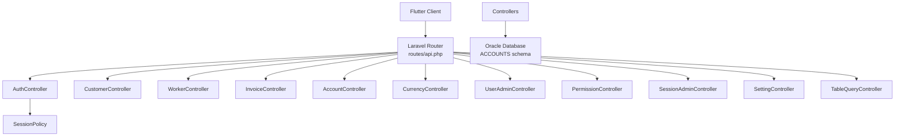
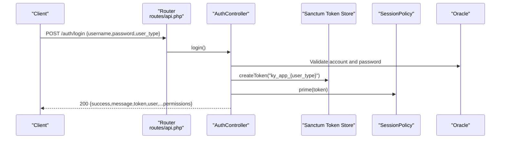
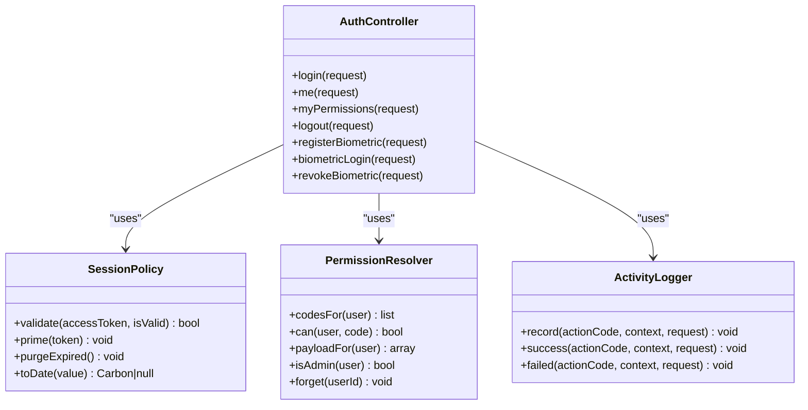

# API Reference

<cite>
**Referenced Files in This Document**
- [api.php](file://kyApp_API/routes/api.php)
- [AuthController.php](file://kyApp_API/app/Http/Controllers/AuthController.php)
- [CustomerController.php](file://kyApp_API/app/Http/Controllers/CustomerController.php)
- [WorkerController.php](file://kyApp_API/app/Http/Controllers/WorkerController.php)
- [AccountController.php](file://kyApp_API/app/Http/Controllers/AccountController.php)
- [InvoiceController.php](file://kyApp_API/app/Http/Controllers/InvoiceController.php)
- [CurrencyController.php](file://kyApp_API/app/Http/Controllers/CurrencyController.php)
- [UserAdminController.php](file://kyApp_API/app/Http/Controllers/UserAdminController.php)
- [PermissionController.php](file://kyApp_API/app/Http/Controllers/PermissionController.php)
- [SessionAdminController.php](file://kyApp_API/app/Http/Controllers/SessionAdminController.php)
- [SettingController.php](file://kyApp_API/app/Http/Controllers/SettingController.php)
- [TableQueryController.php](file://kyApp_API/app/Http/Controllers/TableQueryController.php)
- [sanctum.php](file://kyApp_API/config/sanctum.php)
- [SessionPolicy.php](file://kyApp_API/app/Support/SessionPolicy.php)
- [PermissionResolver.php](file://kyApp_API/app/Support/PermissionResolver.php)
- [ActivityLogger.php](file://kyApp_API/app/Support/ActivityLogger.php)
</cite>

## Table of Contents
1. [Introduction](#introduction)
2. [Project Structure](#project-structure)
3. [Core Components](#core-components)
4. [Architecture Overview](#architecture-overview)
5. [Detailed Component Analysis](#detailed-component-analysis)
6. [Dependency Analysis](#dependency-analysis)
7. [Performance Considerations](#performance-considerations)
8. [Troubleshooting Guide](#troubleshooting-guide)
9. [Conclusion](#conclusion)

## Introduction
This document is the authoritative REST API reference for the Laravel backend used by the Ky Apps Flutter client. It covers authentication, session management, business domains (customers, workers, invoices, accounts, currencies), and administrative functions (users, permissions, sessions, settings). Every endpoint includes its HTTP method, URL pattern, required and optional parameters, response shape, status codes, and error behavior. Security, rate limiting, versioning strategy, and integration guidance are also documented.

The API uses:
- Sanctum personal access tokens for authenticated requests.
- A sliding idle session policy with absolute lifetime.
- An IBAC permission model where every protected route requires both `auth:sanctum` and a module-specific `permission:<code>` middleware.
- Oracle 11g as the data source through the `oracle` database connection.

## Project Structure
The API routes are centralized under `routes/api.php`. Controllers live under `app/Http/Controllers`, supporting services under `app/Support`, and Sanctum configuration under `config/sanctum.php`.



**Diagram sources**
- [api.php:18-356](file://kyApp_API/routes/api.php#L18-L356)
- [AuthController.php:17-41](file://kyApp_API/app/Http/Controllers/AuthController.php#L17-L41)
- [SessionPolicy.php:9-40](file://kyApp_API/app/Support/SessionPolicy.php#L9-L40)

**Section sources**
- [api.php:18-356](file://kyApp_API/routes/api.php#L18-L356)

## Core Components
- Authentication and token lifecycle: login, logout, biometric enrollment/login/revoke, current user profile, and effective permissions.
- Business domains: customers, workers (employees/cutters/tailors), invoices, chart-of-accounts tree and statements, currencies and FX prices.
- Administration: users, permissions catalog and grants, active sessions, security settings, and a highly restricted diagnostic table query.
- Cross-cutting concerns: Sanctum stateful domain configuration, sliding session policy, IBAC permission resolution, and audit logging.

Key behaviors:
- All business endpoints require `auth:sanctum` plus a specific permission code.
- Public endpoints include `/auth/login`, `/auth/biometric/login`, `/app-config`, and `/app-config/verify-api-password`.
- The only explicit rate limiter is on `/app-config/verify-api-password` at 5 requests per minute.
- Versioning is not implemented; clients should rely on stable contract fields and respond to deprecation headers if added later.

**Section sources**
- [api.php:18-356](file://kyApp_API/routes/api.php#L18-L356)
- [sanctum.php:20-63](file://kyApp_API/config/sanctum.php#L20-L63)
- [SessionPolicy.php:9-40](file://kyApp_API/app/Support/SessionPolicy.php#L9-L40)

## Architecture Overview
Authentication flow using Sanctum and the custom session policy:



**Diagram sources**
- [api.php:18-48](file://kyApp_API/routes/api.php#L18-L48)
- [AuthController.php:47-163](file://kyApp_API/app/Http/Controllers/AuthController.php#L47-L163)
- [SessionPolicy.php:110-117](file://kyApp_API/app/Support/SessionPolicy.php#L110-L117)

## Detailed Component Analysis

### Authentication and Session Management

#### POST /auth/login
- Purpose: Authenticate a user and issue a Sanctum token.
- Authentication: None.
- Request body:
  - `username`: string, required. Accepts English username, Arabic name, or numeric USER_ID.
  - `password`: string, required. Supports legacy plain text and hashed values.
  - `user_type`: string, optional. Allowed values: `employee`, `customer`, `1`, `2`.
- Response 200:
  - `success`: boolean
  - `message`: string
  - `token`: string (plain-text Sanctum token)
  - `user`: object containing account fields and IBAC payload (`user_id`, `is_admin`, `permissions`, `modules`)
- Error responses:
  - 422: Validation failure with `errors`.
  - 401: Invalid username/password.
  - 403: Account deactivated.

Example request:
```http
POST /api/auth/login
Content-Type: application/json

{
  "username": "admin",
  "password": "secret",
  "user_type": "employee"
}
```

Example response:
```json
{
  "success": true,
  "message": "Logged in successfully.",
  "token": "1|abc...",
  "user": {
    "id": 1,
    "username": "admin",
    "name_ar": "المدير",
    "name_en": "Admin",
    "user_type": "1",
    "branch_no": null,
    "is_admin": true,
    "permissions": ["system.*"],
    "modules": ["system"]
  }
}
```

**Section sources**
- [api.php:18-23](file://kyApp_API/routes/api.php#L18-L23)
- [AuthController.php:47-163](file://kyApp_API/app/Http/Controllers/AuthController.php#L47-L163)

#### POST /auth/logout
- Purpose: Revoke the current token.
- Authentication: Sanctum bearer token.
- Response 200:
  - `success`: boolean
  - `message`: string

Example request:
```http
POST /api/auth/logout
Authorization: Bearer <token>
```

Example response:
```json
{
  "success": true,
  "message": "Logged out successfully."
}
```

**Section sources**
- [api.php:38-48](file://kyApp_API/routes/api.php#L38-L48)
- [AuthController.php:221-239](file://kyApp_API/app/Http/Controllers/AuthController.php#L221-L239)

#### GET /auth/me
- Purpose: Return the authenticated user’s profile with IBAC state.
- Authentication: Sanctum bearer token.
- Response 200:
  - `success`: boolean
  - `user`: object with account fields and IBAC payload.

**Section sources**
- [api.php:38-48](file://kyApp_API/routes/api.php#L38-L48)
- [AuthController.php:170-179](file://kyApp_API/app/Http/Controllers/AuthController.php#L170-L179)

#### GET /auth/permissions
- Purpose: Load the current user’s effective permissions, modules, admin flag, and session expiry hint.
- Authentication: Sanctum bearer token.
- Response 200:
  - `success`: boolean
  - `message`: string
  - `data`: object including `permissions`, `modules`, `is_admin`, and `session_expires_at`.

**Section sources**
- [api.php:59-62](file://kyApp_API/routes/api.php#L59-L62)
- [AuthController.php:190-215](file://kyApp_API/app/Http/Controllers/AuthController.php#L190-L215)

#### POST /auth/biometric/register
- Purpose: Register a device for biometric login.
- Authentication: Sanctum bearer token.
- Request body:
  - `device_token`: string, required, max 512.
  - `device_name`: string, required, max 200.
  - `platform`: string, required. Allowed values: `android`, `ios`.
- Response 200:
  - `success`: boolean
  - `message`: string
- Errors:
  - 422: Validation failure.
  - 409: Device already bound to another user.

**Section sources**
- [api.php:38-48](file://kyApp_API/routes/api.php#L38-L48)
- [AuthController.php:245-310](file://kyApp_API/app/Http/Controllers/AuthController.php#L245-L310)

#### POST /auth/biometric/login
- Purpose: Authenticate using a registered device fingerprint.
- Authentication: None (public).
- Request body:
  - `user_id`: integer, required.
  - `device_token`: string, required, max 512.
- Response 200:
  - `success`: boolean
  - `message`: string
  - `token`: string
  - `user`: object with account fields and IBAC payload, plus `biometric_enabled: true`
- Errors:
  - 422: Validation failure.
  - 401: Device not registered or mismatched.
  - 403: Biometric login disabled by system setting or account deactivated.

**Section sources**
- [api.php:18-23](file://kyApp_API/routes/api.php#L18-L23)
- [AuthController.php:316-411](file://kyApp_API/app/Http/Controllers/AuthController.php#L316-L411)

#### DELETE /auth/biometric/revoke
- Purpose: Remove biometric enrollment for the current device.
- Authentication: Sanctum bearer token.
- Response 200:
  - `success`: boolean
  - `message`: string

**Section sources**
- [api.php:38-48](file://kyApp_API/routes/api.php#L38-L48)
- [AuthController.php:417-441](file://kyApp_API/app/Http/Controllers/AuthController.php#L417-L441)

#### GET /app-config
- Purpose: Read public application configuration without secrets.
- Authentication: None.
- Response 200: Application configuration object.

**Section sources**
- [api.php:25-36](file://kyApp_API/routes/api.php#L25-L36)

#### POST /app-config/verify-api-password
- Purpose: Verify the API settings password before unlocking sensitive app configuration.
- Authentication: None.
- Rate limit: 5 requests per minute.
- Response 200: Verification result.

**Section sources**
- [api.php:25-36](file://kyApp_API/routes/api.php#L25-L36)

#### Session Policy Behavior
- Sliding idle window controlled by `session_idle_minutes`.
- Absolute lifetime controlled by `session_absolute_days`.
- Touch threshold controls how often the token expiry is updated.
- Deactivated accounts are rejected immediately.
- Expired tokens are deleted best-effort after rejection.

**Section sources**
- [sanctum.php:44-63](file://kyApp_API/config/sanctum.php#L44-L63)
- [SessionPolicy.php:9-40](file://kyApp_API/app/Support/SessionPolicy.php#L9-L40)
- [SessionPolicy.php:70-108](file://kyApp_API/app/Support/SessionPolicy.php#L70-L108)
- [SessionPolicy.php:130-183](file://kyApp_API/app/Support/SessionPolicy.php#L130-L183)

### Customer Management

#### GET /customers
- Purpose: List customers with search, pagination.
- Authentication: Sanctum + `customers.view`.
- Query parameters:
  - `search`: string. Matches customer number, phone, account, or name.
  - `page`: integer, default 1.
  - `limit`: integer, default 100, capped at 500.
- Response 200:
  - `success`: boolean
  - `data`: array of customer records
  - `meta`: `{ total, page, limit, pages }`

#### GET /customers/{custNo}
- Purpose: Get a single customer by CUST_NO.
- Authentication: Sanctum + `customers.view`.
- Path parameter:
  - `custNo`: integer.
- Response 200: Customer record.
- Error 404: Customer not found.

#### POST /customers
- Purpose: Create a new customer.
- Authentication: Sanctum + `customers.create`.
- Request body:
  - `cust_name`: string, required, max 150.
  - Optional: `addr`, `tel1`, `tel2`, `postbox`, `email`, `fax`, `acc_no`, `limited_balance`, `pre_cust_name`, `stopping_cust`.
- Response 201: Created customer number.

#### PUT /customers/{custNo}
- Purpose: Update an existing customer.
- Authentication: Sanctum + `customers.update`.
- Path parameter:
  - `custNo`: integer.
- Request body: Same fields as create.
- Response 200: Success message.
- Error 404: Customer not found.

#### DELETE /customers/{custNo}
- Purpose: Delete a customer.
- Authentication: Sanctum + `customers.delete`.
- Path parameter:
  - `custNo`: integer.
- Response 200: Success message.
- Error 404: Customer not found.

#### GET /customers/{custNo}/statement
- Purpose: Get customer statement with optional date range.
- Authentication: Sanctum + `customers.statement`.
- Path parameter:
  - `custNo`: integer.
- Query parameters:
  - `from_date`: optional date string.
  - `to_date`: optional date string.
- Response 200:
  - `success`: boolean
  - `customer`: object
  - `data`: array of entries
  - `summary`: totals, opening/final balance, dates, currency, account title.

**Section sources**
- [api.php:188-209](file://kyApp_API/routes/api.php#L188-L209)
- [CustomerController.php:28-84](file://kyApp_API/app/Http/Controllers/CustomerController.php#L28-L84)
- [CustomerController.php:90-112](file://kyApp_API/app/Http/Controllers/CustomerController.php#L90-L112)
- [CustomerController.php:118-182](file://kyApp_API/app/Http/Controllers/CustomerController.php#L118-L182)
- [CustomerController.php:188-256](file://kyApp_API/app/Http/Controllers/CustomerController.php#L188-L256)
- [CustomerController.php:262-288](file://kyApp_API/app/Http/Controllers/CustomerController.php#L262-L288)
- [CustomerController.php:294-421](file://kyApp_API/app/Http/Controllers/CustomerController.php#L294-L421)

### Worker Management

#### Workers: Employees, Cutters, Tailors
Each worker type exposes the same operations: list, create, update, delete, toggle status, and statement. Permissions are separate per type.

Common patterns:
- List endpoints support `search`, `page`, `limit` (default 100, cap 500).
- Statement endpoints return entries with debit/credit, running balance, and summary.
- Toggle endpoints flip activation status.

Employee endpoints:
- GET `/workers/employees` — permission: `employees.view`
- POST `/workers/employees` — permission: `employees.create`
- GET `/workers/employees/{id}/statement` — permission: `employees.statement`
- PUT `/workers/employees/{id}` — permission: `employees.update`
- DELETE `/workers/employees/{id}` — permission: `employees.delete`
- PATCH `/workers/employees/{id}/toggle` — permission: `employees.toggle`

Cutter endpoints:
- GET `/workers/cutters` — permission: `cutters.view`
- POST `/workers/cutters` — permission: `cutters.create`
- GET `/workers/cutters/{id}/statement` — permission: `cutters.statement`
- PUT `/workers/cutters/{id}` — permission: `cutters.update`
- DELETE `/workers/cutters/{id}` — permission: `cutters.delete`
- PATCH `/workers/cutters/{id}/toggle` — permission: `cutters.toggle`

Tailor endpoints:
- GET `/workers/tailors` — permission: `tailors.view`
- POST `/workers/tailors` — permission: `tailors.create`
- GET `/workers/tailors/{id}/statement` — permission: `tailors.statement`
- PUT `/workers/tailors/{id}` — permission: `tailors.update`
- DELETE `/workers/tailors/{id}` — permission: `tailors.delete`
- PATCH `/workers/tailors/{id}/toggle` — permission: `tailors.toggle`

Statement response shape:
- `worker`: object with id, name, acc_no, type.
- `data`: array of entries with entry numbers, dates, types, details, balances, debits, credits.
- `summary`: totals, opening/final balance, dates, currency, account title.

**Section sources**
- [api.php:211-273](file://kyApp_API/routes/api.php#L211-L273)
- [WorkerController.php:68-179](file://kyApp_API/app/Http/Controllers/WorkerController.php#L68-L179)
- [WorkerController.php:188-239](file://kyApp_API/app/Http/Controllers/WorkerController.php#L188-L239)
- [WorkerController.php:244-343](file://kyApp_API/app/Http/Controllers/WorkerController.php#L244-L343)
- [WorkerController.php:348-381](file://kyApp_API/app/Http/Controllers/WorkerController.php#L348-L381)
- [WorkerController.php:398-558](file://kyApp_API/app/Http/Controllers/WorkerController.php#L398-L558)

### Accounting Operations

#### Chart of Accounts Tree and Structure
- GET `/accounts/account` — permission: `accounts.view`
- GET `/accounts/main` — permission: `accounts.view`
- GET `/accounts/sub` — permission: `accounts.view`
- GET `/accounts/sub-group` — permission: `accounts.view`
- GET `/accounts/tree` — permission: `accounts.view`

#### Financial Accounts (CHART_ACC)
- GET `/accounts/chart` — permission: `accounts.view`
  - Query params: `search`, `page`, `limit`, `group_id`.
- POST `/accounts/chart` — permission: `accounts.create`
  - Body: `acc_name`, `group_id`, optional `balance`, `limited_balance`.
- PUT `/accounts/chart/{accNo}` — permission: `accounts.update`
  - Path param: `accNo`.
  - Body: optional fields `acc_name`, `balance`, `group_id`, `limited_balance`, `stopping_acc`.

#### Sub-groups
- POST `/accounts/sub-group` — permission: `accounts.structure_manage`
  - Body: `acc_group_name`, `acc_part`.
- PUT `/accounts/sub-group/{groupId}` — permission: `accounts.structure_manage`
  - Path param: `groupId`.
  - Body: optional `acc_group_name`, `acc_part`.

#### Statements
- GET `/accounts/chart/{accNo}/statement` — permission: `accounts.statement`
  - Path param: `accNo`.
  - Query params: `from_date`, `to_date`, `page`, `limit`.
- GET `/accounts/statement-detail` — permission: `accounts.statement`
  - Query params: `type` (account|main|sub|group), `id`, `from_date`, `to_date`, `cur_no`, `page`, `limit`.

**Section sources**
- [api.php:275-321](file://kyApp_API/routes/api.php#L275-L321)
- [AccountController.php:27-50](file://kyApp_API/app/Http/Controllers/AccountController.php#L27-L50)
- [AccountController.php:52-84](file://kyApp_API/app/Http/Controllers/AccountController.php#L52-L84)
- [AccountController.php:86-118](file://kyApp_API/app/Http/Controllers/AccountController.php#L86-L118)
- [AccountController.php:120-150](file://kyApp_API/app/Http/Controllers/AccountController.php#L120-L150)
- [AccountController.php:156-243](file://kyApp_API/app/Http/Controllers/AccountController.php#L156-L243)
- [AccountController.php:245-304](file://kyApp_API/app/Http/Controllers/AccountController.php#L245-L304)
- [AccountController.php:306-352](file://kyApp_API/app/Http/Controllers/AccountController.php#L306-L352)
- [AccountController.php:354-392](file://kyApp_API/app/Http/Controllers/AccountController.php#L354-L392)
- [AccountController.php:394-428](file://kyApp_API/app/Http/Controllers/AccountController.php#L394-L428)
- [AccountController.php:434-540](file://kyApp_API/app/Http/Controllers/AccountController.php#L434-L540)
- [AccountController.php:542-640](file://kyApp_API/app/Http/Controllers/AccountController.php#L542-L640)
- [AccountController.php:646-800](file://kyApp_API/app/Http/Controllers/AccountController.php#L646-L800)

### Invoices

#### GET /invoices
- Purpose: List invoices with search and pagination.
- Authentication: Sanctum + `invoices.view`.
- Query parameters:
  - `search`: string. Matches bill number or customer name.
  - `page`: integer, default 1.
  - `limit`: integer, default 100, capped at 500.
- Response 200:
  - `success`: boolean
  - `message`: string
  - `data`: array of invoice records
  - `meta`: `{ total, page, limit, pages }`

#### GET /invoices/{billNo}
- Purpose: Get a single invoice by BILL_NO.
- Authentication: Sanctum + `invoices.view`.
- Path parameter:
  - `billNo`: integer.
- Response 200: Invoice record.
- Error 404: Invoice not found.

**Section sources**
- [api.php:165-172](file://kyApp_API/routes/api.php#L165-L172)
- [InvoiceController.php:51-104](file://kyApp_API/app/Http/Controllers/InvoiceController.php#L51-L104)
- [InvoiceController.php:110-138](file://kyApp_API/app/Http/Controllers/InvoiceController.php#L110-L138)

### Currencies and Exchange Rates

#### Currencies
- GET `/currencies` — permission: `currencies.view`
- POST `/currencies` — permission: `currencies.create`
  - Body: `cur_name`, `code`, `main_cur_name`, `sub_cur_name`.
- PUT `/currencies/{curNo}` — permission: `currencies.update`
  - Path param: `curNo`.
  - Body: optional `cur_name`, `code`, `main_cur_name`, `sub_cur_name`.
- DELETE `/currencies/{curNo}` — permission: `currencies.delete`
  - Path param: `curNo`.

#### Currency Prices
- GET `/currencies/{curNo}/prices` — permission: `currencies.prices_view`
  - Path param: `curNo`.
  - Query params: `page`, `limit`.
- POST `/currencies/{curNo}/prices` — permission: `currencies.prices_manage`
  - Path param: `curNo`.
  - Body: `price`, `day_date` (YYYY-MM-DD).
- PUT `/currencies/{curNo}/prices/{seq}` — permission: `currencies.prices_manage`
  - Path params: `curNo`, `seq`.
  - Body: `price`, `day_date` (YYYY-MM-DD).
- DELETE `/currencies/{curNo}/prices/{seq}` — permission: `currencies.prices_manage`
  - Path params: `curNo`, `seq`.

**Section sources**
- [api.php:323-356](file://kyApp_API/routes/api.php#L323-L356)
- [CurrencyController.php:25-94](file://kyApp_API/app/Http/Controllers/CurrencyController.php#L25-L94)
- [CurrencyController.php:100-145](file://kyApp_API/app/Http/Controllers/CurrencyController.php#L100-L145)
- [CurrencyController.php:151-193](file://kyApp_API/app/Http/Controllers/CurrencyController.php#L151-L193)
- [CurrencyController.php:199-216](file://kyApp_API/app/Http/Controllers/CurrencyController.php#L199-L216)
- [CurrencyController.php:223-293](file://kyApp_API/app/Http/Controllers/CurrencyController.php#L223-L293)
- [CurrencyController.php:299-338](file://kyApp_API/app/Http/Controllers/CurrencyController.php#L299-L338)
- [CurrencyController.php:344-377](file://kyApp_API/app/Http/Controllers/CurrencyController.php#L344-L377)
- [CurrencyController.php:383-400](file://kyApp_API/app/Http/Controllers/CurrencyController.php#L383-L400)

### Administrative Functions

#### Users
- GET `/users` — permission: `users.view`
  - Query params: `status`, `user_type`, `admin_only`, `search`, `sort`, `direction`, `page`, `limit`.
- GET `/users/{userId}` — permission: `users.view`
- POST `/users` — permission: `users.create`
  - Body: `user_name_en`, `user_name_ar`, `user_password`, `user_type`, `is_activated`, `is_admin`, `branch_no`, `note`, `cash_acc_no`, `allow_bank_acc`, `permissions`.
- PUT `/users/{userId}` — permission: `users.update`
  - Path param: `userId`.
  - Body: optional fields similar to create; permissions replaced when sent.
- PATCH `/users/{userId}/toggle` — permission: `users.toggle`
  - Path param: `userId`.
- DELETE `/users/{userId}` — permission: `users.delete`
  - Path param: `userId`.
- GET `/users/{userId}/activity` — permission: `users.activity_view`
  - Path param: `userId`.
  - Query params: `page`, `limit`.

Security constraints:
- No self-delete, no self-deactivation, cannot demote/delete the last admin.
- Non-admins cannot grant what they do not hold nor set admin flag.

**Section sources**
- [api.php:50-102](file://kyApp_API/routes/api.php#L50-L102)
- [UserAdminController.php:104-148](file://kyApp_API/app/Http/Controllers/UserAdminController.php#L104-L148)
- [UserAdminController.php:150-182](file://kyApp_API/app/Http/Controllers/UserAdminController.php#L150-L182)
- [UserAdminController.php:184-312](file://kyApp_API/app/Http/Controllers/UserAdminController.php#L184-L312)
- [UserAdminController.php:314-496](file://kyApp_API/app/Http/Controllers/UserAdminController.php#L314-L496)
- [UserAdminController.php:498-560](file://kyApp_API/app/Http/Controllers/UserAdminController.php#L498-L560)
- [UserAdminController.php:562-626](file://kyApp_API/app/Http/Controllers/UserAdminController.php#L562-L626)
- [UserAdminController.php:628-679](file://kyApp_API/app/Http/Controllers/UserAdminController.php#L628-L679)

#### Permissions Catalog and Grants
- GET `/permissions` — permission: `users.view`
  - Returns grouped permission catalog with ids and names.
- GET `/users/{userId}/permissions` — permission: `users.view`
  - Returns user’s effective permissions, granted codes/ids, and admin state.
- PUT `/users/{userId}/permissions` — permission: `users.permissions_manage`
  - Body: `permissions` (array of codes), optional `logout_others` (boolean).
  - Replaces all grants atomically; may terminate sessions.

**Section sources**
- [api.php:64-74](file://kyApp_API/routes/api.php#L64-L74)
- [PermissionController.php:44-93](file://kyApp_API/app/Http/Controllers/PermissionController.php#L44-L93)
- [PermissionController.php:95-128](file://kyApp_API/app/Http/Controllers/PermissionController.php#L95-L128)
- [PermissionController.php:130-243](file://kyApp_API/app/Http/Controllers/PermissionController.php#L130-L243)

#### Active Sessions
- GET `/sessions` — permission: `sessions.view`
  - Query params: `user_id`, `status`, `search`, `page`, `limit`.
- DELETE `/sessions/user/{userId}` — permission: `sessions.terminate`
  - Terminates all sessions for a user.
- DELETE `/sessions/{tokenId}` — permission: `sessions.terminate`
  - Terminates a single session by token id.

Response includes readable names, status labels, minutes left, and “this device” indicator.

**Section sources**
- [api.php:104-130](file://kyApp_API/routes/api.php#L104-L130)
- [SessionAdminController.php:84-141](file://kyApp_API/app/Http/Controllers/SessionAdminController.php#L84-L141)
- [SessionAdminController.php:143-182](file://kyApp_API/app/Http/Controllers/SessionAdminController.php#L143-L182)
- [SessionAdminController.php:184-233](file://kyApp_API/app/Http/Controllers/SessionAdminController.php#L184-L233)
- [SessionAdminController.php:239-314](file://kyApp_API/app/Http/Controllers/SessionAdminController.php#L239-L314)
- [SessionAdminController.php:336-417](file://kyApp_API/app/Http/Controllers/SessionAdminController.php#L336-L417)

#### Security Settings
- GET `/settings` — permission: `settings.view`
  - Returns all security settings with labels, types, bounds, lockable flags, and audit metadata.
- PUT `/settings` — permission: `settings.update`
  - Body: `items` array of `{ key, value }`.
  - Locked keys require `settings.security_manage`.
  - Batch save is transactional; returns changed items.

**Section sources**
- [api.php:113-130](file://kyApp_API/routes/api.php#L113-L130)
- [SettingController.php:39-91](file://kyApp_API/app/Http/Controllers/SettingController.php#L39-L91)
- [SettingController.php:93-230](file://kyApp_API/app/Http/Controllers/SettingController.php#L93-L230)

#### Diagnostic Table Query
- Route: `GET|POST /selectFromTable`
- Authentication: Sanctum + `system.*`.
- Request body/query:
  - `table_name` (or aliases): alphanumeric table name, max 30.
  - `limit` (or aliases): integer, min 1, max 1000.
- Denial rules:
  - Denied tables include credentials, sessions, cache, migrations, jobs, and internal tables.
  - Sensitive columns like passwords, tokens, secrets, and keys are stripped from results.
- Response 200:
  - `success`: boolean
  - `table`: string
  - `count`: integer
  - `limit`: integer
  - `redacted_columns`: array of column names removed
  - `data`: array of rows

**Section sources**
- [api.php:174-185](file://kyApp_API/routes/api.php#L174-L185)
- [TableQueryController.php:65-171](file://kyApp_API/app/Http/Controllers/TableQueryController.php#L65-L171)
- [TableQueryController.php:173-213](file://kyApp_API/app/Http/Controllers/TableQueryController.php#L173-L213)

### App Configuration Writing
- PUT `/app-config` — permission: `app_config.update`
- PUT `/app-config/api-password` — permission: `app_config.api_manage`

These endpoints manage branding and the locked API settings password separately.

**Section sources**
- [api.php:132-146](file://kyApp_API/routes/api.php#L132-L146)

## Dependency Analysis
The API relies on three core support layers:
- Sanctum for token issuance and storage.
- SessionPolicy for sliding idle expiry and absolute lifetime enforcement.
- PermissionResolver for IBAC evaluation with caching and wildcard logic.



**Diagram sources**
- [AuthController.php:17-41](file://kyApp_API/app/Http/Controllers/AuthController.php#L17-L41)
- [SessionPolicy.php:9-40](file://kyApp_API/app/Support/SessionPolicy.php#L9-L40)
- [PermissionResolver.php:9-26](file://kyApp_API/app/Support/PermissionResolver.php#L9-L26)
- [ActivityLogger.php:9-17](file://kyApp_API/app/Support/ActivityLogger.php#L9-L17)

**Section sources**
- [AuthController.php:17-41](file://kyApp_API/app/Http/Controllers/AuthController.php#L17-L41)
- [SessionPolicy.php:9-40](file://kyApp_API/app/Support/SessionPolicy.php#L9-L40)
- [PermissionResolver.php:9-26](file://kyApp_API/app/Support/PermissionResolver.php#L9-L26)
- [ActivityLogger.php:9-17](file://kyApp_API/app/Support/ActivityLogger.php#L9-L17)

## Performance Considerations
- Pagination: Most list endpoints enforce default and maximum limits to avoid large payloads.
- Oracle compatibility: Queries use ROWNUM-based pagination compatible with Oracle 11g.
- Permission caching: Effective permissions are cached per user with a TTL and size guard to avoid oversized cache writes.
- Session updates: Sliding renewal is write-throttled via a touch threshold to reduce database writes.
- Audit logging: Activity writes are best-effort and never fail successful requests.

Recommendations:
- Use pagination consistently and avoid requesting excessive limits.
- Cache permission payloads on the client side and refresh after permission changes.
- Avoid frequent calls to expensive statement endpoints; batch UI updates.

**Section sources**
- [CustomerController.php:20-23](file://kyApp_API/app/Http/Controllers/CustomerController.php#L20-L23)
- [WorkerController.php:61-62](file://kyApp_API/app/Http/Controllers/WorkerController.php#L61-L62)
- [PermissionResolver.php:29-43](file://kyApp_API/app/Support/PermissionResolver.php#L29-L43)
- [SessionPolicy.php:157-183](file://kyApp_API/app/Support/SessionPolicy.php#L157-L183)
- [ActivityLogger.php:13-17](file://kyApp_API/app/Support/ActivityLogger.php#L13-L17)

## Troubleshooting Guide

Common errors and handling:
- 401 Unauthorized: Missing or invalid token, deactivated account, expired idle/absolute session.
  - Action: Clear stored token, redirect to login, then re-authenticate.
- 403 Forbidden: Insufficient permission or locked operation.
  - Action: Check user permissions; ensure required grant exists.
- 404 Not Found: Resource does not exist.
  - Action: Verify identifiers and existence.
- 422 Unprocessable Entity: Validation failure.
  - Action: Inspect `errors` in response and correct request body.
- 500 Internal Server Error: Database or unexpected error.
  - Action: Check server logs; debug mode may expose details.

Debugging techniques:
- Use `/hello` to verify connectivity.
- Use `/auth/permissions` to inspect effective permissions and modules.
- Use `/sessions` to identify active devices and expirations.
- Use `/users/{userId}/activity` to review audit trail.

Security headers and environment:
- Sanctum stateful domains are configured via `SANCTUM_STATEFUL_DOMAINS`; ensure your frontend host is included.
- CSRF and cookie encryption middleware are available for SPA flows.

**Section sources**
- [sanctum.php:20-26](file://kyApp_API/config/sanctum.php#L20-L26)
- [sanctum.php:95-109](file://kyApp_API/config/sanctum.php#L95-L109)
- [api.php:148-152](file://kyApp_API/routes/api.php#L148-L152)
- [AuthController.php:47-163](file://kyApp_API/app/Http/Controllers/AuthController.php#L47-L163)
- [SessionPolicy.php:70-108](file://kyApp_API/app/Support/SessionPolicy.php#L70-L108)

## Conclusion
The Ky Apps API provides a secure, permission-gated REST surface for customer, worker, invoice, accounting, currency, and administrative operations. Authentication uses Sanctum tokens with a sliding idle session policy, while authorization follows an IBAC model enforced per route. Clients should handle standard HTTP status codes, respect rate limits, and implement robust error handling and session recovery. For integrations, start with login, fetch permissions, and then call business endpoints according to the granted permissions.