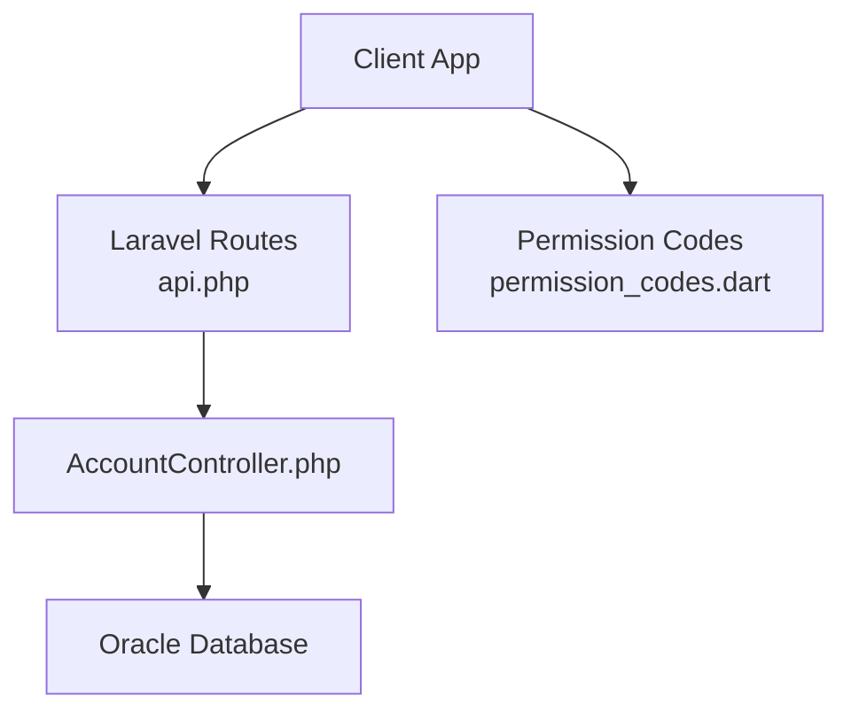
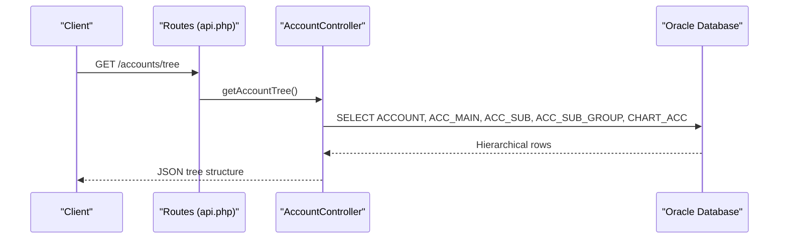
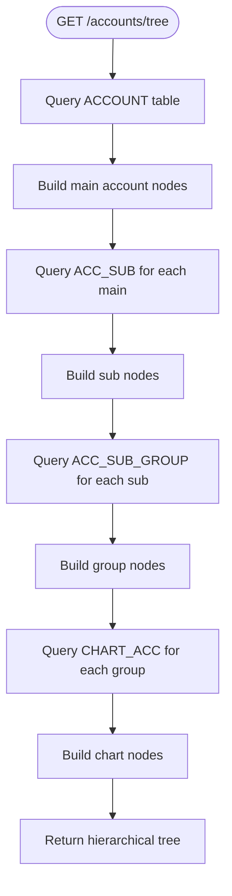
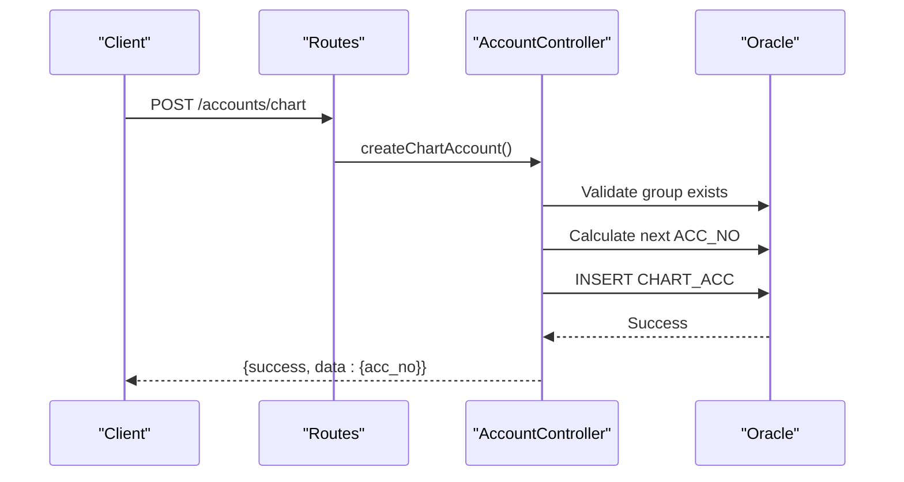
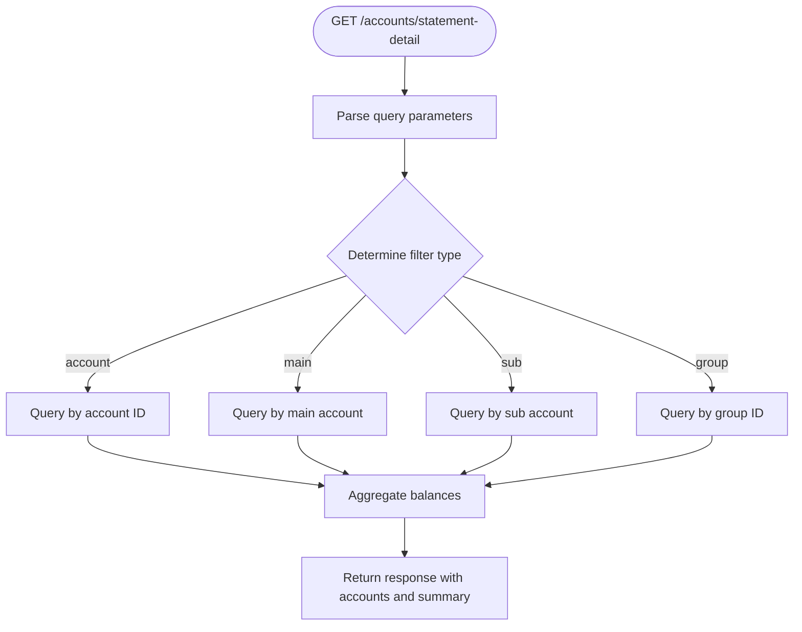
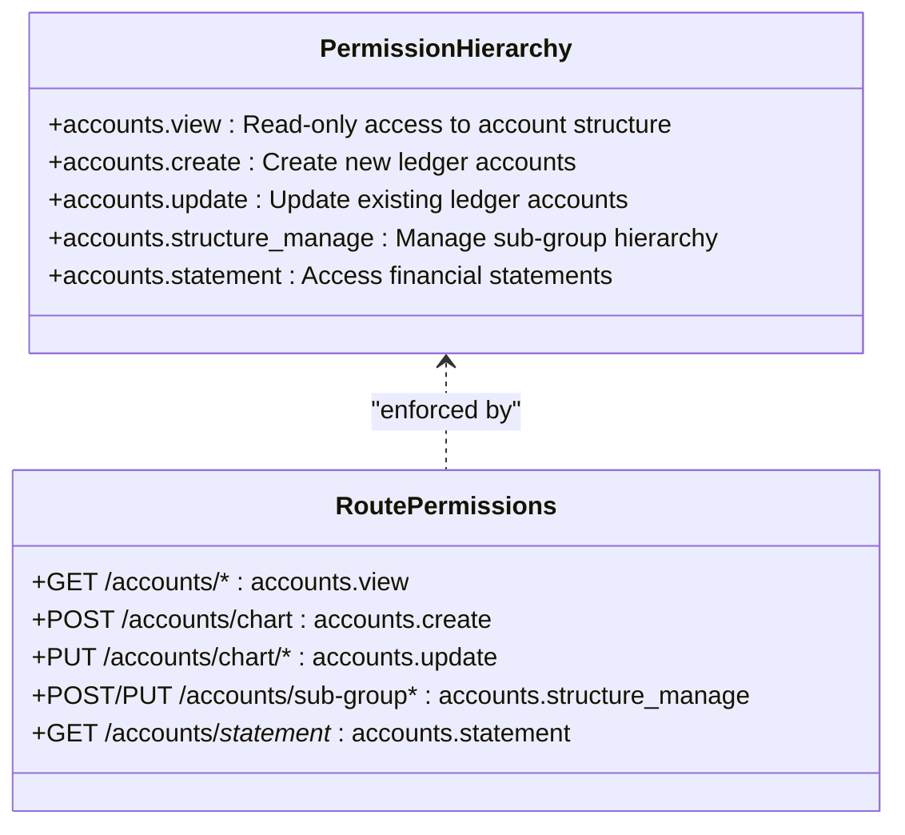
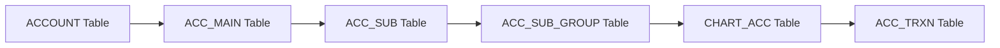

# Accounting API

<cite>
**Referenced Files in This Document**
- [AccountController.php](file://kyApp_API/app/Http/Controllers/AccountController.php)
- [api.php](file://kyApp_API/routes/api.php)
- [permission_codes.dart](file://lib/core/constants/permission_codes.dart)
</cite>

## Table of Contents
1. [Introduction](#introduction)
2. [Project Structure](#project-structure)
3. [Core Components](#core-components)
4. [Architecture Overview](#architecture-overview)
5. [Detailed Component Analysis](#detailed-component-analysis)
6. [Dependency Analysis](#dependency-analysis)
7. [Performance Considerations](#performance-considerations)
8. [Troubleshooting Guide](#troubleshooting-guide)
9. [Conclusion](#conclusion)

## Introduction
This document provides detailed API documentation for the accounting and financial management endpoints. It covers:
- Chart of accounts tree structure retrieval
- Ledger account management
- Sub-group management
- Financial statement generation
- Permission hierarchy
- Complex nested data structures
- Financial calculations and reporting formats
- Examples of hierarchical navigation, balance aggregation, and statement workflows

The backend is a Laravel application that connects directly to an Oracle database. The frontend client uses Dio HTTP calls to consume these endpoints.

## Project Structure
The accounting functionality is implemented in a dedicated controller and exposed through route definitions. Permissions are enforced at the route level using a permission middleware pattern.

**Diagram sources**
- [api.php:245-291](file://kyApp_API/routes/api.php#L245-L291)
- [AccountController.php:10-20](file://kyApp_API/app/Http/Controllers/AccountController.php#L10-L20)
- [permission_codes.dart:75-84](file://lib/core/constants/permission_codes.dart#L75-L84)

**Section sources**
- [api.php:245-291](file://kyApp_API/routes/api.php#L245-L291)
- [AccountController.php:10-20](file://kyApp_API/app/Http/Controllers/AccountController.php#L10-L20)
- [permission_codes.dart:75-84](file://lib/core/constants/permission_codes.dart#L75-L84)

## Core Components
- AccountController: Implements all accounting endpoints including tree retrieval, chart-of-accounts CRUD, sub-group management, and statement generation.
- Route definitions: Define HTTP methods, paths, parameters, and required permissions.
- Permission codes: Define the permission constants used by the system.

Key responsibilities:
- Tree endpoints return hierarchical account structures with levels and children.
- Chart endpoints support search, pagination, creation, and updates.
- Statement endpoints provide transactional details and aggregated summaries.
- All endpoints enforce authentication and role-based access control.

**Section sources**
- [AccountController.php:27-808](file://kyApp_API/app/Http/Controllers/AccountController.php#L27-L808)
- [api.php:245-291](file://kyApp_API/routes/api.php#L245-L291)
- [permission_codes.dart:75-84](file://lib/core/constants/permission_codes.dart#L75-L84)

## Architecture Overview
The accounting API follows a layered architecture:
- Client layer sends authenticated requests with appropriate permissions.
- Route layer validates permissions and maps routes to controller methods.
- Controller layer processes business logic, queries Oracle, and returns JSON responses.
- Database layer stores account hierarchies, ledger entries, and transactions.

**Diagram sources**
- [api.php:257-266](file://kyApp_API/routes/api.php#L257-L266)
- [AccountController.php:647-808](file://kyApp_API/app/Http/Controllers/AccountController.php#L647-L808)

## Detailed Component Analysis

### Chart of Accounts Tree Endpoints
These endpoints retrieve hierarchical account structures:

#### GET /accounts/account
- Purpose: Retrieve all main account sections
- Permission: accounts.view
- Response: Array of main accounts with acc_no, acc_name, balance, cur_no

#### GET /accounts/main
- Purpose: Retrieve secondary accounts with optional filter by main account
- Permission: accounts.view
- Query Parameters: acc_no (optional)
- Response: Array of secondary accounts with acc_no, acc_sub, sub_name, balance, cur_no

#### GET /accounts/sub
- Purpose: Retrieve tertiary accounts with optional filter by secondary account
- Permission: accounts.view
- Query Parameters: acc_sub (optional)
- Response: Array of tertiary accounts with acc_sub, acc_part, part_name, balance, cur_no

#### GET /accounts/sub-group
- Purpose: Retrieve account sub-groups with optional filter by tertiary account
- Permission: accounts.view
- Query Parameters: acc_part (optional)
- Response: Array of sub-groups with group_id, acc_part, acc_group_name

#### GET /accounts/tree
- Purpose: Retrieve complete hierarchical tree structure
- Permission: accounts.view
- Response: Nested tree with levels: account → main → sub → group → chart

**Diagram sources**
- [AccountController.php:647-808](file://kyApp_API/app/Http/Controllers/AccountController.php#L647-L808)

**Section sources**
- [AccountController.php:27-150](file://kyApp_API/app/Http/Controllers/AccountController.php#L27-L150)
- [AccountController.php:647-808](file://kyApp_API/app/Http/Controllers/AccountController.php#L647-L808)
- [api.php:257-266](file://kyApp_API/routes/api.php#L257-L266)

### Ledger Account Management (CHART_ACC)

#### GET /accounts/chart
- Purpose: Retrieve financial accounts with search and pagination
- Permission: accounts.view
- Query Parameters:
  - search: Text search across account name and number
  - page: Page number (default: 1)
  - limit: Items per page (default: 50, max: 100)
  - group_id: Filter by group ID
- Response: Paginated array with meta information including total, page, limit, total_pages, has_more

#### POST /accounts/chart
- Purpose: Create new financial account
- Permission: accounts.create
- Request Body:
  - acc_name: Required string (max 150 chars)
  - group_id: Required integer
  - balance: Optional numeric (default: 0)
  - limited_balance: Optional numeric (default: 0)
- Response: Created account with generated acc_no

#### PUT /accounts/chart/{accNo}
- Purpose: Update existing financial account
- Permission: accounts.update
- Path Parameter: accNo (numeric)
- Request Body Fields:
  - acc_name: Account name
  - balance: Account balance
  - group_id: Group assignment
  - limited_balance: Limited balance amount
  - stopping_acc: Stop flag
- Response: Success message

**Diagram sources**
- [AccountController.php:246-304](file://kyApp_API/app/Http/Controllers/AccountController.php#L246-L304)
- [api.php:271-275](file://kyApp_API/routes/api.php#L271-L275)

**Section sources**
- [AccountController.php:156-352](file://kyApp_API/app/Http/Controllers/AccountController.php#L156-L352)
- [api.php:268-275](file://kyApp_API/routes/api.php#L268-L275)

### Sub-Group Management

#### POST /accounts/sub-group
- Purpose: Create new account sub-group
- Permission: accounts.structure_manage
- Request Body:
  - acc_group_name: Required string (max 100 chars)
  - acc_part: Required integer (tertiary account reference)
- Response: Created group with generated group_id

#### PUT /accounts/sub-group/{groupId}
- Purpose: Update existing sub-group
- Permission: accounts.structure_manage
- Path Parameter: groupId (numeric)
- Request Body Fields:
  - acc_group_name: Group name
  - acc_part: Tertiary account reference
- Response: Success message

**Section sources**
- [AccountController.php:354-428](file://kyApp_API/app/Http/Controllers/AccountController.php#L354-L428)
- [api.php:277-283](file://kyApp_API/routes/api.php#L277-L283)

### Statement Generation

#### GET /accounts/chart/{accNo}/statement
- Purpose: Generate detailed statement for specific financial account
- Permission: accounts.statement
- Path Parameter: accNo (numeric)
- Query Parameters:
  - from_date: Start date (DD/MM/YYYY format)
  - to_date: End date (DD/MM/YYYY format)
  - page: Page number (default: 1)
  - limit: Items per page (default: 50, max: 200)
- Response: Account details, transactions array, summary with current_balance and total_records

#### GET /accounts/statement-detail
- Purpose: Generate detailed statement with advanced filtering options
- Permission: accounts.statement
- Query Parameters:
  - type: Filter type (account|main|sub|group)
  - id: Identifier based on type
  - from_date: Start date (DD/MM/YYYY format)
  - to_date: End date (DD/MM/YYYY format)
  - cur_no: Currency filter
  - page: Page number (default: 1)
  - limit: Items per page (default: 50, max: 200)
- Response: Accounts array, total_count, summary with total_balance, total_debit, total_credit

**Diagram sources**
- [AccountController.php:542-640](file://kyApp_API/app/Http/Controllers/AccountController.php#L542-L640)

**Section sources**
- [AccountController.php:434-640](file://kyApp_API/app/Http/Controllers/AccountController.php#L434-L640)
- [api.php:285-290](file://kyApp_API/routes/api.php#L285-L290)

## Dependency Analysis

### Permission Hierarchy
The accounting module implements a granular permission system:

**Diagram sources**
- [permission_codes.dart:75-84](file://lib/core/constants/permission_codes.dart#L75-L84)
- [api.php:257-290](file://kyApp_API/routes/api.php#L257-L290)

### Data Flow Dependencies

**Diagram sources**
- [AccountController.php:14-20](file://kyApp_API/app/Http/Controllers/AccountController.php#L14-L20)

**Section sources**
- [permission_codes.dart:75-84](file://lib/core/constants/permission_codes.dart#L75-L84)
- [api.php:257-290](file://kyApp_API/routes/api.php#L257-L290)
- [AccountController.php:14-20](file://kyApp_API/app/Http/Controllers/AccountController.php#L14-L20)

## Performance Considerations
- Pagination: All list endpoints implement Oracle-compatible pagination using ROWNUM for optimal performance
- Search Optimization: Full-text search uses multiple LIKE conditions for Arabic and English text
- Database Connections: Direct Oracle connections are used throughout for maximum performance
- Error Handling: Comprehensive try-catch blocks prevent application crashes and provide meaningful error messages
- Data Transformation: Efficient array mapping transforms database results to consistent JSON structures

## Troubleshooting Guide

### Common Issues and Solutions

#### Permission Denied Errors
- **Issue**: 403 Forbidden responses when accessing accounting endpoints
- **Solution**: Ensure user has appropriate permission grants (accounts.view, accounts.create, etc.)
- **Check**: Verify permission assignments in the user management system

#### Database Connection Issues
- **Issue**: Oracle connection failures or timeout errors
- **Solution**: Check Oracle database connectivity and credentials configuration
- **Monitor**: Review application logs for database connection errors

#### Data Encoding Problems
- **Issue**: Incorrect display of Arabic characters in responses
- **Solution**: The system automatically handles encoding conversion using ArabicEncoding utilities
- **Verify**: Ensure proper UTF-8 configuration in client applications

#### Statement Generation Failures
- **Issue**: Missing transaction data or empty statements
- **Solution**: Verify ACC_TRXN table existence and data integrity
- **Check**: Confirm date range parameters are correctly formatted (DD/MM/YYYY)

**Section sources**
- [AccountController.php:47-49](file://kyApp_API/app/Http/Controllers/AccountController.php#L47-L49)
- [AccountController.php:507-509](file://kyApp_API/app/Http/Controllers/AccountController.php#L507-L509)

## Conclusion
The Accounting API provides comprehensive financial management capabilities with robust security, efficient data handling, and flexible reporting options. The modular design allows for easy maintenance and extension while maintaining strict access controls and data integrity. The system supports complex hierarchical account structures, real-time balance calculations, and detailed financial statement generation suitable for enterprise-level accounting requirements.