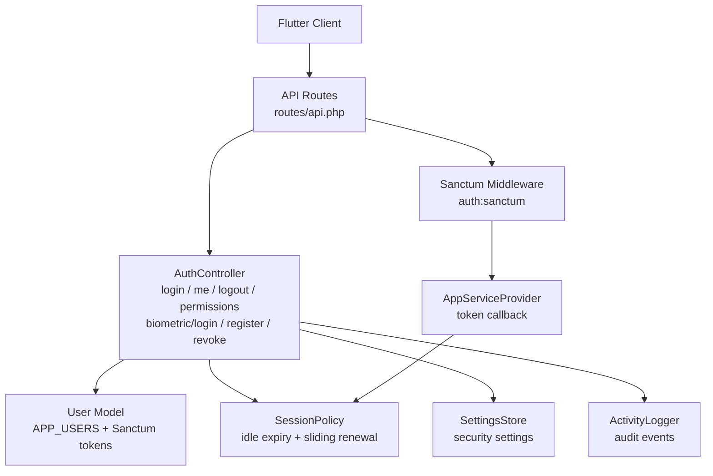
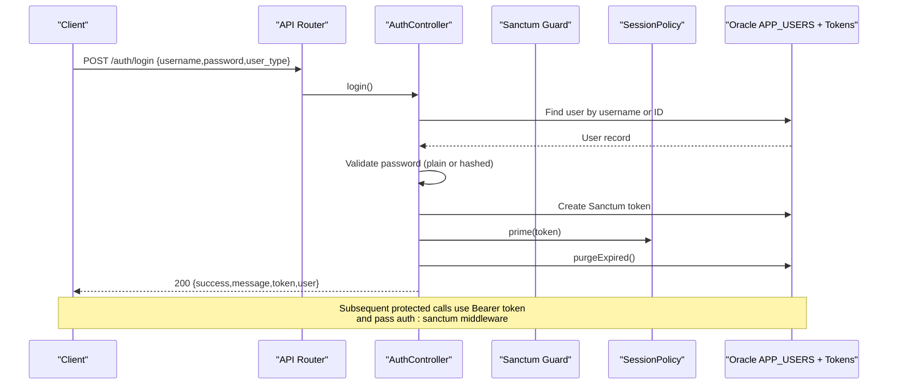
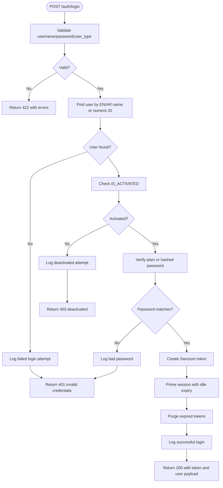
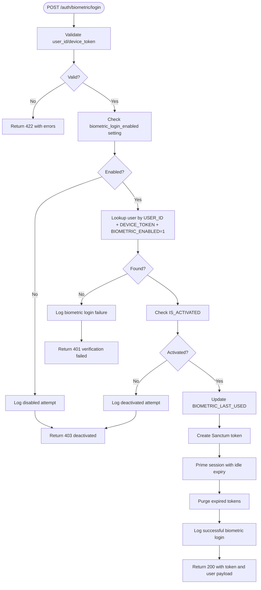
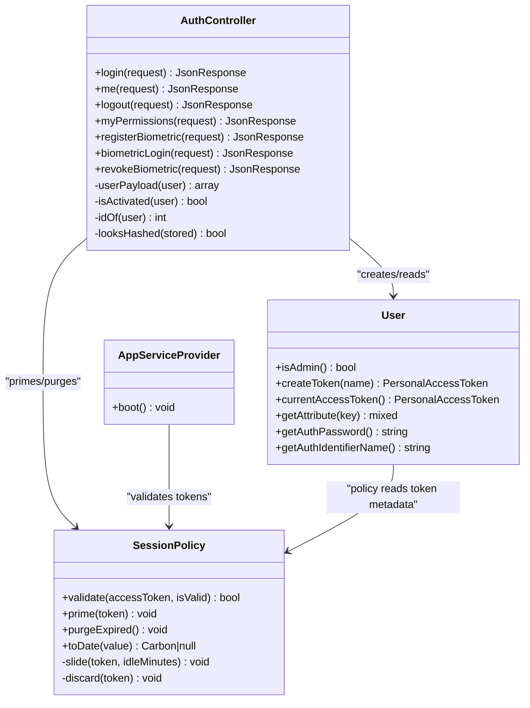

# Authentication API

<cite>
**Referenced Files in This Document**
- [api.php](file://kyApp_API/routes/api.php)
- [AuthController.php](file://kyApp_API/app/Http/Controllers/AuthController.php)
- [sanctum.php](file://kyApp_API/config/sanctum.php)
- [session.php](file://kyApp_API/config/session.php)
- [SessionPolicy.php](file://kyApp_API/app/Support/SessionPolicy.php)
- [User.php](file://kyApp_API/app/Models/User.php)
- [AppServiceProvider.php](file://kyApp_API/app/Providers/AppServiceProvider.php)
</cite>

## Table of Contents
1. [Introduction](#introduction)
2. [Project Structure](#project-structure)
3. [Core Components](#core-components)
4. [Architecture Overview](#architecture-overview)
5. [Detailed Component Analysis](#detailed-component-analysis)
6. [Dependency Analysis](#dependency-analysis)
7. [Performance Considerations](#performance-considerations)
8. [Troubleshooting Guide](#troubleshooting-guide)
9. [Conclusion](#conclusion)

## Introduction
This document describes the authentication API surface exposed by the Laravel backend for the Flutter application. It covers:

- Password-based login
- Biometric login using a device-bound token
- Logout and current user info retrieval
- Permission retrieval endpoint
- Sanctum middleware behavior, session lifecycle, and security posture
- Practical flows for token management, session handling, and biometric registration/revoke operations

The API uses Laravel Sanctum personal access tokens for authenticated requests and applies a custom session policy that enforces idle expiry, absolute age limits, and account activation checks.

## Project Structure
The authentication endpoints are defined in the API routes file and implemented in `AuthController`. Session validation is extended through `SessionPolicy`, which is hooked into Sanctum via `AppServiceProvider`. Configuration for Sanctum and sessions lives under `config/`.

**Diagram sources**
- [api.php:19-34](file://kyApp_API/routes/api.php#L19-L34)
- [AuthController.php:47-440](file://kyApp_API/app/Http/Controllers/AuthController.php#L47-L440)
- [SessionPolicy.php:42-183](file://kyApp_API/app/Support/SessionPolicy.php#L42-L183)
- [AppServiceProvider.php:51-62](file://kyApp_API/app/Providers/AppServiceProvider.php#L51-L62)

**Section sources**
- [api.php:19-34](file://kyApp_API/routes/api.php#L19-L34)
- [AuthController.php:47-440](file://kyApp_API/app/Http/Controllers/AuthController.php#L47-L440)
- [SessionPolicy.php:42-183](file://kyApp_API/app/Support/SessionPolicy.php#L42-L183)
- [AppServiceProvider.php:51-62](file://kyApp_API/app/Providers/AppServiceProvider.php#L51-L62)

## Core Components
- **Authentication controller**: Implements password login, biometric login, logout, current user profile, permission retrieval, and biometric enrollment/revoke.
- **Sanctum configuration**: Defines stateful domains, guards, expiration policy, last-used tracking, token prefix, and middleware aliases.
- **Session policy**: Validates tokens against account status, idle expiry, absolute age, and performs write-throttled sliding renewal.
- **User model**: Maps to Oracle’s `APP_USERS` table, supports Sanctum tokens, hides sensitive fields, and provides admin and activation helpers.
- **Service provider**: Hooks `SessionPolicy` into Sanctum’s token validation pipeline.

**Section sources**
- [AuthController.php:47-440](file://kyApp_API/app/Http/Controllers/AuthController.php#L47-L440)
- [sanctum.php:21-109](file://kyApp_API/config/sanctum.php#L21-L109)
- [SessionPolicy.php:42-183](file://kyApp_API/app/Support/SessionPolicy.php#L42-L183)
- [User.php:10-166](file://kyApp_API/app/Models/User.php#L10-L166)
- [AppServiceProvider.php:51-62](file://kyApp_API/app/Providers/AppServiceProvider.php#L51-L62)

## Architecture Overview
The authentication flow combines route-level middleware with controller logic and a custom session policy:

**Diagram sources**
- [api.php:19-34](file://kyApp_API/routes/api.php#L19-L34)
- [AuthController.php:47-163](file://kyApp_API/app/Http/Controllers/AuthController.php#L47-L163)
- [SessionPolicy.php:114-117](file://kyApp_API/app/Support/SessionPolicy.php#L114-L117)

## Detailed Component Analysis

### Login Endpoint
- **Method**: `POST`
- **Path**: `/auth/login`
- **Authentication**: None (public)
- **Request schema**:
  - `username`: string, required, max 50 characters
  - `password`: string, required
  - `user_type`: optional string; allowed values include `employee`, `customer`, `1`, `2`
- **Response schema**:
  - Success (`200`):
    - `success`: boolean
    - `message`: string
    - `token`: string (Sanctum personal access token)
    - `user`: object containing user identity, type, branch, admin flag, and IBAC permissions payload
  - Validation error (`422`):
    - `success`: false
    - `message`: string
    - `errors`: object with field errors
  - Invalid credentials (`401`):
    - `success`: false
    - `message`: string indicating invalid username or password
  - Deactivated account (`403`):
    - `success`: false
    - `message`: string indicating account is deactivated

**Diagram sources**
- [AuthController.php:47-163](file://kyApp_API/app/Http/Controllers/AuthController.php#L47-L163)

**Section sources**
- [api.php:19](file://kyApp_API/routes/api.php#L19)
- [AuthController.php:47-163](file://kyApp_API/app/Http/Controllers/AuthController.php#L47-L163)

### Biometric Login Endpoint
- **Method**: `POST`
- **Path**: `/auth/biometric/login`
- **Authentication**: None (public)
- **Request schema**:
  - `user_id`: integer, required
  - `device_token`: string, required, max 512 characters
- **Response schema**:
  - Success (`200`):
    - `success`: boolean
    - `message`: string
    - `token`: string (Sanctum personal access token)
    - `user`: object including user payload plus `biometric_enabled: true`
  - Validation error (`422`):
    - `success`: false
    - `message`: string
    - `errors`: object with field errors
  - System disabled (`403`):
    - `success`: false
    - `message`: string indicating biometric login is disabled by system settings
  - Verification failure (`401`):
    - `success`: false
    - `message`: string indicating verification failed or device not enrolled

**Diagram sources**
- [AuthController.php:316-410](file://kyApp_API/app/Http/Controllers/AuthController.php#L316-L410)

**Section sources**
- [api.php:22](file://kyApp_API/routes/api.php#L22)
- [AuthController.php:316-410](file://kyApp_API/app/Http/Controllers/AuthController.php#L316-L410)

### Logout Endpoint
- **Method**: `POST`
- **Path**: `/auth/logout`
- **Authentication**: Required (Bearer token via Sanctum)
- **Request schema**: No body required
- **Response schema**:
  - Success (`200`):
    - `success`: boolean
    - `message`: string indicating successful logout

Behavior:
- Deletes the current access token if present.
- Logs the logout event.

**Section sources**
- [api.php:24-25](file://kyApp_API/routes/api.php#L24-L25)
- [AuthController.php:221-239](file://kyApp_API/app/Http/Controllers/AuthController.php#L221-L239)

### Current User Info Endpoint
- **Method**: `GET`
- **Path**: `/auth/me`
- **Authentication**: Required (Bearer token via Sanctum)
- **Request schema**: No body required
- **Response schema**:
  - Success (`200`):
    - `success`: boolean
    - `user`: object containing user identity, type, branch, admin flag, and IBAC permissions payload

**Section sources**
- [api.php:26](file://kyApp_API/routes/api.php#L26)
- [AuthController.php:170-179](file://kyApp_API/app/Http/Controllers/AuthController.php#L170-L179)

### Permission Retrieval Endpoint
- **Method**: `GET`
- **Path**: `/auth/permissions`
- **Authentication**: Required (Bearer token via Sanctum)
- **Request schema**: No body required
- **Response schema**:
  - Success (`200`):
    - `success`: boolean
    - `message`: string indicating permissions loaded
    - `data`: object combining IBAC permissions payload, `is_admin`, and `session_expires_at`

Notes:
- The resolver cache for the current user is cleared before building the response to ensure fresh grants from the database.
- `session_expires_at` reflects the token’s effective deadline, allowing the client to warn users before re-authentication.

**Section sources**
- [api.php:45-48](file://kyApp_API/routes/api.php#L45-L48)
- [AuthController.php:190-215](file://kyApp_API/app/Http/Controllers/AuthController.php#L190-L215)

### Biometric Registration Endpoint
- **Method**: `POST`
- **Path**: `/auth/biometric/register`
- **Authentication**: Required (Bearer token via Sanctum)
- **Request schema**:
  - `device_token`: string, required, max 512 characters
  - `device_name`: string, required, max 200 characters
  - `platform`: string, required; allowed values include `android`, `ios`
- **Response schema**:
  - Success (`200`):
    - `success`: boolean
    - `message`: string indicating successful registration
  - Validation error (`422`):
    - `success`: false
    - `message`: string
    - `errors`: object with field errors
  - Conflict (`409`):
    - `success`: false
    - `message`: string indicating the device token is already bound to another user

Behavior:
- Ensures one device token per user.
- Persists device metadata and enables biometrics on the user record.
- Logs enrollment success or conflict.

**Section sources**
- [api.php:32](file://kyApp_API/routes/api.php#L32)
- [AuthController.php:245-309](file://kyApp_API/app/Http/Controllers/AuthController.php#L245-L309)

### Biometric Revoke Endpoint
- **Method**: `DELETE`
- **Path**: `/auth/biometric/revoke`
- **Authentication**: Required (Bearer token via Sanctum)
- **Request schema**: No body required
- **Response schema**:
  - Success (`200`):
    - `success`: boolean
    - `message`: string indicating successful revocation

Behavior:
- Clears device token, device name, platform, and disables biometrics for the current user.
- Logs revocation.

**Section sources**
- [api.php:33](file://kyApp_API/routes/api.php#L33)
- [AuthController.php:417-440](file://kyApp_API/app/Http/Controllers/AuthController.php#L417-L440)

## Dependency Analysis
The authentication subsystem depends on several components:

**Diagram sources**
- [AuthController.php:34-493](file://kyApp_API/app/Http/Controllers/AuthController.php#L34-L493)
- [User.php:10-166](file://kyApp_API/app/Models/User.php#L10-L166)
- [SessionPolicy.php:42-183](file://kyApp_API/app/Support/SessionPolicy.php#L42-L183)
- [AppServiceProvider.php:51-62](file://kyApp_API/app/Providers/AppServiceProvider.php#L51-L62)

**Section sources**
- [AuthController.php:34-493](file://kyApp_API/app/Http/Controllers/AuthController.php#L34-L493)
- [User.php:10-166](file://kyApp_API/app/Models/User.php#L10-L166)
- [SessionPolicy.php:42-183](file://kyApp_API/app/Support/SessionPolicy.php#L42-L183)
- [AppServiceProvider.php:51-62](file://kyApp_API/app/Providers/AppServiceProvider.php#L51-L62)

## Performance Considerations
- **Sliding session renewal**: `SessionPolicy::slide` updates token expiry only when necessary, based on a configurable threshold window, reducing database writes during active usage.
- **Best-effort cleanup**: Expired token deletion is wrapped in try/catch so failures do not block authentication or listing operations.
- **Legacy token handling**: Tokens without an explicit expiry are accepted and granted a full idle window, avoiding immediate rejection of older sessions.
- **Configuration-driven limits**: Idle minutes, absolute days, and touch thresholds are read from settings, enabling runtime tuning without code changes.

[No sources needed since this section provides general guidance]

## Troubleshooting Guide
Common issues and their likely causes:

- **422 Validation errors**: Missing or invalid request fields such as `username`, `password`, `user_id`, `device_token`, `device_name`, or `platform`.
- **401 Invalid credentials**: Incorrect username/password or mismatched biometric device token/user ID combination.
- **403 Account deactivated**: The user’s `IS_ACTIVATED` flag is not set; both password and biometric logins reject deactivated accounts.
- **403 Biometric login disabled**: The system setting `biometric_login_enabled` is turned off.
- **409 Device already registered**: The provided `device_token` is bound to another user account.
- **Token rejected on subsequent requests**: The token may have exceeded idle expiry or absolute age; the client should clear stored tokens and redirect to login.

Security-related behaviors:
- Failed attempts are logged via `ActivityLogger`.
- Sensitive fields like passwords and device tokens are hidden in serialization.
- Token validation integrates with Sanctum’s guard through a custom callback, ensuring consistent enforcement across all protected routes.

**Section sources**
- [AuthController.php:47-440](file://kyApp_API/app/Http/Controllers/AuthController.php#L47-L440)
- [User.php:82-88](file://kyApp_API/app/Models/User.php#L82-L88)
- [AppServiceProvider.php:51-62](file://kyApp_API/app/Providers/AppServiceProvider.php#L51-L62)

## Conclusion
The authentication API provides secure, configurable sign-in flows for both password and biometric methods, backed by Sanctum personal access tokens and a robust session policy. Protected endpoints require a valid bearer token, while public endpoints handle credential verification and device binding. The design emphasizes auditability, safe defaults, and operational flexibility through settings-driven policies. Clients should manage tokens carefully, respect session expiry hints, and implement appropriate error handling for 401/403 responses.

[No sources needed since this section summarizes without analyzing specific files]