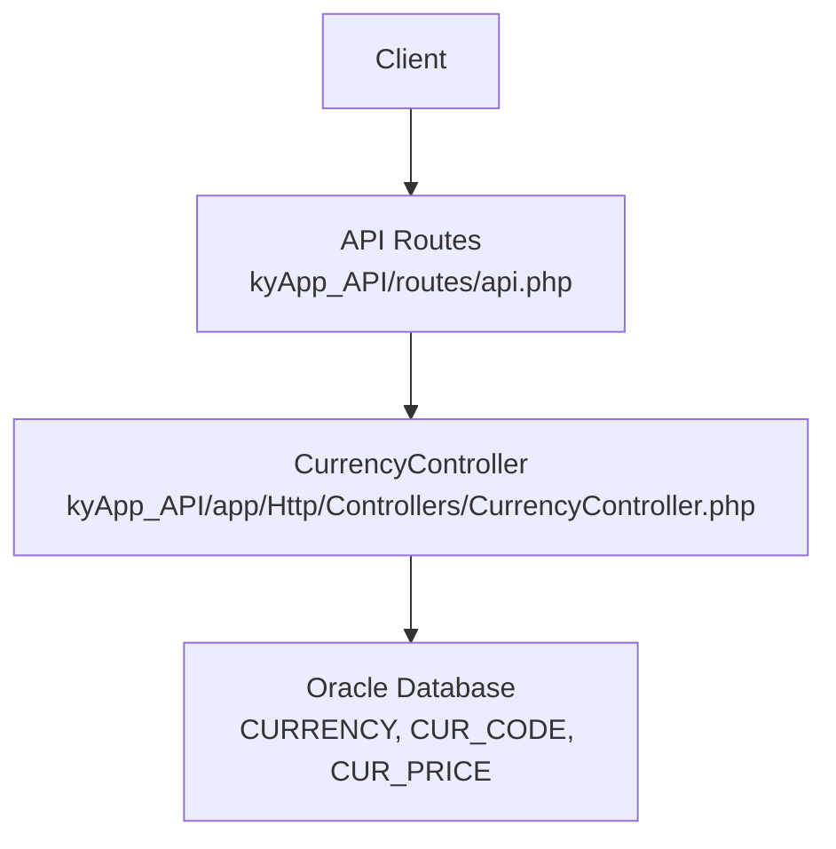
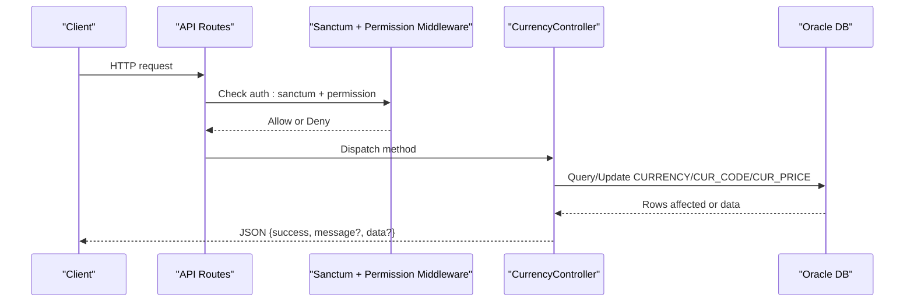
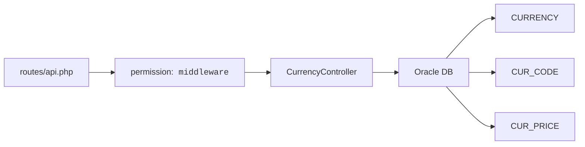

# Currency Management API

<cite>
**Referenced Files in This Document**
- [CurrencyController.php](file://kyApp_API/app/Http/Controllers/CurrencyController.php)
- [api.php](file://kyApp_API/routes/api.php)
- [DBdevloping_history.md](file://DBdevloping_history.md)
</cite>

## Table of Contents
1. [Introduction](#introduction)
2. [Project Structure](#project-structure)
3. [Core Components](#core-components)
4. [Architecture Overview](#architecture-overview)
5. [Detailed Component Analysis](#detailed-component-analysis)
6. [Dependency Analysis](#dependency-analysis)
7. [Performance Considerations](#performance-considerations)
8. [Troubleshooting Guide](#troubleshooting-guide)
9. [Conclusion](#conclusion)

## Introduction
This document describes the Currency Management API for cataloging currencies and managing historical exchange rates. It covers:
- Currency catalog operations: GET /currencies, POST /currencies, PUT /currencies/{curNo}, DELETE /currencies/{curNo}
- Exchange rate management: GET /currencies/{curNo}/prices, POST /currencies/{curNo}/prices, PUT /currencies/{curNo}/prices/{seq}, DELETE /currencies/{curNo}/prices/{seq}
- Permission separation between currency catalog management (currencies.*) and price management (currencies.prices_*)
- Request/response schemas for currency definitions and historical exchange rates
- Validation rules for currency codes and numeric values
- Practical examples for multi-currency support, exchange rate updates, and financial calculations across different currencies

The API is implemented in a Laravel application with Oracle database tables CURRENCY, CUR_CODE, and CUR_PRICE.

## Project Structure
The currency endpoints are defined in the API routes file and handled by a single controller that interacts directly with the Oracle database. The data model is documented in the repository’s development history.

**Diagram sources**
- [api.php:293-326](file://kyApp_API/routes/api.php#L293-L326)
- [CurrencyController.php:10-18](file://kyApp_API/app/Http/Controllers/CurrencyController.php#L10-L18)

**Section sources**
- [api.php:293-326](file://kyApp_API/routes/api.php#L293-L326)
- [CurrencyController.php:10-18](file://kyApp_API/app/Http/Controllers/CurrencyController.php#L10-L18)
- [DBdevloping_history.md:86-99](file://DBdevloping_history.md#L86-L99)

## Core Components
- CurrencyController implements all currency and price endpoints.
- API routes enforce authentication via Sanctum and fine-grained permissions per endpoint.
- Data layer uses direct Oracle queries against CURRENCY, CUR_CODE, and CUR_PRICE.

Key responsibilities:
- Catalog CRUD for currencies and their codes
- Pagination and filtering for historical prices
- Numeric validation for prices and date validation for day_date
- Consistent JSON envelope with success flag and message/data payloads

**Section sources**
- [CurrencyController.php:21-400](file://kyApp_API/app/Http/Controllers/CurrencyController.php#L21-L400)
- [api.php:293-326](file://kyApp_API/routes/api.php#L293-L326)

## Architecture Overview
The request flow for currency and price operations follows a consistent pattern:
1. Client sends an authenticated request to a route under /currencies.
2. Route middleware enforces auth:sanctum and a specific permission code.
3. Controller validates input and executes Oracle queries.
4. Controller returns a standardized JSON response.

**Diagram sources**
- [api.php:293-326](file://kyApp_API/routes/api.php#L293-L326)
- [CurrencyController.php:21-400](file://kyApp_API/app/Http/Controllers/CurrencyController.php#L21-L400)

## Detailed Component Analysis

### Authentication and Permissions
All currency endpoints require authentication via Sanctum. Permissions are split into two scopes:
- Currency catalog: currencies.view, currencies.create, currencies.update, currencies.delete
- Price management: currencies.prices_view, currencies.prices_manage

Permission separation ensures that users who can manage currency catalog entries cannot necessarily modify daily exchange rates.

| Endpoint | Method | Route | Required Permission | Description |
|---|---:|---|---|---|
| List currencies | GET | /currencies | currencies.view | Returns all currencies with latest prices |
| Create currency | POST | /currencies | currencies.create | Adds a new currency and its code mapping |
| Update currency | PUT | /currencies/{curNo} | currencies.update | Updates currency name and/or code mapping |
| Delete currency | DELETE | /currencies/{curNo} | currencies.delete | Deletes currency, code mapping, and prices |
| List prices | GET | /currencies/{curNo}/prices | currencies.prices_view | Paginated historical exchange rates |
| Add price | POST | /currencies/{curNo}/prices | currencies.prices_manage | Inserts a new historical exchange rate |
| Update price | PUT | /currencies/{curNo}/prices/{seq} | currencies.prices_manage | Updates an existing historical exchange rate |
| Delete price | DELETE | /currencies/{curNo}/prices/{seq} | currencies.prices_manage | Removes a specific historical exchange rate |

**Section sources**
- [api.php:293-326](file://kyApp_API/routes/api.php#L293-L326)

### Currency Catalog Endpoints

#### GET /currencies
- Purpose: Retrieve all currencies with their code mappings and latest exchange rate information.
- Response fields:
  - cur_no: integer
  - cur_name: string
  - code: string
  - main_cur_name: string
  - sub_cur_name: string
  - current_price: number
  - previous_price: number
  - change_percent: number
  - last_date: string (YYYY-MM-DD) or null
- Behavior:
  - Joins CURRENCY and CUR_CODE.
  - For each currency, fetches up to two most recent prices ordered by SEQ descending.
  - Computes change_percent from current and previous prices.

Validation: None on input; server-side encoding applied to Arabic text.

Error handling:
- 500 if database error occurs.

**Section sources**
- [CurrencyController.php:21-94](file://kyApp_API/app/Http/Controllers/CurrencyController.php#L21-L94)

#### POST /currencies
- Purpose: Create a new currency and its code mapping.
- Request body:
  - cur_name: required string, max length 30
  - code: required string, max length 30
  - main_cur_name: required string, max length 30
  - sub_cur_name: required string, max length 30
- Server behavior:
  - Generates next CUR_NO based on MAX(CUR_NO).
  - Inserts into CURRENCY and CUR_CODE.
  - Applies Arabic encoding normalization before storage.
- Response:
  - success: boolean
  - message: string
  - data.cur_no: integer

Validation:
- All fields required and strings with max length 30.

Errors:
- 422 for validation errors.
- 500 for database errors.

**Section sources**
- [CurrencyController.php:96-145](file://kyApp_API/app/Http/Controllers/CurrencyController.php#L96-L145)

#### PUT /currencies/{curNo}
- Purpose: Update an existing currency’s name and/or code mapping.
- Path parameter:
  - curNo: integer (route constraint enforced)
- Request body (optional fields):
  - cur_name: string
  - code: string
  - main_cur_name: string
  - sub_cur_name: string
- Server behavior:
  - Verifies existence of currency by CUR_NO.
  - Updates CURRENCY.CUR_NAME if provided.
  - Updates CUR_CODE fields if provided.
  - Applies Arabic encoding normalization.
- Response:
  - success: boolean
  - message: string

Errors:
- 404 if currency not found.
- 500 for database errors.

**Section sources**
- [CurrencyController.php:147-193](file://kyApp_API/app/Http/Controllers/CurrencyController.php#L147-L193)

#### DELETE /currencies/{curNo}
- Purpose: Delete a currency and related records.
- Path parameter:
  - curNo: integer (route constraint enforced)
- Server behavior:
  - Verifies existence of currency.
  - Deletes related CUR_PRICE, CUR_CODE, then CURRENCY rows.
- Response:
  - success: boolean
  - message: string

Errors:
- 404 if currency not found.
- 500 for database errors.

**Section sources**
- [CurrencyController.php:195-216](file://kyApp_API/app/Http/Controllers/CurrencyController.php#L195-L216)

### Exchange Rate Management Endpoints

#### GET /currencies/{curNo}/prices
- Purpose: Retrieve paginated historical exchange rates for a specific currency.
- Path parameter:
  - curNo: integer (route constraint enforced)
- Query parameters:
  - page: integer, default 1, minimum 1
  - limit: integer, default 30, range 10–100
- Response structure:
  - success: boolean
  - currency: object with cur_no and cur_name
  - data: array of price records
  - meta: pagination metadata
- Price record fields:
  - seq: integer
  - cur_no: integer
  - price: number
  - day_date: string (YYYY-MM-DD)
- Behavior:
  - Validates currency existence.
  - Counts total price records.
  - Uses Oracle-compatible pagination with ROWNUM.
  - Orders by SEQ descending.

Errors:
- 404 if currency not found.
- 500 for database errors.

**Section sources**
- [CurrencyController.php:218-293](file://kyApp_API/app/Http/Controllers/CurrencyController.php#L218-L293)

#### POST /currencies/{curNo}/prices
- Purpose: Add a new historical exchange rate for a currency.
- Path parameter:
  - curNo: integer (route constraint enforced)
- Request body:
  - price: required number, minimum 0
  - day_date: required date string in format YYYY-MM-DD
- Server behavior:
  - Validates currency existence.
  - Generates next SEQ based on MAX(SEQ).
  - Inserts into CUR_PRICE with TO_DATE conversion.
- Response:
  - success: boolean
  - message: string
  - data.seq: integer

Validation:
- price must be numeric and non-negative.
- day_date must match YYYY-MM-DD.

Errors:
- 404 if currency not found.
- 422 for validation errors.
- 500 for database errors.

**Section sources**
- [CurrencyController.php:295-338](file://kyApp_API/app/Http/Controllers/CurrencyController.php#L295-L338)

#### PUT /currencies/{curNo}/prices/{seq}
- Purpose: Update an existing historical exchange rate.
- Path parameters:
  - curNo: integer (route constraint enforced)
  - seq: integer (route constraint enforced)
- Request body:
  - price: required number, minimum 0
  - day_date: required date string in format YYYY-MM-DD
- Server behavior:
  - Validates existence of the specific price record by CUR_NO and SEQ.
  - Updates PRICE and DAY_DATE using TO_DATE conversion.
- Response:
  - success: boolean
  - message: string

Validation:
- price must be numeric and non-negative.
- day_date must match YYYY-MM-DD.

Errors:
- 404 if price record not found.
- 422 for validation errors.
- 500 for database errors.

**Section sources**
- [CurrencyController.php:340-377](file://kyApp_API/app/Http/Controllers/CurrencyController.php#L340-L377)

#### DELETE /currencies/{curNo}/prices/{seq}
- Purpose: Remove a specific historical exchange rate.
- Path parameters:
  - curNo: integer (route constraint enforced)
  - seq: integer (route constraint enforced)
- Server behavior:
  - Validates existence of the specific price record by CUR_NO and SEQ.
  - Deletes the row from CUR_PRICE.
- Response:
  - success: boolean
  - message: string

Errors:
- 404 if price record not found.
- 500 for database errors.

**Section sources**
- [CurrencyController.php:379-400](file://kyApp_API/app/Http/Controllers/CurrencyController.php#L379-L400)

### Data Models and Schemas

#### Currency Definition Schema
Used by GET /currencies and POST /currencies.

| Field | Type | Required | Constraints | Notes |
|---|---|---:|---|---|
| cur_no | integer | Yes (response) | Positive integer | Auto-generated ID |
| cur_name | string | Yes (create/update) | Max length 30 | Display name |
| code | string | Yes (create), optional (update) | Max length 30 | Currency code |
| main_cur_name | string | Yes (create), optional (update) | Max length 30 | Main unit name |
| sub_cur_name | string | Yes (create), optional (update) | Max length 30 | Sub-unit name |

#### Historical Exchange Rate Schema
Used by GET /currencies/{curNo}/prices and POST/PUT /currencies/{curNo}/prices.

| Field | Type | Required | Constraints | Notes |
|---|---|---:|---|---|
| seq | integer | Yes (response) | Positive integer | Unique sequence per currency |
| cur_no | integer | Yes | Positive integer | Foreign reference to currency |
| price | number | Yes (write) | Non-negative | Exchange rate value |
| day_date | string | Yes (write) | Format YYYY-MM-DD | Date of the rate |

**Section sources**
- [CurrencyController.php:21-400](file://kyApp_API/app/Http/Controllers/CurrencyController.php#L21-L400)
- [DBdevloping_history.md:86-99](file://DBdevloping_history.md#L86-L99)

### Validation Rules Summary
- Currency catalog creation:
  - cur_name: required, string, max 30
  - code: required, string, max 30
  - main_cur_name: required, string, max 30
  - sub_cur_name: required, string, max 30
- Price write operations:
  - price: required, numeric, min 0
  - day_date: required, date_format Y-m-d
- Path constraints:
  - curNo: integer only
  - seq: integer only

**Section sources**
- [CurrencyController.php:100-108](file://kyApp_API/app/Http/Controllers/CurrencyController.php#L100-L108)
- [CurrencyController.php:302-305](file://kyApp_API/app/Http/Controllers/CurrencyController.php#L302-L305)
- [CurrencyController.php:347-350](file://kyApp_API/app/Http/Controllers/CurrencyController.php#L347-L350)
- [api.php:307-325](file://kyApp_API/routes/api.php#L307-L325)

### Practical Examples

#### Multi-Currency Support
- Use GET /currencies to retrieve available currencies and their latest prices.
- Use the returned code field to identify currency codes in downstream transactions.
- Maintain separate currency catalogs for base and sub units using main_cur_name and sub_cur_name.

Example workflow:
1. Call GET /currencies.
2. Parse data[] to build a list of supported currencies.
3. Use code in invoices, payments, and reports.

**Section sources**
- [CurrencyController.php:21-94](file://kyApp_API/app/Http/Controllers/CurrencyController.php#L21-L94)

#### Exchange Rate Updates
- Use POST /currencies/{curNo}/prices to add a new daily rate.
- Use PUT /currencies/{curNo}/prices/{seq} to correct or update an existing rate.
- Use GET /currencies/{curNo}/prices?page=...&limit=... to review historical rates.

Example workflow:
1. Validate user has currencies.prices_manage permission.
2. Submit price and day_date in YYYY-MM-DD format.
3. Confirm response includes success and data.seq.
4. Review changes via GET /currencies/{curNo}/prices.

**Section sources**
- [CurrencyController.php:295-377](file://kyApp_API/app/Http/Controllers/CurrencyController.php#L295-L377)
- [api.php:314-325](file://kyApp_API/routes/api.php#L314-L325)

#### Financial Calculations Across Currencies
- Use current_price and previous_price from GET /currencies to compute change_percent.
- Apply exchange rates from CUR_PRICE to convert amounts between currencies.
- Ensure consistent rounding and precision at the application layer when performing conversions.

Example workflow:
1. Fetch currency list and latest prices.
2. Convert invoice amounts from source currency to target currency using current_price.
3. Record audit trails and store results in local currency.

**Section sources**
- [CurrencyController.php:45-87](file://kyApp_API/app/Http/Controllers/CurrencyController.php#L45-L87)

## Dependency Analysis
The currency module depends on:
- Authentication and authorization middleware (Sanctum + custom permission middleware)
- Oracle database connection configured for the application
- Direct SQL queries for CURRENCY, CUR_CODE, and CUR_PRICE

**Diagram sources**
- [api.php:293-326](file://kyApp_API/routes/api.php#L293-L326)
- [CurrencyController.php:10-18](file://kyApp_API/app/Http/Controllers/CurrencyController.php#L10-L18)

**Section sources**
- [api.php:293-326](file://kyApp_API/routes/api.php#L293-L326)
- [CurrencyController.php:10-18](file://kyApp_API/app/Http/Controllers/CurrencyController.php#L10-L18)
- [DBdevloping_history.md:86-99](file://DBdevloping_history.md#L86-L99)

## Performance Considerations
- Pagination: GET /currencies/{curNo}/prices supports page and limit with defaults and bounds to avoid excessive loads.
- Latest price computation: index() fetches up to two most recent prices per currency to compute change_percent efficiently.
- Oracle compatibility: Queries use ROWNUM-based pagination compatible with older Oracle versions.
- Indexing: Ensure indexes exist on CUR_PRICE(CUR_NO, SEQ) and CUR_CODE(CUR_NO) for optimal performance.

[No sources needed since this section provides general guidance]

## Troubleshooting Guide
Common issues and resolutions:
- 401 Unauthorized: Ensure valid Sanctum token is included in requests.
- 403 Forbidden: Verify the user has the required permission code for the endpoint.
- 404 Not Found: Check that curNo exists for currency operations and both curNo and seq exist for price operations.
- 422 Unprocessable Entity: Fix validation errors such as missing or invalid fields (e.g., day_date format, non-negative price).
- 500 Internal Server Error: Inspect database connectivity and query execution logs.

Response envelope:
- success: boolean indicating operation outcome
- message: string describing result or error details
- data: optional payload containing created IDs or metadata

**Section sources**
- [CurrencyController.php:90-93](file://kyApp_API/app/Http/Controllers/CurrencyController.php#L90-L93)
- [CurrencyController.php:140-144](file://kyApp_API/app/Http/Controllers/CurrencyController.php#L140-L144)
- [CurrencyController.php:190-192](file://kyApp_API/app/Http/Controllers/CurrencyController.php#L190-L192)
- [CurrencyController.php:290-292](file://kyApp_API/app/Http/Controllers/CurrencyController.php#L290-L292)
- [CurrencyController.php:333-337](file://kyApp_API/app/Http/Controllers/CurrencyController.php#L333-L337)
- [CurrencyController.php:372-376](file://kyApp_API/app/Http/Controllers/CurrencyController.php#L372-L376)
- [CurrencyController.php:397-399](file://kyApp_API/app/Http/Controllers/CurrencyController.php#L397-L399)

## Conclusion
The Currency Management API provides a secure, permission-separated interface for maintaining currency catalogs and historical exchange rates. It enforces strict validation, returns consistent JSON responses, and integrates cleanly with Oracle-backed data models. Teams should leverage the permission boundaries to restrict sensitive price modifications while enabling broad catalog visibility where appropriate.

[No sources needed since this section summarizes without analyzing specific files]