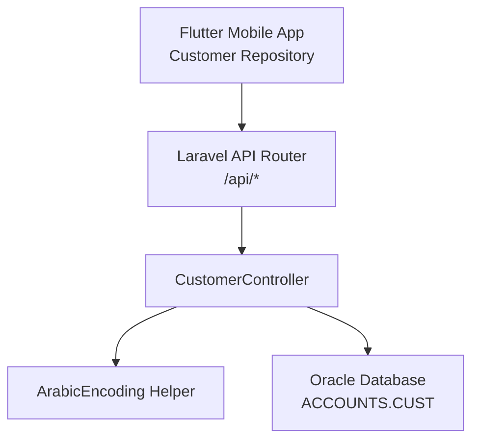
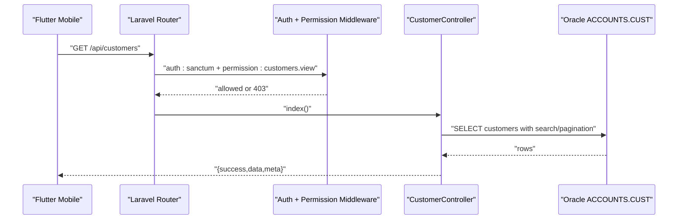
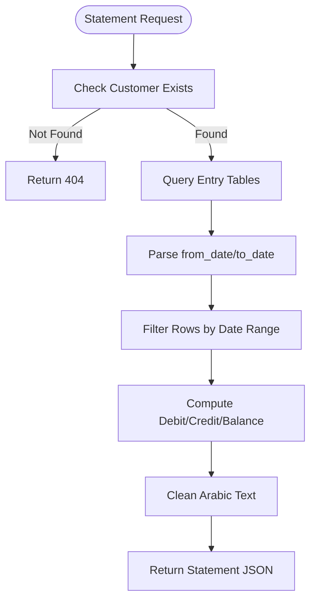
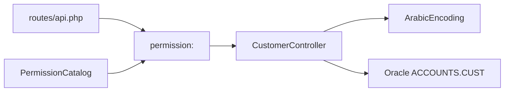

# Customer Management API

<cite>
**Referenced Files in This Document**
- [CustomerController.php](file://kyApp_API/app/Http/Controllers/CustomerController.php)
- [api.php](file://kyApp_API/routes/api.php)
- [ArabicEncoding.php](file://kyApp_API/app/Support/ArabicEncoding.php)
- [PermissionCatalog.php](file://kyApp_API/app/Support/PermissionCatalog.php)
- [customer_repository.dart](file://lib/features/customers/data/repositories/customer_repository.dart)
</cite>

## Table of Contents
1. [Introduction](#introduction)
2. [Project Structure](#project-structure)
3. [Core Components](#core-components)
4. [Architecture Overview](#architecture-overview)
5. [Detailed Component Analysis](#detailed-component-analysis)
6. [Dependency Analysis](#dependency-analysis)
7. [Performance Considerations](#performance-considerations)
8. [Troubleshooting Guide](#troubleshooting-guide)
9. [Conclusion](#conclusion)
10. [Appendices](#appendices)

## Introduction
This document describes the customer management API exposed by the Laravel backend and consumed by the Flutter mobile application. It covers:
- CRUD endpoints for customers
- Statement generation endpoint
- Request parameters, response schemas, validation rules, and business logic
- Permission requirements
- Error handling patterns
- Data models
- Practical examples and integration guidance for the mobile app

The API is protected by Sanctum authentication and uses an IBAC permission system where each route requires a specific permission code such as `customers.view`, `customers.create`, `customers.update`, `customers.delete`, or `customers.statement`.

## Project Structure
The customer management feature spans three main layers:
- Routes define HTTP endpoints and attach authentication and permission middleware.
- The controller implements business logic, validates input, queries Oracle, and returns JSON responses.
- The mobile repository calls these endpoints and maps server payloads to local data models.

**Diagram sources**
- [api.php:158-179](file://kyApp_API/routes/api.php#L158-L179)
- [CustomerController.php:16-463](file://kyApp_API/app/Http/Controllers/CustomerController.php#L16-L463)
- [ArabicEncoding.php:9-193](file://kyApp_API/app/Support/ArabicEncoding.php#L9-L193)
- [customer_repository.dart:60-154](file://lib/features/customers/data/repositories/customer_repository.dart#L60-L154)

**Section sources**
- [api.php:158-179](file://kyApp_API/routes/api.php#L158-L179)
- [CustomerController.php:16-463](file://kyApp_API/app/Http/Controllers/CustomerController.php#L16-L463)
- [customer_repository.dart:60-154](file://lib/features/customers/data/repositories/customer_repository.dart#L60-L154)

## Core Components
- **CustomerController**: Implements listing, retrieval, creation, update, deletion, and statement generation for customers. It connects to the Oracle `ACCOUNTS.CUST` table, applies Arabic encoding helpers, and returns standardized JSON responses.
- **Routes**: Define RESTful endpoints under `/api/customers` with Sanctum authentication and per-route permissions.
- **ArabicEncoding**: Handles conversion between UTF-8 and Oracle Windows-1256, fixing mojibake and preparing search/write values.
- **PermissionCatalog**: Defines the canonical set of permission codes, including the customer module actions.
- **Mobile Repository**: Calls the API endpoints and parses success/failure responses into domain objects.

**Section sources**
- [CustomerController.php:16-463](file://kyApp_API/app/Http/Controllers/CustomerController.php#L16-L463)
- [api.php:158-179](file://kyApp_API/routes/api.php#L158-L179)
- [ArabicEncoding.php:9-193](file://kyApp_API/app/Support/ArabicEncoding.php#L9-L193)
- [PermissionCatalog.php:84-98](file://kyApp_API/app/Support/PermissionCatalog.php#L84-L98)
- [customer_repository.dart:60-154](file://lib/features/customers/data/repositories/customer_repository.dart#L60-L154)

## Architecture Overview
The customer management flow follows a standard layered pattern:
- The mobile app sends authenticated requests using a bearer token.
- Laravel routes enforce authentication and permission checks before invoking the controller.
- The controller validates inputs, interacts with Oracle, normalizes text encoding, and returns structured JSON.
- The mobile repository interprets the response and updates UI state.

**Diagram sources**
- [api.php:158-179](file://kyApp_API/routes/api.php#L158-L179)
- [CustomerController.php:28-84](file://kyApp_API/app/Http/Controllers/CustomerController.php#L28-L84)

## Detailed Component Analysis

### GET /customers
Lists customers with optional search and pagination.

- **Authentication**: Required (`auth:sanctum`)
- **Permission**: `customers.view`
- **Query Parameters**:
  - `search`: Optional string; supports numeric matching for `CUST_NO`, phone numbers, and account number, and text matching for name, address, and previous customer name.
  - `limit`: Optional integer; default 100; maximum 500.
  - `page`: Optional integer; minimum 1; defaults to 1.
- **Response Schema**:
  - `success`: boolean
  - `data`: array of customer objects
  - `meta`: object containing `total`, `page`, `limit`, `pages`
- **Validation Rules**: None on query parameters beyond type coercion and bounds enforced by the controller.
- **Business Logic**:
  - Builds a dynamic Oracle query with search conditions.
  - Applies Arabic encoding normalization to returned text fields.
  - Returns paginated results ordered by customer number.

**Section sources**
- [api.php:160-162](file://kyApp_API/routes/api.php#L160-L162)
- [CustomerController.php:28-84](file://kyApp_API/app/Http/Controllers/CustomerController.php#L28-L84)
- [ArabicEncoding.php:167-192](file://kyApp_API/app/Support/ArabicEncoding.php#L167-L192)

### POST /customers
Creates a new customer.

- **Authentication**: Required (`auth:sanctum`)
- **Permission**: `customers.create`
- **Request Body Fields**:
  - `cust_name`: required string, max 150 characters
  - `addr`: optional string, max 200 characters
  - `tel1`: optional string, max 20 characters
  - `tel2`: optional string, max 20 characters
  - `postbox`: optional string, max 20 characters
  - `email`: optional email, max 100 characters
  - `fax`: optional string, max 20 characters
  - `acc_no`: optional integer
  - `limited_balance`: optional numeric
  - `pre_cust_name`: optional string, max 150 characters
  - `stopping_cust`: optional integer, must be 0 or 1
- **Response Schema**:
  - `success`: boolean
  - `message`: string
  - `cust_no`: integer (newly assigned customer number)
- **Validation Rules**: As listed above; returns 422 with field errors when invalid.
- **Business Logic**:
  - Computes next `CUST_NO` by taking the maximum existing value plus one.
  - Normalizes Arabic text for Oracle storage.
  - Inserts a new row into `ACCOUNTS.CUST`.

**Section sources**
- [api.php:163-164](file://kyApp_API/routes/api.php#L163-L164)
- [CustomerController.php:118-182](file://kyApp_API/app/Http/Controllers/CustomerController.php#L118-L182)
- [ArabicEncoding.php:143-162](file://kyApp_API/app/Support/ArabicEncoding.php#L143-L162)

### GET /customers/{custNo}
Retrieves a single customer by ID.

- **Authentication**: Required (`auth:sanctum`)
- **Permission**: `customers.view`
- **Path Parameter**:
  - `custNo`: integer, validated by route constraint
- **Response Schema**:
  - `success`: boolean
  - `data`: customer object
- **Error Handling**:
  - Returns 404 if the customer does not exist.
- **Business Logic**:
  - Queries `ACCOUNTS.CUST` by `CUST_NO`.
  - Cleans Arabic text before returning.

**Section sources**
- [api.php:170-172](file://kyApp_API/routes/api.php#L170-L172)
- [CustomerController.php:90-112](file://kyApp_API/app/Http/Controllers/CustomerController.php#L90-L112)

### PUT /customers/{custNo}
Updates an existing customer.

- **Authentication**: Required (`auth:sanctum`)
- **Permission**: `customers.update`
- **Path Parameter**:
  - `custNo`: integer, validated by route constraint
- **Request Body Fields**: Same as POST `/customers`.
- **Response Schema**:
  - `success`: boolean
  - `message`: string
- **Validation Rules**: Same as POST; returns 422 on failure.
- **Business Logic**:
  - Checks existence of the customer.
  - Updates only provided fields after Arabic normalization.
  - Returns 404 if the customer does not exist.

**Section sources**
- [api.php:173-175](file://kyApp_API/routes/api.php#L173-L175)
- [CustomerController.php:188-256](file://kyApp_API/app/Http/Controllers/CustomerController.php#L188-L256)

### DELETE /customers/{custNo}
Deletes a customer.

- **Authentication**: Required (`auth:sanctum`)
- **Permission**: `customers.delete`
- **Path Parameter**:
  - `custNo`: integer, validated by route constraint
- **Response Schema**:
  - `success`: boolean
  - `message`: string
- **Error Handling**:
  - Returns 404 if the customer does not exist.
- **Business Logic**:
  - Verifies existence before deletion.
  - Deletes the row from `ACCOUNTS.CUST`.

**Section sources**
- [api.php:176-178](file://kyApp_API/routes/api.php#L176-L178)
- [CustomerController.php:262-288](file://kyApp_API/app/Http/Controllers/CustomerController.php#L262-L288)

### GET /customers/{custNo}/statement
Generates a customer statement with optional date filtering.

- **Authentication**: Required (`auth:sanctum`)
- **Permission**: `customers.statement`
- **Path Parameter**:
  - `custNo`: integer, validated by route constraint
- **Query Parameters**:
  - `from_date`: optional date string; supports formats like `DD/MM/YYYY` or ISO-like strings; normalized internally.
  - `to_date`: optional date string; same format support.
- **Response Schema**:
  - `success`: boolean
  - `customer`: cleaned customer object
  - `data`: array of statement rows
  - `summary`: object containing:
    - `total_rows`: integer
    - `total_debit`: numeric
    - `total_credit`: numeric
    - `opening_balance`: numeric
    - `final_balance`: numeric
    - `from_date`: string
    - `to_date`: string
    - `currency`: string (Yemeni YR)
    - `account_title`: string combining account number and title
- **Business Logic**:
  - Validates customer existence.
  - Joins entry tables to compute debit/credit and running balance.
  - Filters entries based on date range.
  - Calculates opening balance for entries before `from_date`.
  - Cleans Arabic text in returned rows.

**Diagram sources**
- [CustomerController.php:294-420](file://kyApp_API/app/Http/Controllers/CustomerController.php#L294-L420)

**Section sources**
- [api.php:167-169](file://kyApp_API/routes/api.php#L167-L169)
- [CustomerController.php:294-420](file://kyApp_API/app/Http/Controllers/CustomerController.php#L294-L420)
- [ArabicEncoding.php:36-120](file://kyApp_API/app/Support/ArabicEncoding.php#L36-L120)

## Dependency Analysis
The customer management endpoints depend on:
- **Sanctum Authentication**: All routes are wrapped in `auth:sanctum`.
- **Permission Middleware**: Each route enforces a specific permission code.
- **Oracle Database**: Direct queries against `ACCOUNTS.CUST` and related entry tables.
- **ArabicEncoding Helper**: Used for text normalization and mojibake correction.
- **PermissionCatalog**: Provides canonical permission definitions used across the system.

**Diagram sources**
- [api.php:158-179](file://kyApp_API/routes/api.php#L158-L179)
- [PermissionCatalog.php:84-98](file://kyApp_API/app/Support/PermissionCatalog.php#L84-L98)
- [CustomerController.php:16-463](file://kyApp_API/app/Http/Controllers/CustomerController.php#L16-L463)

**Section sources**
- [api.php:158-179](file://kyApp_API/routes/api.php#L158-L179)
- [PermissionCatalog.php:84-98](file://kyApp_API/app/Support/PermissionCatalog.php#L84-L98)
- [CustomerController.php:16-463](file://kyApp_API/app/Http/Controllers/CustomerController.php#L16-L463)

## Performance Considerations
- **Pagination**: The list endpoint caps page size at 500 and defaults to 100 to prevent excessive data transfer.
- **Search Optimization**: Numeric searches use exact matches for identifiers and partial matches for text fields; consider indexing frequently searched columns in Oracle if performance degrades.
- **Statement Generation**: The statement endpoint performs joins and iterative processing; large datasets may benefit from database-side filtering via indexes on entry dates and account numbers.
- **Text Normalization**: Arabic encoding operations add overhead; batch cleaning is already applied to result sets.

[No sources needed since this section provides general guidance]

## Troubleshooting Guide
Common issues and resolutions:
- **403 Forbidden**: Indicates missing or insufficient permission. Verify that the authenticated user has the required permission code (e.g., `customers.view`).
- **404 Not Found**: Returned when a requested customer does not exist. Confirm the `custNo` parameter.
- **422 Validation Error**: Occurs when request body fields fail validation rules. Inspect the `errors` object in the response.
- **500 Internal Server Error**: Indicates a database or unexpected error. In debug mode, the response includes additional error details.

**Section sources**
- [CustomerController.php:455-462](file://kyApp_API/app/Http/Controllers/CustomerController.php#L455-L462)

## Conclusion
The customer management API provides a complete set of CRUD operations and a specialized statement generation endpoint. It enforces strong authentication and fine-grained permissions, integrates with Oracle for data persistence, and handles Arabic text correctly. The mobile repository demonstrates how to consume these endpoints and map responses to local models.

[No sources needed since this section summarizes without analyzing specific files]

## Appendices

### Permission Requirements Summary
- `customers.view`: List and view customer details
- `customers.create`: Create new customers
- `customers.update`: Update existing customers
- `customers.delete`: Delete customers
- `customers.statement`: Generate customer statements

**Section sources**
- [PermissionCatalog.php:84-98](file://kyApp_API/app/Support/PermissionCatalog.php#L84-L98)
- [api.php:160-178](file://kyApp_API/routes/api.php#L160-L178)

### Mobile Integration Examples
- Fetching a single customer:
  - Call `GET /api/customers/{custNo}`
  - Parse `success` and `data` fields
- Creating a customer:
  - Call `POST /api/customers` with validated body
  - Handle `cust_no` in response
- Updating a customer:
  - Call `PUT /api/customers/{custNo}` with updated fields
- Deleting a customer:
  - Call `DELETE /api/customers/{custNo}`
- Generating a statement:
  - Call `GET /api/customers/{custNo}/statement` with optional `from_date` and `to_date`
  - Use `summary` for totals and `data` for line items

**Section sources**
- [customer_repository.dart:60-154](file://lib/features/customers/data/repositories/customer_repository.dart#L60-L154)