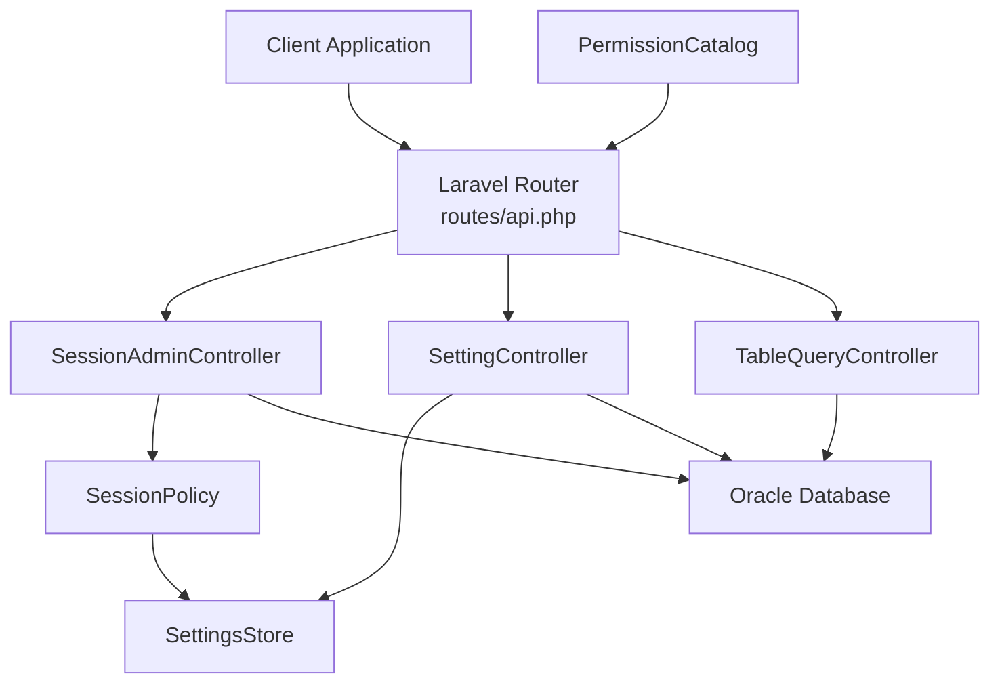
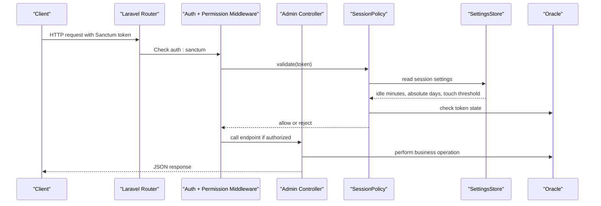
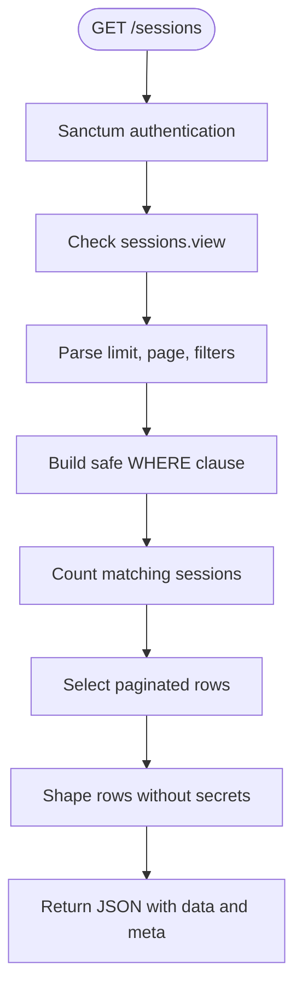
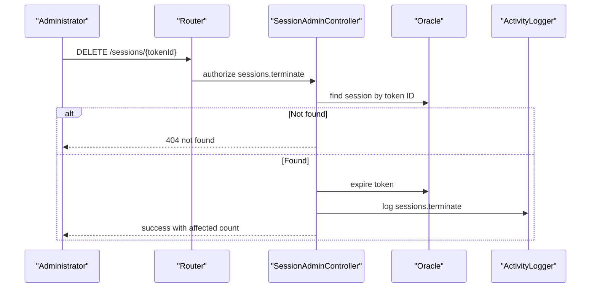
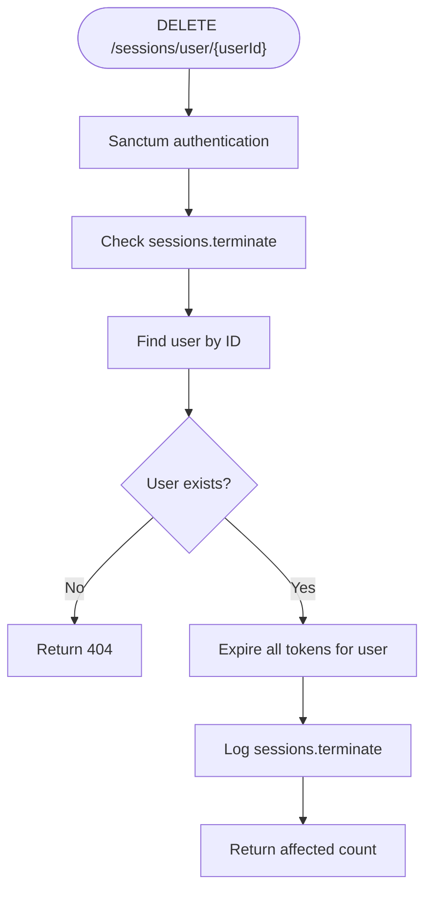
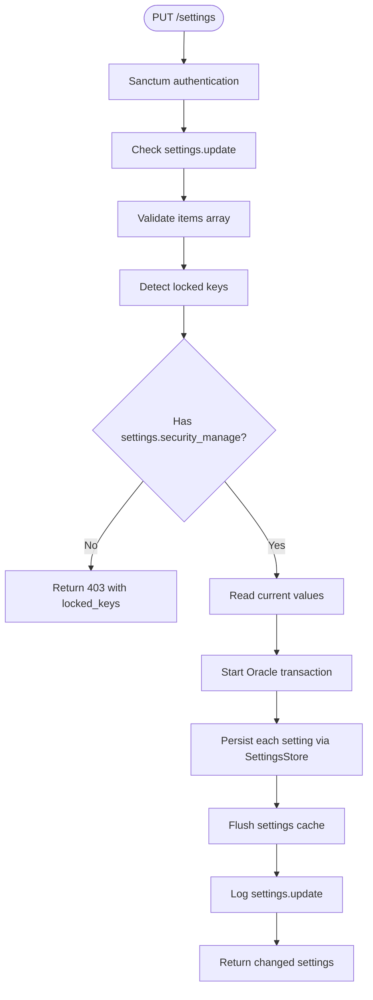
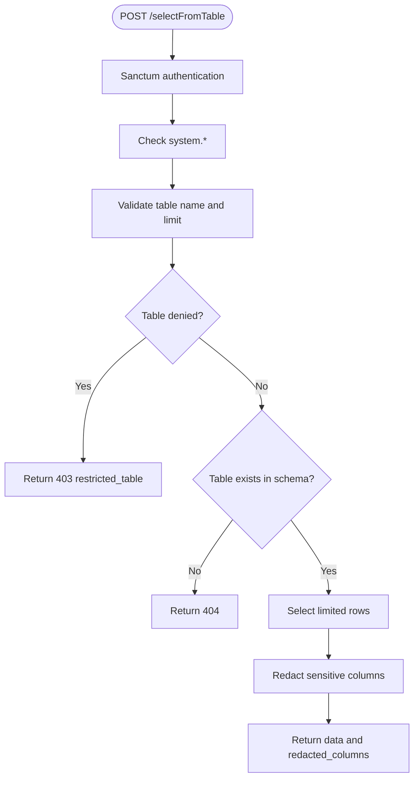
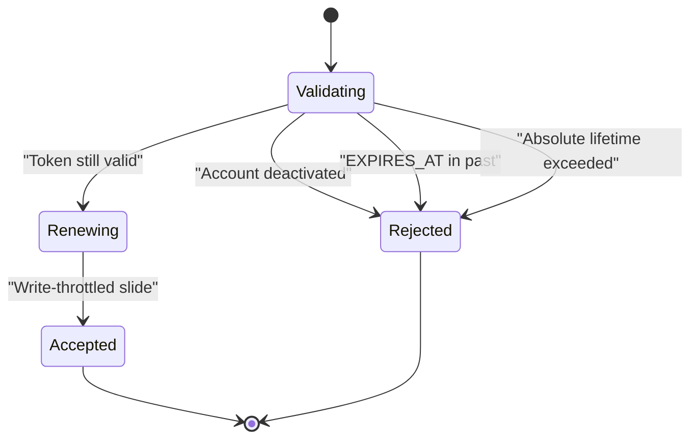
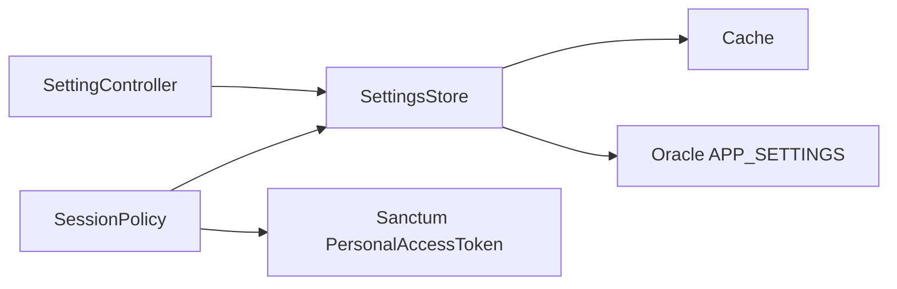

# Session & Security API

<cite>
**Referenced Files in This Document**
- [api.php](file://kyApp_API/routes/api.php)
- [SessionAdminController.php](file://kyApp_API/app/Http/Controllers/SessionAdminController.php)
- [SettingController.php](file://kyApp_API/app/Http/Controllers/SettingController.php)
- [TableQueryController.php](file://kyApp_API/app/Http/Controllers/TableQueryController.php)
- [PermissionCatalog.php](file://kyApp_API/app/Support/PermissionCatalog.php)
- [SessionPolicy.php](file://kyApp_API/app/Support/SessionPolicy.php)
- [SettingsStore.php](file://kyApp_API/app/Support/SettingsStore.php)
- [sanctum.php](file://kyApp_API/config/sanctum.php)
- [02_ibac_seed.php](file://kyApp_API/database/oracle/02_ibac_seed.php)
</cite>

## Table of Contents
1. [Introduction](#introduction)
2. [Project Structure](#project-structure)
3. [Core Components](#core-components)
4. [Architecture Overview](#architecture-overview)
5. [Detailed Component Analysis](#detailed-component-analysis)
6. [Dependency Analysis](#dependency-analysis)
7. [Performance Considerations](#performance-considerations)
8. [Troubleshooting Guide](#troubleshooting-guide)
9. [Conclusion](#conclusion)

## Introduction
This document describes the session management and security configuration endpoints exposed by the application backend. It covers:

- Active session monitoring through `GET /sessions`.
- Session termination through `DELETE /sessions/user/{userId}` and `DELETE /sessions/{tokenId}`.
- System settings management through `GET /settings` and `PUT /settings`.
- Diagnostic table querying through `POST /selectFromTable`.

It also documents the required permissions, elevated security requirements, sensitive operation warnings, session lifecycle behavior, and how security policies are enforced at request time.

The implementation is built on Laravel Sanctum for token-based authentication, an Oracle-backed permission catalog, a runtime session policy that drives idle expiry and sliding renewal, and a settings store backed by `APP_SETTINGS`.

## Project Structure
The relevant backend code lives under `kyApp_API`:

- Routes are declared in `routes/api.php`.
- Controllers handle session administration, settings updates, and diagnostic queries.
- Support classes implement session policy, settings storage, and the canonical permission catalog.
- Configuration controls Sanctum behavior.
- Database seeding defines default permissions and security settings.



**Diagram sources**
- [api.php:90-155](file://kyApp_API/routes/api.php#L90-L155)
- [SessionAdminController.php:15-82](file://kyApp_API/app/Http/Controllers/SessionAdminController.php#L15-L82)
- [SettingController.php:16-36](file://kyApp_API/app/Http/Controllers/SettingController.php#L16-L36)
- [TableQueryController.php:10-26](file://kyApp_API/app/Http/Controllers/TableQueryController.php#L10-L26)
- [SessionPolicy.php:9-44](file://kyApp_API/app/Support/SessionPolicy.php#L9-L44)
- [SettingsStore.php:9-27](file://kyApp_API/app/Support/SettingsStore.php#L9-L27)
- [PermissionCatalog.php:5-21](file://kyApp_API/app/Support/PermissionCatalog.php#L5-L21)

**Section sources**
- [api.php:1-155](file://kyApp_API/routes/api.php#L1-L155)

## Core Components
The session and security subsystem consists of five main parts:

| Component | Responsibility | Key Behavior |
|---|---|---|
| Route definitions | Register protected endpoints and attach permission middleware | Enforce `auth:sanctum` plus module-specific permissions such as `sessions.view`, `sessions.terminate`, `settings.view`, `settings.update`, and `system.*`. |
| Session controller | List active sessions and terminate tokens or all sessions for a user | Reads safe columns from `PERSONAL_ACCESS_TOKENS`, avoids exposing secrets, and expires tokens by pushing `EXPIRES_AT` into the past. |
| Settings controller | Read and update security settings | Validates batched items, enforces type/bounds via `SettingsStore`, blocks locked keys without explicit sensitive-management permission, and audits changes. |
| Diagnostic query controller | Return top rows from a requested table | Requires `system.*`, validates table name, denies sensitive tables, verifies schema existence, limits rows, and redacts sensitive columns. |
| Session policy | Validate every authenticated request | Checks account activation, idle expiry, absolute lifetime, performs write-throttled sliding renewal, and purges expired tokens. |

**Section sources**
- [api.php:90-155](file://kyApp_API/routes/api.php#L90-L155)
- [SessionAdminController.php:15-82](file://kyApp_API/app/Http/Controllers/SessionAdminController.php#L15-L82)
- [SettingController.php:16-36](file://kyApp_API/app/Http/Controllers/SettingController.php#L16-L36)
- [TableQueryController.php:10-26](file://kyApp_API/app/Http/Controllers/TableQueryController.php#L10-L26)
- [SessionPolicy.php:9-44](file://kyApp_API/app/Support/SessionPolicy.php#L9-L44)

## Architecture Overview
The security model uses two layers:

1. **Authentication layer:** Sanctum authenticates requests using personal access tokens.
2. **Authorization layer:** Each route requires a specific permission code. The system supports module wildcards and a global `system.*` wildcard.



**Diagram sources**
- [api.php:24-34](file://kyApp_API/routes/api.php#L24-L34)
- [api.php:90-155](file://kyApp_API/routes/api.php#L90-L155)
- [SessionPolicy.php:70-108](file://kyApp_API/app/Support/SessionPolicy.php#L70-L108)
- [SettingsStore.php:130-153](file://kyApp_API/app/Support/SettingsStore.php#L130-L153)

## Detailed Component Analysis

### Active Session Monitoring: GET /sessions

**Endpoint summary**

| Field | Value |
|---|---|
| Method | `GET` |
| Path | `/sessions` |
| Authentication | Required (`auth:sanctum`) |
| Authorization | `sessions.view` |
| Purpose | List active, expired, and disabled sessions with pagination, search, and status filtering. |

**Request parameters**

| Parameter | Type | Default | Description |
|---|---|---:|---|
| `limit` | integer | 50 | Number of rows per page; clamped between 1 and 200. |
| `page` | integer | 1 | Page number; clamped to at least 1. |
| `user_id` | integer | none | Filter by target user ID. |
| `status` | string | `all` | Filter by `active`, `expired`, or `disabled`; other values mean “all”. |
| `search` | string | none | Search English username, Arabic username, or device name. |

**Response shape**

| Field | Type | Description |
|---|---|---|
| `success` | boolean | Whether the request succeeded. |
| `message` | string | Human-readable status message. |
| `data` | array | Session records. |
| `meta.total` | integer | Total matching sessions. |
| `meta.page` | integer | Current page. |
| `meta.limit` | integer | Applied limit. |
| `meta.pages` | integer | Computed total pages. |

Each session record includes identifiers, readable names, timestamps, device information, activation/admin flags, computed status, remaining minutes, and a flag indicating whether the row represents the current device. Sensitive token values and abilities are never returned.

**Security notes**

- The endpoint reads only safe columns from `PERSONAL_ACCESS_TOKENS`.
- Token secrets and ability payloads are excluded.
- Ordering is fixed internally; client-supplied sort fields are not accepted.
- Pagination uses a row-number approach compatible with Oracle 11g.



**Diagram sources**
- [api.php:99-101](file://kyApp_API/routes/api.php#L99-L101)
- [SessionAdminController.php:93-141](file://kyApp_API/app/Http/Controllers/SessionAdminController.php#L93-L141)
- [SessionAdminController.php:245-283](file://kyApp_API/app/Http/Controllers/SessionAdminController.php#L245-L283)
- [SessionAdminController.php:384-417](file://kyApp_API/app/Http/Controllers/SessionAdminController.php#L384-L417)

**Section sources**
- [api.php:99-101](file://kyApp_API/routes/api.php#L99-L101)
- [SessionAdminController.php:32-82](file://kyApp_API/app/Http/Controllers/SessionAdminController.php#L32-L82)
- [SessionAdminController.php:93-141](file://kyApp_API/app/Http/Controllers/SessionAdminController.php#L93-L141)
- [SessionAdminController.php:245-283](file://kyApp_API/app/Http/Controllers/SessionAdminController.php#L245-L283)
- [SessionAdminController.php:384-417](file://kyApp_API/app/Http/Controllers/SessionAdminController.php#L384-L417)

### Remote Session Termination: DELETE /sessions/{tokenId}

**Endpoint summary**

| Field | Value |
|---|---|
| Method | `DELETE` |
| Path | `/sessions/{tokenId}` |
| Authentication | Required (`auth:sanctum`) |
| Authorization | `sessions.terminate` |
| Purpose | Terminate one session by its token identifier. |

**Behavior**

- Validates the token exists.
- Expires the token by setting `EXPIRES_AT` to a past time rather than deleting the row, preserving auditability.
- Records an activity log entry identifying the actor, target user, module, entity type, and entity identifier.
- Returns the terminated token ID, target user ID, and affected session count.

**Elevated security warning**

Terminating a session immediately invalidates the targeted device’s next authenticated request. Administrators should use this endpoint deliberately and confirm the target before execution.



**Diagram sources**
- [api.php:107-109](file://kyApp_API/routes/api.php#L107-L109)
- [SessionAdminController.php:147-182](file://kyApp_API/app/Http/Controllers/SessionAdminController.php#L147-L182)
- [SessionAdminController.php:343-355](file://kyApp_API/app/Http/Controllers/SessionAdminController.php#L343-L355)

**Section sources**
- [api.php:107-109](file://kyApp_API/routes/api.php#L107-L109)
- [SessionAdminController.php:147-182](file://kyApp_API/app/Http/Controllers/SessionAdminController.php#L147-L182)
- [SessionAdminController.php:343-355](file://kyApp_API/app/Http/Controllers/SessionAdminController.php#L343-L355)

### Batch User Session Termination: DELETE /sessions/user/{userId}

**Endpoint summary**

| Field | Value |
|---|---|
| Method | `DELETE` |
| Path | `/sessions/user/{userId}` |
| Authentication | Required (`auth:sanctum`) |
| Authorization | `sessions.terminate` |
| Purpose | Terminate every active session belonging to a user. |

**Behavior**

- Validates the target user exists.
- Expires all matching tokens for that user.
- Logs the same action code as single-session termination, but records the user-level scope and affected count.
- Returns the target user ID and affected session count.

**Elevated security warning**

This endpoint can disconnect multiple devices simultaneously. It is separate from user account toggling because it targets live sessions rather than account activation state.



**Diagram sources**
- [api.php:103-105](file://kyApp_API/routes/api.php#L103-L105)
- [SessionAdminController.php:193-233](file://kyApp_API/app/Http/Controllers/SessionAdminController.php#L193-L233)
- [SessionAdminController.php:343-355](file://kyApp_API/app/Http/Controllers/SessionAdminController.php#L343-L355)

**Section sources**
- [api.php:103-105](file://kyApp_API/routes/api.php#L103-L105)
- [SessionAdminController.php:193-233](file://kyApp_API/app/Http/Controllers/SessionAdminController.php#L193-L233)
- [SessionAdminController.php:343-355](file://kyApp_API/app/Http/Controllers/SessionAdminController.php#L343-L355)

### Security Settings Management: GET /settings

**Endpoint summary**

| Field | Value |
|---|---|
| Method | `GET` |
| Path | `/settings` |
| Authentication | Required (`auth:sanctum`) |
| Authorization | `settings.view` |
| Purpose | Retrieve all security settings with labels, types, bounds, lockable flags, and current values. |

**Response characteristics**

- Returns every defined setting.
- Includes Arabic labels and descriptions.
- Returns both the typed value and raw stored value.
- Indicates which settings are lockable and their sort order.
- Reads definitions directly from the database because Arabic text may exceed cache column limits.

**Section sources**
- [api.php:111-112](file://kyApp_API/routes/api.php#L111-L112)
- [SettingController.php:47-82](file://kyApp_API/app/Http/Controllers/SettingController.php#L47-L82)
- [SettingsStore.php:279-282](file://kyApp_API/app/Support/SettingsStore.php#L279-L282)

### Security Settings Management: PUT /settings

**Endpoint summary**

| Field | Value |
|---|---|
| Method | `PUT` |
| Path | `/settings` |
| Authentication | Required (`auth:sanctum`) |
| Authorization | `settings.update` |
| Purpose | Update a batch of security settings atomically. |

**Request body**

| Field | Type | Required | Description |
|---|---|---:|---|
| `items` | array | Yes | Array of `{key, value}` objects. |
| `items[].key` | string | Yes | Setting key; max length 60. |
| `items[].value` | mixed | No | Typed value; null means the field was not submitted. |

**Validation rules**

- `items` must be present and non-empty.
- Each item must have a valid key.
- Values are validated and normalized by `SettingsStore` according to declared type and bounds.

**Lockable settings**

- Some settings are marked lockable.
- Updating a locked setting requires the explicit `settings.security_manage` permission.
- If locked keys are requested without that permission, the request fails with a 403 and lists the locked keys.

**Atomicity and auditing**

- All updates run inside a single transaction.
- A failure rolls back the entire batch so the session policy never observes a partially applied mix of old and new values.
- Changes are audited with before/after descriptions.
- The settings cache is flushed after successful persistence.



**Diagram sources**
- [api.php:114-115](file://kyApp_API/routes/api.php#L114-L115)
- [SettingController.php:98-209](file://kyApp_API/app/Http/Controllers/SettingController.php#L98-L209)
- [SettingController.php:222-245](file://kyApp_API/app/Http/Controllers/SettingController.php#L222-L245)
- [SettingsStore.php:291-321](file://kyApp_API/app/Support/SettingsStore.php#L291-L321)

**Section sources**
- [api.php:114-115](file://kyApp_API/routes/api.php#L114-L115)
- [SettingController.php:98-209](file://kyApp_API/app/Http/Controllers/SettingController.php#L98-L209)
- [SettingController.php:222-245](file://kyApp_API/app/Http/Controllers/SettingController.php#L222-L245)
- [SettingsStore.php:291-321](file://kyApp_API/app/Support/SettingsStore.php#L291-L321)

### Diagnostic Query Capability: POST /selectFromTable

**Endpoint summary**

| Field | Value |
|---|---|
| Methods | `GET`, `POST` |
| Path | `/selectFromTable` |
| Authentication | Required (`auth:sanctum`) |
| Authorization | `system.*` |
| Purpose | Return the top N rows from a specified table for diagnostics. |

**Supported request parameters**

| Parameter | Aliases | Default | Description |
|---|---|---:|---|
| `table_name` | `table`, `tableName`, `tbl` | none | Target table name. |
| `limit` | `rows`, `row_count`, `rowCount`, `count` | 50 | Maximum rows to return; clamped to 1–1000. |

**Security enforcement**

- Requires the global `system.*` permission.
- Rejects sensitive tables including credential, session, permission, cache, migration, job, and internal infrastructure tables.
- Validates the table name against a strict alphanumeric pattern.
- Verifies the table exists in the connected Oracle schema.
- Redacts sensitive columns such as passwords, tokens, secrets, and keys.
- Returns the list of redacted column names so callers know what was stripped.



**Diagram sources**
- [api.php:145-155](file://kyApp_API/routes/api.php#L145-L155)
- [TableQueryController.php:65-171](file://kyApp_API/app/Http/Controllers/TableQueryController.php#L65-L171)
- [TableQueryController.php:182-213](file://kyApp_API/app/Http/Controllers/TableQueryController.php#L182-L213)

**Section sources**
- [api.php:145-155](file://kyApp_API/routes/api.php#L145-L155)
- [TableQueryController.php:10-59](file://kyApp_API/app/Http/Controllers/TableQueryController.php#L10-L59)
- [TableQueryController.php:65-171](file://kyApp_API/app/Http/Controllers/TableQueryController.php#L65-L171)
- [TableQueryController.php:182-213](file://kyApp_API/app/Http/Controllers/TableQueryController.php#L182-L213)

### Session Lifecycle and Policy Enforcement

The session lifecycle is driven by `SessionPolicy` and runtime settings:

1. **Deactivated accounts are rejected immediately**, even if the token is otherwise valid.
2. **Idle expiry**: if `EXPIRES_AT` is in the past, the request is rejected and the token is discarded.
3. **Absolute lifetime**: if the token’s creation date exceeds `session_absolute_days`, the request is rejected and the token is discarded.
4. **Sliding renewal**: for accepted requests, the policy may extend `EXPIRES_AT` based on `session_idle_minutes`, throttling writes using `session_touch_threshold_minutes`.



**Diagram sources**
- [SessionPolicy.php:70-108](file://kyApp_API/app/Support/SessionPolicy.php#L70-L108)
- [SessionPolicy.php:114-117](file://kyApp_API/app/Support/SessionPolicy.php#L114-L117)
- [SessionPolicy.php:166-183](file://kyApp_API/app/Support/SessionPolicy.php#L166-L183)

**Section sources**
- [SessionPolicy.php:9-44](file://kyApp_API/app/Support/SessionPolicy.php#L9-L44)
- [SessionPolicy.php:70-108](file://kyApp_API/app/Support/SessionPolicy.php#L70-L108)
- [SessionPolicy.php:114-117](file://kyApp_API/app/Support/SessionPolicy.php#L114-L117)
- [SessionPolicy.php:130-141](file://kyApp_API/app/Support/SessionPolicy.php#L130-L141)
- [SessionPolicy.php:166-183](file://kyApp_API/app/Support/SessionPolicy.php#L166-L183)
- [sanctum.php:47-63](file://kyApp_API/config/sanctum.php#L47-L63)

## Dependency Analysis

### Permission Model

The permission model is centralized in `PermissionCatalog`. It defines modules, core actions, extra actions, wildcards, and the global `system.*` wildcard. The routes enforce permissions explicitly:

| Endpoint Group | Required Permission(s) |
|---|---|
| `GET /sessions` | `sessions.view` |
| `DELETE /sessions/user/{userId}` | `sessions.terminate` |
| `DELETE /sessions/{tokenId}` | `sessions.terminate` |
| `GET /settings` | `settings.view` |
| `PUT /settings` | `settings.update` |
| `POST /selectFromTable` | `system.*` |

Additionally, updating locked settings requires `settings.security_manage`.

```mermaid
classDiagram
class PermissionCatalog {
+CORE_ACTIONS
+SYSTEM_WILDCARD
+WILDCARD_ACTION
+moduleNames()
+rows()
+codes()
+grouped()
+knows(code)
+isValidCode(code)
+wildcardFor(moduleCode)
+count()
}
class Routes {
+"/sessions"
+"/sessions/user/{userId}"
+"/sessions/{tokenId}"
+"/settings"
+"/selectFromTable"
}
PermissionCatalog --> Routes : "defines valid codes"
```

**Diagram sources**
- [PermissionCatalog.php:22-40](file://kyApp_API/app/Support/PermissionCatalog.php#L22-L40)
- [PermissionCatalog.php:209-236](file://kyApp_API/app/Support/PermissionCatalog.php#L209-L236)
- [api.php:99-155](file://kyApp_API/routes/api.php#L99-L155)

**Section sources**
- [PermissionCatalog.php:5-21](file://kyApp_API/app/Support/PermissionCatalog.php#L5-L21)
- [PermissionCatalog.php:209-236](file://kyApp_API/app/Support/PermissionCatalog.php#L209-L236)
- [api.php:99-155](file://kyApp_API/routes/api.php#L99-L155)

### Settings and Session Policy Dependencies



**Diagram sources**
- [SettingController.php:32-36](file://kyApp_API/app/Http/Controllers/SettingController.php#L32-L36)
- [SettingsStore.php:108-153](file://kyApp_API/app/Support/SettingsStore.php#L108-L153)
- [SessionPolicy.php:44-44](file://kyApp_API/app/Support/SessionPolicy.php#L44-L44)
- [SessionPolicy.php:70-108](file://kyApp_API/app/Support/SessionPolicy.php#L70-L108)

**Section sources**
- [SettingsStore.php:9-27](file://kyApp_API/app/Support/SettingsStore.php#L9-L27)
- [SettingsStore.php:108-153](file://kyApp_API/app/Support/SettingsStore.php#L108-L153)
- [SettingsStore.php:291-321](file://kyApp_API/app/Support/SettingsStore.php#L291-L321)
- [SessionPolicy.php:44-44](file://kyApp_API/app/Support/SessionPolicy.php#L44-L44)
- [SessionPolicy.php:70-108](file://kyApp_API/app/Support/SessionPolicy.php#L70-L108)

## Performance Considerations

- **Active sessions listing** uses bounded pagination and fixed ordering to avoid expensive client-controlled sorting.
- **Session expiration** is implemented by updating `EXPIRES_AT` rather than deleting rows, preserving audit history while allowing the policy to clean up expired tokens.
- **Sliding renewal** is write-throttled using `session_touch_threshold_minutes`, reducing database writes during long-lived active sessions.
- **Settings caching** stores only hot numeric fields for fast request-path reads, while full definitions with Arabic labels are read directly from Oracle for admin screens.
- **Diagnostic queries** cap results at 1000 rows and deny sensitive tables to prevent large or dangerous data dumps.

[No sources needed since this section provides general guidance]

## Troubleshooting Guide

### Common authorization failures

| Symptom | Likely Cause | Resolution |
|---|---|---|
| `401 Unauthorized` on any protected endpoint | Missing or invalid Sanctum token | Ensure the client sends a valid personal access token. |
| `403 Forbidden` on `/sessions` | Missing `sessions.view` | Grant the `sessions.view` permission. |
| `403 Forbidden` on session termination | Missing `sessions.terminate` | Grant the `sessions.terminate` permission. |
| `403 Forbidden` on `/settings` | Missing `settings.view` or `settings.update` | Grant the appropriate permission. |
| `403 Forbidden` with `locked_keys` | Attempted to update a locked setting without `settings.security_manage` | Grant `settings.security_manage` or avoid locked keys. |
| `403 Forbidden` on `/selectFromTable` | Missing `system.*` | Grant the global `system.*` permission. |
| `403 Restricted table` | Requested a denied table such as credentials or session tables | Use an allowed diagnostic table. |

### Session-related issues

| Issue | Explanation | Action |
|---|---|---|
| Active users are logged out unexpectedly | Idle expiry or absolute lifetime may be too short | Review `session_idle_minutes` and `session_absolute_days`. |
| Excessive database writes during active sessions | Sliding renewal threshold may be too low | Adjust `session_touch_threshold_minutes`. |
| Terminated session still appears briefly | Client-side token reuse before next request | Invalidate cached tokens on the client after termination. |
| Old expired tokens remain in the token table | Cleanup did not run or failed best-effort deletion | Trigger login or session screen cleanup; investigate database constraints. |

### Settings-related issues

| Issue | Explanation | Action |
|---|---|---|
| Invalid setting value error | Type or bounds validation failed | Correct the value according to the setting’s declared type and range. |
| No settings changed | Submitted values matched existing values | Confirm intended changes were included. |
| Stale settings after rollback | Cache may reflect pre-rollback state | Ensure the settings cache is flushed after transaction rollback. |
| Arabic text corruption | Encoding mismatch between client and database | Use the application’s encoding helpers and avoid raw byte manipulation. |

**Section sources**
- [SessionAdminController.php:147-182](file://kyApp_API/app/Http/Controllers/SessionAdminController.php#L147-L182)
- [SettingController.php:194-208](file://kyApp_API/app/Http/Controllers/SettingController.php#L194-L208)
- [TableQueryController.php:114-120](file://kyApp_API/app/Http/Controllers/TableQueryController.php#L114-L120)
- [SettingsStore.php:291-321](file://kyApp_API/app/Support/SettingsStore.php#L291-L321)
- [SessionPolicy.php:130-155](file://kyApp_API/app/Support/SessionPolicy.php#L130-L155)

## Conclusion

The session and security API provides a tightly controlled administrative surface:

- Active sessions can be monitored without exposing secrets.
- Session termination is elevated to a dedicated permission and preserves auditability by expiring tokens rather than deleting them.
- Security settings are validated, bounded, optionally locked, and updated atomically with comprehensive auditing.
- Diagnostic table queries require the highest privilege level and include multiple safeguards against data leakage and performance abuse.
- Session lifecycle enforcement is runtime-driven by configurable idle and absolute limits, with write-throttled renewal and best-effort cleanup.

Administrators should treat session termination and system-wide setting modifications as sensitive operations, grant permissions narrowly, and monitor activity logs for accountability.

[No sources needed since this section summarizes without analyzing specific files]