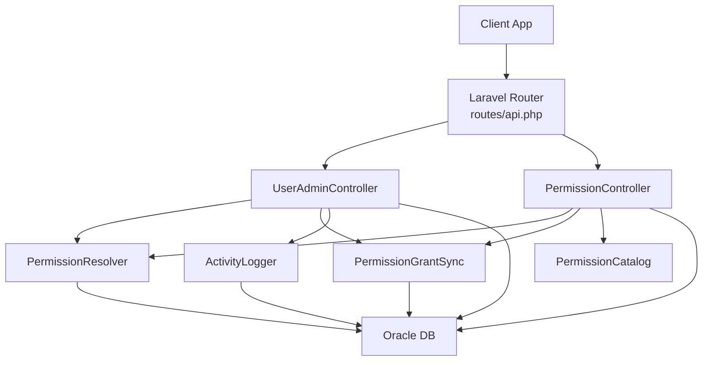
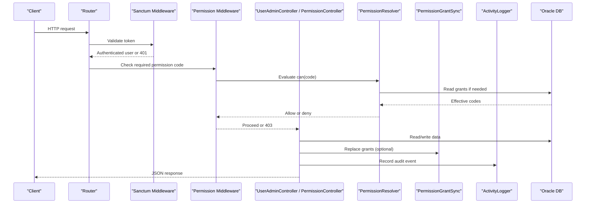
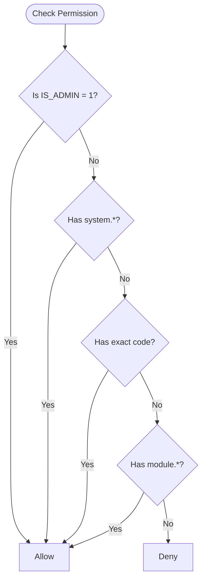
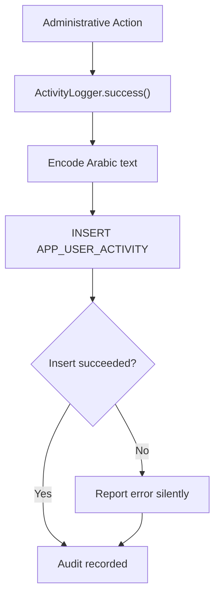
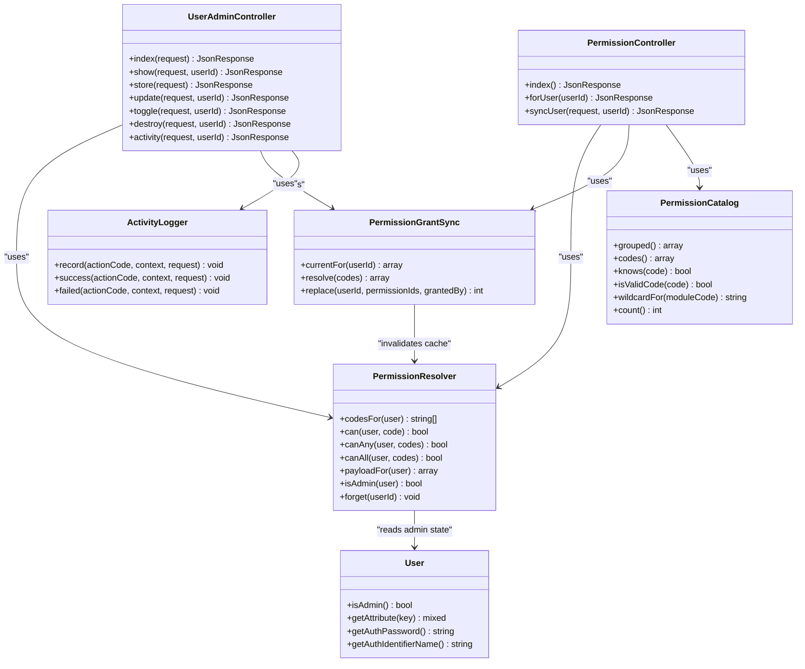
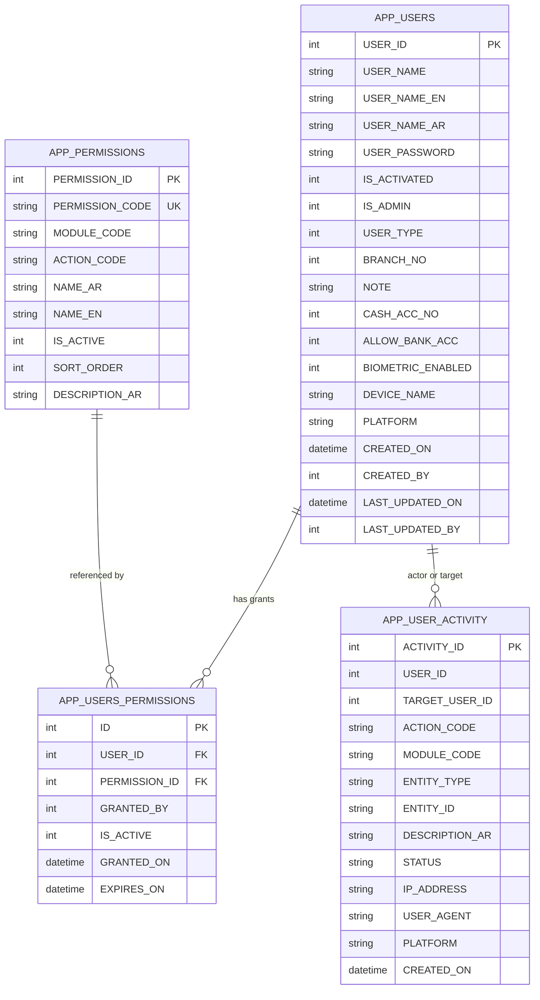

# User Administration API

<cite>
**Referenced Files in This Document**   
- [api.php](file://kyApp_API/routes/api.php)
- [UserAdminController.php](file://kyApp_API/app/Http/Controllers/UserAdminController.php)
- [PermissionController.php](file://kyApp_API/app/Http/Controllers/PermissionController.php)
- [PermissionResolver.php](file://kyApp_API/app/Support/PermissionResolver.php)
- [PermissionCatalog.php](file://kyApp_API/app/Support/PermissionCatalog.php)
- [PermissionGrantSync.php](file://kyApp_API/app/Support/PermissionGrantSync.php)
- [ActivityLogger.php](file://kyApp_API/app/Support/ActivityLogger.php)
- [User.php](file://kyApp_API/app/Models/User.php)
- [01_ibac_schema.sql](file://kyApp_API/database/oracle/01_ibac_schema.sql)
</cite>

## Table of Contents
1. [Introduction](#introduction)
2. [Project Structure](#project-structure)
3. [Core Components](#core-components)
4. [Architecture Overview](#architecture-overview)
5. [Detailed Component Analysis](#detailed-component-analysis)
6. [Dependency Analysis](#dependency-analysis)
7. [Performance Considerations](#performance-considerations)
8. [Troubleshooting Guide](#troubleshooting-guide)
9. [Conclusion](#conclusion)
10. [Appendices](#appendices)

## Introduction
This document describes the user administration and permission management API implemented in the Laravel backend. It covers:

- User CRUD endpoints under `/users`.
- User activity tracking under `/users/{userId}/activity`.
- Permission catalog retrieval under `/permissions`.
- User-specific permission retrieval and assignment under `/users/{userId}/permissions`.
- Granular permission requirements for each endpoint.
- Data models, permission resolution logic, and audit trail behavior.
- Practical workflows such as user lifecycle management and permission assignment.

The system uses a direct-permission model (no roles): permissions are granted directly to users through `ACCOUNTS.APP_USERS_PERMISSIONS`, with an optional system-wide wildcard and administrator bypass.

## Project Structure
The relevant backend implementation lives under `kyApp_API`:

- Routes define protected endpoints behind Sanctum authentication and per-route permission middleware.
- Controllers implement business logic for user administration and permission management.
- Support classes encapsulate permission resolution, grant synchronization, catalog definition, and audit logging.
- The Oracle schema defines the core tables used by these APIs.

**Diagram sources**
- [api.php:45-88](file://kyApp_API/routes/api.php#L45-L88)
- [UserAdminController.php:18-33](file://kyApp_API/app/Http/Controllers/UserAdminController.php#L18-L33)
- [PermissionController.php:17-29](file://kyApp_API/app/Http/Controllers/PermissionController.php#L17-L29)
- [PermissionResolver.php:9-26](file://kyApp_API/app/Support/PermissionResolver.php#L9-L26)
- [PermissionGrantSync.php:7-19](file://kyApp_API/app/Support/PermissionGrantSync.php#L7-L19)
- [PermissionCatalog.php:5-21](file://kyApp_API/app/Support/PermissionCatalog.php#L5-L21)
- [ActivityLogger.php:9-17](file://kyApp_API/app/Support/ActivityLogger.php#L9-L17)

**Section sources**
- [api.php:45-88](file://kyApp_API/routes/api.php#L45-L88)
- [UserAdminController.php:18-33](file://kyApp_API/app/Http/Controllers/UserAdminController.php#L18-L33)
- [PermissionController.php:17-29](file://kyApp_API/app/Http/Controllers/PermissionController.php#L17-L29)

## Core Components
- **UserAdminController**: Implements user listing, lookup, creation, update, toggle, deletion, and activity listing. It enforces anti-lockout and anti-escalation rules, writes to the legacy `ACCOUNTS.APP_USERS` table, and logs administrative actions.
- **PermissionController**: Serves the permission catalog grouped by module, returns a user’s effective and granted permissions, and atomically replaces a user’s grants after validation and escalation checks.
- **PermissionResolver**: Evaluates whether a user has a permission code, supporting administrator bypass, system wildcard, explicit codes, and module-level wildcards. It caches effective codes per user.
- **PermissionGrantSync**: Reads current grants, resolves permission codes to database IDs, validates unknown/inactive codes, and atomically replaces grants while invalidating cached permissions.
- **PermissionCatalog**: Central source of truth for permission codes, module structure, labels, and valid code patterns.
- **ActivityLogger**: Writes audit events into `ACCOUNTS.APP_USER_ACTIVITY` without failing successful requests; it captures actor, target, module, entity, description, status, IP, user agent, platform, and timestamp.
- **User model**: Maps to `ACCOUNTS.APP_USERS`, hides sensitive fields, casts numeric columns, and exposes admin state.

**Section sources**
- [UserAdminController.php:18-33](file://kyApp_API/app/Http/Controllers/UserAdminController.php#L18-L33)
- [PermissionController.php:17-29](file://kyApp_API/app/Http/Controllers/PermissionController.php#L17-L29)
- [PermissionResolver.php:9-26](file://kyApp_API/app/Support/PermissionResolver.php#L9-L26)
- [PermissionGrantSync.php:7-19](file://kyApp_API/app/Support/PermissionGrantSync.php#L7-L19)
- [PermissionCatalog.php:5-21](file://kyApp_API/app/Support/PermissionCatalog.php#L5-L21)
- [ActivityLogger.php:9-17](file://kyApp_API/app/Support/ActivityLogger.php#L9-L17)
- [User.php:14-88](file://kyApp_API/app/Models/User.php#L14-L88)

## Architecture Overview
The API follows a layered design:

1. **Routing layer**: Sanctum authentication is applied first; then a per-route `permission:<code>` middleware enforces granular access.
2. **Controller layer**: Validates input, applies business rules, performs database operations, terminates sessions when necessary, and records audit events.
3. **Support layer**: Permission evaluation, grant synchronization, catalog metadata, and audit logging are isolated from controllers.
4. **Data layer**: Oracle tables store users, permissions, grants, and activity.

**Diagram sources**
- [api.php:45-88](file://kyApp_API/routes/api.php#L45-L88)
- [PermissionResolver.php:95-132](file://kyApp_API/app/Support/PermissionResolver.php#L95-L132)
- [PermissionGrantSync.php:134-163](file://kyApp_API/app/Support/PermissionGrantSync.php#L134-L163)
- [ActivityLogger.php:37-73](file://kyApp_API/app/Support/ActivityLogger.php#L37-L73)

## Detailed Component Analysis

### User Administration Endpoints

#### GET /users
- **Purpose**: List users with search, filters, sorting, and pagination.
- **Required permission**: `users.view`
- **Query parameters**:
  - `limit`: Page size, bounded between 1 and 500.
  - `page`: Page number starting at 1.
  - `status`: `all`, `active`, or `inactive`.
  - `user_type`: `1` (employee) or `2` (customer).
  - `admin_only`: Boolean flag to filter administrators.
  - `search`: Case-insensitive Latin name, Arabic stored bytes, raw Arabic, or numeric user ID.
  - `sort`: Whitelisted column (`user_id`, `user_name_ar`, `user_name_en`, `created_on`, `is_activated`, `user_type`).
  - `direction`: `asc` or `desc`.
- **Response shape**:
  - `success`: boolean.
  - `message`: localized success message.
  - `data`: array of user objects excluding sensitive columns.
  - `meta.total`, `meta.page`, `meta.limit`, `meta.pages`.
- **Security notes**:
  - Uses explicit column lists; password and device token never leave the API.
  - Sorting is whitelisted to prevent SQL injection via `ORDER BY`.
  - Search clauses use bound parameters.

**Section sources**
- [api.php:63-64](file://kyApp_API/routes/api.php#L63-L64)
- [UserAdminController.php:108-148](file://kyApp_API/app/Http/Controllers/UserAdminController.php#L108-L148)
- [UserAdminController.php:691-752](file://kyApp_API/app/Http/Controllers/UserAdminController.php#L691-L752)

#### GET /users/{userId}
- **Purpose**: Retrieve a single user with granted permission codes and IDs, plus latest activity timestamp.
- **Required permission**: `users.view`
- **Path parameter**: `userId` must be numeric.
- **Response shape**:
  - `success`: boolean.
  - `data.user_id`, `data.user_name_*`, `data.is_admin`, `data.granted_codes`, `data.granted_ids`, `data.last_activity_on`.
- **Behavior**:
  - Returns 404 if the user does not exist.
  - Includes active, unexpired grants joined with the permission catalog.

**Section sources**
- [api.php:66-68](file://kyApp_API/routes/api.php#L66-L68)
- [UserAdminController.php:154-182](file://kyApp_API/app/Http/Controllers/UserAdminController.php#L154-L182)

#### POST /users
- **Purpose**: Create a new user and optionally assign permissions in one transaction.
- **Required permission**: `users.create`
- **Request body fields**:
  - `user_name_en`: Required string, length-limited.
  - `user_name_ar`: Optional Arabic name.
  - `user_password`: Required string, minimum length from settings.
  - `user_type`: Optional integer `1` or `2`.
  - `is_activated`: Optional integer `0` or `1`.
  - `is_admin`: Optional integer `0` or `1`; requires `users.admin_flag_manage` to set.
  - `branch_no`, `note`, `cash_acc_no`, `allow_bank_acc`: Optional fields.
  - `permissions`: Optional array of permission codes.
- **Validation and guards**:
  - Username uniqueness check.
  - Admin flag elevation restricted to authorized actors.
  - Permissions validated against catalog and actor’s own permissions.
  - Creation wrapped in a transaction inserting user row and grant rows.
- **Audit trail**: Records `users.create` with actor, target user, module, entity type, entity ID, and Arabic description.
- **Response**:
  - 201 on success with created user data.
  - 409 if username already exists.
  - 422 on validation errors.

**Section sources**
- [api.php:70-71](file://kyApp_API/routes/api.php#L70-L71)
- [UserAdminController.php:188-312](file://kyApp_API/app/Http/Controllers/UserAdminController.php#L188-L312)

#### PUT /users/{userId}
- **Purpose**: Update user attributes; permissions are replaced only when explicitly sent.
- **Required permission**: `users.update`
- **Path parameter**: `userId` must be numeric.
- **Key rules**:
  - Self-edits cannot change account type or admin flag.
  - Changing admin flag requires `users.admin_flag_manage`.
  - Cannot remove the last administrator.
  - Missing fields do not overwrite existing values.
  - If deactivated or grants changed, the controller terminates the user’s sessions.
- **Audit trail**: Records `users.update` with details about what changed.
- **Response**:
  - 400 if nothing to update.
  - 422 on validation errors.
  - Success with updated user data.

**Section sources**
- [api.php:73-75](file://kyApp_API/routes/api.php#L73-L75)
- [UserAdminController.php:318-496](file://kyApp_API/app/Http/Controllers/UserAdminController.php#L318-L496)

#### PATCH /users/{userId}/toggle
- **Purpose**: Toggle the user’s activation state between active and inactive.
- **Required permission**: `users.toggle`
- **Path parameter**: `userId` must be numeric.
- **Rules**:
  - A user cannot deactivate their own account.
  - Deactivating the last administrator is denied.
  - Deactivation terminates active sessions; activation does not create sessions.
- **Audit trail**: Records `users.toggle` with activation state and session termination note.
- **Response**:
  - 422 for self-deactivation attempt.
  - Success with `user_id`, `is_activated`, and `sessions_ended`.

**Section sources**
- [api.php:77-79](file://kyApp_API/routes/api.php#L77-L79)
- [UserAdminController.php:502-560](file://kyApp_API/app/Http/Controllers/UserAdminController.php#L502-L560)

#### DELETE /users/{userId}
- **Purpose**: Delete a user along with grants and tokens.
- **Required permission**: `users.delete`
- **Path parameter**: `userId` must be numeric.
- **Rules**:
  - A user cannot delete their own account.
  - Deleting the last administrator is denied.
  - Deletes grants, personal access tokens, and the user row in order to avoid orphaned references.
  - Clears the user’s cached permissions.
- **Audit trail**: Records `users.delete` with actor, target, module, entity, and description.
- **Response**:
  - Success with deleted user ID.

**Section sources**
- [api.php:81-83](file://kyApp_API/routes/api.php#L81-L83)
- [UserAdminController.php:566-626](file://kyApp_API/app/Http/Controllers/UserAdminController.php#L566-L626)

#### GET /users/{userId}/activity
- **Purpose**: Retrieve the activity trail for a user, including actions performed by the user and actions performed against the user.
- **Required permission**: `users.activity_view`
- **Path parameter**: `userId` must be numeric.
- **Query parameters**:
  - `limit`: Page size, bounded between 1 and 500.
  - `page`: Page number starting at 1.
- **Response shape**:
  - `success`: boolean.
  - `data`: array of activity entries.
  - `meta.total`, `meta.page`, `meta.limit`, `meta.pages`.
- **Audit trail source**: `ACCOUNTS.APP_USER_ACTIVITY`, filtered by `USER_ID` or `TARGET_USER_ID`.

**Section sources**
- [api.php:85-87](file://kyApp_API/routes/api.php#L85-L87)
- [UserAdminController.php:632-679](file://kyApp_API/app/Http/Controllers/UserAdminController.php#L632-L679)

### Permission Management Endpoints

#### GET /permissions
- **Purpose**: Return the full permission catalog grouped by module, including database IDs for each permission.
- **Required permission**: `users.view`
- **Response shape**:
  - `success`: boolean.
  - `message`: localized success message.
  - `data`: array of modules, each containing `module_code`, `name_ar`, and `permissions`.
  - `meta.total`: total permission count.
  - `meta.modules`: number of modules.
- **Catalog source**: `PermissionCatalog` combined with `APP_PERMISSIONS` IDs.

**Section sources**
- [api.php:51-52](file://kyApp_API/routes/api.php#L51-L52)
- [PermissionController.php:51-93](file://kyApp_API/app/Http/Controllers/PermissionController.php#L51-L93)
- [PermissionCatalog.php:271-316](file://kyApp_API/app/Support/PermissionCatalog.php#L271-L316)

#### GET /users/{userId}/permissions
- **Purpose**: Return a user’s effective permissions, granted codes, granted IDs, and admin state.
- **Required permission**: `users.view`
- **Path parameter**: `userId` must be numeric.
- **Behavior**:
  - For administrators, effective permissions include all catalog codes because `IS_ADMIN` bypasses grant checks.
  - For non-administrators, effective permissions are derived from active, unexpired grants.
- **Response shape**:
  - `success`: boolean.
  - `data.user_id`, `data.user_name_*`, `data.is_admin`, `data.effective_permissions`, `data.granted_codes`, `data.granted_ids`.

**Section sources**
- [api.php:54-56](file://kyApp_API/routes/api.php#L54-L56)
- [PermissionController.php:99-128](file://kyApp_API/app/Http/Controllers/PermissionController.php#L99-L128)
- [PermissionResolver.php:178-200](file://kyApp_API/app/Support/PermissionResolver.php#L178-L200)

#### PUT /users/{userId}/permissions
- **Purpose**: Atomically replace a user’s permissions with a new list.
- **Required permission**: `users.permissions_manage`
- **Path parameter**: `userId` must be numeric.
- **Request body**:
  - `permissions`: Required array of permission codes. An empty array means revoke all permissions.
  - `logout_others`: Optional boolean; defaults to true, terminating the user’s sessions so new permissions apply immediately.
- **Validation and guards**:
  - Non-administrators cannot edit their own permissions.
  - Unknown permission codes are rejected.
  - Inactive permission codes are rejected.
  - Non-administrators may only grant permissions they themselves hold.
  - Replacement deletes old grants and inserts new ones inside a transaction.
- **Audit trail**: Records `users.permissions_sync` with actor, target, module, entity type, entity ID, and description.
- **Response**:
  - 422 for validation errors.
  - 403 for unauthorized escalation attempts.
  - Success with updated granted codes, IDs, and number of terminated sessions.

**Section sources**
- [api.php:58-60](file://kyApp_API/routes/api.php#L58-L60)
- [PermissionController.php:137-243](file://kyApp_API/app/Http/Controllers/PermissionController.php#L137-L243)
- [PermissionGrantSync.php:77-120](file://kyApp_API/app/Support/PermissionGrantSync.php#L77-L120)
- [PermissionGrantSync.php:134-163](file://kyApp_API/app/Support/PermissionGrantSync.php#L134-L163)

### Permission Resolution Logic

The permission resolver evaluates access using this ordered logic:

1. Administrator bypass: if `IS_ADMIN = 1`, allow.
2. System wildcard: if the user holds `system.*`, allow.
3. Explicit code match: if the exact permission code is granted, allow.
4. Module wildcard: if the user holds `<module>.*`, allow any action under that module.
5. Deny-by-default otherwise.

Effective grants consider only active grant rows, active permission rows, and non-expired grants. Results are cached per user with a safe payload size limit.

**Diagram sources**
- [PermissionResolver.php:95-132](file://kyApp_API/app/Support/PermissionResolver.php#L95-L132)
- [PermissionResolver.php:49-58](file://kyApp_API/app/Support/PermissionResolver.php#L49-L58)

**Section sources**
- [PermissionResolver.php:9-26](file://kyApp_API/app/Support/PermissionResolver.php#L9-L26)
- [PermissionResolver.php:95-132](file://kyApp_API/app/Support/PermissionResolver.php#L95-L132)
- [PermissionResolver.php:235-251](file://kyApp_API/app/Support/PermissionResolver.php#L235-L251)

### Audit Trail Functionality

Every administrative operation writes an audit event through `ActivityLogger`:

- **Action codes**: `users.create`, `users.update`, `users.toggle`, `users.delete`, `users.permissions_sync`.
- **Context fields**: actor user ID, target user ID, module code, entity type, entity ID, Arabic description, status, IP address, user agent, platform.
- **Availability guarantee**: Audit failures are logged but do not fail successful requests.
- **Storage**: `ACCOUNTS.APP_USER_ACTIVITY`.

**Diagram sources**
- [ActivityLogger.php:37-73](file://kyApp_API/app/Support/ActivityLogger.php#L37-L73)
- [ActivityLogger.php:127-155](file://kyApp_API/app/Support/ActivityLogger.php#L127-L155)

**Section sources**
- [ActivityLogger.php:9-17](file://kyApp_API/app/Support/ActivityLogger.php#L9-L17)
- [ActivityLogger.php:37-95](file://kyApp_API/app/Support/ActivityLogger.php#L37-L95)
- [UserAdminController.php:293-300](file://kyApp_API/app/Http/Controllers/UserAdminController.php#L293-L300)
- [UserAdminController.php:477-484](file://kyApp_API/app/Http/Controllers/UserAdminController.php#L477-L484)
- [UserAdminController.php:543-550](file://kyApp_API/app/Http/Controllers/UserAdminController.php#L543-L550)
- [UserAdminController.php:609-616](file://kyApp_API/app/Http/Controllers/UserAdminController.php#L609-L616)
- [PermissionController.php:219-226](file://kyApp_API/app/Http/Controllers/PermissionController.php#L219-L226)

## Dependency Analysis

**Diagram sources**
- [UserAdminController.php:97-102](file://kyApp_API/app/Http/Controllers/UserAdminController.php#L97-L102)
- [PermissionController.php:38-42](file://kyApp_API/app/Http/Controllers/PermissionController.php#L38-L42)
- [PermissionResolver.php:66-89](file://kyApp_API/app/Support/PermissionResolver.php#L66-L89)
- [PermissionGrantSync.php:40-63](file://kyApp_API/app/Support/PermissionGrantSync.php#L40-L63)
- [PermissionCatalog.php:400-415](file://kyApp_API/app/Support/PermissionCatalog.php#L400-L415)
- [ActivityLogger.php:37-95](file://kyApp_API/app/Support/ActivityLogger.php#L37-L95)
- [User.php:114-117](file://kyApp_API/app/Models/User.php#L114-L117)

**Section sources**
- [UserAdminController.php:97-102](file://kyApp_API/app/Http/Controllers/UserAdminController.php#L97-L102)
- [PermissionController.php:38-42](file://kyApp_API/app/Http/Controllers/PermissionController.php#L38-L42)
- [PermissionResolver.php:66-89](file://kyApp_API/app/Support/PermissionResolver.php#L66-L89)
- [PermissionGrantSync.php:40-63](file://kyApp_API/app/Support/PermissionGrantSync.php#L40-L63)
- [PermissionCatalog.php:400-415](file://kyApp_API/app/Support/PermissionCatalog.php#L400-L415)
- [ActivityLogger.php:37-95](file://kyApp_API/app/Support/ActivityLogger.php#L37-L95)
- [User.php:114-117](file://kyApp_API/app/Models/User.php#L114-L117)

## Performance Considerations
- **Pagination**: User listing and activity listing use bounded limits and page-based slicing to avoid large result sets.
- **Sorting safety**: Only whitelisted columns are used in `ORDER BY`, preventing expensive or unsafe dynamic ordering.
- **Permission caching**: Effective permission codes are cached per user with a maximum payload size to avoid oversized cache entries.
- **Database queries**: Controllers use explicit column lists and bound parameters to reduce data exposure and improve query safety.
- **Session termination**: When permissions change or a user is deactivated, active tokens are expired to enforce immediate policy changes.

[No sources needed since this section provides general guidance]

## Troubleshooting Guide

Common issues and resolutions:

- **401 Unauthorized**: The request lacks a valid Sanctum token. Ensure the client sends an authenticated request before calling protected endpoints.
- **403 Forbidden**: The authenticated user lacks the required permission code. Verify the user’s grants and ensure the correct permission is assigned.
- **404 Not Found**: The requested user ID does not exist. Confirm the path parameter matches an existing `USER_ID`.
- **409 Conflict**: Username already exists during creation or update. Choose a different `user_name_en`.
- **422 Validation Error**: Request body missing required fields or contains invalid values. Check field types, allowed values, and minimum lengths.
- **Permission assignment fails with unknown codes**: The submitted permission code is not present in `APP_PERMISSIONS`. Use the `/permissions` catalog to obtain valid codes.
- **Permission assignment fails with inactive codes**: The permission exists but is disabled. Enable it in the permission catalog before assigning.
- **Escalation denial**: A non-administrator tried to grant permissions they do not hold or edit their own permissions. Adjust the actor’s permissions or perform the operation as an administrator.
- **Cannot modify last administrator**: Any operation attempting to remove or deactivate the final administrator is blocked. Add another administrator first.
- **Audit log missing**: Audit logging failures are silent; check application logs for underlying database or encoding errors.

**Section sources**
- [PermissionController.php:146-192](file://kyApp_API/app/Http/Controllers/PermissionController.php#L146-L192)
- [PermissionController.php:194-209](file://kyApp_API/app/Http/Controllers/PermissionController.php#L194-L209)
- [UserAdminController.php:227-241](file://kyApp_API/app/Http/Controllers/UserAdminController.php#L227-L241)
- [UserAdminController.php:332-347](file://kyApp_API/app/Http/Controllers/UserAdminController.php#L332-L347)
- [UserAdminController.php:511-525](file://kyApp_API/app/Http/Controllers/UserAdminController.php#L511-L525)
- [UserAdminController.php:575-584](file://kyApp_API/app/Http/Controllers/UserAdminController.php#L575-L584)
- [ActivityLogger.php:68-72](file://kyApp_API/app/Support/ActivityLogger.php#L68-L72)

## Conclusion
The User Administration API provides secure, auditable, and granular control over user accounts and permissions. It enforces deny-by-default access, prevents self-harm and system lockout, and separates read-only permission evaluation from write-heavy grant synchronization. Clients should rely on the permission catalog for valid codes, respect pagination bounds, and handle standard error responses. Administrators should manage permissions carefully to avoid escalation risks and ensure at least one administrator remains available.

[No sources needed since this section summarizes without analyzing specific files]

## Appendices

### API Endpoint Summary

| Method | Path | Purpose | Required Permission | Notes |
|---|---|---|---:|---|
| GET | `/users` | List users with search, filters, sorting, pagination | `users.view` | Bounded `limit`, whitelisted `sort` |
| GET | `/users/{userId}` | Get user with grants and latest activity | `users.view` | Numeric `userId` |
| POST | `/users` | Create user and optionally assign permissions | `users.create` | Requires `user_name_en` and `user_password` |
| PUT | `/users/{userId}` | Update user attributes and optionally replace permissions | `users.update` | Missing fields do not blank values |
| PATCH | `/users/{userId}/toggle` | Toggle user activation state | `users.toggle` | Cannot deactivate self or last admin |
| DELETE | `/users/{userId}` | Delete user, grants, and tokens | `users.delete` | Cannot delete self or last admin |
| GET | `/users/{userId}/activity` | Get activity trail for a user | `users.activity_view` | Filters by actor or target |
| GET | `/permissions` | Get permission catalog grouped by module | `users.view` | Includes database IDs |
| GET | `/users/{userId}/permissions` | Get effective and granted permissions | `users.view` | Admins see all catalog codes |
| PUT | `/users/{userId}/permissions` | Replace user permissions atomically | `users.permissions_manage` | Empty list revokes all |

**Section sources**
- [api.php:51-87](file://kyApp_API/routes/api.php#L51-L87)

### Data Models

**Diagram sources**
- [01_ibac_schema.sql:38-72](file://kyApp_API/database/oracle/01_ibac_schema.sql#L38-L72)
- [01_ibac_schema.sql:81-100](file://kyApp_API/database/oracle/01_ibac_schema.sql#L81-L100)
- [01_ibac_schema.sql:152-172](file://kyApp_API/database/oracle/01_ibac_schema.sql#L152-L172)

### Example Workflows

#### User Lifecycle Management
1. **Create user**: Call `POST /users` with required fields and optional permissions.
2. **View user**: Call `GET /users/{userId}` to inspect profile, grants, and latest activity.
3. **Update user**: Call `PUT /users/{userId}` to adjust attributes; omit fields to preserve existing values.
4. **Toggle user**: Call `PATCH /users/{userId}/toggle` to activate or deactivate.
5. **Delete user**: Call `DELETE /users/{userId}` to remove the account and related grants/tokens.

**Section sources**
- [UserAdminController.php:188-312](file://kyApp_API/app/Http/Controllers/UserAdminController.php#L188-L312)
- [UserAdminController.php:318-496](file://kyApp_API/app/Http/Controllers/UserAdminController.php#L318-L496)
- [UserAdminController.php:502-560](file://kyApp_API/app/Http/Controllers/UserAdminController.php#L502-L560)
- [UserAdminController.php:566-626](file://kyApp_API/app/Http/Controllers/UserAdminController.php#L566-L626)

#### Permission Assignment Workflow
1. **Load catalog**: Call `GET /permissions` to obtain valid permission codes and IDs.
2. **Inspect current grants**: Call `GET /users/{userId}/permissions` to see effective and granted permissions.
3. **Assign permissions**: Call `PUT /users/{userId}/permissions` with a complete list of desired codes.
4. **Verify effect**: Call `GET /users/{userId}/permissions` again to confirm effective permissions.
5. **Review audit trail**: Call `GET /users/{userId}/activity` to see who changed permissions and when.

**Section sources**
- [PermissionController.php:51-93](file://kyApp_API/app/Http/Controllers/PermissionController.php#L51-L93)
- [PermissionController.php:99-128](file://kyApp_API/app/Http/Controllers/PermissionController.php#L99-L128)
- [PermissionController.php:137-243](file://kyApp_API/app/Http/Controllers/PermissionController.php#L137-L243)
- [UserAdminController.php:632-679](file://kyApp_API/app/Http/Controllers/UserAdminController.php#L632-L679)