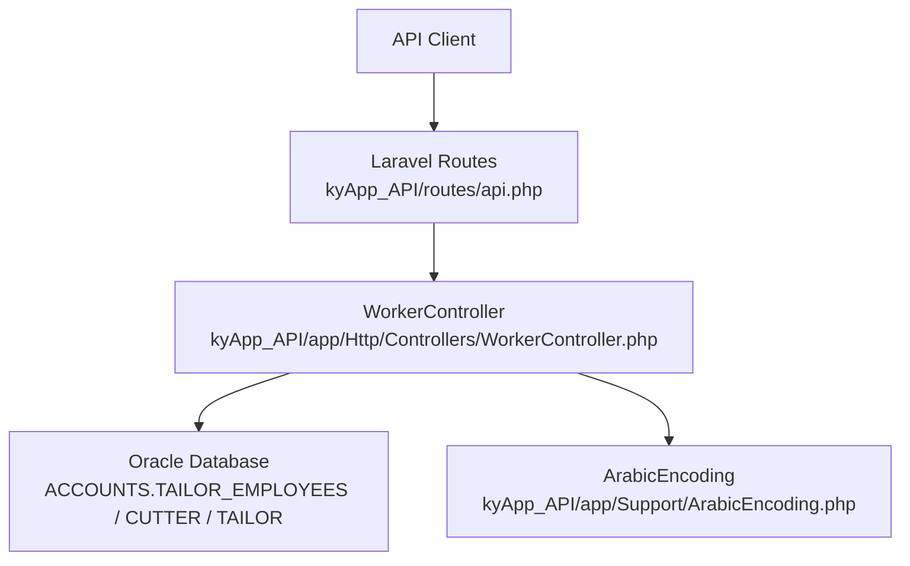
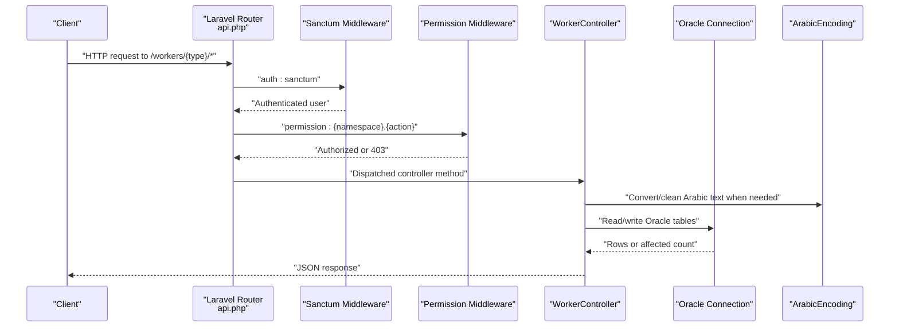
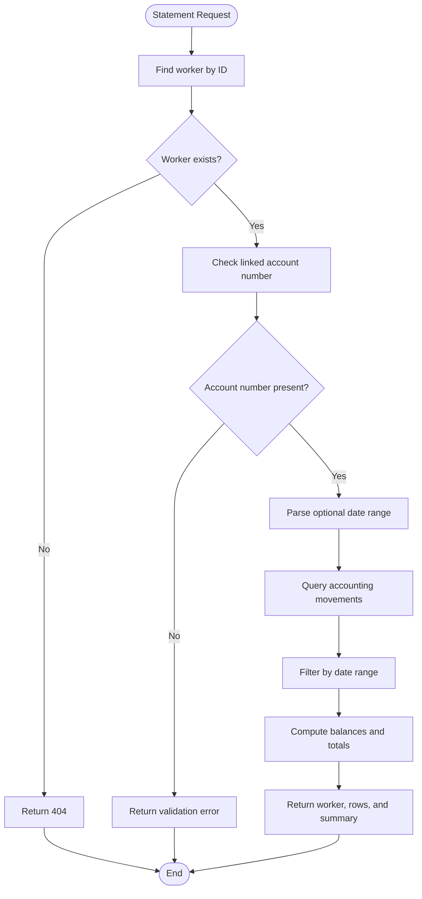
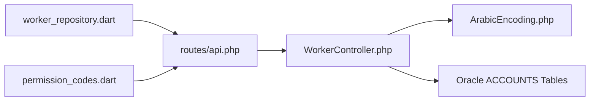

# Worker Management API

<cite>
**Referenced Files in This Document**
- [WorkerController.php](file://kyApp_API/app/Http/Controllers/WorkerController.php)
- [api.php](file://kyApp_API/routes/api.php)
- [ArabicEncoding.php](file://kyApp_API/app/Support/ArabicEncoding.php)
- [permission_codes.dart](file://lib/core/constants/permission_codes.dart)
- [worker_repository.dart](file://lib/features/workers/data/repositories/worker_repository.dart)
</cite>

## Table of Contents
1. [Introduction](#introduction)
2. [Project Structure](#project-structure)
3. [Core Components](#core-components)
4. [Architecture Overview](#architecture-overview)
5. [Detailed Component Analysis](#detailed-component-analysis)
6. [Dependency Analysis](#dependency-analysis)
7. [Performance Considerations](#performance-considerations)
8. [Troubleshooting Guide](#troubleshooting-guide)
9. [Conclusion](#conclusion)

## Introduction
This document describes the Worker Management API for three worker categories:
- Employees, backed by the `TAILOR_EMPLOYEES` table.
- Cutters, backed by the `CUTTER` table.
- Tailors, backed by the `TAILOR` table.

Each category exposes a consistent set of operations:
- List workers.
- Create a worker.
- Read worker detail.
- Update a worker.
- Delete a worker.
- Toggle worker status between active and disabled states.
- Generate a worker statement with optional date filtering.

The backend is implemented in Laravel under `kyApp_API`. Routes are defined in `routes/api.php`, controller logic is in `app/Http/Controllers/WorkerController.php`, Arabic text handling is provided by `app/Support/ArabicEncoding.php`, permission codes are referenced from the Flutter side in `lib/core/constants/permission_codes.dart`, and the Flutter client calls the statement endpoint through `lib/features/workers/data/repositories/worker_repository.dart`.

## Project Structure
The relevant backend structure for this API is:

**Diagram sources**
- [api.php:189-243](file://kyApp_API/routes/api.php#L189-L243)
- [WorkerController.php:16-598](file://kyApp_API/app/Http/Controllers/WorkerController.php#L16-L598)
- [ArabicEncoding.php:1-194](file://kyApp_API/app/Support/ArabicEncoding.php#L1-L194)

**Section sources**
- [api.php:189-243](file://kyApp_API/routes/api.php#L189-L243)
- [WorkerController.php:16-598](file://kyApp_API/app/Http/Controllers/WorkerController.php#L16-L598)

## Core Components
The Worker Management API has three main layers:

| Layer | Responsibility | Key File |
|---|---|---|
| Routing | Defines REST endpoints, HTTP methods, path parameters, and per-endpoint permissions. | `kyApp_API/routes/api.php` |
| Controller | Implements business logic for listing, creating, updating, deleting, toggling, and generating statements for employees, cutters, and tailors. | `kyApp_API/app/Http/Controllers/WorkerController.php` |
| Encoding Support | Converts Arabic text safely between UTF-8 and Oracle’s legacy encoding, fixes mojibake, and cleans data structures. | `kyApp_API/app/Support/ArabicEncoding.php` |

Key design characteristics:
- All worker endpoints require Sanctum authentication.
- Each worker type has its own permission namespace: `employees.*`, `cutters.*`, `tailors.*`.
- Statement access is separated from list/update/delete permissions.
- The controller uses shared private methods to avoid duplicating logic across worker types.
- Data comes from an Oracle database connection named `oracle`.

**Section sources**
- [api.php:189-243](file://kyApp_API/routes/api.php#L189-L243)
- [WorkerController.php:16-598](file://kyApp_API/app/Http/Controllers/WorkerController.php#L16-L598)
- [ArabicEncoding.php:1-194](file://kyApp_API/app/Support/ArabicEncoding.php#L1-L194)

## Architecture Overview
The request flow for worker management is:

**Diagram sources**
- [api.php:189-243](file://kyApp_API/routes/api.php#L189-L243)
- [WorkerController.php:188-598](file://kyApp_API/app/Http/Controllers/WorkerController.php#L188-L598)
- [ArabicEncoding.php:122-194](file://kyApp_API/app/Support/ArabicEncoding.php#L122-L194)

## Detailed Component Analysis

### Authentication and Authorization Model
All worker endpoints are protected by:
- `auth:sanctum`: ensures the request carries a valid token/session.
- A `permission:<namespace>.<action>` middleware that enforces deny-by-default authorization.

The permission namespaces are:
- `employees.view`, `employees.create`, `employees.update`, `employees.delete`, `employees.toggle`, `employees.statement`
- `cutters.view`, `cutters.create`, `cutters.update`, `cutters.delete`, `cutters.toggle`, `cutters.statement`
- `tailors.view`, `tailors.create`, `tailors.update`, `tailors.delete`, `tailors.toggle`, `tailors.statement`

The Flutter permission constants also define wildcard forms such as `employees.*`, `cutters.*`, and `tailors.*`.

**Section sources**
- [api.php:189-243](file://kyApp_API/routes/api.php#L189-L243)
- [permission_codes.dart:57-73](file://lib/core/constants/permission_codes.dart#L57-L73)

### Base Response Shape
Most successful responses follow a common shape:
- `success`: boolean indicating whether the operation succeeded.
- `message`: human-readable message.
- `data`: payload array or object.
- `meta`: pagination metadata for list endpoints.
- `id`: created identifier for creation endpoints.
- `new_status`: current status after toggle.
- `error`: present only on server errors, and may include internal details when debug is enabled.

Error responses use HTTP 500 for unexpected exceptions and HTTP 404 when a record is not found.

**Section sources**
- [WorkerController.php:225-235](file://kyApp_API/app/Http/Controllers/WorkerController.php#L225-L235)
- [WorkerController.php:276-280](file://kyApp_API/app/Http/Controllers/WorkerController.php#L276-L280)
- [WorkerController.php:312-316](file://kyApp_API/app/Http/Controllers/WorkerController.php#L312-L316)
- [WorkerController.php:335-339](file://kyApp_API/app/Http/Controllers/WorkerController.php#L335-L339)
- [WorkerController.php:373-377](file://kyApp_API/app/Http/Controllers/WorkerController.php#L373-L377)
- [WorkerController.php:589-596](file://kyApp_API/app/Http/Controllers/WorkerController.php#L589-L596)

### Employee Endpoints

#### List Employees
- **Method**: `GET`
- **Path**: `/workers/employees`
- **Required Permission**: `employees.view`
- **Query Parameters**:
  - `search`: string; supports numeric primary key search and name/phone search.
  - `limit`: integer; default 100, maximum 500.
  - `page`: integer; default 1.
- **Response Body**:
  - `success`: boolean
  - `type`: `"employees"`
  - `data`: array of employee records
  - `meta`:
    - `total`: total matching rows
    - `page`: current page
    - `limit`: applied limit
    - `pages`: total pages

Employee fields returned include the primary key, name, phone numbers, email, status, notes, account number, and extra columns such as job type, class, wages type, salary, piece price, and currency.

**Section sources**
- [api.php:191-192](file://kyApp_API/routes/api.php#L191-L192)
- [WorkerController.php:22-34](file://kyApp_API/app/Http/Controllers/WorkerController.php#L22-L34)
- [WorkerController.php:68-72](file://kyApp_API/app/Http/Controllers/WorkerController.php#L68-L72)
- [WorkerController.php:188-239](file://kyApp_API/app/Http/Controllers/WorkerController.php#L188-L239)

#### Create Employee
- **Method**: `POST`
- **Path**: `/workers/employees`
- **Required Permission**: `employees.create`
- **Request Body Fields**:
  - Name
  - Phone 1
  - Phone 2
  - Email
  - Status
  - Notes
  - Account number
  - Extra employee-specific fields
- **Response Body**:
  - `success`: boolean
  - `message`: success message
  - `id`: newly assigned employee ID

The controller computes the next primary key by taking the maximum existing value plus one. If no status is provided, a default active status is used.

**Section sources**
- [api.php:193-194](file://kyApp_API/routes/api.php#L193-L194)
- [WorkerController.php:90-93](file://kyApp_API/app/Http/Controllers/WorkerController.php#L90-L93)
- [WorkerController.php:244-284](file://kyApp_API/app/Http/Controllers/WorkerController.php#L244-L284)

#### Get Employee Detail
- **Method**: `GET`
- **Path**: `/workers/employees/{id}`
- **Required Permission**: `employees.view`
- **Path Parameter**:
  - `id`: integer employee ID
- **Response Body**:
  - `success`: boolean
  - `type`: `"employees"`
  - `data`: array containing the matched employee
  - `meta`: pagination metadata

Note: Although the route pattern allows a single-ID lookup, the implementation returns the same paginated list result filtered by the search logic. Clients should treat this as a detail query returning a single-item list.

**Section sources**
- [api.php:191-192](file://kyApp_API/routes/api.php#L191-L192)
- [WorkerController.php:68-72](file://kyApp_API/app/Http/Controllers/WorkerController.php#L68-L72)
- [WorkerController.php:188-239](file://kyApp_API/app/Http/Controllers/WorkerController.php#L188-L239)

#### Update Employee
- **Method**: `PUT`
- **Path**: `/workers/employees/{id}`
- **Required Permission**: `employees.update`
- **Path Parameter**:
  - `id`: integer employee ID
- **Request Body Fields**: Same as create, but partial updates are supported.
- **Response Body**:
  - `success`: boolean
  - `message`: success message
  - Or 404 if the record does not exist.

**Section sources**
- [api.php:198-200](file://kyApp_API/routes/api.php#L198-L200)
- [WorkerController.php:109-112](file://kyApp_API/app/Http/Controllers/WorkerController.php#L109-L112)
- [WorkerController.php:289-320](file://kyApp_API/app/Http/Controllers/WorkerController.php#L289-L320)

#### Delete Employee
- **Method**: `DELETE`
- **Path**: `/workers/employees/{id}`
- **Required Permission**: `employees.delete`
- **Path Parameter**:
  - `id`: integer employee ID
- **Response Body**:
  - `success`: boolean
  - `message`: success message
  - Or 404 if the record does not exist.

**Section sources**
- [api.php:201-203](file://kyApp_API/routes/api.php#L201-L203)
- [WorkerController.php:128-131](file://kyApp_API/app/Http/Controllers/WorkerController.php#L128-L131)
- [WorkerController.php:325-343](file://kyApp_API/app/Http/Controllers/WorkerController.php#L325-L343)

#### Toggle Employee Status
- **Method**: `PATCH`
- **Path**: `/workers/employees/{id}/toggle`
- **Required Permission**: `employees.toggle`
- **Path Parameter**:
  - `id`: integer employee ID
- **Response Body**:
  - `success`: boolean
  - `message`: status change message
  - `new_status`: new status value

The toggle flips between active and disabled states based on the stored status.

**Section sources**
- [api.php:204-206](file://kyApp_API/routes/api.php#L204-L206)
- [WorkerController.php:147-150](file://kyApp_API/app/Http/Controllers/WorkerController.php#L147-L150)
- [WorkerController.php:348-381](file://kyApp_API/app/Http/Controllers/WorkerController.php#L348-L381)

#### Generate Employee Statement
- **Method**: `GET`
- **Path**: `/workers/employees/{id}/statement`
- **Required Permission**: `employees.statement`
- **Path Parameter**:
  - `id`: integer employee ID
- **Query Parameters**:
  - `from_date`: optional date string
  - `to_date`: optional date string
- **Response Body**:
  - `success`: boolean
  - `worker`:
    - `id`
    - `name`
    - `acc_no`
    - `type`
  - `data`: array of movement rows
  - `summary`:
    - `total_rows`
    - `total_debit`
    - `total_credit`
    - `opening_balance`
    - `final_balance`
    - `from_date`
    - `to_date`
    - `currency`
    - `account_title`

If the worker has no linked account number, the endpoint returns a validation-style error. If no dates are provided and movements exist, the backend defaults to the last 30 days relative to the latest movement.

**Section sources**
- [api.php:195-197](file://kyApp_API/routes/api.php#L195-L197)
- [WorkerController.php:166-169](file://kyApp_API/app/Http/Controllers/WorkerController.php#L166-L169)
- [WorkerController.php:398-558](file://kyApp_API/app/Http/Controllers/WorkerController.php#L398-L558)

### Cutter Endpoints

#### List Cutters
- **Method**: `GET`
- **Path**: `/workers/cutters`
- **Required Permission**: `cutters.view`
- **Query Parameters**: Same as employees.
- **Response Body**: Same base list shape, with `type` set to `"cutters"`.

Cutter fields include the cutter primary key, name, phone numbers, email, status, notes, account number, and currency.

**Section sources**
- [api.php:209-210](file://kyApp_API/routes/api.php#L209-L210)
- [WorkerController.php:35-46](file://kyApp_API/app/Http/Controllers/WorkerController.php#L35-L46)
- [WorkerController.php:74-78](file://kyApp_API/app/Http/Controllers/WorkerController.php#L74-L78)
- [WorkerController.php:188-239](file://kyApp_API/app/Http/Controllers/WorkerController.php#L188-L239)

#### Create Cutter
- **Method**: `POST`
- **Path**: `/workers/cutters`
- **Required Permission**: `cutters.create`
- **Request Body Fields**: Cutter-specific fields including name, phones, email, status, notes, account number, and currency.
- **Response Body**: Same creation response shape.

**Section sources**
- [api.php:211-212](file://kyApp_API/routes/api.php#L211-L212)
- [WorkerController.php:95-98](file://kyApp_API/app/Http/Controllers/WorkerController.php#L95-L98)
- [WorkerController.php:244-284](file://kyApp_API/app/Http/Controllers/WorkerController.php#L244-L284)

#### Get Cutter Detail
- **Method**: `GET`
- **Path**: `/workers/cutters/{id}`
- **Required Permission**: `cutters.view`
- **Path Parameter**:
  - `id`: integer cutter ID
- **Response Body**: Paginated list result filtered by the cutter ID.

**Section sources**
- [api.php:209-210](file://kyApp_API/routes/api.php#L209-L210)
- [WorkerController.php:74-78](file://kyApp_API/app/Http/Controllers/WorkerController.php#L74-L78)
- [WorkerController.php:188-239](file://kyApp_API/app/Http/Controllers/WorkerController.php#L188-L239)

#### Update Cutter
- **Method**: `PUT`
- **Path**: `/workers/cutters/{id}`
- **Required Permission**: `cutters.update`
- **Path Parameter**:
  - `id`: integer cutter ID
- **Request Body Fields**: Same as create.
- **Response Body**: Success or 404.

**Section sources**
- [api.php:216-218](file://kyApp_API/routes/api.php#L216-L218)
- [WorkerController.php:114-117](file://kyApp_API/app/Http/Controllers/WorkerController.php#L114-L117)
- [WorkerController.php:289-320](file://kyApp_API/app/Http/Controllers/WorkerController.php#L289-L320)

#### Delete Cutter
- **Method**: `DELETE`
- **Path**: `/workers/cutters/{id}`
- **Required Permission**: `cutters.delete`
- **Path Parameter**:
  - `id`: integer cutter ID
- **Response Body**: Success or 404.

**Section sources**
- [api.php:219-221](file://kyApp_API/routes/api.php#L219-L221)
- [WorkerController.php:133-136](file://kyApp_API/app/Http/Controllers/WorkerController.php#L133-L136)
- [WorkerController.php:325-343](file://kyApp_API/app/Http/Controllers/WorkerController.php#L325-L343)

#### Toggle Cutter Status
- **Method**: `PATCH`
- **Path**: `/workers/cutters/{id}/toggle`
- **Required Permission**: `cutters.toggle`
- **Path Parameter**:
  - `id`: integer cutter ID
- **Response Body**: Success with `new_status`.

**Section sources**
- [api.php:222-224](file://kyApp_API/routes/api.php#L222-L224)
- [WorkerController.php:152-155](file://kyApp_API/app/Http/Controllers/WorkerController.php#L152-L155)
- [WorkerController.php:348-381](file://kyApp_API/app/Http/Controllers/WorkerController.php#L348-L381)

#### Generate Cutter Statement
- **Method**: `GET`
- **Path**: `/workers/cutters/{id}/statement`
- **Required Permission**: `cutters.statement`
- **Path Parameter**:
  - `id`: integer cutter ID
- **Query Parameters**:
  - `from_date`: optional
  - `to_date`: optional
- **Response Body**: Same statement shape as employees.

**Section sources**
- [api.php:213-215](file://kyApp_API/routes/api.php#L213-L215)
- [WorkerController.php:171-174](file://kyApp_API/app/Http/Controllers/WorkerController.php#L171-L174)
- [WorkerController.php:398-558](file://kyApp_API/app/Http/Controllers/WorkerController.php#L398-L558)

### Tailor Endpoints

#### List Tailors
- **Method**: `GET`
- **Path**: `/workers/tailors`
- **Required Permission**: `tailors.view`
- **Query Parameters**: Same as other worker types.
- **Response Body**: Same base list shape, with `type` set to `"tailors"`.

Tailor fields include tailor primary key, name, phone numbers, email, status, notes, account number, and currency.

**Section sources**
- [api.php:227-228](file://kyApp_API/routes/api.php#L227-L228)
- [WorkerController.php:47-58](file://kyApp_API/app/Http/Controllers/WorkerController.php#L47-L58)
- [WorkerController.php:80-84](file://kyApp_API/app/Http/Controllers/WorkerController.php#L80-L84)
- [WorkerController.php:188-239](file://kyApp_API/app/Http/Controllers/WorkerController.php#L188-L239)

#### Create Tailor
- **Method**: `POST`
- **Path**: `/workers/tailors`
- **Required Permission**: `tailors.create`
- **Request Body Fields**: Tailor-specific fields including name, phones, email, status, notes, account number, and currency.
- **Response Body**: Same creation response shape.

**Section sources**
- [api.php:229-230](file://kyApp_API/routes/api.php#L229-L230)
- [WorkerController.php:100-103](file://kyApp_API/app/Http/Controllers/WorkerController.php#L100-L103)
- [WorkerController.php:244-284](file://kyApp_API/app/Http/Controllers/WorkerController.php#L244-L284)

#### Get Tailor Detail
- **Method**: `GET`
- **Path**: `/workers/tailors/{id}`
- **Required Permission**: `tailors.view`
- **Path Parameter**:
  - `id`: integer tailor ID
- **Response Body**: Paginated list result filtered by the tailor ID.

**Section sources**
- [api.php:227-228](file://kyApp_API/routes/api.php#L227-L228)
- [WorkerController.php:80-84](file://kyApp_API/app/Http/Controllers/WorkerController.php#L80-L84)
- [WorkerController.php:188-239](file://kyApp_API/app/Http/Controllers/WorkerController.php#L188-L239)

#### Update Tailor
- **Method**: `PUT`
- **Path**: `/workers/tailors/{id}`
- **Required Permission**: `tailors.update`
- **Path Parameter**:
  - `id`: integer tailor ID
- **Request Body Fields**: Same as create.
- **Response Body**: Success or 404.

**Section sources**
- [api.php:234-236](file://kyApp_API/routes/api.php#L234-L236)
- [WorkerController.php:119-122](file://kyApp_API/app/Http/Controllers/WorkerController.php#L119-L122)
- [WorkerController.php:289-320](file://kyApp_API/app/Http/Controllers/WorkerController.php#L289-L320)

#### Delete Tailor
- **Method**: `DELETE`
- **Path**: `/workers/tailors/{id}`
- **Required Permission**: `tailors.delete`
- **Path Parameter**:
  - `id`: integer tailor ID
- **Response Body**: Success or 404.

**Section sources**
- [api.php:237-239](file://kyApp_API/routes/api.php#L237-L239)
- [WorkerController.php:138-141](file://kyApp_API/app/Http/Controllers/WorkerController.php#L138-L141)
- [WorkerController.php:325-343](file://kyApp_API/app/Http/Controllers/WorkerController.php#L325-L343)

#### Toggle Tailor Status
- **Method**: `PATCH`
- **Path**: `/workers/tailors/{id}/toggle`
- **Required Permission**: `tailors.toggle`
- **Path Parameter**:
  - `id`: integer tailor ID
- **Response Body**: Success with `new_status`.

**Section sources**
- [api.php:240-242](file://kyApp_API/routes/api.php#L240-L242)
- [WorkerController.php:157-160](file://kyApp_API/app/Http/Controllers/WorkerController.php#L157-L160)
- [WorkerController.php:348-381](file://kyApp_API/app/Http/Controllers/WorkerController.php#L348-L381)

#### Generate Tailor Statement
- **Method**: `GET`
- **Path**: `/workers/tailors/{id}/statement`
- **Required Permission**: `tailors.statement`
- **Path Parameter**:
  - `id`: integer tailor ID
- **Query Parameters**:
  - `from_date`: optional
  - `to_date`: optional
- **Response Body**: Same statement shape as other worker types.

**Section sources**
- [api.php:231-233](file://kyApp_API/routes/api.php#L231-L233)
- [WorkerController.php:176-179](file://kyApp_API/app/Http/Controllers/WorkerController.php#L176-L179)
- [WorkerController.php:398-558](file://kyApp_API/app/Http/Controllers/WorkerController.php#L398-L558)

### Business Logic Differences Between Worker Categories
Although the HTTP surface is consistent, each worker type maps to a different Oracle table and column set:

| Worker Type | Oracle Table | Primary Key | Name Column | Extra Columns |
|---|---|---|---|---|
| Employees | `ACCOUNTS.TAILOR_EMPLOYEES` | `EMP_NO` | `EMP_NAME` | Job type, class, wages type, salary, piece price, currency |
| Cutters | `ACCOUNTS.CUTTER` | `CUTTER_NO` | `CUTTER_NAME` | Currency |
| Tailors | `ACCOUNTS.TAILOR` | `TAILOR_NO` | `TAILOR_NAME` | Currency |

Common fields across all types include:
- Primary key
- Name
- Phone 1
- Phone 2
- Email
- Status
- Notes
- Account number

Employees have additional operational fields related to payroll and pricing, while cutters and tailors share a simpler schema focused on identity, contact, status, accounting linkage, and currency.

**Section sources**
- [WorkerController.php:22-58](file://kyApp_API/app/Http/Controllers/WorkerController.php#L22-L58)

### Statement Generation Flow
The statement endpoint performs these steps:
1. Load the worker by ID.
2. Extract the linked account number.
3. Parse optional `from_date` and `to_date`.
4. Query movement records linked to the account.
5. Compute opening balance, running balance, debit totals, credit totals, and filtered rows.
6. Return worker metadata, movement rows, and summary statistics.

**Diagram sources**
- [WorkerController.php:398-558](file://kyApp_API/app/Http/Controllers/WorkerController.php#L398-L558)

**Section sources**
- [WorkerController.php:398-558](file://kyApp_API/app/Http/Controllers/WorkerController.php#L398-L558)

### Client Integration Notes
The Flutter client calls the statement endpoint using a repository method that builds the path `/workers/{type.apiPath}/{id}/statement` and passes optional `from_date` and `to_date` query parameters. On success, it expects `success`, `worker`, `data`, and `summary` fields.

**Section sources**
- [worker_repository.dart:136-169](file://lib/features/workers/data/repositories/worker_repository.dart#L136-L169)

## Dependency Analysis
The worker management feature depends on:

**Diagram sources**
- [api.php:189-243](file://kyApp_API/routes/api.php#L189-L243)
- [WorkerController.php:16-598](file://kyApp_API/app/Http/Controllers/WorkerController.php#L16-L598)
- [ArabicEncoding.php:1-194](file://kyApp_API/app/Support/ArabicEncoding.php#L1-L194)
- [worker_repository.dart:136-169](file://lib/features/workers/data/repositories/worker_repository.dart#L136-L169)
- [permission_codes.dart:57-73](file://lib/core/constants/permission_codes.dart#L57-L73)

Coupling and cohesion observations:
- The controller centralizes all worker-type logic, improving cohesion.
- Route definitions are tightly coupled to controller method names and permission strings.
- Arabic text handling is isolated in a dedicated helper, reducing duplication.
- Permission codes are referenced both in routes and in Flutter constants, requiring coordinated changes when permissions evolve.

**Section sources**
- [api.php:189-243](file://kyApp_API/routes/api.php#L189-L243)
- [WorkerController.php:16-598](file://kyApp_API/app/Http/Controllers/WorkerController.php#L16-L598)
- [ArabicEncoding.php:1-194](file://kyApp_API/app/Support/ArabicEncoding.php#L1-L194)
- [permission_codes.dart:57-73](file://lib/core/constants/permission_codes.dart#L57-L73)
- [worker_repository.dart:136-169](file://lib/features/workers/data/repositories/worker_repository.dart#L136-L169)

## Performance Considerations
- Pagination limits: default 100 rows, maximum 500 rows.
- Search performance: numeric searches use exact primary key matching; text searches use `LIKE` patterns against name and phone fields.
- Statement queries: join multiple accounting tables and compute summaries in PHP; large datasets can be expensive without date filters.
- Arabic encoding: text conversion adds CPU overhead but is necessary for correct Oracle storage and retrieval.
- Recommendation: always provide `from_date` and `to_date` for statement endpoints when possible to reduce row counts.

[No sources needed since this section provides general guidance]

## Troubleshooting Guide
Common issues and their likely causes:

| Symptom | Likely Cause | Resolution |
|---|---|---|
| 401 Unauthorized | Missing or invalid Sanctum token. | Ensure authentication headers are included. |
| 403 Forbidden | Missing required permission. | Grant the correct `employees.*`, `cutters.*`, or `tailors.*` permission. |
| 404 Not Found | Worker ID does not exist. | Verify the ID and worker type. |
| Validation-style error on statement | Worker has no linked account number. | Assign an account number to the worker. |
| Arabic text appears corrupted | Oracle encoding mismatch or double cleaning. | Use the provided Arabic encoding helpers and avoid manual CP1256 manipulation. |
| Statement returns unexpected rows | Date parsing or default 30-day window behavior. | Explicitly pass `from_date` and `to_date`. |

**Section sources**
- [WorkerController.php:236-238](file://kyApp_API/app/Http/Controllers/WorkerController.php#L236-L238)
- [WorkerController.php:312-316](file://kyApp_API/app/Http/Controllers/WorkerController.php#L312-L316)
- [WorkerController.php:335-339](file://kyApp_API/app/Http/Controllers/WorkerController.php#L335-L339)
- [WorkerController.php:419-424](file://kyApp_API/app/Http/Controllers/WorkerController.php#L419-L424)
- [WorkerController.php:589-596](file://kyApp_API/app/Http/Controllers/WorkerController.php#L589-L596)
- [ArabicEncoding.php:122-194](file://kyApp_API/app/Support/ArabicEncoding.php#L122-L194)

## Conclusion
The Worker Management API provides a consistent, permission-gated interface for managing employees, cutters, and tailors. While the HTTP contracts are uniform, each worker type maps to a distinct Oracle table with slightly different fields. Statements are powerful financial reports tied to the worker’s linked account number and support optional date filtering. Proper permission assignment, correct Arabic text handling, and sensible date ranges are essential for reliable operation.

[No sources needed since this section summarizes without analyzing specific files]