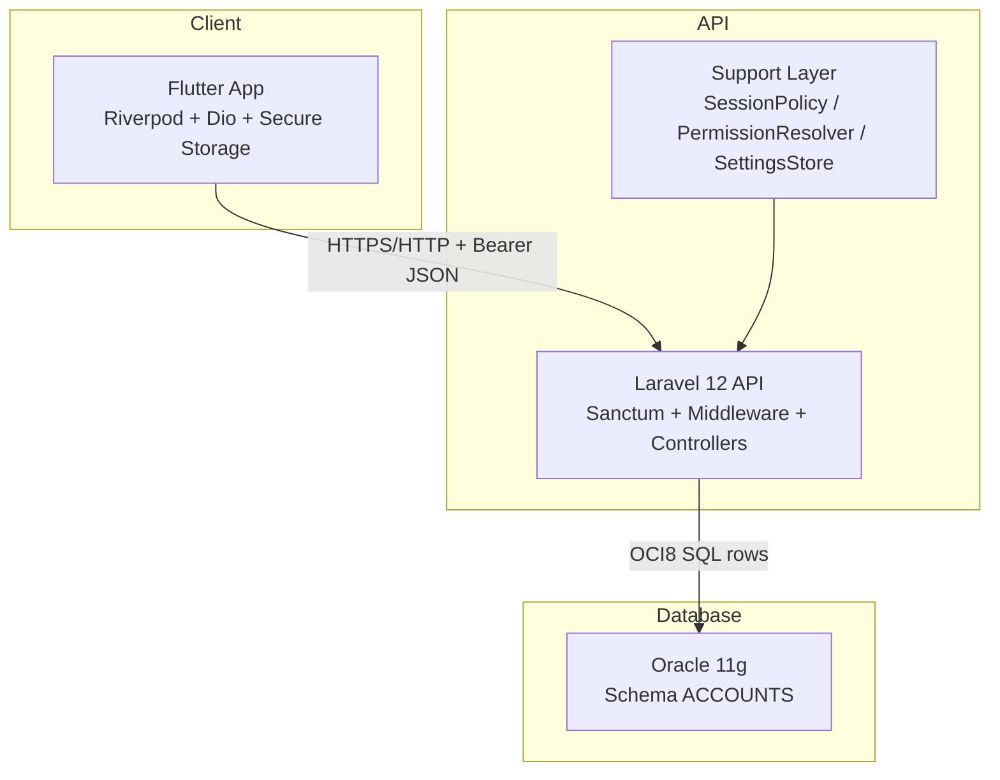
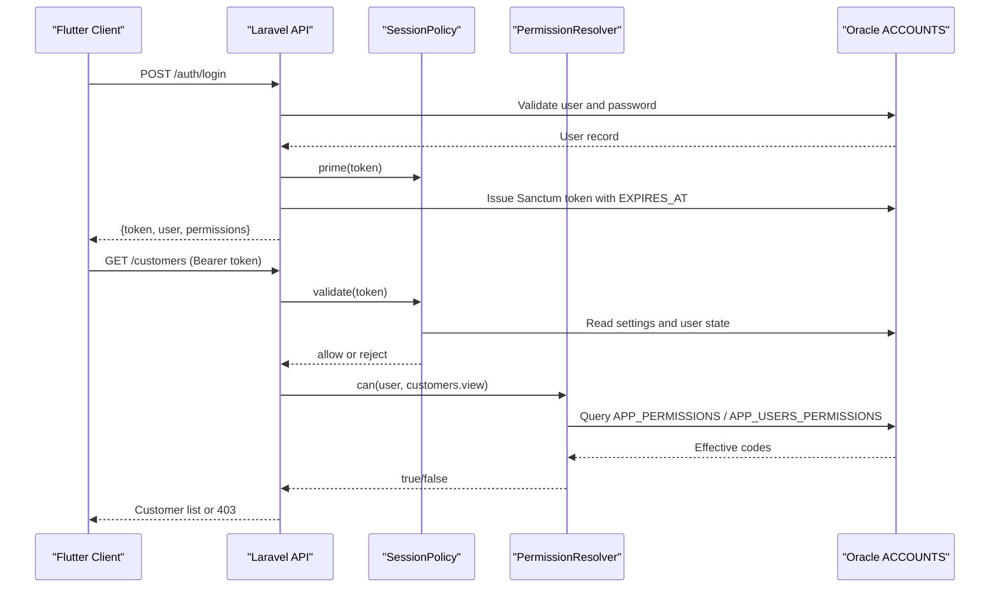
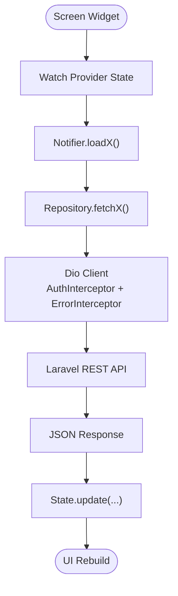
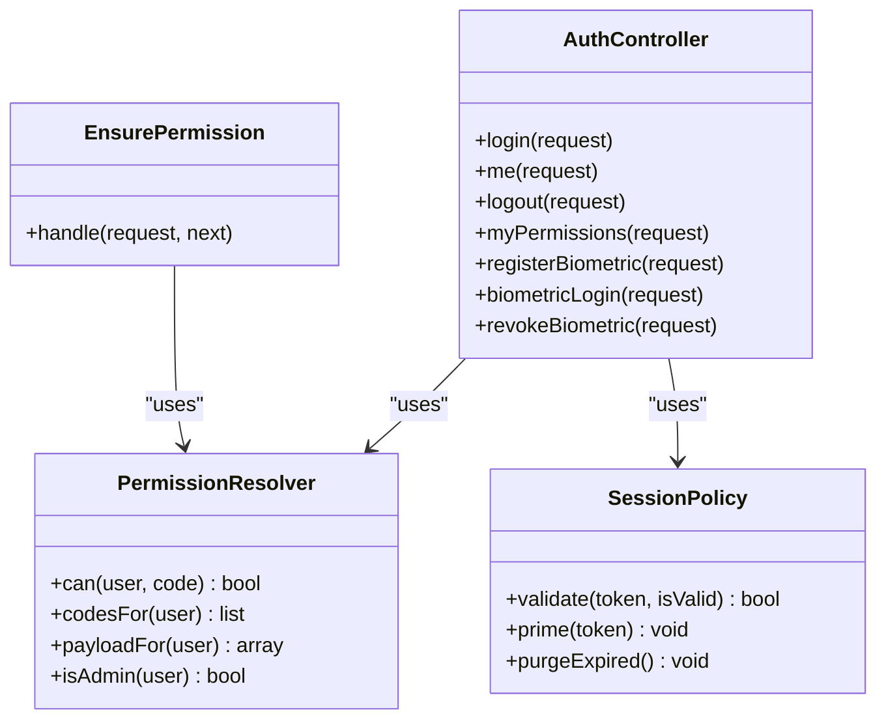
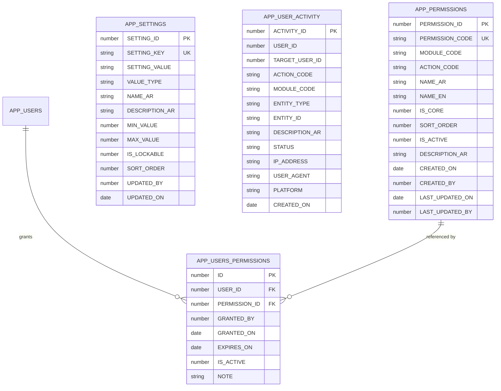
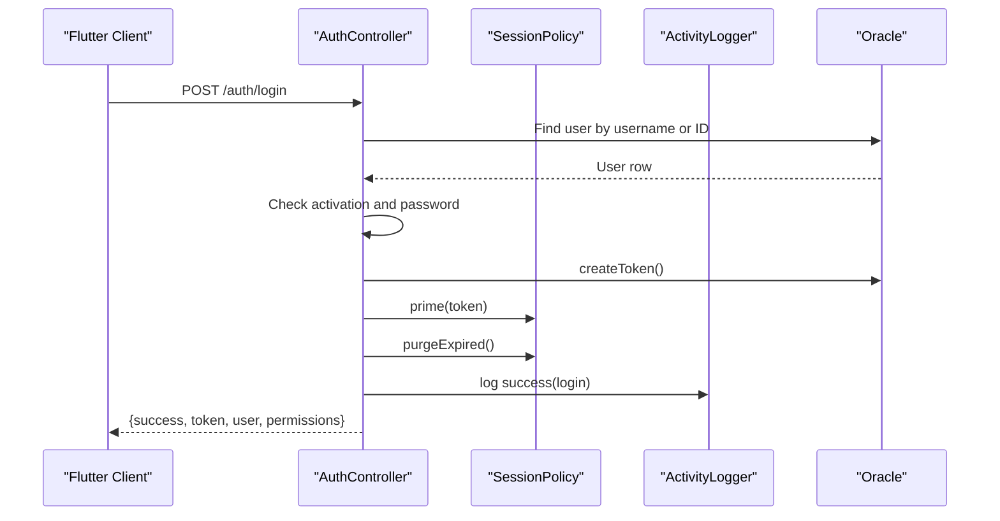
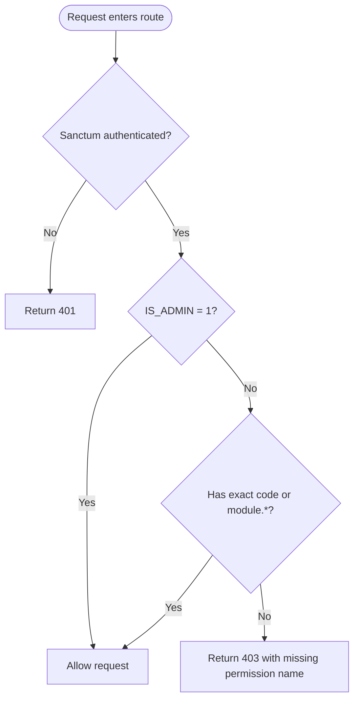
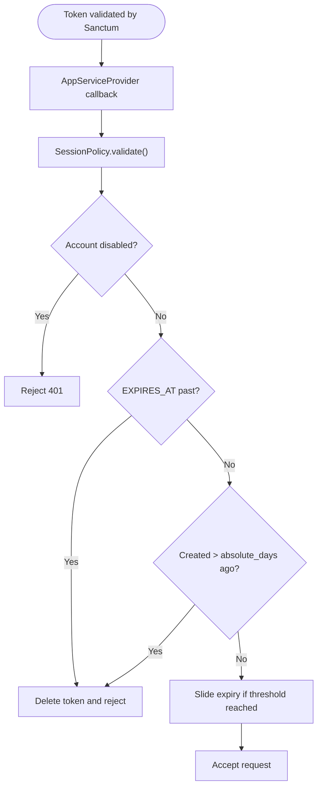
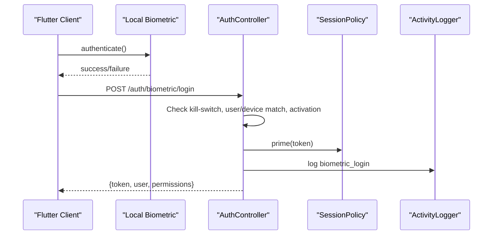
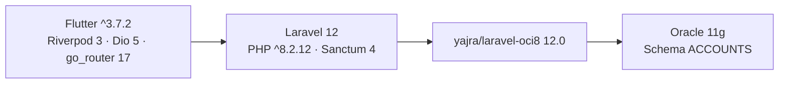

# Architecture Overview

<cite>
**Referenced Files in This Document**
- [AGENTS.md](file://AGENTS.md)
- [README.md](file://README.md)
- [pubspec.yaml](file://pubspec.yaml)
- [lib/main.dart](file://lib/main.dart)
- [composer.json](file://kyApp_API/composer.json)
- [routes/api.php](file://kyApp_API/routes/api.php)
- [app/Providers/AppServiceProvider.php](file://kyApp_API/app/Providers/AppServiceProvider.php)
- [config/sanctum.php](file://kyApp_API/config/sanctum.php)
- [app/Support/SessionPolicy.php](file://kyApp_API/app/Support/SessionPolicy.php)
- [app/Support/PermissionResolver.php](file://kyApp_API/app/Support/PermissionResolver.php)
- [app/Http/Middleware/EnsurePermission.php](file://kyApp_API/app/Http/Middleware/EnsurePermission.php)
- [app/Http/Controllers/AuthController.php](file://kyApp_API/app/Http/Controllers/AuthController.php)
- [database/oracle/01_ibac_schema.sql](file://kyApp_API/database/oracle/01_ibac_schema.sql)
- [appsroles.md](file://appsroles.md)
</cite>

## Table of Contents
1. [Introduction](#introduction)
2. [Project Structure](#project-structure)
3. [Core Components](#core-components)
4. [Architecture Overview](#architecture-overview)
5. [Detailed Component Analysis](#detailed-component-analysis)
6. [Dependency Analysis](#dependency-analysis)
7. [Performance Considerations](#performance-considerations)
8. [Troubleshooting Guide](#troubleshooting-guide)
9. [Conclusion](#conclusion)

## Introduction
Ky Apps is an Arabic-first, right-to-left Flutter client for a tailoring business that consumes a Laravel 12 REST API backed by a legacy Oracle 11g database under the `ACCOUNTS` schema. The system separates presentation (Flutter), application logic and security (Laravel), and data storage (Oracle). Authentication uses Sanctum personal access tokens with a custom session policy; authorization uses Identity-Based Access Control (IBAC) with direct user-to-permission grants and an administrator bypass.

The repository is a two-repo monorepo: the root contains the Flutter client (`lib/`, `android/`, `ios/`, etc.), while `kyApp_API/` is a Git submodule containing the Laravel backend. Business tables are not migrated from this repository; only infrastructure and IBAC-related DDL live here.

**Section sources**
- [AGENTS.md:20-60](file://AGENTS.md#L20-L60)
- [AGENTS.md:63-96](file://AGENTS.md#L63-L96)
- [README.md:1-18](file://README.md#L1-L18)

## Project Structure
At a high level:
- Flutter client: feature-first layout under `lib/features/`, shared infrastructure under `lib/core/`, routing via GoRouter, state management via Riverpod 3 without codegen, networking via Dio, and secure local storage for credentials and permissions.
- Laravel backend: controllers, middleware, support classes, Sanctum configuration, Pest tests, and Oracle DDL scripts under `database/oracle/`.
- Database: Oracle 11g schema `ACCOUNTS`; IBAC adds five core tables plus sequences and triggers.

**Diagram sources**
- [AGENTS.md:26-31](file://AGENTS.md#L26-L31)
- [AGENTS.md:186-258](file://AGENTS.md#L186-L258)
- [AGENTS.md:382-444](file://AGENTS.md#L382-L444)
- [AGENTS.md:448-541](file://AGENTS.md#L448-L541)

**Section sources**
- [AGENTS.md:63-96](file://AGENTS.md#L63-L96)
- [AGENTS.md:186-258](file://AGENTS.md#L186-L258)
- [AGENTS.md:382-444](file://AGENTS.md#L382-L444)
- [AGENTS.md:448-541](file://AGENTS.md#L448-L541)

## Core Components
- Flutter entry point initializes the provider scope and configures Arabic localization, RTL, theming, and router-based navigation.
- Laravel routes define public authentication endpoints, session-only endpoints, and business/admin endpoints protected by Sanctum and IBAC permission guards.
- IBAC defines a permission catalog, direct user grants, settings, and audit activity, all stored in Oracle.
- Session policy enforces idle sliding renewal, absolute lifetime, disabled-account rejection, and token cleanup.
- Permission resolver implements deny-by-default authorization with administrator bypass, explicit codes, module wildcards, and system wildcard.

Key responsibilities:
- Flutter: UI, state, network requests, secure storage, biometric prompts, permission display.
- Laravel: request validation, authentication, authorization, business queries, audit logging, session lifecycle.
- Oracle: legacy business data plus IBAC metadata and Sanctum tokens.

**Section sources**
- [lib/main.dart:7-47](file://lib/main.dart#L7-L47)
- [routes/api.php:17-116](file://kyApp_API/routes/api.php#L17-L116)
- [database/oracle/01_ibac_schema.sql:21-190](file://kyApp_API/database/oracle/01_ibac_schema.sql#L21-L190)
- [app/Support/SessionPolicy.php:9-41](file://kyApp_API/app/Support/SessionPolicy.php#L9-L41)
- [app/Support/PermissionResolver.php:9-26](file://kyApp_API/app/Support/PermissionResolver.php#L9-L26)

## Architecture Overview
The system follows a three-tier architecture:
- Presentation tier: Flutter app renders screens, manages state with Riverpod, and calls the API through Dio.
- Application tier: Laravel exposes REST endpoints, authenticates sessions with Sanctum, authorizes actions with IBAC, and logs activity.
- Data tier: Oracle stores legacy business records and IBAC metadata; Sanctum tokens also reside there.

**Diagram sources**
- [app/Http/Controllers/AuthController.php:47-164](file://kyApp_API/app/Http/Controllers/AuthController.php#L47-L164)
- [app/Support/SessionPolicy.php:70-108](file://kyApp_API/app/Support/SessionPolicy.php#L70-L108)
- [app/Support/PermissionResolver.php:95-132](file://kyApp_API/app/Support/PermissionResolver.php#L95-L132)
- [routes/api.php:17-116](file://kyApp_API/routes/api.php#L17-L116)

## Detailed Component Analysis

### Flutter Frontend — MVVM-like Layering with Riverpod
The Flutter side organizes features into data and presentation layers. Presentation widgets observe Riverpod providers; providers call repositories; repositories make HTTP calls through a centralized Dio client. State is held in Notifiers or legacy StateNotifiers depending on feature age.

Important characteristics:
- Routing uses GoRouter with programmatic auth gating rather than declarative route guards.
- Networking injects bearer tokens, handles cancellation, maps 401 to forced logout, and logs request/response bodies.
- Local storage holds tokens, user profile, permissions snapshot, API base URL, and biometric enrollment flags.
- Permissions are mirrored locally for UI gating, but server-side checks remain authoritative.

**Section sources**
- [AGENTS.md:186-258](file://AGENTS.md#L186-L258)
- [AGENTS.md:297-324](file://AGENTS.md#L297-L324)
- [appsroles.md:13-29](file://appsroles.md#L13-L29)

### Laravel API — RESTful Endpoints and Security Guards
Routes are grouped by concern:
- Public: login, biometric login, health probe.
- Session-owned: logout, current user, current permissions, biometric register/revoke.
- Protected business/admin: Sanctum authentication plus `permission:<code>` middleware enforcing IBAC.

**Diagram sources**
- [app/Http/Controllers/AuthController.php:34-41](file://kyApp_API/app/Http/Controllers/AuthController.php#L34-L41)
- [app/Support/PermissionResolver.php:27-43](file://kyApp_API/app/Support/PermissionResolver.php#L27-L43)
- [app/Support/SessionPolicy.php:42-44](file://kyApp_API/app/Support/SessionPolicy.php#L42-L44)
- [app/Http/Middleware/EnsurePermission.php:11-24](file://kyApp_API/app/Http/Middleware/EnsurePermission.php#L11-L24)

**Section sources**
- [routes/api.php:17-116](file://kyApp_API/routes/api.php#L17-L116)
- [routes/api.php:124-327](file://kyApp_API/routes/api.php#L124-L327)
- [app/Http/Middleware/EnsurePermission.php:11-24](file://kyApp_API/app/Http/Middleware/EnsurePermission.php#L11-L24)

### Oracle Database Schema — IBAC Tables
IBAC introduces five core tables plus sequences and triggers:
- `APP_PERMISSIONS`: permission catalog with ASCII codes and Arabic names.
- `APP_USERS_PERMISSIONS`: direct user-to-permission grants with active/expired semantics.
- `APP_SETTINGS`: security and session settings with typed values and bounds.
- `APP_USER_ACTIVITY`: lightweight audit trail.
- Modified `APP_USERS`: widened password column and added `IS_ADMIN`.

**Diagram sources**
- [database/oracle/01_ibac_schema.sql:36-190](file://kyApp_API/database/oracle/01_ibac_schema.sql#L36-L190)

**Section sources**
- [database/oracle/01_ibac_schema.sql:21-190](file://kyApp_API/database/oracle/01_ibac_schema.sql#L21-L190)
- [AGENTS.md:448-541](file://AGENTS.md#L448-L541)

### Authentication Flow
Password login validates input, locates the user by English name, Arabic name, or numeric ID, supports legacy plain-text passwords alongside hashed passwords, issues a Sanctum token, primes the session, purges expired tokens, and logs the event. Biometric login requires device enrollment, platform kill-switch, account activation, and returns a token under the same session policy.

**Diagram sources**
- [app/Http/Controllers/AuthController.php:47-164](file://kyApp_API/app/Http/Controllers/AuthController.php#L47-L164)
- [app/Support/SessionPolicy.php:110-141](file://kyApp_API/app/Support/SessionPolicy.php#L110-L141)

**Section sources**
- [app/Http/Controllers/AuthController.php:47-164](file://kyApp_API/app/Http/Controllers/AuthController.php#L47-L164)
- [app/Http/Controllers/AuthController.php:316-411](file://kyApp_API/app/Http/Controllers/AuthController.php#L316-L411)

### Authorization Flow — IBAC Permission Validation
Authorization is deny-by-default. A user passes if they are an administrator, hold `system.*`, hold the exact permission code, or hold the module wildcard. The middleware enforces this per route after Sanctum authentication.

**Diagram sources**
- [app/Support/PermissionResolver.php:95-132](file://kyApp_API/app/Support/PermissionResolver.php#L95-L132)
- [app/Http/Middleware/EnsurePermission.php:11-24](file://kyApp_API/app/Http/Middleware/EnsurePermission.php#L11-L24)

**Section sources**
- [app/Support/PermissionResolver.php:9-26](file://kyApp_API/app/Support/PermissionResolver.php#L9-L26)
- [app/Support/PermissionResolver.php:95-132](file://kyApp_API/app/Support/PermissionResolver.php#L95-L132)
- [app/Http/Middleware/EnsurePermission.php:11-24](file://kyApp_API/app/Http/Middleware/EnsurePermission.php#L11-L24)

### Session Management
Sanctum’s expiration setting is intentionally null so it does not impose a hard absolute age against `created_at`. Instead, `SessionPolicy` drives `EXPIRES_AT`:
- Disabled accounts are rejected immediately.
- Expired idle windows cause rejection and token deletion.
- Absolute age beyond configured days causes rejection and token deletion.
- Active sessions receive write-throttled sliding renewal.
- Cleanup runs on login and on the active-sessions screen.

**Diagram sources**
- [app/Providers/AppServiceProvider.php:38-63](file://kyApp_API/app/Providers/AppServiceProvider.php#L38-L63)
- [app/Support/SessionPolicy.php:70-108](file://kyApp_API/app/Support/SessionPolicy.php#L70-L108)
- [config/sanctum.php:60-77](file://kyApp_API/config/sanctum.php#L60-L77)

**Section sources**
- [app/Providers/AppServiceProvider.php:38-63](file://kyApp_API/app/Providers/AppServiceProvider.php#L38-L63)
- [app/Support/SessionPolicy.php:9-41](file://kyApp_API/app/Support/SessionPolicy.php#L9-L41)
- [app/Support/SessionPolicy.php:70-108](file://kyApp_API/app/Support/SessionPolicy.php#L70-L108)
- [config/sanctum.php:60-77](file://kyApp_API/config/sanctum.php#L60-L77)

### Security Architecture
Security combines multiple controls:
- Multi-factor-style flow: password or biometric login, both issuing Sanctum tokens.
- Biometric integration: local device authentication, device token generation, server-side enrollment check, platform kill-switch, and one-device-per-user enforcement.
- Role-like access control implemented as IBAC: direct user grants, module wildcards, system wildcard, and administrator bypass.
- Audit logging: login, failed login, logout, biometric events, and administrative actions.

**Diagram sources**
- [app/Http/Controllers/AuthController.php:316-411](file://kyApp_API/app/Http/Controllers/AuthController.php#L316-L411)
- [app/Support/SessionPolicy.php:110-117](file://kyApp_API/app/Support/SessionPolicy.php#L110-L117)

**Section sources**
- [app/Http/Controllers/AuthController.php:241-310](file://kyApp_API/app/Http/Controllers/AuthController.php#L241-L310)
- [app/Http/Controllers/AuthController.php:316-411](file://kyApp_API/app/Http/Controllers/AuthController.php#L316-L411)
- [app/Http/Controllers/AuthController.php:417-441](file://kyApp_API/app/Http/Controllers/AuthController.php#L417-L441)

### Cross-Cutting Concerns
- Session management: Sanctum tokens with custom idle/absolute policies and silent sliding renewal.
- Error handling: Dio interceptors map cancellations and 401 responses; Laravel returns structured envelopes with bilingual messages.
- Audit logging: Activity logger records successful and failed authentication and administrative actions.
- Arabic encoding: Server reads mojibake and repairs it; writes use a safe conversion path for Oracle’s character set.

**Section sources**
- [AGENTS.md:240-258](file://AGENTS.md#L240-L258)
- [AGENTS.md:510-535](file://AGENTS.md#L510-L535)
- [AGENTS.md:382-444](file://AGENTS.md#L382-L444)

## Dependency Analysis
Technology stack decisions and compatibility:
- Flutter SDK constrained to Dart `^3.7.2`; dependencies include Riverpod 3, Dio 5, go_router 17, local_auth, flutter_secure_storage, and google_fonts.
- Laravel 12 with PHP `^8.2.12`, Sanctum 4, and `yajra/laravel-oci8` 12.0 for Oracle connectivity.
- Oracle 11g schema `ACCOUNTS` with WE8MSWIN1252 character set; IBAC tables are DDL scripts applied outside Laravel migrations.

**Diagram sources**
- [pubspec.yaml:21-47](file://pubspec.yaml#L21-L47)
- [composer.json:11-18](file://kyApp_API/composer.json#L11-L18)
- [AGENTS.md:448-541](file://AGENTS.md#L448-L541)

**Section sources**
- [pubspec.yaml:21-47](file://pubspec.yaml#L21-L47)
- [composer.json:11-18](file://kyApp_API/composer.json#L11-L18)
- [AGENTS.md:448-541](file://AGENTS.md#L448-L541)

## Performance Considerations
- Permission caching: effective permission codes are cached per user with a TTL and a maximum payload size to avoid Oracle cache store limits.
- Sliding session renewal: token updates are throttled by a configurable threshold to reduce writes.
- Manual pagination: API endpoints use page/limit parameters; response meta shapes vary by controller and should be matched consistently.
- Statement performance: chart-of-accounts tree queries may perform N+1 work; new queries should prefer bound parameters and consistent date formats.

[No sources needed since this section provides general guidance]

## Troubleshooting Guide
Common operational issues:
- Arabic text corruption: ensure read repair on the server and client, and write/search paths use the safe conversion function.
- Missing network permission: release Android builds require the internet permission in the main manifest.
- Oracle connection and character set: verify Oracle Instant Client, PDO/OCI8 extensions, charset configuration, and schema prefix.
- Route sealing: every business route must carry Sanctum and permission guards; tests enforce this invariant.

**Section sources**
- [AGENTS.md:510-535](file://AGENTS.md#L510-L535)
- [AGENTS.md:633-658](file://AGENTS.md#L633-L658)
- [AGENTS.md:417-444](file://AGENTS.md#L417-L444)

## Conclusion
Ky Apps separates concerns across Flutter, Laravel, and Oracle. Flutter provides an Arabic-first mobile interface with Riverpod state and Dio networking. Laravel enforces authentication, session lifecycle, and IBAC authorization, exposing REST endpoints for business modules. Oracle stores legacy accounting data and IBAC metadata. Security relies on Sanctum tokens, biometric enrollment, administrator bypass, and deny-by-default permissions. Operational stability depends on correct Arabic encoding, route guards, session policy, and careful Oracle interaction.

[No sources needed since this section summarizes without analyzing specific files]