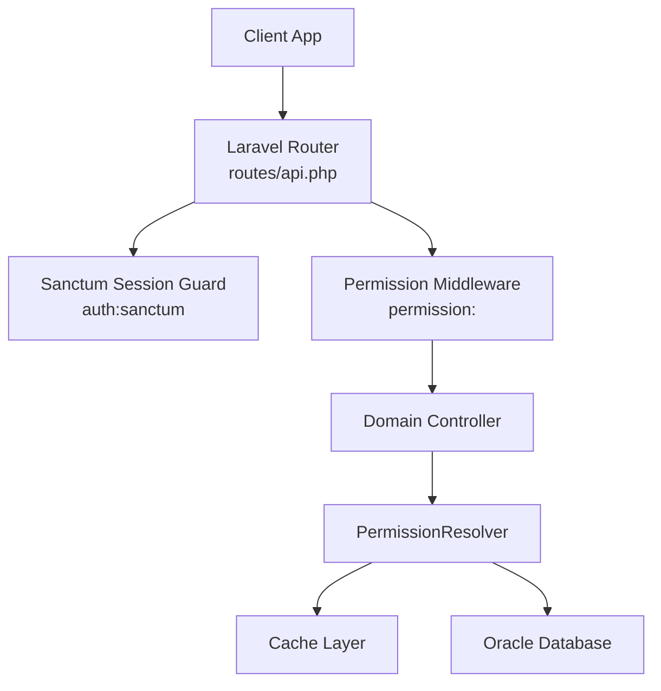
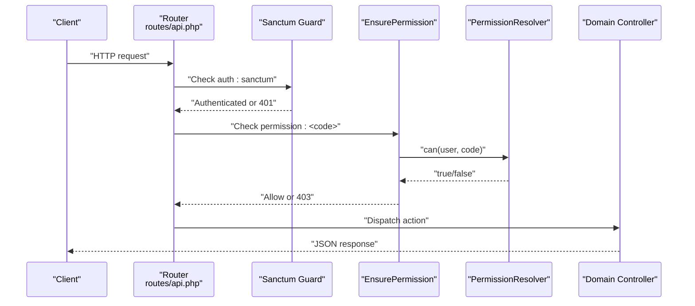
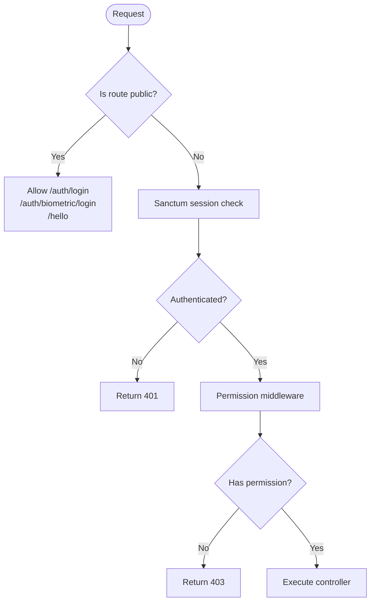
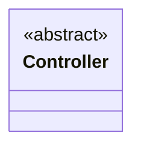
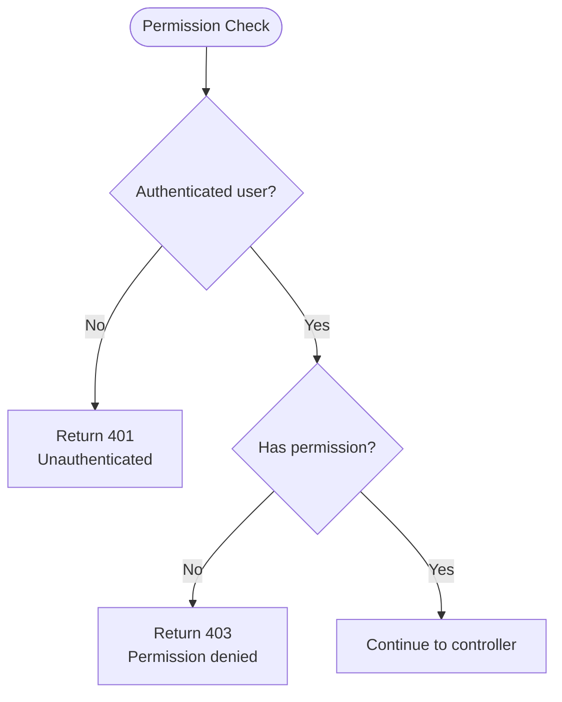
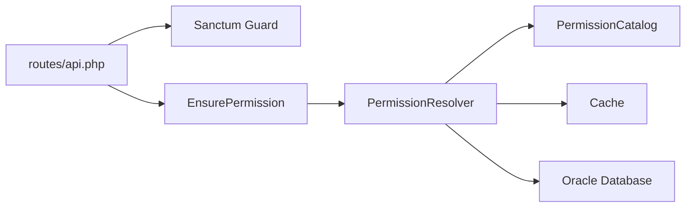
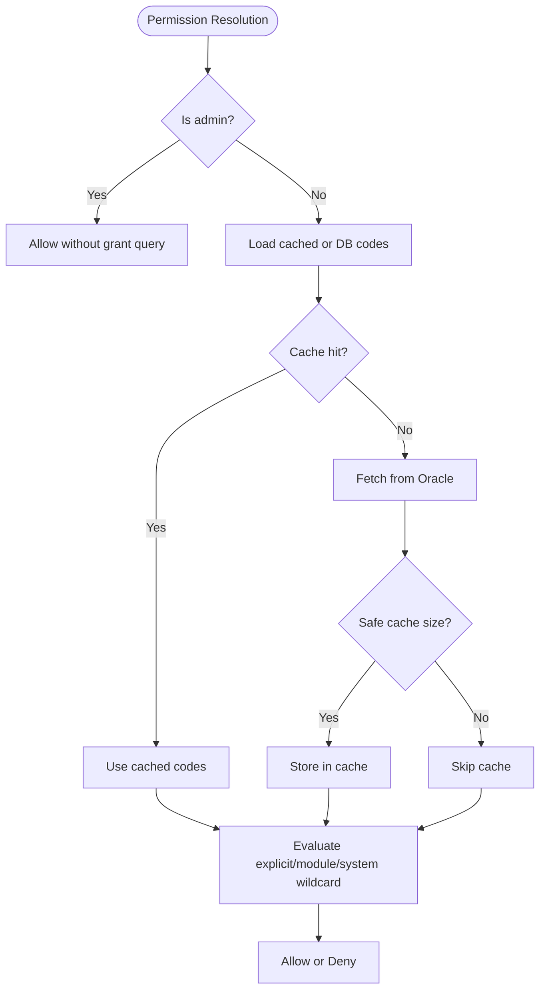

# API Design and Routing

<cite>
**Referenced Files in This Document**
- [api.php](file://kyApp_API/routes/api.php)
- [Controller.php](file://kyApp_API/app/Http/Controllers/Controller.php)
- [EnsurePermission.php](file://kyApp_API/app/Http/Middleware/EnsurePermission.php)
- [PermissionCatalog.php](file://kyApp_API/app/Support/PermissionCatalog.php)
- [PermissionResolver.php](file://kyApp_API/app/Support/PermissionResolver.php)
- [sanctum.php](file://kyApp_API/config/sanctum.php)
- [BusinessRoutesSealedTest.php](file://kyApp_API/tests/Feature/BusinessRoutesSealedTest.php)
- [AGENTS.md](file://kyApp_API/AGENTS.md)
</cite>

## Table of Contents
1. [Introduction](#introduction)
2. [Project Structure](#project-structure)
3. [Core Components](#core-components)
4. [Architecture Overview](#architecture-overview)
5. [Detailed Component Analysis](#detailed-component-analysis)
6. [Dependency Analysis](#dependency-analysis)
7. [Performance Considerations](#performance-considerations)
8. [Troubleshooting Guide](#troubleshooting-guide)
9. [Conclusion](#conclusion)

## Introduction
This document explains the Laravel API design and routing architecture for the `kyApp_API` backend. It focuses on how RESTful endpoints are organized, how authentication and authorization protect routes, how controllers and middleware collaborate, and what response and error patterns clients should expect. The documentation also covers route parameters, query parameters, request validation strategies, API versioning considerations, rate limiting usage, and CORS configuration.

The API is primarily session-based through Laravel Sanctum, with a small public surface for login, biometric login, and a connectivity probe. All business endpoints require an authenticated session and a module-specific permission grant.

## Project Structure
The API lives under `kyApp_API`. The most important files for this document are:

| Area | File | Responsibility |
|---|---|---|
| Routes | `routes/api.php` | Defines all API endpoints, groups, middleware, and parameter constraints |
| Controllers | `app/Http/Controllers/*.php` | Implements endpoint logic; inherits from a base controller class |
| Base Controller | `app/Http/Controllers/Controller.php` | Shared controller root class |
| Authorization Middleware | `app/Http/Middleware/EnsurePermission.php` | Enforces deny-by-default permission checks |
| Permission Catalog | `app/Support/PermissionCatalog.php` | Canonical source of valid permission codes and labels |
| Permission Resolver | `app/Support/PermissionResolver.php` | Evaluates grants, wildcards, admin bypass, and caches effective permissions |
| Authentication Configuration | `config/sanctum.php` | Configures Sanctum stateful domains, guard, expiration policy, and token prefix |
| Contract Test | `tests/Feature/BusinessRoutesSealedTest.php` | Asserts that only the documented public routes are unauthenticated |
| Conventions Reference | `AGENTS.md` | Documents status codes, pagination behavior, response envelope expectations, and endpoint inventory |

**Diagram sources**
- [api.php:17-34](file://kyApp_API/routes/api.php#L17-L34)
- [api.php:45-88](file://kyApp_API/routes/api.php#L45-L88)
- [api.php:99-116](file://kyApp_API/routes/api.php#L99-L116)
- [api.php:138-142](file://kyApp_API/routes/api.php#L138-L142)
- [api.php:160-179](file://kyApp_API/routes/api.php#L160-L179)
- [api.php:189-243](file://kyApp_API/routes/api.php#L189-L243)
- [api.php:255-291](file://kyApp_API/routes/api.php#L255-L291)
- [api.php:302-326](file://kyApp_API/routes/api.php#L302-L326)
- [EnsurePermission.php:25-52](file://kyApp_API/app/Http/Middleware/EnsurePermission.php#L25-L52)
- [PermissionResolver.php:95-132](file://kyApp_API/app/Support/PermissionResolver.php#L95-L132)

**Section sources**
- [api.php:1-327](file://kyApp_API/routes/api.php#L1-L327)
- [Controller.php:1-9](file://kyApp_API/app/Http/Controllers/Controller.php#L1-L9)
- [AGENTS.md:170-184](file://kyApp_API/AGENTS.md#L170-L184)

## Core Components
The API’s core design relies on four layers:

1. **Routing layer**: `routes/api.php` defines RESTful resource paths grouped by domain.
2. **Authentication layer**: Sanctum protects routes with `auth:sanctum`.
3. **Authorization layer**: A custom `permission:<code>` middleware enforces deny-by-default access control.
4. **Controller layer**: Domain controllers implement business logic and return JSON responses.

Key characteristics:

- Public endpoints are intentionally minimal: login, biometric login, logout, current user inspection, and a `/hello` connectivity probe.
- Business endpoints are grouped under `auth:sanctum`, then further restricted by a specific permission code.
- Route parameters use numeric constraints to prevent injection and improve matching.
- Query parameters are used for filtering and pagination where applicable.
- Responses follow a consistent envelope pattern documented in the project conventions.

**Section sources**
- [api.php:17-34](file://kyApp_API/routes/api.php#L17-L34)
- [api.php:118-122](file://kyApp_API/routes/api.php#L118-L122)
- [api.php:138-142](file://kyApp_API/routes/api.php#L138-L142)
- [api.php:160-179](file://kyApp_API/routes/api.php#L160-L179)
- [api.php:189-243](file://kyApp_API/routes/api.php#L189-L243)
- [api.php:255-291](file://kyApp_API/routes/api.php#L255-L291)
- [api.php:302-326](file://kyApp_API/routes/api.php#L302-L326)
- [AGENTS.md:207-232](file://kyApp_API/AGENTS.md#L207-L232)

## Architecture Overview
The API follows a layered request flow:

1. The client sends an HTTP request to an `api/*` route.
2. If the route requires authentication, Sanctum validates the session or bearer token.
3. If the route requires a permission, `EnsurePermission` resolves the required code and delegates to `PermissionResolver`.
4. `PermissionResolver` evaluates admin status, system wildcard, explicit grant, and module wildcard.
5. On success, the request reaches the controller.
6. The controller returns a structured JSON response using the project’s response conventions.

**Diagram sources**
- [api.php:24-34](file://kyApp_API/routes/api.php#L24-L34)
- [api.php:45-88](file://kyApp_API/routes/api.php#L45-L88)
- [api.php:138-142](file://kyApp_API/routes/api.php#L138-L142)
- [api.php:160-179](file://kyApp_API/routes/api.php#L160-L179)
- [api.php:189-243](file://kyApp_API/routes/api.php#L189-L243)
- [api.php:255-291](file://kyApp_API/routes/api.php#L255-L291)
- [api.php:302-326](file://kyApp_API/routes/api.php#L302-L326)
- [EnsurePermission.php:25-52](file://kyApp_API/app/Http/Middleware/EnsurePermission.php#L25-L52)
- [PermissionResolver.php:95-132](file://kyApp_API/app/Support/PermissionResolver.php#L95-L132)

## Detailed Component Analysis

### RESTful Endpoint Structure
The API uses plural noun resources and standard HTTP methods:

| Resource | Method | Route Pattern | Purpose | Required Permission |
|---|---:|---|---|---|
| Authentication | `POST` | `/auth/login` | Authenticate user | None |
| Authentication | `POST` | `/auth/biometric/login` | Biometric login | None |
| Authentication | `POST` | `/auth/logout` | Logout session | `auth:sanctum` |
| Authentication | `GET` | `/auth/me` | Inspect current user | `auth:sanctum` |
| Authentication | `GET` | `/user` | Return authenticated user object | `auth:sanctum` |
| Users | `GET` | `/users` | List users | `users.view` |
| Users | `GET` | `/users/{userId}` | Show user | `users.view` |
| Users | `POST` | `/users` | Create user | `users.create` |
| Users | `PUT` | `/users/{userId}` | Update user | `users.update` |
| Users | `PATCH` | `/users/{userId}/toggle` | Activate/deactivate user | `users.toggle` |
| Users | `DELETE` | `/users/{userId}` | Delete user | `users.delete` |
| Users | `GET` | `/users/{userId}/activity` | View activity log | `users.activity_view` |
| Permissions | `GET` | `/permissions` | List permissions catalog | `users.view` |
| Permissions | `GET` | `/users/{userId}/permissions` | List user grants | `users.view` |
| Permissions | `PUT` | `/users/{userId}/permissions` | Sync user grants | `users.permissions_manage` |
| Sessions | `GET` | `/sessions` | List active sessions | `sessions.view` |
| Sessions | `DELETE` | `/sessions/user/{userId}` | Terminate user sessions | `sessions.terminate` |
| Sessions | `DELETE` | `/sessions/{tokenId}` | Terminate single session | `sessions.terminate` |
| Settings | `GET` | `/settings` | Read security settings | `settings.view` |
| Settings | `PUT` | `/settings` | Update security settings | `settings.update` |
| Invoices | `GET` | `/invoices` | List invoices | `invoices.view` |
| Invoices | `GET` | `/invoices/{billNo}` | Show invoice | `invoices.view` |
| Customers | `GET` | `/customers` | List customers | `customers.view` |
| Customers | `POST` | `/customers` | Create customer | `customers.create` |
| Customers | `GET` | `/customers/{custNo}` | Show customer | `customers.view` |
| Customers | `PUT` | `/customers/{custNo}` | Update customer | `customers.update` |
| Customers | `DELETE` | `/customers/{custNo}` | Delete customer | `customers.delete` |
| Customers | `GET` | `/customers/{custNo}/statement` | Customer statement | `customers.statement` |
| Workers | Multiple | `/workers/employees`, `/workers/cutters`, `/workers/tailors` | Manage worker registries | Module-specific permissions |
| Accounts | Multiple | `/accounts/**` | Chart-of-accounts structure, ledger accounts, statements | `accounts.*` |
| Currencies | Multiple | `/currencies/**` | Currency directory and exchange rates | `currencies.*` |
| Diagnostic | `GET`/`POST` | `/selectFromTable` | System diagnostic table query | `system.*` |
| Health | `GET` | `/hello` | Connectivity probe | None |

The route file explicitly documents that every business route is sealed behind `auth:sanctum` and a permission guard. Only `/auth/login`, `/auth/biometric/login`, and `/hello` remain public.

**Section sources**
- [api.php:17-34](file://kyApp_API/routes/api.php#L17-L34)
- [api.php:45-88](file://kyApp_API/routes/api.php#L45-L88)
- [api.php:99-116](file://kyApp_API/routes/api.php#L99-L116)
- [api.php:138-142](file://kyApp_API/routes/api.php#L138-L142)
- [api.php:160-179](file://kyApp_API/routes/api.php#L160-L179)
- [api.php:189-243](file://kyApp_API/routes/api.php#L189-L243)
- [api.php:255-291](file://kyApp_API/routes/api.php#L255-L291)
- [api.php:302-326](file://kyApp_API/routes/api.php#L302-L326)
- [BusinessRoutesSealedTest.php:46-70](file://kyApp_API/tests/Feature/BusinessRoutesSealedTest.php#L46-L70)

### Authentication Routes
Authentication routes are split into two categories:

- **Public authentication**: `/auth/login` and `/auth/biometric/login` do not require a session.
- **Protected authentication**: `/auth/logout`, `/auth/me`, `/user`, `/auth/biometric/register`, and `/auth/biometric/revoke` require `auth:sanctum`.

Sanctum is configured to support stateful domains for first-party SPAs. The guard defaults to the web guard, and token expiration is intentionally left null because session lifetime and idle expiry are managed by the application’s session policy rather than Sanctum’s absolute expiration setting.

**Diagram sources**
- [api.php:17-34](file://kyApp_API/routes/api.php#L17-L34)
- [api.php:118-122](file://kyApp_API/routes/api.php#L118-L122)
- [sanctum.php:21-40](file://kyApp_API/config/sanctum.php#L21-L40)
- [sanctum.php:47-63](file://kyApp_API/config/sanctum.php#L47-L63)
- [EnsurePermission.php:32-52](file://kyApp_API/app/Http/Middleware/EnsurePermission.php#L32-L52)

**Section sources**
- [api.php:17-34](file://kyApp_API/routes/api.php#L17-L34)
- [sanctum.php:10-40](file://kyApp_API/config/sanctum.php#L10-L40)
- [sanctum.php:47-77](file://kyApp_API/config/sanctum.php#L47-L77)

### Business Domain Routes
Business routes are grouped by domain and protected by both authentication and fine-grained permissions:

- **Users and permissions**: User administration, permission catalog, and per-user grant synchronization.
- **Active sessions and security settings**: Sensitive administrative operations such as terminating sessions and updating security configuration.
- **Invoices**: Read-only invoice listing and lookup.
- **Customers**: Full CRUD plus a separately granted statement endpoint.
- **Workers**: Three independent registries — employees, cutters, tailors — each with its own permission module.
- **Accounts**: Chart-of-accounts tree, ledger accounts, sub-group structure management, and financial statements.
- **Currencies**: Currency directory and daily exchange-rate pricing.

Each route attaches a `permission:<module>.<action>` middleware. The deny-by-default rule means missing grants produce a 403 response.

**Section sources**
- [api.php:45-88](file://kyApp_API/routes/api.php#L45-L88)
- [api.php:99-116](file://kyApp_API/routes/api.php#L99-L116)
- [api.php:138-142](file://kyApp_API/routes/api.php#L138-L142)
- [api.php:160-179](file://kyApp_API/routes/api.php#L160-L179)
- [api.php:189-243](file://kyApp_API/routes/api.php#L189-L243)
- [api.php:255-291](file://kyApp_API/routes/api.php#L255-L291)
- [api.php:302-326](file://kyApp_API/routes/api.php#L302-L326)

### Administrative Endpoints
Administrative endpoints include:

- User management: list, show, create, update, toggle, delete, and activity inspection.
- Permission management: view catalog, view user grants, sync grants.
- Session administration: list active sessions and terminate sessions by user or token.
- Security settings: read and update sensitive application settings.
- System diagnostic query: allows querying arbitrary schema tables but is gated by the system-wide wildcard permission.

These endpoints are more sensitive than ordinary business routes. For example, terminating a session evicts a device, and changing session idle settings affects all live sessions.

**Section sources**
- [api.php:45-88](file://kyApp_API/routes/api.php#L45-L88)
- [api.php:99-116](file://kyApp_API/routes/api.php#L99-L116)
- [api.php:154-155](file://kyApp_API/routes/api.php#L154-L155)

### Controller Base Class Pattern
The base controller class is currently minimal:

**Diagram sources**
- [Controller.php:5-8](file://kyApp_API/app/Http/Controllers/Controller.php#L5-L8)

At present, the base controller does not provide shared methods. Domain controllers extend it directly. Common functionality such as response formatting, validation, pagination, and Arabic encoding is applied at the controller method level or through supporting classes, rather than through a shared base controller implementation.

**Section sources**
- [Controller.php:1-9](file://kyApp_API/app/Http/Controllers/Controller.php#L1-L9)
- [AGENTS.md:207-232](file://kyApp_API/AGENTS.md#L207-L232)

### Request Validation Strategies
Validation is enforced through several mechanisms:

1. **Route parameter constraints**: Numeric IDs use regex constraints such as `[0-9]+`.
2. **Permission middleware**: Every business route requires a specific permission code.
3. **Query parameter limits**: Pagination and row limits are bounded per controller.
4. **System diagnostic validation**: The diagnostic table query enforces a maximum row limit.

The project conventions document that pagination is manual via `page` and `limit` query parameters, not Laravel paginator format. Limits vary by controller, and the `meta` shape differs between resource groups. Clients must match the neighboring controller’s contract.

**Section sources**
- [api.php:54-56](file://kyApp_API/routes/api.php#L54-L56)
- [api.php:66-68](file://kyApp_API/routes/api.php#L66-L68)
- [api.php:167-169](file://kyApp_API/routes/api.php#L167-L169)
- [api.php:195-197](file://kyApp_API/routes/api.php#L195-L197)
- [api.php:213-215](file://kyApp_API/routes/api.php#L213-L215)
- [api.php:231-233](file://kyApp_API/routes/api.php#L231-L233)
- [api.php:314-316](file://kyApp_API/routes/api.php#L314-L316)
- [AGENTS.md:212-228](file://kyApp_API/AGENTS.md#L212-L228)

### Response and Error Handling Patterns
The API uses structured JSON responses with consistent status codes:

| Status Code | Meaning | Typical Use |
|---:|---|---|
| 200 | Success | Successful reads and updates |
| 201 | Created | Successful creation |
| 400 | Bad request | Empty or invalid update payloads |
| 401 | Unauthenticated | Missing or invalid session/token |
| 403 | Forbidden | Missing permission or deactivated account |
| 404 | Not found | Missing record or table |
| 409 | Conflict | Device already bound to another user |
| 422 | Validation error | Invalid input data |
| 500 | Server error | Unexpected failure |

The permission middleware returns a standardized 401 when no authenticated user exists and a standardized 403 when the user lacks the required permission. The 403 response includes the permission code and an Arabic label from the permission catalog.

**Diagram sources**
- [EnsurePermission.php:32-52](file://kyApp_API/app/Http/Middleware/EnsurePermission.php#L32-L52)
- [PermissionCatalog.php:426-441](file://kyApp_API/app/Support/PermissionCatalog.php#L426-L441)

**Section sources**
- [EnsurePermission.php:32-52](file://kyApp_API/app/Http/Middleware/EnsurePermission.php#L32-L52)
- [PermissionCatalog.php:426-441](file://kyApp_API/app/Support/PermissionCatalog.php#L426-L441)
- [AGENTS.md:207-232](file://kyApp_API/AGENTS.md#L207-L232)

### Route Parameters and Query Parameters
Route parameters are used for resource identifiers:

- `{userId}` for user-related routes.
- `{billNo}` for invoice lookups.
- `{custNo}` for customer operations.
- `{id}` for worker registries.
- `{accNo}` for account operations.
- `{curNo}` and `{seq}` for currency price operations.

All numeric parameters are constrained with `[0-9]+` to prevent malformed input from reaching controllers.

Query parameters are used for:

- Pagination: `page` and `limit`.
- Filtering: search terms and domain-specific filters.
- Row limits: capped per controller to avoid excessive database load.

**Section sources**
- [api.php:54-56](file://kyApp_API/routes/api.php#L54-L56)
- [api.php:66-68](file://kyApp_API/routes/api.php#L66-L68)
- [api.php:167-169](file://kyApp_API/routes/api.php#L167-L169)
- [api.php:195-197](file://kyApp_API/routes/api.php#L195-L197)
- [api.php:213-215](file://kyApp_API/routes/api.php#L213-L215)
- [api.php:231-233](file://kyApp_API/routes/api.php#L231-L233)
- [api.php:314-316](file://kyApp_API/routes/api.php#L314-L316)
- [AGENTS.md:212-228](file://kyApp_API/AGENTS.md#L212-L228)

### API Versioning Considerations
The current repository does not define an explicit API version segment such as `/api/v1/`. All routes are defined directly under the API namespace without a version prefix.

If versioning is introduced later, recommended approaches include:

- URL path versioning: `/api/v1/customers`, `/api/v2/customers`.
- Header-based versioning: `Accept-Version: v1`.
- Content negotiation: versioned media types.

For backward compatibility, existing Flutter clients parse controller-specific pagination shapes and limits, so any version change should preserve the contract or introduce a new version group rather than silently altering response structures.

[No sources needed since this section provides general guidance]

### Rate Limiting Implementation
Rate limiting is not applied globally to all API routes in the current `routes/api.php`. However, the project conventions reference a throttled verification endpoint pattern using Laravel’s built-in throttle middleware.

Where rate limiting is needed, it should be applied narrowly to sensitive public endpoints such as login or password verification, rather than broadly across authenticated business routes.

**Section sources**
- [api.php:17-34](file://kyApp_API/routes/api.php#L17-L34)
- [AGENTS.md:207-232](file://kyApp_API/AGENTS.md#L207-L232)

### CORS Configuration for Cross-Origin Requests
A dedicated `config/cors.php` file is not present in the analyzed repository. CORS behavior therefore depends on Laravel’s default configuration and server-level proxy settings.

For cross-origin SPA access, ensure that:

- The frontend origin is allowed by the application’s CORS configuration.
- Stateful Sanctum domains include the frontend host and port.
- Credentials and cookies are permitted when required.
- Preflight requests are handled correctly by the web server or reverse proxy.

**Section sources**
- [sanctum.php:21-26](file://kyApp_API/config/sanctum.php#L21-L26)

## Dependency Analysis
The authorization chain has clear dependencies:

- Routes depend on Sanctum for authentication.
- Routes depend on `EnsurePermission` for authorization.
- `EnsurePermission` depends on `PermissionResolver`.
- `PermissionResolver` depends on `PermissionCatalog` for valid codes and labels.
- `PermissionResolver` uses cache and Oracle database connections.

**Diagram sources**
- [api.php:45-88](file://kyApp_API/routes/api.php#L45-L88)
- [EnsurePermission.php:5-6](file://kyApp_API/app/Http/Middleware/EnsurePermission.php#L5-L6)
- [PermissionResolver.php:5-7](file://kyApp_API/app/Support/PermissionResolver.php#L5-L7)
- [PermissionCatalog.php:22-21](file://kyApp_API/app/Support/PermissionCatalog.php#L22-L21)

**Section sources**
- [api.php:45-88](file://kyApp_API/routes/api.php#L45-L88)
- [EnsurePermission.php:5-6](file://kyApp_API/app/Http/Middleware/EnsurePermission.php#L5-L6)
- [PermissionResolver.php:5-7](file://kyApp_API/app/Support/PermissionResolver.php#L5-L7)
- [PermissionCatalog.php:22-21](file://kyApp_API/app/Support/PermissionCatalog.php#L22-L21)

## Performance Considerations
Several performance characteristics are relevant:

- **Permission caching**: Effective permissions are cached per user with a TTL. Oversized permission sets skip cache storage to avoid Oracle cache payload limits.
- **Admin bypass**: System administrators bypass grant checks entirely, reducing database queries for privileged users.
- **Manual pagination**: Controllers enforce default and maximum limits to prevent large result sets.
- **Numeric parameter constraints**: Route constraints reduce parsing overhead and prevent malformed IDs.
- **Deny-by-default authorization**: Early rejection avoids unnecessary controller execution.

**Diagram sources**
- [PermissionResolver.php:95-132](file://kyApp_API/app/Support/PermissionResolver.php#L95-L132)
- [PermissionResolver.php:66-89](file://kyApp_API/app/Support/PermissionResolver.php#L66-L89)
- [PermissionResolver.php:235-251](file://kyApp_API/app/Support/PermissionResolver.php#L235-L251)

**Section sources**
- [PermissionResolver.php:29-43](file://kyApp_API/app/Support/PermissionResolver.php#L29-L43)
- [PermissionResolver.php:66-89](file://kyApp_API/app/Support/PermissionResolver.php#L66-L89)
- [PermissionResolver.php:95-132](file://kyApp_API/app/Support/PermissionResolver.php#L95-L132)
- [PermissionResolver.php:235-251](file://kyApp_API/app/Support/PermissionResolver.php#L235-L251)

## Troubleshooting Guide
Common issues and their likely causes:

| Symptom | Likely Cause | Recommended Action |
|---|---|---|
| 401 Unauthenticated | Missing Sanctum session or invalid token | Verify login flow and stateful domain configuration |
| 403 Forbidden | Missing permission grant | Check user grants, module wildcard, or system wildcard |
| 403 with permission code | Permission resolver denied access | Validate permission code against `PermissionCatalog` |
| Large permission payload errors | Cached permission set exceeds Oracle cache limit | Rely on fallback DB fetch; avoid granting entire catalog unnecessarily |
| Route mismatch | Non-numeric ID passed | Ensure client sends integer IDs matching `[0-9]+` constraint |
| Pagination inconsistency | Different controller contracts | Match the neighboring controller’s `meta` shape and limits |
| Cross-origin failures | Frontend origin not allowed | Configure CORS and Sanctum stateful domains appropriately |

**Section sources**
- [EnsurePermission.php:32-52](file://kyApp_API/app/Http/Middleware/EnsurePermission.php#L32-L52)
- [PermissionResolver.php:35-43](file://kyApp_API/app/Support/PermissionResolver.php#L35-L43)
- [PermissionResolver.php:235-251](file://kyApp_API/app/Support/PermissionResolver.php#L235-L251)
- [AGENTS.md:212-232](file://kyApp_API/AGENTS.md#L212-L232)

## Conclusion
The `kyApp_API` implements a secure, permission-driven REST API. Authentication is handled by Sanctum, while authorization is enforced through a deny-by-default permission middleware backed by a canonical permission catalog and a resolver that supports admin bypass, system wildcards, and module wildcards. Routes are organized by business domain, use plural resource names, and apply strict parameter constraints. Responses follow documented status codes and pagination conventions, though pagination metadata shapes differ between controller groups.

When extending the API:

- Keep public endpoints minimal.
- Protect business routes with both `auth:sanctum` and a specific `permission:<code>`.
- Use numeric route constraints for IDs.
- Respect existing pagination and response contracts.
- Apply rate limiting narrowly to sensitive public endpoints.
- Introduce API versioning carefully to avoid breaking Flutter clients.
- Configure CORS and Sanctum stateful domains for cross-origin SPAs.