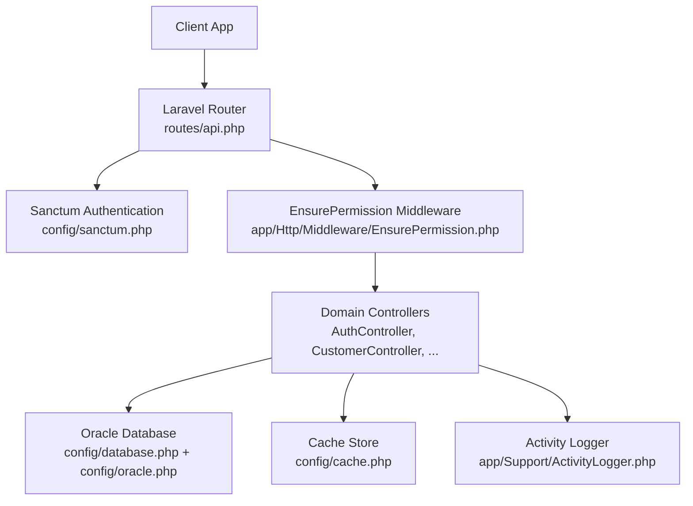
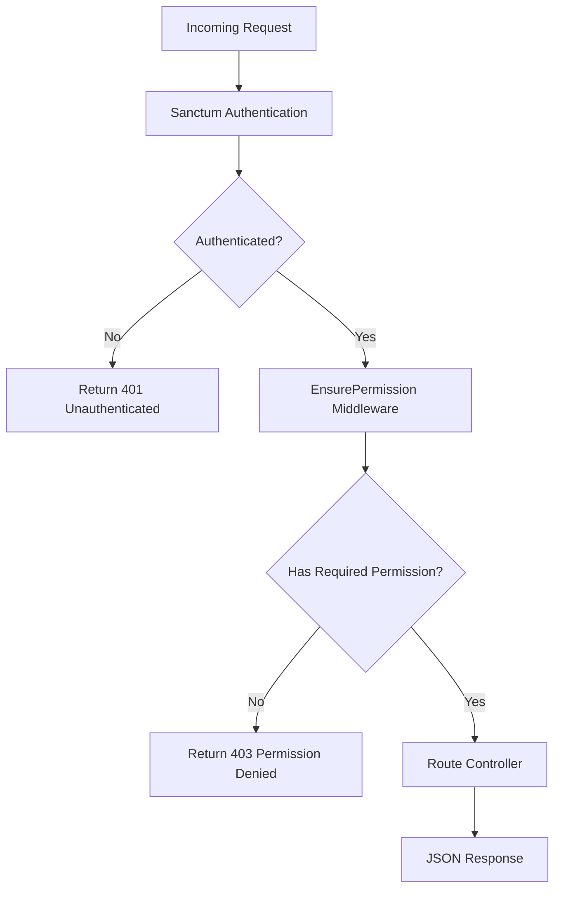
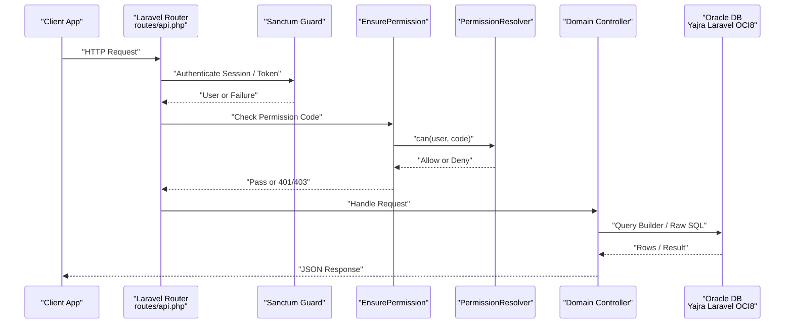
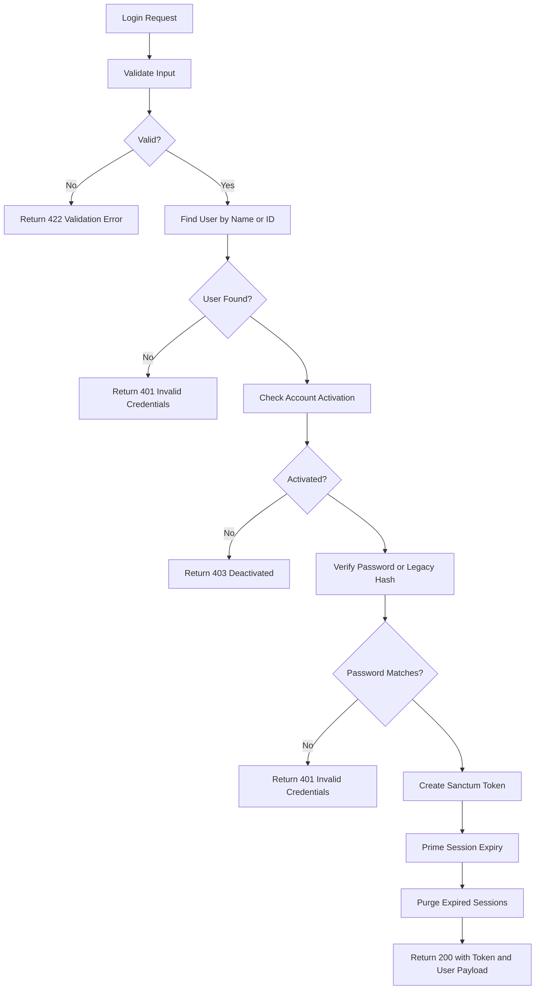
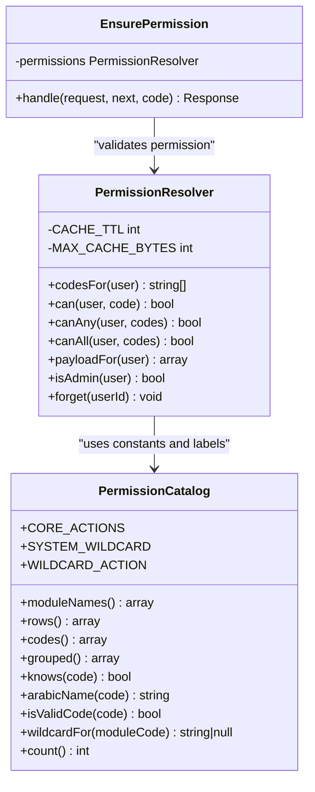
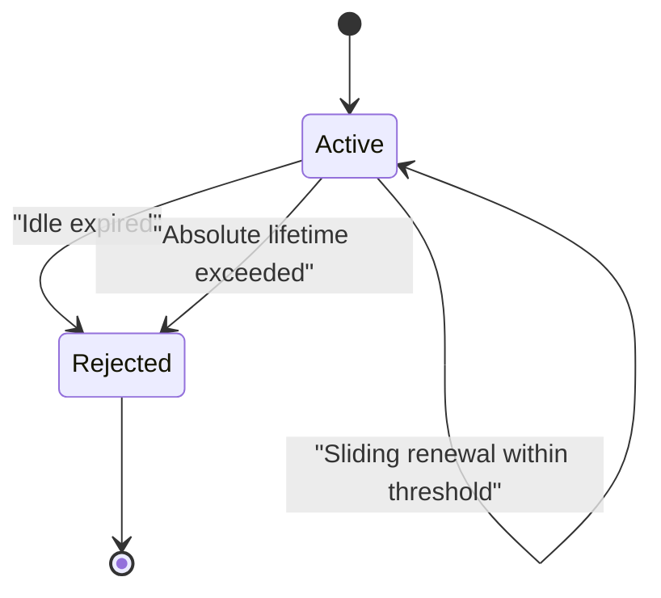
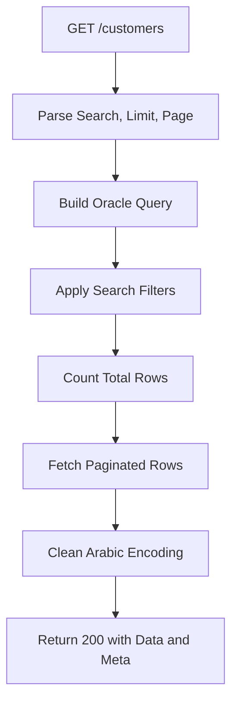
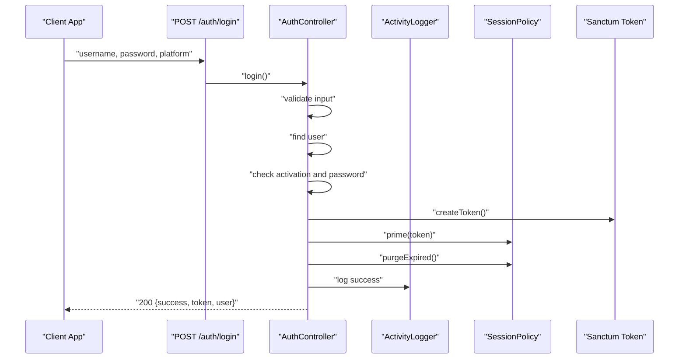
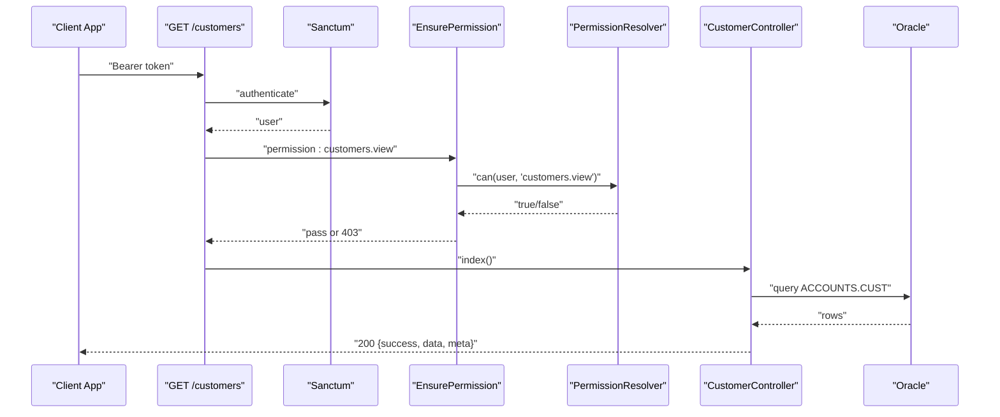
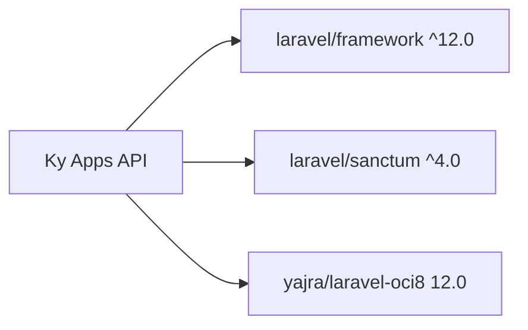

# Backend Architecture (Laravel)

<cite>
**Referenced Files in This Document**   
- [api.php](file://kyApp_API/routes/api.php)
- [AuthController.php](file://kyApp_API/app/Http/Controllers/AuthController.php)
- [CustomerController.php](file://kyApp_API/app/Http/Controllers/CustomerController.php)
- [EnsurePermission.php](file://kyApp_API/app/Http/Middleware/EnsurePermission.php)
- [PermissionResolver.php](file://kyApp_API/app\Support\PermissionResolver.php)
- [PermissionCatalog.php](file://kyApp_API/app\Support\PermissionCatalog.php)
- [SessionPolicy.php](file://kyApp_API/app\Support\SessionPolicy.php)
- [sanctum.php](file://kyApp_API/config/sanctum.php)
- [database.php](file://kyApp_API/config/database.php)
- [oracle.php](file://kyApp_API/config/oracle.php)
- [cache.php](file://kyApp_API/config/cache.php)
- [composer.json](file://kyApp_API/composer.json)
</cite>

## Table of Contents
1. [Introduction](#introduction)
2. [Project Structure](#project-structure)
3. [Core Components](#core-components)
4. [Architecture Overview](#architecture-overview)
5. [Detailed Component Analysis](#detailed-component-analysis)
6. [Dependency Analysis](#dependency-analysis)
7. [Performance Considerations](#performance-considerations)
8. [Troubleshooting Guide](#troubleshooting-guide)
9. [Conclusion](#conclusion)

## Introduction
This document describes the Laravel backend architecture for the Ky Apps API. It explains how RESTful routes are organized, how authentication and authorization work through Laravel Sanctum and a custom permission middleware, how controllers handle business domains, how Oracle data is accessed through Yajra Laravel OCI8, and how caching, logging, and session policies shape request processing.

The system follows a deny-by-default security model: every protected route requires an authenticated Sanctum session and an explicit permission grant. Controllers validate input, call Oracle through the configured `oracle` connection, and return consistent JSON responses with standard HTTP status codes.

## Project Structure
The backend lives under `kyApp_API`. The most important parts for this documentation are:

- Routes: `routes/api.php` defines all public and protected endpoints.
- Controllers: `app/Http/Controllers/*` implement domain-specific REST operations.
- Middleware: `app/Http/Middleware/EnsurePermission.php` enforces permissions after Sanctum authentication.
- Support services: `app/Support/*` contain permission resolution, session policy, catalog definitions, activity logging, settings access, and Arabic encoding helpers.
- Configuration: `config/*` define Sanctum, database connections, Oracle driver options, cache stores, and application behavior.
- Dependencies: `composer.json` declares Laravel 12, Sanctum 4, and Yajra Laravel OCI8 12.0.

**Diagram sources**
- [api.php:1-327](file://kyApp_API/routes/api.php#L1-L327)
- [sanctum.php:1-112](file://kyApp_API/config/sanctum.php#L1-L112)
- [EnsurePermission.php:1-54](file://kyApp_API/app/Http/Middleware/EnsurePermission.php#L1-L54)
- [database.php:116-127](file://kyApp_API/config/database.php#L116-L127)
- [oracle.php:1-30](file://kyApp_API/config/oracle.php#L1-L30)
- [cache.php:1-118](file://kyApp_API/config/cache.php#L1-L118)

**Section sources**
- [api.php:1-327](file://kyApp_API/routes/api.php#L1-L327)
- [composer.json:11-18](file://kyApp_API/composer.json#L11-L18)

## Core Components
The backend is built around four main layers:

| Layer | Responsibility | Key Files |
|---|---|---|
| Routing | Public and protected REST endpoints, grouped by domain and permission | [api.php](file://kyApp_API/routes/api.php) |
| Controllers | Request validation, business logic coordination, JSON responses | [AuthController.php](file://kyApp_API/app/Http/Controllers/AuthController.php), [CustomerController.php](file://kyApp_API/app/Http/Controllers/CustomerController.php) |
| Authorization | Sanctum session authentication and IBAC permission checks | [sanctum.php](file://kyApp_API/config/sanctum.php), [EnsurePermission.php](file://kyApp_API/app/Http/Middleware/EnsurePermission.php), [PermissionResolver.php](file://kyApp_API/app\Support\PermissionResolver.php), [PermissionCatalog.php](file://kyApp_API/app\Support\PermissionCatalog.php) |
| Data Access | Oracle queries via Yajra Laravel OCI8 and Laravel query builder | [database.php](file://kyApp_API/config/database.php), [oracle.php](file://kyApp_API/config/oracle.php) |

### RESTful API Design
Routes follow REST conventions:

- Resource names use plural nouns: `/users`, `/customers`, `/workers/employees`, `/accounts/chart`, `/currencies`.
- Read-only endpoints use `GET`; creation uses `POST`; updates use `PUT`; deletion uses `DELETE`; toggles use `PATCH`.
- Nested resources use path segments: `/users/{userId}/permissions`, `/customers/{custNo}/statement`, `/currencies/{curNo}/prices`.
- Parameters are validated at the route level where needed, such as numeric IDs using `where('userId', '[0-9]+')`.
- Responses are JSON objects with a `success` flag, optional `message`, optional `data`, and optional `errors`.

Example route groups:

- Authentication: login, logout, biometric registration, and profile endpoints.
- User administration: CRUD and permission management for users.
- Sessions and settings: active session termination and security configuration.
- Business domains: invoices, customers, workers, accounts, currencies.

**Section sources**
- [api.php:17-34](file://kyApp_API/routes/api.php#L17-L34)
- [api.php:45-88](file://kyApp_API/routes/api.php#L45-L88)
- [api.php:99-116](file://kyApp_API/routes/api.php#L99-L116)
- [api.php:138-142](file://kyApp_API/routes/api.php#L138-L142)
- [api.php:160-179](file://kyApp_API/routes/api.php#L160-L179)
- [api.php:189-243](file://kyApp_API/routes/api.php#L189-L243)
- [api.php:255-291](file://kyApp_API/routes/api.php#L255-L291)
- [api.php:302-326](file://kyApp_API/routes/api.php#L302-L326)

### Controller Organization Pattern
Each business domain has a dedicated controller:

- `AuthController`: authentication, token lifecycle, biometric enrollment, user payload, and permission refresh.
- `CustomerController`: customer listing, search, pagination, create, update, delete, and account statement.
- Other domain controllers exist for users, permissions, sessions, settings, invoices, accounts, currencies, workers, and table diagnostics.

Controllers do not directly expose database internals to clients. They validate requests, coordinate support services, and return structured JSON.

**Section sources**
- [AuthController.php:17-41](file://kyApp_API/app/Http/Controllers/AuthController.php#L17-L41)
- [CustomerController.php:12-23](file://kyApp_API/app/Http/Controllers/CustomerController.php#L12-L23)

### Middleware Pipeline
The pipeline applies two security layers:

1. **Authentication**: `auth:sanctum` ensures a valid Sanctum session or personal access token.
2. **Authorization**: `permission:<code>` ensures the authenticated user holds the required IBAC grant.

If no user is authenticated, `EnsurePermission` returns `401`. If the user lacks the required permission, it returns `403` with the permission code and an Arabic label from `PermissionCatalog`. System administrators bypass grant checks because `PermissionResolver` short-circuits on `IS_ADMIN`.

**Diagram sources**
- [EnsurePermission.php:11-52](file://kyApp_API/app/Http/Middleware/EnsurePermission.php#L11-L52)
- [PermissionResolver.php:9-26](file://kyApp_API/app\Support\PermissionResolver.php#L9-L26)

**Section sources**
- [EnsurePermission.php:1-54](file://kyApp_API/app/Http/Middleware/EnsurePermission.php#L1-54)
- [api.php:24-34](file://kyApp_API/routes/api.php#L24-L34)
- [api.php:45-88](file://kyApp_API/routes/api.php#L45-L88)

### Service Layer Abstraction
Although there is no separate service directory, complex business logic is abstracted into support classes:

- `PermissionResolver`: resolves effective permissions, supports wildcards, caches results, and builds client payloads.
- `SessionPolicy`: implements sliding session renewal, idle expiry, absolute lifetime, and best-effort cleanup.
- `PermissionCatalog`: centralizes permission codes, module definitions, labels, and validation rules.
- `SettingsStore`: reads application settings used by session and security logic.
- `ActivityLogger`: records successful and failed authentication events.

This approach keeps controllers focused on HTTP concerns while moving reusable business rules into typed support classes.

**Section sources**
- [PermissionResolver.php:9-27](file://kyApp_API/app\Support\PermissionResolver.php#L9-L27)
- [SessionPolicy.php:9-41](file://kyApp_API/app\Support\SessionPolicy.php#L9-L41)
- [PermissionCatalog.php:5-21](file://kyApp_API/app\Support\PermissionCatalog.php#L5-L21)

### Repository Pattern for Data Access
The current implementation does not use a repository layer. Controllers and support classes access Oracle directly through Laravel’s query builder on the `oracle` connection. This is acceptable for direct table access but means business logic and persistence logic can coexist in controllers and support classes rather than being separated into repositories.

For future evolution, a repository abstraction could wrap Oracle queries for entities like customers, workers, accounts, and invoices, making testing and swapping storage implementations easier.

**Section sources**
- [CustomerController.php:35-83](file://kyApp_API/app/Http/Controllers/CustomerController.php#L35-L83)
- [CustomerController.php:92-111](file://kyApp_API/app/Http/Controllers/CustomerController.php#L92-L111)
- [PermissionResolver.php:235-250](file://kyApp_API/app\Support\PermissionResolver.php#L235-L250)

## Architecture Overview
The API request flow moves from routing through authentication, authorization, controller logic, and finally to Oracle.

**Diagram sources**
- [api.php:17-34](file://kyApp_API/routes/api.php#L17-L34)
- [api.php:45-88](file://kyApp_API/routes/api.php#L45-L88)
- [EnsurePermission.php:32-51](file://kyApp_API/app/Http/Middleware/EnsurePermission.php#L32-L51)
- [PermissionResolver.php:95-131](file://kyApp_API/app\Support\PermissionResolver.php#L95-L131)
- [CustomerController.php:35-83](file://kyApp_API/app/Http/Controllers/CustomerController.php#L35-L83)

## Detailed Component Analysis

### Authentication and Session Lifecycle
`AuthController` handles password login, biometric login, logout, device registration, and profile retrieval. It integrates with:

- Sanctum personal access tokens.
- `SessionPolicy` for idle and absolute session expiration.
- `ActivityLogger` for audit trails.
- `PermissionResolver` for returning effective permissions and modules.
- `SettingsStore` for feature flags such as biometric login enablement.

Key behaviors:

- Login validates username, password, and optional user type.
- Unknown usernames and wrong passwords return the same generic message to avoid enumeration.
- Deactivated accounts receive `403`.
- Tokens are issued with a real `EXPIRES_AT` managed by `SessionPolicy`.
- Logout deletes the current token.
- Biometric login is gated by a system setting and binds one device per user.

**Diagram sources**
- [AuthController.php:47-163](file://kyApp_API/app/Http/Controllers/AuthController.php#L47-L163)
- [SessionPolicy.php:70-107](file://kyApp_API/app\Support\SessionPolicy.php#L70-L107)

**Section sources**
- [AuthController.php:47-163](file://kyApp_API/app/Http/Controllers/AuthController.php#L47-L163)
- [AuthController.php:170-215](file://kyApp_API/app/Http/Controllers/AuthController.php#L170-L215)
- [AuthController.php:221-239](file://kyApp_API/app/Http/Controllers/AuthController.php#L221-L239)
- [AuthController.php:245-310](file://kyApp_API/app/Http/Controllers/AuthController.php#L245-L310)
- [AuthController.php:316-410](file://kyApp_API/app/Http/Controllers/AuthController.php#L316-L410)
- [SessionPolicy.php:70-107](file://kyApp_API/app\Support\SessionPolicy.php#L70-L107)

### Permission Model and Authorization
The IBAC permission model is defined centrally in `PermissionCatalog` and enforced by `PermissionResolver`.

Rules evaluated in order:

1. System administrator (`IS_ADMIN = 1`) passes immediately.
2. Wildcard `system.*` grants everything.
3. Exact permission code match.
4. Module wildcard `module.*` matches any action in that module.
5. Otherwise, deny.

Grants are considered valid only when both the grant row and permission row are active and not expired. Results are cached per user with a safe byte-size limit to avoid Oracle bound-value errors.

**Diagram sources**
- [PermissionCatalog.php:22-479](file://kyApp_API/app\Support\PermissionCatalog.php#L22-L479)
- [PermissionResolver.php:27-274](file://kyApp_API/app\Support\PermissionResolver.php#L27-L274)
- [EnsurePermission.php:25-52](file://kyApp_API/app/Http/Middleware/EnsurePermission.php#L25-L52)

**Section sources**
- [PermissionCatalog.php:5-21](file://kyApp_API/app\Support\PermissionCatalog.php#L5-L21)
- [PermissionCatalog.php:271-315](file://kyApp_API/app\Support\PermissionCatalog.php#L271-L315)
- [PermissionResolver.php:9-26](file://kyApp_API/app\Support\PermissionResolver.php#L9-L26)
- [PermissionResolver.php:66-89](file://kyApp_API/app\Support\PermissionResolver.php#L66-L89)
- [PermissionResolver.php:95-131](file://kyApp_API/app\Support\PermissionResolver.php#L95-L131)
- [PermissionResolver.php:178-199](file://kyApp_API/app\Support\PermissionResolver.php#L178-L199)
- [PermissionResolver.php:206-218](file://kyApp_API/app\Support\PermissionResolver.php#L206-L218)
- [EnsurePermission.php:32-51](file://kyApp_API/app/Http/Middleware/EnsurePermission.php#L32-L51)

### Session Policy
`SessionPolicy` manages token lifetimes without relying on Sanctum’s absolute expiration setting. Instead, it drives `EXPIRES_AT` and enforces:

- Deactivated accounts are rejected.
- Expired idle windows are rejected.
- Absolute lifetime based on `session_absolute_days` is rejected.
- Active sessions receive sliding renewal throttled by `session_touch_threshold_minutes`.
- Expired tokens are deleted best-effort to prevent accumulation.

**Diagram sources**
- [SessionPolicy.php:70-107](file://kyApp_API/app\Support\SessionPolicy.php#L70-L107)
- [SessionPolicy.php:130-141](file://kyApp_API/app\Support\SessionPolicy.php#L130-L141)
- [SessionPolicy.php:166-183](file://kyApp_API/app\Support\SessionPolicy.php#L166-L183)

**Section sources**
- [SessionPolicy.php:9-41](file://kyApp_API/app\Support\SessionPolicy.php#L9-L41)
- [SessionPolicy.php:70-107](file://kyApp_API/app\Support\SessionPolicy.php#L70-L107)
- [SessionPolicy.php:114-117](file://kyApp_API/app\Support\SessionPolicy.php#L114-L117)
- [SessionPolicy.php:130-141](file://kyApp_API/app\Support\SessionPolicy.php#L130-L141)
- [SessionPolicy.php:166-183](file://kyApp_API/app\Support\SessionPolicy.php#L166-L183)

### Customer Domain Controller
`CustomerController` demonstrates the typical controller pattern:

- Validates input.
- Uses the `oracle` connection.
- Supports search, pagination, and Arabic text handling.
- Returns standardized JSON responses.
- Handles missing resources with `404`.
- Wraps database errors with a controlled `500` response.

**Diagram sources**
- [CustomerController.php:28-83](file://kyApp_API/app/Http/Controllers/CustomerController.php#L28-L83)

**Section sources**
- [CustomerController.php:28-83](file://kyApp_API/app/Http/Controllers/CustomerController.php#L28-L83)
- [CustomerController.php:90-111](file://kyApp_API/app/Http/Controllers/CustomerController.php#L90-L111)
- [CustomerController.php:118-181](file://kyApp_API/app/Http/Controllers/CustomerController.php#L118-L181)
- [CustomerController.php:188-255](file://kyApp_API/app/Http/Controllers/CustomerController.php#L188-L255)
- [CustomerController.php:262-287](file://kyApp_API/app/Http/Controllers/CustomerController.php#L262-L287)
- [CustomerController.php:294-420](file://kyApp_API/app/Http/Controllers/CustomerController.php#L294-L420)
- [CustomerController.php:455-462](file://kyApp_API/app/Http/Controllers/CustomerController.php#L455-L462)

### Oracle Database Integration
The project uses Yajra Laravel OCI8 version 12.0 with Laravel’s default Oracle connection configuration. The `oracle` connection defines host, port, database, service name, credentials, charset, prefix, and schema prefix. A separate `config/oracle.php` file provides additional OCI8-specific options such as TNS, edition, server version, load balancing, and NLS session variables.

Important notes:

- Controllers explicitly use `DB::connection('oracle')`.
- Queries select specific columns instead of `SELECT *`.
- Pagination uses `offset` and `limit`.
- Raw SQL is used for complex statements such as customer statements.
- Caching is used for permission codes, not for general entity data.

Connection pooling is not explicitly configured in the provided files. Connection reuse is handled by PHP’s PDO layer and Laravel’s database manager; tuning would require environment-level Oracle client and PHP extension configuration.

**Section sources**
- [composer.json:11-18](file://kyApp_API/composer.json#L11-L18)
- [database.php:116-127](file://kyApp_API/config/database.php#L116-L127)
- [oracle.php:1-30](file://kyApp_API/config/oracle.php#L1-L30)
- [CustomerController.php:35-83](file://kyApp_API/app/Http/Controllers/CustomerController.php#L35-L83)
- [CustomerController.php:314-334](file://kyApp_API/app/Http/Controllers/CustomerController.php#L314-L334)

### API Request Flow Examples

#### Login Flow

**Diagram sources**
- [api.php:17-34](file://kyApp_API/routes/api.php#L17-L34)
- [AuthController.php:47-163](file://kyApp_API/app/Http/Controllers/AuthController.php#L47-L163)
- [SessionPolicy.php:114-117](file://kyApp_API/app\Support\SessionPolicy.php#L114-L117)

#### Protected Business Endpoint Flow

**Diagram sources**
- [api.php:160-162](file://kyApp_API/routes/api.php#L160-L162)
- [EnsurePermission.php:32-51](file://kyApp_API/app/Http/Middleware/EnsurePermission.php#L32-L51)
- [PermissionResolver.php:95-131](file://kyApp_API/app\Support\PermissionResolver.php#L95-L131)
- [CustomerController.php:28-83](file://kyApp_API/app/Http/Controllers/CustomerController.php#L28-L83)

## Dependency Analysis
The main runtime dependencies are:

| Dependency | Version | Purpose |
|---|---:|---|
| Laravel Framework | ^12.0 | Web framework, routing, middleware, query builder, cache, logging |
| Laravel Sanctum | ^4.0 | SPA/session-based API authentication and personal access tokens |
| Yajra Laravel OCI8 | 12.0 | Oracle database driver integration |

**Diagram sources**
- [composer.json:11-18](file://kyApp_API/composer.json#L11-L18)

**Section sources**
- [composer.json:11-18](file://kyApp_API/composer.json#L11-L18)

## Performance Considerations
- **Caching**: The default cache store is `database`. `PermissionResolver` caches per-user permission codes for 300 seconds, with a maximum serialized size to avoid Oracle bound-value limits.
- **Query Optimization**: Controllers select only needed columns, paginate results, and use parameter binding for raw SQL.
- **Session Writes**: Sliding renewal is write-throttled so active sessions are not updated on every request.
- **Cache Store Selection**: For high-throughput deployments, consider switching the default cache store to Redis if available, since the current configuration leaves the default as `database`.
- **Oracle Tuning**: Connection pooling, NLS settings, and driver options should be tuned at the environment and Oracle client level rather than inside Laravel configuration alone.

**Section sources**
- [cache.php:18-18](file://kyApp_API/config/cache.php#L18-L18)
- [PermissionResolver.php:32-43](file://kyApp_API/app\Support\PermissionResolver.php#L32-L43)
- [PermissionResolver.php:74-89](file://kyApp_API/app\Support\PermissionResolver.php#L74-L89)
- [SessionPolicy.php:166-183](file://kyApp_API/app\Support\SessionPolicy.php#L166-L183)
- [CustomerController.php:35-83](file://kyApp_API/app/Http/Controllers/CustomerController.php#L35-L83)

## Troubleshooting Guide

### Common Status Codes
| Status | Meaning | Typical Cause |
|---:|---|---|
| 200 | Success | Successful login, profile retrieval, or read operation |
| 201 | Created | Successful customer creation |
| 401 | Unauthenticated | Missing or invalid Sanctum session/token |
| 403 | Forbidden | Deactivated account, disabled feature, or missing permission |
| 404 | Not Found | Missing customer or resource |
| 422 | Validation Error | Missing or invalid request fields |
| 500 | Server Error | Database or unexpected exception |

### Authentication Issues
- If login always fails, check username lookup, password format, and whether the account is activated.
- If biometric login is blocked, verify the system setting enabling biometric login.
- If sessions expire too quickly, review `session_idle_minutes`, `session_absolute_days`, and `session_touch_threshold_minutes`.

### Permission Issues
- A `403` with a permission code indicates the user lacks that grant.
- System administrators bypass grant checks.
- Wildcard grants `module.*` cover all actions in that module.
- After changing permissions, the resolver cache may need to be refreshed; `/auth/permissions` forces a fresh read.

### Oracle Issues
- If queries fail, verify the `oracle` connection parameters and Oracle client availability.
- Large permission payloads may skip cache due to byte-size limits.
- Raw SQL should continue using parameter binding to avoid injection and encoding problems.

**Section sources**
- [AuthController.php:47-163](file://kyApp_API/app/Http/Controllers/AuthController.php#L47-L163)
- [AuthController.php:316-410](file://kyApp_API/app/Http/Controllers/AuthController.php#L316-L410)
- [EnsurePermission.php:32-51](file://kyApp_API/app/Http/Middleware/EnsurePermission.php#L32-L51)
- [PermissionResolver.php:74-89](file://kyApp_API/app\Support\PermissionResolver.php#L74-L89)
- [CustomerController.php:455-462](file://kyApp_API/app/Http/Controllers/CustomerController.php#L455-L462)

## Conclusion
The Laravel backend follows a clear separation of concerns:

- Routes define RESTful endpoints grouped by domain.
- Sanctum authenticates sessions and tokens.
- `EnsurePermission` enforces a deny-by-default IBAC model backed by `PermissionResolver` and `PermissionCatalog`.
- Controllers validate input, coordinate support services, and return consistent JSON.
- Oracle data is accessed through Yajra Laravel OCI8 with explicit connection usage and careful query construction.
- Caching protects permission lookups, while session policy controls token lifetimes independently of Sanctum’s absolute expiration setting.

For future improvements, introducing a service layer for complex business workflows and a repository layer for data access would further decouple HTTP concerns from persistence logic and improve testability.