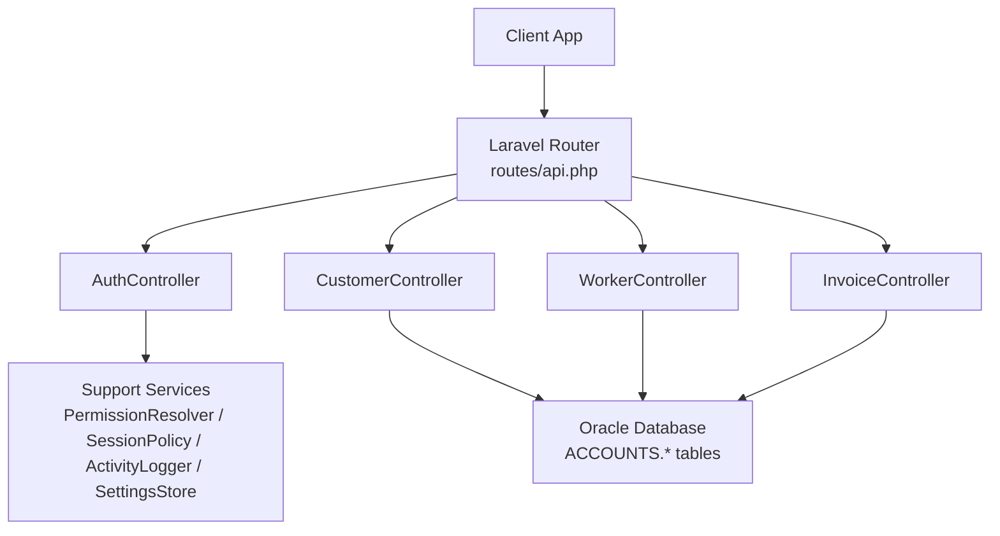
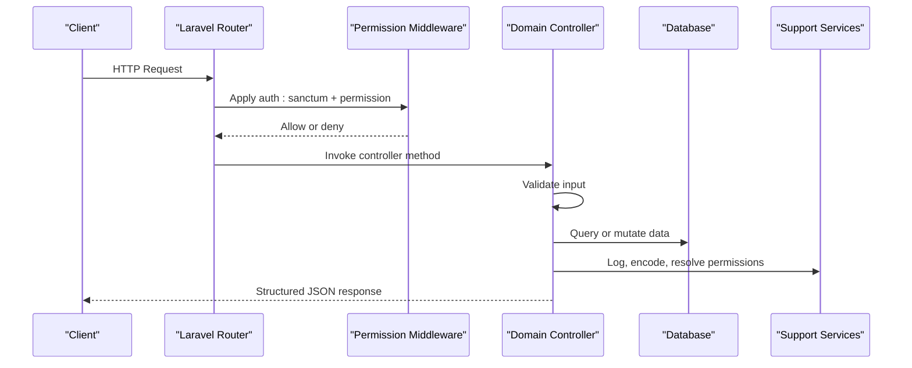
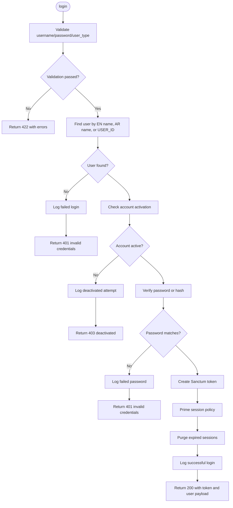
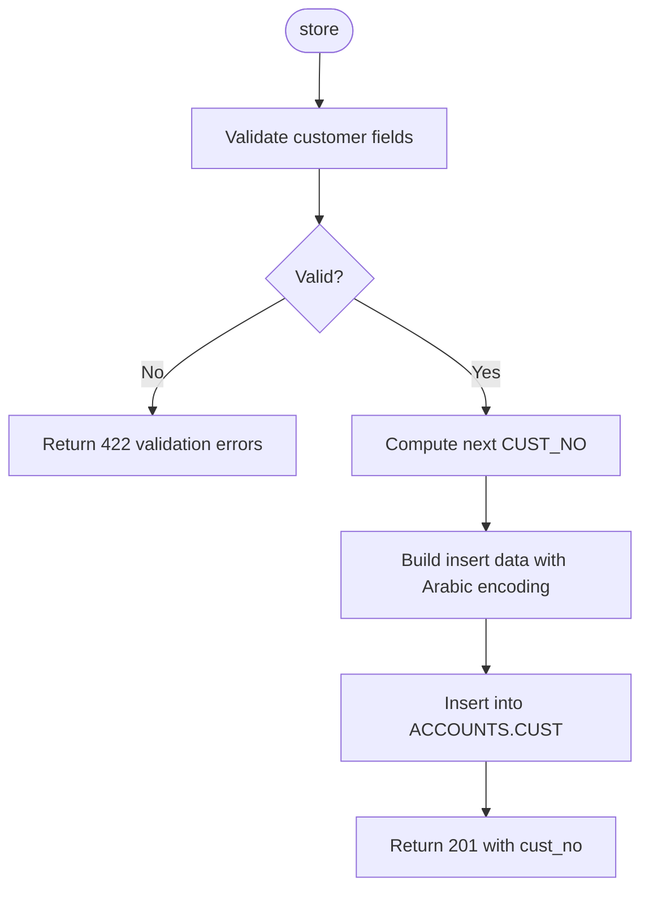
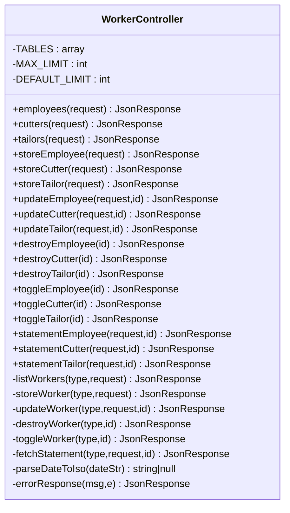
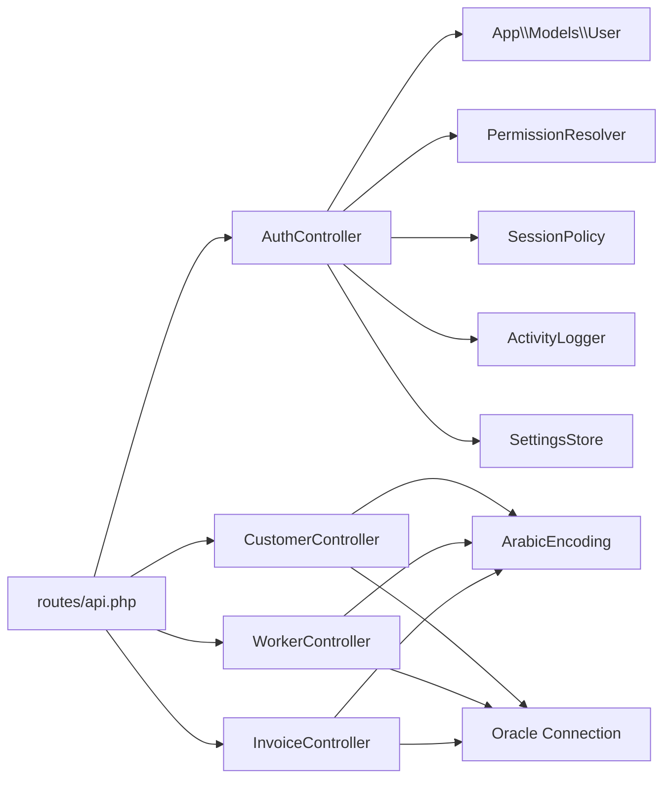

# Controller Organization Pattern

<cite>
**Referenced Files in This Document**
- [AuthController.php](file://kyApp_API/app/Http/Controllers/AuthController.php)
- [CustomerController.php](file://kyApp_API/app/Http/Controllers/CustomerController.php)
- [WorkerController.php](file://kyApp_API/app/Http/Controllers/WorkerController.php)
- [InvoiceController.php](file://kyApp_API/app/Http/Controllers/InvoiceController.php)
- [api.php](file://kyApp_API/routes/api.php)
- [Controller.php](file://kyApp_API/app/Http/Controllers/Controller.php)
</cite>

## Table of Contents
1. [Introduction](#introduction)
2. [Project Structure](#project-structure)
3. [Core Components](#core-components)
4. [Architecture Overview](#architecture-overview)
5. [Detailed Component Analysis](#detailed-component-analysis)
6. [Dependency Analysis](#dependency-analysis)
7. [Performance Considerations](#performance-considerations)
8. [Troubleshooting Guide](#troubleshooting-guide)
9. [Conclusion](#conclusion)

## Introduction
This document explains the Laravel controller organization pattern used in Ky Apps. Each business domain has a dedicated controller: authentication, customers, workers, and invoices. The controllers follow separation of concerns by handling HTTP input, validation, authorization, data access, response formatting, and error handling. Business logic is kept close to the controller for small operations but uses shared helpers and support classes where appropriate. There is no separate service layer in the analyzed code; controllers coordinate directly with database connections, models, and support utilities.

## Project Structure
The relevant backend structure for this documentation is under `kyApp_API/app/Http/Controllers`. Routes are centralized in `routes/api.php`, which attaches Sanctum authentication and permission middleware before exposing endpoints to each controller.

**Diagram sources**
- [api.php:18-48](file://kyApp_API/routes/api.php#L18-L48)
- [api.php:168-273](file://kyApp_API/routes/api.php#L168-L273)
- [AuthController.php:36-41](file://kyApp_API/app/Http/Controllers/AuthController.php#L36-L41)
- [CustomerController.php:18-22](file://kyApp_API/app/Http/Controllers/CustomerController.php#L18-L22)
- [WorkerController.php:22-59](file://kyApp_API/app/Http/Controllers/WorkerController.php#L22-L59)
- [InvoiceController.php:20-45](file://kyApp_API/app/Http/Controllers/InvoiceController.php#L20-L45)

**Section sources**
- [api.php:18-48](file://kyApp_API/routes/api.php#L18-L48)
- [api.php:168-273](file://kyApp_API/routes/api.php#L168-L273)

## Core Components
Ky Apps organizes controllers by business domain rather than by HTTP verb or technical layer.

| Controller | Domain Responsibility | Main Methods | Data Access | Validation Style | Response Shape |
|---|---|---|---|---|---|
| `AuthController` | Authentication, token issuance, biometric enrollment, permissions payload | `login`, `me`, `myPermissions`, `logout`, `registerBiometric`, `biometricLogin`, `revokeBiometric` | Eloquent `User` model, Sanctum tokens, support services | Inline `Validator::make` | JSON with `success`, optional `message`, `errors`, `token`, `user`, `data` |
| `CustomerController` | Customer CRUD and account statement | `index`, `show`, `store`, `update`, `destroy`, `statement` | Oracle query builder on `ACCOUNTS.CUST` and entry tables | Inline `Validator::make` | JSON with `success`, `data`, `meta`, `summary` |
| `WorkerController` | Employees, cutters, tailors CRUD, status toggle, statements | Per-type list/store/update/destroy/toggle/statement methods delegating to private helpers | Oracle query builder on worker tables and entry tables | No inline validation in shared helpers; type-specific routes gate IDs | JSON with `success`, `type`, `data`, `worker`, `summary` |
| `InvoiceController` | Read-only invoice listing and detail | `index`, `show` | Oracle query builder on `ACCOUNTS.SALES_BILL` | No request validation needed for read endpoints | JSON with `success`, `message`, `data`, `meta` |

All controllers extend the base `Controller` class, which currently contains no shared behavior. Error handling is implemented per controller using either local helper methods or inline JSON responses.

**Section sources**
- [AuthController.php:34-41](file://kyApp_API/app/Http/Controllers/AuthController.php#L34-L41)
- [CustomerController.php:16-22](file://kyApp_API/app/Http/Controllers/CustomerController.php#L16-L22)
- [WorkerController.php:16-62](file://kyApp_API/app/Http/Controllers/WorkerController.php#L16-L62)
- [InvoiceController.php:18-45](file://kyApp_API/app/Http/Controllers/InvoiceController.php#L18-L45)
- [Controller.php:5-8](file://kyApp_API/app/Http/Controllers/Controller.php#L5-L8)

## Architecture Overview
The API follows a thin-controller pattern:

1. **Routing**: `routes/api.php` groups routes under `auth:sanctum` and applies fine-grained `permission:<code>` middleware.
2. **Authorization**: Permission checks happen at the route level through a custom `permission:` middleware.
3. **Controller Layer**: Controllers accept `Request`, validate input, perform business coordination, and return structured JSON.
4. **Data Layer**: Controllers use Eloquent for the `User` model and the Laravel Query Builder for direct Oracle table access.
5. **Support Layer**: Shared cross-cutting concerns such as Arabic encoding, activity logging, session policy, and permission resolution live in `app/Support`.

**Diagram sources**
- [api.php:38-48](file://kyApp_API/routes/api.php#L38-L48)
- [api.php:168-273](file://kyApp_API/routes/api.php#L168-L273)
- [AuthController.php:47-163](file://kyApp_API/app/Http/Controllers/AuthController.php#L47-L163)
- [CustomerController.php:28-83](file://kyApp_API/app/Http/Controllers/CustomerController.php#L28-L83)
- [WorkerController.php:188-239](file://kyApp_API/app/Http/Controllers/WorkerController.php#L188-L239)
- [InvoiceController.php:51-103](file://kyApp_API/app/Http/Controllers/InvoiceController.php#L51-L103)

## Detailed Component Analysis

### Authentication Controller
`AuthController` handles login, logout, profile retrieval, permission loading, and biometric enrollment/login. It uses constructor injection for `PermissionResolver`, `SessionPolicy`, `ActivityLogger`, and `SettingsStore`.

Key responsibilities:
- Input validation using `Validator::make`.
- User lookup supporting English username, Arabic username, and numeric user ID.
- Password verification supporting plain text legacy values and hashed passwords.
- Token issuance via Sanctum with session policy management.
- Unified user payload combining account fields and IBAC permissions.
- Biometric device registration and login with system kill-switch checks.

**Diagram sources**
- [AuthController.php:47-163](file://kyApp_API/app/Http/Controllers/AuthController.php#L47-L163)

Response patterns:
- Success: `{ success: true, message?, token?, user?, data? }`
- Validation failure: `{ success: false, message, errors }` with status `422`
- Unauthorized: `{ success: false, message }` with status `401`
- Forbidden: `{ success: false, message }` with status `403`

**Section sources**
- [AuthController.php:34-41](file://kyApp_API/app/Http/Controllers/AuthController.php#L34-L41)
- [AuthController.php:47-163](file://kyApp_API/app/Http/Controllers/AuthController.php#L47-L163)
- [AuthController.php:170-215](file://kyApp_API/app/Http/Controllers/AuthController.php#L170-L215)
- [AuthController.php:221-239](file://kyApp_API/app/Http/Controllers/AuthController.php#L221-L239)
- [AuthController.php:245-310](file://kyApp_API/app/Http/Controllers/AuthController.php#L245-L310)
- [AuthController.php:316-411](file://kyApp_API/app/Http/Controllers/AuthController.php#L316-L411)
- [AuthController.php:417-441](file://kyApp_API/app/Http/Controllers/AuthController.php#L417-L441)
- [AuthController.php:452-492](file://kyApp_API/app/Http/Controllers/AuthController.php#L452-L492)

### Customer Controller
`CustomerController` provides full CRUD over `ACCOUNTS.CUST` plus an account statement endpoint. It uses the Oracle connection directly and applies Arabic encoding helpers for search and display.

CRUD summary:
- `index`: paginated list with search across customer number, name, phone, address, and account number.
- `show`: single customer by `CUST_NO`.
- `store`: create with auto-incremented `CUST_NO` and encoded Arabic text.
- `update`: update existing customer after existence check.
- `destroy`: delete by `CUST_NO`.
- `statement`: compute opening balance, debits, credits, running balance, and filtered entries by date range.

**Diagram sources**
- [CustomerController.php:118-181](file://kyApp_API/app/Http/Controllers/CustomerController.php#L118-L181)

Statement processing:
- Fetches all related entries for the customer account.
- Parses optional `from_date` and `to_date`.
- Computes opening balance from rows before the requested range.
- Filters rows within the requested range.
- Returns formatted rows with corrected Arabic text and financial summaries.

**Section sources**
- [CustomerController.php:28-83](file://kyApp_API/app/Http/Controllers/CustomerController.php#L28-L83)
- [CustomerController.php:90-112](file://kyApp_API/app/Http/Controllers/CustomerController.php#L90-L112)
- [CustomerController.php:118-181](file://kyApp_API/app/Http/Controllers/CustomerController.php#L118-L181)
- [CustomerController.php:188-255](file://kyApp_API/app/Http/Controllers/CustomerController.php#L188-L255)
- [CustomerController.php:262-287](file://kyApp_API/app/Http/Controllers/CustomerController.php#L262-L287)
- [CustomerController.php:294-450](file://kyApp_API/app/Http/Controllers/CustomerController.php#L294-L450)
- [CustomerController.php:455-462](file://kyApp_API/app/Http/Controllers/CustomerController.php#L455-L462)

### Worker Controller
`WorkerController` manages three worker registries: employees, cutters, and tailors. Public methods delegate to private shared helpers that operate based on a configuration array mapping each registry to its table, primary key, column names, and extra columns.

Shared capabilities:
- List with search and pagination.
- Create with auto-generated primary key.
- Update with affected-row check.
- Delete with affected-row check.
- Toggle status between active and inactive.
- Statement generation similar to the customer statement.

**Diagram sources**
- [WorkerController.php:16-62](file://kyApp_API/app/Http/Controllers/WorkerController.php#L16-L62)
- [WorkerController.php:68-179](file://kyApp_API/app/Http/Controllers/WorkerController.php#L68-L179)
- [WorkerController.php:188-596](file://kyApp_API/app/Http/Controllers/WorkerController.php#L188-L596)

**Section sources**
- [WorkerController.php:22-59](file://kyApp_API/app/Http/Controllers/WorkerController.php#L22-L59)
- [WorkerController.php:68-179](file://kyApp_API/app/Http/Controllers/WorkerController.php#L68-L179)
- [WorkerController.php:188-239](file://kyApp_API/app/Http/Controllers/WorkerController.php#L188-L239)
- [WorkerController.php:244-284](file://kyApp_API/app/Http/Controllers/WorkerController.php#L244-L284)
- [WorkerController.php:289-343](file://kyApp_API/app/Http/Controllers/WorkerController.php#L289-L343)
- [WorkerController.php:348-381](file://kyApp_API/app/Http/Controllers/WorkerController.php#L348-L381)
- [WorkerController.php:398-558](file://kyApp_API/app/Http/Controllers/WorkerController.php#L398-L558)
- [WorkerController.php:563-596](file://kyApp_API/app/Http/Controllers/WorkerController.php#L563-L596)

### Invoice Controller
`InvoiceController` is intentionally read-only because invoices originate in the legacy accounting system. It exposes:
- `index`: paginated invoice list with search by bill number or customer name.
- `show`: single invoice by `BILL_NO`.

It computes a remaining amount field using a raw expression and cleans Arabic text for consistent client rendering.

**Section sources**
- [InvoiceController.php:10-17](file://kyApp_API/app/Http/Controllers/InvoiceController.php#L10-L17)
- [InvoiceController.php:20-45](file://kyApp_API/app/Http/Controllers/InvoiceController.php#L20-L45)
- [InvoiceController.php:51-103](file://kyApp_API/app/Http/Controllers/InvoiceController.php#L51-L103)
- [InvoiceController.php:110-138](file://kyApp_API/app/Http/Controllers/InvoiceController.php#L110-L138)

## Dependency Analysis
The controllers depend on:

- **Routes and middleware**: `auth:sanctum` ensures a valid token; `permission:<code>` enforces IBAC grants.
- **Models**: `AuthController` uses the `User` model for Sanctum token creation and profile data.
- **Database**: Other controllers use the Oracle connection directly through the query builder.
- **Support services**: `AuthController` depends on `PermissionResolver`, `SessionPolicy`, `ActivityLogger`, and `SettingsStore`.
- **Encoding utilities**: `ArabicEncoding` is used by customer, worker, and invoice controllers for safe Oracle search and display.

**Diagram sources**
- [api.php:18-48](file://kyApp_API/routes/api.php#L18-L48)
- [api.php:168-273](file://kyApp_API/routes/api.php#L168-L273)
- [AuthController.php:5-15](file://kyApp_API/app/Http/Controllers/AuthController.php#L5-L15)
- [AuthController.php:36-41](file://kyApp_API/app/Http/Controllers/AuthController.php#L36-L41)
- [CustomerController.php:5-10](file://kyApp_API/app/Http/Controllers/CustomerController.php#L5-L10)
- [WorkerController.php:5-10](file://kyApp_API/app/Http/Controllers/WorkerController.php#L5-L10)
- [InvoiceController.php:5-8](file://kyApp_API/app/Http/Controllers/InvoiceController.php#L5-L8)

**Section sources**
- [api.php:18-48](file://kyApp_API/routes/api.php#L18-L48)
- [api.php:168-273](file://kyApp_API/routes/api.php#L168-L273)
- [AuthController.php:5-15](file://kyApp_API/app/Http/Controllers/AuthController.php#L5-L15)
- [AuthController.php:36-41](file://kyApp_API/app/Http/Controllers/AuthController.php#L36-L41)
- [CustomerController.php:5-10](file://kyApp_API/app/Http/Controllers/CustomerController.php#L5-L10)
- [WorkerController.php:5-10](file://kyApp_API/app/Http/Controllers/WorkerController.php#L5-L10)
- [InvoiceController.php:5-8](file://kyApp_API/app/Http/Controllers/InvoiceController.php#L5-L8)

## Performance Considerations
- Pagination is enforced with `limit` and `offset`, and maximum limits are capped to prevent large result sets.
- Search queries combine multiple `LIKE` conditions; Arabic text is normalized through `ArabicEncoding::toOracleSearchChars` to improve matching against stored bytes.
- Statement endpoints load all related entries and compute balances in PHP. For very large datasets, consider server-side filtering by date and incremental aggregation.
- Oracle queries use explicit column lists instead of `SELECT *`, reducing payload size.
- The base `Controller` class does not yet provide shared caching, logging, or error handling; duplication exists across controllers.

[No sources needed since this section provides general guidance]

## Troubleshooting Guide
Common issues and their locations:

| Symptom | Likely Cause | Where to Inspect |
|---|---|---|
| Login returns invalid credentials even when username exists | Username may be Arabic, English, or numeric; password may be plain text or hashed | [AuthController.php:75-140](file://kyApp_API/app/Http/Controllers/AuthController.php#L75-L140) |
| Account cannot log in | Account may be deactivated | [AuthController.php:100-113](file://kyApp_API/app/Http/Controllers/AuthController.php#L100-L113) |
| Biometric login disabled | System setting disables biometric login | [AuthController.php:334-347](file://kyApp_API/app/Http/Controllers/AuthController.php#L334-L347) |
| Customer search returns no results | Arabic text stored as CP1256 bytes requires normalization | [CustomerController.php:44-63](file://kyApp_API/app/Http/Controllers/CustomerController.php#L44-L63) |
| Worker statement missing recent entries | Default last 30 days applied when no dates provided | [WorkerController.php:464-475](file://kyApp_API/app/Http/Controllers/WorkerController.php#L464-L475) |
| Database errors expose internal messages | Debug mode controls whether exception messages are returned | [CustomerController.php:455-462](file://kyApp_API/app/Http/Controllers/CustomerController.php#L455-L462), [WorkerController.php:589-596](file://kyApp_API/app/Http/Controllers/WorkerController.php#L589-L596), [InvoiceController.php:97-103](file://kyApp_API/app/Http/Controllers/InvoiceController.php#L97-L103) |

Error handling patterns:
- Validation failures return `422` with `success: false`, `message`, and `errors`.
- Not found cases return `404` with a localized message.
- Database exceptions return `500` with a generic message and optionally the exception message when debug is enabled.

**Section sources**
- [AuthController.php:47-163](file://kyApp_API/app/Http/Controllers/AuthController.php#L47-L163)
- [AuthController.php:316-411](file://kyApp_API/app/Http/Controllers/AuthController.php#L316-L411)
- [CustomerController.php:28-83](file://kyApp_API/app/Http/Controllers/CustomerController.php#L28-L83)
- [CustomerController.php:455-462](file://kyApp_API/app/Http/Controllers/CustomerController.php#L455-L462)
- [WorkerController.php:398-558](file://kyApp_API/app/Http/Controllers/WorkerController.php#L398-L558)
- [WorkerController.php:589-596](file://kyApp_API/app/Http/Controllers/WorkerController.php#L589-L596)
- [InvoiceController.php:97-103](file://kyApp_API/app/Http/Controllers/InvoiceController.php#L97-L103)

## Conclusion
Ky Apps uses a clear domain-based controller organization. Each controller owns one business area and coordinates HTTP concerns while keeping data access and presentation simple. Authentication integrates with Sanctum and IBAC support services, while other controllers interact directly with Oracle tables. Validation is mostly inline, and there is no separate service layer in the current implementation. Authorization is enforced at the route level, making controllers focused on input handling, business coordination, and response formatting. Future improvements could include extracting shared error handling, introducing FormRequest classes for complex validation, and moving reusable business logic into service or action classes.

[No sources needed since this section summarizes without analyzing specific files]