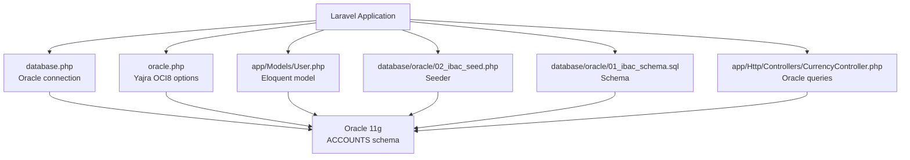
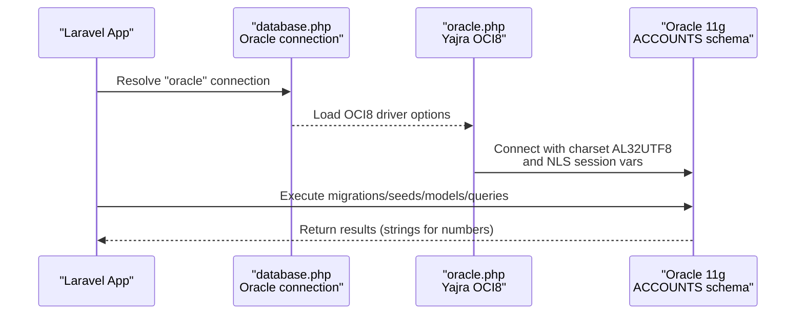
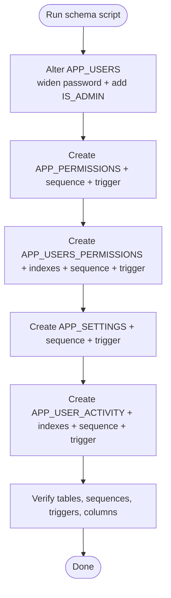
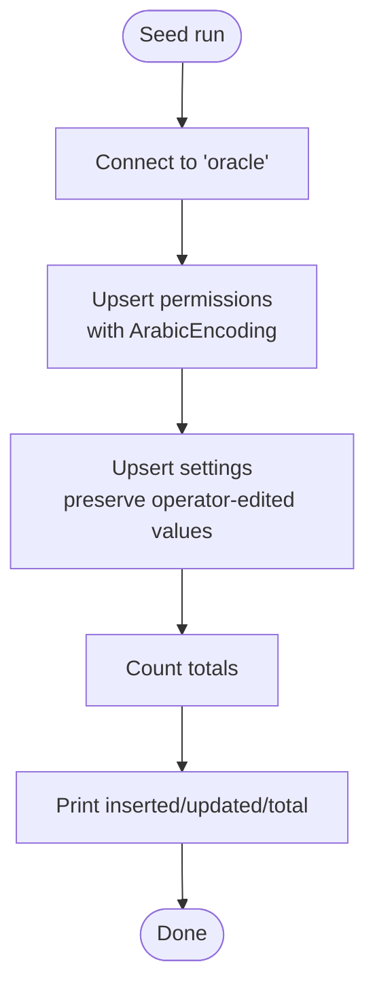
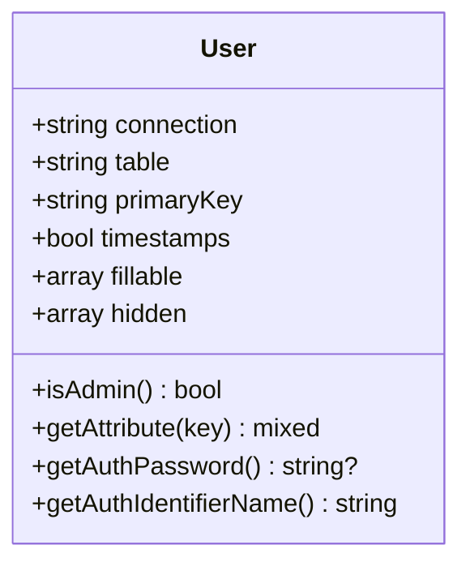
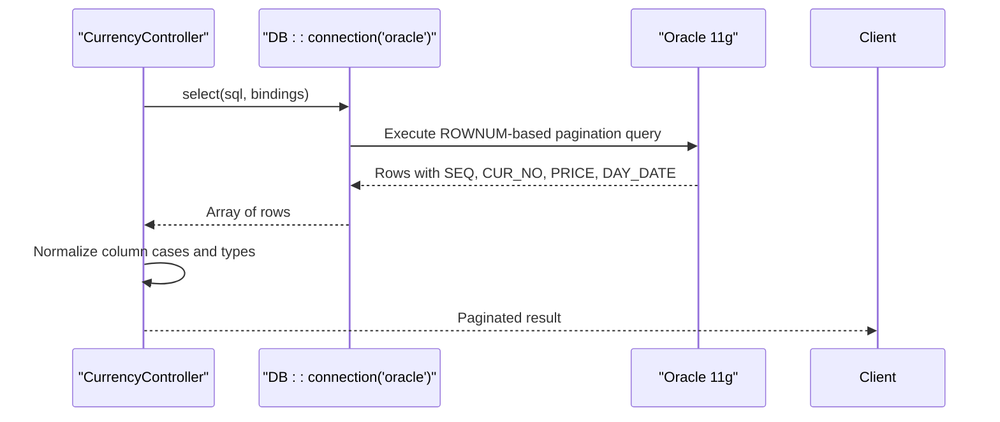
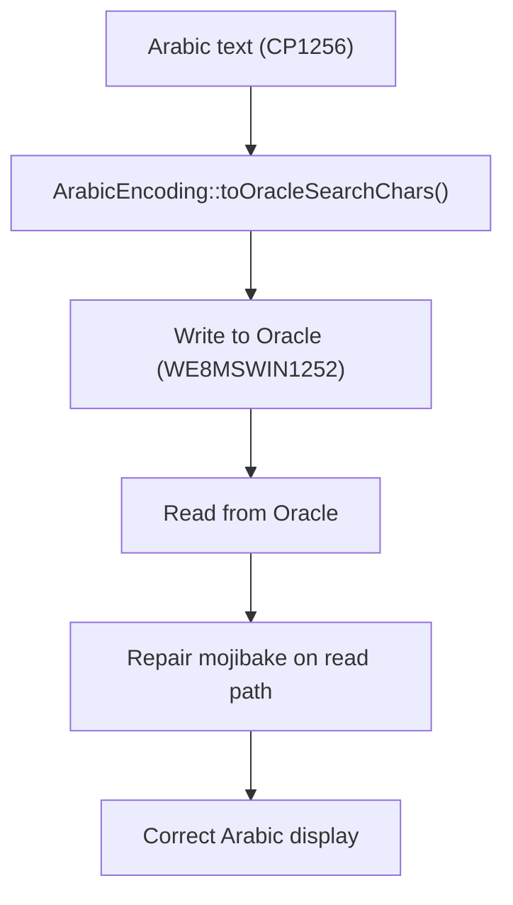
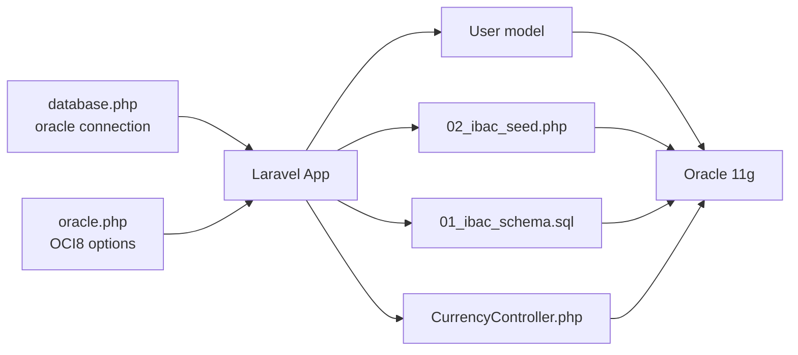

# Database Integration and Oracle Configuration

<cite>
**Referenced Files in This Document**
- [database.php](file://kyApp_API/config/database.php)
- [oracle.php](file://kyApp_API/config/oracle.php)
- [01_ibac_schema.sql](file://kyApp_API/database/oracle/01_ibac_schema.sql)
- [02_ibac_seed.php](file://kyApp_API/database/oracle/02_ibac_seed.php)
- [User.php](file://kyApp_API/app/Models/User.php)
- [CurrencyController.php](file://kyApp_API/app/Http/Controllers/CurrencyController.php)
</cite>

## Table of Contents
1. [Introduction](#introduction)
2. [Project Structure](#project-structure)
3. [Core Components](#core-components)
4. [Architecture Overview](#architecture-overview)
5. [Detailed Component Analysis](#detailed-component-analysis)
6. [Dependency Analysis](#dependency-analysis)
7. [Performance Considerations](#performance-considerations)
8. [Troubleshooting Guide](#troubleshooting-guide)
9. [Conclusion](#conclusion)

## Introduction
This document explains how the Laravel application integrates with Oracle using the Yajra Laravel OCI8 package. It covers connection configuration, migration and seeding workflows, Eloquent model behavior against Oracle, PL/SQL triggers and sequences, Arabic text encoding across AL32UTF8 clients and a WE8MSWIN1252 database, NLS session settings, complex queries, transactions, backup strategies, performance monitoring, and common connectivity troubleshooting.

## Project Structure
The Oracle integration is centered around:
- Connection configuration files for Laravel’s database layer and Yajra OCI8 driver.
- A raw Oracle schema script that defines tables, sequences, indexes, and triggers under the ACCOUNTS schema.
- A PHP seed script that populates permission catalogs and security settings while handling Arabic text correctly.
- An Eloquent User model bound to the Oracle connection and legacy APP_USERS table.
- Controllers that execute Oracle-specific SQL for pagination and data operations.

**Diagram sources**
- [database.php:116-127](file://kyApp_API/config/database.php#L116-L127)
- [oracle.php:4-28](file://kyApp_API/config/oracle.php#L4-L28)
- [User.php:19-26](file://kyApp_API/app/Models/User.php#L19-L26)
- [02_ibac_seed.php:32-32](file://kyApp_API/database/oracle/02_ibac_seed.php#L32-L32)
- [01_ibac_schema.sql:21-207](file://kyApp_API/database/oracle/01_ibac_schema.sql#L21-L207)
- [CurrencyController.php:244-273](file://kyApp_API/app/Http/Controllers/CurrencyController.php#L244-L273)

**Section sources**
- [database.php:116-127](file://kyApp_API/config/database.php#L116-L127)
- [oracle.php:4-28](file://kyApp_API/config/oracle.php#L4-L28)
- [01_ibac_schema.sql:21-207](file://kyApp_API/database/oracle/01_ibac_schema.sql#L21-L207)
- [02_ibac_seed.php:32-32](file://kyApp_API/database/oracle/02_ibac_seed.php#L32-L32)
- [User.php:19-26](file://kyApp_API/app/Models/User.php#L19-L26)
- [CurrencyController.php:244-273](file://kyApp_API/app/Http/Controllers/CurrencyController.php#L244-L273)

## Core Components
- Oracle connection in Laravel’s database configuration defines host, port, service name, username, password, charset, prefix, and schema prefix.
- Yajra OCI8 configuration provides TNS, load balancing, edition, server version, max identifier length, dynamic parameters, and NLS session variables.
- The Oracle schema script creates core tables (APP_PERMISSIONS, APP_USERS_PERMISSIONS, APP_SETTINGS, APP_USER_ACTIVITY), sequences, indexes, and triggers.
- The seed script upserts permissions and settings, handles Arabic text via a dedicated encoder, and uses bound parameters.
- The User model binds to the Oracle connection, maps to APP_USERS, and includes case-insensitive attribute access and casts for numeric columns returned as strings by Oracle.
- Controllers use explicit Oracle connections and ROWNUM-based pagination compatible with Oracle 11g.

**Section sources**
- [database.php:116-127](file://kyApp_API/config/database.php#L116-L127)
- [oracle.php:4-28](file://kyApp_API/config/oracle.php#L4-L28)
- [01_ibac_schema.sql:21-207](file://kyApp_API/database/oracle/01_ibac_schema.sql#L21-L207)
- [02_ibac_seed.php:32-32](file://kyApp_API/database/oracle/02_ibac_seed.php#L32-L32)
- [User.php:19-106](file://kyApp_API/app/Models/User.php#L19-L106)
- [CurrencyController.php:244-273](file://kyApp_API/app/Http/Controllers/CurrencyController.php#L244-L273)

## Architecture Overview
The application connects to Oracle through two configuration layers:
- Laravel’s database.php defines the “oracle” connection used by Eloquent and query builder.
- oracle.php configures Yajra OCI8 driver-level options such as NLS session variables, load balancing, edition, and server version hints.

**Diagram sources**
- [database.php:116-127](file://kyApp_API/config/database.php#L116-L127)
- [oracle.php:4-28](file://kyApp_API/config/oracle.php#L4-L28)

## Detailed Component Analysis

### Oracle Connection Configuration
- database.php:
  - Defines an “oracle” connection with host, port, database/service_name, username, password, charset, prefix, and prefix_schema.
  - Uses environment variables for all values.
- oracle.php:
  - Provides Yajra OCI8 options including TNS, host/port, service_name, charset, prefix, prefix_schema, edition, server_version, load_balance, max_name_len, dynamic parameters, and sessionVars for NLS formatting.

Key implications:
- Charset AL32UTF8 on the client side must be coordinated with the database character set (WE8MSWIN1252) to avoid mojibake.
- NLS session variables standardize date/time formats and numeric characters.
- Load balancing can distribute connections when enabled.

**Section sources**
- [database.php:116-127](file://kyApp_API/config/database.php#L116-L127)
- [oracle.php:4-28](file://kyApp_API/config/oracle.php#L4-L28)

### Migration System and Schema Management
- Raw Oracle schema script 01_ibac_schema.sql:
  - Alters existing APP_USERS (widens password column, adds admin flag).
  - Creates APP_PERMISSIONS, APP_USERS_PERMISSIONS, APP_SETTINGS, APP_USER_ACTIVITY.
  - Defines sequences and BEFORE INSERT triggers to auto-populate primary keys.
  - Adds indexes for performance.
  - Includes verification queries for objects and columns.

Important notes:
- Sequence names inside PL/SQL are unqualified because a VIEW named ACCOUNTS exists; qualifying them would cause PLS-00302.
- Triggers rely on NEXTVAL from DUAL without schema qualification.

**Diagram sources**
- [01_ibac_schema.sql:21-207](file://kyApp_API/database/oracle/01_ibac_schema.sql#L21-L207)

**Section sources**
- [01_ibac_schema.sql:21-207](file://kyApp_API/database/oracle/01_ibac_schema.sql#L21-L207)

### Seeders and Test Data
- 02_ibac_seed.php:
  - Connects to the “oracle” connection.
  - Upserts permission catalog rows and security settings.
  - Uses ArabicEncoding::toOracleSearchChars() for Arabic text to preserve bytes under AL32UTF8 client / WE8MSWIN1252 database.
  - Uses bound parameters exclusively.
  - Is idempotent: safe to re-run, updates existing rows and inserts missing ones.

**Diagram sources**
- [02_ibac_seed.php:32-32](file://kyApp_API/database/oracle/02_ibac_seed.php#L32-L32)
- [02_ibac_seed.php:38-91](file://kyApp_API/database/oracle/02_ibac_seed.php#L38-L91)
- [02_ibac_seed.php:363-430](file://kyApp_API/database/oracle/02_ibac_seed.php#L363-L430)
- [02_ibac_seed.php:448-461](file://kyApp_API/database/oracle/02_ibac_seed.php#L448-L461)

**Section sources**
- [02_ibac_seed.php:32-32](file://kyApp_API/database/oracle/02_ibac_seed.php#L32-L32)
- [02_ibac_seed.php:38-91](file://kyApp_API/database/oracle/02_ibac_seed.php#L38-L91)
- [02_ibac_seed.php:363-430](file://kyApp_API/database/oracle/02_ibac_seed.php#L363-L430)
- [02_ibac_seed.php:448-461](file://kyApp_API/database/oracle/02_ibac_seed.php#L448-L461)

### Eloquent ORM and Model Relationships
- User model:
  - Binds to the “oracle” connection and maps to APP_USERS.
  - Overrides primary key to user_id and disables timestamps.
  - Defines fillable fields and hidden sensitive attributes.
  - Casts numeric columns to integer to handle Oracle returning numbers as strings.
  - Implements case-insensitive attribute access to accommodate Oracle PDO column casing differences.
  - Provides authentication helpers for password and identifier.

**Diagram sources**
- [User.php:19-106](file://kyApp_API/app/Models/User.php#L19-L106)
- [User.php:114-165](file://kyApp_API/app/Models/User.php#L114-L165)

**Section sources**
- [User.php:19-106](file://kyApp_API/app/Models/User.php#L19-L106)
- [User.php:114-165](file://kyApp_API/app/Models/User.php#L114-L165)

### Oracle-Specific Features: PL/SQL Procedures, Functions, and Cursors
- The repository contains sequences and triggers for ID generation and audit logging.
- PL/SQL procedures/functions and cursors are not present in the analyzed files. When integrating them:
  - Use DB::connection('oracle') to call stored procedures with bind variables.
  - For ref cursors, pass cursor variables and fetch rows via the OCI8 driver.
  - Ensure NLS session variables match expected date/time formats.

[No sources needed since this section provides general guidance]

### Complex Queries and Joins Across Multiple Tables
- Pagination example in CurrencyController demonstrates Oracle 11g-compatible ROWNUM pagination.
- Bind parameters are used for safety and performance.
- Column names may vary in case; code normalizes access to both uppercase and lowercase variants.

**Diagram sources**
- [CurrencyController.php:244-273](file://kyApp_API/app/Http/Controllers/CurrencyController.php#L244-L273)

**Section sources**
- [CurrencyController.php:244-273](file://kyApp_API/app/Http/Controllers/CurrencyController.php#L244-L273)

### Transaction Management
- Use DB::beginTransaction(), commit(), and rollBack() around multi-step operations involving multiple tables (e.g., inserting permissions and activity logs).
- Wrap controller actions or seeder steps in transactions to ensure atomicity.
- Always catch exceptions and roll back on failure.

[No sources needed since this section provides general guidance]

### Arabic Text Encoding and NLS Settings
- Client charset AL32UTF8 vs database charset WE8MSWIN1252 requires special handling for Arabic text.
- ArabicEncoding::toOracleSearchChars() maps CP1256 bytes to Latin-1 code points so the bytes land correctly in the database; reading paths should repair mojibake.
- NLS session variables in oracle.php define consistent date/time and numeric formatting.

**Diagram sources**
- [02_ibac_seed.php:10-23](file://kyApp_API/database/oracle/02_ibac_seed.php#L10-L23)
- [02_ibac_seed.php:59-87](file://kyApp_API/database/oracle/02_ibac_seed.php#L59-L87)
- [oracle.php:21-27](file://kyApp_API/config/oracle.php#L21-L27)

**Section sources**
- [02_ibac_seed.php:10-23](file://kyApp_API/database/oracle/02_ibac_seed.php#L10-L23)
- [02_ibac_seed.php:59-87](file://kyApp_API/database/oracle/02_ibac_seed.php#L59-L87)
- [oracle.php:21-27](file://kyApp_API/config/oracle.php#L21-L27)

## Dependency Analysis
The following diagram shows how configuration, models, scripts, and controllers depend on the Oracle database.

**Diagram sources**
- [database.php:116-127](file://kyApp_API/config/database.php#L116-L127)
- [oracle.php:4-28](file://kyApp_API/config/oracle.php#L4-L28)
- [User.php:19-26](file://kyApp_API/app/Models/User.php#L19-L26)
- [02_ibac_seed.php:32-32](file://kyApp_API/database/oracle/02_ibac_seed.php#L32-L32)
- [01_ibac_schema.sql:21-207](file://kyApp_API/database/oracle/01_ibac_schema.sql#L21-L207)
- [CurrencyController.php:244-273](file://kyApp_API/app/Http/Controllers/CurrencyController.php#L244-L273)

**Section sources**
- [database.php:116-127](file://kyApp_API/config/database.php#L116-L127)
- [oracle.php:4-28](file://kyApp_API/config/oracle.php#L4-L28)
- [User.php:19-26](file://kyApp_API/app/Models/User.php#L19-L26)
- [02_ibac_seed.php:32-32](file://kyApp_API/database/oracle/02_ibac_seed.php#L32-L32)
- [01_ibac_schema.sql:21-207](file://kyApp_API/database/oracle/01_ibac_schema.sql#L21-L207)
- [CurrencyController.php:244-273](file://kyApp_API/app/Http/Controllers/CurrencyController.php#L244-L273)

## Performance Considerations
- Connection pooling:
  - Enable OCI8 persistent connections if appropriate for your deployment.
  - Tune Oracle listener and pooler settings at the database level.
- Timeouts:
  - Set query timeouts at the application level where supported by the driver.
  - Configure Oracle-side timeout profiles if necessary.
- Query optimization:
  - Use indexes defined in the schema (e.g., APP_PERM_MOD_IX, APP_UQ_USER_IX, APP_ACT_*_IX).
  - Prefer bound parameters and avoid SELECT * where possible.
  - Use ROWNUM-based pagination for Oracle 11g compatibility.
- NLS and casting:
  - Standardize NLS session variables to reduce conversion overhead.
  - Cast numeric columns explicitly in models to avoid repeated conversions.

[No sources needed since this section provides general guidance]

## Troubleshooting Guide
Common Oracle connectivity and data issues:
- ORA-04098 / PLS-00302 due to qualified sequence references:
  - Cause: A VIEW named ACCOUNTS exists; qualifying sequence names like ACCOUNTS.SEQ_X.NEXTVAL resolves as view.column.
  - Resolution: Use unqualified sequence names inside PL/SQL triggers.
- Mojibake with Arabic text:
  - Cause: AL32UTF8 client writing to WE8MSWIN1252 database corrupts raw CP1256 bytes.
  - Resolution: Use ArabicEncoding::toOracleSearchChars() when writing; repair mojibake on read paths.
- Column casing inconsistencies:
  - Cause: Oracle PDO returns column attributes in lowercase.
  - Resolution: Implement case-insensitive attribute access in models.
- Numeric columns returned as strings:
  - Cause: Oracle driver returns numbers as strings.
  - Resolution: Cast numeric columns in Eloquent models.
- Pagination errors on Oracle 11g:
  - Cause: FETCH FIRST … ROWS ONLY is not supported until 12c+.
  - Resolution: Use nested ROWNUM pagination as shown in controllers.

**Section sources**
- [01_ibac_schema.sql:64-75](file://kyApp_API/database/oracle/01_ibac_schema.sql#L64-L75)
- [02_ibac_seed.php:10-23](file://kyApp_API/database/oracle/02_ibac_seed.php#L10-L23)
- [User.php:35-39](file://kyApp_API/app/Models/User.php#L35-L39)
- [User.php:125-149](file://kyApp_API/app/Models/User.php#L125-L149)
- [CurrencyController.php:244-273](file://kyApp_API/app/Http/Controllers/CurrencyController.php#L244-L273)

## Conclusion
The application integrates Oracle through Laravel’s database configuration and Yajra OCI8 driver options. The schema defines core tables, sequences, and triggers; the seed script populates permissions and settings with correct Arabic encoding. The User model adapts to Oracle quirks such as column casing and numeric string returns. Controllers demonstrate Oracle 11g-compatible pagination. Proper NLS settings, careful encoding, and transaction management ensure reliable operation. For production, apply connection pooling, timeouts, indexing, and monitoring aligned with Oracle best practices.