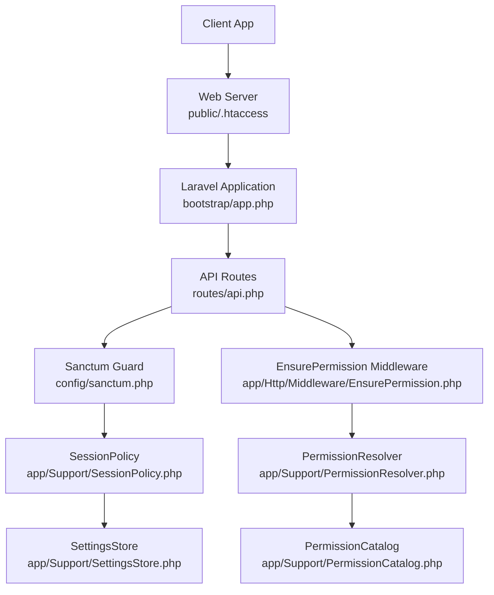
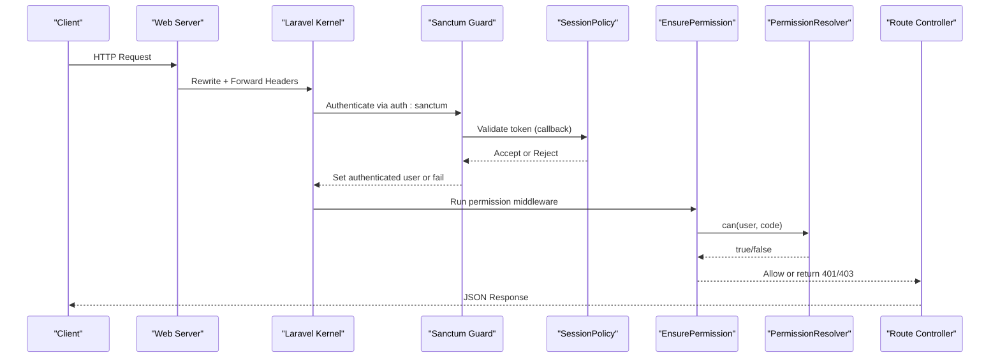
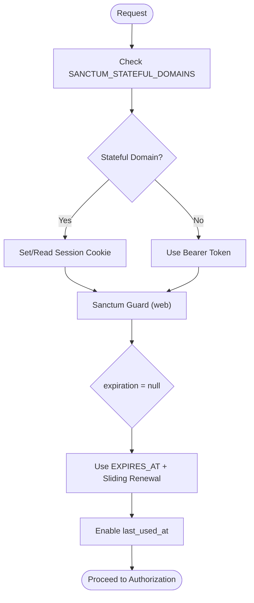
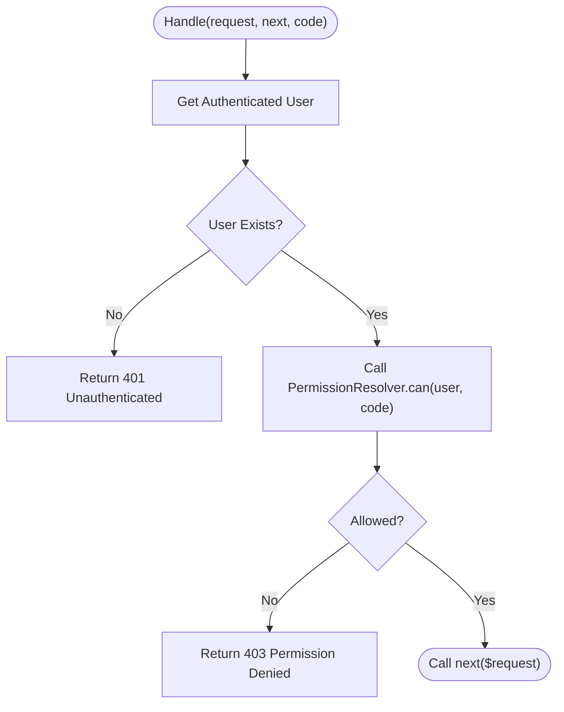
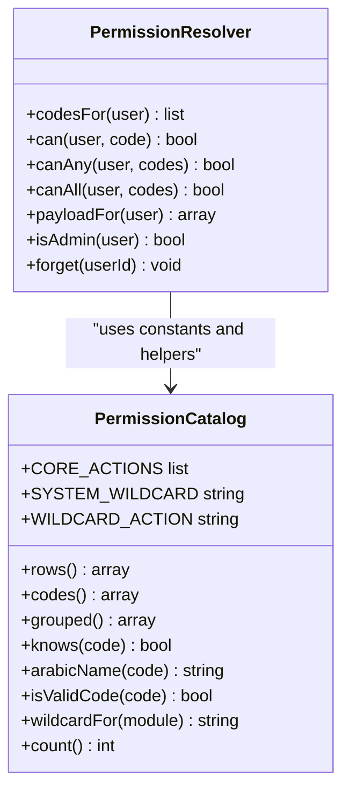
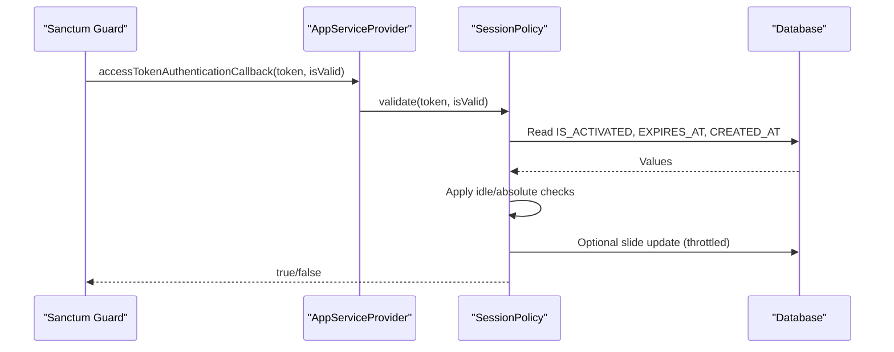
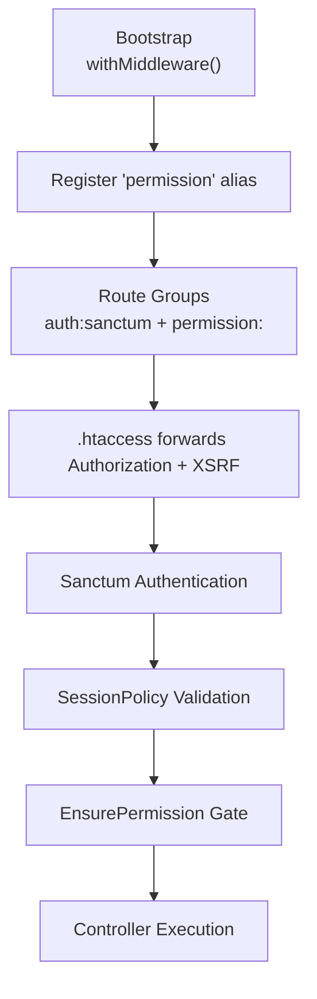
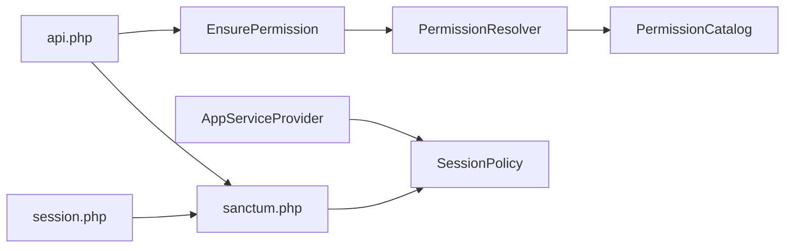

# Middleware Pipeline and Security

<cite>
**Referenced Files in This Document**
- [bootstrap/app.php](file://kyApp_API/bootstrap/app.php)
- [app/Http/Middleware/EnsurePermission.php](file://kyApp_API/app/Http/Middleware/EnsurePermission.php)
- [app/Support/PermissionResolver.php](file://kyApp_API/app/Support/PermissionResolver.php)
- [app/Support/PermissionCatalog.php](file://kyApp_API/app/Support/PermissionCatalog.php)
- [app/Support/SessionPolicy.php](file://kyApp_API/app/Support/SessionPolicy.php)
- [app/Providers/AppServiceProvider.php](file://kyApp_API/app/Providers/AppServiceProvider.php)
- [config/sanctum.php](file://kyApp_API/config/sanctum.php)
- [config/auth.php](file://kyApp_API/config/auth.php)
- [config/session.php](file://kyApp_API/config/session.php)
- [routes/api.php](file://kyApp_API/routes/api.php)
- [routes/web.php](file://kyApp_API/routes/web.php)
- [public/.htaccess](file://kyApp_API/public/.htaccess)
- [app/Http/Controllers/TableQueryController.php](file://kyApp_API/app/Http/Controllers/TableQueryController.php)
</cite>

## Table of Contents
1. [Introduction](#introduction)
2. [Project Structure](#project-structure)
3. [Core Components](#core-components)
4. [Architecture Overview](#architecture-overview)
5. [Detailed Component Analysis](#detailed-component-analysis)
6. [Dependency Analysis](#dependency-analysis)
7. [Performance Considerations](#performance-considerations)
8. [Troubleshooting Guide](#troubleshooting-guide)
9. [Conclusion](#conclusion)

## Introduction
This document explains the Laravel middleware pipeline and security implementation for the API backend. It covers:
- Sanctum authentication middleware setup for API token-based authentication and session management.
- The custom `EnsurePermission` middleware implementing Identity-Based Access Control (IBAC).
- Middleware registration order, global versus route-specific application, and request lifecycle hooks.
- Permission checking logic, role-like system-admin bypass, and dynamic permission resolution.
- Security posture including CSRF protection, session cookie behavior, SQL injection mitigation, and sensitive data handling.
- Testing approaches and debugging techniques for authentication and authorization flows.

## Project Structure
The relevant backend structure is organized around:
- Bootstrap configuration that registers the `permission` middleware alias.
- Route definitions that apply `auth:sanctum` and per-route `permission:<code>` gates.
- Support classes that implement IBAC decision logic, session policy, and settings caching.
- Configuration files for Sanctum, authentication guards, and session cookies.
- Web server rewrite rules that forward headers to Laravel.

**Diagram sources**
- [bootstrap/app.php:8-20](file://kyApp_API/bootstrap/app.php#L8-L20)
- [routes/api.php:38-185](file://kyApp_API/routes/api.php#L38-L185)
- [config/sanctum.php:105-109](file://kyApp_API/config/sanctum.php#L105-L109)
- [app/Http/Middleware/EnsurePermission.php:25-52](file://kyApp_API/app/Http/Middleware/EnsurePermission.php#L25-L52)
- [app/Support/PermissionResolver.php:27-132](file://kyApp_API/app/Support/PermissionResolver.php#L27-L132)
- [app/Support/PermissionCatalog.php:22-41](file://kyApp_API/app/Support/PermissionCatalog.php#L22-L41)
- [app/Support/SessionPolicy.php:42-108](file://kyApp_API/app/Support/SessionPolicy.php#L42-L108)

**Section sources**
- [bootstrap/app.php:8-20](file://kyApp_API/bootstrap/app.php#L8-L20)
- [routes/api.php:38-185](file://kyApp_API/routes/api.php#L38-L185)
- [config/sanctum.php:105-109](file://kyApp_API/config/sanctum.php#L105-L109)

## Core Components
- **Sanctum Authentication**: Uses the `web` guard with stateful domains configured via environment variables. Token expiration is intentionally left null so session lifetime is driven by `EXPIRES_AT` and a sliding renewal policy.
- **Custom IBAC Middleware**: `EnsurePermission` enforces deny-by-default access control using permission codes like `customers.view`. It returns 401 when no authenticated user exists and 403 when the required permission is missing.
- **Permission Resolution**: `PermissionResolver` implements IBAC rules: system admin bypass, system wildcard, explicit grant, module wildcard, then denial. It caches effective permissions per user.
- **Session Policy**: `SessionPolicy` validates tokens against account activation, idle expiry, absolute age, and performs write-throttled sliding renewal. It integrates into Sanctum’s token validation callback.
- **Middleware Registration**: The `permission` alias maps to `EnsurePermission::class` in bootstrap configuration. Routes apply `auth:sanctum` globally within groups and add `permission:<code>` per route.

**Section sources**
- [config/sanctum.php:21-40](file://kyApp_API/config/sanctum.php#L21-L40)
- [config/sanctum.php:63-77](file://kyApp_API/config/sanctum.php#L63-L77)
- [app/Http/Middleware/EnsurePermission.php:25-52](file://kyApp_API/app/Http/Middleware/EnsurePermission.php#L25-L52)
- [app/Support/PermissionResolver.php:27-132](file://kyApp_API/app/Support/PermissionResolver.php#L27-L132)
- [app/Support/SessionPolicy.php:42-108](file://kyApp_API/app/Support/SessionPolicy.php#L42-L108)
- [bootstrap/app.php:15-20](file://kyApp_API/bootstrap/app.php#L15-L20)

## Architecture Overview
The request flow combines Sanctum authentication and IBAC authorization:

**Diagram sources**
- [public/.htaccess:8-14](file://kyApp_API/public/.htaccess#L8-L14)
- [config/sanctum.php:105-109](file://kyApp_API/config/sanctum.php#L105-L109)
- [app/Providers/AppServiceProvider.php:51-62](file://kyApp_API/app/Providers/AppServiceProvider.php#L51-L62)
- [app/Support/SessionPolicy.php:70-108](file://kyApp_API/app/Support/SessionPolicy.php#L70-L108)
- [app/Http/Middleware/EnsurePermission.php:32-52](file://kyApp_API/app/Http/Middleware/EnsurePermission.php#L32-L52)
- [app/Support/PermissionResolver.php:95-132](file://kyApp_API/app/Support/PermissionResolver.php#L95-L132)

## Detailed Component Analysis

### Sanctum Authentication Middleware Setup
- **Guard**: The default guard is `web`, which uses session-based authentication.
- **Stateful Domains**: Sanctum allows stateful cookies from configured domains; this enables SPA sessions alongside token-based APIs.
- **Expiration Strategy**: `expiration` is set to null to avoid hard absolute age checks against `created_at`. Instead, `EXPIRES_AT` drives session lifetime, and `last_used_at` is enabled for active-session tracking.
- **Sanctum Middleware Mapping**: The configuration maps aliases for session authentication, cookie encryption, and CSRF validation used during Sanctum processing.

**Diagram sources**
- [config/sanctum.php:21-26](file://kyApp_API/config/sanctum.php#L21-L26)
- [config/sanctum.php:40-40](file://kyApp_API/config/sanctum.php#L40-L40)
- [config/sanctum.php:63-63](file://kyApp_API/config/sanctum.php#L63-L63)
- [config/sanctum.php:77-77](file://kyApp_API/config/sanctum.php#L77-L77)
- [config/sanctum.php:105-109](file://kyApp_API/config/sanctum.php#L105-L109)

**Section sources**
- [config/sanctum.php:21-40](file://kyApp_API/config/sanctum.php#L21-L40)
- [config/sanctum.php:63-77](file://kyApp_API/config/sanctum.php#L63-L77)
- [config/sanctum.php:105-109](file://kyApp_API/config/sanctum.php#L105-L109)

### Custom EnsurePermission Middleware (IBAC)
- **Purpose**: Deny-by-default gate enforcing granular permissions on routes protected by `auth:sanctum`.
- **Behavior**:
  - If no authenticated user is present, return 401.
  - If the required permission code is not granted, return 403 with an Arabic label from the catalog.
  - Otherwise, pass the request to the next handler.
- **Integration**: Registered as the `permission` alias and applied per route, e.g., `->middleware('permission:customers.view')`.

**Diagram sources**
- [app/Http/Middleware/EnsurePermission.php:32-52](file://kyApp_API/app/Http/Middleware/EnsurePermission.php#L32-L52)
- [app/Support/PermissionResolver.php:95-132](file://kyApp_API/app/Support/PermissionResolver.php#L95-L132)
- [app/Support/PermissionCatalog.php:432-441](file://kyApp_API/app/Support/PermissionCatalog.php#L432-L441)

**Section sources**
- [app/Http/Middleware/EnsurePermission.php:25-52](file://kyApp_API/app/Http/Middleware/EnsurePermission.php#L25-L52)

### PermissionResolver and PermissionCatalog
- **Decision Rules**:
  1. System administrator (`IS_ADMIN = 1`) bypasses all grant checks.
  2. Grant of `system.*` grants everything.
  3. Explicit permission code match grants access.
  4. Module wildcard (`module.*`) grants all actions under that module.
  5. Otherwise, deny.
- **Caching**: Effective permission codes are cached per user with a safe payload size limit to avoid Oracle CLOB binding issues.
- **Catalog**: Central source of truth for permission codes, labels, wildcards, and validation helpers.

**Diagram sources**
- [app/Support/PermissionResolver.php:27-132](file://kyApp_API/app/Support/PermissionResolver.php#L27-L132)
- [app/Support/PermissionCatalog.php:22-41](file://kyApp_API/app/Support/PermissionCatalog.php#L22-L41)
- [app/Support/PermissionCatalog.php:271-316](file://kyApp_API/app/Support/PermissionCatalog.php#L271-L316)
- [app/Support/PermissionCatalog.php:432-441](file://kyApp_API/app/Support/PermissionCatalog.php#L432-L441)

**Section sources**
- [app/Support/PermissionResolver.php:27-132](file://kyApp_API/app/Support/PermissionResolver.php#L27-L132)
- [app/Support/PermissionCatalog.php:22-41](file://kyApp_API/app/Support/PermissionCatalog.php#L22-L41)
- [app/Support/PermissionCatalog.php:271-316](file://kyApp_API/app/Support/PermissionCatalog.php#L271-L316)
- [app/Support/PermissionCatalog.php:432-441](file://kyApp_API/app/Support/PermissionCatalog.php#L432-L441)

### SessionPolicy and Sanctum Integration
- **Validation Flow**:
  - Reject if the tokenable user is inactive.
  - Reject if `EXPIRES_AT` is in the past (idle expiry).
  - Reject if the token exceeds absolute age based on `session_absolute_days`.
  - Otherwise, perform sliding renewal with write throttling.
- **Sanctum Hook**: The service provider attaches `SessionPolicy::validate` to Sanctum’s token validation callback, ensuring every authenticated request passes through session policy. Failures fall back to Sanctum’s original verdict rather than causing 500 errors.

**Diagram sources**
- [app/Providers/AppServiceProvider.php:51-62](file://kyApp_API/app/Providers/AppServiceProvider.php#L51-L62)
- [app/Support/SessionPolicy.php:70-108](file://kyApp_API/app/Support/SessionPolicy.php#L70-L108)
- [app/Support/SessionPolicy.php:166-183](file://kyApp_API/app/Support/SessionPolicy.php#L166-L183)

**Section sources**
- [app/Providers/AppServiceProvider.php:51-62](file://kyApp_API/app/Providers/AppServiceProvider.php#L51-L62)
- [app/Support/SessionPolicy.php:70-108](file://kyApp_API/app/Support/SessionPolicy.php#L70-L108)
- [app/Support/SessionPolicy.php:166-183](file://kyApp_API/app/Support/SessionPolicy.php#L166-L183)

### Middleware Registration Order and Lifecycle
- **Global Alias**: The `permission` alias is registered in bootstrap configuration, enabling concise usage across routes.
- **Route Groups**: Business routes are grouped under `auth:sanctum`; each route adds its own `permission:<code>` requirement.
- **Lifecycle Hooks**:
  - Web server forwards `Authorization` and `X-XSRF-Token` headers.
  - Sanctum authenticates via session or bearer token.
  - Session policy validates token lifetime and account status.
  - EnsurePermission checks IBAC grants.
  - Controllers execute only after both authentication and authorization succeed.

**Diagram sources**
- [bootstrap/app.php:15-20](file://kyApp_API/bootstrap/app.php#L15-L20)
- [routes/api.php:38-185](file://kyApp_API/routes/api.php#L38-L185)
- [public/.htaccess:8-14](file://kyApp_API/public/.htaccess#L8-L14)
- [app/Providers/AppServiceProvider.php:51-62](file://kyApp_API/app/Providers/AppServiceProvider.php#L51-L62)
- [app/Http/Middleware/EnsurePermission.php:32-52](file://kyApp_API/app/Http/Middleware/EnsurePermission.php#L32-L52)

**Section sources**
- [bootstrap/app.php:15-20](file://kyApp_API/bootstrap/app.php#L15-L20)
- [routes/api.php:38-185](file://kyApp_API/routes/api.php#L38-L185)
- [public/.htaccess:8-14](file://kyApp_API/public/.htaccess#L8-L14)

### Security Posture: CSRF, XSS, SQL Injection Mitigation
- **CSRF Protection**:
  - Sanctum configuration includes CSRF validation middleware mapping.
  - `.htaccess` forwards `X-XSRF-Token` header for SPA clients.
  - For web routes, include CSRF tokens in forms handled by Laravel’s web middleware.
- **Session Cookies**:
  - `SESSION_HTTP_ONLY` defaults to true to prevent JavaScript access.
  - `SESSION_SECURE_COOKIE` controls HTTPS-only transmission.
  - `SESSION_SAME_SITE` mitigates cross-site request risks.
- **SQL Injection Mitigation**:
  - Permission queries use bound parameters.
  - Sensitive diagnostic routes enforce strict allowlists and deny lists for tables and columns.
- **XSS Prevention**:
  - Follow best practices to escape output in Blade templates and avoid raw HTML unless sanitized.

**Section sources**
- [config/sanctum.php:105-109](file://kyApp_API/config/sanctum.php#L105-L109)
- [public/.htaccess:8-14](file://kyApp_API/public/.htaccess#L8-L14)
- [config/session.php:172-202](file://kyApp_API/config/session.php#L172-L202)
- [app/Support/PermissionResolver.php:49-58](file://kyApp_API/app/Support/PermissionResolver.php#L49-L58)
- [app/Http/Controllers/TableQueryController.php:28-59](file://kyApp_API/app/Http/Controllers/TableQueryController.php#L28-L59)

## Dependency Analysis
The following diagram shows how components depend on each other:

**Diagram sources**
- [app/Http/Middleware/EnsurePermission.php:25-52](file://kyApp_API/app/Http/Middleware/EnsurePermission.php#L25-L52)
- [app/Support/PermissionResolver.php:27-132](file://kyApp_API/app/Support/PermissionResolver.php#L27-L132)
- [app/Support/PermissionCatalog.php:22-41](file://kyApp_API/app/Support/PermissionCatalog.php#L22-L41)
- [app/Providers/AppServiceProvider.php:51-62](file://kyApp_API/app/Providers/AppServiceProvider.php#L51-L62)
- [config/sanctum.php:105-109](file://kyApp_API/config/sanctum.php#L105-L109)
- [routes/api.php:38-185](file://kyApp_API/routes/api.php#L38-L185)
- [config/session.php:172-202](file://kyApp_API/config/session.php#L172-L202)

**Section sources**
- [app/Http/Middleware/EnsurePermission.php:25-52](file://kyApp_API/app/Http/Middleware/EnsurePermission.php#L25-L52)
- [app/Support/PermissionResolver.php:27-132](file://kyApp_API/app/Support/PermissionResolver.php#L27-L132)
- [app/Support/PermissionCatalog.php:22-41](file://kyApp_API/app/Support/PermissionCatalog.php#L22-L41)
- [app/Providers/AppServiceProvider.php:51-62](file://kyApp_API/app/Providers/AppServiceProvider.php#L51-L62)
- [config/sanctum.php:105-109](file://kyApp_API/config/sanctum.php#L105-L109)
- [routes/api.php:38-185](file://kyApp_API/routes/api.php#L38-L185)
- [config/session.php:172-202](file://kyApp_API/config/session.php#L172-L202)

## Performance Considerations
- **Permission Caching**: `PermissionResolver` caches effective permission codes per user with a TTL and a maximum serialized size to avoid Oracle CLOB binding limits. Oversized sets skip cache to prevent failures.
- **Write-Throttled Sliding Renewal**: `SessionPolicy::slide` updates token expiry only when necessary, reducing database writes while maintaining active session lifetimes.
- **Singleton Services**: IBAC support services are registered as singletons to share cache-backed reads across middleware, controllers, and Sanctum callbacks within a request.

[No sources needed since this section provides general guidance]

## Troubleshooting Guide
- **Authentication Fails Despite Valid Token**:
  - Verify `SANCTUM_STATEFUL_DOMAINS` includes the client domain.
  - Confirm `expiration` remains null; otherwise, absolute age may prematurely expire active sessions.
  - Check `SessionPolicy::validate` logs and ensure `IS_ACTIVATED` is set correctly.
- **Authorization Returns 403**:
  - Ensure the route has the correct `permission:<code>` middleware.
  - Confirm the user has the required grant or module wildcard in `APP_USERS_PERMISSIONS`.
  - Validate permission codes against `PermissionCatalog::isValidCode`.
- **CSRF Mismatch**:
  - Ensure `.htaccess` forwards `X-XSRF-Token`.
  - For SPA clients, send the token header consistently.
  - Do not disable CSRF protection to fix mismatches; instead, align client behavior.
- **Sensitive Data Exposure**:
  - Review `TableQueryController` deny lists for tables and columns.
  - Avoid returning sensitive fields in API responses.
  - Use parameter binding for all database queries.

**Section sources**
- [config/sanctum.php:21-26](file://kyApp_API/config/sanctum.php#L21-L26)
- [config/sanctum.php:63-63](file://kyApp_API/config/sanctum.php#L63-L63)
- [app/Support/SessionPolicy.php:70-108](file://kyApp_API/app/Support/SessionPolicy.php#L70-L108)
- [app/Http/Middleware/EnsurePermission.php:32-52](file://kyApp_API/app/Http/Middleware/EnsurePermission.php#L32-L52)
- [app/Support/PermissionCatalog.php:447-456](file://kyApp_API/app/Support/PermissionCatalog.php#L447-L456)
- [public/.htaccess:8-14](file://kyApp_API/public/.htaccess#L8-L14)
- [app/Http/Controllers/TableQueryController.php:28-59](file://kyApp_API/app/Http/Controllers/TableQueryController.php#L28-L59)

## Conclusion
The backend implements a robust middleware pipeline combining Sanctum authentication and IBAC authorization:
- Sanctum handles token and session lifecycle without hard-coded expiration, relying on `EXPIRES_AT` and sliding renewal.
- `EnsurePermission` enforces deny-by-default access control using granular permission codes resolved by `PermissionResolver`.
- `SessionPolicy` integrates deeply with Sanctum to enforce account activation, idle expiry, absolute age, and write-throttled renewal.
- Security measures include CSRF protection, secure session cookies, parameter-bound queries, and strict deny lists for sensitive operations.
- Testing should cover authentication flows, permission checks, session policy behavior, and CSRF handling to ensure reliability and security.

[No sources needed since this section summarizes without analyzing specific files]