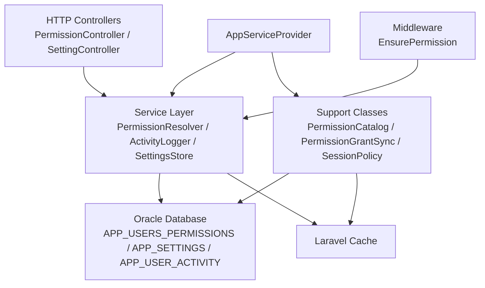
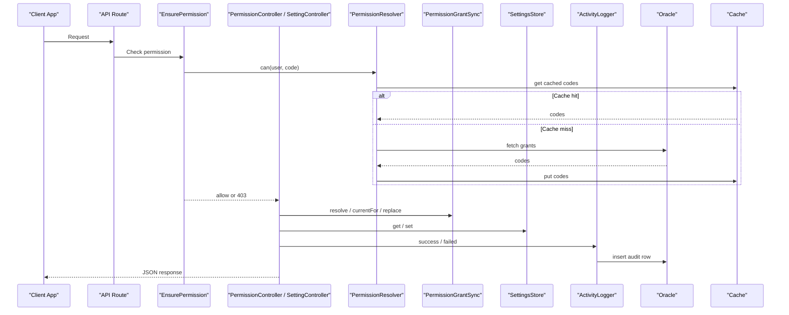
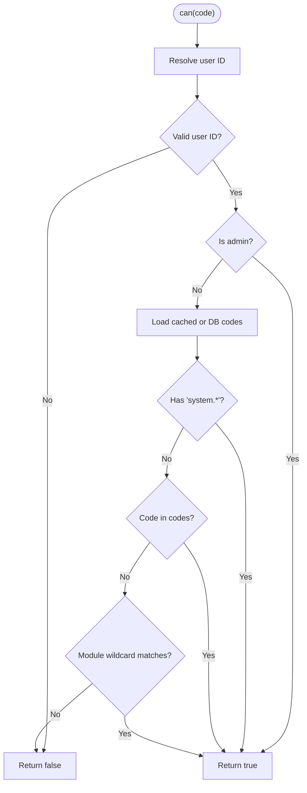
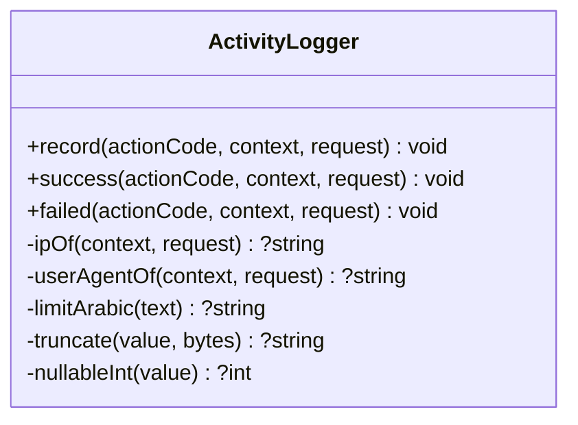
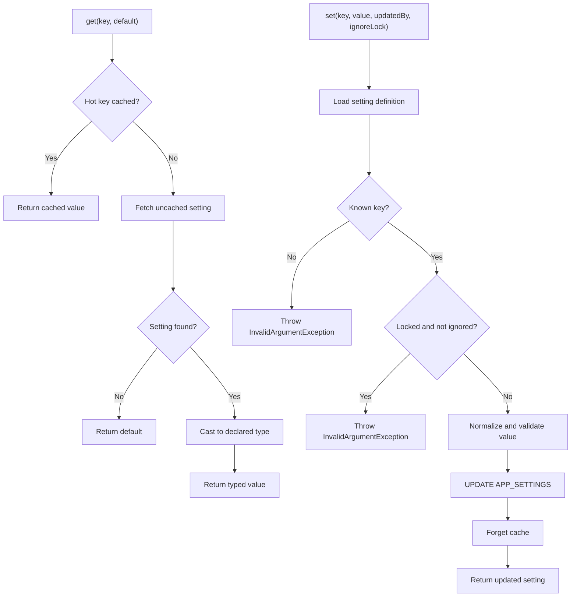
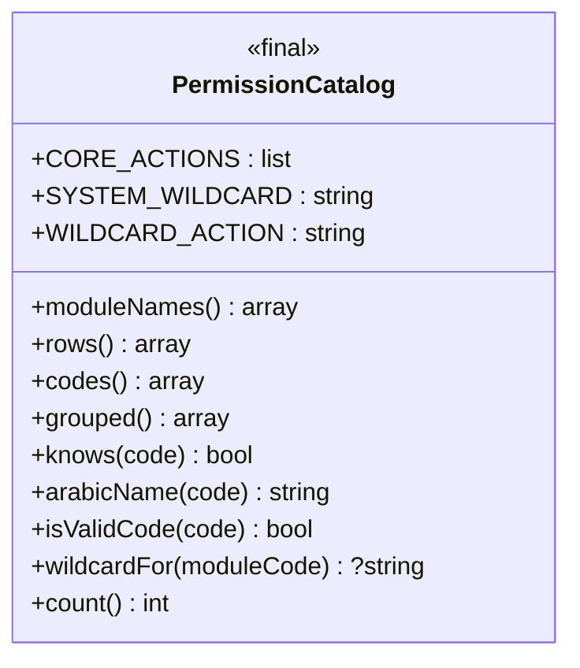
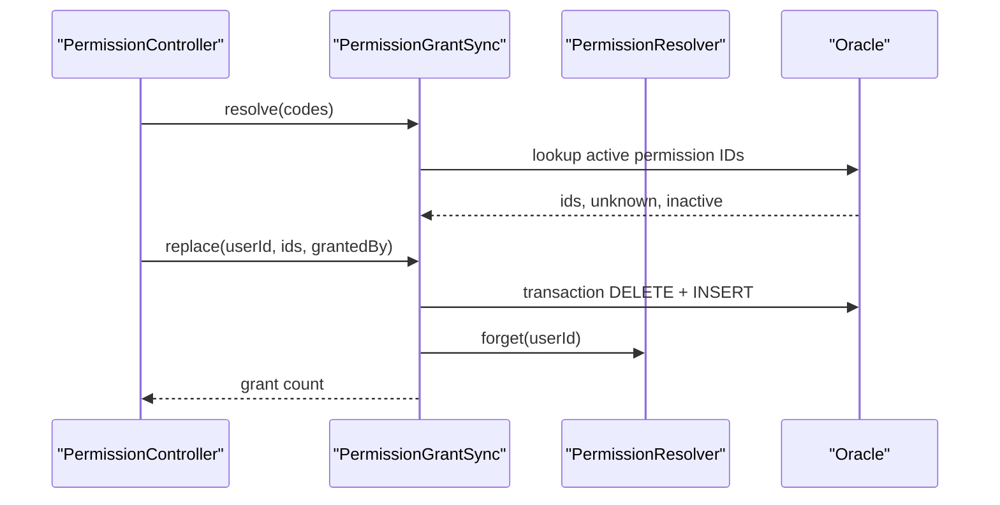
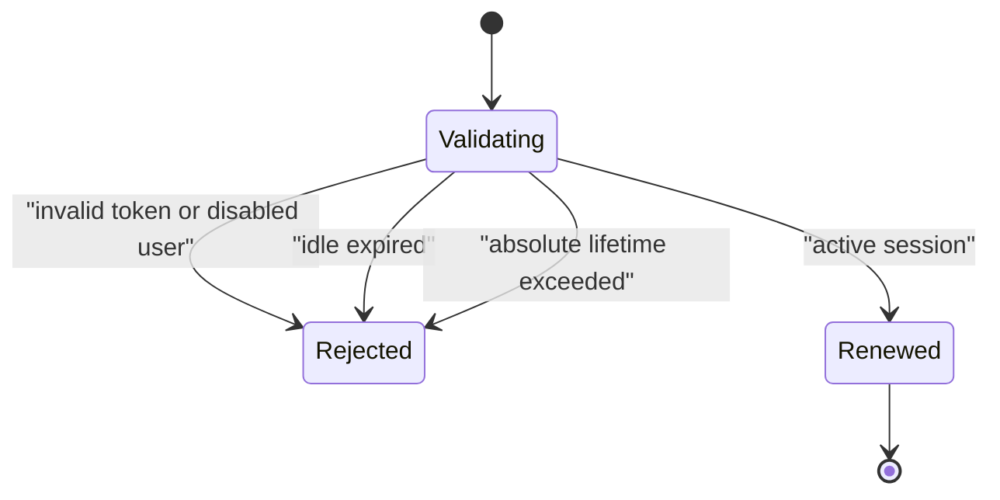
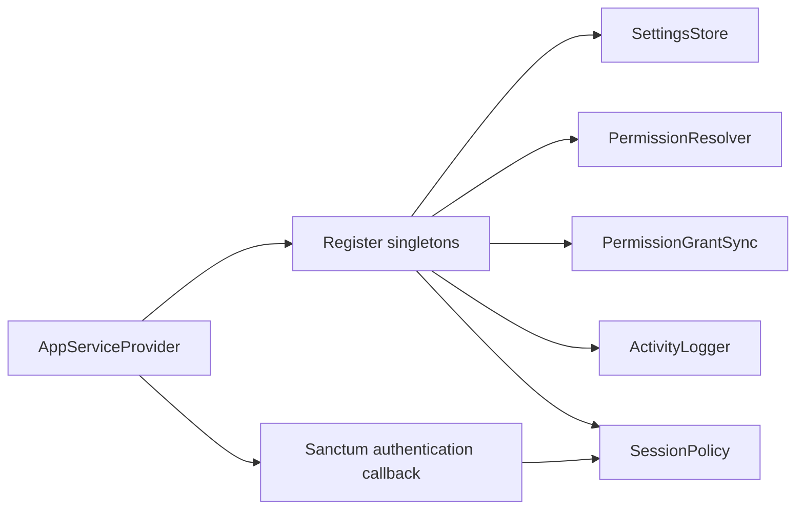
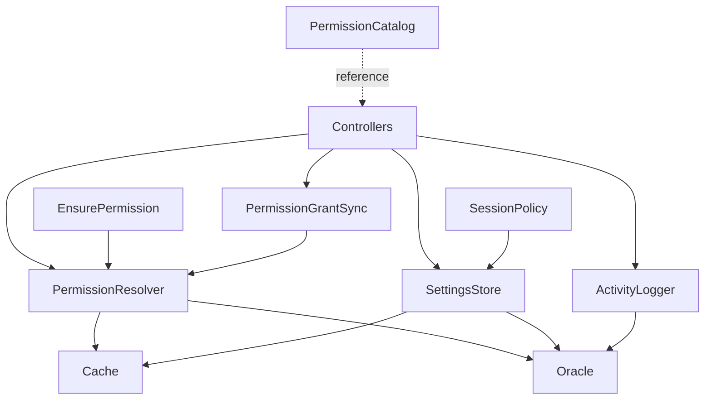

# Service Layer and Business Logic

<cite>
**Referenced Files in This Document**
- [PermissionResolver.php](file://kyApp_API/app/Support/PermissionResolver.php)
- [ActivityLogger.php](file://kyApp_API/app/Support/ActivityLogger.php)
- [SettingsStore.php](file://kyApp_API/app/Support/SettingsStore.php)
- [PermissionCatalog.php](file://kyApp_API/app/Support/PermissionCatalog.php)
- [PermissionGrantSync.php](file://kyApp_API/app/Support/PermissionGrantSync.php)
- [SessionPolicy.php](file://kyApp_API/app/Support/SessionPolicy.php)
- [EnsurePermission.php](file://kyApp_API/app/Http/Middleware/EnsurePermission.php)
- [PermissionController.php](file://kyApp_API/app/Http/Controllers/PermissionController.php)
- [SettingController.php](file://kyApp_API/app/Http/Controllers/SettingController.php)
- [AppServiceProvider.php](file://kyApp_API/app/Providers/AppServiceProvider.php)
- [IbacCoreTest.php](file://kyApp_API/tests/Feature/IbacCoreTest.php)
- [PermissionSyncTest.php](file://kyApp_API/tests/Feature/PermissionSyncTest.php)
- [SecuritySettingsTest.php](file://kyApp_API/tests/Feature/SecuritySettingsTest.php)
</cite>

## Table of Contents
1. [Introduction](#introduction)
2. [Project Structure](#project-structure)
3. [Core Components](#core-components)
4. [Architecture Overview](#architecture-overview)
5. [Detailed Component Analysis](#detailed-component-analysis)
6. [Dependency Analysis](#dependency-analysis)
7. [Performance Considerations](#performance-considerations)
8. [Troubleshooting Guide](#troubleshooting-guide)
9. [Conclusion](#conclusion)

## Introduction
This document explains how Ky Apps backend abstracts business logic into a service layer under `app/Support`. The main goals are:
- Separate permission resolution, activity logging, settings management, session policy, and grant synchronization from HTTP controllers.
- Provide stable method signatures and predictable return-value patterns for controllers and tests.
- Use Laravel’s dependency injection container to bind services as singletons per request.
- Handle Oracle-specific constraints, caching, transactions, error propagation, and auditability.

The three primary services analyzed here are:
- `PermissionResolver`: evaluates whether a user may perform an action.
- `ActivityLogger`: writes audit events without breaking successful requests.
- `SettingsStore`: reads and writes security/session settings with type validation, bounds checking, and short-lived caching.

Supporting components include `PermissionCatalog`, `PermissionGrantSync`, `SessionPolicy`, the `EnsurePermission` middleware, and the `AppServiceProvider` that wires everything together.

## Project Structure
The relevant backend code lives under `kyApp_API/app`:
- `app/Support`: service classes implementing domain logic.
- `app/Http/Controllers`: HTTP endpoints that orchestrate requests and delegate to services.
- `app/Http/Middleware`: route-level authorization gate using `PermissionResolver`.
- `app/Providers/AppServiceProvider`: binds services and hooks session policy into Sanctum.
- `tests/Feature`: integration-style tests exercising IBAC core, permission sync, and security settings.

**Diagram sources**
- [PermissionController.php:38-42](file://kyApp_API/app/Http/Controllers/PermissionController.php#L38-L42)
- [SettingController.php:33-37](file://kyApp_API/app/Http/Controllers/SettingController.php#L33-L37)
- [EnsurePermission.php:27-52](file://kyApp_API/app/Http/Middleware/EnsurePermission.php#L27-L52)
- [PermissionResolver.php:27-273](file://kyApp_API/app/Support/PermissionResolver.php#L27-L273)
- [ActivityLogger.php:18-169](file://kyApp_API/app/Support/ActivityLogger.php#L18-L169)
- [SettingsStore.php:28-500](file://kyApp_API/app/Support/SettingsStore.php#L28-L500)
- [PermissionCatalog.php:22-479](file://kyApp_API/app/Support/PermissionCatalog.php#L22-L479)
- [PermissionGrantSync.php:20-190](file://kyApp_API/app/Support/PermissionGrantSync.php#L20-L190)
- [SessionPolicy.php:42-184](file://kyApp_API/app/Support/SessionPolicy.php#L42-L184)
- [AppServiceProvider.php:29-62](file://kyApp_API/app/Providers/AppServiceProvider.php#L29-L62)

**Section sources**
- [PermissionController.php:1-379](file://kyApp_API/app/Http/Controllers/PermissionController.php#L1-L379)
- [SettingController.php:1-399](file://kyApp_API/app/Http/Controllers/SettingController.php#L1-L399)
- [AppServiceProvider.php:1-64](file://kyApp_API/app/Providers/AppServiceProvider.php#L1-L64)

## Core Components
The service layer focuses on three responsibilities:

| Service | Responsibility | Key Methods | Return Value Pattern |
|---|---|---|---|
| `PermissionResolver` | Determine effective permissions for a user or user ID. | `codesFor`, `can`, `canAny`, `canAll`, `payloadFor`, `isAdmin`, `forget` | Boolean checks; list of permission codes; structured payload array; void cache invalidation. |
| `ActivityLogger` | Write audit trail entries for user actions. | `record`, `success`, `failed` | Void; never throws to avoid breaking successful requests. |
| `SettingsStore` | Read/write security and session settings with type casting and bounds enforcement. | `all`, `hot`, `get`, `int`, `bool`, `raw`, `definitions`, `set`, `flush` | Arrays of settings; typed values; updated setting row; void cache flush. |

These services are stateless and bound as singletons by `AppServiceProvider`, so each request shares one instance per service.

**Section sources**
- [PermissionResolver.php:27-273](file://kyApp_API/app/Support/PermissionResolver.php#L27-L273)
- [ActivityLogger.php:18-169](file://kyApp_API/app/Support/ActivityLogger.php#L18-L169)
- [SettingsStore.php:28-500](file://kyApp_API/app/Support/SettingsStore.php#L28-L500)
- [AppServiceProvider.php:29-36](file://kyApp_API/app/Providers/AppServiceProvider.php#L29-L36)

## Architecture Overview
The system follows a clear separation:
- Controllers handle HTTP input/output and orchestrate flows.
- Middleware enforces route-level authorization before reaching controllers.
- Services encapsulate business rules, database access, and caching.
- Support classes provide shared constants, catalog data, grant synchronization, and session policy.
- `AppServiceProvider` registers services and integrates session policy with Sanctum token validation.

**Diagram sources**
- [EnsurePermission.php:32-52](file://kyApp_API/app/Http/Middleware/EnsurePermission.php#L32-L52)
- [PermissionResolver.php:66-227](file://kyApp_API/app/Support/PermissionResolver.php#L66-L227)
- [PermissionController.php:137-243](file://kyApp_API/app/Http/Controllers/PermissionController.php#L137-L243)
- [SettingController.php:107-230](file://kyApp_API/app/Http/Controllers/SettingController.php#L107-L230)
- [PermissionGrantSync.php:77-163](file://kyApp_API/app/Support/PermissionGrantSync.php#L77-L163)
- [SettingsStore.php:205-336](file://kyApp_API/app/Support/SettingsStore.php#L205-L336)
- [ActivityLogger.php:37-73](file://kyApp_API/app/Support/ActivityLogger.php#L37-L73)

## Detailed Component Analysis

### PermissionResolver
`PermissionResolver` is the core authorization engine. It implements deny-by-default evaluation with explicit overrides:
- System administrator bypasses grant checks.
- A granted `system.*` wildcard implies all permissions.
- Explicit permission code grants acceptance.
- Module wildcard such as `customers.*` covers `customers.view`.
- Otherwise, denial.

Key behaviors:
- Accepts either a `User` model or an integer user ID.
- Caches effective permission codes per user with a TTL and a safe byte limit to avoid Oracle bind-size failures.
- Provides helper methods for bulk checks (`canAny`, `canAll`) and a client-facing payload including derived modules.

**Diagram sources**
- [PermissionResolver.php:95-132](file://kyApp_API/app/Support/PermissionResolver.php#L95-L132)
- [PermissionResolver.php:66-89](file://kyApp_API/app/Support/PermissionResolver.php#L66-L89)
- [PermissionResolver.php:206-227](file://kyApp_API/app/Support/PermissionResolver.php#L206-L227)

Method summary:
- `codesFor(User|int $user): array`
  - Returns effective permission codes for a user.
  - Uses cache when available; otherwise queries Oracle and caches if payload size is safe.
- `can(User|int $user, string $code): bool`
  - Implements the permission decision algorithm.
- `canAny(User|int $user, array $codes): bool`
  - True if at least one code is allowed.
- `canAll(User|int $user, array $codes): bool`
  - True only if every code is allowed.
- `payloadFor(User|int $user): array`
  - Returns `{user_id, is_admin, permissions, modules}` for the Flutter client.
- `isAdmin(User|int $user): bool`
  - Reads `IS_ADMIN` directly without caching.
- `forget(int $userId): void`
  - Drops the user’s cached permission codes.

Error handling and edge cases:
- Invalid or missing user IDs return empty results or false rather than throwing.
- Cache misses fall back to direct Oracle reads.
- Oversized cached payloads skip caching to avoid ORA-01461.

**Section sources**
- [PermissionResolver.php:27-273](file://kyApp_API/app/Support/PermissionResolver.php#L27-L273)

### ActivityLogger
`ActivityLogger` writes audit events to `ACCOUNTS.APP_USER_ACTIVITY`. Its design prioritizes availability:
- Logging failures are caught and reported via application logging.
- All database writes use bound parameters.
- Arabic text is transformed through `ArabicEncoding` and truncated safely.
- IP address and user agent come from context or request, with trusted extraction.

**Diagram sources**
- [ActivityLogger.php:37-169](file://kyApp_API/app/Support/ActivityLogger.php#L37-L169)

Method summary:
- `record(string $actionCode, array $context = [], ?Request $request = null): void`
  - Inserts an audit row with status derived from context.
- `success(...)` and `failed(...)`
  - Convenience wrappers around `record`.

Error handling:
- Any database write failure is caught and reported; it does not throw to the caller.
- This ensures audit logging remains secondary to user-request success.

**Section sources**
- [ActivityLogger.php:18-169](file://kyApp_API/app/Support/ActivityLogger.php#L18-L169)

### SettingsStore
`SettingsStore` manages security and session settings stored in `ACCOUNTS.APP_SETTINGS`. It combines:
- Short-lived caching for hot keys.
- Type-safe reading and writing.
- Bounds enforcement based on table metadata.
- Safe handling of Oracle constraints and Arabic text encoding.

**Diagram sources**
- [SettingsStore.php:205-216](file://kyApp_API/app/Support/SettingsStore.php#L205-L216)
- [SettingsStore.php:291-321](file://kyApp_API/app/Support/SettingsStore.php#L291-L321)
- [SettingsStore.php:344-407](file://kyApp_API/app/Support/SettingsStore.php#L344-L407)

Method summary:
- `all(): array`
  - Returns all settings slimmed to cached fields.
- `hot(): array`
  - Returns only hot keys, cached with TTL and byte-limit guard.
- `get(string $key, mixed $default = null): mixed`
  - Typed read: hot cache first, then direct query, then cast.
- `int(string $key, int $default): int`
- `bool(string $key, bool $default): bool`
- `raw(string $key, ?string $default = null): ?string`
  - Raw stored value without type casting or mojibake repair.
- `definitions(): array`
  - Full definitions with Arabic labels; read directly from Oracle.
- `set(string $key, mixed $value, ?int $updatedBy = null, bool $ignoreLock = false): array`
  - Validates unknown keys, lockable flags, type, and bounds; updates Oracle; forgets cache; returns updated setting.
- `flush(): void`
  - Manually drops cached settings.

Validation and error handling:
- Unknown keys throw `InvalidArgumentException`.
- Locked settings throw unless explicitly ignored.
- Invalid boolean, integer, JSON, or too-long strings throw descriptive exceptions.
- Cache is invalidated after successful writes and manually flushed after transaction rollback paths.

**Section sources**
- [SettingsStore.php:28-500](file://kyApp_API/app/Support/SettingsStore.php#L28-L500)

### PermissionCatalog
`PermissionCatalog` is the canonical source of truth for permission codes, module structure, and labels. It is used by:
- Oracle seeding scripts.
- Server-side grant validation.
- Building permission-picker UI payloads.

Key characteristics:
- Defines core actions and wildcards.
- Generates rows for `APP_PERMISSIONS`.
- Provides grouped, validated, and human-readable representations.

**Diagram sources**
- [PermissionCatalog.php:22-479](file://kyApp_API/app/Support/PermissionCatalog.php#L22-L479)

**Section sources**
- [PermissionCatalog.php:1-480](file://kyApp_API/app/Support/PermissionCatalog.php#L1-L480)

### PermissionGrantSync
`PermissionGrantSync` is the exclusive writer for `ACCOUNTS.APP_USERS_PERMISSIONS`. It separates write concerns from `PermissionResolver`, which remains read-only.

Responsibilities:
- Resolve permission codes to database IDs while distinguishing unknown vs inactive codes.
- Read current grants for a user.
- Atomically replace grants inside a transaction.
- Invalidate permission resolver cache after writes.

**Diagram sources**
- [PermissionGrantSync.php:77-163](file://kyApp_API/app/Support/PermissionGrantSync.php#L77-L163)
- [PermissionController.php:176-213](file://kyApp_API/app/Http/Controllers/PermissionController.php#L176-L213)

**Section sources**
- [PermissionGrantSync.php:20-190](file://kyApp_API/app/Support/PermissionGrantSync.php#L20-L190)

### SessionPolicy
`SessionPolicy` controls session lifecycle by integrating with Sanctum’s token validation callback. It uses settings to determine idle windows, absolute lifetimes, and sliding renewal thresholds.

Key behaviors:
- Reject disabled users immediately.
- Reject expired idle sessions and ancient tokens beyond absolute lifetime.
- Silently renew active sessions within a write-throttled threshold.
- Purge expired tokens best-effort.

**Diagram sources**
- [SessionPolicy.php:70-108](file://kyApp_API/app/Support/SessionPolicy.php#L70-L108)
- [SessionPolicy.php:166-183](file://kyApp_API/app/Support/SessionPolicy.php#L166-L183)

**Section sources**
- [SessionPolicy.php:42-184](file://kyApp_API/app/Support/SessionPolicy.php#L42-L184)

### EnsurePermission Middleware
`EnsurePermission` enforces route-level authorization:
- Unauthenticated users receive 401.
- Authenticated users without the required permission receive 403 with an Arabic permission name.
- System administrators pass through automatically because `PermissionResolver::can` short-circuits on admin status.

**Section sources**
- [EnsurePermission.php:11-54](file://kyApp_API/app/Http/Middleware/EnsurePermission.php#L11-L54)

### Controllers and Service Usage

#### PermissionController
Delegates permission catalog retrieval, user grant inspection, and grant synchronization to services:
- Uses `PermissionResolver` for admin checks and escalation prevention.
- Uses `PermissionGrantSync` to map codes to IDs and atomically replace grants.
- Uses `ActivityLogger` to record permission changes.
- Terminates user sessions by default after grant changes to prevent stale client-side permission caches.

**Section sources**
- [PermissionController.php:38-42](file://kyApp_API/app/Http/Controllers/PermissionController.php#L38-L42)
- [PermissionController.php:137-243](file://kyApp_API/app/Http/Controllers/PermissionController.php#L137-L243)

#### SettingController
Orchestrates security settings operations:
- Reads full definitions and typed values through `SettingsStore`.
- Validates batch updates and rejects app-config keys intended for another controller.
- Enforces sensitive-management permission for locked settings.
- Wrrites settings in a single transaction and flushes cache afterward.
- Records detailed audit descriptions using `ActivityLogger`.

**Section sources**
- [SettingController.php:33-37](file://kyApp_API/app/Http/Controllers/SettingController.php#L33-L37)
- [SettingController.php:107-230](file://kyApp_API/app/Http/Controllers/SettingController.php#L107-L230)

### Dependency Injection Container Usage
`AppServiceProvider` binds the core support classes as singletons:
- `SettingsStore`
- `PermissionResolver`
- `PermissionGrantSync`
- `ActivityLogger`
- `SessionPolicy`

It also hooks `SessionPolicy` into Sanctum’s token authentication callback, ensuring session policy runs on every authenticated request while gracefully falling back to Sanctum’s original verdict on unexpected errors.

**Diagram sources**
- [AppServiceProvider.php:29-62](file://kyApp_API/app/Providers/AppServiceProvider.php#L29-L62)

**Section sources**
- [AppServiceProvider.php:1-64](file://kyApp_API/app/Providers/AppServiceProvider.php#L1-L64)

## Dependency Analysis
The service layer has clear directional dependencies:
- Controllers depend on services but do not implement business logic themselves.
- `PermissionResolver` depends on cache and Oracle database connections.
- `PermissionGrantSync` depends on `PermissionResolver` only for cache invalidation.
- `SettingsStore` depends on cache, Oracle, and `ArabicEncoding`.
- `SessionPolicy` depends on `SettingsStore` and Sanctum models.
- `ActivityLogger` depends on Oracle and request context.

**Diagram sources**
- [PermissionController.php:38-42](file://kyApp_API/app/Http/Controllers/PermissionController.php#L38-L42)
- [SettingController.php:33-37](file://kyApp_API/app/Http/Controllers/SettingController.php#L33-L37)
- [EnsurePermission.php:27-52](file://kyApp_API/app/Http/Middleware/EnsurePermission.php#L27-L52)
- [PermissionGrantSync.php:32-32](file://kyApp_API/app/Support/PermissionGrantSync.php#L32-L32)
- [SessionPolicy.php:44-44](file://kyApp_API/app/Support/SessionPolicy.php#L44-L44)

**Section sources**
- [PermissionResolver.php:27-273](file://kyApp_API/app/Support/PermissionResolver.php#L27-L273)
- [PermissionGrantSync.php:20-190](file://kyApp_API/app/Support/PermissionGrantSync.php#L20-L190)
- [SettingsStore.php:28-500](file://kyApp_API/app/Support/SettingsStore.php#L28-L500)
- [SessionPolicy.php:42-184](file://kyApp_API/app/Support/SessionPolicy.php#L42-L184)
- [ActivityLogger.php:18-169](file://kyApp_API/app/Support/ActivityLogger.php#L18-L169)

## Performance Considerations
- **Permission caching**: `PermissionResolver` caches effective permission codes per user with a TTL and a maximum serialized size to avoid Oracle bind limitations.
- **Settings caching**: `SettingsStore` caches only hot keys and numeric/short values; full definitions with Arabic labels are read directly from Oracle to stay within cache payload limits.
- **Sliding session renewal**: `SessionPolicy` throttles database writes by comparing current expiry against a threshold window.
- **Audit logging isolation**: `ActivityLogger` catches all exceptions so audit failures never degrade request performance or success.
- **Oracle constraints**: Both services account for ORA-01461 by limiting cached payloads and avoiding large bound values.

[No sources needed since this section provides general guidance]

## Troubleshooting Guide
Common issues and their handling:

| Issue | Symptom | Handling |
|---|---|---|
| Unknown permission code during sync | 422 with `unknown_codes` | `PermissionController` validates resolved codes before any write. |
| Inactive permission code | 422 with `inactive_codes` | `PermissionGrantSync` distinguishes unknown vs inactive codes. |
| Self-permission escalation attempt | 403 | Non-admin actors cannot edit their own grants. |
| Unknown setting key | 422 with validation error | `SettingsStore::set` throws `InvalidArgumentException`. |
| Out-of-range setting value | 422 with validation error | `SettingsStore::normalize` enforces min/max bounds. |
| Wrongly typed setting value | 422 with validation error | Boolean/int/json normalization rejects invalid inputs. |
| Locked setting update | 403 or validation error | Controller requires sensitive-management permission; store refuses unless explicitly ignored. |
| Stale settings after rollback | Cache disagrees with database | Controller calls `SettingsStore::flush()` after transaction rollback paths. |
| Audit log write failure | No impact on request success | `ActivityLogger` reports via application log instead of throwing. |
| Session policy failure | Graceful fallback to Sanctum verdict | `AppServiceProvider` wraps policy callback in try/catch and reports errors. |

**Section sources**
- [PermissionController.php:146-243](file://kyApp_API/app/Http/Controllers/PermissionController.php#L146-L243)
- [SettingController.php:111-230](file://kyApp_API/app/Http/Controllers/SettingController.php#L111-L230)
- [SettingsStore.php:291-336](file://kyApp_API/app/Support/SettingsStore.php#L291-L336)
- [ActivityLogger.php:41-73](file://kyApp_API/app/Support/ActivityLogger.php#L41-L73)
- [AppServiceProvider.php:51-62](file://kyApp_API/app/Providers/AppServiceProvider.php#L51-L62)

## Conclusion
Ky Apps backend implements a clean service layer pattern:
- Controllers orchestrate HTTP flows and enforce request-level decisions.
- Services encapsulate complex business logic: permission resolution, audit logging, settings management, grant synchronization, and session policy.
- Dependency injection binds services as singletons, enabling efficient caching and consistent behavior across middleware, controllers, and Sanctum callbacks.
- Error handling is deliberate: validation errors return structured responses, audit failures remain non-fatal, and session policy failures fall back safely.
- Tests exercise core IBAC behavior, permission synchronization, and security settings without mutating production data where possible, relying on live Oracle connectivity only where necessary.

This architecture makes the system easier to test, extend, and maintain while keeping security-sensitive logic centralized and auditable.

[No sources needed since this section summarizes without analyzing specific files]