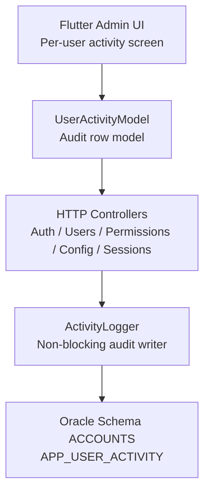
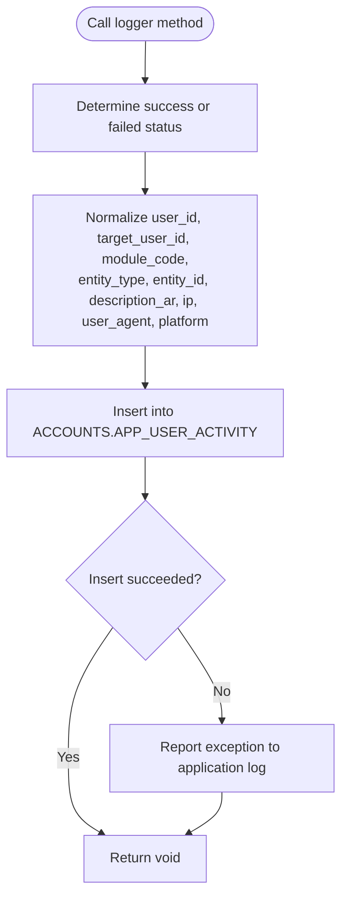
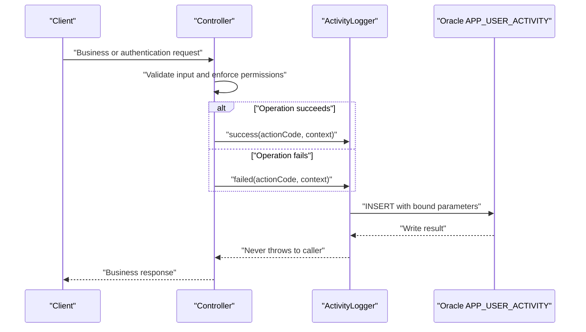
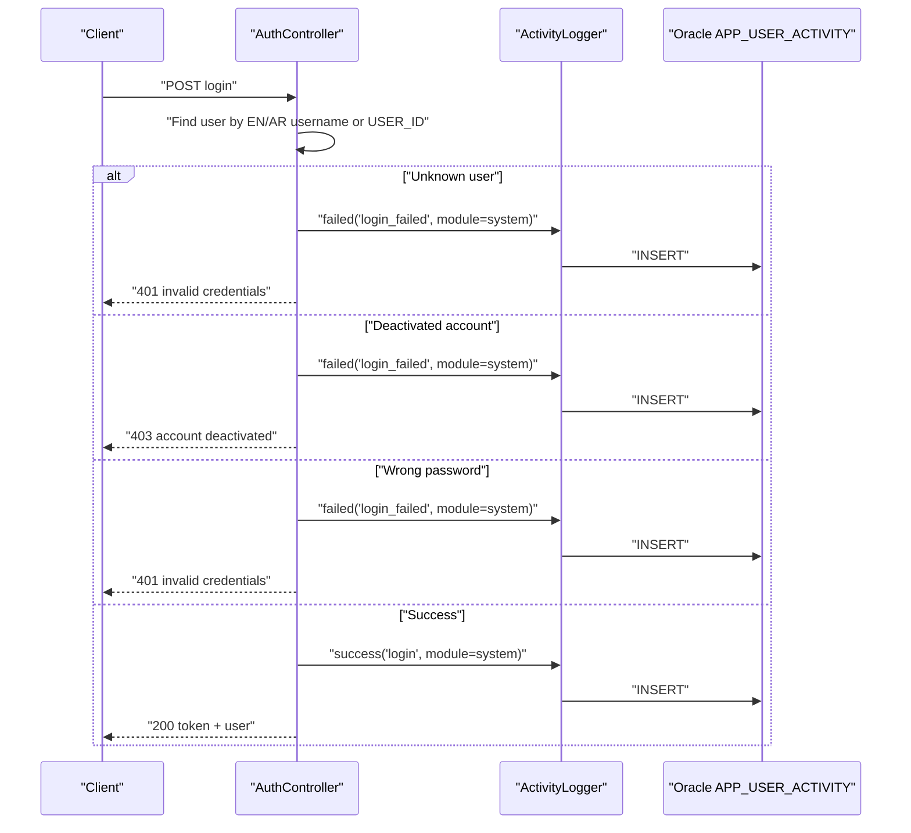
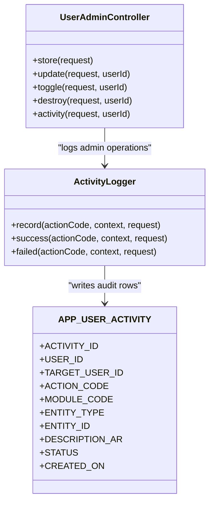
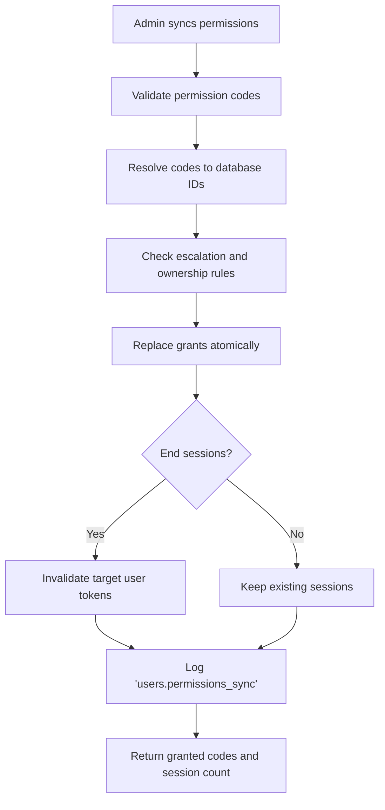
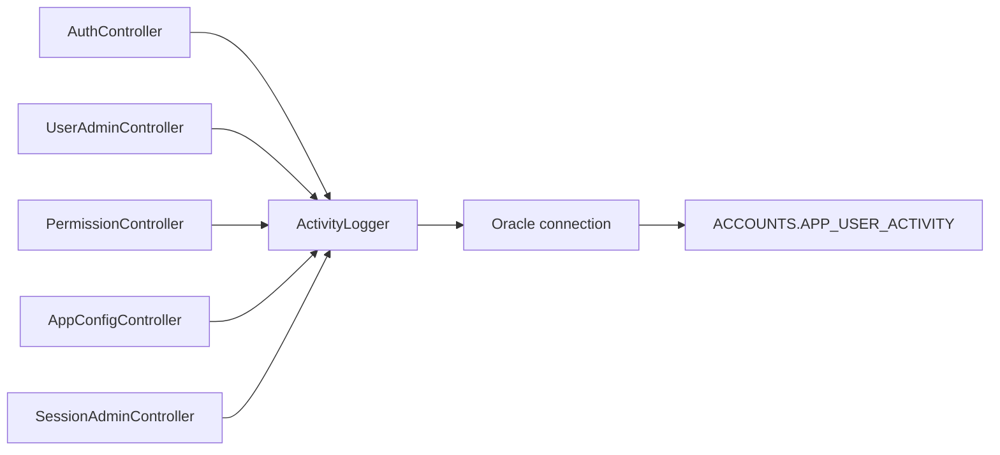

# Audit Trail System

<cite>
**Referenced Files in This Document**
- [ActivityLogger.php](file://kyApp_API/app/Support/ActivityLogger.php)
- [01_ibac_schema.sql](file://kyApp_API/database/oracle/01_ibac_schema.sql)
- [AuthController.php](file://kyApp_API/app/Http/Controllers/AuthController.php)
- [UserAdminController.php](file://kyApp_API/app/Http/Controllers/UserAdminController.php)
- [PermissionController.php](file://kyApp_API/app/Http/Controllers/PermissionController.php)
- [AppConfigController.php](file://kyApp_API/app/Http/Controllers/AppConfigController.php)
- [SessionAdminController.php](file://kyApp_API/app/Http/Controllers/SessionAdminController.php)
- [user_activity_model.dart](file://lib/features/admin/data/models/user_activity_model.dart)
- [db_commends.md](file://db_commends.md)
</cite>

## Table of Contents
1. [Introduction](#introduction)
2. [Project Structure](#project-structure)
3. [Core Components](#core-components)
4. [Architecture Overview](#architecture-overview)
5. [Detailed Component Analysis](#detailed-component-analysis)
6. [Dependency Analysis](#dependency-analysis)
7. [Performance Considerations](#performance-considerations)
8. [Troubleshooting Guide](#troubleshooting-guide)
9. [Conclusion](#conclusion)
10. [Appendices](#appendices)

## Introduction
This document explains the comprehensive audit trail system built around the `ACCOUNTS.APP_USER_ACTIVITY` table. It covers how user actions are captured, how the flexible logging structure supports different entity types and modules, why foreign keys on actor and target identifiers are intentionally optional, how indexes support efficient reporting, and how the system remains non-blocking so audit failures never break normal application requests.

The audit trail records:
- Authentication events such as successful login, failed login, logout, biometric enrollment, biometric login attempts, and biometric revocation.
- Business operations such as creating, updating, toggling, or deleting users.
- Permission changes through permission synchronization.
- Application configuration updates and API settings password verification attempts.

## Project Structure
The audit trail spans three layers:

| Layer | Responsibility | Key Files |
|---|---|---|
| Database schema | Defines the audit table, primary key, status check, sequence, trigger, and indexes | [01_ibac_schema.sql](file://kyApp_API/database/oracle/01_ibac_schema.sql) |
| Logging service | Centralizes safe, bounded, non-blocking writes to the audit table | [ActivityLogger.php](file://kyApp_API/app/Support/ActivityLogger.php) |
| Controllers | Emit audit events for authentication, user administration, permissions, app configuration, and session management | [AuthController.php](file://kyApp_API/app/Http/Controllers/AuthController.php), [UserAdminController.php](file://kyApp_API/app/Http/Controllers/UserAdminController.php), [PermissionController.php](file://kyApp_API/app/Http/Controllers/PermissionController.php), [AppConfigController.php](file://kyApp_API/app/Http/Controllers/AppConfigController.php), [SessionAdminController.php](file://kyApp_API/app/Http/Controllers/SessionAdminController.php) |
| Client model | Describes the shape of audit rows returned by the per-user activity endpoint | [user_activity_model.dart](file://lib/features/admin/data/models/user_activity_model.dart) |

**Diagram sources**
- [ActivityLogger.php:37-73](file://kyApp_API/app/Support/ActivityLogger.php#L37-L73)
- [01_ibac_schema.sql:148-184](file://kyApp_API/database/oracle/01_ibac_schema.sql#L148-L184)
- [user_activity_model.dart:12-109](file://lib/features/admin/data/models/user_activity_model.dart#L12-L109)

**Section sources**
- [ActivityLogger.php:1-170](file://kyApp_API/app/Support/ActivityLogger.php#L1-L170)
- [01_ibac_schema.sql:148-184](file://kyApp_API/database/oracle/01_ibac_schema.sql#L148-L184)

## Core Components
The audit system is centered on a single database table and a single PHP service that all controllers use.

### APP_USER_ACTIVITY Table
The audit table stores one row per recorded event. Its most important design points are:

| Column | Purpose | Important Behavior |
|---|---|---|
| `ACTIVITY_ID` | Unique audit row identifier | Generated by an Oracle sequence and trigger when not supplied |
| `USER_ID` | Actor who performed the action | Nullable; anonymous or failed logins may have no authenticated user |
| `TARGET_USER_ID` | User affected by the action | Nullable for actions not targeting another user |
| `ACTION_CODE` | Stable machine-readable action name | Required; examples include `login`, `login_failed`, `users.create`, `users.update`, `users.permissions_sync`, `app_config.update` |
| `MODULE_CODE` | Logical module grouping | Optional; commonly `system`, `users`, `app_config` |
| `ENTITY_TYPE` | Target business entity | Optional; commonly `APP_USERS`, `APP_USERS_PERMISSIONS`, `APP_SETTINGS` |
| `ENTITY_ID` | Target identifier | Stored as text because it can represent numeric IDs, journal numbers, or table names |
| `DESCRIPTION_AR` | Human-readable Arabic description | Truncated safely before write; encoded for legacy compatibility |
| `STATUS` | Success or failure | Restricted to `success` or `failed` |
| `IP_ADDRESS` | Client IP address | Optional; extracted from request or context |
| `USER_AGENT` | Client browser/app agent | Optional; truncated to column width |
| `PLATFORM` | Client platform hint | Optional; commonly `android` or `ios` |
| `CREATED_ON` | Event timestamp | Set by Oracle `SYSDATE` at insert time |

The table has:
- A primary key on `ACTIVITY_ID`.
- A check constraint limiting `STATUS` to `success` or `failed`.
- No foreign key on `USER_ID`, allowing anonymous failed authentication attempts and preserving audit history even if a user is deleted.
- Three composite indexes optimized for common audit queries.

**Section sources**
- [01_ibac_schema.sql:148-184](file://kyApp_API/database/oracle/01_ibac_schema.sql#L148-L184)
- [db_commends.md:200-225](file://db_commends.md#L200-L225)

### ActivityLogger Service
`ActivityLogger` is the only place that inserts into `APP_USER_ACTIVITY`. Its responsibilities include:

- Accepting an action code and a flexible context array.
- Normalizing `status` to `success` or `failed`.
- Extracting client IP and user agent from either the context or the HTTP request.
- Truncating values to match column widths.
- Limiting Arabic text length before encoding.
- Using bound parameters for all database writes.
- Wrapping every write in a silent `try/catch` that reports exceptions without failing the caller’s request.

**Diagram sources**
- [ActivityLogger.php:37-73](file://kyApp_API/app/Support/ActivityLogger.php#L37-L73)
- [ActivityLogger.php:101-168](file://kyApp_API/app/Support/ActivityLogger.php#L101-L168)

**Section sources**
- [ActivityLogger.php:1-170](file://kyApp_API/app/Support/ActivityLogger.php#L1-L170)

## Architecture Overview
The audit trail is intentionally decoupled from business logic. Controllers focus on authorization, validation, and business outcomes; they call `ActivityLogger` only after deciding whether the operation succeeded or failed.

**Diagram sources**
- [AuthController.php:88-156](file://kyApp_API/app/Http/Controllers/AuthController.php#L88-L156)
- [ActivityLogger.php:37-73](file://kyApp_API/app/Support/ActivityLogger.php#L37-L73)

## Detailed Component Analysis

### Authentication Audit Events
Authentication is heavily audited because it is the security boundary.

| Action Code | Status | Typical Context | Meaning |
|---|---|---|---|
| `login_failed` | `failed` | Unknown username, deactivated account, wrong password | Records suspicious or invalid login attempts |
| `login` | `success` | Authenticated user, module `system` | Successful password-based login |
| `logout` | `success` | Authenticated user, module `system` | Token revocation and logout |
| `biometric_enroll` | `success` or `failed` | Device token, device name, platform | Biometric device registration |
| `biometric_login` | `success` or `failed` | User ID and device token | Biometric sign-in attempt |
| `biometric_revoke` | `success` | Current user | Removal of biometric enrollment |

Important behaviors:
- Unknown usernames do not reveal whether the user exists; the same generic error is used for unknown users and wrong passwords.
- Failed login attempts may have no `user_id` because the user cannot be authenticated.
- Successful login and biometric login record the actor and platform.
- Deactivated accounts are rejected and audited.

**Diagram sources**
- [AuthController.php:88-156](file://kyApp_API/app/Http/Controllers/AuthController.php#L88-L156)
- [ActivityLogger.php:37-73](file://kyApp_API/app/Support/ActivityLogger.php#L37-L73)

**Section sources**
- [AuthController.php:47-164](file://kyApp_API/app/Http/Controllers/AuthController.php#L47-L164)
- [AuthController.php:221-239](file://kyApp_API/app/Http/Controllers/AuthController.php#L221-L239)
- [AuthController.php:245-411](file://kyApp_API/app/Http/Controllers/AuthController.php#L245-L411)

### User Administration Audit Events
User administration operations are logged with both the actor and the target user.

| Action Code | Module | Entity Type | Typical Fields |
|---|---|---|---|
| `users.create` | `users` | `APP_USERS` | `target_user_id`, `entity_id`, description including username and grant count |
| `users.update` | `users` | `APP_USERS` | `target_user_id`, `entity_id`, description summarizing field and permission changes |
| `users.toggle` | `users` | `APP_USERS` | `target_user_id`, `entity_id`, activation state and session termination note |
| `users.delete` | `users` | `APP_USERS` | `target_user_id`, `entity_id`, description including removed grants and sessions |

These operations also interact with other tables:
- Creating or updating users may update `APP_USERS`.
- Grant changes go through `APP_USERS_PERMISSIONS`.
- Session termination updates personal access tokens.
- The audit trail itself remains independent of those business tables.

**Diagram sources**
- [UserAdminController.php:293-300](file://kyApp_API/app/Http/Controllers/UserAdminController.php#L293-L300)
- [UserAdminController.php:477-484](file://kyApp_API/app/Http/Controllers/UserAdminController.php#L477-L484)
- [UserAdminController.php:543-550](file://kyApp_API/app/Http/Controllers/UserAdminController.php#L543-L550)
- [UserAdminController.php:609-616](file://kyApp_API/app/Http/Controllers/UserAdminController.php#L609-L616)
- [ActivityLogger.php:37-73](file://kyApp_API/app/Support/ActivityLogger.php#L37-L73)

**Section sources**
- [UserAdminController.php:188-312](file://kyApp_API/app/Http/Controllers/UserAdminController.php#L188-L312)
- [UserAdminController.php:318-496](file://kyApp_API/app/Http/Controllers/UserAdminController.php#L318-L496)
- [UserAdminController.php:502-560](file://kyApp_API/app/Http/Controllers/UserAdminController.php#L502-L560)
- [UserAdminController.php:566-626](file://kyApp_API/app/Http/Controllers/UserAdminController.php#L566-L626)

### Permission Change Audit Events
Permission synchronization is audited separately from general user updates because changing permissions is a sensitive administrative action.

Key details:
- Action code: `users.permissions_sync`.
- Module: `users`.
- Entity type: `APP_USERS_PERMISSIONS`.
- Entity ID: the target user ID.
- Description includes the target username and the number of permissions applied.
- Changing permissions may terminate the target user’s sessions to avoid stale cached permissions on the client.

**Diagram sources**
- [PermissionController.php:137-243](file://kyApp_API/app/Http/Controllers/PermissionController.php#L137-L243)
- [PermissionController.php:294-304](file://kyApp_API/app/Http/Controllers/PermissionController.php#L294-L304)

**Section sources**
- [PermissionController.php:137-243](file://kyApp_API/app/Http/Controllers/PermissionController.php#L137-L243)

### Application Configuration Audit Events
Application configuration changes are audited with enough detail to show what changed.

Key details:
- Successful configuration update uses `app_config.update`.
- Failed API settings password verification uses `app_config.api_verify`.
- API settings password change uses `app_config.api_password`.
- The description summarizes which setting keys changed from their previous value to their new value.
- The public API password verification route always returns 200 so the client can distinguish server reachability from password correctness, while still recording failed attempts.

**Section sources**
- [AppConfigController.php:80-175](file://kyApp_API/app/Http/Controllers/AppConfigController.php#L80-L175)
- [AppConfigController.php:188-226](file://kyApp_API/app/Http/Controllers/AppConfigController.php#L188-L226)
- [AppConfigController.php:240-292](file://kyApp_API/app/Http/Controllers/AppConfigController.php#L240-L292)

### Session Management Audit Events
Session termination is audited when active sessions are ended by administrators.

**Section sources**
- [SessionAdminController.php:82-104](file://kyApp_API/app/Http/Controllers/SessionAdminController.php#L82-L104)
- [SessionAdminController.php:165-165](file://kyApp_API/app/Http/Controllers/SessionAdminController.php#L165-L165)
- [SessionAdminController.php:216-216](file://kyApp_API/app/Http/Controllers/SessionAdminController.php#L216-L216)

### Client-Side Audit Model
The Flutter admin layer reads per-user audit rows through a typed model. The model expects:
- Numeric `activity_id`, `user_id`, and `target_user_id`.
- Textual `action_code`, `module_code`, `entity_type`, `entity_id`, `description_ar`, `status`, `ip_address`, and `platform`.
- A date `created_on`.

This matches the server-side behavior where `entity_id` is stored as text even when it represents a numeric ID.

**Section sources**
- [user_activity_model.dart:12-109](file://lib/features/admin/data/models/user_activity_model.dart#L12-L109)

## Dependency Analysis
The audit system has low coupling between business controllers and the persistence layer:

**Diagram sources**
- [AuthController.php:36-41](file://kyApp_API/app/Http/Controllers/AuthController.php#L36-L41)
- [UserAdminController.php:97-102](file://kyApp_API/app/Http/Controllers/UserAdminController.php#L97-L102)
- [PermissionController.php:38-42](file://kyApp_API/app/Http/Controllers/PermissionController.php#L38-L42)
- [AppConfigController.php:40-44](file://kyApp_API/app/Http/Controllers/AppConfigController.php#L40-L44)
- [SessionAdminController.php:82-82](file://kyApp_API/app/Http/Controllers/SessionAdminController.php#L82-L82)
- [ActivityLogger.php:42-48](file://kyApp_API/app/Support/ActivityLogger.php#L42-L48)

There are no circular dependencies involving the audit logger. Controllers depend on `ActivityLogger`; `ActivityLogger` depends only on the database connection and helper utilities.

**Section sources**
- [ActivityLogger.php:1-170](file://kyApp_API/app/Support/ActivityLogger.php#L1-L170)

## Performance Considerations
The audit system is designed for reliability over strict performance, but its indexing strategy supports common reporting patterns.

### Index Strategy
| Index | Columns | Best Query Pattern |
|---|---|---|
| `APP_ACT_USER_IX` | `USER_ID`, `CREATED_ON` | Per-user timeline and recent activity |
| `APP_ACT_TGT_IX` | `TARGET_USER_ID`, `CREATED_ON` | Timeline of actions taken against a specific user |
| `APP_ACT_MOD_IX` | `MODULE_CODE`, `CREATED_ON` | Module-level audit reporting by date range |

Recommended query characteristics:
- Prefer filtering by `USER_ID` or `TARGET_USER_ID` together with a `CREATED_ON` range.
- Prefer filtering by `MODULE_CODE` together with a `CREATED_ON` range for module-wide reports.
- Avoid scanning the entire audit table without date filters when possible.
- Use pagination for large timelines because the per-user activity endpoint already uses row-number slicing.

### Non-Blocking Guarantee
Audit logging is secondary to the main request lifecycle. If the audit write fails:
- The exception is reported through the application logger.
- The controller continues normally.
- The client receives the expected business response.
- The missing audit row is recoverable later through reprocessing or manual replay where appropriate.

This design ensures that database issues, connection problems, or temporary unavailability of the audit table do not degrade core authentication or business functionality.

**Section sources**
- [01_ibac_schema.sql:170-172](file://kyApp_API/database/oracle/01_ibac_schema.sql#L170-L172)
- [ActivityLogger.php:41-72](file://kyApp_API/app/Support/ActivityLogger.php#L41-L72)

## Troubleshooting Guide

### Common Symptoms and Causes
| Symptom | Likely Cause | Recommended Check |
|---|---|---|
| Audit rows missing after a successful request | Audit write failed silently | Check application logs for reported exceptions from `ActivityLogger` |
| Anonymous failed login attempts appear with `USER_ID = NULL` | Expected behavior for unknown usernames | Confirm the action code is `login_failed` and no authenticated user was resolved |
| Arabic descriptions look corrupted | Legacy CP1256 encoding mismatch or double-fixing | Verify Arabic encoding path and avoid repairing text twice |
| Slow audit queries | Missing date filter or scanning full table | Add `CREATED_ON` range and filter by `USER_ID`, `TARGET_USER_ID`, or `MODULE_CODE` |
| Audit table grows quickly | High-volume authentication or admin operations | Review rate limits, brute-force protection, and retention policy |

### Safe Audit Queries
Below are representative query patterns. Replace placeholders with actual values.

| Goal | Example Pattern | Notes |
|---|---|---|
| Recent activity for a user | `WHERE USER_ID = :id AND CREATED_ON >= :from AND CREATED_ON <= :to` | Uses `APP_ACT_USER_IX` |
| Actions against a target user | `WHERE TARGET_USER_ID = :id AND CREATED_ON >= :from AND CREATED_ON <= :to` | Uses `APP_ACT_TGT_IX` |
| Module report for a period | `WHERE MODULE_CODE = :module AND CREATED_ON >= :from AND CREATED_ON <= :to` | Uses `APP_ACT_MOD_IX` |
| Failed authentication attempts | `WHERE ACTION_CODE = 'login_failed' AND STATUS = 'failed'` | Combine with date range |
| Permission changes | `WHERE ACTION_CODE = 'users.permissions_sync'` | Combine with date range and module |
| Configuration changes | `WHERE MODULE_CODE = 'app_config'` | Filter further by `ACTION_CODE` |
| Per-user timeline ordered by newest first | Order by `CREATED_ON DESC, ACTIVITY_ID DESC` | Matches the per-user activity endpoint |

### Reporting Patterns
- **Security monitoring**: Count `login_failed` by IP, time window, and username pattern.
- **Privilege change audit**: Track `users.permissions_sync` and correlate with `users.update`.
- **Administrative accountability**: Group `users.create`, `users.update`, `users.toggle`, `users.delete` by actor.
- **System health**: Monitor `app_config.*` changes and failed API password verification attempts.
- **Compliance export**: Export rows by date range and module, preserving `STATUS`, `DESCRIPTION_AR`, and timestamps.

### Handling Audit Failures
Because audit failures are intentionally swallowed:
1. Inspect application logs for exceptions reported by `ActivityLogger`.
2. Check Oracle connectivity and the `ACCOUNTS.APP_USER_ACTIVITY` table availability.
3. Do not retry the original business request solely because audit logging failed.
4. If needed, implement a separate reconciliation job that compares business events with audit rows.

**Section sources**
- [ActivityLogger.php:41-72](file://kyApp_API/app/Support/ActivityLogger.php#L41-L72)
- [01_ibac_schema.sql:170-172](file://kyApp_API/database/oracle/01_ibac_schema.sql#L170-L172)
- [db_commends.md:392-407](file://db_commends.md#L392-L407)

## Conclusion
The audit trail system provides a consistent, secure, and resilient record of user and administrative activity. Its strengths are:

- A single, well-defined audit table with clear columns and constraints.
- A centralized logger that enforces safety, bounds, and non-blocking behavior.
- Broad coverage of authentication, user administration, permission changes, configuration updates, and session management.
- Flexible fields for module, entity type, and entity ID that adapt to different business contexts.
- Optional actor and target identifiers that correctly handle anonymous and failed authentication attempts.
- Indexes tuned for the most common audit queries.
- A client model that reflects the server’s audit row shape.

When extending the system, follow these principles:
- Always use `ActivityLogger` instead of inserting directly into `APP_USER_ACTIVITY`.
- Choose stable, descriptive action codes.
- Include meaningful `module_code`, `entity_type`, and `entity_id` values.
- Keep descriptions concise and human-readable.
- Never let audit logging failures affect business responses.
- Use date-range filters in reports to leverage the existing indexes.

## Appendices

### Action Code Reference
| Action Code | Module | Typical Status | Description |
|---|---|---|---|
| `login_failed` | `system` | `failed` | Invalid username, deactivated account, or wrong password |
| `login` | `system` | `success` | Password-based login |
| `logout` | `system` | `success` | Logout and token revocation |
| `biometric_enroll` | `system` | `success` or `failed` | Biometric device registration |
| `biometric_login` | `system` | `success` or `failed` | Biometric sign-in attempt |
| `biometric_revoke` | `system` | `success` | Remove biometric enrollment |
| `users.create` | `users` | `success` | Create a new user |
| `users.update` | `users` | `success` | Update user data or grants |
| `users.toggle` | `users` | `success` | Activate or deactivate a user |
| `users.delete` | `users` | `success` | Delete a user and related data |
| `users.permissions_sync` | `users` | `success` | Replace user permissions |
| `app_config.update` | `app_config` | `success` | Save application configuration |
| `app_config.api_verify` | `app_config` | `failed` | Failed API settings password verification |
| `app_config.api_password` | `app_config` | `success` | Change API settings password |

**Section sources**
- [AuthController.php:88-156](file://kyApp_API/app/Http/Controllers/AuthController.php#L88-L156)
- [AuthController.php:221-411](file://kyApp_API/app/Http/Controllers/AuthController.php#L221-L411)
- [UserAdminController.php:293-616](file://kyApp_API/app/Http/Controllers/UserAdminController.php#L293-L616)
- [PermissionController.php:219-226](file://kyApp_API/app/Http/Controllers/PermissionController.php#L219-L226)
- [AppConfigController.php:144-150](file://kyApp_API/app/Http/Controllers/AppConfigController.php#L144-L150)
- [AppConfigController.php:211-216](file://kyApp_API/app/Http/Controllers/AppConfigController.php#L211-L216)
- [AppConfigController.php:274-280](file://kyApp_API/app/Http/Controllers/AppConfigController.php#L274-L280)