# Core Schema Design

<cite>
**Referenced Files in This Document**
- [01_ibac_schema.sql](file://kyApp_API/database/oracle/01_ibac_schema.sql)
- [02_ibac_seed.php](file://kyApp_API/database/oracle/02_ibac_seed.php)
- [03_ibac_bootstrap.php](file://kyApp_API/database/oracle/03_ibac_bootstrap.php)
- [04_ibac_rollback.sql](file://kyApp_API/database/oracle/04_ibac_rollback.sql)
- [PermissionCatalog.php](file://kyApp_API/app/Support/PermissionCatalog.php)
- [ArabicEncoding.php](file://kyApp_API/app/Support/ArabicEncoding.php)
</cite>

## Table of Contents
1. [Introduction](#introduction)
2. [Project Structure](#project-structure)
3. [Core Components](#core-components)
4. [Architecture Overview](#architecture-overview)
5. [Detailed Component Analysis](#detailed-component-analysis)
6. [Dependency Analysis](#dependency-analysis)
7. [Performance Considerations](#performance-considerations)
8. [Troubleshooting Guide](#troubleshooting-guide)
9. [Conclusion](#conclusion)

## Introduction
This document explains the core Oracle database schema design for the IBAC (Identity-Based Access Control) foundation. It focuses on:
- Foundational tables: `APP_USERS`, `APP_PERMISSIONS`, `APP_SETTINGS`, plus supporting tables for direct user permissions and activity logging.
- Data types, constraints, indexes, sequences, and triggers used for automatic ID generation.
- Bilingual support for Arabic and English through separate columns.
- The legacy-safe modification strategy for `APP_USERS` to preserve compatibility with existing ERP systems while adding admin flags and password capacity.
- The seed and bootstrap process that populates permission catalogs, security settings, comments, and initial administrator access.

The schema targets an Oracle 11g environment under the `ACCOUNTS` schema, using a Windows-1256-compatible approach for Arabic text storage and retrieval.

## Project Structure
The Oracle-related schema and initialization logic live under the API layer:
- SQL DDL and rollback scripts define tables, sequences, triggers, indexes, and verification queries.
- PHP scripts seed reference data and perform final bootstrap steps such as applying bilingual comments and promoting the first administrator.
- Application support classes provide the canonical permission catalog and safe Arabic encoding helpers.

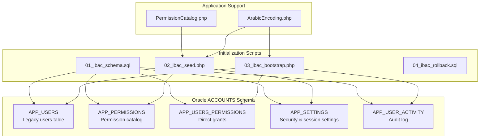

**Diagram sources**
- [01_ibac_schema.sql:21-184](file://kyApp_API/database/oracle/01_ibac_schema.sql#L21-L184)
- [02_ibac_seed.php:36-89](file://kyApp_API/database/oracle/02_ibac_seed.php#L36-L89)
- [02_ibac_seed.php:212-279](file://kyApp_API/database/oracle/02_ibac_seed.php#L212-L279)
- [03_ibac_bootstrap.php:135-185](file://kyApp_API/database/oracle/03_ibac_bootstrap.php#L135-L185)
- [PermissionCatalog.php:271-316](file://kyApp_API/app/Support/PermissionCatalog.php#L271-L316)
- [ArabicEncoding.php:143-162](file://kyApp_API/app/Support/ArabicEncoding.php#L143-L162)

**Section sources**
- [01_ibac_schema.sql:1-19](file://kyApp_API/database/oracle/01_ibac_schema.sql#L1-L19)
- [01_ibac_schema.sql:21-184](file://kyApp_API/database/oracle/01_ibac_schema.sql#L21-L184)
- [02_ibac_seed.php:1-24](file://kyApp_API/database/oracle/02_ibac_seed.php#L1-L24)
- [03_ibac_bootstrap.php:1-14](file://kyApp_API/database/oracle/03_ibac_bootstrap.php#L1-L14)
- [04_ibac_rollback.sql:1-11](file://kyApp_API/database/oracle/04_ibac_rollback.sql#L1-L11)

## Core Components
The core schema consists of five primary objects:
- `APP_USERS`: A pre-existing legacy table extended with an admin flag and wider password column.
- `APP_PERMISSIONS`: A permission catalog storing module-action pairs, bilingual names, core flags, active flags, and sort order.
- `APP_USERS_PERMISSIONS`: Direct user-to-permission grants without roles.
- `APP_SETTINGS`: System configuration entries for security and sessions, including value type, ranges, lockability, and bilingual labels.
- `APP_USER_ACTIVITY`: Lightweight audit trail for user actions, login attempts, session management, and system bootstrap.

Key characteristics:
- Primary keys are enforced via explicit constraints.
- Sequences generate IDs; triggers assign sequence values when inserts omit them.
- Indexes optimize lookups by module, user, permission, and activity time.
- Bilingual support uses Arabic-only or Arabic-and-English columns where needed.
- Legacy compatibility is preserved by altering `APP_USERS` instead of replacing it.

**Section sources**
- [01_ibac_schema.sql:21-184](file://kyApp_API/database/oracle/01_ibac_schema.sql#L21-L184)

## Architecture Overview
The schema implements a minimal identity-based access control model:
- Users are identified by `USER_ID`.
- Permissions are defined centrally in `APP_PERMISSIONS`.
- Grants are assigned directly to users in `APP_USERS_PERMISSIONS`.
- An `IS_ADMIN` flag on `APP_USERS` acts as a global override.
- Security behavior is controlled by `APP_SETTINGS`.
- All significant operations are recorded in `APP_USER_ACTIVITY`.

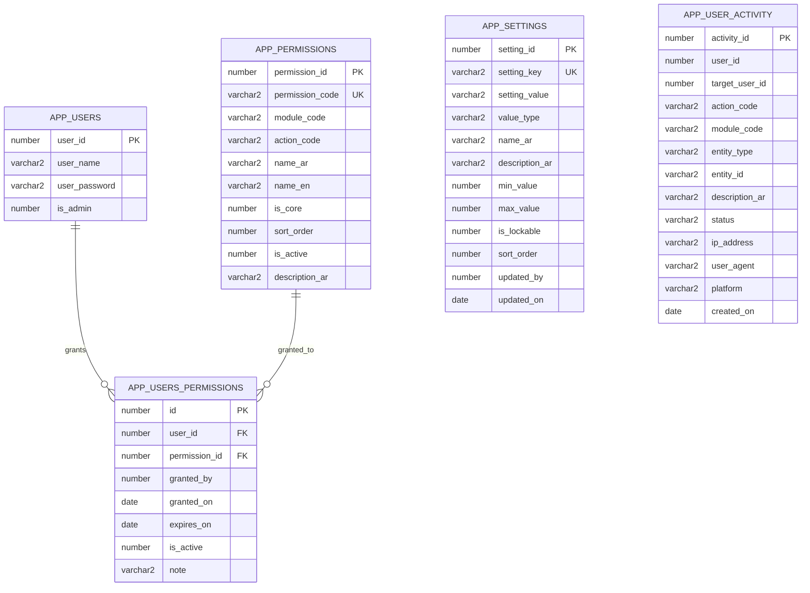

**Diagram sources**
- [01_ibac_schema.sql:26-168](file://kyApp_API/database/oracle/01_ibac_schema.sql#L26-L168)

## Detailed Component Analysis

### APP_USERS — Legacy User Table Extension
`APP_USERS` is not recreated; it is altered to remain compatible with existing ERP writes:
- `USER_PASSWORD` is widened to accommodate future hashing while preserving legacy plain-text passwords.
- `IS_ADMIN` is added as a numeric flag defaulting to inactive.
- A dedicated sequence `SEQ_APP_USERS_ID` is created for new user IDs, but no trigger is attached to avoid breaking legacy ERP insert paths.

Design implications:
- Existing ERP applications continue writing to `APP_USERS` without changes.
- New application code can use the sequence for generated IDs if desired.
- Admin privileges are represented by `IS_ADMIN = 1`.

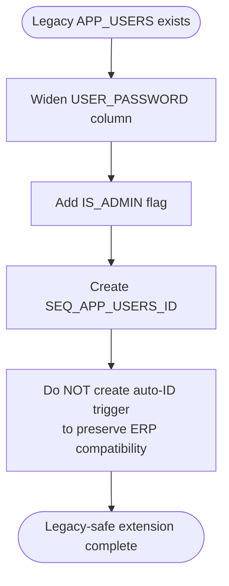

**Diagram sources**
- [01_ibac_schema.sql:21-33](file://kyApp_API/database/oracle/01_ibac_schema.sql#L21-L33)
- [04_ibac_rollback.sql:33-38](file://kyApp_API/database/oracle/04_ibac_rollback.sql#L33-L38)

**Section sources**
- [01_ibac_schema.sql:21-33](file://kyApp_API/database/oracle/01_ibac_schema.sql#L21-L33)
- [04_ibac_rollback.sql:33-38](file://kyApp_API/database/oracle/04_ibac_rollback.sql#L33-L38)

### APP_PERMISSIONS — Permission Catalog
`APP_PERMISSIONS` stores the authoritative list of permissions:
- `PERMISSION_ID`: Numeric primary key generated by a sequence and trigger.
- `PERMISSION_CODE`: Unique code following a module-action pattern, including wildcard forms.
- `MODULE_CODE` and `ACTION_CODE`: Structural fields for grouping and filtering.
- `NAME_AR` and `NAME_EN`: Bilingual display and descriptive names.
- `IS_CORE`: Indicates foundational view/create/update/delete actions.
- `SORT_ORDER`: Controls presentation order within modules.
- `IS_ACTIVE`: Allows deactivating a permission without removing historical grants.
- Audit timestamps and creator/updater fields are included.

Indexes:
- A composite index on `MODULE_CODE` and `SORT_ORDER` supports UI rendering and ordering.

Constraints:
- Primary key on `PERMISSION_ID`.
- Unique constraint on `PERMISSION_CODE`.
- Check constraints enforce binary flags.

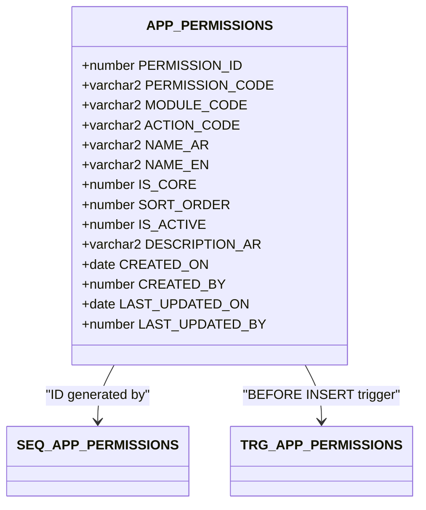

**Diagram sources**
- [01_ibac_schema.sql:38-75](file://kyApp_API/database/oracle/01_ibac_schema.sql#L38-L75)

**Section sources**
- [01_ibac_schema.sql:35-75](file://kyApp_API/database/oracle/01_ibac_schema.sql#L35-L75)

### APP_USERS_PERMISSIONS — Direct User Grants
`APP_USERS_PERMISSIONS` implements direct user-to-permission assignment:
- `ID`: Primary key generated by a sequence and trigger.
- `USER_ID`: Foreign key referencing `APP_USERS.USER_ID`; deletions cascade.
- `PERMISSION_ID`: References `APP_PERMISSIONS.PERMISSION_ID`.
- `GRANTED_BY`, `GRANTED_ON`, `EXPIRES_ON`: Grant provenance and optional expiration.
- `IS_ACTIVE`: Soft-deletion style deactivation.
- `NOTE`: Optional human-readable reason.

Indexes:
- Composite index on `USER_ID` and `IS_ACTIVE` optimizes active-grant checks.
- Index on `PERMISSION_ID` supports reverse lookup from permission to users.

Constraints:
- Primary key on `ID`.
- Unique constraint on `(USER_ID, PERMISSION_ID)` prevents duplicate grants.
- Foreign keys enforce referential integrity.
- Check constraint enforces binary active flag.

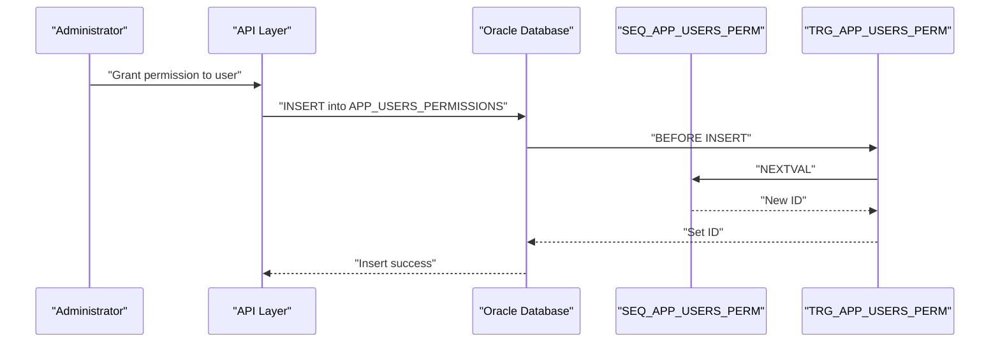

**Diagram sources**
- [01_ibac_schema.sql:77-112](file://kyApp_API/database/oracle/01_ibac_schema.sql#L77-L112)

**Section sources**
- [01_ibac_schema.sql:77-112](file://kyApp_API/database/oracle/01_ibac_schema.sql#L77-L112)

### APP_SETTINGS — System Configuration
`APP_SETTINGS` provides editable system configuration:
- `SETTING_ID`: Primary key generated by a sequence and trigger.
- `SETTING_KEY`: Unique configuration key consumed by application code.
- `SETTING_VALUE`: Textual value interpreted according to `VALUE_TYPE`.
- `VALUE_TYPE`: Enumerated type (`int`, `bool`, `string`, `json`).
- `NAME_AR` and `DESCRIPTION_AR`: Bilingual labels and descriptions for the UI.
- `MIN_VALUE` and `MAX_VALUE`: Numeric bounds for integer settings.
- `IS_LOCKABLE`: Prevents sensitive settings from being edited through the interface.
- `SORT_ORDER`: Controls presentation order in the security settings screen.
- `UPDATED_BY` and `UPDATED_ON`: Audit fields for tracking changes.

Constraints:
- Primary key on `SETTING_ID`.
- Unique constraint on `SETTING_KEY`.
- Check constraint restricts `VALUE_TYPE`.

Seed behavior:
- The seed script performs idempotent upserts.
- Existing operator-edited values are preserved; metadata such as labels, ranges, and sort order are refreshed.

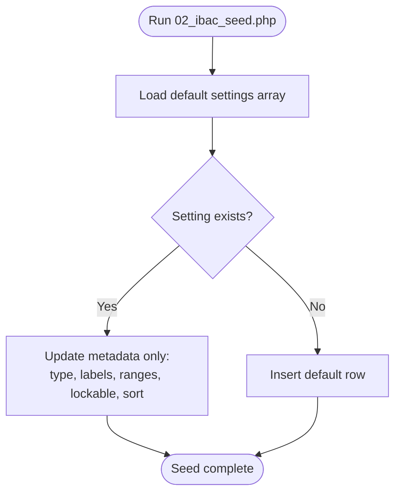

**Diagram sources**
- [02_ibac_seed.php:212-279](file://kyApp_API/database/oracle/02_ibac_seed.php#L212-L279)

**Section sources**
- [01_ibac_schema.sql:114-146](file://kyApp_API/database/oracle/01_ibac_schema.sql#L114-L146)
- [02_ibac_seed.php:91-210](file://kyApp_API/database/oracle/02_ibac_seed.php#L91-L210)
- [02_ibac_seed.php:212-279](file://kyApp_API/database/oracle/02_ibac_seed.php#L212-L279)

### APP_USER_ACTIVITY — Audit Trail
`APP_USER_ACTIVITY` records lightweight audit events:
- `ACTIVITY_ID`: Primary key generated by a sequence and trigger.
- `USER_ID` and `TARGET_USER_ID`: Actor and target user identifiers; both nullable to support anonymous failed logins.
- `ACTION_CODE`, `MODULE_CODE`, `ENTITY_TYPE`, `ENTITY_ID`: Structured event classification.
- `DESCRIPTION_AR`: Arabic-ready description for UI display.
- `STATUS`: Success or failure indicator.
- Client context fields: IP address, user agent, platform.
- `CREATED_ON`: Event timestamp.

Important design choice:
- There is no foreign key on `USER_ID`. This allows recording failed logins for unknown usernames and preserves audit history even if a user is deleted.

Indexes:
- Composite indexes on `(USER_ID, CREATED_ON)`, `(TARGET_USER_ID, CREATED_ON)`, and `(MODULE_CODE, CREATED_ON)` optimize common audit queries.

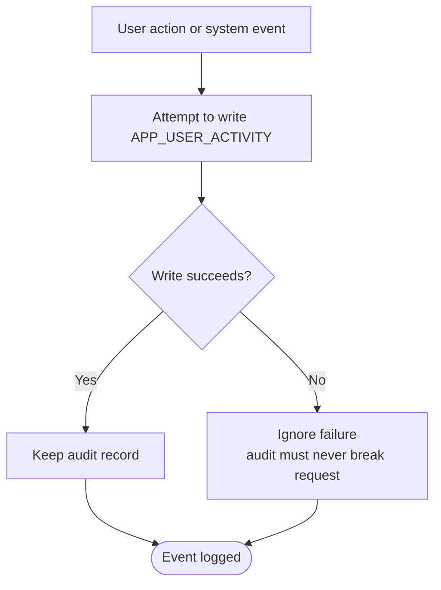

**Diagram sources**
- [01_ibac_schema.sql:148-189](file://kyApp_API/database/oracle/01_ibac_schema.sql#L148-L189)

**Section sources**
- [01_ibac_schema.sql:148-189](file://kyApp_API/database/oracle/01_ibac_schema.sql#L148-L189)

### Sequence Generation Strategy
Automatic ID generation uses Oracle sequences combined with `BEFORE INSERT` triggers:
- `SEQ_APP_PERMISSIONS` → `TRG_APP_PERMISSIONS` → `APP_PERMISSIONS.PERMISSION_ID`.
- `SEQ_APP_USERS_PERM` → `TRG_APP_USERS_PERM` → `APP_USERS_PERMISSIONS.ID`.
- `SEQ_APP_SETTINGS` → `TRG_APP_SETTINGS` → `APP_SETTINGS.SETTING_ID`.
- `SEQ_APP_ACTIVITY` → `TRG_APP_ACTIVITY` → `APP_USER_ACTIVITY.ACTIVITY_ID`.
- `SEQ_APP_USERS_ID` exists for new user IDs but has no trigger, preserving legacy ERP behavior.

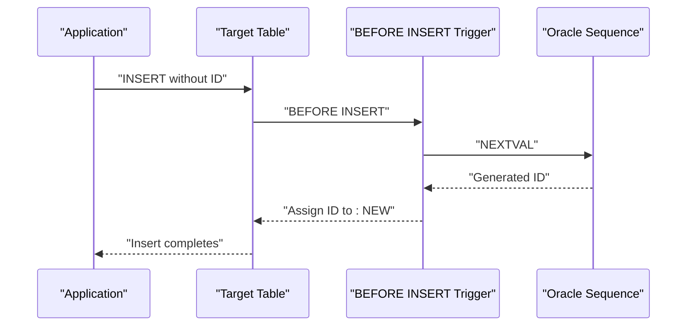

**Diagram sources**
- [01_ibac_schema.sql:61-75](file://kyApp_API/database/oracle/01_ibac_schema.sql#L61-L75)
- [01_ibac_schema.sql:102-112](file://kyApp_API/database/oracle/01_ibac_schema.sql#L102-L112)
- [01_ibac_schema.sql:136-146](file://kyApp_API/database/oracle/01_ibac_schema.sql#L136-L146)
- [01_ibac_schema.sql:174-184](file://kyApp_API/database/oracle/01_ibac_schema.sql#L174-L184)
- [01_ibac_schema.sql:32-33](file://kyApp_API/database/oracle/01_ibac_schema.sql#L32-L33)

**Section sources**
- [01_ibac_schema.sql:32-33](file://kyApp_API/database/oracle/01_ibac_schema.sql#L32-L33)
- [01_ibac_schema.sql:61-75](file://kyApp_API/database/oracle/01_ibac_schema.sql#L61-L75)
- [01_ibac_schema.sql:102-112](file://kyApp_API/database/oracle/01_ibac_schema.sql#L102-L112)
- [01_ibac_schema.sql:136-146](file://kyApp_API/database/oracle/01_ibac_schema.sql#L136-L146)
- [01_ibac_schema.sql:174-184](file://kyApp_API/database/oracle/01_ibac_schema.sql#L174-L184)

### Bilingual Support Design
Bilingual support is implemented through separate Arabic and English columns:
- `APP_PERMISSIONS` includes `NAME_AR`, `NAME_EN`, and `DESCRIPTION_AR`.
- `APP_SETTINGS` includes `NAME_AR` and `DESCRIPTION_AR`.
- `APP_USER_ACTIVITY` includes `DESCRIPTION_AR` for ready-to-display audit messages.

Arabic text handling follows a strict path:
- The application connects as UTF-8 client to a Windows-1256 database.
- Raw CP1256 bytes would be corrupted by the driver.
- `ArabicEncoding::toOracleSearchChars()` maps each CP1256 byte to a Latin-1 character with the same code point so the original byte survives transport and storage.
- Read-time decoding uses `ArabicEncoding::fixMojibake()` to repair mojibake safely and idempotently.

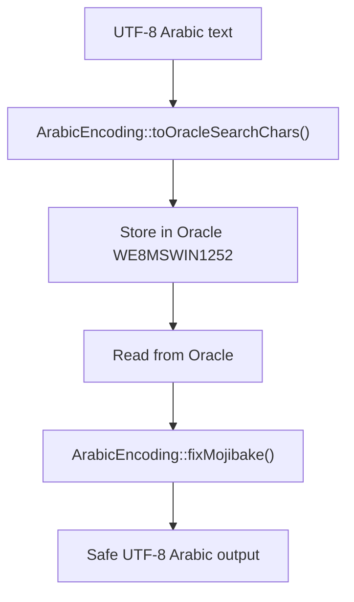

**Diagram sources**
- [ArabicEncoding.php:122-162](file://kyApp_API/app/Support/ArabicEncoding.php#L122-L162)
- [ArabicEncoding.php:33-120](file://kyApp_API/app/Support/ArabicEncoding.php#L33-L120)
- [02_ibac_seed.php:10-24](file://kyApp_API/database/oracle/02_ibac_seed.php#L10-L24)

**Section sources**
- [01_ibac_schema.sql:38-57](file://kyApp_API/database/oracle/01_ibac_schema.sql#L38-L57)
- [01_ibac_schema.sql:118-134](file://kyApp_API/database/oracle/01_ibac_schema.sql#L118-L134)
- [01_ibac_schema.sql:152-168](file://kyApp_API/database/oracle/01_ibac_schema.sql#L152-L168)
- [ArabicEncoding.php:33-120](file://kyApp_API/app/Support/ArabicEncoding.php#L33-L120)
- [ArabicEncoding.php:122-162](file://kyApp_API/app/Support/ArabicEncoding.php#L122-L162)
- [02_ibac_seed.php:10-24](file://kyApp_API/database/oracle/02_ibac_seed.php#L10-L24)

### Legacy Table Modification Approach for APP_USERS
The legacy modification strategy prioritizes compatibility:
- Instead of recreating `APP_USERS`, the schema alters the existing table.
- `USER_PASSWORD` is widened to prevent truncation errors during migration to hashed passwords.
- `IS_ADMIN` is added to enable global administrative access.
- No trigger is created for user ID generation because a trigger could break ERP systems still inserting rows into `APP_USERS`.
- Rollback guidance preserves business data and warns about narrowing `USER_PASSWORD` only after confirming stored password lengths.

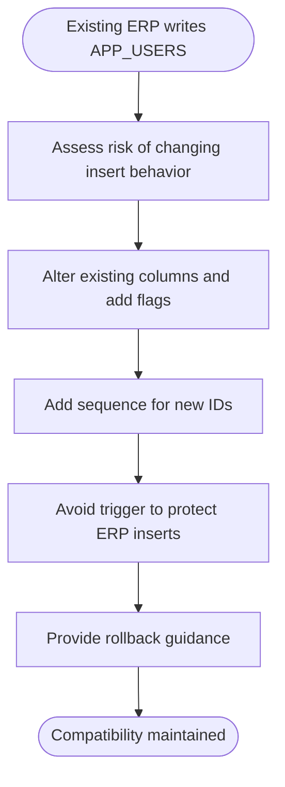

**Diagram sources**
- [01_ibac_schema.sql:21-33](file://kyApp_API/database/oracle/01_ibac_schema.sql#L21-L33)
- [04_ibac_rollback.sql:33-38](file://kyApp_API/database/oracle/04_ibac_rollback.sql#L33-L38)

**Section sources**
- [01_ibac_schema.sql:21-33](file://kyApp_API/database/oracle/01_ibac_schema.sql#L21-L33)
- [04_ibac_rollback.sql:33-38](file://kyApp_API/database/oracle/04_ibac_rollback.sql#L33-L38)

## Dependency Analysis
The schema dependencies follow a clear hierarchy:
- `APP_PERMISSIONS` is the root reference for permissions.
- `APP_USERS_PERMISSIONS` depends on both `APP_USERS` and `APP_PERMISSIONS`.
- `APP_SETTINGS` is independent but consumed by application logic controlling security and sessions.
- `APP_USER_ACTIVITY` is loosely coupled; it references users conceptually but does not enforce foreign keys to allow anonymous and historical audit records.

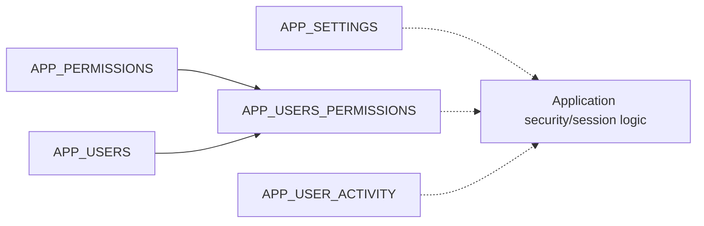

**Diagram sources**
- [01_ibac_schema.sql:77-112](file://kyApp_API/database/oracle/01_ibac_schema.sql#L77-L112)
- [01_ibac_schema.sql:148-189](file://kyApp_API/database/oracle/01_ibac_schema.sql#L148-L189)

**Section sources**
- [01_ibac_schema.sql:38-112](file://kyApp_API/database/oracle/01_ibac_schema.sql#L38-L112)
- [01_ibac_schema.sql:148-189](file://kyApp_API/database/oracle/01_ibac_schema.sql#L148-L189)

## Performance Considerations
- Use the provided indexes for common query patterns:
  - Module-based permission listing via `APP_PERMISSIONS(MODULE_CODE, SORT_ORDER)`.
  - Active grant checks via `APP_USERS_PERMISSIONS(USER_ID, IS_ACTIVE)`.
  - Reverse permission-to-user lookups via `APP_USERS_PERMISSIONS(PERMISSION_ID)`.
  - Activity queries via composite indexes on user, target user, and module with creation time.
- Avoid unnecessary updates to `APP_SETTINGS` metadata when operator-edited values already exist; the seed script intentionally preserves runtime values.
- Keep audit writes non-fatal: failures should not break application requests.
- Prefer bound parameters over string interpolation to avoid encoding and injection issues.

[No sources needed since this section provides general guidance]

## Troubleshooting Guide
Common operational concerns:
- Arabic text corruption:
  - Ensure all Arabic values written to Oracle go through `ArabicEncoding::toOracleSearchChars()`.
  - Ensure all Arabic values read from Oracle go through `ArabicEncoding::fixMojibake()`.
- Permission catalog drift:
  - Use `PermissionCatalog::rows()` as the single source of truth for permission codes, labels, and ordering.
  - Re-run the seed script to synchronize the database with the application catalog.
- Administrator access:
  - Bootstrap promotes the first administrator safely and grants the system-wide wildcard permission only once.
  - If access is lost, verify `IS_ADMIN` and the presence of the system wildcard grant.
- Rollback safety:
  - Use the rollback script to drop only IBAC objects.
  - Restore `APP_USERS` carefully; narrowing `USER_PASSWORD` will fail if existing values exceed the narrower length.

**Section sources**
- [ArabicEncoding.php:33-120](file://kyApp_API/app/Support/ArabicEncoding.php#L33-L120)
- [ArabicEncoding.php:122-162](file://kyApp_API/app/Support/ArabicEncoding.php#L122-L162)
- [PermissionCatalog.php:271-316](file://kyApp_API/app/Support/PermissionCatalog.php#L271-L316)
- [02_ibac_seed.php:281-310](file://kyApp_API/database/oracle/02_ibac_seed.php#L281-L310)
- [03_ibac_bootstrap.php:135-185](file://kyApp_API/database/oracle/03_ibac_bootstrap.php#L135-L185)
- [04_ibac_rollback.sql:1-11](file://kyApp_API/database/oracle/04_ibac_rollback.sql#L1-L11)
- [04_ibac_rollback.sql:33-38](file://kyApp_API/database/oracle/04_ibac_rollback.sql#L33-L38)

## Conclusion
The core schema establishes a secure, extensible foundation for identity-based access control:
- `APP_USERS` is extended safely to support admin flags and future password hashing without disrupting legacy ERP systems.
- `APP_PERMISSIONS` centralizes permission definitions with bilingual labels and structured sorting.
- `APP_USERS_PERMISSIONS` provides direct, auditable grants between users and permissions.
- `APP_SETTINGS` enables configurable security and session behavior with typed values and UI-friendly metadata.
- `APP_USER_ACTIVITY` captures essential audit information without compromising request reliability.
- Sequences and triggers automate ID generation consistently across most tables, while `APP_USERS` remains deliberately trigger-free for compatibility.
- Bilingual Arabic and English support is handled through explicit columns and a robust encoding helper that bridges UTF-8 application code and a Windows-1256 Oracle database.

[No sources needed since this section summarizes without analyzing specific files]