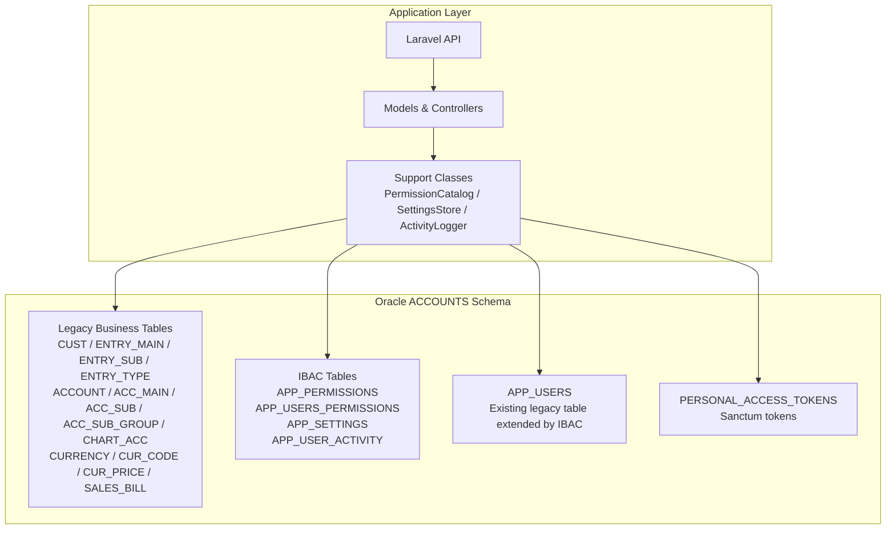
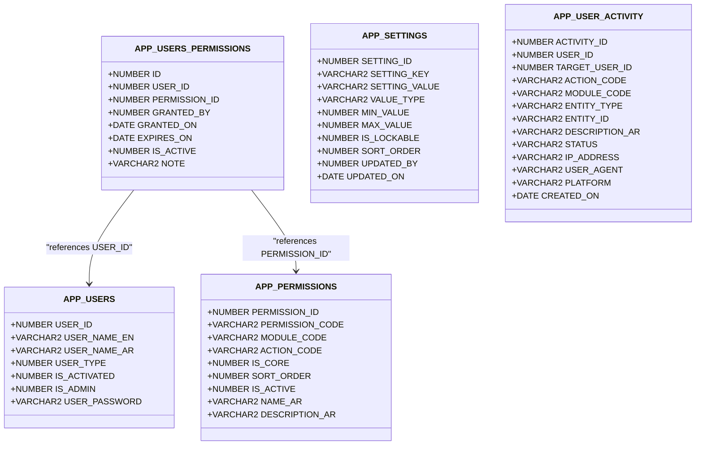
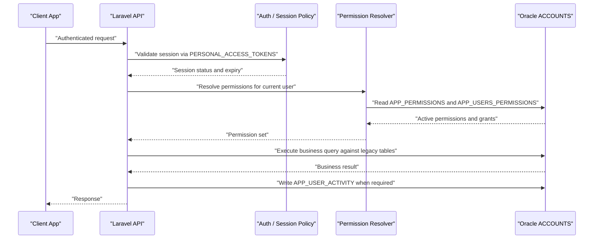
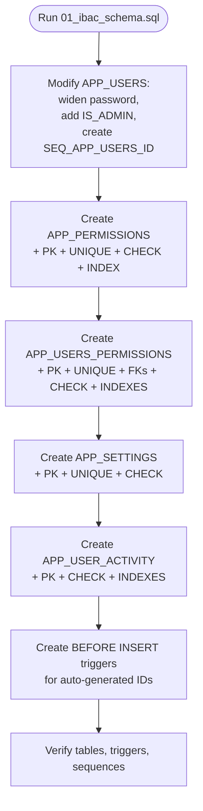
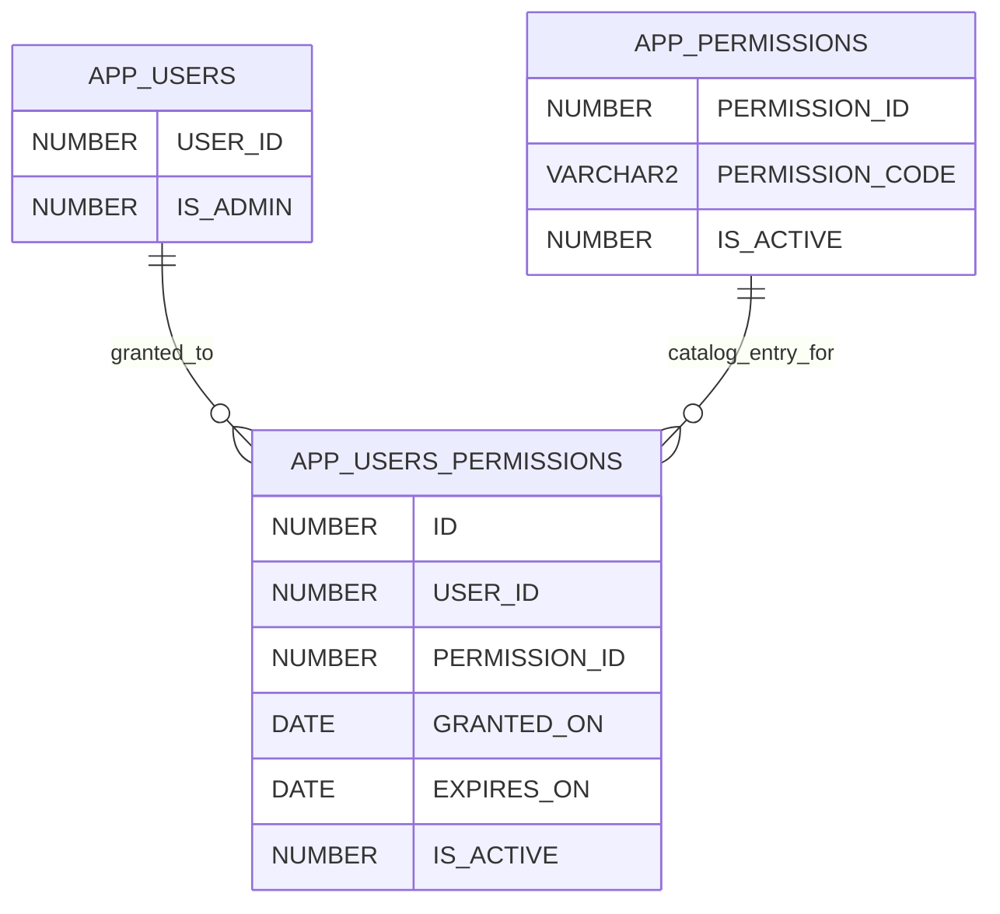
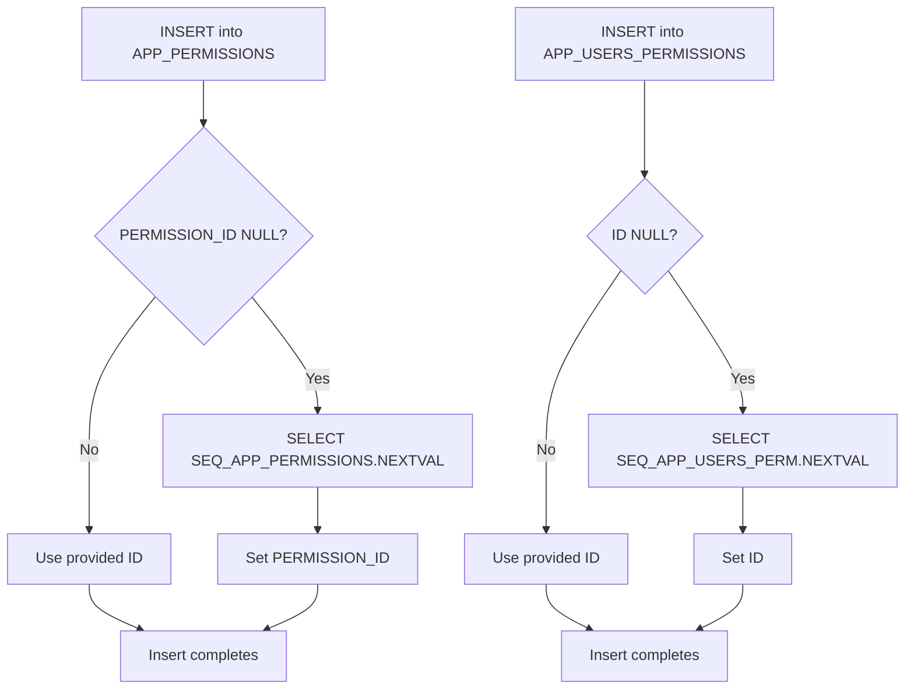
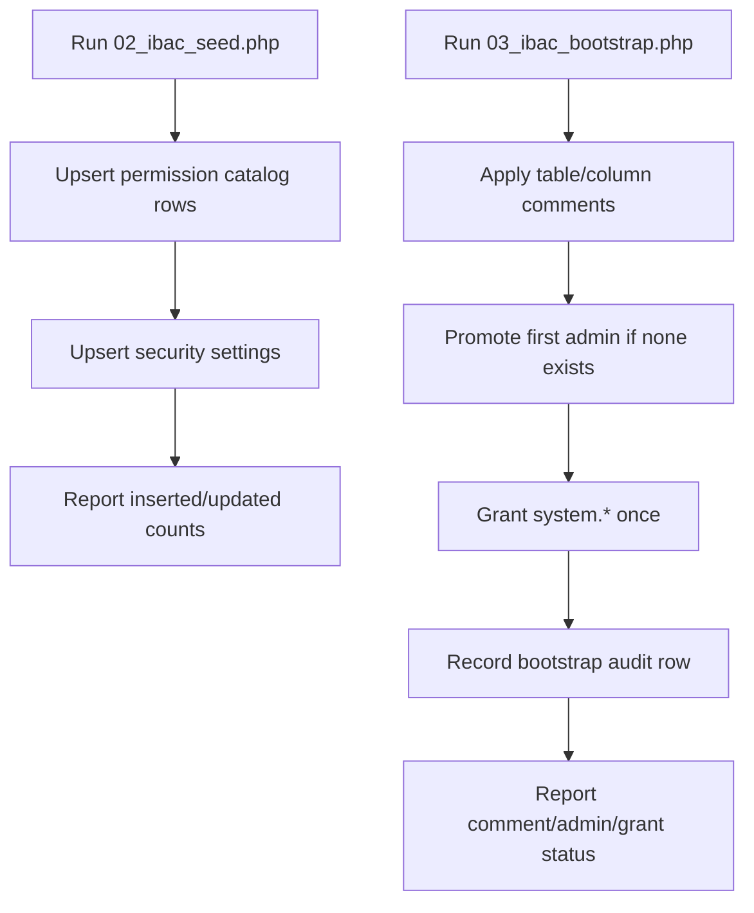
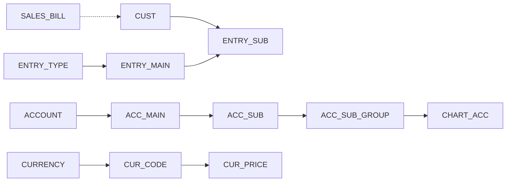
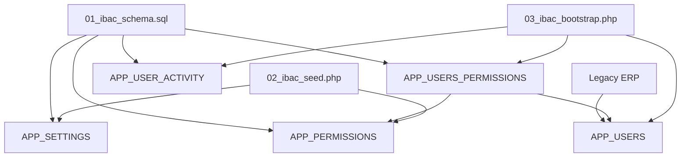
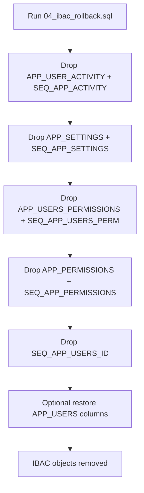

# Database Architecture (Oracle)

<cite>
**Referenced Files in This Document**
- [01_ibac_schema.sql](file://kyApp_API/database/oracle/01_ibac_schema.sql)
- [02_ibac_seed.php](file://kyApp_API/database/oracle/02_ibac_seed.php)
- [03_ibac_bootstrap.php](file://kyApp_API/database/oracle/03_ibac_bootstrap.php)
- [04_ibac_rollback.sql](file://kyApp_API/database/oracle/04_ibac_rollback.sql)
- [oracle.php](file://kyApp_API/config/oracle.php)
- [AGENTS.md](file://kyApp_API/AGENTS.md)
- [DBdevloping_history.md](file://DBdevloping_history.md)
- [db_commends.md](file://db_commends.md)
</cite>

## Table of Contents
1. [Introduction](#introduction)
2. [Project Structure](#project-structure)
3. [Core Components](#core-components)
4. [Architecture Overview](#architecture-overview)
5. [Detailed Component Analysis](#detailed-component-analysis)
6. [Dependency Analysis](#dependency-analysis)
7. [Performance Considerations](#performance-considerations)
8. [Troubleshooting Guide](#troubleshooting-guide)
9. [Conclusion](#conclusion)
10. [Appendices](#appendices)

## Introduction
This document describes the Oracle database architecture supporting the IBAC (Identity-Based Access Control) system and the legacy business data model under the `ACCOUNTS` schema. The repository does not contain a single DDL file for the entire enterprise schema; instead, it combines:

- A legacy Oracle 11g business schema owned by `ACCOUNTS`, including customer, worker, financial account, currency, journal entry, and invoice tables.
- An IBAC extension that adds permission catalog, direct user-to-permission grants, security/session settings, and an activity audit trail.
- PHP seed and bootstrap scripts that populate metadata, bilingual comments, and initial administrative state.
- Configuration describing the Oracle connection, edition, session NLS settings, identifier length limits, and schema prefix behavior.

The documentation focuses on what is actually present in the repository: the IBAC schema definition, its triggers and sequences, the seed/bootstrap process, the documented legacy tables referenced by application code, and the operational constraints discovered during development.

## Project Structure
The Oracle-related artifacts are concentrated under `kyApp_API/database/oracle`, with supporting configuration and documentation elsewhere:

| Area | Purpose |
|---|---|
| `kyApp_API/database/oracle/01_ibac_schema.sql` | Creates IBAC tables, indexes, sequences, and triggers; modifies the existing `APP_USERS` table. |
| `kyApp_API/database/oracle/02_ibac_seed.php` | Seeds the permission catalog and security settings idempotently. |
| `kyApp_API/database/oracle/03_ibac_bootstrap.php` | Applies bilingual dictionary comments, promotes the first administrator, and records bootstrap audit activity. |
| `kyApp_API/database/oracle/04_ibac_rollback.sql` | Drops only the new IBAC objects without touching business data. |
| `kyApp_API/config/oracle.php` | Oracle driver, TNS/host/service name, charset, edition, server version, load balance, max identifier length, and NLS session variables. |
| `kyApp_API/AGENTS.md` | Operational notes about the legacy schema, constraint behavior, date binding formats, cache limits, and inspection guidance. |
| `DBdevloping_history.md` | Chronological development history covering customer queries, Arabic encoding, worker registries, chart-of-accounts, currencies, IBAC phases, and live checks. |
| `db_commends.md` | Recorded SQL commands, execution results, and authoritative column names used to validate later documentation. |

**Diagram sources**
- [AGENTS.md:454-469](file://kyApp_API/AGENTS.md#L454-L469)
- [01_ibac_schema.sql:22-207](file://kyApp_API/database/oracle/01_ibac_schema.sql#L22-L207)

**Section sources**
- [01_ibac_schema.sql:1-207](file://kyApp_API/database/oracle/01_ibac_schema.sql#L1-L207)
- [oracle.php:1-30](file://kyApp_API/config/oracle.php#L1-L30)
- [AGENTS.md:454-469](file://kyApp_API/AGENTS.md#L454-L469)
- [DBdevloping_history.md:6-10](file://DBdevloping_history.md#L6-L10)

## Core Components
The database design has two layers:

1. **Legacy business layer:** Customer management, worker administration, financial accounts, currencies, journal entries, and invoices. These tables already exist in the production `ACCOUNTS` schema and are read or written by controllers and historical queries.
2. **IBAC extension layer:** Permission catalog, direct user permissions, security settings, and activity audit trail. This layer is explicitly created by the IBAC schema script and populated by the seed and bootstrap scripts.

### IBAC Extension Tables
| Table | Responsibility | Key Columns | Constraints & Indexes |
|---|---|---|---|
| `APP_PERMISSIONS` | Permission catalog | `PERMISSION_ID`, `PERMISSION_CODE`, `MODULE_CODE`, `ACTION_CODE`, `IS_CORE`, `SORT_ORDER`, `IS_ACTIVE` | Primary key on `PERMISSION_ID`; unique on `PERMISSION_CODE`; check constraints on `IS_CORE` and `IS_ACTIVE`; composite index on `(MODULE_CODE, SORT_ORDER)` |
| `APP_USERS_PERMISSIONS` | Direct user-to-permission grants | `ID`, `USER_ID`, `PERMISSION_ID`, `GRANTED_BY`, `GRANTED_ON`, `EXPIRES_ON`, `IS_ACTIVE`, `NOTE` | Primary key on `ID`; unique on `(USER_ID, PERMISSION_ID)`; foreign keys to `APP_USERS(USER_ID)` with cascade delete and `APP_PERMISSIONS(PERMISSION_ID)`; check on `IS_ACTIVE`; indexes on `(USER_ID, IS_ACTIVE)` and `(PERMISSION_ID)` |
| `APP_SETTINGS` | Security and session settings | `SETTING_ID`, `SETTING_KEY`, `SETTING_VALUE`, `VALUE_TYPE`, `NAME_AR`, `DESCRIPTION_AR`, `MIN_VALUE`, `MAX_VALUE`, `IS_LOCKABLE`, `SORT_ORDER`, `UPDATED_BY`, `UPDATED_ON` | Primary key on `SETTING_ID`; unique on `SETTING_KEY`; check on `VALUE_TYPE` (`int`, `bool`, `string`, `json`) |
| `APP_USER_ACTIVITY` | Audit trail | `ACTIVITY_ID`, `USER_ID`, `TARGET_USER_ID`, `ACTION_CODE`, `MODULE_CODE`, `ENTITY_TYPE`, `ENTITY_ID`, `DESCRIPTION_AR`, `STATUS`, `IP_ADDRESS`, `USER_AGENT`, `PLATFORM`, `CREATED_ON` | Primary key on `ACTIVITY_ID`; check on `STATUS` (`success`, `failed`); no foreign key on `USER_ID`; indexes on `(USER_ID, CREATED_ON)`, `(TARGET_USER_ID, CREATED_ON)`, `(MODULE_CODE, CREATED_ON)` |

### Legacy Business Entities Referenced by Application Code
| Entity | Representative Table(s) | Notes |
|---|---|---|
| Customers | `CUST` | Includes credit limit and deactivation flags; used in customer search and statement queries. |
| Workers | `TAILOR_EMPLOYEES`, `CUTTER`, `TAILOR` | Separate worker registries, each with its own account number. |
| Financial accounts | `ACCOUNT`, `ACC_MAIN`, `ACC_SUB`, `ACC_SUB_GROUP`, `CHART_ACC` | Five-level chart-of-accounts hierarchy. |
| Journal entries | `ENTRY_MAIN`, `ENTRY_SUB`, `ENTRY_TYPE` | Main/sub entries and entry types drive statements and balances. |
| Currencies | `CURRENCY`, `CUR_CODE`, `CUR_PRICE` | Currency definitions, codes, and daily exchange rates. |
| Invoices | `SALES_BILL` | Read-only invoice table accessed through the invoice controller. |
| Users | `APP_USERS` | Existing legacy login table extended by IBAC with `IS_ADMIN` and widened password column. |
| Sessions | `PERSONAL_ACCESS_TOKENS` | Sanctum token table used for active sessions and expiration enforcement. |

**Section sources**
- [01_ibac_schema.sql:38-184](file://kyApp_API/database/oracle/01_ibac_schema.sql#L38-L184)
- [AGENTS.md:454-469](file://kyApp_API/AGENTS.md#L454-L469)
- [DBdevloping_history.md:6-10](file://DBdevloping_history.md#L6-L10)
- [DBdevloping_history.md:57-79](file://DBdevloping_history.md#L57-L79)
- [DBdevloping_history.md:86-99](file://DBdevloping_history.md#L86-L99)

## Architecture Overview
The IBAC architecture is identity-based rather than role-based: permissions are defined as catalog entries and granted directly to users. Administrative access is partially enforced at the database level through `APP_USERS.IS_ADMIN`, while most authorization logic lives in the application layer.

**Diagram sources**
- [01_ibac_schema.sql:38-184](file://kyApp_API/database/oracle/01_ibac_schema.sql#L38-L184)

### Data Flow Between Application Layers and Database Operations

**Diagram sources**
- [03_ibac_bootstrap.php:187-217](file://kyApp_API/database/oracle/03_ibac_bootstrap.php#L187-L217)
- [DBdevloping_history.md:363-370](file://DBdevloping_history.md#L363-L370)

## Detailed Component Analysis

### IBAC Schema Definition
The IBAC schema script performs four main responsibilities:

1. Extends the legacy `APP_USERS` table by widening the password column, adding `IS_ADMIN`, and creating a sequence without a trigger because the legacy ERP writes directly to this table.
2. Creates the permission catalog table with controlled boolean-like columns and a module-oriented index.
3. Creates the direct grant table with referential integrity to both users and permissions.
4. Creates settings and activity tables with bounded value types and audit-friendly indexes.

**Diagram sources**
- [01_ibac_schema.sql:26-207](file://kyApp_API/database/oracle/01_ibac_schema.sql#L26-L207)

**Section sources**
- [01_ibac_schema.sql:22-207](file://kyApp_API/database/oracle/01_ibac_schema.sql#L22-L207)

### Foreign Keys, Referential Integrity, and Cascading Operations
| Relationship | Constraint Type | Behavior | Rationale |
|---|---|---|---|
| `APP_USERS_PERMISSIONS.USER_ID` → `APP_USERS.USER_ID` | Foreign key | `ON DELETE CASCADE` | Removing a user removes their direct grants automatically. |
| `APP_USERS_PERMISSIONS.PERMISSION_ID` → `APP_PERMISSIONS.PERMISSION_ID` | Foreign key | No explicit cascade shown | Deleting a permission should be coordinated with application logic; grants remain auditable. |
| `APP_USER_ACTIVITY.USER_ID` | No foreign key | Allows `NULL` | Failed logins from unknown usernames must be recorded; deleting a user must not erase their audit history. |

**Diagram sources**
- [01_ibac_schema.sql:81-97](file://kyApp_API/database/oracle/01_ibac_schema.sql#L81-L97)
- [01_ibac_schema.sql:186-189](file://kyApp_API/database/oracle/01_ibac_schema.sql#L186-L189)

**Section sources**
- [01_ibac_schema.sql:81-97](file://kyApp_API/database/oracle/01_ibac_schema.sql#L81-L97)
- [01_ibac_schema.sql:186-189](file://kyApp_API/database/oracle/01_ibac_schema.sql#L186-L189)
- [db_commends.md:150-172](file://db_commends.md#L150-L172)

### Indexing Strategy
The IBAC schema uses targeted indexing rather than broad coverage:

| Index | Target Columns | Purpose |
|---|---|---|
| `APP_PERM_MOD_IX` | `MODULE_CODE`, `SORT_ORDER` | Fast lookup of permissions grouped by module and display order. |
| `APP_UQ_USER_IX` | `USER_ID`, `IS_ACTIVE` | Efficient resolution of active grants per user. |
| `APP_UQ_PERM_IX` | `PERMISSION_ID` | Lookup of grants by permission. |
| `APP_ACT_USER_IX` | `USER_ID`, `CREATED_ON` | User-centric audit queries. |
| `APP_ACT_TGT_IX` | `TARGET_USER_ID`, `CREATED_ON` | Target-user audit queries. |
| `APP_ACT_MOD_IX` | `MODULE_CODE`, `CREATED_ON` | Module-scoped audit queries. |

Composite indexes align with the most common filtering patterns: user identity plus activity time, module plus time, and user plus grant state.

**Section sources**
- [01_ibac_schema.sql:59-60](file://kyApp_API/database/oracle/01_ibac_schema.sql#L59-L60)
- [01_ibac_schema.sql:99-100](file://kyApp_API/database/oracle/01_ibac_schema.sql#L99-L100)
- [01_ibac_schema.sql:170-172](file://kyApp_API/database/oracle/01_ibac_schema.sql#L170-L172)

### Stored Procedures, Triggers, and Functions
The repository defines **triggers**, not stored procedures or functions, for the IBAC extension:

| Object | Type | Trigger Point | Logic |
|---|---|---|---|
| `TRG_APP_PERMISSIONS` | Before insert trigger | `APP_PERMISSIONS` | Generates `PERMISSION_ID` from `SEQ_APP_PERMISSIONS` if null. |
| `TRG_APP_USERS_PERM` | Before insert trigger | `APP_USERS_PERMISSIONS` | Generates `ID` from `SEQ_APP_USERS_PERM` if null. |
| `TRG_APP_SETTINGS` | Before insert trigger | `APP_SETTINGS` | Generates `SETTING_ID` from `SEQ_APP_SETTINGS` if null. |
| `TRG_APP_ACTIVITY` | Before insert trigger | `APP_USER_ACTIVITY` | Generates `ACTIVITY_ID` from `SEQ_APP_ACTIVITY` if null. |

A critical implementation detail is that sequence names inside PL/SQL must remain unqualified. The `ACCOUNTS` schema contains a view named `ACCOUNTS`, so referencing `ACCOUNTS.SEQ_X.NEXTVAL` resolves incorrectly as a view column and invalidates the trigger.

**Diagram sources**
- [01_ibac_schema.sql:68-75](file://kyApp_API/database/oracle/01_ibac_schema.sql#L68-L75)
- [01_ibac_schema.sql:105-112](file://kyApp_API/database/oracle/01_ibac_schema.sql#L105-L112)

**Section sources**
- [01_ibac_schema.sql:68-75](file://kyApp_API/database/oracle/01_ibac_schema.sql#L68-L75)
- [01_ibac_schema.sql:105-112](file://kyApp_API/database/oracle/01_ibac_schema.sql#L105-L112)
- [01_ibac_schema.sql:177-184](file://kyApp_API/database/oracle/01_ibac_schema.sql#L177-L184)
- [db_commends.md:228-290](file://db_commends.md#L228-L290)

### Seed and Bootstrap Process
The seed script populates the permission catalog and security settings using bound parameters and an idempotent upsert pattern. It reads permission rows from `PermissionCatalog` and updates existing rows while inserting missing ones. For settings, it preserves operator-edited values but refreshes labels, ranges, lockability, and sort order.

The bootstrap script applies bilingual table and column comments, promotes the first administrator safely, grants `system.*` once, and records a bootstrap audit row even if audit logging fails.

**Diagram sources**
- [02_ibac_seed.php:36-89](file://kyApp_API/database/oracle/02_ibac_seed.php#L36-L89)
- [02_ibac_seed.php:212-279](file://kyApp_API/database/oracle/02_ibac_seed.php#L212-L279)
- [03_ibac_bootstrap.php:107-119](file://kyApp_API/database/oracle/03_ibac_bootstrap.php#L107-L119)
- [03_ibac_bootstrap.php:131-217](file://kyApp_API/database/oracle/03_ibac_bootstrap.php#L131-L217)

**Section sources**
- [02_ibac_seed.php:1-310](file://kyApp_API/database/oracle/02_ibac_seed.php#L1-L310)
- [03_ibac_bootstrap.php:1-227](file://kyApp_API/database/oracle/03_ibac_bootstrap.php#L1-L227)

### Legacy Business Data Model
The legacy model is documented primarily through development history and agent notes rather than a single DDL file. Key relationships include:

- Customer statements join `ENTRY_SUB`, `ENTRY_MAIN`, `ENTRY_TYPE`, and `CUST`.
- Worker statements join `ENTRY_MAIN`, `ENTRY_SUB`, and `ENTRY_TYPE` by account number.
- Chart-of-accounts hierarchy uses numeric derivation and grouping levels.
- Currencies and daily prices support financial calculations.
- Invoices are read from `SALES_BILL`.

**Diagram sources**
- [DBdevloping_history.md:6-10](file://DBdevloping_history.md#L6-L10)
- [DBdevloping_history.md:57-79](file://DBdevloping_history.md#L57-L79)
- [DBdevloping_history.md:86-99](file://DBdevloping_history.md#L86-L99)
- [AGENTS.md:454-469](file://kyApp_API/AGENTS.md#L454-L469)

**Section sources**
- [DBdevloping_history.md:6-10](file://DBdevloping_history.md#L6-L10)
- [DBdevloping_history.md:57-79](file://DBdevloping_history.md#L57-L79)
- [DBdevloping_history.md:86-99](file://DBdevloping_history.md#L86-L99)
- [AGENTS.md:454-469](file://kyApp_API/AGENTS.md#L454-L469)

## Dependency Analysis
The IBAC extension depends on the legacy `APP_USERS` table but avoids breaking the legacy ERP by:

- Not adding a trigger on `APP_USERS`.
- Using an explicit sequence for new user IDs.
- Keeping audit logs decoupled from user deletion.
- Using safe rollback scripts that drop only new objects.

**Diagram sources**
- [01_ibac_schema.sql:26-33](file://kyApp_API/database/oracle/01_ibac_schema.sql#L26-L33)
- [01_ibac_schema.sql:81-97](file://kyApp_API/database/oracle/01_ibac_schema.sql#L81-L97)
- [02_ibac_seed.php:36-89](file://kyApp_API/database/oracle/02_ibac_seed.php#L36-L89)
- [03_ibac_bootstrap.php:131-217](file://kyApp_API/database/oracle/03_ibac_bootstrap.php#L131-L217)

**Section sources**
- [01_ibac_schema.sql:22-33](file://kyApp_API/database/oracle/01_ibac_schema.sql#L22-L33)
- [01_ibac_schema.sql:81-97](file://kyApp_API/database/oracle/01_ibac_schema.sql#L81-L97)
- [04_ibac_rollback.sql:1-42](file://kyApp_API/database/oracle/04_ibac_rollback.sql#L1-L42)

## Performance Considerations
Several performance and platform-specific characteristics are documented:

- **Oracle 11g compatibility:** Pagination uses `ROW_NUMBER()` wrappers and `ROWNUM` limits because `OFFSET/FETCH` is unavailable.
- **Identifier length:** Maximum identifier length is 30 characters.
- **NLS session variables:** Date and timestamp formats are configured for consistent output.
- **Cache payload limit:** Laravel’s `CACHE` table rejects bound strings over 4000 bytes; application caches cap payloads at 3000 bytes and avoid storing Arabic text.
- **Date handling:** Empty Oracle dates may return `false` or empty strings rather than `null`; application code normalizes these before use.
- **Column-name case:** Oracle PDO returns lowercase attribute keys while the catalog is uppercase; models and queries tolerate inconsistent casing.
- **Statement binding:** All dynamic queries bind parameters; string interpolation is avoided.

These constraints affect how queries are written, how results are parsed, and how large payloads such as permissions or settings are cached.

**Section sources**
- [oracle.php:1-30](file://kyApp_API/config/oracle.php#L1-L30)
- [AGENTS.md:303-330](file://kyApp_API/AGENTS.md#L303-L330)
- [DBdevloping_history.md:211-241](file://DBdevloping_history.md#L211-L241)
- [DBdevloping_history.md:363-370](file://DBdevloping_history.md#L363-L370)

## Troubleshooting Guide
Common issues identified in the repository include:

| Issue | Cause | Resolution |
|---|---|---|
| Invalid trigger compilation | Sequence reference qualified as `ACCOUNTS.SEQ_X.NEXTVAL` resolves as a view column | Use unqualified sequence names inside PL/SQL triggers. |
| Bind variable name error | Reserved word used as bind variable name | Rename bind variables (e.g., `:by` → `:updated_by`). |
| Missing identifier errors | Documentation or ad-hoc queries used wrong column names | Validate column names against `ALL_TAB_COLUMNS`; use `PERMISSION_ID`, `IS_ACTIVE`, `EXPIRES_ON`, `ACTIVITY_ID`. |
| Arabic mojibake | Raw CP1256 bytes sent through AL32UTF8 client replaced with replacement character | Write Arabic through `toOracleSearchChars()`; read through `fixMojibake()`/`cleanData()`. |
| Cache write failure | Bound value exceeds 4000-byte limit for CLOB insertion via `FROM dual` | Cap cache payloads at 3000 bytes and exclude Arabic text from cached values. |
| Pagination failure | Using `OFFSET/FETCH` on Oracle 11g | Wrap queries with `ROW_NUMBER()` and filter by `ROWNUM`. |
| Accidental business data loss | Running full rollback without restoring backup | Restore `APP_USERS_BAK_IBAC` before dropping modified columns. |

**Section sources**
- [db_commends.md:228-290](file://db_commends.md#L228-L290)
- [db_commends.md:420-435](file://db_commends.md#L420-L435)
- [db_commends.md:515-555](file://db_commends.md#L515-L555)
- [db_commends.md:661-698](file://db_commends.md#L661-L698)
- [04_ibac_rollback.sql:1-42](file://kyApp_API/database/oracle/04_ibac_rollback.sql#L1-L42)

## Conclusion
The Oracle database architecture in this repository is a hybrid design: a mature legacy accounting and operations schema coexists with a carefully scoped IBAC extension. The IBAC layer provides a permission catalog, direct user grants, configurable security settings, and an audit trail, while preserving backward compatibility with the legacy ERP that writes directly to `APP_USERS`.

Key architectural decisions include:

- Identity-based access control without roles.
- Explicit foreign-key constraints for grants, with intentional absence of a foreign key on audit activity.
- Trigger-driven primary key generation for IBAC tables, but not for the shared legacy user table.
- Idempotent seed and bootstrap scripts that protect against accidental lockout and duplicate administrative state.
- Conservative performance tuning aligned with Oracle 11g, Arabic encoding quirks, and Laravel cache limitations.

For future changes, the safest approach is to consult the authoritative development history and command log, validate column names against the data dictionary, and treat any write to the production `ACCOUNTS` schema as requiring explicit approval.

## Appendices

### Rollback Strategy
The rollback script drops IBAC objects in reverse dependency order:

1. Activity audit table and sequence.
2. Settings table and sequence.
3. Grants table and sequence.
4. Permission catalog table and sequence.
5. New user-id sequence.
6. Optional restoration of `APP_USERS` columns from the backup snapshot.

**Diagram sources**
- [04_ibac_rollback.sql:13-42](file://kyApp_API/database/oracle/04_ibac_rollback.sql#L13-L42)

**Section sources**
- [04_ibac_rollback.sql:1-42](file://kyApp_API/database/oracle/04_ibac_rollback.sql#L1-L42)