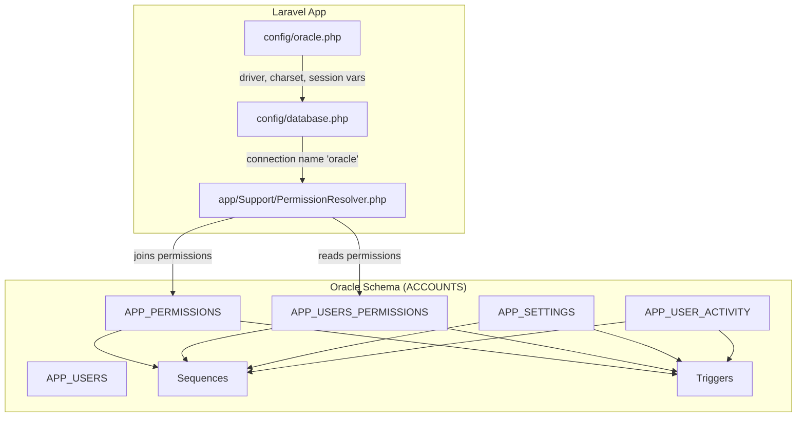
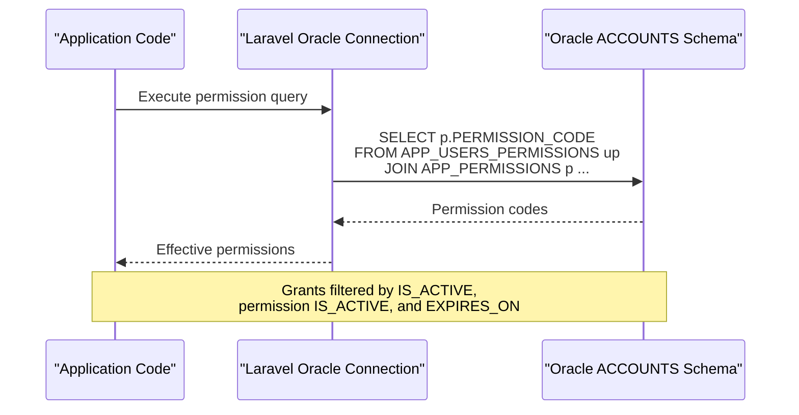
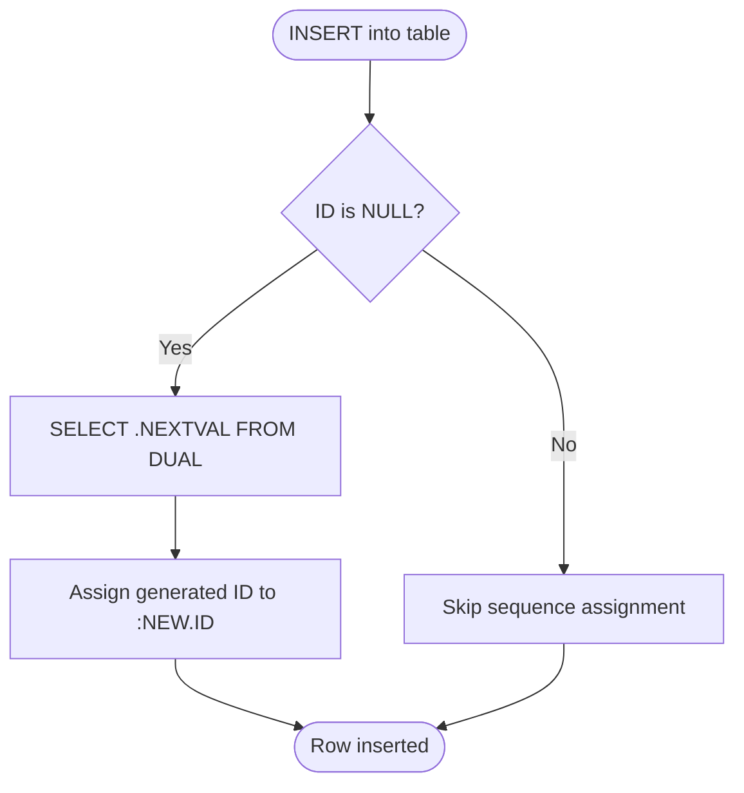
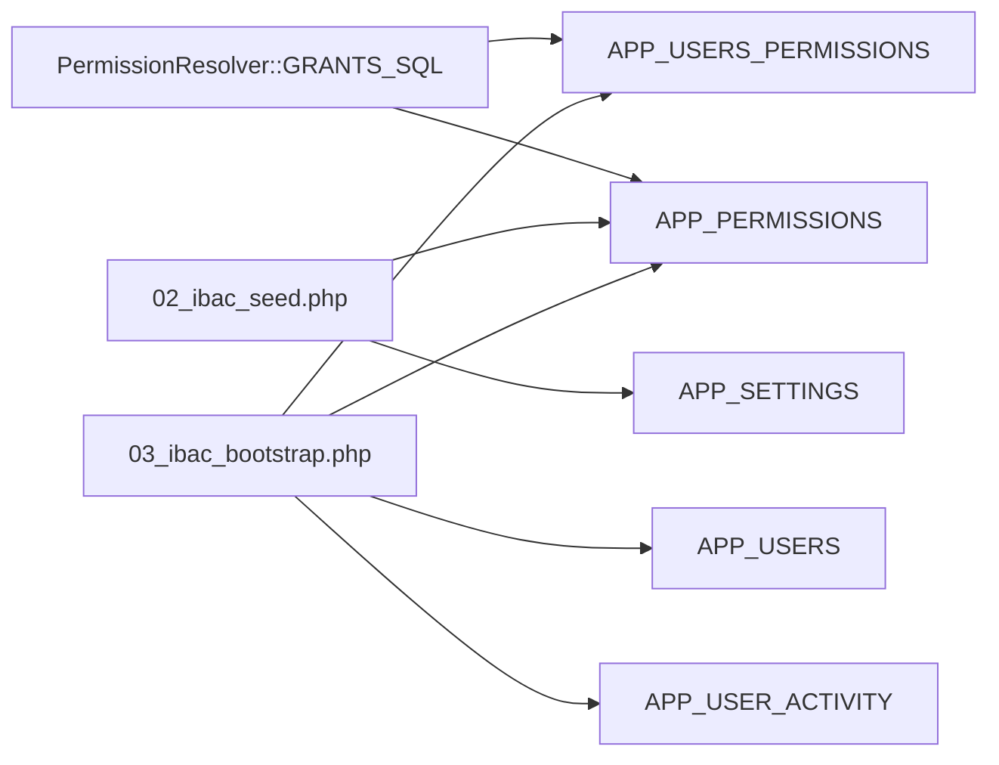

# Database Optimization & Performance

<cite>
**Referenced Files in This Document**   
- [01_ibac_schema.sql](file://kyApp_API/database/oracle/01_ibac_schema.sql)
- [02_ibac_seed.php](file://kyApp_API/database/oracle/02_ibac_seed.php)
- [03_ibac_bootstrap.php](file://kyApp_API/database/oracle/03_ibac_bootstrap.php)
- [04_ibac_rollback.sql](file://kyApp_API/database/oracle/04_ibac_rollback.sql)
- [database.php](file://kyApp_API/config/database.php)
- [oracle.php](file://kyApp_API/config/oracle.php)
- [PermissionResolver.php](file://kyApp_API/app/Support/PermissionResolver.php)
- [DBdevloping_history.md](file://DBdevloping_history.md)
- [db_commends.md](file://db_commends.md)
</cite>

## Table of Contents
1. [Introduction](#introduction)
2. [Project Structure](#project-structure)
3. [Core Components](#core-components)
4. [Architecture Overview](#architecture-overview)
5. [Detailed Component Analysis](#detailed-component-analysis)
6. [Dependency Analysis](#dependency-analysis)
7. [Performance Considerations](#performance-considerations)
8. [Troubleshooting Guide](#troubleshooting-guide)
9. [Conclusion](#conclusion)
10. [Appendices](#appendices)

## Introduction
This document provides Oracle-focused optimization and performance-tuning guidance for the IBAC schema used by the application. It covers indexing strategy, primary keys and unique constraints, sequence-driven ID generation, trigger behavior, audit trail considerations, partitioning and archival options, monitoring techniques, memory and connection configuration, backup strategies, and capacity planning. The recommendations are grounded in the actual schema definition, seed/bootstrap scripts, Laravel Oracle connection configuration, and development history notes.

## Project Structure
The Oracle-related database layer is defined under `kyApp_API/database/oracle`, with DDL in a SQL file and seeding/bootstrapping logic in PHP scripts. Application-level Oracle connection settings live in Laravel configuration files.

**Diagram sources**
- [database.php:116-127](file://kyApp_API/config/database.php#L116-L127)
- [oracle.php:3-28](file://kyApp_API/config/oracle.php#L3-L28)
- [PermissionResolver.php:49-58](file://kyApp_API/app/Support/PermissionResolver.php#L49-L58)
- [01_ibac_schema.sql:38-184](file://kyApp_API/database/oracle/01_ibac_schema.sql#L38-L184)

**Section sources**
- [database.php:116-127](file://kyApp_API/config/database.php#L116-L127)
- [oracle.php:3-28](file://kyApp_API/config/oracle.php#L3-L28)
- [01_ibac_schema.sql:1-207](file://kyApp_API/database/oracle/01_ibac_schema.sql#L1-L207)

## Core Components
The schema centers on five tables plus sequences and triggers:

- APP_USERS: legacy user table extended with admin flag; new IDs use a sequence but no trigger to avoid breaking the ERP writer.
- APP_PERMISSIONS: permission catalog with code-based access control.
- APP_USERS_PERMISSIONS: direct user-to-permission grants.
- APP_SETTINGS: runtime security/session settings.
- APP_USER_ACTIVITY: lightweight audit trail that must not fail requests.

Key design points:
- Primary keys enforce row identity.
- Unique constraints enforce business uniqueness (e.g., permission codes, user-permission pairs).
- Composite indexes support common query patterns.
- Sequences generate surrogate keys; triggers auto-fill IDs when omitted.
- Audit logging is intentionally decoupled from core transactions.

**Section sources**
- [01_ibac_schema.sql:21-184](file://kyApp_API/database/oracle/01_ibac_schema.sql#L21-L184)

## Architecture Overview
The application uses Laravel’s Oracle connection to read and write the ACCOUNTS schema. Permission resolution joins active grants with active permissions and filters by expiration. Seed and bootstrap scripts populate catalog data, apply bilingual comments, and ensure an initial administrator exists without duplicating grants or risking lockout.

**Diagram sources**
- [PermissionResolver.php:49-58](file://kyApp_API/app/Support/PermissionResolver.php#L49-L58)
- [01_ibac_schema.sql:38-112](file://kyApp_API/database/oracle/01_ibac_schema.sql#L38-L112)

## Detailed Component Analysis

### Indexing Strategy
Indexes are designed around frequent query patterns:

- APP_PERMISSIONS
  - Primary key on PERMISSION_ID.
  - UNIQUE on PERMISSION_CODE.
  - Composite index on MODULE_CODE, SORT_ORDER supports module-scoped listing and ordering.

- APP_USERS_PERMISSIONS
  - Primary key on ID.
  - UNIQUE on USER_ID, PERMISSION_ID enforces one grant per user-permission pair.
  - Index on USER_ID, IS_ACTIVE optimizes “active grants for a user” checks.
  - Index on PERMISSION_ID supports reverse lookups by permission.

- APP_USER_ACTIVITY
  - Primary key on ACTIVITY_ID.
  - Indexes on USER_ID + CREATED_ON, TARGET_USER_ID + CREATED_ON, and MODULE_CODE + CREATED_ON optimize time-bounded activity queries by actor, target, or module.

Recommendations validated against current usage:
- Keep composite column order aligned with WHERE and ORDER BY patterns.
- Avoid redundant indexes where existing ones cover the same leading columns.
- Monitor index usage via Oracle statistics and execution plans before adding new indexes.

**Section sources**
- [01_ibac_schema.sql:53-62](file://kyApp_API/database/oracle/01_ibac_schema.sql#L53-L62)
- [01_ibac_schema.sql:90-103](file://kyApp_API/database/oracle/01_ibac_schema.sql#L90-L103)
- [01_ibac_schema.sql:166-175](file://kyApp_API/database/oracle/01_ibac_schema.sql#L166-L175)

### Primary Keys, Unique Constraints, and Foreign Keys
- PKs provide clustered-like access paths for row lookup and enforce identity.
- UNIQUE constraints prevent duplicate business keys and enable efficient existence checks.
- Foreign keys maintain referential integrity between users and grants; cascade delete ensures cleanup when a user is removed.
- No FK on APP_USER_ACTIVITY.USER_ID allows anonymous failed login records and preserves audit history after user deletion.

Operational implications:
- Deleting a user cascades their grants but does not erase their audit trail.
- Permission code uniqueness simplifies idempotent seeding and updates.

**Section sources**
- [01_ibac_schema.sql:53-57](file://kyApp_API/database/oracle/01_ibac_schema.sql#L53-L57)
- [01_ibac_schema.sql:90-97](file://kyApp_API/database/oracle/01_ibac_schema.sql#L90-L97)
- [01_ibac_schema.sql:186-189](file://kyApp_API/database/oracle/01_ibac_schema.sql#L186-L189)

### Sequence Usage and Trigger Implementations
Sequences:
- SEQ_APP_USERS_ID: starts at 100, increment 1, no cache, no cycle.
- SEQ_APP_PERMISSIONS: starts at 1, increment 1, no cache, no cycle.
- SEQ_APP_USERS_PERM: starts at 1, increment 1, no cache, no cycle.
- SEQ_APP_SETTINGS: starts at 1, increment 1, no cache, no cycle.
- SEQ_APP_ACTIVITY: starts at 1, increment 1, no cache, no cycle.

Trigger behavior:
- Before-insert triggers assign sequence values when the ID column is NULL.
- APP_USERS intentionally has no trigger because the legacy ERP writes directly into it; callers must explicitly call the sequence.

**Diagram sources**
- [01_ibac_schema.sql:68-75](file://kyApp_API/database/oracle/01_ibac_schema.sql#L68-L75)
- [01_ibac_schema.sql:105-112](file://kyApp_API/database/oracle/01_ibac_schema.sql#L105-L112)
- [01_ibac_schema.sql:139-146](file://kyApp_API/database/oracle/01_ibac_schema.sql#L139-L146)
- [01_ibac_schema.sql:177-184](file://kyApp_API/database/oracle/01_ibac_schema.sql#L177-L184)

**Section sources**
- [01_ibac_schema.sql:32-33](file://kyApp_API/database/oracle/01_ibac_schema.sql#L32-L33)
- [01_ibac_schema.sql:61-75](file://kyApp_API/database/oracle/01_ibac_schema.sql#L61-L75)
- [01_ibac_schema.sql:102-112](file://kyApp_API/database/oracle/01_ibac_schema.sql#L102-L112)
- [01_ibac_schema.sql:136-146](file://kyApp_API/database/oracle/01_ibac_schema.sql#L136-L146)
- [01_ibac_schema.sql:174-184](file://kyApp_API/database/oracle/01_ibac_schema.sql#L174-L184)

### Partitioning and Archival Strategies for Audit Trail
APP_USER_ACTIVITY is the high-growth audit table. Current design includes targeted indexes for time-bound queries. For production growth:

- Partitioning approach
  - Range-partition by CREATED_ON (monthly or quarterly), enabling partition pruning for recent windows.
  - Use global indexes if cross-partition queries are frequent; otherwise local indexes can be more maintenance-friendly.
  - Ensure partitioning aligns with the most common query predicates (USER_ID + CREATED_ON, MODULE_CODE + CREATED_ON).

- Archival strategy
  - Move older partitions to archive tablespaces or export via Data Pump.
  - Maintain a retention policy driven by APP_SETTINGS.ACTIVITY_LOG_RETENTION_DAYS seeded by the bootstrap script.
  - Provide scheduled jobs to detach/archive old partitions and drop them after compliance holds.

- Query safety
  - Always bound time ranges to leverage partition pruning.
  - Avoid functions on partition keys in WHERE clauses.

[No sources needed since this section provides conceptual guidance]

### Monitoring and Query Optimization
- Execution plans
  - Use EXPLAIN PLAN and AWR/ASH to identify full scans, expensive joins, and missing indexes.
  - Validate that composite indexes match WHERE and ORDER BY patterns.

- Statistics
  - Gather optimizer statistics regularly, especially after bulk loads or large archival operations.

- Pagination
  - On Oracle 11g, prefer ROWNUM-based pagination rather than FETCH FIRST … ROWS ONLY.

- Bind variables
  - Use bind variables consistently; avoid reserved-word bind names that cause ORA-01745.

- Cache limits
  - Be aware of Oracle cache store limitations with large payloads; oversized sets may bypass cache.

**Section sources**
- [db_commends.md:753-757](file://db_commends.md#L753-L757)
- [DBdevloping_history.md:211-229](file://DBdevloping_history.md#L211-L229)
- [PermissionResolver.php:35-43](file://kyApp_API/app/Support/PermissionResolver.php#L35-L43)

### Memory Allocation Settings and Connection Pooling
- Oracle client/server memory
  - Tune SGA/PGA based on workload size and concurrency.
  - Enable automatic memory management where appropriate.
  - Review shared pool and library cache sizing for heavy PL/SQL and repeated SQL.

- Laravel connection pooling
  - The application defines an Oracle connection with service_name and charset AL32UTF8.
  - Session NLS formats are set via oracle.php sessionVars for consistent date/time handling.
  - Configure persistent connections and max idle/max lifetime according to app server process model.
  - Set load balancing and edition parameters as needed for RAC/multitenant environments.

- Connection best practices
  - Reuse connections through the framework’s connection manager.
  - Avoid long-running transactions; keep DML short and commit promptly.
  - Use explicit transaction boundaries for multi-statement operations like replacing grants.

**Section sources**
- [database.php:116-127](file://kyApp_API/config/database.php#L116-L127)
- [oracle.php:3-28](file://kyApp_API/config/oracle.php#L3-L28)

### Backup Strategies for Production
- Logical backups
  - Export schema objects and data using Data Pump for ACCOUNTS.
  - Include sequences, triggers, and grants metadata.

- Physical backups
  - Use RMAN for block-level recovery and point-in-time recovery.
  - Back up archived redo logs to enable PITR.

- Operational safeguards
  - Test restore procedures regularly.
  - Separate backup storage and encryption for sensitive audit data.
  - Retain backups per compliance requirements.

[No sources needed since this section provides general guidance]

### Capacity Planning and Scaling Considerations
- Growth drivers
  - APP_USER_ACTIVITY grows with logins, user management actions, and session operations.
  - APP_USERS_PERMISSIONS scales with user count and permission breadth.

- Scaling tactics
  - Horizontal scaling of application servers behind a load balancer.
  - Vertical scaling of Oracle instance with tuned memory and CPU.
  - Partitioning and archival to keep hot data small.
  - Read replicas for reporting and analytics offloading.

- Monitoring KPIs
  - Active sessions, wait events, buffer cache hit ratio, library cache hits, undo usage, and I/O latency.
  - Query response times for permission checks and activity queries.

[No sources needed since this section provides general guidance]

## Dependency Analysis
The permission resolution path depends on two tables and relies on indexes for efficiency. Seed and bootstrap scripts depend on the schema being present and on correct character encoding for Arabic text.

**Diagram sources**
- [PermissionResolver.php:49-58](file://kyApp_API/app/Support/PermissionResolver.php#L49-L58)
- [02_ibac_seed.php:38-91](file://kyApp_API/database/oracle/02_ibac_seed.php#L38-L91)
- [02_ibac_seed.php:363-430](file://kyApp_API/database/oracle/02_ibac_seed.php#L363-L430)
- [03_ibac_bootstrap.php:109-119](file://kyApp_API/database/oracle/03_ibac_bootstrap.php#L109-L119)
- [03_ibac_bootstrap.php:135-185](file://kyApp_API/database/oracle/03_ibac_bootstrap.php#L135-L185)
- [03_ibac_bootstrap.php:191-217](file://kyApp_API/database/oracle/03_ibac_bootstrap.php#L191-L217)

**Section sources**
- [PermissionResolver.php:49-58](file://kyApp_API/app/Support/PermissionResolver.php#L49-L58)
- [02_ibac_seed.php:38-91](file://kyApp_API/database/oracle/02_ibac_seed.php#L38-L91)
- [02_ibac_seed.php:363-430](file://kyApp_API/database/oracle/02_ibac_seed.php#L363-L430)
- [03_ibac_bootstrap.php:109-119](file://kyApp_API/database/oracle/03_ibac_bootstrap.php#L109-L119)
- [03_ibac_bootstrap.php:135-185](file://kyApp_API/database/oracle/03_ibac_bootstrap.php#L135-L185)
- [03_ibac_bootstrap.php:191-217](file://kyApp_API/database/oracle/03_ibac_bootstrap.php#L191-L217)

## Performance Considerations
- Index alignment
  - Ensure WHERE and ORDER BY columns match index prefix order.
  - Prefer composite indexes for frequently combined predicates.

- Pagination
  - Use ROWNUM-based pagination on Oracle 11g.

- Bind variable naming
  - Avoid reserved words as bind names; use domain-prefixed names.

- Large payloads
  - Bypass cache for oversized permission sets to avoid ORA-01461.

- Audit logging
  - Keep audit inserts non-blocking; failures should not break requests.

- Character set handling
  - Write Arabic via the provided encoding helper to preserve bytes in WE8MSWIN1252 databases accessed by AL32UTF8 clients.

**Section sources**
- [db_commends.md:753-757](file://db_commends.md#L753-L757)
- [DBdevloping_history.md:211-229](file://DBdevloping_history.md#L211-L229)
- [PermissionResolver.php:35-43](file://kyApp_API/app/Support/PermissionResolver.php#L35-L43)
- [02_ibac_seed.php:10-23](file://kyApp_API/database/oracle/02_ibac_seed.php#L10-L23)
- [03_ibac_bootstrap.php:191-217](file://kyApp_API/database/oracle/03_ibac_bootstrap.php#L191-L217)

## Troubleshooting Guide
Common issues and resolutions:

- ORA-01461: bind value too large for column
  - Occurs when caching large permission catalogs; bypass cache for oversized sets.

- ORA-01745: invalid host/bind variable name
  - Caused by using reserved words as bind names; rename binds with domain prefixes.

- ORA-00942: table or view does not exist
  - Guard dynamic queries by checking USER_TABLES before executing.

- Arabic mojibake
  - Use the encoding helper to map CP1256 bytes correctly; do not send raw bytes through UTF-8 clients.

- Pagination syntax
  - Do not use FETCH FIRST … ROWS ONLY on Oracle 11g; wrap with ROWNUM.

- Rollback safety
  - Use the provided rollback script to remove only IBAC objects without touching business data.

**Section sources**
- [PermissionResolver.php:35-43](file://kyApp_API/app/Support/PermissionResolver.php#L35-L43)
- [DBdevloping_history.md:211-229](file://DBdevloping_history.md#L211-L229)
- [DBdevloping_history.md:1-8](file://DBdevloping_history.md#L1-L8)
- [02_ibac_seed.php:10-23](file://kyApp_API/database/oracle/02_ibac_seed.php#L10-L23)
- [db_commends.md:753-757](file://db_commends.md#L753-L757)
- [04_ibac_rollback.sql:1-42](file://kyApp_API/database/oracle/04_ibac_rollback.sql#L1-L42)

## Conclusion
The IBAC schema is optimized for secure, fine-grained access control with clear primary keys, unique constraints, and purpose-built indexes. Sequences and triggers provide safe ID generation while preserving compatibility with legacy writers. The audit trail is designed to be resilient and queryable by time and entity. For production, adopt partitioning and archival for high-growth tables, monitor with Oracle tools, tune memory and connections, and implement robust backup and capacity planning.

## Appendices

### Appendix A: Key Tables and Index Summary
- APP_PERMISSIONS
  - PK: PERMISSION_ID
  - UK: PERMISSION_CODE
  - IX: MODULE_CODE, SORT_ORDER
- APP_USERS_PERMISSIONS
  - PK: ID
  - UK: USER_ID, PERMISSION_ID
  - IX: USER_ID, IS_ACTIVE
  - IX: PERMISSION_ID
- APP_SETTINGS
  - PK: SETTING_ID
  - UK: SETTING_KEY
- APP_USER_ACTIVITY
  - PK: ACTIVITY_ID
  - IX: USER_ID, CREATED_ON
  - IX: TARGET_USER_ID, CREATED_ON
  - IX: MODULE_CODE, CREATED_ON

**Section sources**
- [01_ibac_schema.sql:53-62](file://kyApp_API/database/oracle/01_ibac_schema.sql#L53-L62)
- [01_ibac_schema.sql:90-103](file://kyApp_API/database/oracle/01_ibac_schema.sql#L90-L103)
- [01_ibac_schema.sql:131-134](file://kyApp_API/database/oracle/01_ibac_schema.sql#L131-L134)
- [01_ibac_schema.sql:166-175](file://kyApp_API/database/oracle/01_ibac_schema.sql#L166-L175)

### Appendix B: Oracle Connection Configuration Highlights
- Driver: oracle
- Service name and host/port configured via environment variables
- Charset: AL32UTF8
- Prefix schema: accounts
- Session NLS formats defined for consistent date/time handling

**Section sources**
- [database.php:116-127](file://kyApp_API/config/database.php#L116-L127)
- [oracle.php:3-28](file://kyApp_API/config/oracle.php#L3-L28)