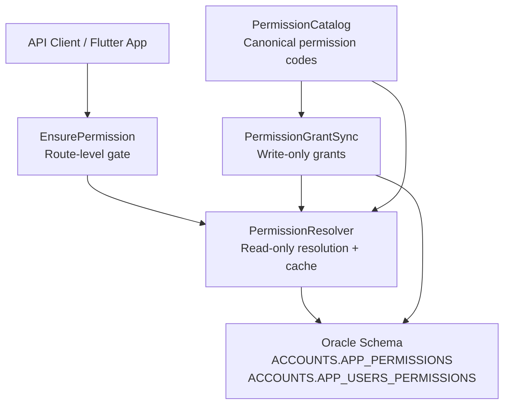
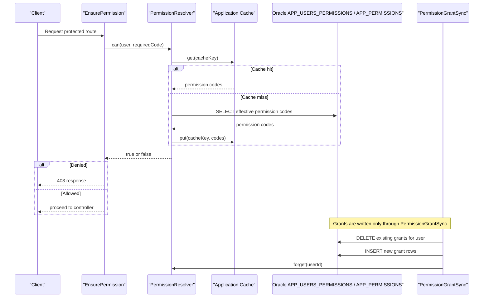
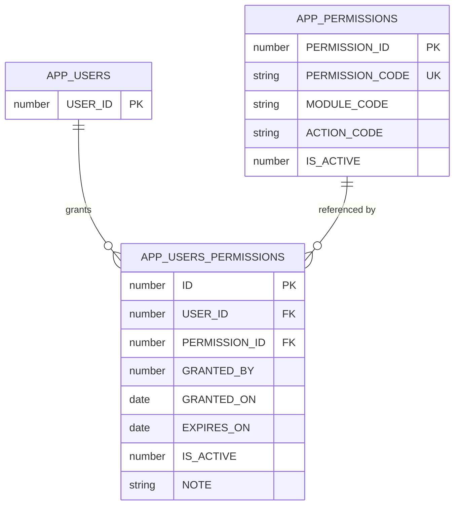
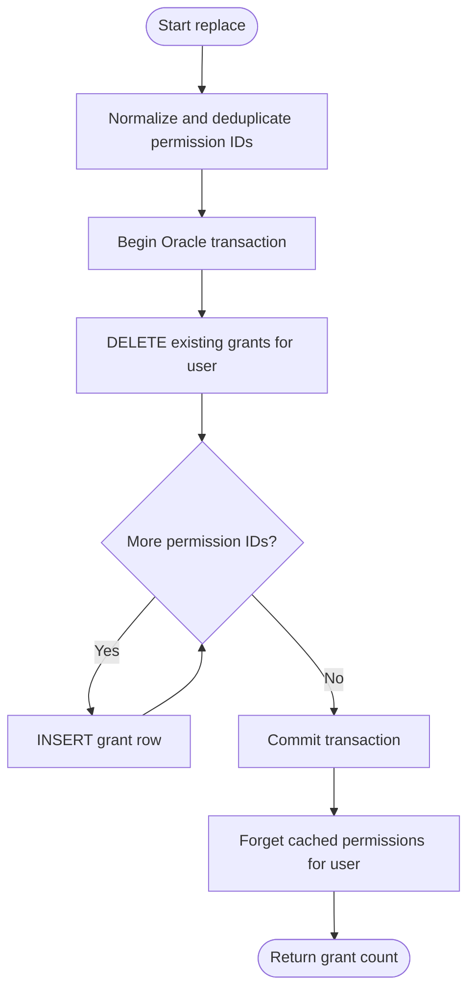
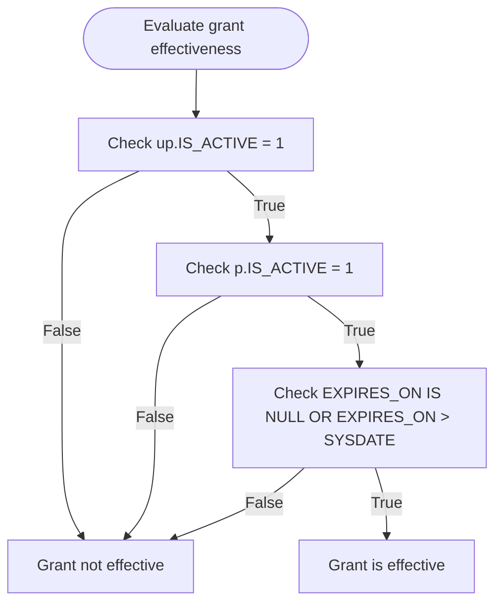
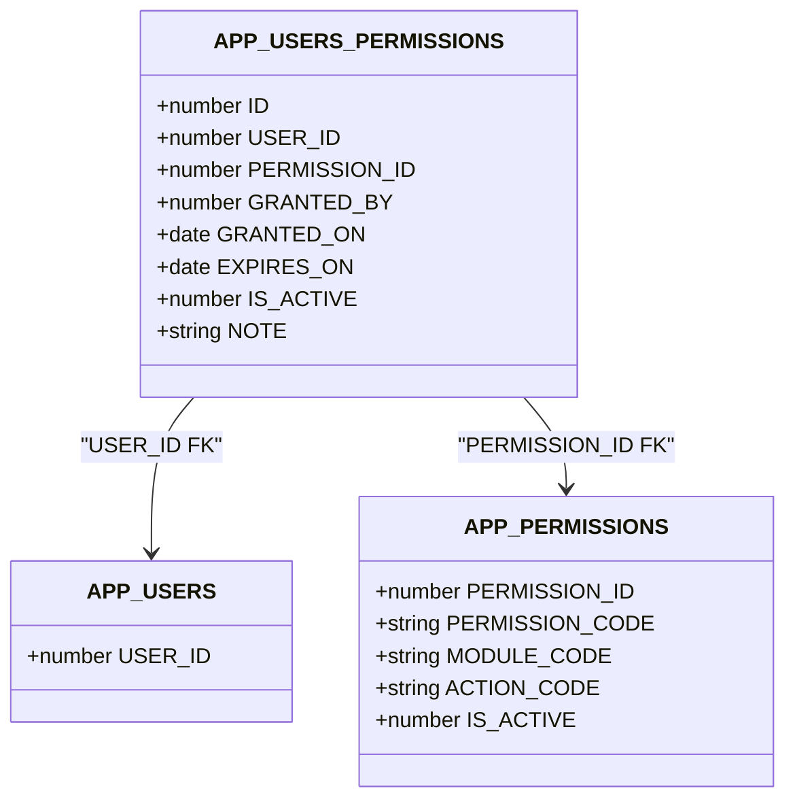
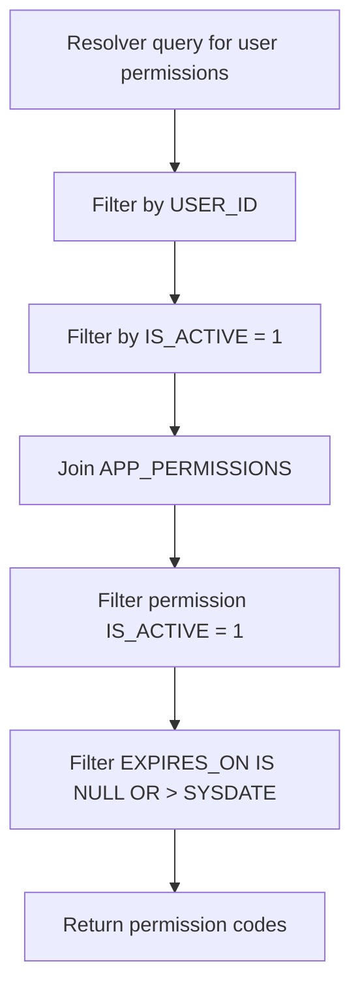
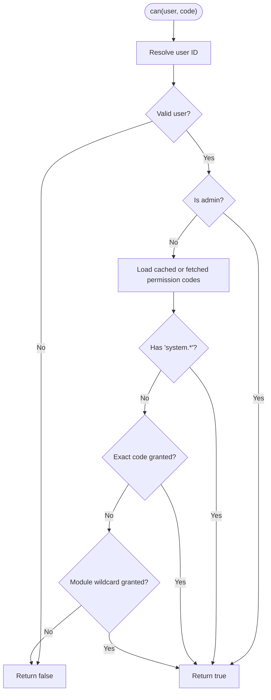
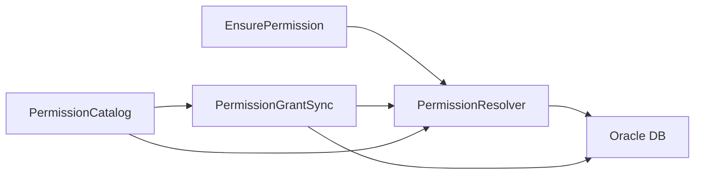

# IBAC Security Tables

<cite>
**Referenced Files in This Document**
- [01_ibac_schema.sql](file://kyApp_API/database/oracle/01_ibac_schema.sql)
- [PermissionResolver.php](file://kyApp_API/app/Support/PermissionResolver.php)
- [PermissionCatalog.php](file://kyApp_API/app/Support/PermissionCatalog.php)
- [EnsurePermission.php](file://kyApp_API/app/Http/Middleware/EnsurePermission.php)
- [PermissionGrantSync.php](file://kyApp_API/app/Support/PermissionGrantSync.php)
</cite>

## Table of Contents
1. [Introduction](#introduction)
2. [Project Structure](#project-structure)
3. [Core Components](#core-components)
4. [Architecture Overview](#architecture-overview)
5. [Detailed Component Analysis](#detailed-component-analysis)
6. [Dependency Analysis](#dependency-analysis)
7. [Performance Considerations](#performance-considerations)
8. [Troubleshooting Guide](#troubleshooting-guide)
9. [Conclusion](#conclusion)

## Introduction
This document explains the Identity-Based Access Control (IBAC) security architecture centered on the `APP_USERS_PERMISSIONS` table. Unlike role-based systems, this model grants permissions directly from users to permission records without an intermediate role layer. The design emphasizes:

- Direct user-to-permission grants.
- Expiration and active-status checks at runtime.
- Deny-by-default authorization.
- Referential integrity between users, permissions, and grant rows.
- Indexing for efficient lookup by user and permission.
- Audit-friendly metadata such as who granted a permission and when.

The system is implemented with an Oracle schema and PHP application logic that reads, validates, caches, and enforces permissions through middleware and support classes.

## Project Structure
The IBAC implementation spans database schema definitions and application-layer components:

| Layer | Responsibility | Key Files |
|---|---|---|
| Database schema | Defines tables, constraints, sequences, triggers, and indexes | [01_ibac_schema.sql](file://kyApp_API/database/oracle/01_ibac_schema.sql) |
| Permission catalog | Canonical list of permission codes, modules, actions, labels, and wildcards | [PermissionCatalog.php](file://kyApp_API/app/Support/PermissionCatalog.php) |
| Permission resolver | Reads effective permissions, applies deny-by-default rules, and caches results | [PermissionResolver.php](file://kyApp_API/app/Support/PermissionResolver.php) |
| Grant writer | Single write path for mutating `APP_USERS_PERMISSIONS`, including transactional replacement | [PermissionGrantSync.php](file://kyApp_API/app/Support/PermissionGrantSync.php) |
| Middleware guard | Enforces route-level permission checks and returns 401/403 responses | [EnsurePermission.php](file://kyApp_API/app/Http/Middleware/EnsurePermission.php) |

**Diagram sources**
- [01_ibac_schema.sql:38-100](file://kyApp_API/database/oracle/01_ibac_schema.sql#L38-L100)
- [PermissionCatalog.php:22-41](file://kyApp_API/app/Support/PermissionCatalog.php#L22-L41)
- [PermissionResolver.php:27-58](file://kyApp_API/app/Support/PermissionResolver.php#L27-L58)
- [PermissionGrantSync.php:20-32](file://kyApp_API/app/Support/PermissionGrantSync.php#L20-L32)
- [EnsurePermission.php:25-32](file://kyApp_API/app/Http/Middleware/EnsurePermission.php#L25-L32)

**Section sources**
- [01_ibac_schema.sql:38-100](file://kyApp_API/database/oracle/01_ibac_schema.sql#L38-L100)
- [PermissionCatalog.php:22-41](file://kyApp_API/app/Support/PermissionCatalog.php#L22-L41)
- [PermissionResolver.php:27-58](file://kyApp_API/app/Support/PermissionResolver.php#L27-L58)
- [PermissionGrantSync.php:20-32](file://kyApp_API/app/Support/PermissionGrantSync.php#L20-L32)
- [EnsurePermission.php:25-32](file://kyApp_API/app/Http/Middleware/EnsurePermission.php#L25-L32)

## Core Components
The IBAC core consists of five tightly coupled components:

1. **Database schema**
   - `APP_PERMISSIONS`: canonical permission catalog with code, module, action, active flag, and ordering.
   - `APP_USERS_PERMISSIONS`: direct user-to-permission grants with expiration, active status, and audit fields.
   - Foreign keys ensure referential integrity; cascading delete removes grants when a user is removed.
   - Indexes optimize lookups by user and permission.

2. **Permission catalog**
   - Centralizes all valid permission codes, including module wildcard forms like `module.*`.
   - Supplies seed data and validation for permission codes used across the system.

3. **Permission resolver**
   - Computes effective permissions for a user.
   - Applies deny-by-default logic.
   - Supports admin bypass, system wildcard, explicit permission, and module wildcard matching.
   - Caches resolved permission codes per user.

4. **Permission grant sync**
   - Exclusive write path for `APP_USERS_PERMISSIONS`.
   - Validates requested permission codes against the catalog and active permission rows.
   - Replaces a user’s grants atomically within a transaction and invalidates cached permissions.

5. **Middleware guard**
   - Protects routes requiring specific permissions.
   - Returns 401 for unauthenticated requests and 403 for insufficient permissions.
   - Uses human-readable Arabic permission names in denial messages.

**Section sources**
- [01_ibac_schema.sql:38-100](file://kyApp_API/database/oracle/01_ibac_schema.sql#L38-L100)
- [PermissionCatalog.php:22-41](file://kyApp_API/app/Support/PermissionCatalog.php#L22-L41)
- [PermissionResolver.php:27-58](file://kyApp_API/app/Support/PermissionResolver.php#L27-L58)
- [PermissionGrantSync.php:20-32](file://kyApp_API/app/Support/PermissionGrantSync.php#L20-L32)
- [EnsurePermission.php:25-32](file://kyApp_API/app/Http/Middleware/EnsurePermission.php#L25-L32)

## Architecture Overview
The IBAC architecture follows a clear separation between read-side authorization and write-side grant management:

**Diagram sources**
- [EnsurePermission.php:32-52](file://kyApp_API/app/Http/Middleware/EnsurePermission.php#L32-L52)
- [PermissionResolver.php:66-89](file://kyApp_API/app/Support/PermissionResolver.php#L66-L89)
- [PermissionResolver.php:95-132](file://kyApp_API/app/Support/PermissionResolver.php#L95-L132)
- [PermissionGrantSync.php:134-163](file://kyApp_API/app/Support/PermissionGrantSync.php#L134-L163)

## Detailed Component Analysis

### APP_USERS_PERMISSIONS Table
The `APP_USERS_PERMISSIONS` table is the central record of direct user-to-permission grants. Its key characteristics:

| Column | Purpose | Notes |
|---|---|---|
| `ID` | Primary key for each grant row | Auto-generated via trigger and sequence |
| `USER_ID` | User receiving the permission | Foreign key to `APP_USERS.USER_ID` |
| `PERMISSION_ID` | Permission being granted | Foreign key to `APP_PERMISSIONS.PERMISSION_ID` |
| `GRANTED_BY` | Administrator or system actor granting access | Optional audit field |
| `GRANTED_ON` | Timestamp when the grant was created | Defaults to current time |
| `EXPIRES_ON` | Optional expiration timestamp | Null means no expiration |
| `IS_ACTIVE` | Active/inactive state of the grant | Checked at runtime |
| `NOTE` | Optional administrative note | Human-readable context |

Constraints and relationships:

- Primary key on `ID`.
- Unique constraint on `(USER_ID, PERMISSION_ID)` prevents duplicate grants.
- Foreign key on `USER_ID` references `APP_USERS(USER_ID)` with `ON DELETE CASCADE`.
- Foreign key on `PERMISSION_ID` references `APP_PERMISSIONS(PERMISSION_ID)`.
- Check constraint ensures `IS_ACTIVE` is binary.

Indexes:

- Composite index on `(USER_ID, IS_ACTIVE)` optimizes queries filtering by user and active status.
- Index on `PERMISSION_ID` supports reverse lookups and joins.

Cascading delete behavior:

- When a user is deleted, all their grant rows are automatically removed due to the cascade foreign key.
- This keeps the grant table consistent without manual cleanup.

**Diagram sources**
- [01_ibac_schema.sql:38-100](file://kyApp_API/database/oracle/01_ibac_schema.sql#L38-L100)

**Section sources**
- [01_ibac_schema.sql:81-100](file://kyApp_API/database/oracle/01_ibac_schema.sql#L81-L100)

### Grant Management System
Grant management is centralized in `PermissionGrantSync`, which is the only code path that mutates `APP_USERS_PERMISSIONS`. This design ensures:

- Consistent validation before writing.
- Transactional replacement of grants.
- Explicit cache invalidation after changes.
- Clear separation between reading permissions and writing them.

Key operations:

- `currentFor(userId)`: returns active, non-expired grants for a user, including both permission codes and IDs.
- `resolve(codes)`: validates requested permission codes against `APP_PERMISSIONS`, separating unknown and inactive codes.
- `replace(userId, permissionIds, grantedBy)`: deletes all existing grants for the user, inserts new ones, and invalidates the user’s cached permissions.

**Diagram sources**
- [PermissionGrantSync.php:134-163](file://kyApp_API/app/Support/PermissionGrantSync.php#L134-L163)

**Section sources**
- [PermissionGrantSync.php:40-63](file://kyApp_API/app/Support/PermissionGrantSync.php#L40-L63)
- [PermissionGrantSync.php:77-120](file://kyApp_API/app/Support/PermissionGrantSync.php#L77-L120)
- [PermissionGrantSync.php:134-163](file://kyApp_API/app/Support/PermissionGrantSync.php#L134-L163)

### Expiration Dates and Active Status Tracking
A grant is considered effective only when all of the following hold:

- The grant row has `IS_ACTIVE = 1`.
- The referenced permission row has `IS_ACTIVE = 1`.
- Either `EXPIRES_ON` is null or `EXPIRES_ON > SYSDATE`.

This rule is enforced consistently in both the resolver and the grant reader:

- Resolver query filters by active grant, active permission, and expiration.
- Current-grant reader uses the same conditions to present the user’s effective permissions.

**Diagram sources**
- [PermissionResolver.php:49-58](file://kyApp_API/app/Support/PermissionResolver.php#L49-L58)
- [PermissionGrantSync.php:42-50](file://kyApp_API/app/Support/PermissionGrantSync.php#L42-L50)

**Section sources**
- [PermissionResolver.php:49-58](file://kyApp_API/app/Support/PermissionResolver.php#L49-L58)
- [PermissionGrantSync.php:42-50](file://kyApp_API/app/Support/PermissionGrantSync.php#L42-L50)

### Audit Trail Fields
The grant table includes audit-oriented columns:

- `GRANTED_BY`: identifies the actor who granted the permission.
- `GRANTED_ON`: records when the grant was created.
- `NOTE`: allows administrators to add contextual notes about why a permission was granted.

These fields support compliance, review, and troubleshooting. They are intentionally lightweight so that logging failures do not break requests, consistent with the broader audit design described in the schema comments.

**Section sources**
- [01_ibac_schema.sql:81-97](file://kyApp_API/database/oracle/01_ibac_schema.sql#L81-L97)

### Foreign Key Relationships and Referential Integrity
Referential integrity is enforced through two foreign keys:

1. `USER_ID` → `APP_USERS(USER_ID)`
   - Ensures every grant points to a real user.
   - Cascades deletes: removing a user removes all their grants.

2. `PERMISSION_ID` → `APP_PERMISSIONS(PERMISSION_ID)`
   - Ensures every grant points to a defined permission.
   - Prevents orphaned permission references.

**Diagram sources**
- [01_ibac_schema.sql:38-100](file://kyApp_API/database/oracle/01_ibac_schema.sql#L38-L100)

**Section sources**
- [01_ibac_schema.sql:92-96](file://kyApp_API/database/oracle/01_ibac_schema.sql#L92-L96)

### Indexing Strategy for Performance Optimization
The schema defines targeted indexes to support common IBAC queries:

| Index | Columns | Purpose |
|---|---|---|
| Primary key | `ID` | Fast grant-row lookup |
| Unique constraint | `(USER_ID, PERMISSION_ID)` | Prevents duplicate grants and supports fast existence checks |
| Composite index | `(USER_ID, IS_ACTIVE)` | Optimizes resolver queries filtering by user and active status |
| Index | `PERMISSION_ID` | Optimizes joins and reverse lookups by permission |

The resolver’s main query selects permission codes for a single user while joining active permission rows and applying expiration logic. The composite index on `(USER_ID, IS_ACTIVE)` aligns closely with this access pattern.

**Diagram sources**
- [PermissionResolver.php:49-58](file://kyApp_API/app/Support/PermissionResolver.php#L49-L58)
- [01_ibac_schema.sql:99-100](file://kyApp_API/database/oracle/01_ibac_schema.sql#L99-L100)

**Section sources**
- [01_ibac_schema.sql:99-100](file://kyApp_API/database/oracle/01_ibac_schema.sql#L99-L100)
- [PermissionResolver.php:49-58](file://kyApp_API/app/Support/PermissionResolver.php#L49-L58)

### Security Model: Deny-by-Default and Runtime Resolution
The IBAC model is deny-by-default: if no effective permission matches, access is denied. The resolver evaluates permissions in this order:

1. If the user is a system administrator (`IS_ADMIN = 1`), allow immediately.
2. If the user has the system wildcard `system.*`, allow immediately.
3. If the exact permission code is granted, allow.
4. If the module wildcard `module.*` is granted, allow for any action under that module.
5. Otherwise, deny.

Runtime resolution also considers:

- Active grant rows.
- Active permission rows.
- Expiration timestamps.
- Cached permission codes per user.

**Diagram sources**
- [PermissionResolver.php:95-132](file://kyApp_API/app/Support/PermissionResolver.php#L95-L132)

**Section sources**
- [PermissionResolver.php:95-132](file://kyApp_API/app/Support/PermissionResolver.php#L95-L132)

### Permission Grant Scenarios
Below are representative scenarios showing how the IBAC model behaves:

| Scenario | Behavior |
|---|---|
| Grant `customers.view` to a user | User can view customer-related resources if the grant is active and not expired. |
| Grant `customers.*` to a user | User gains all current and future actions under the `customers` module, including `customers.view`, `customers.create`, etc. |
| Grant `system.*` to a user | User effectively has all permissions; resolver short-circuits to allow. |
| Set `EXPIRES_ON` to a past date | Grant is ignored at runtime even if `IS_ACTIVE = 1`. |
| Set `IS_ACTIVE = 0` | Grant is ignored at runtime regardless of expiration. |
| Remove a user | All grant rows are deleted automatically due to cascading foreign key. |
| Replace grants for a user | Existing grants are deleted and replaced atomically; cached permissions are invalidated. |

**Section sources**
- [PermissionResolver.php:95-132](file://kyApp_API/app/Support/PermissionResolver.php#L95-L132)
- [PermissionGrantSync.php:134-163](file://kyApp_API/app/Support/PermissionGrantSync.php#L134-L163)
- [01_ibac_schema.sql:92-96](file://kyApp_API/database/oracle/01_ibac_schema.sql#L92-L96)

## Dependency Analysis
The IBAC components have clear dependencies:

- `EnsurePermission` depends on `PermissionResolver`.
- `PermissionResolver` depends on the Oracle connection and application cache.
- `PermissionGrantSync` depends on `PermissionResolver` for cache invalidation and on the Oracle connection for grant mutations.
- Both resolver and writer depend on `APP_USERS_PERMISSIONS` and `APP_PERMISSIONS`.
- `PermissionCatalog` provides canonical permission codes consumed by both writer and resolver.

**Diagram sources**
- [EnsurePermission.php:5-9](file://kyApp_API/app/Http/Middleware/EnsurePermission.php#L5-L9)
- [PermissionResolver.php:5-8](file://kyApp_API/app/Support/PermissionResolver.php#L5-L8)
- [PermissionGrantSync.php:5-6](file://kyApp_API/app/Support/PermissionGrantSync.php#L5-L6)
- [PermissionCatalog.php:26-28](file://kyApp_API/app/Support/PermissionCatalog.php#L26-L28)

**Section sources**
- [EnsurePermission.php:5-9](file://kyApp_API/app/Http/Middleware/EnsurePermission.php#L5-L9)
- [PermissionResolver.php:5-8](file://kyApp_API/app/Support/PermissionResolver.php#L5-L8)
- [PermissionGrantSync.php:5-6](file://kyApp_API/app/Support/PermissionGrantSync.php#L5-L6)
- [PermissionCatalog.php:26-28](file://kyApp_API/app/Support/PermissionCatalog.php#L26-L28)

## Performance Considerations
Several performance-oriented design choices are visible:

- **Indexing**: Composite index on `(USER_ID, IS_ACTIVE)` supports the most common resolver query pattern.
- **Caching**: Permission codes are cached per user with a fixed TTL and a safe payload size limit to avoid oversized cache entries.
- **Single write path**: Centralizing writes reduces inconsistent grant states and simplifies cache invalidation.
- **Deny-by-default**: Early rejection avoids unnecessary downstream processing.
- **Admin bypass**: Administrators skip grant resolution entirely, reducing overhead for privileged users.

Recommendations for further optimization:

- Monitor resolver query execution plans to confirm index usage.
- Review cache backend capacity and eviction policies.
- Consider partitioning large grant tables if user counts grow significantly.
- Keep permission catalog small and stable to reduce resolver workload.

[No sources needed since this section provides general guidance]

## Troubleshooting Guide
Common issues and how to investigate them:

| Symptom | Likely Cause | Investigation Steps |
|---|---|---|
| User cannot access a feature they should have | Grant is inactive, expired, or missing | Check `APP_USERS_PERMISSIONS` for active, non-expired rows |
| Permission appears in catalog but is not effective | Permission row is inactive | Check `APP_PERMISSIONS.IS_ACTIVE` |
| Grant works temporarily then stops | `EXPIRES_ON` passed | Compare `EXPIRES_ON` with current time |
| Permissions change but client still sees old state | Cached permissions not invalidated | Verify `PermissionResolver.forget()` is called after grant changes |
| Deleting a user leaves orphaned grants | Missing cascade or custom delete logic | Confirm cascade foreign key and avoid manual partial deletes |
| Route returns 401 | No authenticated user | Check authentication middleware before permission middleware |
| Route returns 403 | Required permission not granted | Check exact code, module wildcard, and system wildcard |

**Section sources**
- [PermissionResolver.php:95-132](file://kyApp_API/app/Support/PermissionResolver.php#L95-L132)
- [PermissionGrantSync.php:134-163](file://kyApp_API/app/Support/PermissionGrantSync.php#L134-L163)
- [EnsurePermission.php:32-52](file://kyApp_API/app/Http/Middleware/EnsurePermission.php#L32-L52)

## Conclusion
The IBAC security architecture centers on direct user-to-permission grants stored in `APP_USERS_PERMISSIONS`. It combines strong database constraints, explicit runtime checks, and a deny-by-default policy to create a secure and auditable authorization model. The resolver handles permission evaluation efficiently with caching, while the grant writer ensures consistent updates and cache invalidation. Together, these components provide a clear, maintainable foundation for fine-grained access control without relying on roles.

[No sources needed since this section summarizes without analyzing specific files]