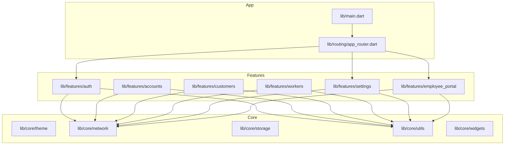
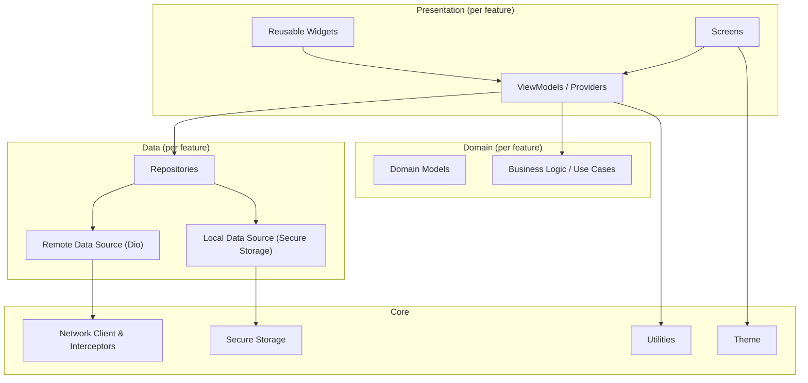
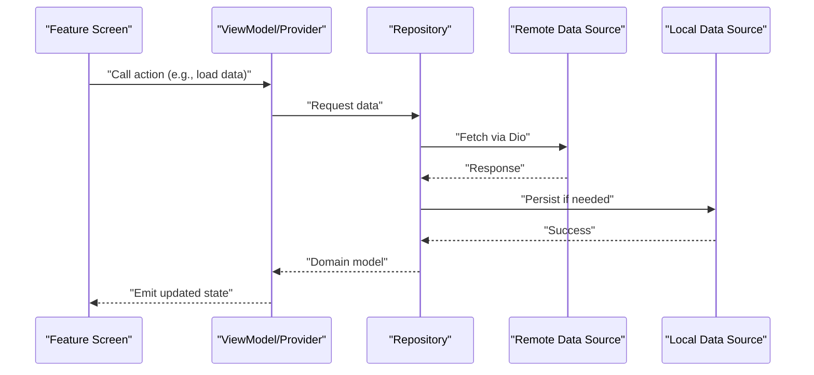
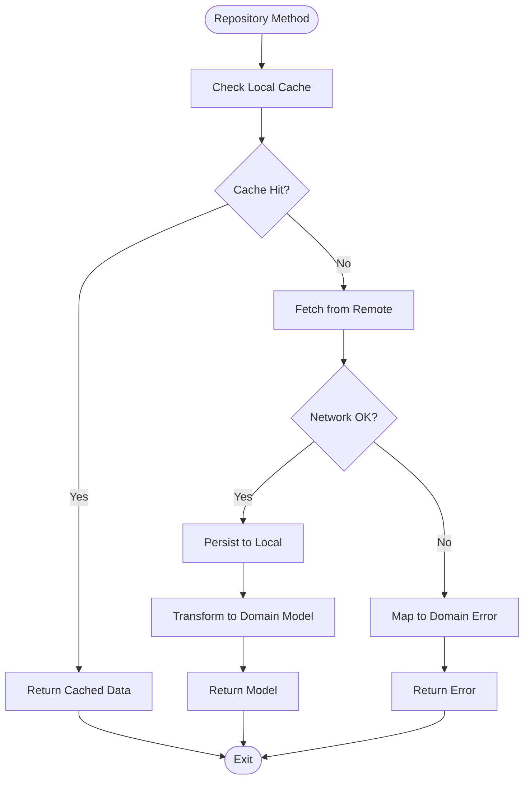
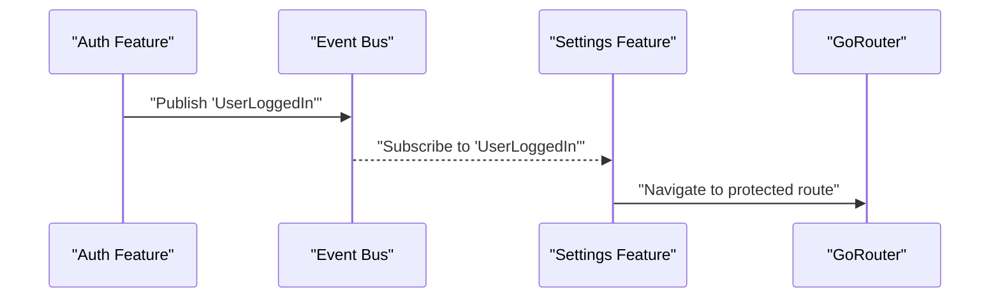
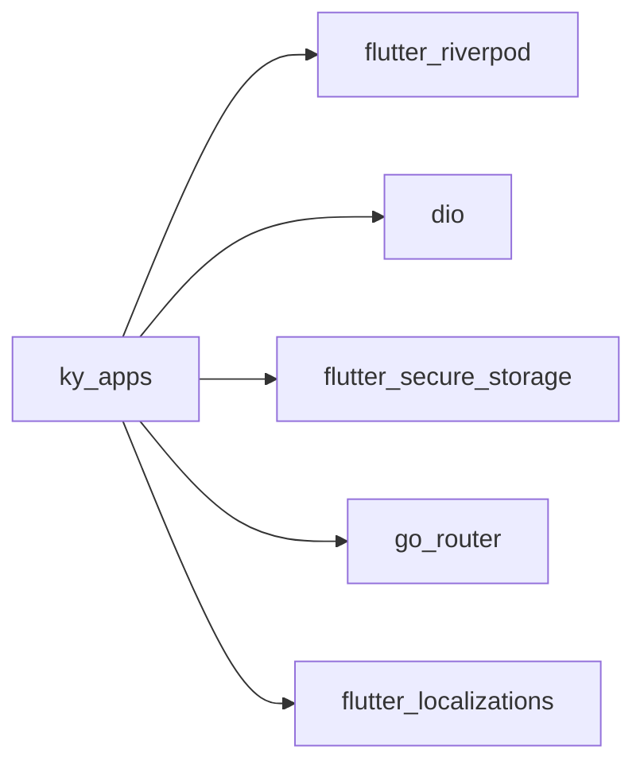

# Feature Module Organization

<cite>
**Referenced Files in This Document**
- [main.dart](file://lib/main.dart)
- [app_router.dart](file://lib/routing/app_router.dart)
- [pubspec.yaml](file://pubspec.yaml)
</cite>

## Table of Contents
1. [Introduction](#introduction)
2. [Project Structure](#project-structure)
3. [Core Components](#core-components)
4. [Architecture Overview](#architecture-overview)
5. [Detailed Component Analysis](#detailed-component-analysis)
6. [Dependency Analysis](#dependency-analysis)
7. [Performance Considerations](#performance-considerations)
8. [Troubleshooting Guide](#troubleshooting-guide)
9. [Conclusion](#conclusion)

## Introduction
This document explains the feature-based architecture used by the application, where each business domain is encapsulated in its own module. It describes the consistent folder structure within features (presentation, domain, data), how this organization improves maintainability and testability, and how features communicate via an event bus and shared state management. It also details the presentation layer (screens, widgets, viewmodels using MVVM), the domain layer (business logic and models), and the data layer (repositories and data sources). Guidance is included for adding new features, sharing utilities across features, managing cross-cutting concerns, ensuring feature isolation, dependency management, and testing strategies per feature.

## Project Structure
The application follows a clear separation of concerns:
- lib/core: Shared infrastructure such as theme, network, storage, constants, utils, and reusable widgets.
- lib/features: Feature modules grouped by business domain. Each feature contains presentation, data, and optionally domain layers.
- lib/routing: Centralized routing configuration that wires feature screens into the app.
- lib/main.dart: Application entry point that initializes providers and configures global settings like localization and theming.

**Diagram sources**
- [main.dart:1-47](file://lib/main.dart#L1-L47)
- [app_router.dart:1-37](file://lib/routing/app_router.dart#L1-L37)

**Section sources**
- [main.dart:1-47](file://lib/main.dart#L1-L47)
- [app_router.dart:1-37](file://lib/routing/app_router.dart#L1-L37)

## Core Components
- Application bootstrap and provider scope: The app initializes Flutter bindings, wraps the app with a provider scope, and configures MaterialApp with router, theme, and localization.
- Routing: A centralized GoRouter defines top-level routes and delegates to feature screens.
- Dependencies: The project uses Riverpod for state management, Dio for networking, secure storage, and localization support.

Key responsibilities:
- main.dart: Initializes ProviderScope, sets up theme and localization, and attaches the router.
- app_router.dart: Declares routes and maps paths to feature screens.
- pubspec.yaml: Declares runtime dependencies and dev dependencies.

**Section sources**
- [main.dart:7-46](file://lib/main.dart#L7-L46)
- [app_router.dart:10-35](file://lib/routing/app_router.dart#L10-L35)
- [pubspec.yaml:30-46](file://pubspec.yaml#L30-L46)

## Architecture Overview
The system follows a layered, feature-based architecture:
- Presentation Layer (per feature): Screens, widgets, and viewmodels/providers implementing MVVM.
- Domain Layer (per feature): Business rules, use cases, and domain models.
- Data Layer (per feature): Repositories and data sources (remote via Dio, local via secure storage or other mechanisms).
- Cross-cutting concerns: Network client, interceptors, storage, theme, and utilities are centralized under core.

[No sources needed since this diagram shows conceptual workflow, not actual code structure]

## Detailed Component Analysis

### Feature Folder Structure and Responsibilities
Each feature directory follows a consistent layout:
- presentation/: UI components including screens, reusable widgets, and viewmodels/providers.
- data/: Data access layer including repositories and data sources; may include models if they are data-centric.
- domain/: Business logic and domain models (when present).

Benefits:
- Encapsulation: Each feature owns its UI, logic, and data, reducing coupling.
- Testability: Isolated units can be tested independently with mocks for repositories and providers.
- Maintainability: Changes are localized to a single feature without affecting unrelated parts.

Example feature directories:
- lib/features/auth
- lib/features/accounts
- lib/features/customers
- lib/features/workers
- lib/features/settings
- lib/features/employee_portal

**Section sources**
- [app_router.dart:2-6](file://lib/routing/app_router.dart#L2-L6)

### Presentation Layer (MVVM)
- Screens: Top-level UI for each feature route (e.g., splash, login, employee main layout, settings screens).
- Widgets: Reusable UI components scoped to a feature.
- ViewModels/Providers: State holders using Riverpod providers that expose state and actions to the UI.

Communication patterns:
- UI binds to providers for state and triggers actions.
- Providers call repositories to fetch/update data.
- Providers may emit events through an event bus for cross-feature communication.

[No sources needed since this diagram shows conceptual workflow, not actual code structure]

### Domain Layer
- Models: Pure Dart classes representing business entities.
- Use Cases: Orchestrate business operations, combining multiple repositories and enforcing business rules.
- Validation and transformation: Convert between data models and domain models.

Best practices:
- Keep domain models free of framework-specific code.
- Expose use cases with clear inputs/outputs to simplify testing.

[No sources needed since this section doesn't analyze specific files]

### Data Layer
- Repositories: Abstract interfaces exposed to domain/presentation; implementations handle remote/local data.
- Data Sources:
  - Remote: HTTP calls via Dio with interceptors for auth and error handling.
  - Local: Secure storage for sensitive data.
- Error mapping: Repositories map low-level errors to domain exceptions.

[No sources needed since this diagram shows conceptual workflow, not actual code structure]

### Communication Between Features
- Event Bus: Publishes domain events (e.g., user logged in, settings changed) that other features can subscribe to.
- Shared State: Global state managed via Riverpod providers for app-wide concerns (e.g., authentication status, locale).
- Routing: Centralized router coordinates navigation between features based on state changes.

[No sources needed since this diagram shows conceptual workflow, not actual code structure]

### Adding a New Feature
Steps:
1. Create a new feature directory under lib/features with presentation/, data/, and domain/ subfolders.
2. Implement screens, widgets, and viewmodels/providers in presentation/.
3. Define domain models and use cases in domain/.
4. Implement repositories and data sources in data/.
5. Register routes in the central router to navigate to the new feature’s screens.
6. Wire any necessary providers at the app level or feature level.

Guidelines:
- Keep feature boundaries strict; avoid importing sibling features directly.
- Use core utilities and services for shared functionality.
- Provide unit tests for domain/use cases and widget tests for screens.

[No sources needed since this section doesn't analyze specific files]

### Sharing Utilities Across Features
- Place common helpers, formatters, validators, and constants in lib/core/utils and lib/core/constants.
- Expose reusable UI components in lib/core/widgets.
- Centralize networking and storage in lib/core/network and lib/core/storage.

Benefits:
- Single source of truth for shared logic.
- Reduced duplication and easier maintenance.

[No sources needed since this section doesn't analyze specific files]

### Managing Cross-Cutting Concerns
- Authentication: Handled via interceptors and secure storage; state exposed through providers.
- Localization: Configured in the app entry point with supported locales and RTL support.
- Theming: Centralized theme definitions applied globally.

[No sources needed since this section doesn't analyze specific files]

### Feature Isolation and Dependency Management
- Enforce one-way dependencies: presentation depends on domain and data; domain depends only on core; data depends on core.
- Avoid circular imports by extracting shared abstractions into core.
- Use dependency injection (Riverpod) to provide repositories and services to features.

[No sources needed since this section doesn't analyze specific files]

### Testing Strategies
- Unit Tests:
  - Domain: Test use cases and business rules with pure inputs/outputs.
  - Data: Mock repositories and data sources; verify error mapping and caching behavior.
- Widget Tests:
  - Test screens and widgets in isolation; mock providers and repositories.
- Integration Tests:
  - Validate end-to-end flows such as login and navigation to protected routes.

[No sources needed since this section doesn't analyze specific files]

## Dependency Analysis
The application’s runtime dependencies include:
- flutter_riverpod: State management and dependency injection.
- dio: HTTP client for remote data access.
- flutter_secure_storage: Secure persistence for sensitive data.
- go_router: Declarative routing.
- flutter_localizations: Internationalization support.

**Diagram sources**
- [pubspec.yaml:30-46](file://pubspec.yaml#L30-L46)

**Section sources**
- [pubspec.yaml:30-46](file://pubspec.yaml#L30-L46)

## Performance Considerations
- Lazy loading: Defer heavy feature initialization until routes are accessed.
- Provider scoping: Scope providers to minimize rebuilds and memory usage.
- Network efficiency: Use caching, pagination, and request deduplication via repositories.
- UI optimization: Minimize widget rebuilds by separating stateful logic into providers and keeping widgets stateless where possible.

[No sources needed since this section provides general guidance]

## Troubleshooting Guide
Common issues and resolutions:
- Navigation failures: Ensure routes are registered in the central router and that required parameters are passed correctly.
- State not updating: Verify provider scopes and ensure state mutations trigger rebuilds.
- Network errors: Check interceptors for proper error handling and token refresh logic.
- Localization problems: Confirm supported locales and correct delegate registration in the app entry point.

**Section sources**
- [main.dart:17-44](file://lib/main.dart#L17-L44)
- [app_router.dart:10-35](file://lib/routing/app_router.dart#L10-L35)

## Conclusion
The feature-based architecture organizes the application into cohesive, testable, and maintainable modules. By consistently applying presentation/domain/data layers within each feature and centralizing cross-cutting concerns, the codebase remains scalable and easy to evolve. Clear communication patterns via event buses and shared state, combined with robust testing strategies, ensure reliability and developer productivity.

[No sources needed since this section summarizes without analyzing specific files]