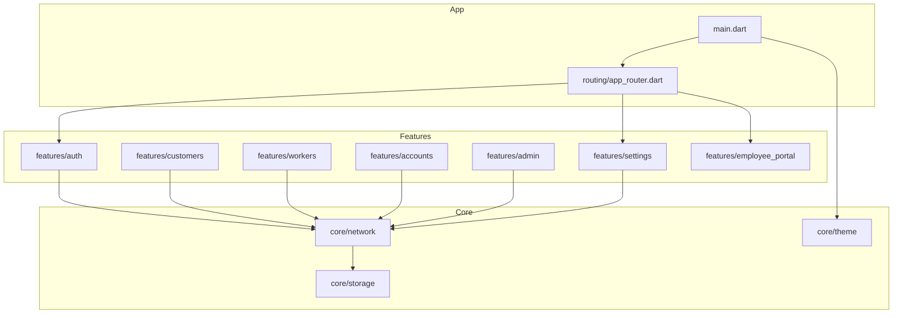
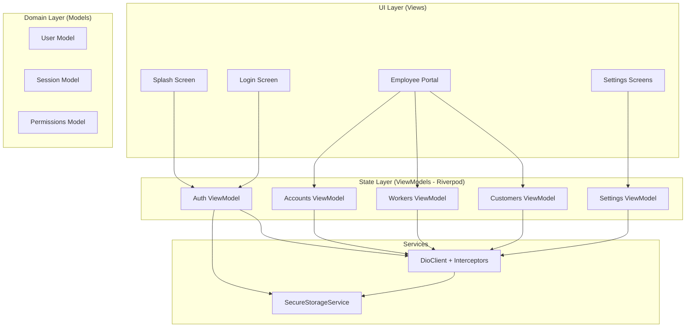
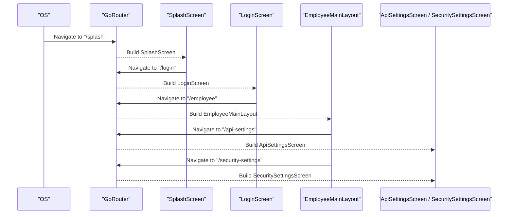
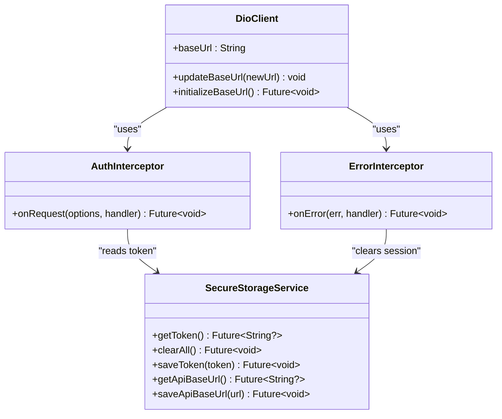
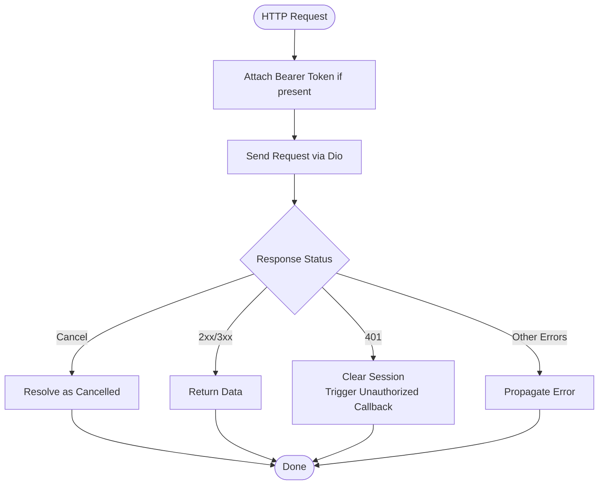
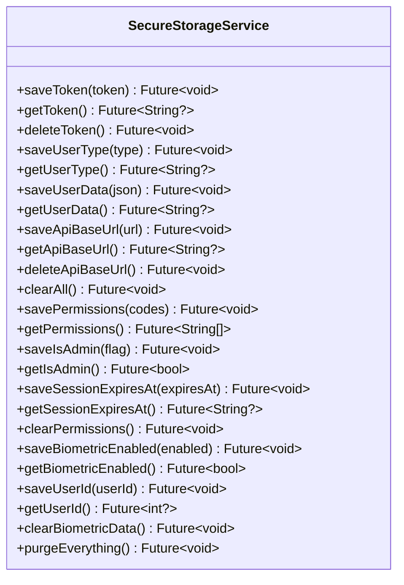
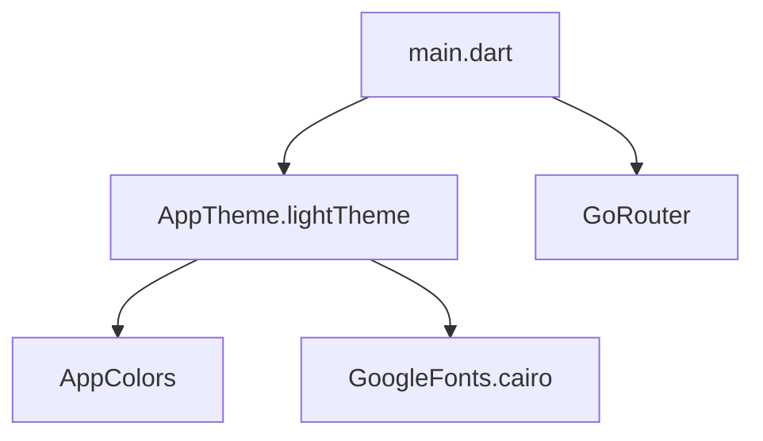
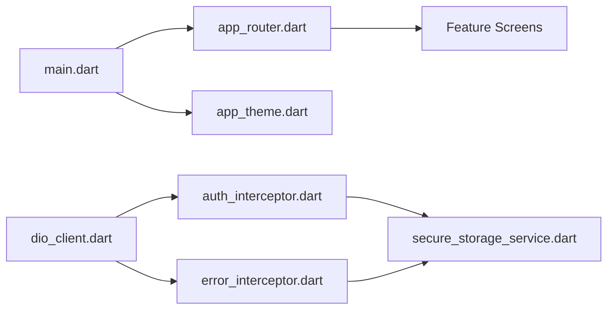

# Frontend Architecture (Flutter)

<cite>
**Referenced Files in This Document**
- [main.dart](file://lib/main.dart)
- [app_router.dart](file://lib/routing/app_router.dart)
- [dio_client.dart](file://lib/core/network/dio_client.dart)
- [auth_interceptor.dart](file://lib/core/network/auth_interceptor.dart)
- [error_interceptor.dart](file://lib/core/network/error_interceptor.dart)
- [secure_storage_service.dart](file://lib/core/storage/secure_storage_service.dart)
- [app_theme.dart](file://lib/core/theme/app_theme.dart)
- [pubspec.yaml](file://pubspec.yaml)
</cite>

## Table of Contents
1. [Introduction](#introduction)
2. [Project Structure](#project-structure)
3. [Core Components](#core-components)
4. [Architecture Overview](#architecture-overview)
5. [Detailed Component Analysis](#detailed-component-analysis)
6. [Dependency Analysis](#dependency-analysis)
7. [Performance Considerations](#performance-considerations)
8. [Troubleshooting Guide](#troubleshooting-guide)
9. [Conclusion](#conclusion)

## Introduction
This document describes the Flutter frontend architecture for a multi-platform application targeting Android, iOS, Windows, and Web. The app follows an MVVM pattern with clear separation between models, views, and viewmodels, uses Riverpod for state management, organizes features by business domain, implements declarative routing with GoRouter, builds a robust network layer with Dio and interceptors, and secures sensitive data via flutter_secure_storage. It also covers the theme system, responsive design patterns, and cross-platform considerations.

## Project Structure
The codebase is organized into:
- lib/main.dart: Application bootstrap, localization, theming, and router integration.
- lib/routing: Declarative routes using GoRouter.
- lib/features: Feature-based modules (auth, customers, workers, accounts, admin, settings, employee_portal).
- lib/core: Cross-cutting concerns including network, storage, theme, constants, utils, and shared widgets.

**Diagram sources**
- [main.dart:1-47](file://lib/main.dart#L1-L47)
- [app_router.dart:1-37](file://lib/routing/app_router.dart#L1-L37)

**Section sources**
- [main.dart:1-47](file://lib/main.dart#L1-L47)
- [app_router.dart:1-37](file://lib/routing/app_router.dart#L1-L37)

## Core Components
- State Management: Riverpod is used to manage UI state across features.
- Routing: GoRouter provides declarative navigation and deep linking.
- Network Layer: Dio client configured with interceptors for authentication, error handling, and logging.
- Secure Storage: Encrypted storage for tokens, user data, API base URL, biometric flags, and IBAC-related permissions.
- Theme System: Centralized Material 3 theme with Arabic typography and consistent input/button/card styles.

Key responsibilities:
- main.dart initializes Flutter bindings, wraps the app with ProviderScope, configures localization and RTL, applies the theme, and wires up the router.
- app_router.dart defines top-level routes and screens for splash, login, employee portal, and settings.
- dio_client.dart centralizes HTTP configuration, base URL management, and interceptor wiring.
- auth_interceptor.dart injects Bearer tokens from secure storage into outgoing requests.
- error_interceptor.dart handles cancellation gracefully, clears session on 401, and triggers unauthorized callbacks.
- secure_storage_service.dart encapsulates all persistent sensitive data operations.
- app_theme.dart defines global colors, typography, and component themes.

**Section sources**
- [main.dart:1-47](file://lib/main.dart#L1-L47)
- [app_router.dart:1-37](file://lib/routing/app_router.dart#L1-L37)
- [dio_client.dart:1-60](file://lib/core/network/dio_client.dart#L1-L60)
- [auth_interceptor.dart:1-24](file://lib/core/network/auth_interceptor.dart#L1-L24)
- [error_interceptor.dart:1-39](file://lib/core/network/error_interceptor.dart#L1-L39)
- [secure_storage_service.dart:1-206](file://lib/core/storage/secure_storage_service.dart#L1-L206)
- [app_theme.dart:1-88](file://lib/core/theme/app_theme.dart#L1-L88)

## Architecture Overview
The application follows MVVM:
- Models: Domain entities and DTOs (not shown here).
- ViewModels: Riverpod providers that encapsulate state and business logic.
- Views: Feature-specific screens and widgets that consume providers.

Cross-cutting services:
- NetworkService built on DioClient with interceptors.
- SecureStorageService for encrypted persistence.
- AppTheme for consistent UI.

[No sources needed since this diagram shows conceptual workflow, not actual code structure]

## Detailed Component Analysis

### MVVM with Riverpod
- Views subscribe to Riverpod providers to react to state changes.
- ViewModels encapsulate async operations, transform server responses into UI-friendly states, and expose streams or values.
- Models represent domain data and are immutable where possible.

Benefits:
- Clear separation of concerns.
- Testable viewmodels independent of UI.
- Reactive UI updates without manual state propagation.

[No sources needed since this section doesn't analyze specific source files]

### Feature-Based Organization
Business domains are isolated into feature folders:
- auth: Authentication flows and related screens.
- customers: Customer management screens and logic.
- workers: Worker management screens and logic.
- accounts: Accounting and financial screens.
- admin: Administrative tools and dashboards.
- settings: Configuration screens including API and security settings.
- employee_portal: Employee-facing layout and navigation.

Each feature typically contains presentation (screens/widgets), domain (models/use cases), and infrastructure (repositories/services) layers.

[No sources needed since this section doesn't analyze specific source files]

### Navigation with GoRouter
GoRouter provides:
- Declarative route definitions.
- Deep linking support via path-based routes.
- Centralized navigation logic.

Current routes include splash, login, employee portal, API settings, and security settings.

**Diagram sources**
- [app_router.dart:10-35](file://lib/routing/app_router.dart#L10-L35)

**Section sources**
- [app_router.dart:1-37](file://lib/routing/app_router.dart#L1-L37)

### Network Layer with Dio and Interceptors
DioClient centralizes HTTP configuration and integrates interceptors:
- AuthInterceptor attaches Authorization headers using stored tokens.
- ErrorInterceptor handles cancellations and 401 Unauthorized by clearing session and invoking an unauthorized callback.
- Logging is enabled for request/response bodies and errors.

**Diagram sources**
- [dio_client.dart:9-59](file://lib/core/network/dio_client.dart#L9-L59)
- [auth_interceptor.dart:6-23](file://lib/core/network/auth_interceptor.dart#L6-L23)
- [error_interceptor.dart:6-38](file://lib/core/network/error_interceptor.dart#L6-L38)
- [secure_storage_service.dart:32-95](file://lib/core/storage/secure_storage_service.dart#L32-L95)

**Diagram sources**
- [auth_interceptor.dart:11-22](file://lib/core/network/auth_interceptor.dart#L11-L22)
- [error_interceptor.dart:12-37](file://lib/core/network/error_interceptor.dart#L12-L37)

**Section sources**
- [dio_client.dart:1-60](file://lib/core/network/dio_client.dart#L1-L60)
- [auth_interceptor.dart:1-24](file://lib/core/network/auth_interceptor.dart#L1-L24)
- [error_interceptor.dart:1-39](file://lib/core/network/error_interceptor.dart#L1-L39)

### Secure Storage Implementation
SecureStorageService manages:
- Authentication token and user type/data.
- API base URL persistence.
- Biometric authentication state and associated user ID.
- IBAC-related permissions, admin flag, and session expiry.

Operations include save/read/delete/clear/purge, with safe parsing for permissions and admin flag.

**Diagram sources**
- [secure_storage_service.dart:7-204](file://lib/core/storage/secure_storage_service.dart#L7-L204)

**Section sources**
- [secure_storage_service.dart:1-206](file://lib/core/storage/secure_storage_service.dart#L1-L206)

### Theme System and Responsive Design
AppTheme defines:
- Material 3 theme with Cairo Arabic font.
- Consistent color scheme, text styles, input decoration, elevated button, and card themes.
- Integration with MaterialApp for global styling.

Responsive behavior:
- Text scaling is clamped to avoid overflow on small screens.
- Layout adapts across devices through standard Flutter responsive techniques within feature screens.

**Diagram sources**
- [main.dart:18-44](file://lib/main.dart#L18-L44)
- [app_theme.dart:7-86](file://lib/core/theme/app_theme.dart#L7-L86)

**Section sources**
- [main.dart:1-47](file://lib/main.dart#L1-L47)
- [app_theme.dart:1-88](file://lib/core/theme/app_theme.dart#L1-L88)

### Cross-Platform Considerations
- Android/iOS/Web/Windows targets are supported by Flutter tooling.
- Platform-specific secure storage options are configured for Android and iOS.
- Localization supports Arabic and English with RTL direction.
- Dependencies such as Dio, GoRouter, flutter_secure_storage, local_auth, and google_fonts enable cross-platform capabilities.

**Section sources**
- [pubspec.yaml:30-47](file://pubspec.yaml#L30-L47)
- [secure_storage_service.dart:10-17](file://lib/core/storage/secure_storage_service.dart#L10-L17)
- [main.dart:24-31](file://lib/main.dart#L24-L31)

## Dependency Analysis
High-level dependencies:
- main.dart depends on Riverpod, GoRouter, and AppTheme.
- app_router.dart depends on feature screens.
- dio_client.dart depends on SecureStorageService and interceptors.
- auth_interceptor.dart and error_interceptor.dart depend on SecureStorageService.

**Diagram sources**
- [main.dart:1-47](file://lib/main.dart#L1-L47)
- [app_router.dart:1-37](file://lib/routing/app_router.dart#L1-L37)
- [dio_client.dart:1-60](file://lib/core/network/dio_client.dart#L1-L60)
- [auth_interceptor.dart:1-24](file://lib/core/network/auth_interceptor.dart#L1-L24)
- [error_interceptor.dart:1-39](file://lib/core/network/error_interceptor.dart#L1-L39)
- [secure_storage_service.dart:1-206](file://lib/core/storage/secure_storage_service.dart#L1-L206)

**Section sources**
- [main.dart:1-47](file://lib/main.dart#L1-L47)
- [app_router.dart:1-37](file://lib/routing/app_router.dart#L1-L37)
- [dio_client.dart:1-60](file://lib/core/network/dio_client.dart#L1-L60)

## Performance Considerations
- Use Riverpod providers efficiently; prefer scoped providers for feature-specific state and singletons for shared services.
- Avoid rebuilding large widget trees by isolating state changes to smaller providers.
- Leverage Dio’s interceptors for centralized retry/backoff logic if required.
- Cache frequently accessed data locally when appropriate, but ensure consistency with server state.
- Minimize heavy computations in the UI thread; offload to background tasks where possible.

[No sources needed since this section provides general guidance]

## Troubleshooting Guide
Common issues and resolutions:
- Unauthorized access after token expiration:
  - The error interceptor clears session data and invokes an unauthorized callback. Ensure your app navigates to login and re-authenticates.
- Cancellation of network requests:
  - Cancellations are resolved gracefully with a standardized response shape to prevent unhandled exceptions.
- Base URL misconfiguration:
  - Verify the saved API base URL via secure storage and update it through settings if necessary.
- Biometric login not working:
  - Check biometric-enabled flag and stored user ID; ensure device supports biometrics and credentials are enrolled.

**Section sources**
- [error_interceptor.dart:12-37](file://lib/core/network/error_interceptor.dart#L12-L37)
- [secure_storage_service.dart:87-95](file://lib/core/storage/secure_storage_service.dart#L87-L95)
- [secure_storage_service.dart:167-198](file://lib/core/storage/secure_storage_service.dart#L167-L198)

## Conclusion
The Flutter frontend employs a clean MVVM architecture with Riverpod for state management, feature-based organization for maintainability, GoRouter for declarative navigation, a robust Dio-based network layer with interceptors, and secure storage for sensitive data. The centralized theme system ensures consistent UI across platforms, while responsive design and localization provide a polished experience on Android, iOS, Windows, and Web.

[No sources needed since this section summarizes without analyzing specific files]