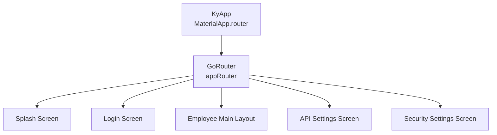
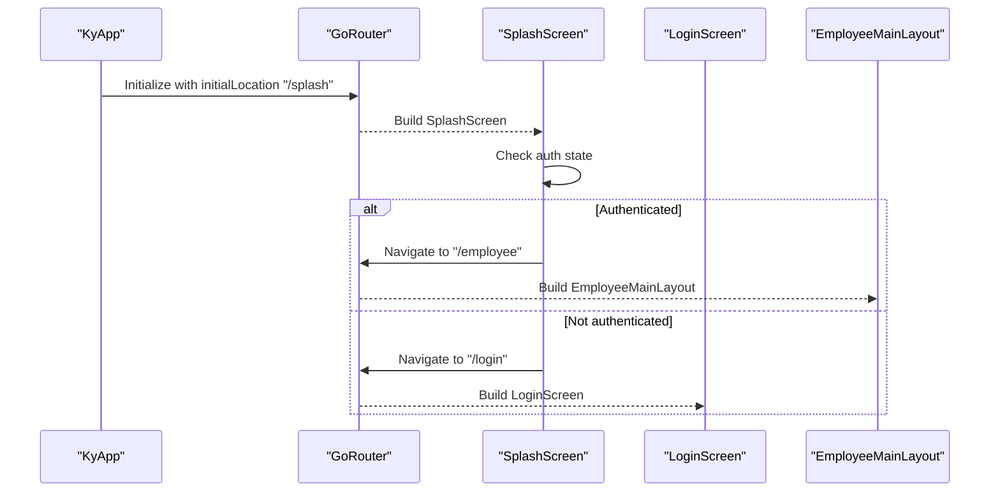
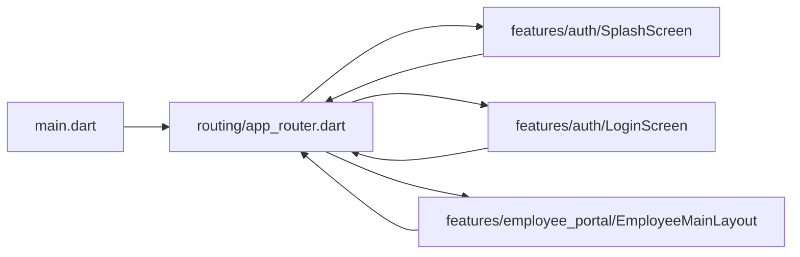

# Navigation System with GoRouter

<cite>
**Referenced Files in This Document**
- [main.dart](file://lib/main.dart)
- [app_router.dart](file://lib/routing/app_router.dart)
- [splash_screen.dart](file://lib/features/auth/presentation/screens/splash_screen.dart)
- [login_screen.dart](file://lib/features/auth/presentation/screens/login_screen.dart)
- [employee_main_layout.dart](file://lib/features/employee_portal/presentation/screens/employee_main_layout.dart)
</cite>

## Table of Contents
1. [Introduction](#introduction)
2. [Project Structure](#project-structure)
3. [Core Components](#core-components)
4. [Architecture Overview](#architecture-overview)
5. [Detailed Component Analysis](#detailed-component-analysis)
6. [Dependency Analysis](#dependency-analysis)
7. [Performance Considerations](#performance-considerations)
8. [Troubleshooting Guide](#troubleshooting-guide)
9. [Conclusion](#conclusion)

## Introduction
This document explains the navigation system implemented with GoRouter in the application. It covers declarative routing configuration, route guards and redirects for authentication-based navigation, parameter passing patterns, query parameters, state preservation during navigation, programmatic navigation examples, responsive navigation across screen sizes, platform-specific behaviors, and integration with Flutter’s Material Design navigation patterns and custom transitions.

The implementation centers on a single GoRouter instance that declares top-level routes and is integrated into MaterialApp.router. Authentication-driven navigation is handled by screens that read auth state and navigate programmatically using GoRouter’s context methods. The employee portal layout adapts between mobile and desktop/tablet layouts while preserving section state via IndexedStack.

## Project Structure
At a high level:
- The app entry point configures MaterialApp.router and wires it to the central GoRouter instance.
- The router defines top-level routes for splash, login, employee portal, API settings, and security settings.
- Screens use GoRouter’s context methods (go, push) for navigation.
- The employee portal layout provides responsive UI and maintains active section state locally.

**Diagram sources**
- [main.dart:17-44](file://lib/main.dart#L17-L44)
- [app_router.dart:10-36](file://lib/routing/app_router.dart#L10-L36)

**Section sources**
- [main.dart:1-47](file://lib/main.dart#L1-L47)
- [app_router.dart:1-37](file://lib/routing/app_router.dart#L1-L37)

## Core Components
- Central router configuration: Declares initial location and route definitions for key screens.
- Splash screen: Checks authentication state and navigates to either login or employee portal.
- Login screen: Handles user login and biometric login, then navigates based on user type.
- Employee main layout: Responsive layout with drawer/sidebar and bottom navigation; manages section selection and logout flow.

Key responsibilities:
- Declarative routes: Defined in the router file.
- Programmatic navigation: Performed from screens using GoRouter context methods.
- State-aware navigation: Auth state drives where users are sent after login or splash checks.
- Responsive navigation: Employee portal adapts to different screen sizes.

**Section sources**
- [app_router.dart:10-36](file://lib/routing/app_router.dart#L10-L36)
- [splash_screen.dart:23-33](file://lib/features/auth/presentation/screens/splash_screen.dart#L23-L33)
- [login_screen.dart:32-72](file://lib/features/auth/presentation/screens/login_screen.dart#L32-L72)
- [employee_main_layout.dart:78-127](file://lib/features/employee_portal/presentation/screens/employee_main_layout.dart#L78-L127)

## Architecture Overview
The navigation architecture integrates GoRouter with the app shell and feature screens:

**Diagram sources**
- [main.dart:17-44](file://lib/main.dart#L17-L44)
- [app_router.dart:10-36](file://lib/routing/app_router.dart#L10-L36)
- [splash_screen.dart:23-33](file://lib/features/auth/presentation/screens/splash_screen.dart#L23-L33)

## Detailed Component Analysis

### Declarative Routing Configuration (app_router.dart)
- Initial location is set to "/splash".
- Routes defined:
  - "/splash" -> SplashScreen
  - "/login" -> LoginScreen
  - "/employee" -> EmployeeMainLayout
  - "/api-settings" -> ApiSettingsScreen
  - "/security-settings" -> SecuritySettingsScreen

Notes:
- All routes are top-level GoRoute entries without nested sub-routes in this file.
- Deep linking is supported by GoRouter through path-based URLs. Query parameters can be appended to these paths when navigating programmatically.

**Section sources**
- [app_router.dart:10-36](file://lib/routing/app_router.dart#L10-L36)

### Route Guards and Redirects (Authentication-Based Navigation)
Current approach:
- No global redirect or guard function is configured in the router.
- Authentication checks occur within screens:
  - SplashScreen reads auth state and navigates to "/employee" if authenticated, otherwise "/login".
  - LoginScreen performs login/biometric login and navigates to "/employee" upon success for employee users.

Implications:
- Protection is screen-level rather than router-level.
- To enforce consistent protection, consider adding a redirect function in GoRouter that checks auth state before allowing access to protected routes like "/employee".

Example pattern (conceptual):
- Use GoRouter's redirect property to check authentication and redirect unauthenticated users to "/login" when attempting to access protected routes.

**Section sources**
- [splash_screen.dart:23-33](file://lib/features/auth/presentation/screens/splash_screen.dart#L23-L33)
- [login_screen.dart:32-72](file://lib/features/auth/presentation/screens/login_screen.dart#L32-L72)

### Parameter Passing Between Screens
Patterns used:
- Named routes are used throughout (e.g., "/employee", "/login").
- For passing data between screens, GoRouter supports:
  - Path parameters: Define dynamic segments in route paths (e.g., "/employee/:id") and access via state.params.
  - Query parameters: Append key-value pairs to URLs (e.g., "/employee?tab=settings") and access via state.queryParameters.
  - Extra data: Pass arbitrary objects via GoRouter’s extra parameter when navigating.

Recommendations:
- Prefer query parameters for filters and search terms.
- Use path parameters for resource identifiers.
- Use extra for complex objects not suitable for URL serialization.

Note: These patterns are recommended for extending the current implementation; they are not explicitly present in the referenced files.

### State Preservation During Navigation
- EmployeeMainLayout uses IndexedStack to preserve the state of visible sections while switching between them.
- Section selection is tracked by a string identifier (_currentSectionId), ensuring resilience against permission changes mid-session.

Benefits:
- Avoids reinitializing heavy widgets when switching sections.
- Maintains scroll position and form state within each section.

**Section sources**
- [employee_main_layout.dart:217-220](file://lib/features/employee_portal/presentation/screens/employee_main_layout.dart#L217-L220)
- [employee_main_layout.dart:349-356](file://lib/features/employee_portal/presentation/screens/employee_main_layout.dart#L349-L356)
- [employee_main_layout.dart:27-32](file://lib/features/employee_portal/presentation/screens/employee_main_layout.dart#L27-L32)

### Programmatic Navigation Examples
Common operations:
- Replace current route: context.go("/employee")
- Push new route onto stack: context.push("/api-settings")
- Pop back: context.pop()

Usage in code:
- SplashScreen navigates to "/employee" or "/login" based on auth state.
- LoginScreen navigates to "/employee" after successful login for employee users.
- EmployeeMainLayout navigates to "/login" on logout.

**Section sources**
- [splash_screen.dart:23-33](file://lib/features/auth/presentation/screens/splash_screen.dart#L23-L33)
- [login_screen.dart:32-72](file://lib/features/auth/presentation/screens/login_screen.dart#L32-L72)
- [employee_main_layout.dart:34-61](file://lib/features/employee_portal/presentation/screens/employee_main_layout.dart#L34-L61)

### Dynamic Routing Patterns
To support dynamic routes:
- Define path parameters in GoRoute paths (e.g., "/employee/:sectionId").
- Access parameters via state.params in builders or inside screens.
- Combine with query parameters for filtering (e.g., "/employee?filter=active").

Considerations:
- Ensure all dynamic segments have sensible defaults or validation.
- Handle missing or invalid parameters gracefully.

Note: These patterns are recommended for extending the current implementation; they are not explicitly present in the referenced files.

### Responsive Navigation for Different Screen Sizes
EmployeeMainLayout adapts to screen size:
- Mobile: Uses Drawer for navigation and optional bottom navigation bar for quick access to selected sections.
- Tablet/Desktop: Uses a persistent sidebar/drawer alongside a top bar with status indicators and actions.

State management:
- Section selection is maintained via IndexedStack to preserve content state.
- Visibility of sections is derived from permissions, ensuring only allowed sections are shown.

**Section sources**
- [employee_main_layout.dart:78-127](file://lib/features/employee_portal/presentation/screens/employee_main_layout.dart#L78-L127)
- [employee_main_layout.dart:129-248](file://lib/features/employee_portal/presentation/screens/employee_main_layout.dart#L129-L248)
- [employee_main_layout.dart:251-362](file://lib/features/employee_portal/presentation/screens/employee_main_layout.dart#L251-L362)

### Platform-Specific Behaviors
- Biometric login is conditionally shown based on device capability and enrollment status.
- Navigation behavior remains consistent across platforms due to GoRouter’s abstraction over platform navigation stacks.

**Section sources**
- [login_screen.dart:55-72](file://lib/features/auth/presentation/screens/login_screen.dart#L55-L72)

### Integration with Material Design Navigation Patterns
- AppBar, Drawer, BottomNavigationBar, and Scaffold are used to align with Material guidelines.
- GoRouter integrates seamlessly with MaterialApp.router, enabling declarative routing while retaining Material components.

Custom transition animations:
- Not explicitly configured in the referenced files.
- Can be added via GoRouter’s pageBuilder and custom TransitionBuilder or by wrapping routes with AnimatedPageRoute.

**Section sources**
- [employee_main_layout.dart:129-248](file://lib/features/employee_portal/presentation/screens/employee_main_layout.dart#L129-L248)
- [employee_main_layout.dart:251-362](file://lib/features/employee_portal/presentation/screens/employee_main_layout.dart#L251-L362)

## Dependency Analysis
The navigation system has clear dependencies:
- KyApp depends on GoRouter configuration.
- Screens depend on GoRouter context for navigation.
- EmployeeMainLayout depends on responsive utilities and auth state to determine visibility and selection.

**Diagram sources**
- [main.dart:17-44](file://lib/main.dart#L17-L44)
- [app_router.dart:10-36](file://lib/routing/app_router.dart#L10-L36)
- [splash_screen.dart:23-33](file://lib/features/auth/presentation/screens/splash_screen.dart#L23-L33)
- [login_screen.dart:32-72](file://lib/features/auth/presentation/screens/login_screen.dart#L32-L72)
- [employee_main_layout.dart:34-61](file://lib/features/employee_portal/presentation/screens/employee_main_layout.dart#L34-L61)

**Section sources**
- [main.dart:17-44](file://lib/main.dart#L17-L44)
- [app_router.dart:10-36](file://lib/routing/app_router.dart#L10-L36)

## Performance Considerations
- IndexedStack in EmployeeMainLayout preserves widget trees, reducing rebuild costs when switching sections.
- Avoid unnecessary pushes; prefer go for replacing routes when appropriate to keep the navigation stack lean.
- Minimize heavy computations in route builders; defer expensive work until after navigation completes.

[No sources needed since this section provides general guidance]

## Troubleshooting Guide
Common issues and resolutions:
- Unprotected routes: If accessing "/employee" directly without authentication, ensure a global redirect is configured or add guards in screens.
- Missing parameters: When using dynamic routes, validate path and query parameters to prevent runtime errors.
- State loss on navigation: Use IndexedStack or persist state externally (e.g., Riverpod providers) to maintain state across navigations.
- Biometric login not showing: Verify device capability and enrollment; handle unsupported cases gracefully.

**Section sources**
- [splash_screen.dart:23-33](file://lib/features/auth/presentation/screens/splash_screen.dart#L23-L33)
- [login_screen.dart:55-72](file://lib/features/auth/presentation/screens/login_screen.dart#L55-L72)
- [employee_main_layout.dart:217-220](file://lib/features/employee_portal/presentation/screens/employee_main_layout.dart#L217-L220)

## Conclusion
The navigation system leverages GoRouter for declarative routing and integrates with Material Design components for a consistent user experience. Authentication-driven navigation is currently implemented at the screen level, with opportunities to enhance security via global redirects. The employee portal demonstrates responsive navigation and state preservation strategies. Extending the system with dynamic routes, query parameters, and custom transitions will further improve flexibility and user experience.

[No sources needed since this section summarizes without analyzing specific files]