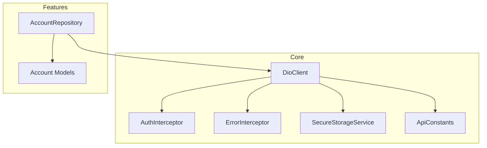
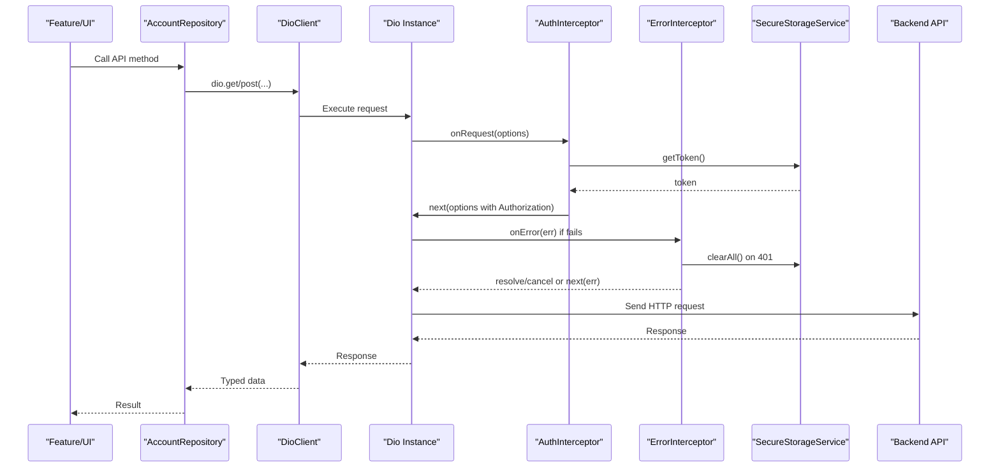
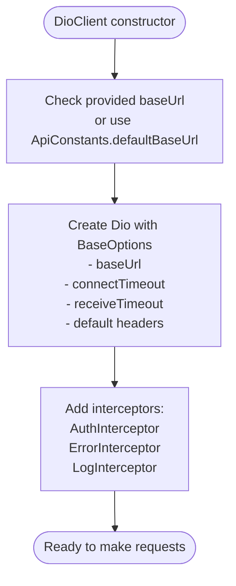
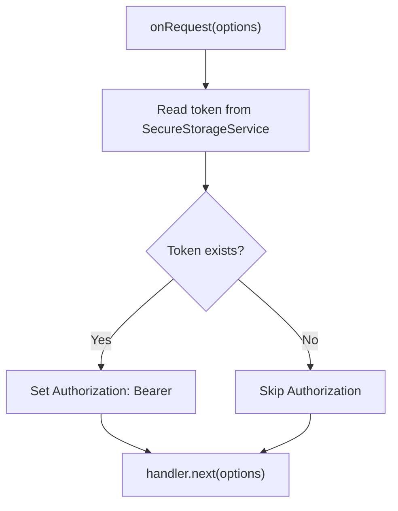
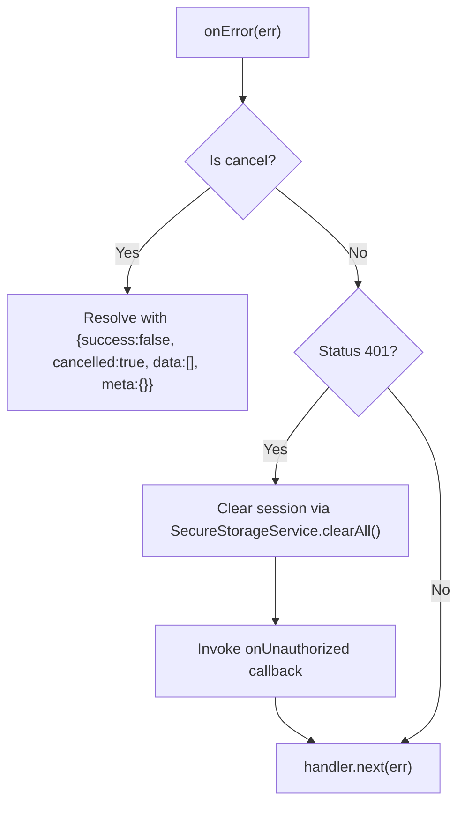
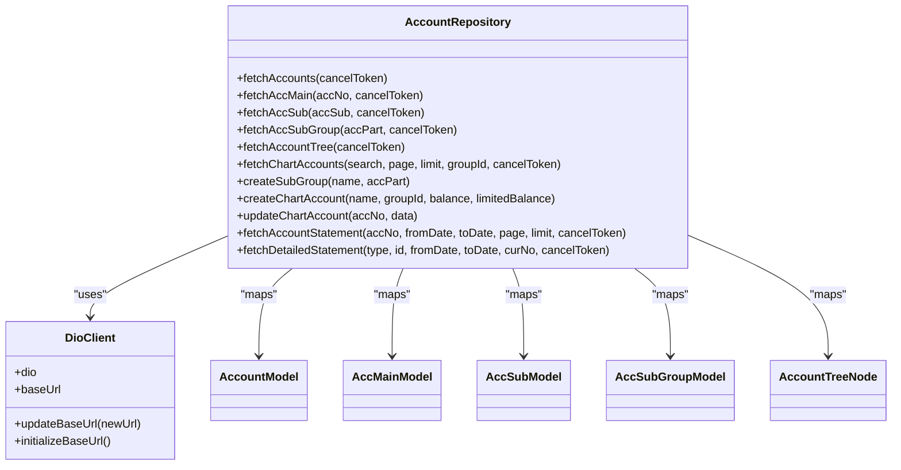
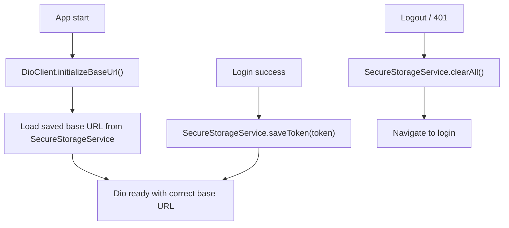
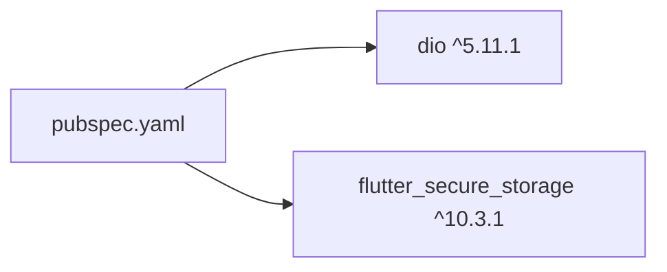

# Network Layer with Dio Client

<cite>
**Referenced Files in This Document**
- [dio_client.dart](file://lib/core/network/dio_client.dart)
- [auth_interceptor.dart](file://lib/core/network/auth_interceptor.dart)
- [error_interceptor.dart](file://lib/core/network/error_interceptor.dart)
- [secure_storage_service.dart](file://lib/core/storage/secure_storage_service.dart)
- [api_constants.dart](file://lib/core/constants/api_constants.dart)
- [account_repository.dart](file://lib/features/accounts/data/repositories/account_repository.dart)
- [account_model.dart](file://lib/features/accounts/data/models/account_model.dart)
- [pubspec.yaml](file://pubspec.yaml)
</cite>

## Table of Contents
1. [Introduction](#introduction)
2. [Project Structure](#project-structure)
3. [Core Components](#core-components)
4. [Architecture Overview](#architecture-overview)
5. [Detailed Component Analysis](#detailed-component-analysis)
6. [Dependency Analysis](#dependency-analysis)
7. [Performance Considerations](#performance-considerations)
8. [Troubleshooting Guide](#troubleshooting-guide)
9. [Conclusion](#conclusion)

## Introduction
This document explains the network layer built on Dio for the application. It covers the centralized Dio client configuration, interceptor chain for authentication and error handling, request/response logging, secure storage integration for tokens, repository usage patterns, and response transformation. It also addresses connection pooling, caching strategies, offline synchronization, retry mechanisms, and exponential backoff considerations.

## Project Structure
The network layer is organized under core features:
- Centralized HTTP client and interceptors
- Secure storage abstraction for tokens and session data
- API constants for endpoints and timeouts
- Feature repositories that use the Dio client to call backend APIs
- Data models that transform JSON payloads into typed objects

**Diagram sources**
- [dio_client.dart:1-60](file://lib/core/network/dio_client.dart#L1-L60)
- [auth_interceptor.dart:1-24](file://lib/core/network/auth_interceptor.dart#L1-L24)
- [error_interceptor.dart:1-39](file://lib/core/network/error_interceptor.dart#L1-L39)
- [secure_storage_service.dart:1-206](file://lib/core/storage/secure_storage_service.dart#L1-L206)
- [api_constants.dart:1-29](file://lib/core/constants/api_constants.dart#L1-L29)
- [account_repository.dart:1-313](file://lib/features/accounts/data/repositories/account_repository.dart#L1-L313)
- [account_model.dart:1-191](file://lib/features/accounts/data/models/account_model.dart#L1-L191)

**Section sources**
- [dio_client.dart:1-60](file://lib/core/network/dio_client.dart#L1-L60)
- [api_constants.dart:1-29](file://lib/core/constants/api_constants.dart#L1-L29)
- [account_repository.dart:1-313](file://lib/features/accounts/data/repositories/account_repository.dart#L1-L313)

## Core Components
- DioClient: Central entry point for all HTTP requests. Configures base URL, timeouts, default headers, and registers interceptors. Supports runtime base URL updates and initialization from secure storage.
- AuthInterceptor: Adds Authorization Bearer token from SecureStorageService to every outgoing request.
- ErrorInterceptor: Centralizes error handling, including graceful cancellation responses and automatic logout on 401 Unauthorized.
- SecureStorageService: Encapsulates FlutterSecureStorage operations for tokens, user data, permissions, session expiry, and biometric state.
- ApiConstants: Holds default base URL, endpoints, and timeout durations.
- Repositories and Models: Feature-specific repositories (e.g., AccountRepository) use DioClient to call endpoints and map responses to typed models.

Key responsibilities:
- Centralized configuration and lifecycle management of Dio instance
- Consistent authentication injection across requests
- Unified error handling and session invalidation
- Safe persistence of sensitive data
- Clear separation between transport (Dio) and domain logic (repositories)

**Section sources**
- [dio_client.dart:1-60](file://lib/core/network/dio_client.dart#L1-L60)
- [auth_interceptor.dart:1-24](file://lib/core/network/auth_interceptor.dart#L1-L24)
- [error_interceptor.dart:1-39](file://lib/core/network/error_interceptor.dart#L1-L39)
- [secure_storage_service.dart:1-206](file://lib/core/storage/secure_storage_service.dart#L1-L206)
- [api_constants.dart:1-29](file://lib/core/constants/api_constants.dart#L1-L29)

## Architecture Overview
The network layer follows a layered architecture:
- Presentation or feature layers call repositories
- Repositories use DioClient for HTTP calls
- DioClient configures Dio with BaseOptions and an interceptor chain
- Interceptors handle auth, errors, and logging
- SecureStorageService provides encrypted persistence for tokens and session metadata

**Diagram sources**
- [dio_client.dart:14-42](file://lib/core/network/dio_client.dart#L14-L42)
- [auth_interceptor.dart:11-22](file://lib/core/network/auth_interceptor.dart#L11-L22)
- [error_interceptor.dart:12-36](file://lib/core/network/error_interceptor.dart#L12-L36)
- [secure_storage_service.dart:32-45](file://lib/core/storage/secure_storage_service.dart#L32-L45)
- [account_repository.dart:38-55](file://lib/features/accounts/data/repositories/account_repository.dart#L38-L55)

## Detailed Component Analysis

### DioClient Configuration
Responsibilities:
- Initialize Dio with BaseOptions:
  - Base URL from ApiConstants.defaultBaseUrl or provided parameter
  - Connect and receive timeouts from ApiConstants
  - Default headers: Content-Type and Accept set to application/json
- Register interceptors:
  - AuthInterceptor for token injection
  - ErrorInterceptor for unified error handling
  - LogInterceptor for request/response logging
- Provide utilities:
  - baseUrl getter
  - updateBaseUrl for runtime changes
  - initializeBaseUrl to load saved base URL from SecureStorageService

Configuration highlights:
- Timeouts are defined centrally in ApiConstants.connectTimeout and ApiConstants.receiveTimeout
- Logging includes request body, response body, and errors; headers are not logged by default

**Diagram sources**
- [dio_client.dart:14-42](file://lib/core/network/dio_client.dart#L14-L42)
- [api_constants.dart:5-27](file://lib/core/constants/api_constants.dart#L5-L27)

**Section sources**
- [dio_client.dart:14-58](file://lib/core/network/dio_client.dart#L14-L58)
- [api_constants.dart:5-27](file://lib/core/constants/api_constants.dart#L5-L27)

### Authentication Interceptor Chain
Behavior:
- On each request, AuthInterceptor reads the token from SecureStorageService.getToken()
- If present, it sets Authorization header to Bearer <token>
- Ensures Accept header is application/json
- Passes the modified options to the next interceptor

Security notes:
- Token retrieval is asynchronous and safe; missing tokens result in unauthenticated requests
- Sensitive data is stored via FlutterSecureStorage

**Diagram sources**
- [auth_interceptor.dart:11-22](file://lib/core/network/auth_interceptor.dart#L11-L22)
- [secure_storage_service.dart:32-45](file://lib/core/storage/secure_storage_service.dart#L32-L45)

**Section sources**
- [auth_interceptor.dart:1-24](file://lib/core/network/auth_interceptor.dart#L1-24)
- [secure_storage_service.dart:32-45](file://lib/core/storage/secure_storage_service.dart#L32-L45)

### Error Handling and Session Invalidation
Behavior:
- Cancellation handling: If DioExceptionType.cancel occurs, returns a resolved response indicating success=false and cancelled=true with empty data and meta
- 401 Unauthorized: Clears all session data via SecureStorageService.clearAll() and invokes optional onUnauthorized callback
- Other errors: Propagated via handler.next(err)

**Diagram sources**
- [error_interceptor.dart:12-36](file://lib/core/network/error_interceptor.dart#L12-L36)
- [secure_storage_service.dart:82-95](file://lib/core/storage/secure_storage_service.dart#L82-L95)

**Section sources**
- [error_interceptor.dart:1-39](file://lib/core/network/error_interceptor.dart#L1-39)
- [secure_storage_service.dart:82-95](file://lib/core/storage/secure_storage_service.dart#L82-L95)

### Retry Mechanism and Exponential Backoff
Current status:
- The codebase does not implement explicit retry logic or exponential backoff at the DioClient level.
- Repositories handle CancelToken gracefully but do not retry failed requests automatically.

Recommendations:
- Implement a custom Interceptor or wrapper around DioClient to add retries with exponential backoff for transient errors (e.g., network timeouts, 5xx).
- Use a retry policy per endpoint or globally with max attempts and jitter.
- Integrate with a queue for offline synchronization when connectivity is restored.

[No sources needed since this section provides general guidance]

### Request/Response Logging
- LogInterceptor is enabled with requestBody, responseBody, and error logging.
- Headers are not logged by default to avoid leaking sensitive information.

Operational impact:
- Useful for debugging and monitoring API interactions.
- Consider enabling/disabling based on environment (debug vs release).

**Section sources**
- [dio_client.dart:31-41](file://lib/core/network/dio_client.dart#L31-L41)

### Connection Pooling
- Dio uses underlying HTTP clients which typically manage connection pooling.
- No explicit pool configuration is present in DioClient.

Best practices:
- Keep a single Dio instance per app lifecycle to benefit from connection reuse.
- Avoid creating multiple Dio instances concurrently.

[No sources needed since this section provides general guidance]

### Caching Strategies
- No in-memory or disk caching is implemented in the current network layer.
- Repositories return fresh data from the server on each call.

Recommended approaches:
- Add a cache layer (in-memory or persistent) in repositories or a dedicated service.
- Cache GET endpoints with TTL and invalidation policies.
- Use ETags or Last-Modified headers where supported by the backend.

[No sources needed since this section provides general guidance]

### Offline Data Synchronization
- Not implemented in the current network layer.
- To support offline-first behavior:
  - Queue failed mutations locally and sync when online.
  - Sync read data using background tasks or app lifecycle events.
  - Ensure conflict resolution strategies for concurrent updates.

[No sources needed since this section provides general guidance]

### API Service Implementation Example: AccountRepository
Responsibilities:
- Encapsulates account-related API calls using DioClient.dio
- Parses standardized responses with success flag and data payload
- Maps JSON to typed models (AccountModel, AccMainModel, etc.)
- Handles cancellation gracefully using CancelToken

Common patterns:
- GET endpoints return lists or paginated results
- POST/PUT endpoints return structured results with success/message/data
- Errors are rethrown unless they are cancellations

**Diagram sources**
- [account_repository.dart:24-313](file://lib/features/accounts/data/repositories/account_repository.dart#L24-L313)
- [dio_client.dart:9-58](file://lib/core/network/dio_client.dart#L9-L58)
- [account_model.dart:9-174](file://lib/features/accounts/data/models/account_model.dart#L9-L174)

**Section sources**
- [account_repository.dart:24-313](file://lib/features/accounts/data/repositories/account_repository.dart#L24-L313)
- [account_model.dart:9-174](file://lib/features/accounts/data/models/account_model.dart#L9-L174)

### Request/Response Models
- Models define strongly-typed structures for API payloads.
- They include factory constructors to parse JSON safely, often normalizing Arabic text via utility functions.
- Tree structures like AccountTreeNode support hierarchical data rendering and search/filter operations.

Examples:
- AccountModel, AccMainModel, AccSubModel, AccSubGroupModel represent accounting entities
- AccountTreeNode represents nested hierarchy with children and search capabilities

**Section sources**
- [account_model.dart:9-174](file://lib/features/accounts/data/models/account_model.dart#L9-L174)

### Secure Storage Integration
SecureStorageService wraps FlutterSecureStorage to provide:
- Token CRUD operations
- User type and user data persistence
- Custom API base URL persistence
- IBAC permission state and admin flag
- Session expiry timestamp
- Biometric enablement and user ID
- Comprehensive clearing methods for logout and security hygiene

Integration points:
- AuthInterceptor reads tokens before sending requests
- ErrorInterceptor clears session on 401 Unauthorized
- DioClient initializes base URL from secure storage

**Diagram sources**
- [dio_client.dart:52-58](file://lib/core/network/dio_client.dart#L52-L58)
- [secure_storage_service.dart:32-45](file://lib/core/storage/secure_storage_service.dart#L32-L45)
- [secure_storage_service.dart:82-95](file://lib/core/storage/secure_storage_service.dart#L82-L95)

**Section sources**
- [secure_storage_service.dart:1-206](file://lib/core/storage/secure_storage_service.dart#L1-L206)
- [dio_client.dart:52-58](file://lib/core/network/dio_client.dart#L52-L58)
- [error_interceptor.dart:30-36](file://lib/core/network/error_interceptor.dart#L30-L36)

### Response Transformation Pipeline
- Repositories expect a standard envelope with success flag and data payload
- They map raw JSON to typed models and return domain objects
- For list endpoints, repositories convert List<dynamic> to List<T>
- For mutation endpoints, repositories return structured results with success/message/data

Pipeline steps:
1. Dio sends request through interceptors
2. Server responds with JSON envelope
3. Repository checks success flag
4. Repository maps data to models
5. Repository returns typed result to caller

**Section sources**
- [account_repository.dart:38-55](file://lib/features/accounts/data/repositories/account_repository.dart#L38-L55)
- [account_repository.dart:145-183](file://lib/features/accounts/data/repositories/account_repository.dart#L145-L183)
- [account_repository.dart:186-232](file://lib/features/accounts/data/repositories/account_repository.dart#L186-L232)

## Dependency Analysis
External dependencies relevant to networking:
- dio: HTTP client library
- flutter_secure_storage: Encrypted local storage for tokens and sensitive data

**Diagram sources**
- [pubspec.yaml:30-45](file://pubspec.yaml#L30-L45)

**Section sources**
- [pubspec.yaml:30-45](file://pubspec.yaml#L30-L45)

## Performance Considerations
- Use a single DioClient instance to leverage connection pooling and reduce overhead.
- Enable logging only in debug builds to minimize I/O costs.
- Prefer pagination and filtering on the server side to reduce payload sizes.
- Avoid unnecessary model transformations; map only required fields.
- Consider adding caching for read-heavy endpoints to reduce network calls.

[No sources needed since this section provides general guidance]

## Troubleshooting Guide
Common issues and resolutions:
- 401 Unauthorized:
  - The ErrorInterceptor clears session data and triggers onUnauthorized callback.
  - Ensure logout navigation is handled in the UI layer.
- Canceled requests:
  - The ErrorInterceptor resolves canceled requests with a consistent structure; callers should check cancelled flag.
- Missing Authorization header:
  - Verify SecureStorageService.getToken() returns a valid token.
  - Confirm AuthInterceptor is registered in DioClient.
- Incorrect base URL:
  - Use DioClient.updateBaseUrl() or ensure initializeBaseUrl() loads the saved URL correctly.

Actionable checks:
- Validate ApiConstants.defaultBaseUrl matches your environment.
- Inspect logs from LogInterceptor for request/response details.
- Test SecureStorageService methods independently to confirm token persistence.

**Section sources**
- [error_interceptor.dart:12-36](file://lib/core/network/error_interceptor.dart#L12-L36)
- [dio_client.dart:44-58](file://lib/core/network/dio_client.dart#L44-L58)
- [auth_interceptor.dart:11-22](file://lib/core/network/auth_interceptor.dart#L11-L22)

## Conclusion
The network layer centers around a well-configured DioClient with interceptors for authentication, error handling, and logging. SecureStorageService ensures safe token and session management. Repositories encapsulate API calls and transform responses into typed models. While retry/backoff, caching, and offline synchronization are not yet implemented, the architecture supports straightforward extensions. Following the recommended best practices will improve reliability, performance, and maintainability.