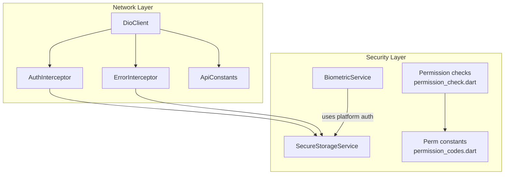
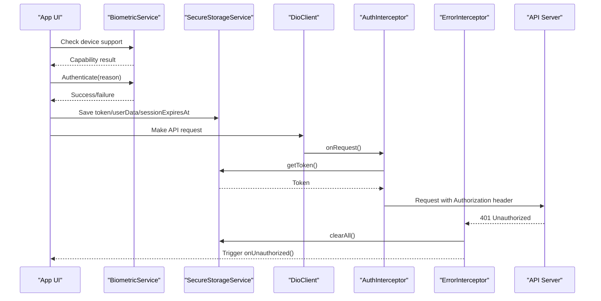
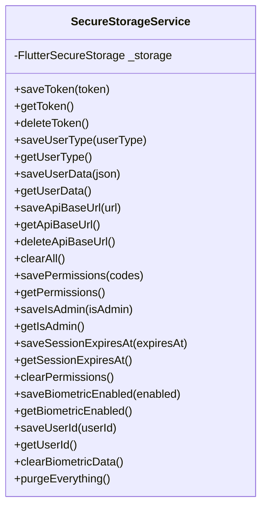
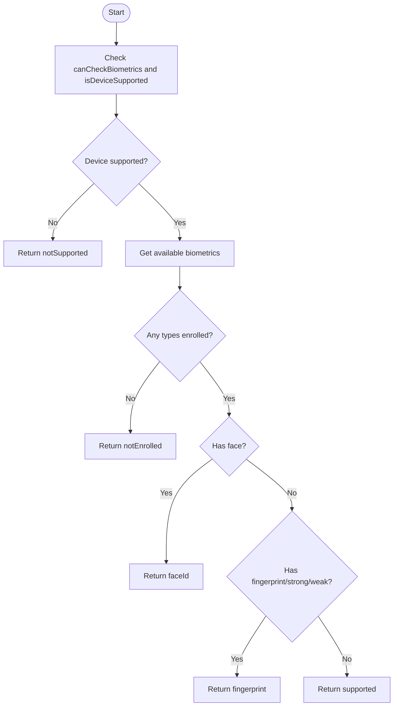
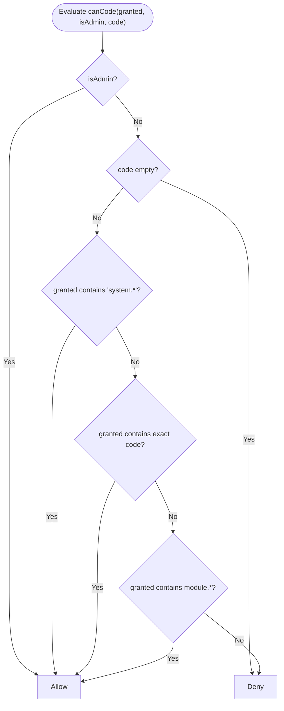
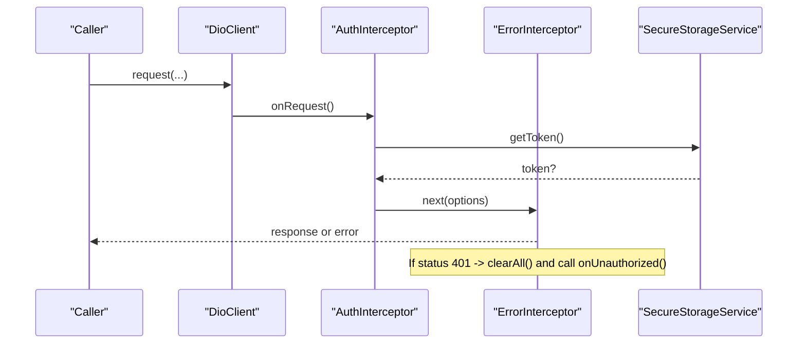
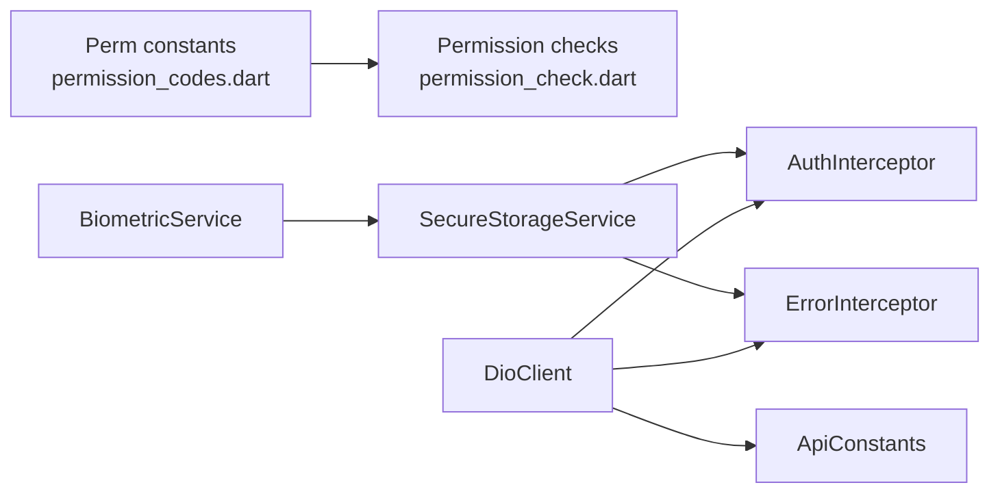

# Security Implementation

<cite>
**Referenced Files in This Document**
- [secure_storage_service.dart](file://lib/core/storage/secure_storage_service.dart)
- [biometric_service.dart](file://lib/core/utils/biometric_service.dart)
- [permission_codes.dart](file://lib/core/constants/permission_codes.dart)
- [permission_check.dart](file://lib/core/utils/permission_check.dart)
- [auth_interceptor.dart](file://lib/core/network/auth_interceptor.dart)
- [dio_client.dart](file://lib/core/network/dio_client.dart)
- [error_interceptor.dart](file://lib/core/network/error_interceptor.dart)
- [api_constants.dart](file://lib/core/constants/api_constants.dart)
</cite>

## Table of Contents
1. [Introduction](#introduction)
2. [Project Structure](#project-structure)
3. [Core Components](#core-components)
4. [Architecture Overview](#architecture-overview)
5. [Detailed Component Analysis](#detailed-component-analysis)
6. [Dependency Analysis](#dependency-analysis)
7. [Performance Considerations](#performance-considerations)
8. [Troubleshooting Guide](#troubleshooting-guide)
9. [Conclusion](#conclusion)

## Introduction
This document explains the client-side security implementation for biometric authentication, secure storage, and permission management. It focuses on how sensitive data is persisted, how biometric login integrates with the server, and how client-side access control mirrors server-side IBAC permissions. The goal is to make these mechanisms understandable for both developers and product stakeholders while preserving technical precision.

## Project Structure
The security-related code lives under `lib/core` and follows a layered approach:
- Storage layer: encrypted persistence for tokens, user data, API base URL, IBAC state, and biometric flags.
- Biometric layer: device capability detection and local authentication prompts.
- Permission layer: canonical permission codes and pure decision logic that mirrors the server resolver.
- Network layer: Dio client configuration, automatic token injection, and centralized error handling.

**Diagram sources**
- [secure_storage_service.dart:7-30](file://lib/core/storage/secure_storage_service.dart#L7-L30)
- [biometric_service.dart:14-15](file://lib/core/utils/biometric_service.dart#L14-L15)
- [permission_codes.dart:12-143](file://lib/core/constants/permission_codes.dart#L12-L143)
- [permission_check.dart:24-38](file://lib/core/utils/permission_check.dart#L24-L38)
- [dio_client.dart:9-42](file://lib/core/network/dio_client.dart#L9-L42)
- [auth_interceptor.dart:6-22](file://lib/core/network/auth_interceptor.dart#L6-L22)
- [error_interceptor.dart:6-36](file://lib/core/network/error_interceptor.dart#L6-L36)
- [api_constants.dart:3-28](file://lib/core/constants/api_constants.dart#L3-L28)

**Section sources**
- [secure_storage_service.dart:7-30](file://lib/core/storage/secure_storage_service.dart#L7-L30)
- [dio_client.dart:9-42](file://lib/core/network/dio_client.dart#L9-L42)

## Core Components
- SecureStorageService: Encrypted persistence for authentication tokens, user type, user data JSON, API base URL, IBAC permissions, admin flag, session expiry, and biometric metadata.
- BiometricService: Wrapper around LocalAuthentication for capability checks and biometric prompts.
- Permission catalog and checker: Canonical permission codes and pure functions implementing deny-by-default rules identical to the server resolver.
- Network integration: Dio client configured with interceptors that attach tokens and handle unauthorized responses.

Key responsibilities:
- Keep secrets out of plain storage.
- Provide safe defaults when data is missing or corrupt.
- Mirror server-side permission semantics locally to avoid UI/API mismatches.
- Centralize network behavior for consistent auth and error handling.

**Section sources**
- [secure_storage_service.dart:7-203](file://lib/core/storage/secure_storage_service.dart#L7-L203)
- [biometric_service.dart:14-84](file://lib/core/utils/biometric_service.dart#L14-L84)
- [permission_codes.dart:12-339](file://lib/core/constants/permission_codes.dart#L12-L339)
- [permission_check.dart:24-68](file://lib/core/utils/permission_check.dart#L24-L68)
- [dio_client.dart:9-59](file://lib/core/network/dio_client.dart#L9-L59)

## Architecture Overview
The security architecture connects four layers:
- Storage: FlutterSecureStorage-backed service for all sensitive values.
- Biometrics: LocalAuthentication-based flow for fingerprint/face ID.
- Permissions: Client-side mirror of server IBAC codes with strict evaluation.
- Networking: Dio client that injects tokens and clears sessions on 401.

**Diagram sources**
- [biometric_service.dart:18-70](file://lib/core/utils/biometric_service.dart#L18-L70)
- [secure_storage_service.dart:32-154](file://lib/core/storage/secure_storage_service.dart#L32-L154)
- [dio_client.dart:14-42](file://lib/core/network/dio_client.dart#L14-L42)
- [auth_interceptor.dart:11-22](file://lib/core/network/auth_interceptor.dart#L11-L22)
- [error_interceptor.dart:12-36](file://lib/core/network/error_interceptor.dart#L12-L36)

## Detailed Component Analysis

### SecureStorageService
SecureStorageService centralizes encrypted persistence using FlutterSecureStorage. It manages:
- Authentication token, user type, user data JSON, and API base URL.
- IBAC state: permission codes, admin flag, and session expiry.
- Biometric metadata: enabled flag and stored user ID.

Important behaviors:
- On logout, it clears session data and IBAC state but intentionally keeps biometric metadata so users can still use biometric login later.
- Permission reads are defensive: malformed or empty stored JSON returns an empty list rather than throwing.
- Admin flag absence means false (deny-by-default).
- Session expiry is stored exactly as the server sends it; null means no deadline.

**Diagram sources**
- [secure_storage_service.dart:7-203](file://lib/core/storage/secure_storage_service.dart#L7-L203)

Security notes:
- Tokens and credentials are never written to plain storage.
- Corrupt permission blobs are treated as “no permissions” to prevent accidental privilege escalation.
- Clearing only IBAC state after failed permission refresh avoids leaving stale grants.

**Section sources**
- [secure_storage_service.dart:7-203](file://lib/core/storage/secure_storage_service.dart#L7-L203)

### BiometricService
BiometricService wraps LocalAuthentication to:
- Detect device support and enrolled biometrics.
- Distinguish between fingerprint and face ID where available.
- Prompt the user with a localized reason and enforce biometric-only authentication.

Capability mapping:
- Not supported: device cannot check biometrics or is unsupported.
- Not enrolled: device supports biometrics but none are enrolled.
- Fingerprint or face ID based on available types.
- Supported fallback for other strong/weak types.

**Diagram sources**
- [biometric_service.dart:18-47](file://lib/core/utils/biometric_service.dart#L18-L47)

Usage guidance:
- Use `checkSupport()` to decide whether to show biometric options.
- Use `isAvailable()` to gate features requiring biometric login.
- Use `authenticate(reason)` to prompt the user; failures return false without throwing.

**Section sources**
- [biometric_service.dart:14-84](file://lib/core/utils/biometric_service.dart#L14-L84)

### Permission Codes and Validation
The permission system mirrors the server’s IBAC catalog:
- Canonical codes are defined in `Perm`.
- A complete ordered list ensures parity testing.
- Module/action helpers parse and build wildcard codes.
- Pure validation functions implement the same rules as the server resolver.

Rules enforced by `canCode`:
1. System admin bypasses grant table.
2. Global wildcard `system.*` grants everything.
3. Exact code match.
4. Module wildcard `module.*` match.
5. Otherwise denied.

**Diagram sources**
- [permission_check.dart:24-38](file://lib/core/utils/permission_check.dart#L24-L38)
- [permission_codes.dart:313-339](file://lib/core/constants/permission_codes.dart#L313-L339)

UI integration:
- Hide or disable UI elements based on `canCode`, `canAnyCode`, or `canAllCode`.
- Because decisions are pure and deterministic, UI gating matches server authorization.

**Section sources**
- [permission_codes.dart:12-339](file://lib/core/constants/permission_codes.dart#L12-L339)
- [permission_check.dart:24-68](file://lib/core/utils/permission_check.dart#L24-L68)

### Network Integration and Token Handling
DioClient configures:
- Base URL from ApiConstants or saved API base URL.
- Interceptors for authentication, logging, and error handling.

AuthInterceptor:
- Reads the token from SecureStorageService and attaches it as a Bearer header.
- Ensures Accept header is set.

ErrorInterceptor:
- Handles cancellation gracefully.
- Clears all session data on 401 and triggers an optional callback for UI navigation.

**Diagram sources**
- [dio_client.dart:14-42](file://lib/core/network/dio_client.dart#L14-L42)
- [auth_interceptor.dart:11-22](file://lib/core/network/auth_interceptor.dart#L11-L22)
- [error_interceptor.dart:12-36](file://lib/core/network/error_interceptor.dart#L12-L36)

**Section sources**
- [dio_client.dart:9-59](file://lib/core/network/dio_client.dart#L9-L59)
- [auth_interceptor.dart:6-22](file://lib/core/network/auth_interceptor.dart#L6-L22)
- [error_interceptor.dart:6-36](file://lib/core/network/error_interceptor.dart#L6-L36)
- [api_constants.dart:3-28](file://lib/core/constants/api_constants.dart#L3-L28)

## Dependency Analysis
The following diagram shows how components depend on each other:

**Diagram sources**
- [permission_codes.dart:12-339](file://lib/core/constants/permission_codes.dart#L12-L339)
- [permission_check.dart:24-68](file://lib/core/utils/permission_check.dart#L24-L68)
- [secure_storage_service.dart:7-203](file://lib/core/storage/secure_storage_service.dart#L7-L203)
- [auth_interceptor.dart:6-22](file://lib/core/network/auth_interceptor.dart#L6-L22)
- [error_interceptor.dart:6-36](file://lib/core/network/error_interceptor.dart#L6-L36)
- [dio_client.dart:9-59](file://lib/core/network/dio_client.dart#L9-L59)
- [api_constants.dart:3-28](file://lib/core/constants/api_constants.dart#L3-L28)
- [biometric_service.dart:14-84](file://lib/core/utils/biometric_service.dart#L14-L84)

Coupling and cohesion:
- SecureStorageService is cohesive around persistence and exposes focused methods.
- Permission logic is decoupled from UI and network, enabling unit tests.
- DioClient composes interceptors cleanly, isolating cross-cutting concerns.

Potential risks:
- Circular dependencies are avoided; storage does not depend on network.
- Error handling centralizes 401 cleanup, reducing scattered logout logic.

**Section sources**
- [permission_check.dart:1-18](file://lib/core/utils/permission_check.dart#L1-L18)
- [dio_client.dart:9-42](file://lib/core/network/dio_client.dart#L9-L42)

## Performance Considerations
- Permission checks are O(1) per code lookup and O(n) for any/all checks against small sets; this is negligible compared to network calls.
- Storing permissions as JSON allows fast read/write; parsing is guarded to avoid exceptions.
- Avoid frequent re-parsing by caching decoded permissions in higher-level state if needed.
- Token injection via interceptor adds minimal overhead per request.

[No sources needed since this section provides general guidance]

## Troubleshooting Guide
Common issues and resolutions:
- Biometric not showing:
  - Verify device support and enrollment using `BiometricService.checkSupport()`.
  - Ensure the app has required platform permissions for biometrics.
- Biometric login fails:
  - Confirm `authenticate(reason)` is called with a meaningful localized reason.
  - Handle false results and fall back to password-based login.
- Permissions not applied:
  - Ensure permissions are loaded and saved via `SecureStorageService.savePermissions()`.
  - Validate that the stored JSON is valid; corrupt data will be treated as empty permissions.
- Unexpected logout:
  - Check for 401 responses; the error interceptor clears session data and invokes `onUnauthorized`.
  - Implement navigation to login screen in `onUnauthorized`.

Operational tips:
- Use `clearAll()` during explicit logout flows.
- Use `clearPermissions()` when post-401 permission refresh fails to avoid stale grants.
- Use `purgeEverything()` only for full app reset scenarios.

**Section sources**
- [biometric_service.dart:18-70](file://lib/core/utils/biometric_service.dart#L18-L70)
- [secure_storage_service.dart:82-162](file://lib/core/storage/secure_storage_service.dart#L82-L162)
- [error_interceptor.dart:12-36](file://lib/core/network/error_interceptor.dart#L12-L36)

## Conclusion
The security implementation provides a robust foundation for biometric authentication, secure storage, and client-side access control aligned with server-side IBAC permissions. By centralizing token handling, enforcing deny-by-default permission rules, and mirroring server semantics locally, the application minimizes UI/API mismatches and reduces attack surface. Following the best practices outlined here—encrypted storage, careful session management, and consistent permission checks—ensures a secure and maintainable user experience.

[No sources needed since this section summarizes without analyzing specific files]