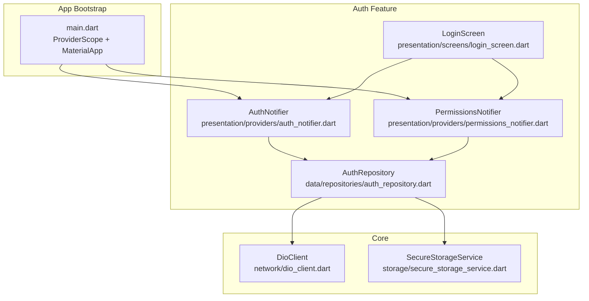
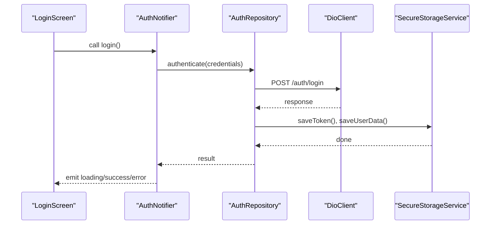
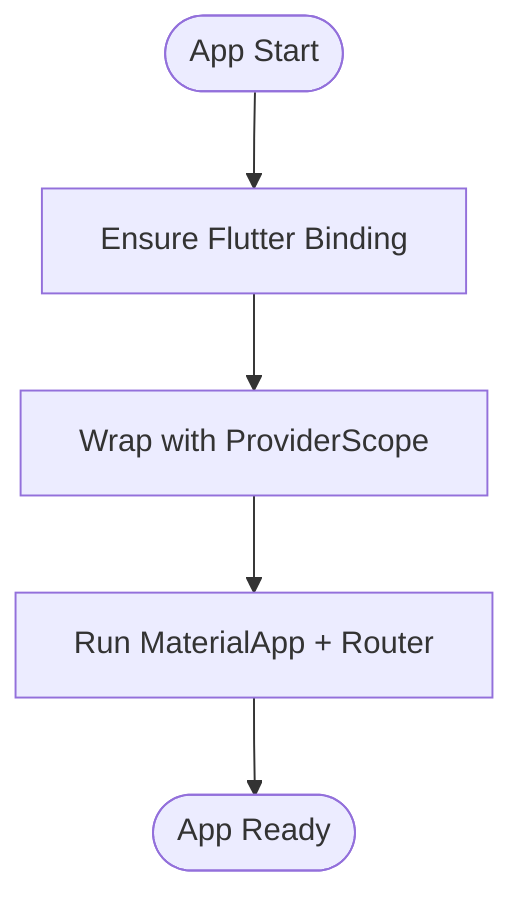
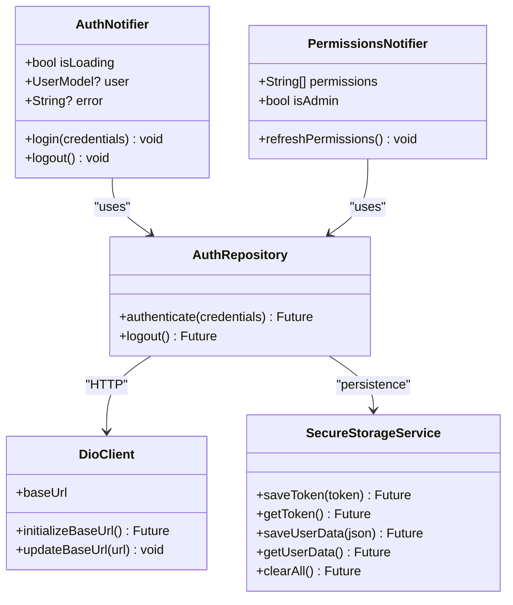
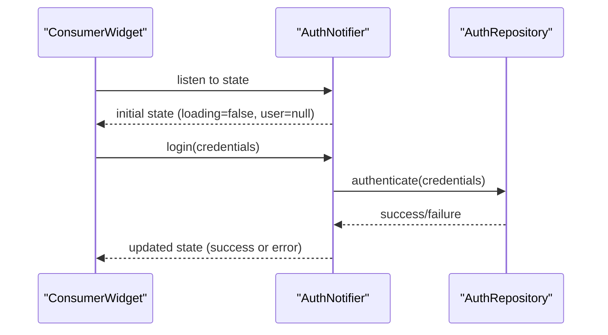
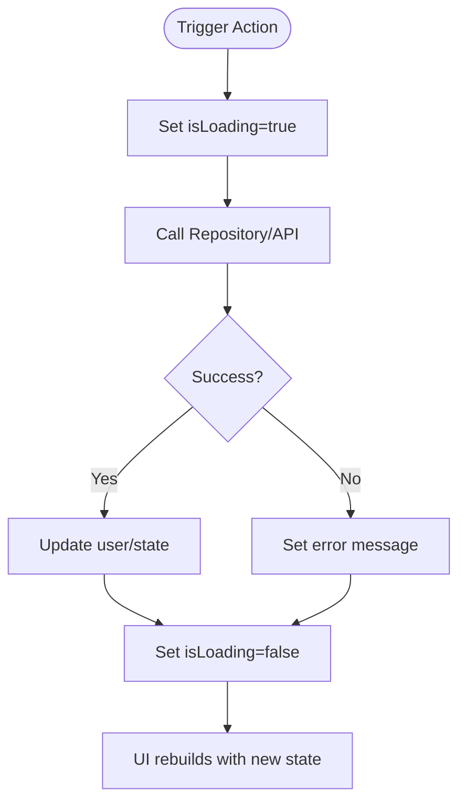
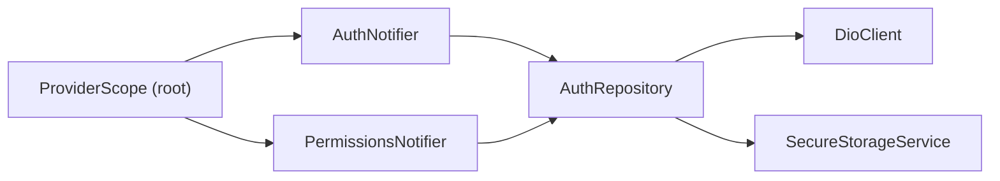
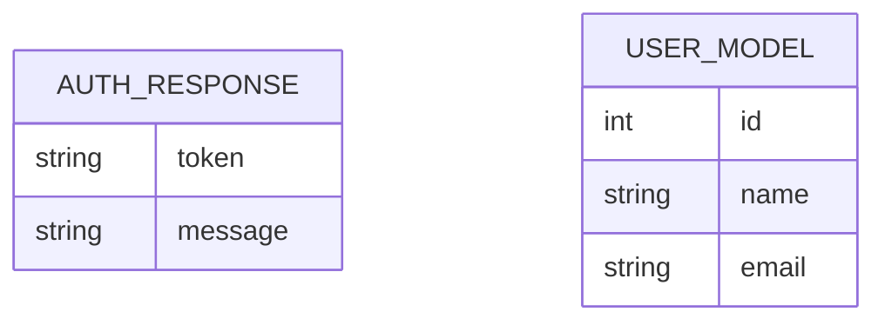
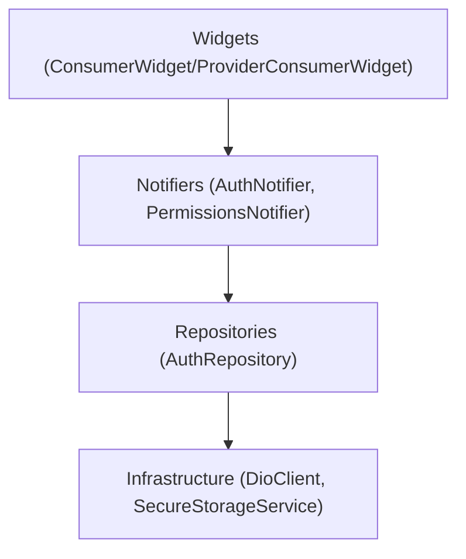

# State Management with Riverpod

<cite>
**Referenced Files in This Document**
- [main.dart](file://lib/main.dart)
- [pubspec.yaml](file://pubspec.yaml)
- [dio_client.dart](file://lib/core/network/dio_client.dart)
- [secure_storage_service.dart](file://lib/core/storage/secure_storage_service.dart)
- [auth_notifier.dart](file://lib/features/auth/presentation/providers/auth_notifier.dart)
- [permissions_notifier.dart](file://lib/features/auth/presentation/providers/permissions_notifier.dart)
- [auth_repository.dart](file://lib/features/auth/data/repositories/auth_repository.dart)
- [auth_response.dart](file://lib/features/auth/data/models/auth_response.dart)
- [user_model.dart](file://lib/features/auth/data/models/user_model.dart)
- [login_screen.dart](file://lib/features/auth/presentation/screens/login_screen.dart)
</cite>

## Table of Contents
1. [Introduction](#introduction)
2. [Project Structure](#project-structure)
3. [Core Components](#core-components)
4. [Architecture Overview](#architecture-overview)
5. [Detailed Component Analysis](#detailed-component-analysis)
6. [Dependency Analysis](#dependency-analysis)
7. [Performance Considerations](#performance-considerations)
8. [Troubleshooting Guide](#troubleshooting-guide)
9. [Conclusion](#conclusion)

## Introduction
This document explains how Ky Apps uses Riverpod for state management, focusing on ProviderScope initialization, the notifier pattern for business logic (including authentication), and how UI components consume providers. It also covers async state handling, error states, loading indicators, provider hierarchy, dependency injection patterns, performance considerations like selective rebuilding, and state persistence strategies.

## Project Structure
Ky Apps is a Flutter application that:
- Initializes Riverpod at app startup via ProviderScope.
- Organizes features under lib/features with clear separation between data, presentation, and providers.
- Uses Riverpod Notifiers to encapsulate business logic and reactive state.
- Integrates secure storage and a centralized HTTP client for network operations.

**Diagram sources**
- [main.dart:7-10](file://lib/main.dart#L7-L10)
- [dio_client.dart:9-42](file://lib/core/network/dio_client.dart#L9-L42)
- [secure_storage_service.dart:7-30](file://lib/core/storage/secure_storage_service.dart#L7-L30)
- [auth_notifier.dart](file://lib/features/auth/presentation/providers/auth_notifier.dart)
- [permissions_notifier.dart](file://lib/features/auth/presentation/providers/permissions_notifier.dart)
- [auth_repository.dart](file://lib/features/auth/data/repositories/auth_repository.dart)
- [login_screen.dart](file://lib/features/auth/presentation/screens/login_screen.dart)

**Section sources**
- [main.dart:7-10](file://lib/main.dart#L7-L10)
- [pubspec.yaml:30-46](file://pubspec.yaml#L30-L46)

## Core Components
- ProviderScope initialization: The app wraps the root widget with ProviderScope to enable Riverpod’s dependency injection and reactive state across the tree.
- Notifier-based state: Business logic is implemented using Riverpod Notifiers, which expose mutable state and methods to update it reactively.
- Separation of concerns: UI widgets consume providers without holding state; providers orchestrate repositories and services.
- Async state handling: Providers manage loading, success, and error states for asynchronous operations such as authentication and permission fetching.
- Persistence: Secure storage persists tokens, user data, permissions, and session metadata; providers coordinate read/write through a dedicated service.

Key files:
- App bootstrap and Riverpod setup: [main.dart:7-10](file://lib/main.dart#L7-L10)
- Network client: [dio_client.dart:9-42](file://lib/core/network/dio_client.dart#L9-L42)
- Secure storage: [secure_storage_service.dart:7-30](file://lib/core/storage/secure_storage_service.dart#L7-L30)
- Authentication notifier: [auth_notifier.dart](file://lib/features/auth/presentation/providers/auth_notifier.dart)
- Permissions notifier: [permissions_notifier.dart](file://lib/features/auth/presentation/providers/permissions_notifier.dart)
- Auth repository: [auth_repository.dart](file://lib/features/auth/data/repositories/auth_repository.dart)
- Models: [auth_response.dart](file://lib/features/auth/data/models/auth_response.dart), [user_model.dart](file://lib/features/auth/data/models/user_model.dart)
- UI screens consuming providers: [login_screen.dart](file://lib/features/auth/presentation/screens/login_screen.dart)

**Section sources**
- [main.dart:7-10](file://lib/main.dart#L7-L10)
- [dio_client.dart:9-42](file://lib/core/network/dio_client.dart#L9-L42)
- [secure_storage_service.dart:7-30](file://lib/core/storage/secure_storage_service.dart#L7-L30)
- [auth_notifier.dart](file://lib/features/auth/presentation/providers/auth_notifier.dart)
- [permissions_notifier.dart](file://lib/features/auth/presentation/providers/permissions_notifier.dart)
- [auth_repository.dart](file://lib/features/auth/data/repositories/auth_repository.dart)
- [auth_response.dart](file://lib/features/auth/data/models/auth_response.dart)
- [user_model.dart](file://lib/features/auth/data/models/user_model.dart)
- [login_screen.dart](file://lib/features/auth/presentation/screens/login_screen.dart)

## Architecture Overview
The application follows a layered architecture:
- Presentation layer: Widgets consume Riverpod providers (e.g., ConsumerWidget or ProviderConsumerWidget patterns).
- State layer: Notifiers encapsulate business logic and reactive state.
- Data layer: Repositories coordinate API calls and local storage.
- Infrastructure: DioClient handles HTTP requests; SecureStorageService manages encrypted persistence.

**Diagram sources**
- [login_screen.dart](file://lib/features/auth/presentation/screens/login_screen.dart)
- [auth_notifier.dart](file://lib/features/auth/presentation/providers/auth_notifier.dart)
- [auth_repository.dart](file://lib/features/auth/data/repositories/auth_repository.dart)
- [dio_client.dart:9-42](file://lib/core/network/dio_client.dart#L9-L42)
- [secure_storage_service.dart:32-65](file://lib/core/storage/secure_storage_service.dart#L32-L65)

## Detailed Component Analysis

### ProviderScope Initialization and App Bootstrap
- ProviderScope is placed at the root to provide Riverpod context to all descendants.
- The app configures localization and routing, while state remains decoupled from UI.

**Diagram sources**
- [main.dart:7-10](file://lib/main.dart#L7-L10)
- [main.dart:14-46](file://lib/main.dart#L14-L46)

**Section sources**
- [main.dart:7-10](file://lib/main.dart#L7-L10)
- [main.dart:14-46](file://lib/main.dart#L14-L46)

### Notifier Pattern for Business Logic
- Notifiers encapsulate state and behavior, exposing methods to mutate state and trigger side effects.
- Typical responsibilities include:
  - Managing authentication state (loading, authenticated user, errors).
  - Coordinating API calls via repositories.
  - Persisting tokens and user data through secure storage.
  - Emitting reactive updates to subscribed widgets.

**Diagram sources**
- [auth_notifier.dart](file://lib/features/auth/presentation/providers/auth_notifier.dart)
- [permissions_notifier.dart](file://lib/features/auth/presentation/providers/permissions_notifier.dart)
- [auth_repository.dart](file://lib/features/auth/data/repositories/auth_repository.dart)
- [dio_client.dart:9-42](file://lib/core/network/dio_client.dart#L9-L42)
- [secure_storage_service.dart:32-65](file://lib/core/storage/secure_storage_service.dart#L32-L65)

**Section sources**
- [auth_notifier.dart](file://lib/features/auth/presentation/providers/auth_notifier.dart)
- [permissions_notifier.dart](file://lib/features/auth/presentation/providers/permissions_notifier.dart)
- [auth_repository.dart](file://lib/features/auth/data/repositories/auth_repository.dart)
- [dio_client.dart:9-42](file://lib/core/network/dio_client.dart#L9-L42)
- [secure_storage_service.dart:32-65](file://lib/core/storage/secure_storage_service.dart#L32-L65)

### UI Consumption Patterns
- Widgets consume providers using ConsumerWidget or ProviderConsumerWidget patterns to subscribe to state changes.
- UI displays loading indicators during async operations, shows error messages when failures occur, and renders authenticated views upon success.

**Diagram sources**
- [login_screen.dart](file://lib/features/auth/presentation/screens/login_screen.dart)
- [auth_notifier.dart](file://lib/features/auth/presentation/providers/auth_notifier.dart)
- [auth_repository.dart](file://lib/features/auth/data/repositories/auth_repository.dart)

**Section sources**
- [login_screen.dart](file://lib/features/auth/presentation/screens/login_screen.dart)
- [auth_notifier.dart](file://lib/features/auth/presentation/providers/auth_notifier.dart)

### Async State Handling, Error States, and Loading Indicators
- Notifiers maintain explicit loading flags and error fields to reflect operation status.
- UI reacts to these fields to show spinners, error banners, or navigate to protected routes.
- Errors are surfaced consistently by updating the notifier’s error state and allowing UI to render appropriate feedback.

**Diagram sources**
- [auth_notifier.dart](file://lib/features/auth/presentation/providers/auth_notifier.dart)

**Section sources**
- [auth_notifier.dart](file://lib/features/auth/presentation/providers/auth_notifier.dart)

### Provider Hierarchy and Dependency Injection
- ProviderScope at the root provides access to all providers.
- Feature-specific providers (e.g., auth, permissions) are defined within their feature folders.
- Repositories and services are injected into notifiers, promoting testability and separation of concerns.

**Diagram sources**
- [main.dart:7-10](file://lib/main.dart#L7-L10)
- [auth_notifier.dart](file://lib/features/auth/presentation/providers/auth_notifier.dart)
- [permissions_notifier.dart](file://lib/features/auth/presentation/providers/permissions_notifier.dart)
- [auth_repository.dart](file://lib/features/auth/data/repositories/auth_repository.dart)
- [dio_client.dart:9-42](file://lib/core/network/dio_client.dart#L9-L42)
- [secure_storage_service.dart:7-30](file://lib/core/storage/secure_storage_service.dart#L7-L30)

**Section sources**
- [main.dart:7-10](file://lib/main.dart#L7-L10)
- [auth_notifier.dart](file://lib/features/auth/presentation/providers/auth_notifier.dart)
- [permissions_notifier.dart](file://lib/features/auth/presentation/providers/permissions_notifier.dart)
- [auth_repository.dart](file://lib/features/auth/data/repositories/auth_repository.dart)
- [dio_client.dart:9-42](file://lib/core/network/dio_client.dart#L9-L42)
- [secure_storage_service.dart:7-30](file://lib/core/storage/secure_storage_service.dart#L7-L30)

### Data Models and Responses
- Models represent server responses and local entities used by providers and UI.
- Examples include authentication response structures and user models.

**Diagram sources**
- [auth_response.dart](file://lib/features/auth/data/models/auth_response.dart)
- [user_model.dart](file://lib/features/auth/data/models/user_model.dart)

**Section sources**
- [auth_response.dart](file://lib/features/auth/data/models/auth_response.dart)
- [user_model.dart](file://lib/features/auth/data/models/user_model.dart)

## Dependency Analysis
Riverpod enables clean dependency injection:
- Notifiers depend on repositories.
- Repositories depend on infrastructure (DioClient, SecureStorageService).
- UI depends only on providers, not on implementation details.

**Diagram sources**
- [login_screen.dart](file://lib/features/auth/presentation/screens/login_screen.dart)
- [auth_notifier.dart](file://lib/features/auth/presentation/providers/auth_notifier.dart)
- [permissions_notifier.dart](file://lib/features/auth/presentation/providers/permissions_notifier.dart)
- [auth_repository.dart](file://lib/features/auth/data/repositories/auth_repository.dart)
- [dio_client.dart:9-42](file://lib/core/network/dio_client.dart#L9-L42)
- [secure_storage_service.dart:7-30](file://lib/core/storage/secure_storage_service.dart#L7-L30)

**Section sources**
- [login_screen.dart](file://lib/features/auth/presentation/screens/login_screen.dart)
- [auth_notifier.dart](file://lib/features/auth/presentation/providers/auth_notifier.dart)
- [permissions_notifier.dart](file://lib/features/auth/presentation/providers/permissions_notifier.dart)
- [auth_repository.dart](file://lib/features/auth/data/repositories/auth_repository.dart)
- [dio_client.dart:9-42](file://lib/core/network/dio_client.dart#L9-L42)
- [secure_storage_service.dart:7-30](file://lib/core/storage/secure_storage_service.dart#L7-L30)

## Performance Considerations
- Selective rebuilding: Use ConsumerWidget or ProviderConsumerWidget to rebuild only widgets that depend on specific provider fields, minimizing unnecessary rebuilds.
- Fine-grained state: Keep state granular in notifiers so UI subscribes only to relevant slices.
- Avoid heavy computations in build: Offload work to providers and memoize derived values where possible.
- Efficient persistence: Batch writes and avoid redundant storage operations; use SecureStorageService methods judiciously.
- Network efficiency: Leverage Dio interceptors for logging and error handling; cache responses if appropriate.

[No sources needed since this section provides general guidance]

## Troubleshooting Guide
Common issues and resolutions:
- Provider not found: Ensure ProviderScope wraps the entire app tree at the root.
- State not updating: Verify that widgets consume providers correctly and that notifiers emit updates after mutations.
- Authentication failures: Check DioClient configuration, interceptors, and SecureStorageService token persistence.
- Permission inconsistencies: Clear IBAC state when necessary and refresh permissions after successful login.

Actionable checks:
- Confirm ProviderScope initialization in main entry point.
- Validate that notifiers call repository methods and update state accordingly.
- Inspect network logs via Dio interceptors for request/response details.
- Review secure storage keys and ensure they are set/cleared appropriately during login/logout flows.

**Section sources**
- [main.dart:7-10](file://lib/main.dart#L7-L10)
- [dio_client.dart:9-42](file://lib/core/network/dio_client.dart#L9-L42)
- [secure_storage_service.dart:82-95](file://lib/core/storage/secure_storage_service.dart#L82-L95)
- [secure_storage_service.dart:156-162](file://lib/core/storage/secure_storage_service.dart#L156-L162)

## Conclusion
Ky Apps leverages Riverpod’s ProviderScope and Notifier pattern to deliver reactive, maintainable state management. UI components remain thin consumers of provider state, while notifiers encapsulate business logic and coordinate with repositories and infrastructure. This architecture supports robust async handling, clear error states, efficient persistence, and scalable dependency injection across features.

[No sources needed since this section summarizes without analyzing specific files]