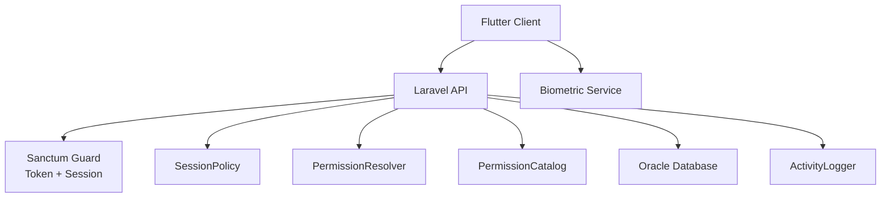
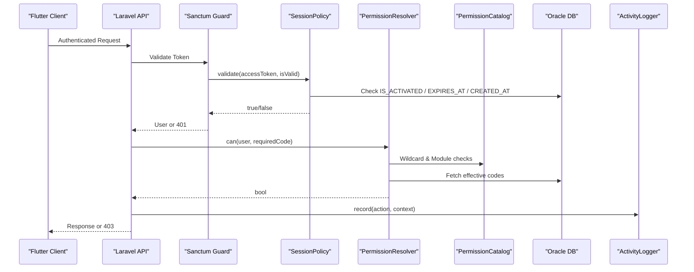
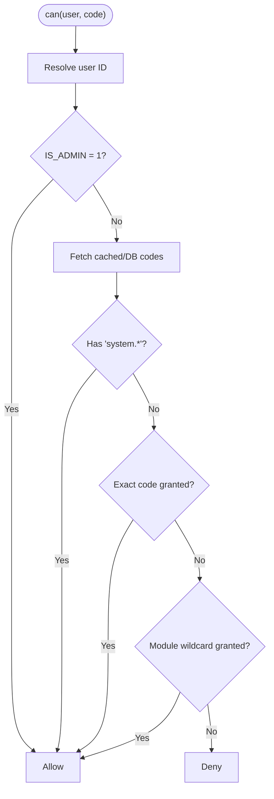
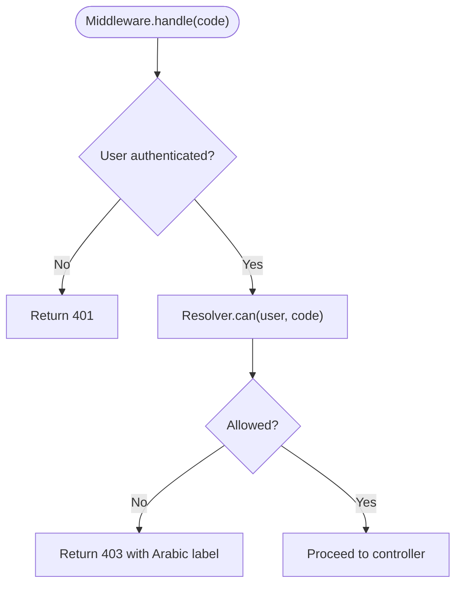
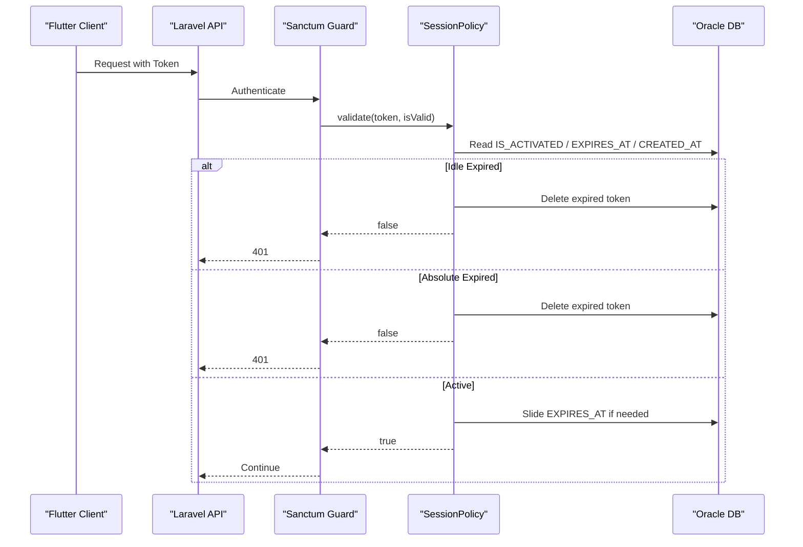
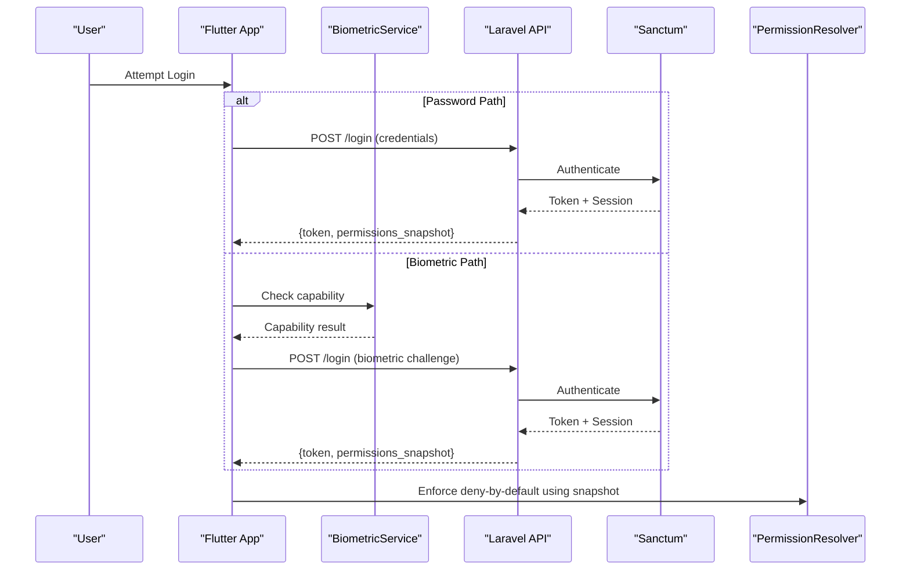
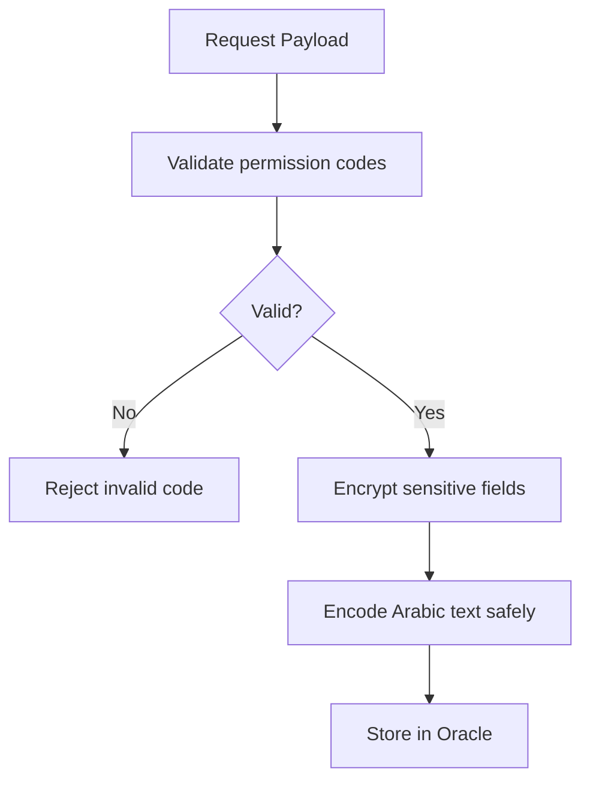
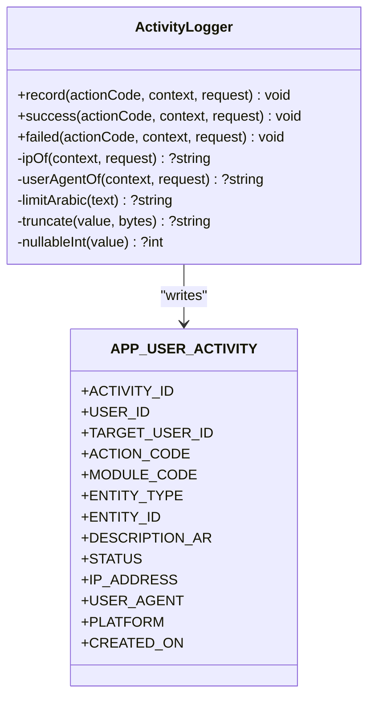
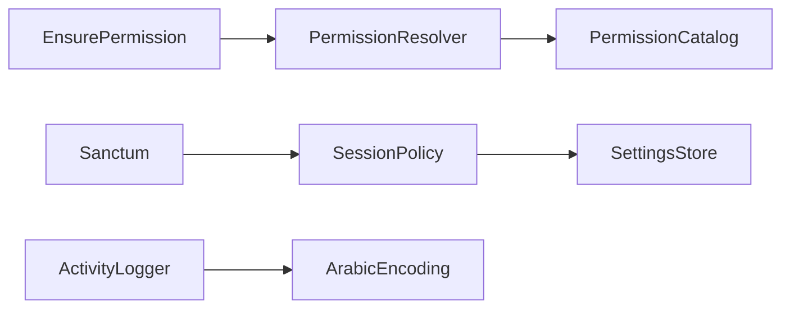

# Security Architecture

<cite>
**Referenced Files in This Document**
- [PermissionResolver.php](file://kyApp_API/app/Support/PermissionResolver.php)
- [PermissionCatalog.php](file://kyApp_API/app/Support/PermissionCatalog.php)
- [EnsurePermission.php](file://kyApp_API/app/Http/Middleware/EnsurePermission.php)
- [SessionPolicy.php](file://kyApp_API/app/Support/SessionPolicy.php)
- [sanctum.php](file://kyApp_API/config/sanctum.php)
- [auth.php](file://kyApp_API/config/auth.php)
- [01_ibac_schema.sql](file://kyApp_API/database/oracle/01_ibac_schema.sql)
- [ActivityLogger.php](file://kyApp_API/app/Support/ActivityLogger.php)
- [ArabicEncoding.php](file://kyApp_API/app/Support/ArabicEncoding.php)
- [login_screen.dart](file://lib/features/auth/presentation/screens/login_screen.dart)
- [biometric_settings_notifier.dart](file://lib/features/settings/presentation/providers/biometric_settings_notifier.dart)
- [permission_snapshot_model.dart](file://lib/features/auth/data/models/permission_snapshot_model.dart)
- [IbacCoreTest.php](file://kyApp_API/tests/Feature/IbacCoreTest.php)
</cite>

## Table of Contents
1. [Introduction](#introduction)
2. [Project Structure](#project-structure)
3. [Core Components](#core-components)
4. [Architecture Overview](#architecture-overview)
5. [Detailed Component Analysis](#detailed-component-analysis)
6. [Dependency Analysis](#dependency-analysis)
7. [Performance Considerations](#performance-considerations)
8. [Troubleshooting Guide](#troubleshooting-guide)
9. [Conclusion](#conclusion)

## Introduction
This document describes the multi-layered security architecture for the application, focusing on:
- Identity-Based Access Control (IBAC) with granular permission resolution and deny-by-default behavior.
- System-wide wildcard permissions and module-level wildcards.
- Multi-factor authentication combining password-based login with biometric authentication using device hardware capabilities.
- Session management with active session tracking, remote termination, sliding renewal, idle expiry, and absolute lifetime.
- Token management through Laravel Sanctum with automatic refresh driven by `EXPIRES_AT`.
- Encryption strategies, secure communication, input validation, audit logging, vulnerability assessment, and compliance considerations.

The backend is a Laravel API backed by an Oracle database schema that stores permissions, grants, settings, and audit events. The frontend is a Flutter application that consumes server-asserted permission snapshots and enforces deny-by-default decisions locally.

## Project Structure
Security-related code spans three layers:
- Backend support classes implement IBAC, session policy, activity logging, and encoding safety.
- Middleware enforces authorization at the HTTP layer.
- Frontend components integrate biometric capability checks and consume permission snapshots.

**Diagram sources**
- [sanctum.php:40-77](file://kyApp_API/config/sanctum.php#L40-L77)
- [SessionPolicy.php:70-107](file://kyApp_API/app/Support/SessionPolicy.php#L70-L107)
- [PermissionResolver.php:95-131](file://kyApp_API/app/Support/PermissionResolver.php#L95-L131)
- [PermissionCatalog.php:22-40](file://kyApp_API/app/Support/PermissionCatalog.php#L22-L40)
- [ActivityLogger.php:37-73](file://kyApp_API/app/Support/ActivityLogger.php#L37-L73)
- [01_ibac_schema.sql:38-100](file://kyApp_API/database/oracle/01_ibac_schema.sql#L38-L100)

**Section sources**
- [sanctum.php:21-77](file://kyApp_API/config/sanctum.php#L21-L77)
- [auth.php:40-68](file://kyApp_API/config/auth.php#L40-L68)
- [01_ibac_schema.sql:21-100](file://kyApp_API/database/oracle/01_ibac_schema.sql#L21-L100)

## Core Components
- IBAC Permission Resolution: Implemented by `PermissionResolver` with explicit rules, caching, and system-wide bypass for administrators.
- Permission Catalog: Centralized definition of modules, actions, wildcards, and labels consumed by seeding, validation, and UI.
- Authorization Middleware: `EnsurePermission` enforces deny-by-default access control per route.
- Session Policy: Sliding renewal, idle expiry, absolute lifetime, and best-effort cleanup of expired tokens.
- Sanctum Configuration: Stateful domains, guard configuration, last-used tracking, token prefixing, and CSRF/cookie middleware.
- Activity Logger: Secure, non-failing audit trail into `APP_USER_ACTIVITY`.
- Encoding Safety: Arabic text handling to avoid mojibake and ensure safe storage and display.

**Section sources**
- [PermissionResolver.php:9-26](file://kyApp_API/app/Support/PermissionResolver.php#L9-L26)
- [PermissionCatalog.php:5-21](file://kyApp_API/app/Support/PermissionCatalog.php#L5-L21)
- [EnsurePermission.php:11-24](file://kyApp_API/app/Http/Middleware/EnsurePermission.php#L11-L24)
- [SessionPolicy.php:9-41](file://kyApp_API/app/Support/SessionPolicy.php#L9-L41)
- [sanctum.php:40-109](file://kyApp_API/config/sanctum.php#L40-L109)
- [ActivityLogger.php:9-17](file://kyApp_API/app/Support/ActivityLogger.php#L9-L17)
- [ArabicEncoding.php:55-64](file://kyApp_API/app/Support/ArabicEncoding.php#L55-L64)

## Architecture Overview
The security architecture combines multiple layers:
- Authentication: Sanctum validates personal access tokens; session state is tracked via `LAST_USED_AT` and `EXPIRES_AT`.
- Authorization: IBAC resolves permissions from Oracle tables with a strict deny-by-default model.
- Session Management: Sliding renewal extends `EXPIRES_AT`; idle sessions expire after configured minutes; absolute lifetime caps token age.
- Audit Logging: All significant actions are recorded in `APP_USER_ACTIVITY`, never failing successful requests.
- Data Protection: Sensitive data uses encrypted casts where appropriate; inputs are validated against a canonical catalog; Arabic text is safely encoded.

**Diagram sources**
- [sanctum.php:40-77](file://kyApp_API/config/sanctum.php#L40-L77)
- [SessionPolicy.php:70-107](file://kyApp_API/app/Support/SessionPolicy.php#L70-L107)
- [PermissionResolver.php:95-131](file://kyApp_API/app/Support/PermissionResolver.php#L95-L131)
- [PermissionCatalog.php:447-468](file://kyApp_API/app/Support/PermissionCatalog.php#L447-L468)
- [ActivityLogger.php:37-73](file://kyApp_API/app/Support/ActivityLogger.php#L37-L73)
- [01_ibac_schema.sql:38-100](file://kyApp_API/database/oracle/01_ibac_schema.sql#L38-L100)

## Detailed Component Analysis

### IBAC Permission Resolution
The IBAC system evaluates permissions in a strict order:
1. System administrator (`IS_ADMIN = 1`) bypasses grant checks entirely.
2. System-wide wildcard (`system.*`) grants all permissions.
3. Explicit permission code match grants access.
4. Module wildcard (`module.*`) covers any action under that module.
5. Otherwise, deny.

The resolver caches effective codes per user with a safe payload size limit to avoid Oracle binding errors. It also derives module lists for client payloads.

**Diagram sources**
- [PermissionResolver.php:95-131](file://kyApp_API/app/Support/PermissionResolver.php#L95-L131)
- [PermissionCatalog.php:34-40](file://kyApp_API/app/Support/PermissionCatalog.php#L34-L40)

**Section sources**
- [PermissionResolver.php:9-26](file://kyApp_API/app/Support/PermissionResolver.php#L9-L26)
- [PermissionResolver.php:66-89](file://kyApp_API/app/Support/PermissionResolver.php#L66-L89)
- [PermissionResolver.php:95-131](file://kyApp_API/app/Support/PermissionResolver.php#L95-L131)
- [PermissionResolver.php:178-200](file://kyApp_API/app/Support/PermissionResolver.php#L178-L200)
- [PermissionCatalog.php:22-40](file://kyApp_API/app/Support/PermissionCatalog.php#L22-L40)
- [IbacCoreTest.php:74-87](file://kyApp_API/tests/Feature/IbacCoreTest.php#L74-L87)

### Authorization Middleware
The `EnsurePermission` middleware enforces deny-by-default at the route level:
- If no authenticated user exists, return 401.
- If the user lacks the required permission, return 403 with an Arabic-friendly message derived from the catalog.
- Administrators always pass due to resolver short-circuiting.

**Diagram sources**
- [EnsurePermission.php:32-52](file://kyApp_API/app/Http/Middleware/EnsurePermission.php#L32-L52)
- [PermissionCatalog.php:432-441](file://kyApp_API/app/Support/PermissionCatalog.php#L432-L441)

**Section sources**
- [EnsurePermission.php:11-24](file://kyApp_API/app/Http/Middleware/EnsurePermission.php#L11-L24)
- [EnsurePermission.php:32-52](file://kyApp_API/app/Http/Middleware/EnsurePermission.php#L32-L52)

### Session Management and Token Strategy
Session policy implements:
- Silent sliding renewal while active: updates `EXPIRES_AT` only when necessary based on a touch threshold.
- Idle expiry: rejects sessions past `session_idle_minutes`.
- Absolute lifetime: rejects sessions older than `session_absolute_days`.
- Best-effort cleanup: deletes expired tokens on rejection and periodically purges leftovers.

Sanctum configuration:
- `expiration` remains null to avoid hard absolute age conflicts; sliding renewal is handled by `SessionPolicy`.
- `last_used_at` is enabled so active sessions reflect real activity.
- Stateful domains allow SPA cookie-based auth.
- Token prefixing supports secret scanning.

**Diagram sources**
- [SessionPolicy.php:70-107](file://kyApp_API/app/Support/SessionPolicy.php#L70-L107)
- [SessionPolicy.php:114-117](file://kyApp_API/app/Support/SessionPolicy.php#L114-L117)
- [SessionPolicy.php:130-141](file://kyApp_API/app/Support/SessionPolicy.php#L130-L141)
- [SessionPolicy.php:166-183](file://kyApp_API/app/Support/SessionPolicy.php#L166-L183)
- [sanctum.php:40-77](file://kyApp_API/config/sanctum.php#L40-L77)

**Section sources**
- [SessionPolicy.php:9-41](file://kyApp_API/app/Support/SessionPolicy.php#L9-L41)
- [SessionPolicy.php:70-107](file://kyApp_API/app/Support/SessionPolicy.php#L70-L107)
- [SessionPolicy.php:114-117](file://kyApp_API/app/Support/SessionPolicy.php#L114-L117)
- [SessionPolicy.php:130-141](file://kyApp_API/app/Support/SessionPolicy.php#L130-L141)
- [SessionPolicy.php:166-183](file://kyApp_API/app/Support/SessionPolicy.php#L166-L183)
- [sanctum.php:40-77](file://kyApp_API/config/sanctum.php#L40-L77)

### Multi-Factor Authentication Flow
The application supports:
- Password-based login via Sanctum session guard.
- Biometric authentication using device hardware capabilities.
- Server-asserted permission snapshots delivered during login and `/auth/me`, used by the client to enforce deny-by-default decisions.

Frontend integration:
- Login screen offers biometric login option alongside password entry.
- Biometric settings notifier manages capability detection, enablement, and error/success messaging.
- Permission snapshot model carries server-asserted state including admin flag, permissions, modules, and optional session expiry.

**Diagram sources**
- [login_screen.dart:272-303](file://lib/features/auth/presentation/screens/login_screen.dart#L272-L303)
- [biometric_settings_notifier.dart:9-65](file://lib/features/settings/presentation/providers/biometric_settings_notifier.dart#L9-L65)
- [permission_snapshot_model.dart:1-28](file://lib/features/auth/data/models/permission_snapshot_model.dart#L1-L28)
- [sanctum.php:40-77](file://kyApp_API/config/sanctum.php#L40-L77)

**Section sources**
- [login_screen.dart:272-303](file://lib/features/auth/presentation/screens/login_screen.dart#L272-L303)
- [biometric_settings_notifier.dart:9-65](file://lib/features/settings/presentation/providers/biometric_settings_notifier.dart#L9-L65)
- [permission_snapshot_model.dart:1-28](file://lib/features/auth/data/models/permission_snapshot_model.dart#L1-L28)

### Data Protection and Input Validation
- Encryption: Use Laravel’s `encrypted` cast for sensitive attributes; hide them from JSON serialization.
- Secure Communication: Sanctum enables CSRF protection and cookie encryption for stateful SPAs.
- Input Validation: Permission codes are validated against `PermissionCatalog::isValidCode`, enforcing lowercase module/action format and rejecting partial wildcards.
- Arabic Text Safety: `ArabicEncoding` ensures idempotent repair of mojibake and safe storage in Oracle CP1256-compatible fields.

**Diagram sources**
- [PermissionCatalog.php:447-456](file://kyApp_API/app/Support/PermissionCatalog.php#L447-L456)
- [ArabicEncoding.php:55-64](file://kyApp_API/app/Support/ArabicEncoding.php#L55-L64)
- [sanctum.php:105-109](file://kyApp_API/config/sanctum.php#L105-L109)

**Section sources**
- [PermissionCatalog.php:447-456](file://kyApp_API/app/Support/PermissionCatalog.php#L447-L456)
- [ArabicEncoding.php:55-64](file://kyApp_API/app/Support/ArabicEncoding.php#L55-L64)
- [sanctum.php:105-109](file://kyApp_API/config/sanctum.php#L105-L109)

### Audit Logging and Compliance
- Activity Logger writes to `APP_USER_ACTIVITY` with bounded fields, IP/user-agent capture, and status tracking.
- Logging failures are reported but never break successful requests.
- Schema includes indexes for efficient querying by user, target user, module, and time.
- Compliance considerations include least privilege (deny-by-default), audit trails, and controlled exposure of sensitive data.

**Diagram sources**
- [ActivityLogger.php:37-73](file://kyApp_API/app/Support/ActivityLogger.php#L37-L73)
- [01_ibac_schema.sql:152-173](file://kyApp_API/database/oracle/01_ibac_schema.sql#L152-L173)

**Section sources**
- [ActivityLogger.php:9-17](file://kyApp_API/app/Support/ActivityLogger.php#L9-L17)
- [ActivityLogger.php:37-73](file://kyApp_API/app/Support/ActivityLogger.php#L37-L73)
- [01_ibac_schema.sql:152-173](file://kyApp_API/database/oracle/01_ibac_schema.sql#L152-L173)

## Dependency Analysis
Key dependencies:
- `PermissionResolver` depends on `PermissionCatalog` for canonical codes and wildcards.
- `EnsurePermission` middleware depends on `PermissionResolver` for authorization decisions.
- `SessionPolicy` depends on `SettingsStore` for configurable thresholds and interacts with Sanctum’s token lifecycle.
- `ActivityLogger` depends on Oracle connection and `ArabicEncoding` for safe text handling.

**Diagram sources**
- [EnsurePermission.php:5-8](file://kyApp_API/app/Http/Middleware/EnsurePermission.php#L5-L8)
- [PermissionResolver.php:5-8](file://kyApp_API/app/Support/PermissionResolver.php#L5-L8)
- [SessionPolicy.php:44-44](file://kyApp_API/app/Support/SessionPolicy.php#L44-L44)
- [ActivityLogger.php:5-7](file://kyApp_API/app/Support/ActivityLogger.php#L5-L7)

**Section sources**
- [EnsurePermission.php:5-8](file://kyApp_API/app/Http/Middleware/EnsurePermission.php#L5-L8)
- [PermissionResolver.php:5-8](file://kyApp_API/app/Support/PermissionResolver.php#L5-L8)
- [SessionPolicy.php:44-44](file://kyApp_API/app/Support/SessionPolicy.php#L44-L44)
- [ActivityLogger.php:5-7](file://kyApp_API/app/Support/ActivityLogger.php#L5-L7)

## Performance Considerations
- Caching: `PermissionResolver` caches effective permission codes per user with a safe byte limit to avoid Oracle binding errors.
- Write Throttling: `SessionPolicy` slides token expiry only when necessary, reducing database writes.
- Query Optimization: Oracle indexes on `APP_USERS_PERMISSIONS` and `APP_USER_ACTIVITY` improve lookup performance.
- Stateless vs Stateful: Sanctum’s `last_used_at` enables accurate activity tracking without heavy custom logic.

[No sources needed since this section provides general guidance]

## Troubleshooting Guide
Common issues and resolutions:
- 401 Unauthorized: Indicates missing or expired token; check `EXPIRES_AT` and `IS_ACTIVATED`.
- 403 Forbidden: Indicates insufficient permissions; verify grant rows and catalog validity.
- Oracle Binding Errors: Large permission sets may exceed cache payload limits; resolver skips cache for oversized sets.
- Arabic Text Corruption: Ensure `ArabicEncoding` is applied consistently; avoid double-repairing already valid UTF-8.

**Section sources**
- [SessionPolicy.php:70-107](file://kyApp_API/app/Support/SessionPolicy.php#L70-L107)
- [PermissionResolver.php:36-43](file://kyApp_API/app/Support/PermissionResolver.php#L36-L43)
- [ArabicEncoding.php:55-64](file://kyApp_API/app/Support/ArabicEncoding.php#L55-L64)

## Conclusion
The security architecture implements a robust, multi-layered approach:
- IBAC with deny-by-default and granular permission resolution.
- System-wide and module-level wildcards for flexible access control.
- Multi-factor authentication combining passwords and biometrics.
- Session management with sliding renewal, idle expiry, and absolute lifetime.
- Sanctum-based token strategy with automatic refresh.
- Strong data protection, input validation, and audit logging.
- Compliance-ready design with least privilege and comprehensive auditing.

[No sources needed since this section summarizes without analyzing specific files]