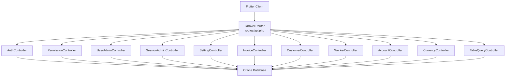
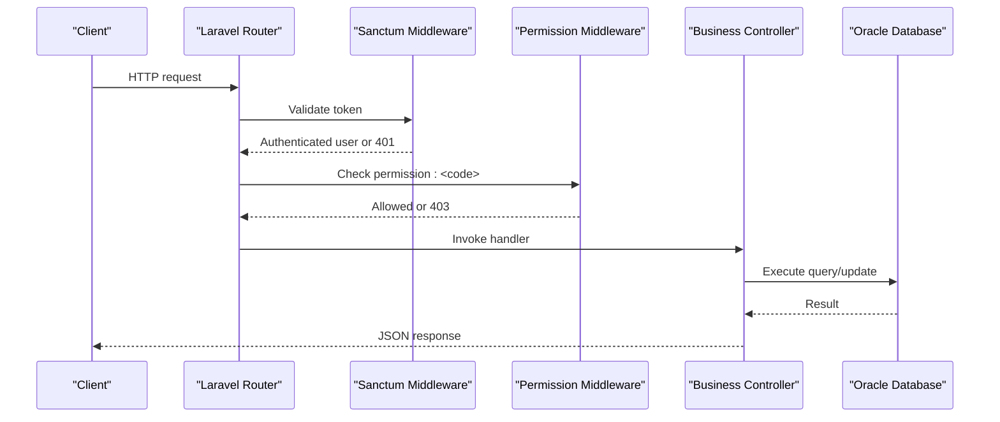
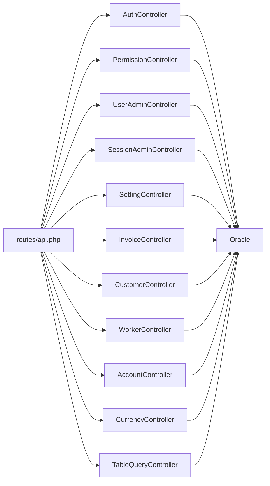
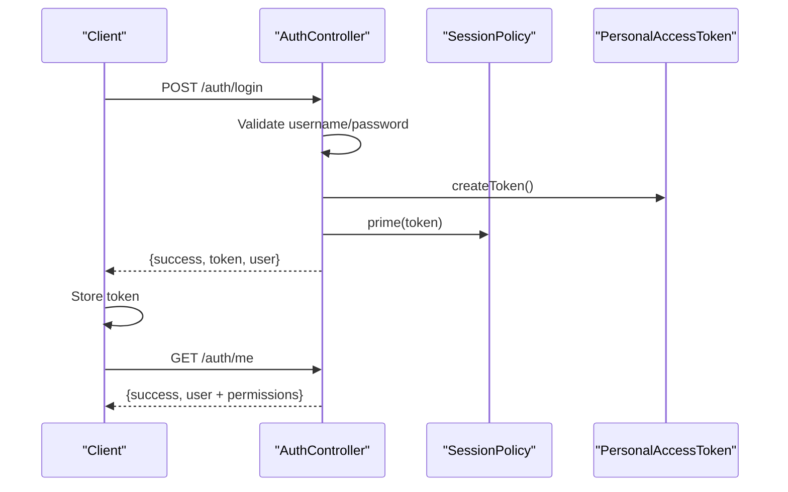
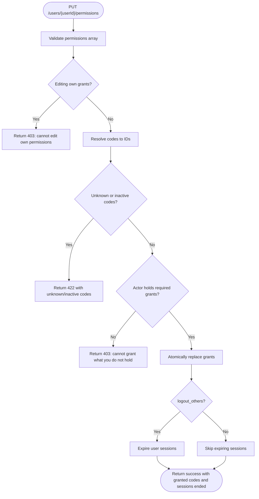

# API Endpoints Reference

<cite>
**Referenced Files in This Document**   
- [api.php](file://kyApp_API/routes/api.php)
- [AuthController.php](file://kyApp_API/app/Http/Controllers/AuthController.php)
- [PermissionController.php](file://kyApp_API/app/Http/Controllers/PermissionController.php)
- [UserAdminController.php](file://kyApp_API/app/Http/Controllers/UserAdminController.php)
- [SessionAdminController.php](file://kyApp_API/app/Http/Controllers/SessionAdminController.php)
- [SettingController.php](file://kyApp_API/app/Http/Controllers/SettingController.php)
- [InvoiceController.php](file://kyApp_API/app/Http/Controllers/InvoiceController.php)
- [CustomerController.php](file://kyApp_API/app/Http/Controllers/CustomerController.php)
- [WorkerController.php](file://kyApp_API/app/Http/Controllers/WorkerController.php)
- [AccountController.php](file://kyApp_API/app/Http/Controllers/AccountController.php)
- [CurrencyController.php](file://kyApp_API/app/Http/Controllers/CurrencyController.php)
- [TableQueryController.php](file://kyApp_API/app/Http/Controllers/TableQueryController.php)
</cite>

## Table of Contents
1. [Introduction](#introduction)
2. [Project Structure](#project-structure)
3. [Core Components](#core-components)
4. [Architecture Overview](#architecture-overview)
5. [Detailed Component Analysis](#detailed-component-analysis)
6. [Dependency Analysis](#dependency-analysis)
7. [Performance Considerations](#performance-considerations)
8. [Troubleshooting Guide](#troubleshooting-guide)
9. [Conclusion](#conclusion)
10. [Appendices](#appendices)

## Introduction
This document is the authoritative API reference for the Laravel backend exposed to the Flutter application. It covers every RESTful endpoint defined in the route file, grouped by functional area: authentication, user and permission administration, active sessions, security settings, invoices, customers, workers, accounting, currencies, and a diagnostic table query tool.

Key characteristics:
- Authentication uses Laravel Sanctum personal access tokens.
- Authorization uses an IBAC (Identity-Based Access Control) system with explicit `permission:<code>` middleware on each route.
- All business endpoints require a valid Sanctum token; many also require a specific permission code.
- Pagination follows a consistent pattern: `page`, `limit`, `meta.total`, `meta.page`, `meta.limit`, `meta.pages`.
- Arabic text is stored in Oracle as CP1256 bytes; the API normalizes it through encoding helpers.
- There is no explicit URL versioning; routes are flat under `/auth`, `/users`, `/permissions`, `/sessions`, `/settings`, `/invoices`, `/customers`, `/workers`, `/accounts`, `/currencies`, and `/selectFromTable`.

## Project Structure
The API is implemented as a standard Laravel application:
- Routes are declared in `routes/api.php`.
- Controllers live under `app/Http/Controllers`.
- Business data is read/written directly against an Oracle database connection named `oracle`.
- Security and authorization are enforced by Sanctum and custom permission middleware.



**Diagram sources**
- [api.php:1-327](file://kyApp_API/routes/api.php#L1-L327)
- [AuthController.php:1-494](file://kyApp_API/app/Http/Controllers/AuthController.php#L1-L494)
- [PermissionController.php:1-379](file://kyApp_API/app/Http/Controllers/PermissionController.php#L1-L379)
- [UserAdminController.php:1-1169](file://kyApp_API/app/Http/Controllers/UserAdminController.php#L1-L1169)
- [SessionAdminController.php:1-474](file://kyApp_API/app/Http/Controllers/SessionAdminController.php#L1-L474)
- [SettingController.php:1-355](file://kyApp_API/app/Http/Controllers/SettingController.php#L1-L355)
- [InvoiceController.php:1-140](file://kyApp_API/app/Http/Controllers/InvoiceController.php#L1-L140)
- [CustomerController.php:1-464](file://kyApp_API/app/Http/Controllers/CustomerController.php#L1-L464)
- [WorkerController.php:1-598](file://kyApp_API/app/Http/Controllers/WorkerController.php#L1-L598)
- [AccountController.php:1-810](file://kyApp_API/app/Http/Controllers/AccountController.php#L1-L810)
- [CurrencyController.php:1-402](file://kyApp_API/app/Http/Controllers/CurrencyController.php#L1-L402)
- [TableQueryController.php:1-215](file://kyApp_API/app/Http/Controllers/TableQueryController.php#L1-L215)

**Section sources**
- [api.php:1-327](file://kyApp_API/routes/api.php#L1-L327)

## Core Components
- **Authentication**: Login, logout, current user profile, biometric enrollment/login/revoke, and effective permissions.
- **User Administration**: Create, read, update, toggle activation, delete, and audit activity for application users.
- **Permissions**: Catalog of available permissions, per-user grant inspection, and atomic grant replacement.
- **Sessions**: List active/expired/disabled sessions and terminate individual or all sessions for a user.
- **Security Settings**: Read and batch-update runtime settings such as idle session windows and feature flags.
- **Invoices**: Read-only invoice listing and detail from the legacy accounting system.
- **Customers**: Full CRUD plus statement generation with optional date filtering.
- **Workers**: Separate registries for employees, cutters, and tailors with CRUD, status toggling, and statements.
- **Accounts**: Chart-of-accounts tree, financial accounts, sub-groups, and detailed statements.
- **Currencies**: Currency directory and daily exchange rates.
- **Diagnostic Query**: A highly restricted dynamic table reader for administrators.

**Section sources**
- [api.php:17-327](file://kyApp_API/routes/api.php#L17-L327)

## Architecture Overview
The API enforces two layers of protection:
1. `auth:sanctum` ensures the request carries a valid personal access token.
2. `permission:<code>` ensures the authenticated actor has the required grant.



**Diagram sources**
- [api.php:24-34](file://kyApp_API/routes/api.php#L24-L34)
- [api.php:45-88](file://kyApp_API/routes/api.php#L45-L88)
- [api.php:99-116](file://kyApp_API/routes/api.php#L99-L116)
- [api.php:138-142](file://kyApp_API/routes/api.php#L138-L142)
- [api.php:160-179](file://kyApp_API/routes/api.php#L160-L179)
- [api.php:189-243](file://kyApp_API/routes/api.php#L189-L243)
- [api.php:255-291](file://kyApp_API/routes/api.php#L255-L291)
- [api.php:302-326](file://kyApp_API/routes/api.php#L302-L326)

## Detailed Component Analysis

### Authentication Endpoints

#### POST `/auth/login`
- Purpose: Authenticate a user and issue a Sanctum token.
- Authentication: None.
- Request body:
  - `username`: string, required, max 50.
  - `password`: string, required.
  - `user_type`: string, optional; allowed values include `employee`, `customer`, `1`, `2`.
- Success response:
  - `success`: boolean.
  - `message`: string.
  - `token`: string Sanctum token.
  - `user`: object containing user identity, admin flag, permissions, modules, and related IBAC state.
- Error responses:
  - 422: Validation failure.
  - 401: Invalid username/password.
  - 403: Account deactivated.

Example curl:
```bash
curl -X POST https://your-api.example.com/auth/login \
  -H "Content-Type: application/json" \
  -d '{"username":"admin","password":"secret"}'
```

**Section sources**
- [api.php:19-19](file://kyApp_API/routes/api.php#L19-L19)
- [AuthController.php:47-164](file://kyApp_API/app/Http/Controllers/AuthController.php#L47-L164)

#### POST `/auth/biometric/login`
- Purpose: Authenticate using a registered device fingerprint without a password.
- Authentication: None.
- Request body:
  - `user_id`: integer, required.
  - `device_token`: string, required, max 512.
- Behavior:
  - Requires biometric login enabled in security settings.
  - Validates that the device token belongs to the requested user.
  - Issues a Sanctum token with sliding session policy.
- Success response:
  - `success`, `message`, `token`, `user` with `biometric_enabled: true`.
- Error responses:
  - 422: Validation error.
  - 403: Biometric login disabled by settings.
  - 401: Device not registered or mismatched.
  - 403: Account deactivated.

Example curl:
```bash
curl -X POST https://your-api.example.com/auth/biometric/login \
  -H "Content-Type: application/json" \
  -d '{"user_id":1,"device_token":"device-token-value"}'
```

**Section sources**
- [api.php:22-22](file://kyApp_API/routes/api.php#L22-L22)
- [AuthController.php:316-411](file://kyApp_API/app/Http/Controllers/AuthController.php#L316-L411)

#### POST `/auth/logout`
- Authentication: Required (`auth:sanctum`).
- Purpose: Revoke the current token.
- Response:
  - `success`: boolean.
  - `message`: string.

Example curl:
```bash
curl -X POST https://your-api.example.com/auth/logout \
  -H "Authorization: Bearer YOUR_TOKEN"
```

**Section sources**
- [api.php:24-25](file://kyApp_API/routes/api.php#L24-L25)
- [AuthController.php:221-239](file://kyApp_API/app/Http/Controllers/AuthController.php#L221-L239)

#### GET `/auth/me`
- Authentication: Required (`auth:sanctum`).
- Purpose: Return the authenticated user’s profile with IBAC state.
- Response:
  - `success`: boolean.
  - `user`: object with identity and permissions payload.

Example curl:
```bash
curl -X GET https://your-api.example.com/auth/me \
  -H "Authorization: Bearer YOUR_TOKEN"
```

**Section sources**
- [api.php:26-26](file://kyApp_API/routes/api.php#L26-L26)
- [AuthController.php:170-179](file://kyApp_API/app/Http/Controllers/AuthController.php#L170-L179)

#### GET `/auth/permissions`
- Authentication: Required (`auth:sanctum`).
- Purpose: Return the current user’s effective permissions, modules, admin flag, and session expiry hint.
- Response:
  - `success`, `message`, `data.permissions`, `data.modules`, `data.is_admin`, `data.session_expires_at`.

Example curl:
```bash
curl -X GET https://your-api.example.com/auth/permissions \
  -H "Authorization: Bearer YOUR_TOKEN"
```

**Section sources**
- [api.php:48-48](file://kyApp_API/routes/api.php#L48-L48)
- [AuthController.php:190-215](file://kyApp_API/app/Http/Controllers/AuthController.php#L190-L215)

#### POST `/auth/biometric/register`
- Authentication: Required (`auth:sanctum`).
- Purpose: Register a device for biometric login.
- Request body:
  - `device_token`: string, required, max 512.
  - `device_name`: string, required, max 200.
  - `platform`: string, required; allowed values `android`, `ios`.
- Success response:
  - `success`, `message`.
- Error responses:
  - 422: Validation error.
  - 409: Device already bound to another user.

Example curl:
```bash
curl -X POST https://your-api.example.com/auth/biometric/register \
  -H "Authorization: Bearer YOUR_TOKEN" \
  -H "Content-Type: application/json" \
  -d '{"device_token":"dev-token","device_name":"My Phone","platform":"android"}'
```

**Section sources**
- [api.php:32-32](file://kyApp_API/routes/api.php#L32-L32)
- [AuthController.php:245-310](file://kyApp_API/app/Http/Controllers/AuthController.php#L245-L310)

#### DELETE `/auth/biometric/revoke`
- Authentication: Required (`auth:sanctum`).
- Purpose: Remove biometric enrollment for the current device.
- Response:
  - `success`, `message`.

Example curl:
```bash
curl -X DELETE https://your-api.example.com/auth/biometric/revoke \
  -H "Authorization: Bearer YOUR_TOKEN"
```

**Section sources**
- [api.php:33-33](file://kyApp_API/routes/api.php#L33-L33)
- [AuthController.php:417-441](file://kyApp_API/app/Http/Controllers/AuthController.php#L417-L441)

### User and Permission Administration

#### GET `/permissions`
- Authentication: Required (`auth:sanctum`).
- Permission: `users.view`.
- Purpose: Return the full permission catalog grouped by module.
- Response:
  - `success`, `message`, `data`: array of modules with permissions including IDs, codes, names, core flags, and sort order.
  - `meta.total`, `meta.modules`.

Example curl:
```bash
curl -X GET https://your-api.example.com/permissions \
  -H "Authorization: Bearer YOUR_TOKEN"
```

**Section sources**
- [api.php:51-52](file://kyApp_API/routes/api.php#L51-L52)
- [PermissionController.php:51-93](file://kyApp_API/app/Http/Controllers/PermissionController.php#L51-L93)

#### GET `/users/{userId}/permissions`
- Authentication: Required (`auth:sanctum`).
- Permission: `users.view`.
- Path parameter: `userId` must be numeric.
- Purpose: Return a single user’s granted permissions and admin state.
- Response:
  - `success`, `data.user_id`, `data.user_name_en`, `data.user_name_ar`, `data.is_admin`, `data.effective_permissions`, `data.granted_codes`, `data.granted_ids`.

Example curl:
```bash
curl -X GET https://your-api.example.com/users/1/permissions \
  -H "Authorization: Bearer YOUR_TOKEN"
```

**Section sources**
- [api.php:54-56](file://kyApp_API/routes/api.php#L54-L56)
- [PermissionController.php:99-128](file://kyApp_API/app/Http/Controllers/PermissionController.php#L99-L128)

#### PUT `/users/{userId}/permissions`
- Authentication: Required (`auth:sanctum`).
- Permission: `users.permissions_manage`.
- Path parameter: `userId` must be numeric.
- Purpose: Atomically replace a user’s grants.
- Request body:
  - `permissions`: array of strings, required; empty list revokes all permissions.
  - `logout_others`: boolean, optional; defaults to ending the user’s sessions.
- Success response:
  - `success`, `message`, `data.user_id`, `data.granted_codes`, `data.granted_ids`, `data.sessions_ended`.
- Error responses:
  - 422: Missing or invalid permissions.
  - 403: Non-admin editing own grants or granting unknown/inactive permissions.

Example curl:
```bash
curl -X PUT https://your-api.example.com/users/1/permissions \
  -H "Authorization: Bearer YOUR_TOKEN" \
  -H "Content-Type: application/json" \
  -d '{"permissions":["customers.view","invoices.view"],"logout_others":true}'
```

**Section sources**
- [api.php:58-60](file://kyApp_API/routes/api.php#L58-L60)
- [PermissionController.php:137-243](file://kyApp_API/app/Http/Controllers/PermissionController.php#L137-L243)

#### GET `/users`
- Authentication: Required (`auth:sanctum`).
- Permission: `users.view`.
- Purpose: List users with search, filters, sorting, and pagination.
- Query parameters:
  - `search`: string.
  - `status`: `all`, `active`, `inactive`.
  - `user_type`: `all`, `1`, `2`.
  - `admin_only`: boolean.
  - `sort`: whitelisted column name.
  - `direction`: `asc` or `desc`.
  - `page`, `limit`.
- Response:
  - `success`, `message`, `data`: array of users.
  - `meta.total`, `meta.page`, `meta.limit`, `meta.pages`.

Example curl:
```bash
curl -X GET "https://your-api.example.com/users?search=admin&status=active&page=1&limit=50" \
  -H "Authorization: Bearer YOUR_TOKEN"
```

**Section sources**
- [api.php:63-64](file://kyApp_API/routes/api.php#L63-L64)
- [UserAdminController.php:108-148](file://kyApp_API/app/Http/Controllers/UserAdminController.php#L108-L148)

#### GET `/users/{userId}`
- Authentication: Required (`auth:sanctum`).
- Permission: `users.view`.
- Path parameter: `userId` must be numeric.
- Purpose: Return one user with grants and latest activity timestamp.
- Response:
  - `success`, `data` with user fields, `granted_codes`, `granted_ids`, `last_activity_on`.

Example curl:
```bash
curl -X GET https://your-api.example.com/users/1 \
  -H "Authorization: Bearer YOUR_TOKEN"
```

**Section sources**
- [api.php:66-68](file://kyApp_API/routes/api.php#L66-L68)
- [UserAdminController.php:154-182](file://kyApp_API/app/Http/Controllers/UserAdminController.php#L154-L182)

#### POST `/users`
- Authentication: Required (`auth:sanctum`).
- Permission: `users.create`.
- Purpose: Create a new user and optionally assign permissions.
- Request body:
  - `user_name_en`: string, required, min 2, max 50.
  - `user_name_ar`: string, optional, max 120.
  - `user_password`: string, required, minimum length controlled by settings.
  - `user_type`: integer, optional; allowed values `1`, `2`.
  - `is_activated`: integer, optional; allowed values `0`, `1`.
  - `is_admin`: integer, optional; allowed values `0`, `1`; requires `users.admin_flag_manage`.
  - `branch_no`: integer, optional, non-negative.
  - `note`: string, optional, max 100.
  - `cash_acc_no`: integer, optional, non-negative.
  - `allow_bank_acc`: integer, optional; allowed values `0`, `1`.
  - `permissions`: array of strings, optional.
- Success response:
  - `success`, `message`, `data` with created user.
- Error responses:
  - 422: Validation error.
  - 409: Username already exists.
  - 403: Non-admin trying to set admin flag.

Example curl:
```bash
curl -X POST https://your-api.example.com/users \
  -H "Authorization: Bearer YOUR_TOKEN" \
  -H "Content-Type: application/json" \
  -d '{
    "user_name_en":"newuser",
    "user_name_ar":"مستخدم جديد",
    "user_password":"securepass",
    "user_type":1,
    "is_activated":1,
    "permissions":["customers.view"]
  }'
```

**Section sources**
- [api.php:70-71](file://kyApp_API/routes/api.php#L70-L71)
- [UserAdminController.php:188-312](file://kyApp_API/app/Http/Controllers/UserAdminController.php#L188-L312)

#### PUT `/users/{userId}`
- Authentication: Required (`auth:sanctum`).
- Permission: `users.update`.
- Path parameter: `userId` must be numeric.
- Purpose: Update user fields and optionally replace permissions.
- Request body: Same fields as create, but most are optional; password change is supported.
- Security rules:
  - Self-edits cannot change account type or admin flag.
  - Changing admin flag requires `users.admin_flag_manage`.
  - Cannot demote the last administrator.
- Success response:
  - `success`, `message`, `data` with updated user.

Example curl:
```bash
curl -X PUT https://your-api.example.com/users/1 \
  -H "Authorization: Bearer YOUR_TOKEN" \
  -H "Content-Type: application/json" \
  -d '{"user_name_en":"updateduser","is_activated":1}'
```

**Section sources**
- [api.php:73-75](file://kyApp_API/routes/api.php#L73-L75)
- [UserAdminController.php:318-496](file://kyApp_API/app/Http/Controllers/UserAdminController.php#L318-L496)

#### PATCH `/users/{userId}/toggle`
- Authentication: Required (`auth:sanctum`).
- Permission: `users.toggle`.
- Path parameter: `userId` must be numeric.
- Purpose: Toggle user activation.
- Security rules:
  - Cannot deactivate self.
  - Cannot deactivate the last administrator.
- Success response:
  - `success`, `message`, `data.user_id`, `data.is_activated`, `data.sessions_ended`.

Example curl:
```bash
curl -X PATCH https://your-api.example.com/users/1/toggle \
  -H "Authorization: Bearer YOUR_TOKEN"
```

**Section sources**
- [api.php:77-79](file://kyApp_API/routes/api.php#L77-L79)
- [UserAdminController.php:502-560](file://kyApp_API/app/Http/Controllers/UserAdminController.php#L502-L560)

#### DELETE `/users/{userId}`
- Authentication: Required (`auth:sanctum`).
- Permission: `users.delete`.
- Path parameter: `userId` must be numeric.
- Purpose: Delete a user, their grants, and tokens.
- Security rules:
  - Cannot delete self.
  - Cannot delete the last administrator.
- Success response:
  - `success`, `message`, `data.user_id`.

Example curl:
```bash
curl -X DELETE https://your-api.example.com/users/1 \
  -H "Authorization: Bearer YOUR_TOKEN"
```

**Section sources**
- [api.php:81-83](file://kyApp_API/routes/api.php#L81-L83)
- [UserAdminController.php:566-626](file://kyApp_API/app/Http/Controllers/UserAdminController.php#L566-L626)

#### GET `/users/{userId}/activity`
- Authentication: Required (`auth:sanctum`).
- Permission: `users.activity_view`.
- Path parameter: `userId` must be numeric.
- Purpose: Retrieve activity trail for a user.
- Query parameters:
  - `page`, `limit`.
- Response:
  - `success`, `data`: array of activity entries.
  - `meta.total`, `meta.page`, `meta.limit`, `meta.pages`.

Example curl:
```bash
curl -X GET "https://your-api.example.com/users/1/activity?page=1&limit=50" \
  -H "Authorization: Bearer YOUR_TOKEN"
```

**Section sources**
- [api.php:85-87](file://kyApp_API/routes/api.php#L85-L87)
- [UserAdminController.php:632-679](file://kyApp_API/app/Http/Controllers/UserAdminController.php#L632-L679)

### Active Sessions and Security Settings

#### GET `/sessions`
- Authentication: Required (`auth:sanctum`).
- Permission: `sessions.view`.
- Purpose: List active, expired, or disabled sessions with search and pagination.
- Query parameters:
  - `user_id`: integer, optional.
  - `status`: `all`, `active`, `expired`, `disabled`.
  - `search`: string.
  - `page`, `limit`.
- Response:
  - `success`, `message`, `data`: array of sessions.
  - `meta.total`, `meta.page`, `meta.limit`, `meta.pages`.

Example curl:
```bash
curl -X GET "https://your-api.example.com/sessions?status=active&page=1&limit=50" \
  -H "Authorization: Bearer YOUR_TOKEN"
```

**Section sources**
- [api.php:100-101](file://kyApp_API/routes/api.php#L100-L101)
- [SessionAdminController.php:93-141](file://kyApp_API/app/Http/Controllers/SessionAdminController.php#L93-L141)

#### DELETE `/sessions/user/{userId}`
- Authentication: Required (`auth:sanctum`).
- Permission: `sessions.terminate`.
- Path parameter: `userId` must be numeric.
- Purpose: Terminate all sessions for a user.
- Success response:
  - `success`, `message`, `data.user_id`, `data.sessions_ended`.

Example curl:
```bash
curl -X DELETE https://your-api.example.com/sessions/user/1 \
  -H "Authorization: Bearer YOUR_TOKEN"
```

**Section sources**
- [api.php:103-105](file://kyApp_API/routes/api.php#L103-L105)
- [SessionAdminController.php:193-233](file://kyApp_API/app/Http/Controllers/SessionAdminController.php#L193-L233)

#### DELETE `/sessions/{tokenId}`
- Authentication: Required (`auth:sanctum`).
- Permission: `sessions.terminate`.
- Path parameter: `tokenId` must be numeric.
- Purpose: Terminate a single session by token ID.
- Success response:
  - `success`, `message`, `data.token_id`, `data.user_id`, `data.sessions_ended`.

Example curl:
```bash
curl -X DELETE https://your-api.example.com/sessions/123 \
  -H "Authorization: Bearer YOUR_TOKEN"
```

**Section sources**
- [api.php:107-109](file://kyApp_API/routes/api.php#L107-L109)
- [SessionAdminController.php:147-182](file://kyApp_API/app/Http/Controllers/SessionAdminController.php#L147-L182)

#### GET `/settings`
- Authentication: Required (`auth:sanctum`).
- Permission: `settings.view`.
- Purpose: Return all security settings with labels, types, bounds, and current values.
- Response:
  - `success`, `message`, `data`: array of settings.
  - `meta.total`.

Example curl:
```bash
curl -X GET https://your-api.example.com/settings \
  -H "Authorization: Bearer YOUR_TOKEN"
```

**Section sources**
- [api.php:111-112](file://kyApp_API/routes/api.php#L111-L112)
- [SettingController.php:47-82](file://kyApp_API/app/Http/Controllers/SettingController.php#L47-L82)

#### PUT `/settings`
- Authentication: Required (`auth:sanctum`).
- Permission: `settings.update`.
- Purpose: Batch-update security settings.
- Request body:
  - `items`: array of objects, required; each object contains `key` and optional `value`.
  - Locked keys require `settings.security_manage`.
- Success response:
  - `success`, `message`, `data`: changed settings, `meta.changed`.
- Error responses:
  - 422: Validation or invalid setting value.
  - 403: Attempt to modify locked settings without permission.

Example curl:
```bash
curl -X PUT https://your-api.example.com/settings \
  -H "Authorization: Bearer YOUR_TOKEN" \
  -H "Content-Type: application/json" \
  -d '{"items":[{"key":"session_idle_minutes","value":30},{"key":"biometric_login_enabled","value":true}]}'
```

**Section sources**
- [api.php:114-115](file://kyApp_API/routes/api.php#L114-L115)
- [SettingController.php:98-209](file://kyApp_API/app/Http/Controllers/SettingController.php#L98-L209)

### Invoices

#### GET `/invoices`
- Authentication: Required (`auth:sanctum`).
- Permission: `invoices.view`.
- Purpose: List invoices with search and pagination.
- Query parameters:
  - `search`: string; supports numeric bill number or customer name.
  - `page`, `limit`.
- Response:
  - `success`, `message`, `data`: array of invoices.
  - `meta.total`, `meta.page`, `meta.limit`, `meta.pages`.

Example curl:
```bash
curl -X GET "https://your-api.example.com/invoices?search=1001&page=1&limit=50" \
  -H "Authorization: Bearer YOUR_TOKEN"
```

**Section sources**
- [api.php:138-139](file://kyApp_API/routes/api.php#L138-L139)
- [InvoiceController.php:51-104](file://kyApp_API/app/Http/Controllers/InvoiceController.php#L51-L104)

#### GET `/invoices/{billNo}`
- Authentication: Required (`auth:sanctum`).
- Permission: `invoices.view`.
- Path parameter: `billNo` must be numeric.
- Purpose: Retrieve one invoice by bill number.
- Response:
  - `success`, `message`, `data`: invoice object.

Example curl:
```bash
curl -X GET https://your-api.example.com/invoices/1001 \
  -H "Authorization: Bearer YOUR_TOKEN"
```

**Section sources**
- [api.php:140-141](file://kyApp_API/routes/api.php#L140-L141)
- [InvoiceController.php:110-138](file://kyApp_API/app/Http/Controllers/InvoiceController.php#L110-L138)

### Customers

#### GET `/customers`
- Authentication: Required (`auth:sanctum`).
- Permission: `customers.view`.
- Purpose: List customers with search and pagination.
- Query parameters:
  - `search`: string; supports name, customer number, phone, account number.
  - `page`, `limit`.
- Response:
  - `success`, `data`: array of customers.
  - `meta.total`, `meta.page`, `meta.limit`, `meta.pages`.

Example curl:
```bash
curl -X GET "https://your-api.example.com/customers?search=ali&page=1&limit=100" \
  -H "Authorization: Bearer YOUR_TOKEN"
```

**Section sources**
- [api.php:161-162](file://kyApp_API/routes/api.php#L161-L162)
- [CustomerController.php:28-84](file://kyApp_API/app/Http/Controllers/CustomerController.php#L28-L84)

#### POST `/customers`
- Authentication: Required (`auth:sanctum`).
- Permission: `customers.create`.
- Purpose: Create a new customer.
- Request body:
  - `cust_name`: string, required, max 150.
  - `addr`: string, optional, max 200.
  - `tel1`, `tel2`: string, optional, max 20.
  - `postbox`: string, optional, max 20.
  - `email`: email, optional, max 100.
  - `fax`: string, optional, max 20.
  - `acc_no`: integer, optional.
  - `limited_balance`: numeric, optional.
  - `pre_cust_name`: string, optional, max 150.
  - `stopping_cust`: integer, optional; allowed values `0`, `1`.
- Success response:
  - `success`, `message`, `cust_no`.

Example curl:
```bash
curl -X POST https://your-api.example.com/customers \
  -H "Authorization: Bearer YOUR_TOKEN" \
  -H "Content-Type: application/json" \
  -d '{"cust_name":"Ali Trading","email":"ali@example.com","acc_no":12345}'
```

**Section sources**
- [api.php:163-164](file://kyApp_API/routes/api.php#L163-L164)
- [CustomerController.php:118-182](file://kyApp_API/app/Http/Controllers/CustomerController.php#L118-L182)

#### GET `/customers/{custNo}/statement`
- Authentication: Required (`auth:sanctum`).
- Permission: `customers.statement`.
- Path parameter: `custNo` must be numeric.
- Purpose: Generate a customer account statement with optional date range.
- Query parameters:
  - `from_date`: optional; DD/MM/YYYY or ISO-like formats.
  - `to_date`: optional; DD/MM/YYYY or ISO-like formats.
- Response:
  - `success`, `customer`, `data`: transaction rows.
  - `summary`: totals, opening/final balance, dates, currency, account title.

Example curl:
```bash
curl -X GET "https://your-api.example.com/customers/1/statement?from_date=01/01/2025&to_date=31/01/2025" \
  -H "Authorization: Bearer YOUR_TOKEN"
```

**Section sources**
- [api.php:167-169](file://kyApp_API/routes/api.php#L167-L169)
- [CustomerController.php:294-421](file://kyApp_API/app/Http/Controllers/CustomerController.php#L294-L421)

#### GET `/customers/{custNo}`
- Authentication: Required (`auth:sanctum`).
- Permission: `customers.view`.
- Path parameter: `custNo` must be numeric.
- Purpose: Retrieve one customer by number.
- Response:
  - `success`, `data`: customer object.

Example curl:
```bash
curl -X GET https://your-api.example.com/customers/1 \
  -H "Authorization: Bearer YOUR_TOKEN"
```

**Section sources**
- [api.php:170-172](file://kyApp_API/routes/api.php#L170-L172)
- [CustomerController.php:90-112](file://kyApp_API/app/Http/Controllers/CustomerController.php#L90-L112)

#### PUT `/customers/{custNo}`
- Authentication: Required (`auth:sanctum`).
- Permission: `customers.update`.
- Path parameter: `custNo` must be numeric.
- Purpose: Update an existing customer.
- Request body: Same fields as create.
- Response:
  - `success`, `message`.

Example curl:
```bash
curl -X PUT https://your-api.example.com/customers/1 \
  -H "Authorization: Bearer YOUR_TOKEN" \
  -H "Content-Type: application/json" \
  -d '{"cust_name":"Ali Trading Updated","email":"updated@example.com"}'
```

**Section sources**
- [api.php:173-175](file://kyApp_API/routes/api.php#L173-L175)
- [CustomerController.php:188-256](file://kyApp_API/app/Http/Controllers/CustomerController.php#L188-L256)

#### DELETE `/customers/{custNo}`
- Authentication: Required (`auth:sanctum`).
- Permission: `customers.delete`.
- Path parameter: `custNo` must be numeric.
- Purpose: Delete a customer by number.
- Response:
  - `success`, `message`.

Example curl:
```bash
curl -X DELETE https://your-api.example.com/customers/1 \
  -H "Authorization: Bearer YOUR_TOKEN"
```

**Section sources**
- [api.php:176-178](file://kyApp_API/routes/api.php#L176-L178)
- [CustomerController.php:262-288](file://kyApp_API/app/Http/Controllers/CustomerController.php#L262-L288)

### Workers

#### Employees

##### GET `/workers/employees`
- Authentication: Required (`auth:sanctum`).
- Permission: `employees.view`.
- Purpose: List employees with search and pagination.
- Query parameters:
  - `search`: string.
  - `page`, `limit`.
- Response:
  - `success`, `type`, `data`, `meta`.

Example curl:
```bash
curl -X GET "https://your-api.example.com/workers/employees?search=ahmed&page=1&limit=100" \
  -H "Authorization: Bearer YOUR_TOKEN"
```

**Section sources**
- [api.php:191-192](file://kyApp_API/routes/api.php#L191-L192)
- [WorkerController.php:69-84](file://kyApp_API/app/Http/Controllers/WorkerController.php#L69-L84)
- [WorkerController.php:188-239](file://kyApp_API/app/Http/Controllers/WorkerController.php#L188-L239)

##### POST `/workers/employees`
- Authentication: Required (`auth:sanctum`).
- Permission: `employees.create`.
- Purpose: Add an employee.
- Request body: Name, phones, email, status, notes, account number, and extra worker fields.
- Response:
  - `success`, `message`, `id`.

Example curl:
```bash
curl -X POST https://your-api.example.com/workers/employees \
  -H "Authorization: Bearer YOUR_TOKEN" \
  -H "Content-Type: application/json" \
  -d '{"EMP_NAME":"Ahmed","EMP_PHONE1":"+967770000000","EMP_STATUS":"فعال"}'
```

**Section sources**
- [api.php:193-194](file://kyApp_API/routes/api.php#L193-L194)
- [WorkerController.php:90-103](file://kyApp_API/app/Http/Controllers/WorkerController.php#L90-L103)
- [WorkerController.php:244-284](file://kyApp_API/app/Http/Controllers/WorkerController.php#L244-L284)

##### GET `/workers/employees/{id}/statement`
- Authentication: Required (`auth:sanctum`).
- Permission: `employees.statement`.
- Path parameter: `id` must be numeric.
- Purpose: Employee statement by associated account number.
- Query parameters:
  - `from_date`, `to_date`.
- Response:
  - `success`, `worker`, `data`, `summary`.

Example curl:
```bash
curl -X GET "https://your-api.example.com/workers/employees/1/statement?from_date=01/01/2025&to_date=31/01/2025" \
  -H "Authorization: Bearer YOUR_TOKEN"
```

**Section sources**
- [api.php:195-197](file://kyApp_API/routes/api.php#L195-L197)
- [WorkerController.php:166-179](file://kyApp_API/app/Http/Controllers/WorkerController.php#L166-L179)
- [WorkerController.php:398-558](file://kyApp_API/app/Http/Controllers/WorkerController.php#L398-L558)

##### PUT `/workers/employees/{id}`
- Authentication: Required (`auth:sanctum`).
- Permission: `employees.update`.
- Path parameter: `id` must be numeric.
- Purpose: Update an employee.
- Response:
  - `success`, `message`.

Example curl:
```bash
curl -X PUT https://your-api.example.com/workers/employees/1 \
  -H "Authorization: Bearer YOUR_TOKEN" \
  -H "Content-Type: application/json" \
  -d '{"EMP_NAME":"Ahmed Updated"}'
```

**Section sources**
- [api.php:198-200](file://kyApp_API/routes/api.php#L198-L200)
- [WorkerController.php:109-122](file://kyApp_API/app/Http/Controllers/WorkerController.php#L109-L122)
- [WorkerController.php:289-320](file://kyApp_API/app/Http/Controllers/WorkerController.php#L289-L320)

##### DELETE `/workers/employees/{id}`
- Authentication: Required (`auth:sanctum`).
- Permission: `employees.delete`.
- Path parameter: `id` must be numeric.
- Purpose: Delete an employee.
- Response:
  - `success`, `message`.

Example curl:
```bash
curl -X DELETE https://your-api.example.com/workers/employees/1 \
  -H "Authorization: Bearer YOUR_TOKEN"
```

**Section sources**
- [api.php:201-203](file://kyApp_API/routes/api.php#L201-L203)
- [WorkerController.php:128-141](file://kyApp_API/app/Http/Controllers/WorkerController.php#L128-L141)
- [WorkerController.php:325-343](file://kyApp_API/app/Http/Controllers/WorkerController.php#L325-L343)

##### PATCH `/workers/employees/{id}/toggle`
- Authentication: Required (`auth:sanctum`).
- Permission: `employees.toggle`.
- Path parameter: `id` must be numeric.
- Purpose: Toggle employee status between active and inactive.
- Response:
  - `success`, `message`, `new_status`.

Example curl:
```bash
curl -X PATCH https://your-api.example.com/workers/employees/1/toggle \
  -H "Authorization: Bearer YOUR_TOKEN"
```

**Section sources**
- [api.php:204-206](file://kyApp_API/routes/api.php#L204-L206)
- [WorkerController.php:147-160](file://kyApp_API/app/Http/Controllers/WorkerController.php#L147-L160)
- [WorkerController.php:348-381](file://kyApp_API/app/Http/Controllers/WorkerController.php#L348-L381)

#### Cutters and Tailors
Cutters and tailors follow the same pattern as employees:
- `/workers/cutters`
- `/workers/cutters/{id}/statement`
- `/workers/cutters/{id}`
- `/workers/cutters/{id}`
- `/workers/cutters/{id}`
- `/workers/cutters/{id}/toggle`
- `/workers/tailors`
- `/workers/tailors/{id}/statement`
- `/workers/tailors/{id}`
- `/workers/tailors/{id}`
- `/workers/tailors/{id}`
- `/workers/tailors/{id}/toggle`

Each group has its own permission namespace: `cutters.*` and `tailors.*`.

**Section sources**
- [api.php:208-243](file://kyApp_API/routes/api.php#L208-L243)
- [WorkerController.php:74-103](file://kyApp_API/app/Http/Controllers/WorkerController.php#L74-L103)

### Accounting

#### Chart-of-Accounts Tree and Structure
- `GET /accounts/account` — main accounts.
- `GET /accounts/main` — sub-accounts with optional `acc_no` filter.
- `GET /accounts/sub` — parts with optional `acc_sub` filter.
- `GET /accounts/sub-group` — sub-groups with optional `acc_part` filter.
- `GET /accounts/tree` — full hierarchical tree.

All require `accounts.view`.

**Section sources**
- [api.php:257-266](file://kyApp_API/routes/api.php#L257-L266)
- [AccountController.php:31-50](file://kyApp_API/app/Http/Controllers/AccountController.php#L31-L50)
- [AccountController.php:56-84](file://kyApp_API/app/Http/Controllers/AccountController.php#L56-L84)
- [AccountController.php:90-118](file://kyApp_API/app/Http/Controllers/AccountController.php#L90-L118)
- [AccountController.php:124-150](file://kyApp_API/app/Http/Controllers/AccountController.php#L124-L150)
- [AccountController.php:650-810](file://kyApp_API/app/Http/Controllers/AccountController.php#L650-L810)

#### Financial Accounts
- `GET /accounts/chart` — paginated financial accounts with search and optional `group_id`.
- `POST /accounts/chart` — create a financial account.
- `PUT /accounts/chart/{accNo}` — update a financial account.

Permissions:
- Read: `accounts.view`.
- Create: `accounts.create`.
- Update: `accounts.update`.

Pagination:
- `page`, `limit`, `meta.total`, `meta.page`, `meta.limit`, `meta.total_pages`, `meta.has_more`.

**Section sources**
- [api.php:269-275](file://kyApp_API/routes/api.php#L269-L275)
- [AccountController.php:161-243](file://kyApp_API/app/Http/Controllers/AccountController.php#L161-L243)
- [AccountController.php:249-304](file://kyApp_API/app/Http/Controllers/AccountController.php#L249-L304)
- [AccountController.php:310-352](file://kyApp_API/app/Http/Controllers/AccountController.php#L310-L352)

#### Sub-Groups
- `POST /accounts/sub-group` — create a sub-group.
- `PUT /accounts/sub-group/{groupId}` — update a sub-group.

Permission: `accounts.structure_manage`.

**Section sources**
- [api.php:279-283](file://kyApp_API/routes/api.php#L279-L283)
- [AccountController.php:358-392](file://kyApp_API/app/Http/Controllers/AccountController.php#L358-L392)
- [AccountController.php:398-428](file://kyApp_API/app/Http/Controllers/AccountController.php#L398-L428)

#### Statements
- `GET /accounts/chart/{accNo}/statement` — single account statement with optional date range and pagination.
- `GET /accounts/statement-detail` — detailed statement across account levels with `type`, `id`, date range, currency, and pagination.

Permissions:
- Statement endpoints require `accounts.statement`.

**Section sources**
- [api.php:286-290](file://kyApp_API/routes/api.php#L286-L290)
- [AccountController.php:439-540](file://kyApp_API/app/Http/Controllers/AccountController.php#L439-L540)
- [AccountController.php:547-640](file://kyApp_API/app/Http/Controllers/AccountController.php#L547-L640)

### Currencies

#### Directory
- `GET /currencies` — list currencies with codes and latest prices.
- `POST /currencies` — add a currency.
- `PUT /currencies/{curNo}` — update a currency.
- `DELETE /currencies/{curNo}` — delete a currency.

Permissions:
- Read: `currencies.view`.
- Create: `currencies.create`.
- Update: `currencies.update`.
- Delete: `currencies.delete`.

**Section sources**
- [api.php:303-312](file://kyApp_API/routes/api.php#L303-L312)
- [CurrencyController.php:25-94](file://kyApp_API/app/Http/Controllers/CurrencyController.php#L25-L94)
- [CurrencyController.php:100-145](file://kyApp_API/app/Http/Controllers/CurrencyController.php#L100-L145)
- [CurrencyController.php:151-193](file://kyApp_API/app/Http/Controllers/CurrencyController.php#L151-L193)
- [CurrencyController.php:199-216](file://kyApp_API/app/Http/Controllers/CurrencyController.php#L199-L216)

#### Exchange Rates
- `GET /currencies/{curNo}/prices` — paginated exchange rate history.
- `POST /currencies/{curNo}/prices` — add a price.
- `PUT /currencies/{curNo}/prices/{seq}` — update a price.
- `DELETE /currencies/{curNo}/prices/{seq}` — delete a price.

Permissions:
- Read: `currencies.prices_view`.
- Manage: `currencies.prices_manage`.

**Section sources**
- [api.php:314-325](file://kyApp_API/routes/api.php#L314-L325)
- [CurrencyController.php:223-293](file://kyApp_API/app/Http/Controllers/CurrencyController.php#L223-L293)
- [CurrencyController.php:299-338](file://kyApp_API/app/Http/Controllers/CurrencyController.php#L299-L338)
- [CurrencyController.php:344-377](file://kyApp_API/app/Http/Controllers/CurrencyController.php#L344-L377)
- [CurrencyController.php:383-400](file://kyApp_API/app/Http/Controllers/CurrencyController.php#L383-L400)

### Diagnostic Query

#### MATCH `/selectFromTable`
- Authentication: Required (`auth:sanctum`).
- Permission: `system.*`.
- Methods: `GET`, `POST`.
- Purpose: Safely return top-N rows from any allowed schema table.
- Request parameters:
  - `table_name`, `table`, `tableName`, `tbl`: table name, required, alphanumeric/underscore only, max 30.
  - `limit`, `rows`, `row_count`, `rowCount`, `count`: row limit, integer, min 1, max 1000.
- Security:
  - Denies sensitive tables such as credentials, sessions, cache, migrations, jobs, and internal tables.
  - Strips sensitive columns like passwords, tokens, secrets, and keys.
- Response:
  - `success`, `table`, `count`, `limit`, `redacted_columns`, `data`.

Example curl:
```bash
curl -X POST https://your-api.example.com/selectFromTable \
  -H "Authorization: Bearer YOUR_TOKEN" \
  -H "Content-Type: application/json" \
  -d '{"table_name":"ACCOUNTS.CUST","limit":50}'
```

**Section sources**
- [api.php:154-155](file://kyApp_API/routes/api.php#L154-L155)
- [TableQueryController.php:65-171](file://kyApp_API/app/Http/Controllers/TableQueryController.php#L65-L171)
- [TableQueryController.php:182-213](file://kyApp_API/app/Http/Controllers/TableQueryController.php#L182-L213)

## Dependency Analysis
The routing layer maps URLs to controllers and applies layered middleware:
- Sanctum authentication protects session-based requests.
- Permission middleware enforces granular IBAC grants.
- Controllers interact with Oracle via the `oracle` database connection.
- Some endpoints perform additional validation, encoding, and business logic before returning JSON.



**Diagram sources**
- [api.php:1-327](file://kyApp_API/routes/api.php#L1-L327)

**Section sources**
- [api.php:1-327](file://kyApp_API/routes/api.php#L1-L327)

## Performance Considerations
- Pagination is consistently applied to large lists: customers, workers, users, chart accounts, currency prices, and account statements.
- Oracle 11g compatibility is handled using `ROW_NUMBER` and nested queries rather than modern `OFFSET/FETCH`.
- Search queries normalize Arabic input to match stored CP1256 bytes, avoiding expensive full-text workarounds.
- The diagnostic query limits rows to prevent server overload and strips sensitive columns.
- No explicit rate limiting is visible in the route definitions; clients should implement client-side retry/backoff and respect server responses.

[No sources needed since this section provides general guidance]

## Troubleshooting Guide
Common error patterns:
- 401 Unauthorized: Missing or invalid Sanctum token.
- 403 Forbidden: Missing permission or blocked operation such as biometric login disabled, editing own permissions, or accessing denied tables.
- 404 Not Found: Missing resource such as customer, invoice, user, currency, or session.
- 422 Unprocessable Entity: Validation failures for required fields, invalid enums, or invalid setting values.
- 500 Internal Server Error: Database or unexpected controller errors; debug details may be included when `config('app.debug')` is true.

Recommended debugging steps:
- Verify the `Authorization: Bearer <token>` header.
- Confirm the required permission code for the endpoint.
- Check pagination parameters and ensure they are within allowed ranges.
- For Arabic text issues, confirm that the client sends UTF-8 and the server returns normalized text.
- For settings updates, ensure locked keys are modified only by actors with `settings.security_manage`.

**Section sources**
- [AuthController.php:47-164](file://kyApp_API/app/Http/Controllers/AuthController.php#L47-L164)
- [PermissionController.php:137-243](file://kyApp_API/app/Http/Controllers/PermissionController.php#L137-L243)
- [SettingController.php:98-209](file://kyApp_API/app/Http/Controllers/SettingController.php#L98-L209)
- [TableQueryController.php:65-171](file://kyApp_API/app/Http/Controllers/TableQueryController.php#L65-L171)

## Conclusion
This API provides a secure, permission-driven interface for managing authentication, users, permissions, sessions, security settings, invoices, customers, workers, accounting structures, currencies, and a controlled diagnostic query tool. Clients should:
- Always authenticate with Sanctum tokens.
- Respect permission requirements.
- Use pagination parameters consistently.
- Handle 401, 403, 404, 422, and 500 responses gracefully.
- Treat Arabic text as normalized by the server.
- Avoid assuming URL versioning; rely on stable route paths.

[No sources needed since this section summarizes without analyzing specific files]

## Appendices

### Authentication Flow


**Diagram sources**
- [AuthController.php:47-164](file://kyApp_API/app/Http/Controllers/AuthController.php#L47-L164)
- [AuthController.php:170-215](file://kyApp_API/app/Http/Controllers/AuthController.php#L170-L215)

### Permission Grant Replacement Flow


**Diagram sources**
- [PermissionController.php:137-243](file://kyApp_API/app/Http/Controllers/PermissionController.php#L137-L243)