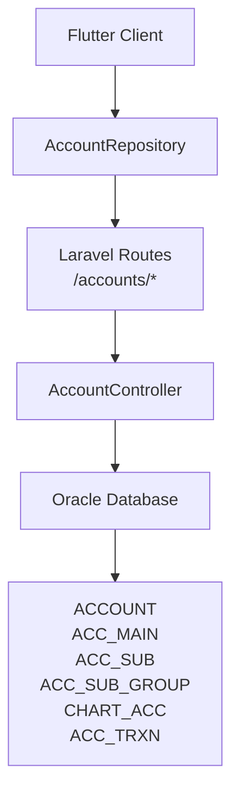
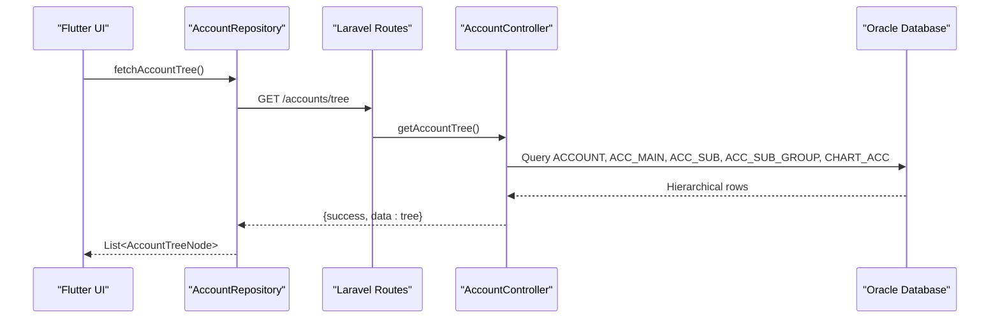
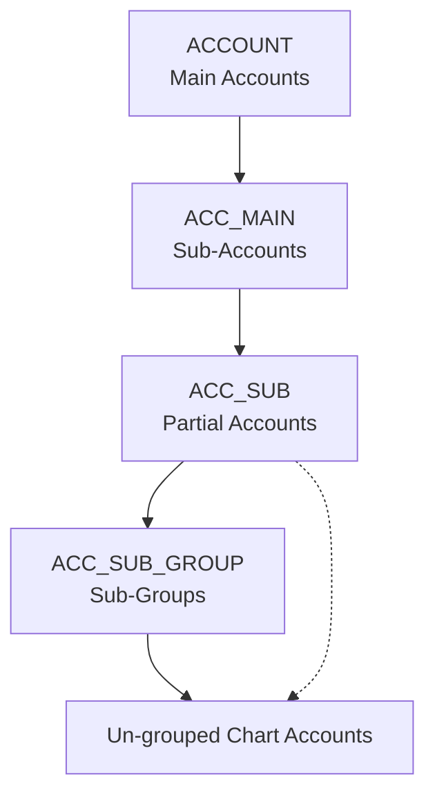
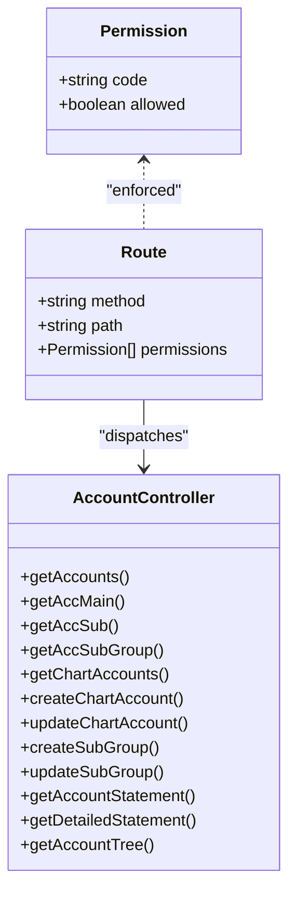
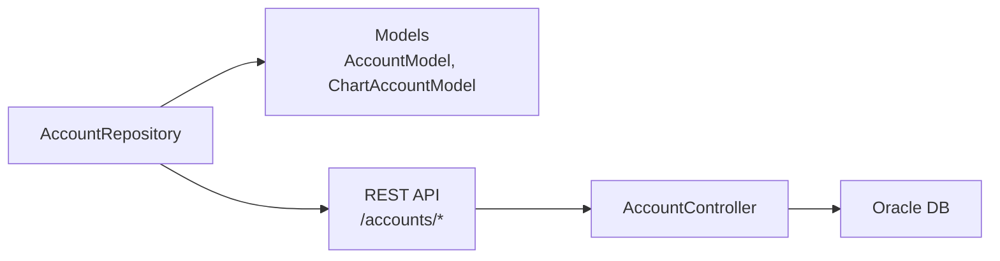

# Accounting API

<cite>
**Referenced Files in This Document**
- [AccountController.php](file://kyApp_API/app/Http/Controllers/AccountController.php)
- [api.php](file://kyApp_API/routes/api.php)
- [account_model.dart](file://lib/features/accounts/data/models/account_model.dart)
- [chart_account_model.dart](file://lib/features/accounts/data/models/chart_account_model.dart)
- [account_repository.dart](file://lib/features/accounts/data/repositories/account_repository.dart)
</cite>

## Table of Contents
1. [Introduction](#introduction)
2. [Project Structure](#project-structure)
3. [Core Components](#core-components)
4. [Architecture Overview](#architecture-overview)
5. [Detailed Component Analysis](#detailed-component-analysis)
6. [Dependency Analysis](#dependency-analysis)
7. [Performance Considerations](#performance-considerations)
8. [Troubleshooting Guide](#troubleshooting-guide)
9. [Conclusion](#conclusion)
10. [Appendices](#appendices)

## Introduction
This document provides detailed API documentation for the accounting and chart-of-accounts subsystem. It covers:
- Account hierarchy operations across main accounts, sub-accounts, partial accounts, and sub-groups.
- Chart-of-accounts management including listing, creation, and modification.
- Sub-group management for restructuring the accounting hierarchy.
- Financial statement generation for single accounts and aggregated views.
- Risk-based permissions separating structure reads, content writes, structural changes, and sensitive financial statements.
- The underlying accounting hierarchy, double-entry bookkeeping principles, and reporting formats used by the endpoints.

The backend is a Laravel application connecting to an Oracle database. The frontend uses Flutter models and repositories that call these REST endpoints.

## Project Structure
The accounting functionality is implemented primarily in:
- A Laravel controller handling HTTP requests and Oracle queries.
- Route definitions enforcing authentication and fine-grained permissions.
- Flutter data models representing account hierarchy nodes and chart accounts.
- A repository layer calling the REST API with pagination, search, and cancellation support.

**Diagram sources**
- [api.php:275-321](file://kyApp_API/routes/api.php#L275-L321)
- [AccountController.php:10-20](file://kyApp_API/app/Http/Controllers/AccountController.php#L10-L20)

**Section sources**
- [api.php:275-321](file://kyApp_API/routes/api.php#L275-L321)
- [AccountController.php:10-20](file://kyApp_API/app/Http/Controllers/AccountController.php#L10-L20)

## Core Components
- **AccountController**: Implements all accounting endpoints, including hierarchy reads, chart-of-accounts CRUD, sub-group management, and statement generation.
- **Routes**: Define URL patterns and attach permission middleware such as `accounts.view`, `accounts.create`, `accounts.update`, `accounts.structure_manage`, and `accounts.statement`.
- **Flutter Models**: Represent hierarchical tree nodes, chart accounts, and statement payloads.
- **AccountRepository**: Encapsulates network calls, query parameters, pagination, and error handling for the client side.

Key responsibilities:
- Reading the accounting hierarchy without exposing balances unless explicitly requested.
- Managing chart-of-accounts entries with validation and encoding normalization.
- Restructuring sub-groups independently from account content.
- Generating per-account statements and aggregated statement details.

**Section sources**
- [AccountController.php:21-20](file://kyApp_API/app/Http/Controllers/AccountController.php#L21-L20)
- [api.php:275-321](file://kyApp_API/routes/api.php#L275-L321)
- [account_model.dart:1-191](file://lib/features/accounts/data/models/account_model.dart#L1-L191)
- [chart_account_model.dart:1-147](file://lib/features/accounts/data/models/chart_account_model.dart#L1-L147)
- [account_repository.dart:1-313](file://lib/features/accounts/data/repositories/account_repository.dart#L1-L313)

## Architecture Overview
The accounting API follows a layered architecture:
- **Client Layer**: Flutter UI and state management call the repository.
- **Repository Layer**: Handles HTTP requests, query parameters, pagination, and model mapping.
- **Route Layer**: Enforces authentication and permission checks before invoking controllers.
- **Controller Layer**: Validates inputs, performs Oracle queries, and returns standardized JSON responses.
- **Database Layer**: Oracle tables store the accounting hierarchy and transactional data.

**Diagram sources**
- [account_repository.dart:120-138](file://lib/features/accounts/data/repositories/account_repository.dart#L120-L138)
- [api.php:295-296](file://kyApp_API/routes/api.php#L295-L296)
- [AccountController.php:646-808](file://kyApp_API/app/Http/Controllers/AccountController.php#L646-L808)

## Detailed Component Analysis

### Accounting Hierarchy Endpoints
These endpoints expose the accounting structure: main accounts, sub-accounts, partial accounts, and sub-groups. They are read-only and protected by `accounts.view`.

| Endpoint | Method | URL Pattern | Permissions | Request Parameters | Response Schema |
|---|---|---|---|---|---|
| Get Main Accounts | GET | `/accounts/account` | `accounts.view` | None | `{ success: boolean, data: [{ acc_no: number, acc_name: string, balance?: number, cur_no?: number }] }` |
| Get Sub-Accounts | GET | `/accounts/main?acc_no={number}` | `accounts.view` | `acc_no` (optional) | `{ success: boolean, data: [{ acc_no: number, acc_sub: number, sub_name: string, balance?: number, cur_no?: number }] }` |
| Get Partial Accounts | GET | `/accounts/sub?acc_sub={number}` | `accounts.view` | `acc_sub` (optional) | `{ success: boolean, data: [{ acc_sub: number, acc_part: number, part_name: string, balance?: number, cur_no?: number }] }` |
| Get Sub-Groups | GET | `/accounts/sub-group?acc_part={number}` | `accounts.view` | `acc_part` (optional) | `{ success: boolean, data: [{ group_id: number, acc_part: number, acc_group_name: string }] }` |
| Get Full Tree | GET | `/accounts/tree` | `accounts.view` | None | `{ success: boolean, data: AccountTreeNode[] }` |

Example usage scenarios:
- Navigate from main accounts to sub-accounts using `acc_no`.
- Drill down to partial accounts using `acc_sub`.
- Retrieve sub-groups under a partial account using `acc_part`.
- Load the complete hierarchical tree for UI rendering.

Notes:
- All names are normalized for Arabic encoding.
- Balances may be null or zero depending on table availability.
- The full tree endpoint builds nested nodes with levels: `account`, `main`, `sub`, `group`, `chart`.

**Section sources**
- [AccountController.php:27-50](file://kyApp_API/app/Http/Controllers/AccountController.php#L27-L50)
- [AccountController.php:52-84](file://kyApp_API/app/Http/Controllers/AccountController.php#L52-L84)
- [AccountController.php:86-118](file://kyApp_API/app/Http/Controllers/AccountController.php#L86-L118)
- [AccountController.php:120-150](file://kyApp_API/app/Http/Controllers/AccountController.php#L120-L150)
- [AccountController.php:646-808](file://kyApp_API/app/Http/Controllers/AccountController.php#L646-L808)
- [api.php:287-296](file://kyApp_API/routes/api.php#L287-L296)

### Chart-of-Accounts Management
Chart-of-accounts endpoints manage ledger accounts stored in `CHART_ACC`. Listing supports search, pagination, and optional grouping. Creation and update require appropriate write permissions.

| Endpoint | Method | URL Pattern | Permissions | Request Body / Parameters | Response Schema |
|---|---|---|---|---|---|
| List Chart Accounts | GET | `/accounts/chart` | `accounts.view` | Query: `search`, `page`, `limit`, `group_id` | `{ success: boolean, data: ChartAccountModel[], meta: { total, page, limit, total_pages, has_more } }` |
| Create Chart Account | POST | `/accounts/chart` | `accounts.create` | Body: `acc_name`, `group_id`, optional `balance`, `limited_balance` | `{ success: boolean, message: string, data: { acc_no: number } }` |
| Update Chart Account | PUT | `/accounts/chart/{accNo}` | `accounts.update` | Path: `accNo`; Body: any of `acc_name`, `balance`, `group_id`, `limited_balance`, `stopping_acc` | `{ success: boolean, message: string }` |

Validation rules:
- Creating requires `acc_name` and `group_id`.
- Updating requires at least one mutable field; otherwise returns a 400-level response.
- Group existence is validated during creation.

Pagination behavior:
- Default page size is bounded between 10 and 100.
- Oracle-compatible pagination uses row numbering.

Example workflow:
- Search chart accounts by name or number.
- Filter by group ID to view accounts within a specific sub-group.
- Create a new ledger account under an existing group.
- Modify account metadata such as name, balance, group assignment, limited balance, or stopping flag.

**Section sources**
- [AccountController.php:156-243](file://kyApp_API/app/Http/Controllers/AccountController.php#L156-L243)
- [AccountController.php:245-304](file://kyApp_API/app/Http/Controllers/AccountController.php#L245-L304)
- [AccountController.php:306-352](file://kyApp_API/app/Http/Controllers/AccountController.php#L306-L352)
- [api.php:298-305](file://kyApp_API/routes/api.php#L298-L305)
- [chart_account_model.dart:1-70](file://lib/features/accounts/data/models/chart_account_model.dart#L1-L70)
- [account_repository.dart:144-183](file://lib/features/accounts/data/repositories/account_repository.dart#L144-L183)

### Sub-Group Management
Sub-group endpoints allow restructuring the accounting hierarchy by creating and updating groups associated with partial accounts. These are structural changes and require `accounts.structure_manage`.

| Endpoint | Method | URL Pattern | Permissions | Request Body / Parameters | Response Schema |
|---|---|---|---|---|---|
| Create Sub-Group | POST | `/accounts/sub-group` | `accounts.structure_manage` | Body: `acc_group_name`, `acc_part` | `{ success: boolean, message: string, data: { group_id: number } }` |
| Update Sub-Group | PUT | `/accounts/sub-group/{groupId}` | `accounts.structure_manage` | Path: `groupId`; Body: any of `acc_group_name`, `acc_part` | `{ success: boolean, message: string }` |

Behavior:
- New group IDs are auto-incremented based on the maximum existing ID.
- Names are normalized for Oracle search compatibility.
- Updates require at least one mutable field.

Restructuring example:
- Create a new sub-group under a partial account.
- Rename or reassign the sub-group to another partial account.
- Use the updated group ID when creating chart accounts.

**Section sources**
- [AccountController.php:354-392](file://kyApp_API/app/Http/Controllers/AccountController.php#L354-L392)
- [AccountController.php:394-428](file://kyApp_API/app/Http/Controllers/AccountController.php#L394-L428)
- [api.php:307-313](file://kyApp_API/routes/api.php#L307-L313)
- [account_repository.dart:185-204](file://lib/features/accounts/data/repositories/account_repository.dart#L185-L204)

### Financial Statement Generation
Statement endpoints provide financial reports:
- Single account statement with transactions and summary.
- Aggregated statement detail across multiple account scopes.

| Endpoint | Method | URL Pattern | Permissions | Request Parameters | Response Schema |
|---|---|---|---|---|---|
| Account Statement | GET | `/accounts/chart/{accNo}/statement` | `accounts.statement` | Path: `accNo`; Query: `from_date`, `to_date`, `page`, `limit` | `{ success: boolean, data: { account: {...}, transactions: [...], summary: {...} }, meta: {...} }` |
| Detailed Statement | GET | `/accounts/statement-detail` | `accounts.statement` | Query: `type`, `id`, `from_date`, `to_date`, `cur_no`, `page`, `limit` | `{ success: boolean, data: { accounts: [...], total_count: number, summary: {...} } }` |

Single account statement:
- Returns account metadata, paginated transactions, and current balance.
- Transactions include date, description, debit, credit, and running balance.
- If the transaction table is missing, it gracefully returns empty transactions while still providing account metadata.

Detailed statement:
- Supports aggregation types: `account`, `main`, `sub`, `group`.
- For `account`, optionally lists child chart accounts under a main account.
- For `main`, aggregates chart accounts linked via partial accounts.
- For `sub`, filters chart accounts by partial account prefix.
- For `group`, filters chart accounts by group ID.
- Returns a list of accounts with balances and a summary including total balance and date range.

Double-entry bookkeeping principles reflected:
- Each transaction records debits and credits.
- Running balance reflects cumulative effect.
- Statements can be filtered by date ranges for period analysis.

Complex operation examples:
- Reconciliation: Compare account statement totals against external ledgers using date-bounded queries.
- Analysis: Aggregate balances across groups to compute departmental financial positions.
- Reporting: Export paginated transaction sets for audit trails.

**Section sources**
- [AccountController.php:430-540](file://kyApp_API/app/Http/Controllers/AccountController.php#L430-L540)
- [AccountController.php:542-640](file://kyApp_API/app/Http/Controllers/AccountController.php#L542-L640)
- [api.php:315-320](file://kyApp_API/routes/api.php#L315-L320)
- [chart_account_model.dart:72-147](file://lib/features/accounts/data/models/chart_account_model.dart#L72-L147)
- [account_repository.dart:251-311](file://lib/features/accounts/data/repositories/account_repository.dart#L251-L311)

### Accounting Hierarchy Structure
The accounting hierarchy is organized into five layers:
1. **Main Accounts (`ACCOUNT`)**: Top-level categories.
2. **Sub-Accounts (`ACC_MAIN`)**: Breakdowns under main accounts.
3. **Partial Accounts (`ACC_SUB`)**: Further subdivisions identified by numeric prefixes.
4. **Sub-Groups (`ACC_SUB_GROUP`)**: Logical groupings for chart accounts.
5. **Chart Accounts (`CHART_ACC`)**: Ledger accounts with balances and metadata.

**Diagram sources**
- [AccountController.php:10-20](file://kyApp_API/app/Http/Controllers/AccountController.php#L10-L20)
- [AccountController.php:646-808](file://kyApp_API/app/Http/Controllers/AccountController.php#L646-L808)

### Permission Model and Separation of Concerns
Permissions are enforced at the route level:
- `accounts.view`: Read access to hierarchy and chart listings.
- `accounts.create`: Create chart accounts.
- `accounts.update`: Modify chart account properties.
- `accounts.structure_manage`: Create/update sub-groups (structural changes).
- `accounts.statement`: Access financial statements exposing balances and transactions.

Separation of concerns:
- Reading account structures does not imply permission to modify content.
- Modifying chart accounts does not grant authority to restructure the hierarchy.
- Financial statements are gated separately due to sensitivity of balance exposure.

**Diagram sources**
- [api.php:275-321](file://kyApp_API/routes/api.php#L275-L321)
- [AccountController.php:21-808](file://kyApp_API/app/Http/Controllers/AccountController.php#L21-L808)

**Section sources**
- [api.php:275-321](file://kyApp_API/routes/api.php#L275-L321)

## Dependency Analysis
The accounting module depends on:
- Laravel routing and middleware for authentication and permission enforcement.
- Oracle database connections for querying accounting tables.
- Flutter models and repositories for client-side data representation and network calls.

**Diagram sources**
- [account_repository.dart:1-313](file://lib/features/accounts/data/repositories/account_repository.dart#L1-L313)
- [chart_account_model.dart:1-147](file://lib/features/accounts/data/models/chart_account_model.dart#L1-L147)
- [account_model.dart:1-191](file://lib/features/accounts/data/models/account_model.dart#L1-L191)
- [AccountController.php:10-20](file://kyApp_API/app/Http/Controllers/AccountController.php#L10-L20)

**Section sources**
- [account_repository.dart:1-313](file://lib/features/accounts/data/repositories/account_repository.dart#L1-L313)
- [chart_account_model.dart:1-147](file://lib/features/accounts/data/models/chart_account_model.dart#L1-L147)
- [account_model.dart:1-191](file://lib/features/accounts/data/models/account_model.dart#L1-L191)
- [AccountController.php:10-20](file://kyApp_API/app/Http/Controllers/AccountController.php#L10-L20)

## Performance Considerations
- Pagination is applied to chart account listings and statements to avoid large payloads.
- Oracle-compatible pagination uses row numbering to ensure compatibility with older database versions.
- Search queries normalize Arabic text for consistent matching.
- Statement endpoints gracefully handle missing transaction tables by returning empty transaction lists.
- Clients should use cancellation tokens for long-running requests like tree loading and statement retrieval.

[No sources needed since this section provides general guidance]

## Troubleshooting Guide
Common issues and resolutions:
- **401 Unauthorized**: Ensure Sanctum authentication token is present.
- **403 Forbidden**: Verify the user has the required permission code for the endpoint.
- **404 Not Found**: Check account/group identifiers and ensure they exist in the database.
- **422 Validation Error**: Validate request body fields according to endpoint specifications.
- **500 Server Error**: Inspect server logs for database connection or query failures.

Debugging tips:
- Use the detailed statement endpoint to aggregate balances across scopes for reconciliation.
- Validate group assignments before creating chart accounts.
- Confirm Arabic encoding normalization if names appear incorrectly.

**Section sources**
- [AccountController.php:299-303](file://kyApp_API/app/Http/Controllers/AccountController.php#L299-L303)
- [AccountController.php:342-351](file://kyApp_API/app/Http/Controllers/AccountController.php#L342-L351)
- [AccountController.php:418-427](file://kyApp_API/app/Http/Controllers/AccountController.php#L418-L427)
- [AccountController.php:507-509](file://kyApp_API/app/Http/Controllers/AccountController.php#L507-L509)

## Conclusion
The accounting API provides a robust, permission-gated interface for managing the chart of accounts, restructuring sub-groups, and generating financial statements. Its design separates reading hierarchy, modifying content, and altering structure, ensuring secure and maintainable operations. The Oracle-backed implementation supports complex accounting workflows, including double-entry bookkeeping and period-based reporting. Clients interact through well-defined Flutter models and repositories, enabling scalable and testable integrations.

[No sources needed since this section summarizes without analyzing specific files]

## Appendices

### Data Models Reference
- **AccountTreeNode**: Represents hierarchical nodes with levels and children.
- **ChartAccountModel**: Represents ledger accounts with metadata and flags.
- **AccountTransactionModel**: Represents individual transactions in statements.
- **AccountStatementData**: Aggregates account info, transactions, and summaries.

**Section sources**
- [account_model.dart:99-174](file://lib/features/accounts/data/models/account_model.dart#L99-L174)
- [chart_account_model.dart:1-147](file://lib/features/accounts/data/models/chart_account_model.dart#L1-L147)