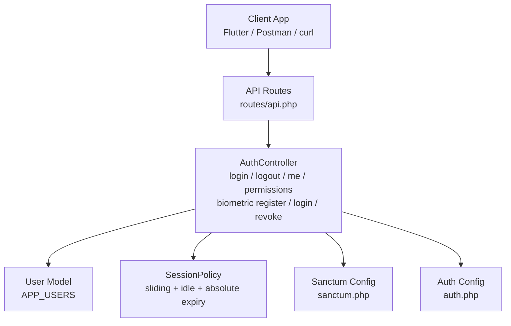
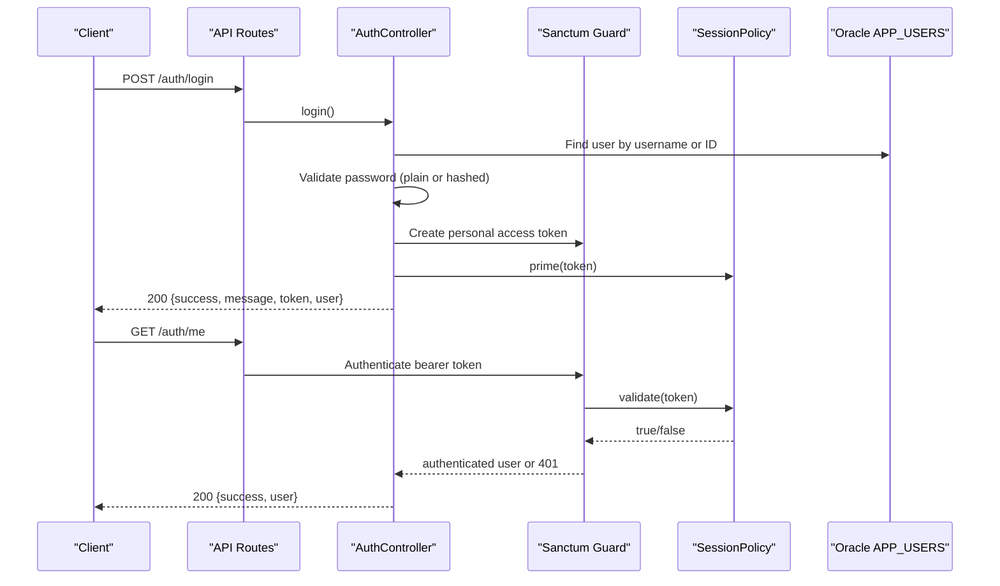
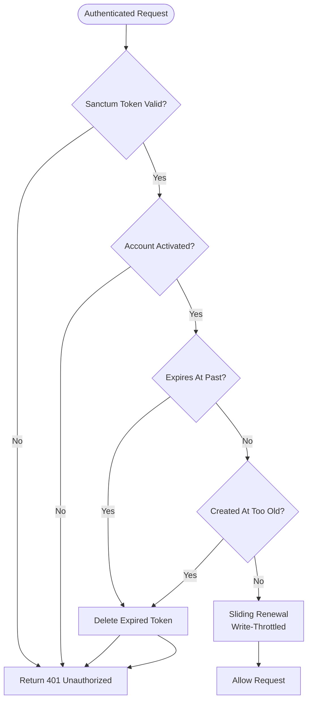
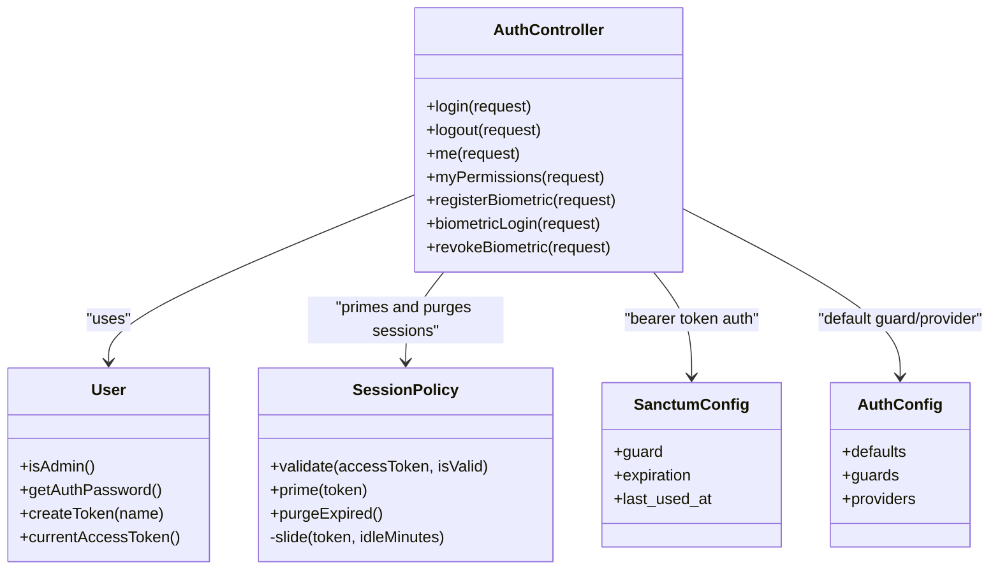

# Authentication API

<cite>
**Referenced Files in This Document**   
- [api.php](file://kyApp_API/routes/api.php)
- [AuthController.php](file://kyApp_API/app/Http/Controllers/AuthController.php)
- [sanctum.php](file://kyApp_API/config/sanctum.php)
- [auth.php](file://kyApp_API/config/auth.php)
- [SessionPolicy.php](file://kyApp_API/app/Support/SessionPolicy.php)
- [User.php](file://kyApp_API/app/Models/User.php)
</cite>

## Table of Contents
1. [Introduction](#introduction)
2. [Project Structure](#project-structure)
3. [Core Components](#core-components)
4. [Architecture Overview](#architecture-overview)
5. [Detailed Component Analysis](#detailed-component-analysis)
6. [Dependency Analysis](#dependency-analysis)
7. [Performance Considerations](#performance-considerations)
8. [Troubleshooting Guide](#troubleshooting-guide)
9. [Conclusion](#conclusion)

## Introduction
This document provides comprehensive API documentation for the authentication subsystem of the application. It covers:

- Password-based login and logout.
- Biometric registration, biometric login, and biometric revocation.
- Session management through Sanctum personal access tokens.
- Request/response schemas, parameter specifications, and HTTP status codes.
- Security considerations including token storage, sliding session renewal, idle expiry, absolute lifetime, kill switches, and multi-factor readiness.

The backend is a Laravel API using Sanctum for token-based authentication. The Flutter client performs local biometric checks and then calls the server to register or use a device-bound biometric identity.

## Project Structure
Authentication-related code lives primarily under:

- `kyApp_API/routes/api.php`: route definitions for public and protected endpoints.
- `kyApp_API/app/Http/Controllers/AuthController.php`: authentication logic for login, logout, profile, permissions, and biometrics.
- `kyApp_API/config/sanctum.php`: Sanctum configuration.
- `kyApp_API/config/auth.php`: default guard and provider configuration.
- `kyApp_API/app/Support/SessionPolicy.php`: custom session lifecycle policy.
- `kyApp_API/app/Models/User.php`: user model with Sanctum support and Oracle compatibility.



**Diagram sources**
- [api.php:18-48](file://kyApp_API/routes/api.php#L18-L48)
- [AuthController.php:47-440](file://kyApp_API/app/Http/Controllers/AuthController.php#L47-L440)
- [SessionPolicy.php:42-184](file://kyApp_API/app/Support/SessionPolicy.php#L42-L184)
- [sanctum.php:8-111](file://kyApp_API/config/sanctum.php#L8-L111)
- [auth.php:18-68](file://kyApp_API/config/auth.php#L18-L68)

**Section sources**
- [api.php:18-48](file://kyApp_API/routes/api.php#L18-L48)
- [AuthController.php:47-440](file://kyApp_API/app/Http/Controllers/AuthController.php#L47-L440)
- [sanctum.php:8-111](file://kyApp_API/config/sanctum.php#L8-L111)
- [auth.php:18-68](file://kyApp_API/config/auth.php#L18-L68)
- [SessionPolicy.php:42-184](file://kyApp_API/app/Support/SessionPolicy.php#L42-L184)
- [User.php:10-166](file://kyApp_API/app/Models/User.php#L10-L166)

## Core Components
- **Routes**: Public login and biometric login routes; protected logout, profile, permissions, and biometric management routes.
- **AuthController**: Validates credentials, issues Sanctum tokens, manages biometric enrollment, and returns unified user payloads with IBAC permission state.
- **SessionPolicy**: Implements silent sliding renewal, idle timeout, absolute token lifetime, and cleanup of expired tokens.
- **Sanctum Configuration**: Uses bearer tokens, tracks last used time, and leaves expiration to the custom policy.
- **User Model**: Integrates Sanctum, maps to Oracle’s `APP_USERS`, and exposes helper methods such as admin check and password retrieval.

**Section sources**
- [api.php:18-48](file://kyApp_API/routes/api.php#L18-L48)
- [AuthController.php:47-440](file://kyApp_API/app/Http/Controllers/AuthController.php#L47-L440)
- [SessionPolicy.php:42-184](file://kyApp_API/app/Support/SessionPolicy.php#L42-L184)
- [sanctum.php:8-111](file://kyApp_API/config/sanctum.php#L8-L111)
- [User.php:10-166](file://kyApp_API/app/Models/User.php#L10-L166)

## Architecture Overview
The authentication flow uses Sanctum personal access tokens. Clients send requests with an Authorization header containing a bearer token. Sanctum authenticates the request, and `SessionPolicy` validates the token’s session state before allowing access.



**Diagram sources**
- [api.php:18-48](file://kyApp_API/routes/api.php#L18-L48)
- [AuthController.php:47-163](file://kyApp_API/app/Http/Controllers/AuthController.php#L47-L163)
- [AuthController.php:170-179](file://kyApp_API/app/Http/Controllers/AuthController.php#L170-L179)
- [SessionPolicy.php:70-108](file://kyApp_API/app/Support/SessionPolicy.php#L70-L108)
- [sanctum.php:40-77](file://kyApp_API/config/sanctum.php#L40-L77)

## Detailed Component Analysis

### Login Endpoint
- **Method**: `POST`
- **URL**: `/auth/login`
- **Authentication**: None (public)
- **Request Body**:
  - `username`: string, required, max 50 characters. Accepts English username, Arabic username, or numeric user ID.
  - `password`: string, required. Supports both plain-text legacy passwords and hashed passwords.
  - `user_type`: optional string; allowed values include `employee`, `customer`, `1`, `2`. Used to name the token.
- **Response**:
  - Success `200`:
    - `success`: boolean
    - `message`: string
    - `token`: Sanctum personal access token string
    - `user`: object containing account data and IBAC permission state
  - Validation error `422`:
    - `success`: false
    - `message`: validation error message
    - `errors`: field-level errors
  - Invalid credentials `401`:
    - `success`: false
    - `message`: generic invalid credential message
  - Deactivated account `403`:
    - `success`: false
    - `message`: account deactivated message

Example curl for successful login:
```bash
curl -X POST https://your-domain.com/api/auth/login \
  -H "Content-Type: application/json" \
  -d '{"username":"admin","password":"secure-password","user_type":"employee"}'
```

Example curl for invalid credentials:
```bash
curl -X POST https://your-domain.com/api/auth/login \
  -H "Content-Type: application/json" \
  -d '{"username":"unknown","password":"wrong"}'
```

Security notes:
- Username enumeration is prevented by returning the same error for unknown users and wrong passwords.
- Legacy plain-text passwords are supported intentionally for migration; hashed passwords are preferred.
- Successful login logs activity and primes the session with a real idle window.

**Section sources**
- [api.php:18-23](file://kyApp_API/routes/api.php#L18-L23)
- [AuthController.php:47-163](file://kyApp_API/app/Http/Controllers/AuthController.php#L47-L163)
- [User.php:154-166](file://kyApp_API/app/Models/User.php#L154-L166)

### Logout Endpoint
- **Method**: `POST`
- **URL**: `/auth/logout`
- **Authentication**: Required via Sanctum bearer token
- **Request Body**: None
- **Response**:
  - Success `200`:
    - `success`: boolean
    - `message`: logged out successfully
  - If no current token exists, the endpoint still returns success after safely handling the absence of a token.

Example curl for logout:
```bash
curl -X POST https://your-domain.com/api/auth/logout \
  -H "Authorization: Bearer YOUR_TOKEN"
```

Behavior:
- Deletes the current personal access token.
- Logs logout activity.
- Returns a consistent success response even if no token was present.

**Section sources**
- [api.php:38-40](file://kyApp_API/routes/api.php#L38-L40)
- [AuthController.php:221-239](file://kyApp_API/app/Http/Controllers/AuthController.php#L221-L239)

### Current User Profile Endpoint
- **Method**: `GET`
- **URL**: `/auth/me`
- **Authentication**: Required via Sanctum bearer token
- **Response**:
  - Success `200`:
    - `success`: boolean
    - `user`: object containing account data and IBAC permission state

Example curl:
```bash
curl -X GET https://your-domain.com/api/auth/me \
  -H "Authorization: Bearer YOUR_TOKEN"
```

Notes:
- The user payload includes identifiers, names, type, branch, admin flag, and permissions.
- This endpoint is useful for refreshing UI state after login or permission changes.

**Section sources**
- [api.php:38-40](file://kyApp_API/routes/api.php#L38-L40)
- [AuthController.php:170-179](file://kyApp_API/app/Http/Controllers/AuthController.php#L170-L179)
- [AuthController.php:452-463](file://kyApp_API/app/Http/Controllers/AuthController.php#L452-L463)

### Permissions Endpoint
- **Method**: `GET`
- **URL**: `/auth/permissions`
- **Authentication**: Required via Sanctum bearer token
- **Response**:
  - Success `200`:
    - `success`: boolean
    - `message`: permissions loaded
    - `data`: object containing effective permissions, modules, admin flag, and current session expiration timestamp

Use cases:
- Client-side UI gating based on actual grants.
- Refreshing cached permissions after administrative changes.

Example curl:
```bash
curl -X GET https://your-domain.com/api/auth/permissions \
  -H "Authorization: Bearer YOUR_TOKEN"
```

**Section sources**
- [api.php:59-62](file://kyApp_API/routes/api.php#L59-L62)
- [AuthController.php:190-215](file://kyApp_API/app/Http/Controllers/AuthController.php#L190-L215)

### Biometric Registration Endpoint
- **Method**: `POST`
- **URL**: `/auth/biometric/register`
- **Authentication**: Required via Sanctum bearer token
- **Request Body**:
  - `device_token`: string, required, max 512 characters. Unique device identifier generated by the client.
  - `device_name`: string, required, max 200 characters. Human-readable device name.
  - `platform`: string, required; allowed values `android`, `ios`.
- **Response**:
  - Success `200`:
    - `success`: boolean
    - `message`: biometric registered successfully
  - Conflict `409`:
    - `success`: false
    - `message`: device already bound to another user
  - Validation error `422`:
    - `success`: false
    - `message`: incomplete data
    - `errors`: field-level errors

Example curl for successful registration:
```bash
curl -X POST https://your-domain.com/api/auth/biometric/register \
  -H "Authorization: Bearer YOUR_TOKEN" \
  -H "Content-Type: application/json" \
  -d '{"device_token":"DEVICE_UNIQUE_ID","device_name":"My Phone","platform":"android"}'
```

Security notes:
- Each device token can be bound to only one user.
- Enrollment updates user fields including device token, device name, platform, and biometric flags.
- Activity logging records enrollment attempts and outcomes.

**Section sources**
- [api.php:38-48](file://kyApp_API/routes/api.php#L38-L48)
- [AuthController.php:245-310](file://kyApp_API/app/Http/Controllers/AuthController.php#L245-L310)
- [User.php:53-88](file://kyApp_API/app/Models/User.php#L53-L88)

### Biometric Login Endpoint
- **Method**: `POST`
- **URL**: `/auth/biometric/login`
- **Authentication**: None (public)
- **Request Body**:
  - `user_id`: integer or numeric string, required.
  - `device_token`: string, required, max 512 characters. Must match the device enrolled for that user.
- **Response**:
  - Success `200`:
    - `success`: boolean
    - `message`: biometric login successful
    - `token`: Sanctum personal access token
    - `user`: object with account data and IBAC state plus `biometric_enabled: true`
  - Validation error `422`:
    - `success`: false
    - `message`: incomplete data
    - `errors`: field-level errors
  - System disabled `403`:
    - `success`: false
    - `message`: biometric login disabled by system settings
  - Unauthorized `401`:
    - `success`: false
    - `message`: verification failed; re-enable biometrics
  - Deactivated account `403`:
    - `success`: false
    - `message`: account deactivated

Example curl for successful biometric login:
```bash
curl -X POST https://your-domain.com/api/auth/biometric/login \
  -H "Content-Type: application/json" \
  -d '{"user_id":1,"device_token":"DEVICE_UNIQUE_ID"}'
```

Flow summary:
- Validates input.
- Checks global kill switch `biometric_login_enabled`.
- Matches user ID and device token together.
- Ensures biometric enrollment is enabled.
- Ensures account is active.
- Updates last biometric usage timestamp.
- Issues a new Sanctum token and primes the session.

**Section sources**
- [api.php:18-23](file://kyApp_API/routes/api.php#L18-L23)
- [AuthController.php:316-411](file://kyApp_API/app/Http/Controllers/AuthController.php#L316-L411)

### Biometric Revocation Endpoint
- **Method**: `DELETE`
- **URL**: `/auth/biometric/revoke`
- **Authentication**: Required via Sanctum bearer token
- **Request Body**: None
- **Response**:
  - Success `200`:
    - `success`: boolean
    - `message`: biometric revoked successfully

Example curl:
```bash
curl -X DELETE https://your-domain.com/api/auth/biometric/revoke \
  -H "Authorization: Bearer YOUR_TOKEN"
```

Behavior:
- Clears device token, device name, platform, and biometric flags for the current user.
- Logs revocation activity.

**Section sources**
- [api.php:38-48](file://kyApp_API/routes/api.php#L38-L48)
- [AuthController.php:417-441](file://kyApp_API/app/Http/Controllers/AuthController.php#L417-L441)

### Sanctum Token-Based Authentication System
Sanctum is configured to:
- Use the `web` guard.
- Leave token expiration null so the custom `SessionPolicy` controls `EXPIRES_AT`.
- Track last used timestamps for active sessions.
- Support first-party SPA stateful domains via the `stateful` list.

Token lifecycle:
- Tokens are created during login and biometric login.
- `SessionPolicy::prime()` sets a full idle window immediately after token creation.
- On each authenticated request, `SessionPolicy::validate()` checks:
  - Account activation.
  - Idle expiry via `expires_at`.
  - Absolute lifetime via `created_at` plus configured absolute days.
  - Sliding renewal with write throttling.



**Diagram sources**
- [SessionPolicy.php:70-108](file://kyApp_API/app/Support/SessionPolicy.php#L70-L108)
- [SessionPolicy.php:166-183](file://kyApp_API/app/Support/SessionPolicy.php#L166-L183)
- [sanctum.php:40-77](file://kyApp_API/config/sanctum.php#L40-L77)

**Section sources**
- [sanctum.php:8-111](file://kyApp_API/config/sanctum.php#L8-L111)
- [SessionPolicy.php:42-184](file://kyApp_API/app/Support/SessionPolicy.php#L42-L184)
- [AuthController.php:142-149](file://kyApp_API/app/Http/Controllers/AuthController.php#L142-L149)
- [AuthController.php:392-396](file://kyApp_API/app/Http/Controllers/AuthController.php#L392-L396)

### Session Management Endpoints
While this document focuses on authentication, related session administration endpoints exist:

- `GET /sessions`: List active sessions (requires `sessions.view`).
- `DELETE /sessions/user/{userId}`: Terminate all sessions for a user (requires `sessions.terminate`).
- `DELETE /sessions/{tokenId}`: Terminate a specific session token (requires `sessions.terminate`).

These endpoints operate on Sanctum personal access tokens and rely on `last_used_at` and `expires_at` metadata.

**Section sources**
- [api.php:113-130](file://kyApp_API/routes/api.php#L113-L130)

## Dependency Analysis
The authentication subsystem depends on several components:

- Routes depend on `AuthController` for all authentication operations.
- `AuthController` depends on:
  - `User` model for user lookup and token creation.
  - `SessionPolicy` for session lifecycle management.
  - Sanctum configuration for guard behavior and token tracking.
  - Auth configuration for default guard and provider.
- `SessionPolicy` depends on `SettingsStore` for runtime session settings.
- `User` model integrates Sanctum and maps to Oracle’s `APP_USERS`.



**Diagram sources**
- [AuthController.php:34-440](file://kyApp_API/app/Http/Controllers/AuthController.php#L34-L440)
- [User.php:10-166](file://kyApp_API/app/Models/User.php#L10-L166)
- [SessionPolicy.php:42-184](file://kyApp_API/app/Support/SessionPolicy.php#L42-L184)
- [sanctum.php:8-111](file://kyApp_API/config/sanctum.php#L8-L111)
- [auth.php:18-68](file://kyApp_API/config/auth.php#L18-L68)

**Section sources**
- [api.php:18-48](file://kyApp_API/routes/api.php#L18-L48)
- [AuthController.php:34-440](file://kyApp_API/app/Http/Controllers/AuthController.php#L34-L440)
- [User.php:10-166](file://kyApp_API/app/Models/User.php#L10-L166)
- [SessionPolicy.php:42-184](file://kyApp_API/app/Support/SessionPolicy.php#L42-L184)
- [sanctum.php:8-111](file://kyApp_API/config/sanctum.php#L8-L111)
- [auth.php:18-68](file://kyApp_API/config/auth.php#L18-L68)

## Performance Considerations
- Sliding renewal is write-throttled to reduce database writes. A token’s expiry is updated only when necessary based on a configurable touch threshold.
- Expired tokens are deleted at validation time and periodically purged during login and session listing.
- Last used timestamps are tracked by Sanctum to support accurate active session reporting.
- Avoid setting `sanctum.expiration` to a fixed number; it would impose an absolute age against `created_at` and break sliding sessions.

Recommendations:
- Keep `session_idle_minutes` reasonable for your security posture.
- Monitor `session_absolute_days` to prevent long-lived tokens from being abused.
- Use `session_touch_threshold_minutes` to balance freshness and database load.

**Section sources**
- [SessionPolicy.php:157-183](file://kyApp_API/app/Support/SessionPolicy.php#L157-L183)
- [SessionPolicy.php:119-141](file://kyApp_API/app/Support/SessionPolicy.php#L119-L141)
- [sanctum.php:65-77](file://kyApp_API/config/sanctum.php#L65-L77)

## Troubleshooting Guide
Common issues and resolutions:

- **422 Validation Error**:
  - Cause: Missing or invalid request fields.
  - Resolution: Ensure required fields are present and conform to constraints.

- **401 Unauthorized**:
  - Cause: Invalid credentials, expired idle session, or absolute token lifetime exceeded.
  - Resolution: Re-authenticate via login or biometric login. Clear stale tokens on the client if needed.

- **403 Forbidden**:
  - Cause: Deactivated account or biometric login disabled by system settings.
  - Resolution: Activate the account or enable biometric login in system settings.

- **409 Conflict**:
  - Cause: Device token already bound to another user during biometric registration.
  - Resolution: Use a unique device token or contact administration.

- **Token Not Accepted**:
  - Cause: Missing or malformed Authorization header.
  - Resolution: Send `Authorization: Bearer YOUR_TOKEN` with every protected request.

- **Session Expires While Active**:
  - Cause: Misconfigured `sanctum.expiration` or incorrect session settings.
  - Resolution: Keep `sanctum.expiration` null and configure `session_idle_minutes`, `session_absolute_days`, and `session_touch_threshold_minutes` appropriately.

**Section sources**
- [AuthController.php:47-163](file://kyApp_API/app/Http/Controllers/AuthController.php#L47-L163)
- [AuthController.php:316-411](file://kyApp_API/app/Http/Controllers/AuthController.php#L316-L411)
- [SessionPolicy.php:70-108](file://kyApp_API/app/Support/SessionPolicy.php#L70-L108)
- [sanctum.php:40-77](file://kyApp_API/config/sanctum.php#L40-L77)

## Conclusion
The authentication API provides secure, flexible, and auditable login flows for both password and biometric scenarios. Sanctum personal access tokens are managed with a custom session policy that supports sliding renewal, idle timeouts, and absolute lifetimes. Biometric features are device-bound and controlled by a system-wide kill switch. Clients should store tokens securely, refresh them as needed, and handle 401 responses by forcing re-authentication. For multi-factor authentication, the current design allows extending the login flow with additional factors while preserving the token and session lifecycle.