# Currency Management API

<cite>
**Referenced Files in This Document**
- [CurrencyController.php](file://kyApp_API/app/Http/Controllers/CurrencyController.php)
- [api.php](file://kyApp_API/routes/api.php)
- [PermissionCatalog.php](file://kyApp_API/app/Support/PermissionCatalog.php)
- [currency_model.dart](file://lib/features/accounts/data/models/currency_model.dart)
- [currency_repository.dart](file://lib/features/accounts/data/repositories/currency_repository.dart)
</cite>

## Table of Contents
1. [Introduction](#introduction)
2. [Project Structure](#project-structure)
3. [Core Components](#core-components)
4. [Architecture Overview](#architecture-overview)
5. [Detailed Component Analysis](#detailed-component-analysis)
6. [Dependency Analysis](#dependency-analysis)
7. [Performance Considerations](#performance-considerations)
8. [Security and Dual-Permission Model](#security-and-dual-permission-model)
9. [Troubleshooting Guide](#troubleshooting-guide)
10. [Conclusion](#conclusion)

## Introduction
This document describes the currency management and daily exchange rate endpoints exposed by the backend API. It covers:
- Currency directory operations: listing, creating, updating, and deleting currencies and their codes.
- Daily exchange rate operations: listing historical rates, adding new rates, updating existing rates, and deleting specific rate records.
- HTTP methods, URL patterns, request and response schemas, validation rules, status codes, and pagination behavior.
- The dual-permission model that separates currency vocabulary management from exchange rate pricing.
- Security implications of exchange rate manipulation and recommended audit practices.

The API is implemented in Laravel under `kyApp_API`, with routes defined in `routes/api.php` and business logic in `app/Http/Controllers/CurrencyController.php`. Permissions are centrally defined in `app/Support/PermissionCatalog.php`.

## Project Structure
The relevant parts of the repository for this API are:
- Backend controller: `kyApp_API/app/Http/Controllers/CurrencyController.php`
- Route definitions: `kyApp_API/routes/api.php`
- Permission catalog: `kyApp_API/app/Support/PermissionCatalog.php`
- Frontend data model: `lib/features/accounts/data/models/currency_model.dart`
- Frontend repository: `lib/features/accounts/data/repositories/currency_repository.dart`

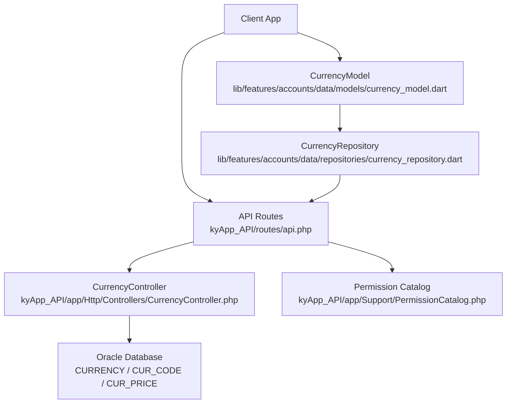

**Diagram sources**
- [api.php:324-356](file://kyApp_API/routes/api.php#L324-L356)
- [CurrencyController.php:10-18](file://kyApp_API/app/Http/Controllers/CurrencyController.php#L10-L18)
- [PermissionCatalog.php:153-165](file://kyApp_API/app/Support/PermissionCatalog.php#L153-L165)
- [currency_model.dart:8-59](file://lib/features/accounts/data/models/currency_model.dart#L8-L59)
- [currency_repository.dart:59-161](file://lib/features/accounts/data/repositories/currency_repository.dart#L59-L161)

**Section sources**
- [api.php:324-356](file://kyApp_API/routes/api.php#L324-L356)
- [CurrencyController.php:10-18](file://kyApp_API/app/Http/Controllers/CurrencyController.php#L10-L18)
- [PermissionCatalog.php:153-165](file://kyApp_API/app/Support/PermissionCatalog.php#L153-L165)
- [currency_model.dart:8-59](file://lib/features/accounts/data/models/currency_model.dart#L8-L59)
- [currency_repository.dart:59-161](file://lib/features/accounts/data/repositories/currency_repository.dart#L59-L161)

## Core Components
- **CurrencyController**: Implements all currency and price endpoints, including Oracle queries, validation, error handling, and Arabic encoding utilities.
- **Routes**: Define RESTful paths under `/currencies` and `/currencies/{curNo}/prices`, protected by Sanctum authentication and IBAC permissions.
- **PermissionCatalog**: Defines the canonical permission codes for the `currencies` module, including separate view/manage rights for prices.
- **Frontend Model and Repository**: Represent the expected JSON shape and call the API endpoints for currency CRUD and price maintenance.

Key responsibilities:
- List currencies with latest two prices and computed change percentage.
- Register a new currency and its code metadata.
- Update currency name and/or code fields.
- Delete a currency and related code and price history.
- Paginate historical exchange rates per currency.
- Add, update, and delete individual exchange rate records.

**Section sources**
- [CurrencyController.php:25-94](file://kyApp_API/app/Http/Controllers/CurrencyController.php#L25-L94)
- [CurrencyController.php:100-145](file://kyApp_API/app/Http/Controllers/CurrencyController.php#L100-L145)
- [CurrencyController.php:151-193](file://kyApp_API/app/Http/Controllers/CurrencyController.php#L151-L193)
- [CurrencyController.php:199-216](file://kyApp_API/app/Http/Controllers/CurrencyController.php#L199-L216)
- [CurrencyController.php:223-293](file://kyApp_API/app/Http/Controllers/CurrencyController.php#L223-L293)
- [CurrencyController.php:299-338](file://kyApp_API/app/Http/Controllers/CurrencyController.php#L299-L338)
- [CurrencyController.php:344-377](file://kyApp_API/app/Http/Controllers/CurrencyController.php#L344-L377)
- [CurrencyController.php:383-400](file://kyApp_API/app/Http/Controllers/CurrencyController.php#L383-L400)

## Architecture Overview
The currency API follows a standard layered architecture:
- HTTP layer: Laravel routes enforce authentication and fine-grained permissions.
- Controller layer: Validates input, performs database operations on Oracle, and returns consistent JSON responses.
- Data layer: Uses three core tables: `CURRENCY`, `CUR_CODE`, and `CUR_PRICE`.

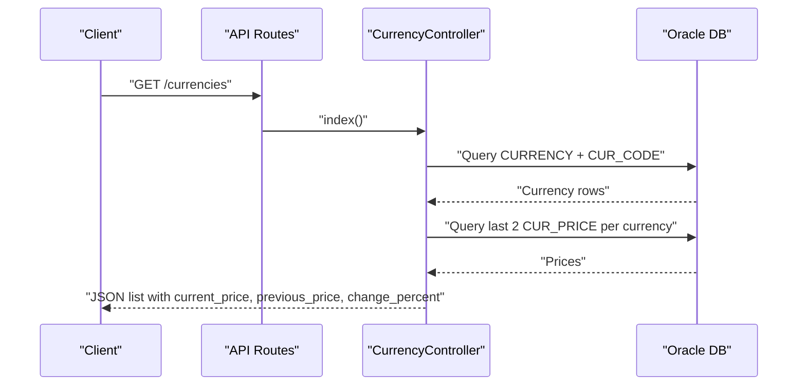

**Diagram sources**
- [api.php:332-342](file://kyApp_API/routes/api.php#L332-L342)
- [CurrencyController.php:25-94](file://kyApp_API/app/Http/Controllers/CurrencyController.php#L25-L94)

## Detailed Component Analysis

### Currency Directory Endpoints

#### GET /currencies
- Purpose: Retrieve all currencies with their code metadata and latest two exchange rates.
- Authentication: Required via Sanctum.
- Permission: `currencies.view`.
- Response schema:
  - `success`: boolean
  - `data`: array of currency objects
    - `cur_no`: integer
    - `cur_name`: string
    - `code`: string
    - `main_cur_name`: string
    - `sub_cur_name`: string
    - `current_price`: number
    - `previous_price`: number
    - `change_percent`: number
    - `last_date`: string or null
- Error responses:
  - `500` when an exception occurs; body contains `success: false` and `message`.

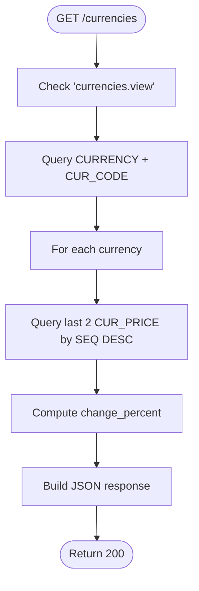

**Diagram sources**
- [api.php:332-334](file://kyApp_API/routes/api.php#L332-L334)
- [CurrencyController.php:25-94](file://kyApp_API/app/Http/Controllers/CurrencyController.php#L25-L94)

**Section sources**
- [api.php:332-334](file://kyApp_API/routes/api.php#L332-L334)
- [CurrencyController.php:25-94](file://kyApp_API/app/Http/Controllers/CurrencyController.php#L25-L94)

#### POST /currencies
- Purpose: Register a new currency and its code metadata.
- Authentication: Required via Sanctum.
- Permission: `currencies.create`.
- Request body:
  - `cur_name`: required string, max length 30
  - `code`: required string, max length 30
  - `main_cur_name`: required string, max length 30
  - `sub_cur_name`: required string, max length 30
- Success response:
  - `success`: true
  - `message`: success message
  - `data.cur_no`: integer (assigned ID)
  - Status: `201 Created`
- Validation errors:
  - `422 Unprocessable Entity` with field errors.
- Errors:
  - `500` on unexpected exceptions.

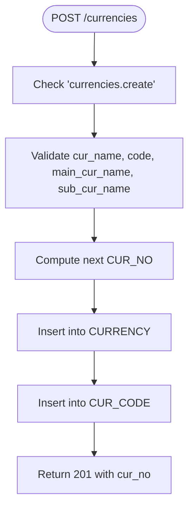

**Diagram sources**
- [api.php:335-336](file://kyApp_API/routes/api.php#L335-L336)
- [CurrencyController.php:100-145](file://kyApp_API/app/Http/Controllers/CurrencyController.php#L100-L145)

**Section sources**
- [api.php:335-336](file://kyApp_API/routes/api.php#L335-L336)
- [CurrencyController.php:100-145](file://kyApp_API/app/Http/Controllers/CurrencyController.php#L100-L145)

#### PUT /currencies/{curNo}
- Purpose: Update currency profile fields.
- Authentication: Required via Sanctum.
- Permission: `currencies.update`.
- Path parameter:
  - `curNo`: integer
- Request body:
  - Optional fields:
    - `cur_name`: string
    - `code`: string
    - `main_cur_name`: string
    - `sub_cur_name`: string
- Behavior:
  - Returns `404` if currency does not exist.
  - Updates only provided fields.
- Success response:
  - `success`: true
  - `message`: success message
- Errors:
  - `500` on unexpected exceptions.

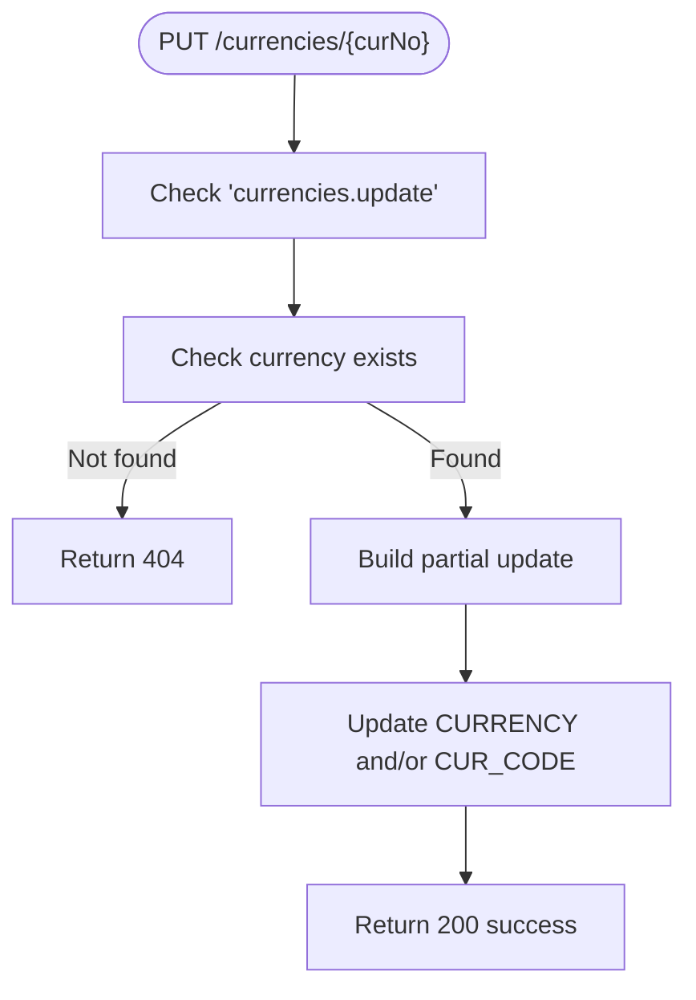

**Diagram sources**
- [api.php:337-339](file://kyApp_API/routes/api.php#L337-L339)
- [CurrencyController.php:151-193](file://kyApp_API/app/Http/Controllers/CurrencyController.php#L151-L193)

**Section sources**
- [api.php:337-339](file://kyApp_API/routes/api.php#L337-L339)
- [CurrencyController.php:151-193](file://kyApp_API/app/Http/Controllers/CurrencyController.php#L151-L193)

#### DELETE /currencies/{curNo}
- Purpose: Delete a currency and its associated code and price history.
- Authentication: Required via Sanctum.
- Permission: `currencies.delete`.
- Path parameter:
  - `curNo`: integer
- Behavior:
  - Deletes `CUR_PRICE`, then `CUR_CODE`, then `CURRENCY` for the given currency.
  - Returns `404` if currency does not exist.
- Success response:
  - `success`: true
  - `message`: success message
- Errors:
  - `500` on unexpected exceptions.

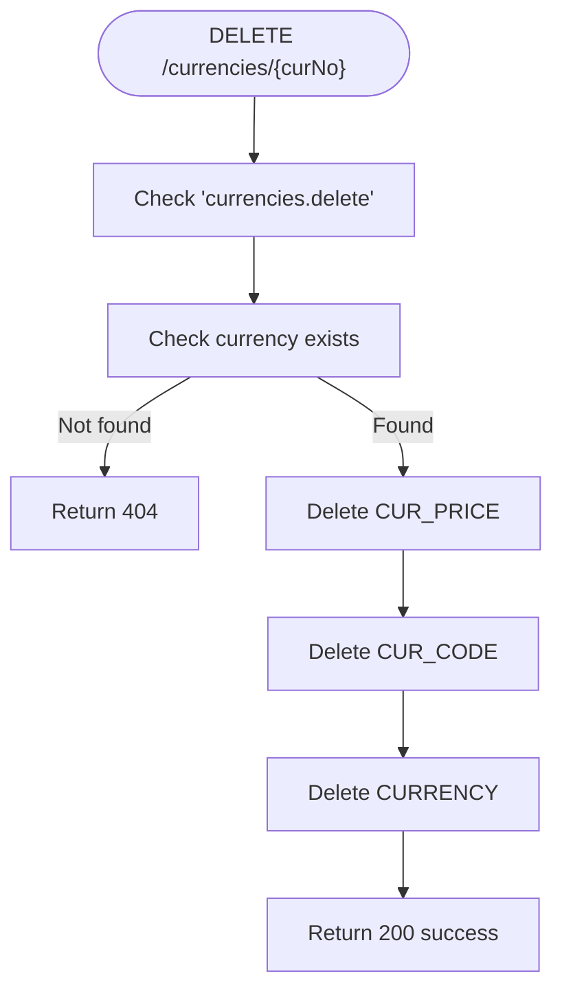

**Diagram sources**
- [api.php:340-342](file://kyApp_API/routes/api.php#L340-L342)
- [CurrencyController.php:199-216](file://kyApp_API/app/Http/Controllers/CurrencyController.php#L199-L216)

**Section sources**
- [api.php:340-342](file://kyApp_API/routes/api.php#L340-L342)
- [CurrencyController.php:199-216](file://kyApp_API/app/Http/Controllers/CurrencyController.php#L199-L216)

### Exchange Rate Endpoints

#### GET /currencies/{curNo}/prices
- Purpose: Retrieve paginated historical exchange rates for a specific currency.
- Authentication: Required via Sanctum.
- Permission: `currencies.prices_view`.
- Path parameter:
  - `curNo`: integer
- Query parameters:
  - `page`: integer, default 1, minimum 1
  - `limit`: integer, default 30, range 10–100
- Response schema:
  - `success`: boolean
  - `currency`: object
    - `cur_no`: integer
    - `cur_name`: string
  - `data`: array of price records
    - `seq`: integer
    - `cur_no`: integer
    - `price`: number
    - `day_date`: string in `YYYY-MM-DD` format
  - `meta`: object
    - `total`: integer
    - `page`: integer
    - `limit`: integer
    - `total_pages`: integer
    - `has_more`: boolean
- Error responses:
  - `404` if currency does not exist.
  - `500` on unexpected exceptions.

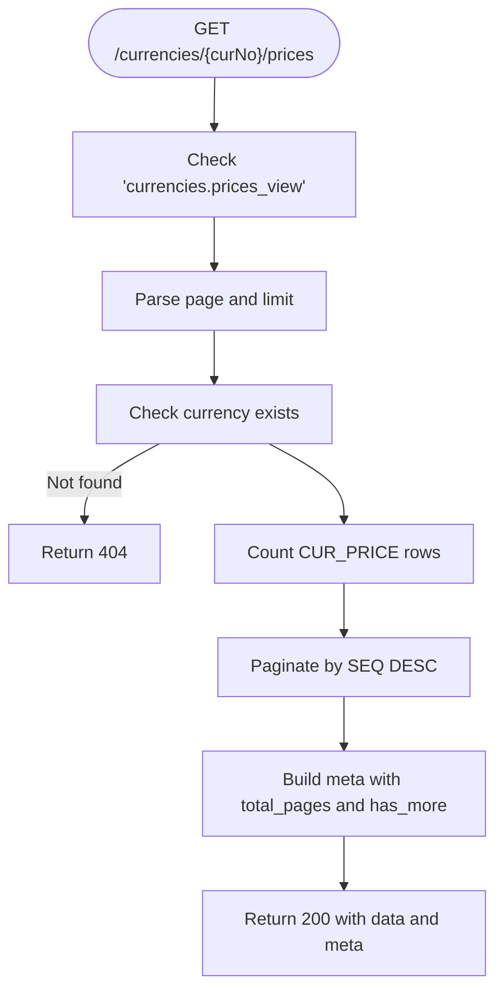

**Diagram sources**
- [api.php:344-346](file://kyApp_API/routes/api.php#L344-L346)
- [CurrencyController.php:223-293](file://kyApp_API/app/Http/Controllers/CurrencyController.php#L223-L293)

**Section sources**
- [api.php:344-346](file://kyApp_API/routes/api.php#L344-L346)
- [CurrencyController.php:223-293](file://kyApp_API/app/Http/Controllers/CurrencyController.php#L223-L293)

#### POST /currencies/{curNo}/prices
- Purpose: Add a new daily exchange rate record.
- Authentication: Required via Sanctum.
- Permission: `currencies.prices_manage`.
- Path parameter:
  - `curNo`: integer
- Request body:
  - `price`: required number, minimum 0
  - `day_date`: required date string in `YYYY-MM-DD`
- Success response:
  - `success`: true
  - `message`: success message
  - `data.seq`: integer (assigned sequence)
  - Status: `201 Created`
- Validation errors:
  - `422 Unprocessable Entity` with field errors.
- Errors:
  - `404` if currency does not exist.
  - `500` on unexpected exceptions.

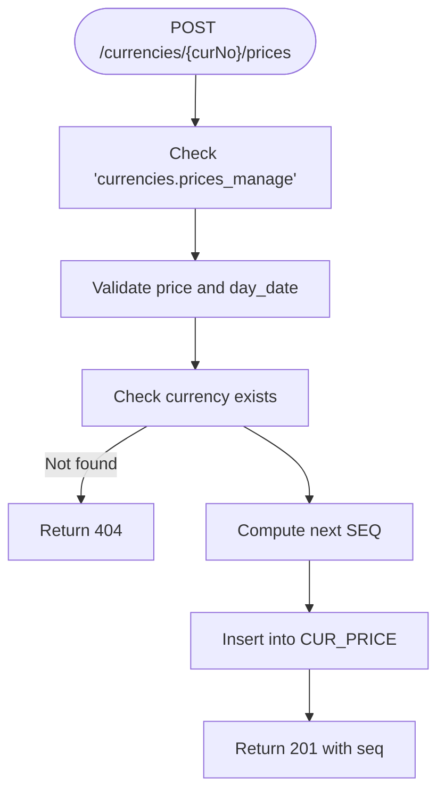

**Diagram sources**
- [api.php:347-349](file://kyApp_API/routes/api.php#L347-L349)
- [CurrencyController.php:299-338](file://kyApp_API/app/Http/Controllers/CurrencyController.php#L299-L338)

**Section sources**
- [api.php:347-349](file://kyApp_API/routes/api.php#L347-L349)
- [CurrencyController.php:299-338](file://kyApp_API/app/Http/Controllers/CurrencyController.php#L299-L338)

#### PUT /currencies/{curNo}/prices/{seq}
- Purpose: Update an existing exchange rate record.
- Authentication: Required via Sanctum.
- Permission: `currencies.prices_manage`.
- Path parameters:
  - `curNo`: integer
  - `seq`: integer
- Request body:
  - `price`: required number, minimum 0
  - `day_date`: required date string in `YYYY-MM-DD`
- Behavior:
  - Returns `404` if the rate record does not exist.
- Success response:
  - `success`: true
  - `message`: success message
- Validation errors:
  - `422 Unprocessable Entity` with field errors.
- Errors:
  - `500` on unexpected exceptions.

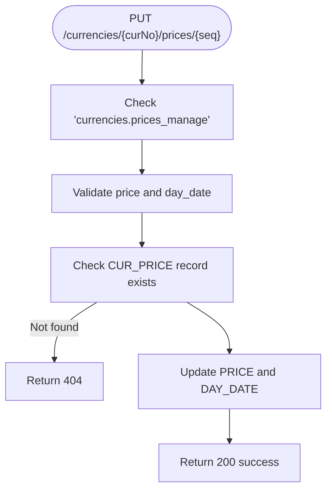

**Diagram sources**
- [api.php:350-352](file://kyApp_API/routes/api.php#L350-L352)
- [CurrencyController.php:344-377](file://kyApp_API/app/Http/Controllers/CurrencyController.php#L344-L377)

**Section sources**
- [api.php:350-352](file://kyApp_API/routes/api.php#L350-L352)
- [CurrencyController.php:344-377](file://kyApp_API/app/Http/Controllers/CurrencyController.php#L344-L377)

#### DELETE /currencies/{curNo}/prices/{seq}
- Purpose: Delete a specific exchange rate record.
- Authentication: Required via Sanctum.
- Permission: `currencies.prices_manage`.
- Path parameters:
  - `curNo`: integer
  - `seq`: integer
- Behavior:
  - Returns `404` if the rate record does not exist.
- Success response:
  - `success`: true
  - `message`: success message
- Errors:
  - `500` on unexpected exceptions.

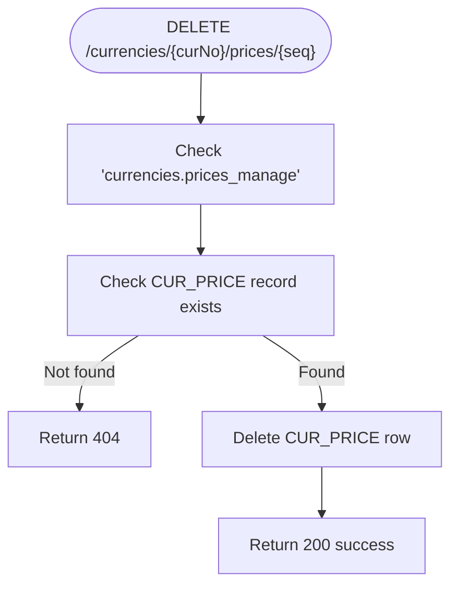

**Diagram sources**
- [api.php:353-355](file://kyApp_API/routes/api.php#L353-L355)
- [CurrencyController.php:383-400](file://kyApp_API/app/Http/Controllers/CurrencyController.php#L383-L400)

**Section sources**
- [api.php:353-355](file://kyApp_API/routes/api.php#L353-L355)
- [CurrencyController.php:383-400](file://kyApp_API/app/Http/Controllers/CurrencyController.php#L383-L400)

### Frontend Integration Notes
The frontend model and repository demonstrate how clients should consume these endpoints:
- `CurrencyModel` represents the full currency object returned by the list endpoint, including derived fields like `changePercent`.
- `CurrencyRepository` calls the API endpoints for currency CRUD and price maintenance, mapping server responses to client-side results.

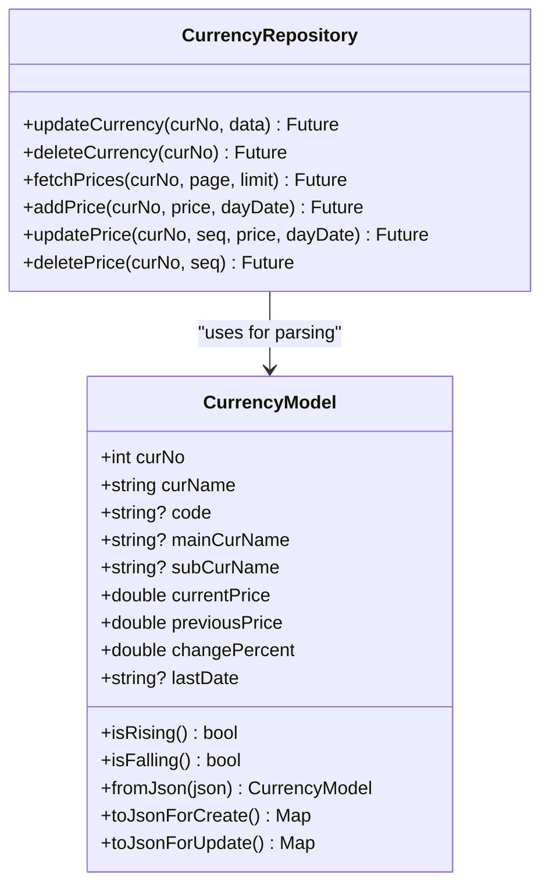

**Diagram sources**
- [currency_model.dart:8-59](file://lib/features/accounts/data/models/currency_model.dart#L8-L59)
- [currency_repository.dart:59-161](file://lib/features/accounts/data/repositories/currency_repository.dart#L59-L161)

**Section sources**
- [currency_model.dart:8-59](file://lib/features/accounts/data/models/currency_model.dart#L8-L59)
- [currency_repository.dart:59-161](file://lib/features/accounts/data/repositories/currency_repository.dart#L59-L161)

## Dependency Analysis
The currency API depends on:
- Laravel routing and middleware for authentication and authorization.
- Oracle database connection for reading and writing currency and price data.
- Permission catalog for canonical permission codes.

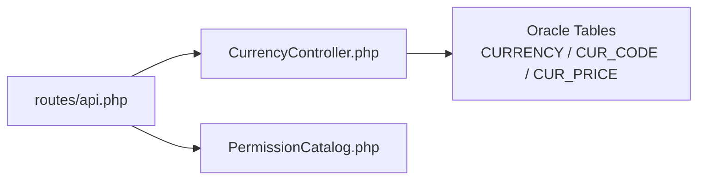

**Diagram sources**
- [api.php:324-356](file://kyApp_API/routes/api.php#L324-L356)
- [CurrencyController.php:10-18](file://kyApp_API/app/Http/Controllers/CurrencyController.php#L10-L18)
- [PermissionCatalog.php:153-165](file://kyApp_API/app/Support/PermissionCatalog.php#L153-L165)

**Section sources**
- [api.php:324-356](file://kyApp_API/routes/api.php#L324-L356)
- [CurrencyController.php:10-18](file://kyApp_API/app/Http/Controllers/CurrencyController.php#L10-L18)
- [PermissionCatalog.php:153-165](file://kyApp_API/app/Support/PermissionCatalog.php#L153-L165)

## Performance Considerations
- Pagination limits: The price listing endpoint enforces a maximum limit of 100 and a minimum of 10 to prevent excessive data retrieval.
- Oracle compatibility: Queries use Oracle-specific constructs such as `ROWNUM` and `TO_CHAR(DAY_DATE, 'YYYY-MM-DD')` for compatibility with older Oracle versions.
- Change percent calculation: Computed client-side in the controller using the most recent and previous prices; avoid redundant calculations at the UI layer.
- Encoding: Arabic text is normalized through an encoding utility before storage and after retrieval to avoid mojibake issues.

[No sources needed since this section provides general guidance]

## Security and Dual-Permission Model
The currency module uses a dual-permission model:
- Vocabulary permissions (`currencies.*`) control access to currency directory operations:
  - `currencies.view`: Read-only access to the currency list.
  - `currencies.create`: Add new currencies.
  - `currencies.update`: Edit currency profiles.
  - `currencies.delete`: Remove currencies and related data.
- Pricing permissions (`currencies.prices_*`) control access to daily exchange rate operations:
  - `currencies.prices_view`: Read-only access to historical exchange rates.
  - `currencies.prices_manage`: Add, update, and delete exchange rate records.

This separation ensures that users who can manage currency vocabulary cannot necessarily manipulate pricing data, which directly affects valuation of transactions.

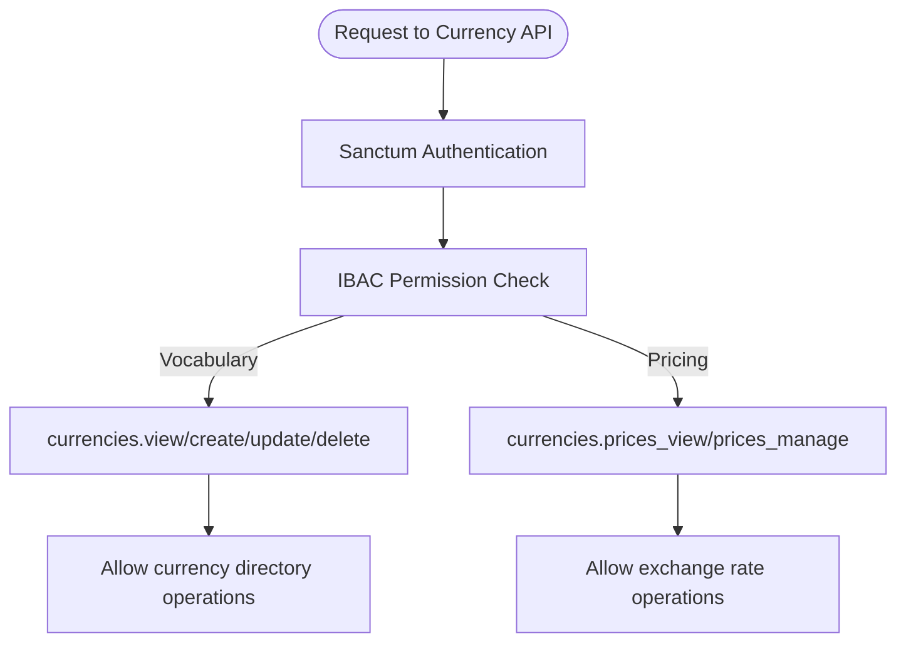

**Diagram sources**
- [api.php:332-355](file://kyApp_API/routes/api.php#L332-L355)
- [PermissionCatalog.php:153-165](file://kyApp_API/app/Support/PermissionCatalog.php#L153-L165)

**Section sources**
- [api.php:332-355](file://kyApp_API/routes/api.php#L332-L355)
- [PermissionCatalog.php:153-165](file://kyApp_API/app/Support/PermissionCatalog.php#L153-L165)

### Security Implications of Exchange Rate Manipulation
- Financial impact: Exchange rates determine multi-currency valuations; unauthorized changes can distort financial statements and transaction outcomes.
- Least privilege: Grant `currencies.prices_manage` only to trusted roles responsible for pricing maintenance.
- Audit trail: While the controller writes to `CUR_PRICE`, there is no explicit audit table usage in the controller. Organizations should implement application-level auditing or database triggers to log who changed which rate and when.
- Input validation: All price inputs are validated as non-negative numbers and dates are strictly formatted to reduce malformed data risks.
- Idempotency and concurrency: The current implementation assigns sequence numbers based on `MAX(SEQ)` without explicit locking; concurrent inserts may require additional safeguards depending on workload.

[No sources needed since this section provides general guidance]

## Troubleshooting Guide
Common issues and resolutions:
- `404 Not Found`:
  - Occurs when referencing a non-existent currency or price record.
  - Verify `curNo` and `seq` values.
- `422 Unprocessable Entity`:
  - Occurs when request validation fails (e.g., missing or invalid fields).
  - Check required fields: `cur_name`, `code`, `main_cur_name`, `sub_cur_name` for currency creation; `price` and `day_date` for price operations.
- `403 Forbidden`:
  - Indicates missing IBAC permission.
  - Ensure the user has the correct permission code (`currencies.*` or `currencies.prices_*`).
- `500 Internal Server Error`:
  - Indicates an unexpected exception in the controller.
  - Review server logs and database connectivity.

**Section sources**
- [CurrencyController.php:140-144](file://kyApp_API/app/Http/Controllers/CurrencyController.php#L140-L144)
- [CurrencyController.php:190-192](file://kyApp_API/app/Http/Controllers/CurrencyController.php#L190-L192)
- [CurrencyController.php:290-292](file://kyApp_API/app/Http/Controllers/CurrencyController.php#L290-L292)
- [CurrencyController.php:333-337](file://kyApp_API/app/Http/Controllers/CurrencyController.php#L333-L337)
- [CurrencyController.php:372-376](file://kyApp_API/app/Http/Controllers/CurrencyController.php#L372-L376)
- [CurrencyController.php:397-399](file://kyApp_API/app/Http/Controllers/CurrencyController.php#L397-L399)

## Conclusion
The Currency Management API provides a clear separation between currency vocabulary management and exchange rate pricing through distinct permission sets. It exposes comprehensive CRUD operations for currencies and daily exchange rates, with robust validation, pagination, and consistent JSON responses. Clients should respect the dual-permission model, validate inputs carefully, and implement appropriate auditing to ensure financial integrity and traceability of exchange rate changes.

[No sources needed since this section summarizes without analyzing specific files]