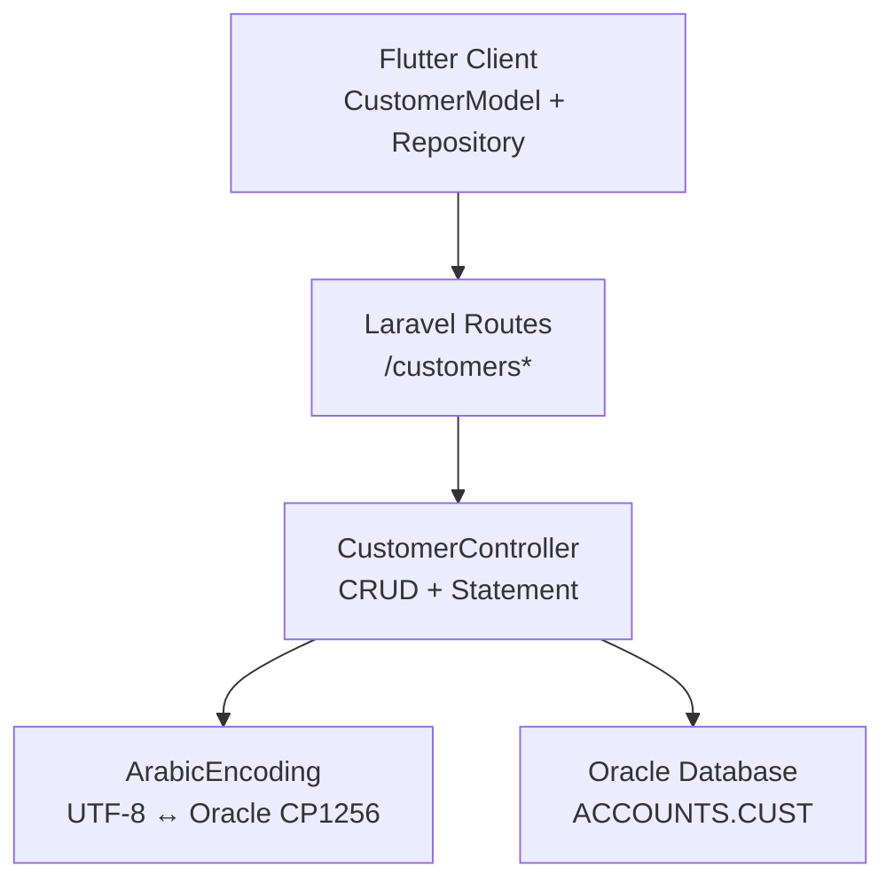
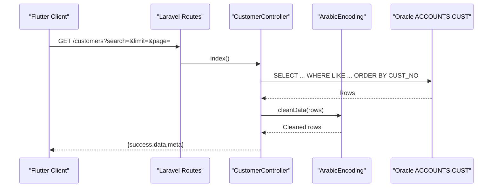
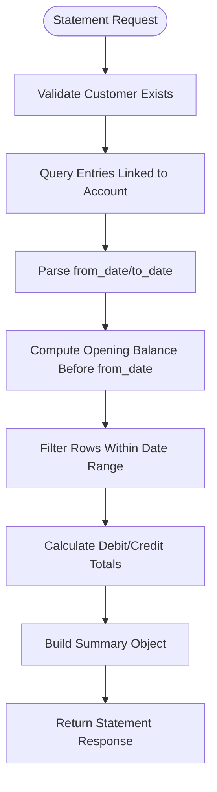
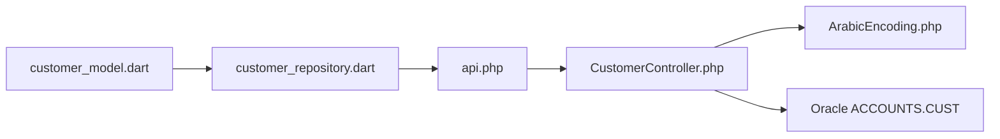

# Customer Management API

<cite>
**Referenced Files in This Document**
- [CustomerController.php](file://kyApp_API/app/Http/Controllers/CustomerController.php)
- [api.php](file://kyApp_API/routes/api.php)
- [ArabicEncoding.php](file://kyApp_API/app/Support/ArabicEncoding.php)
- [customer_model.dart](file://lib/features/customers/data/models/customer_model.dart)
- [customer_repository.dart](file://lib/features/customers/data/repositories/customer_repository.dart)
</cite>

## Table of Contents
1. [Introduction](#introduction)
2. [Project Structure](#project-structure)
3. [Core Components](#core-components)
4. [Architecture Overview](#architecture-overview)
5. [Detailed Component Analysis](#detailed-component-analysis)
6. [Dependency Analysis](#dependency-analysis)
7. [Performance Considerations](#performance-considerations)
8. [Security and Privacy](#security-and-privacy)
9. [Troubleshooting Guide](#troubleshooting-guide)
10. [Conclusion](#conclusion)

## Introduction
This document provides detailed API documentation for the customer management endpoints exposed by the Laravel backend. It covers:
- Customer CRUD operations
- Customer search, filtering, and pagination
- Customer statement generation with financial calculations
- Data model, validation rules, and business constraints
- Security, permissions, and privacy considerations for sensitive financial data

The customer data is stored in an Oracle schema table `ACCOUNTS.CUST`, and the controller performs encoding-safe reads and writes between UTF-8 clients and the legacy Oracle character set.

## Project Structure
The customer feature spans three main layers:
- Routes define HTTP endpoints and permission gates.
- Controller implements business logic, validation, Oracle queries, and response formatting.
- Flutter client models and repository map API payloads to local objects and call the API.



**Diagram sources**
- [api.php:188-209](file://kyApp_API/routes/api.php#L188-L209)
- [CustomerController.php:16-463](file://kyApp_API/app/Http/Controllers/CustomerController.php#L16-L463)
- [ArabicEncoding.php:9-193](file://kyApp_API/app/Support/ArabicEncoding.php#L9-L193)

**Section sources**
- [api.php:188-209](file://kyApp_API/routes/api.php#L188-L209)
- [CustomerController.php:16-463](file://kyApp_API/app/Http/Controllers/CustomerController.php#L16-L463)
- [customer_model.dart:1-109](file://lib/features/customers/data/models/customer_model.dart#L1-L109)
- [customer_repository.dart:60-154](file://lib/features/customers/data/repositories/customer_repository.dart#L60-L154)

## Core Components
- **CustomerController**: Implements all customer endpoints, including list/search, single record, create, update, delete, and statement generation.
- **Routes**: Define RESTful paths under `/customers` and enforce Sanctum authentication plus granular IBAC permissions.
- **ArabicEncoding**: Ensures correct handling of Arabic text across UTF-8 clients and Oracle’s Windows-1256 storage.
- **Flutter CustomerModel**: Maps JSON payloads to strongly typed Dart objects for UI and repository calls.
- **Flutter CustomerRepository**: Encapsulates HTTP calls to `/customers`, handles cancellation tokens, and maps responses.

Key responsibilities:
- Input validation and error normalization
- Pagination and search on multiple fields
- Financial summary computation for statements
- Safe encoding for Arabic text
- Permission-gated access control

**Section sources**
- [CustomerController.php:16-463](file://kyApp_API/app/Http/Controllers/CustomerController.php#L16-L463)
- [api.php:188-209](file://kyApp_API/routes/api.php#L188-L209)
- [ArabicEncoding.php:9-193](file://kyApp_API/app/Support/ArabicEncoding.php#L9-L193)
- [customer_model.dart:1-109](file://lib/features/customers/data/models/customer_model.dart#L1-L109)
- [customer_repository.dart:60-154](file://lib/features/customers/data/repositories/customer_repository.dart#L60-L154)

## Architecture Overview
The customer API follows a standard layered architecture:
- HTTP layer (routes) enforces authentication and authorization.
- Controller layer validates input, applies business rules, and interacts with Oracle.
- Support layer handles character encoding safely.
- Client layer uses typed models and repositories to interact with the API.



**Diagram sources**
- [api.php:190-192](file://kyApp_API/routes/api.php#L190-L192)
- [CustomerController.php:28-84](file://kyApp_API/app/Http/Controllers/CustomerController.php#L28-L84)
- [ArabicEncoding.php:167-192](file://kyApp_API/app/Support/ArabicEncoding.php#L167-L192)

## Detailed Component Analysis

### Customer Data Model
The customer entity maps to the Oracle table `ACCOUNTS.CUST`. The following fields are used by the API:

| Field | Type | Required | Description | Validation Rules |
|---|---|---:|---|---|
| `cust_no` | integer | Yes (read-only) | Unique customer identifier generated by incrementing the maximum existing value | Integer; auto-generated on create |
| `cust_name` | string | Yes | Customer name | Max 150 characters; required |
| `addr` | string | No | Address | Max 200 characters |
| `tel1` | string | No | Primary phone number | Max 20 characters |
| `tel2` | string | No | Secondary phone number | Max 20 characters |
| `postbox` | string | No | Postal box | Max 20 characters |
| `email` | string | No | Email address | Valid email format; max 100 characters |
| `fax` | string | No | Fax number | Max 20 characters |
| `acc_no` | integer | No | Associated account number | Integer |
| `limited_balance` | number | No | Limited balance amount | Numeric |
| `pre_cust_name` | string | No | Previous or alternate customer name | Max 150 characters |
| `stopping_cust` | integer | No | Stop flag | Must be `0` or `1` |

Business constraints:
- `cust_no` is auto-incremented based on the current maximum value in the database.
- `stopping_cust` is a boolean-like flag represented as `0` or `1`.
- Arabic text is normalized before write and read to ensure correct display and search behavior.

**Section sources**
- [CustomerController.php:118-181](file://kyApp_API/app/Http/Controllers/CustomerController.php#L118-L181)
- [CustomerController.php:188-255](file://kyApp_API/app/Http/Controllers/CustomerController.php#L188-L255)
- [customer_model.dart:5-70](file://lib/features/customers/data/models/customer_model.dart#L5-L70)

### Endpoints

#### List Customers
- **Method**: `GET`
- **URL**: `/customers`
- **Authentication**: Required (`auth:sanctum`)
- **Permission**: `customers.view`
- **Query Parameters**:
  - `search`: String; supports numeric and text search across customer number, name, phone numbers, address, previous customer name, and account number.
  - `limit`: Integer; default `100`; maximum `500`.
  - `page`: Integer; minimum `1`.
- **Response Schema**:
  - `success`: boolean
  - `data`: array of customer objects
  - `meta`: object with `total`, `page`, `limit`, `pages`

Example request:
```
GET /customers?search=123&limit=50&page=1
```

Example response:
```json
{
  "success": true,
  "data": [
    {
      "CUST_NO": 1,
      "CUST_NAME": "Ahmad Al-Kaboudi",
      "ADDR": "Sana'a, Yemen",
      "TEL1": "+9671234567",
      "TEL2": null,
      "POSTBOX": "P.O. Box 123",
      "EMAIL": "ahmad@example.com",
      "FAX": null,
      "ACC_NO": 12310000,
      "LIMITED_BALANCE": 1500.00,
      "PRE_CUST_NAME": null,
      "STOPPING_CUST": 0
    }
  ],
  "meta": {
    "total": 1,
    "page": 1,
    "limit": 50,
    "pages": 1
  }
}
```

**Section sources**
- [api.php:190-192](file://kyApp_API/routes/api.php#L190-L192)
- [CustomerController.php:28-84](file://kyApp_API/app/Http/Controllers/CustomerController.php#L28-L84)

#### Get Single Customer
- **Method**: `GET`
- **URL**: `/customers/{custNo}`
- **Authentication**: Required (`auth:sanctum`)
- **Permission**: `customers.view`
- **Path Parameter**:
  - `custNo`: integer
- **Response Schema**:
  - `success`: boolean
  - `data`: customer object

Example request:
```
GET /customers/1
```

Example response:
```json
{
  "success": true,
  "data": {
    "CUST_NO": 1,
    "CUST_NAME": "Ahmad Al-Kaboudi",
    "ADDR": "Sana'a, Yemen",
    "TEL1": "+9671234567",
    "TEL2": null,
    "POSTBOX": "P.O. Box 123",
    "EMAIL": "ahmad@example.com",
    "FAX": null,
    "ACC_NO": 12310000,
    "LIMITED_BALANCE": 1500.00,
    "PRE_CUST_NAME": null,
    "STOPPING_CUST": 0
  }
}
```

**Section sources**
- [api.php:200-202](file://kyApp_API/routes/api.php#L200-L202)
- [CustomerController.php:90-112](file://kyApp_API/app/Http/Controllers/CustomerController.php#L90-L112)

#### Create Customer
- **Method**: `POST`
- **URL**: `/customers`
- **Authentication**: Required (`auth:sanctum`)
- **Permission**: `customers.create`
- **Request Body**:
  - `cust_name`: string, required
  - `addr`: string, optional
  - `tel1`: string, optional
  - `tel2`: string, optional
  - `postbox`: string, optional
  - `email`: string, optional, valid email
  - `fax`: string, optional
  - `acc_no`: integer, optional
  - `limited_balance`: number, optional
  - `pre_cust_name`: string, optional
  - `stopping_cust`: integer, optional, must be `0` or `1`
- **Response Schema**:
  - `success`: boolean
  - `message`: string
  - `cust_no`: integer (on success)

Example request:
```json
{
  "cust_name": "Fatima Al-Masri",
  "addr": "Aden, Yemen",
  "tel1": "+967712345678",
  "email": "fatima@example.com",
  "acc_no": 12310001,
  "limited_balance": 2000.00,
  "stopping_cust": 0
}
```

Example response:
```json
{
  "success": true,
  "message": "Customer created successfully.",
  "cust_no": 2
}
```

**Section sources**
- [api.php:193-194](file://kyApp_API/routes/api.php#L193-L194)
- [CustomerController.php:118-181](file://kyApp_API/app/Http/Controllers/CustomerController.php#L118-L181)

#### Update Customer
- **Method**: `PUT`
- **URL**: `/customers/{custNo}`
- **Authentication**: Required (`auth:sanctum`)
- **Permission**: `customers.update`
- **Path Parameter**:
  - `custNo`: integer
- **Request Body**: Same schema as create, except `cust_no` is not sent.
- **Response Schema**:
  - `success`: boolean
  - `message`: string

Example request:
```json
{
  "cust_name": "Fatima Al-Masri Updated",
  "tel1": "+967712345679",
  "stopping_cust": 1
}
```

Example response:
```json
{
  "success": true,
  "message": "Customer updated successfully."
}
```

**Section sources**
- [api.php:203-205](file://kyApp_API/routes/api.php#L203-L205)
- [CustomerController.php:188-255](file://kyApp_API/app/Http/Controllers/CustomerController.php#L188-L255)

#### Delete Customer
- **Method**: `DELETE`
- **URL**: `/customers/{custNo}`
- **Authentication**: Required (`auth:sanctum`)
- **Permission**: `customers.delete`
- **Path Parameter**:
  - `custNo`: integer
- **Response Schema**:
  - `success`: boolean
  - `message`: string

Example request:
```
DELETE /customers/2
```

Example response:
```json
{
  "success": true,
  "message": "Customer deleted successfully."
}
```

**Section sources**
- [api.php:206-208](file://kyApp_API/routes/api.php#L206-L208)
- [CustomerController.php:262-288](file://kyApp_API/app/Http/Controllers/CustomerController.php#L262-L288)

#### Generate Customer Statement
- **Method**: `GET`
- **URL**: `/customers/{custNo}/statement`
- **Authentication**: Required (`auth:sanctum`)
- **Permission**: `customers.statement`
- **Path Parameter**:
  - `custNo`: integer
- **Query Parameters**:
  - `from_date`: Optional date string; supports formats like `DD/MM/YYYY` or ISO-like strings.
  - `to_date`: Optional date string; same format support.
- **Response Schema**:
  - `success`: boolean
  - `customer`: customer object
  - `data`: array of statement rows
  - `summary`: object with financial totals and report metadata

Statement row fields:
- `entry_no`: integer
- `sub_entry_no`: string
- `entry_date`: string (`DD/MM/YYYY`)
- `entry_type_name`: string
- `details`: string
- `balance_s`: number
- `entry_mnt`: number
- `debit`: number
- `credit`: number
- `cust_name`: string
- `cust_no`: integer
- `acc_no`: integer

Summary fields:
- `total_rows`: integer
- `total_debit`: number
- `total_credit`: number
- `opening_balance`: number
- `final_balance`: number
- `from_date`: string
- `to_date`: string
- `currency`: string (e.g., `يمني YR`)
- `account_title`: string

Example request:
```
GET /customers/1/statement?from_date=01/01/2025&to_date=31/01/2025
```

Example response:
```json
{
  "success": true,
  "customer": {
    "CUST_NO": 1,
    "CUST_NAME": "Ahmad Al-Kaboudi",
    "ACC_NO": 12310000
  },
  "data": [
    {
      "entry_no": 1001,
      "sub_entry_no": "12025",
      "entry_date": "15/01/2025",
      "entry_type_name": "Sale",
      "details": "Invoice payment received",
      "balance_s": 1500.00,
      "entry_mnt": 500.00,
      "debit": 500.00,
      "credit": 0.00,
      "cust_name": "Ahmad Al-Kaboudi",
      "cust_no": 1,
      "acc_no": 12310000
    }
  ],
  "summary": {
    "total_rows": 1,
    "total_debit": 500.00,
    "total_credit": 0.00,
    "opening_balance": 1000.00,
    "final_balance": 1500.00,
    "from_date": "01/01/2025",
    "to_date": "31/01/2025",
    "currency": "يمني YR",
    "account_title": "12310000 عملاء الكبودي للخياطة"
  }
}
```

**Section sources**
- [api.php:195-199](file://kyApp_API/routes/api.php#L195-L199)
- [CustomerController.php:294-420](file://kyApp_API/app/Http/Controllers/CustomerController.php#L294-L420)

### Search and Filtering Logic
The list endpoint supports flexible search:
- Numeric search matches `CUST_NO`, `TEL1`, `TEL2`, and `ACC_NO`.
- Text search matches `CUST_NAME`, `ADDR`, `PRE_CUST_NAME`, and phone fields.
- Arabic text is normalized using `ArabicEncoding::toOracleSearchChars` to ensure correct matching against Oracle’s character set.

Pagination parameters:
- `limit`: capped at `500`.
- `page`: starts at `1`.
- Results are ordered by `CUST_NO`.

**Section sources**
- [CustomerController.php:28-84](file://kyApp_API/app/Http/Controllers/CustomerController.php#L28-L84)
- [ArabicEncoding.php:143-162](file://kyApp_API/app/Support/ArabicEncoding.php#L143-L162)

### Statement Generation Flow
The statement endpoint computes financial summaries and filters entries by date range:
- Retrieves all relevant entries linked to the customer’s account.
- Computes opening balance from entries before `from_date`.
- Filters entries within the requested date range.
- Calculates debit and credit per entry and running balances.
- Returns formatted dates and cleaned Arabic text.



**Diagram sources**
- [CustomerController.php:294-420](file://kyApp_API/app/Http/Controllers/CustomerController.php#L294-L420)

**Section sources**
- [CustomerController.php:294-420](file://kyApp_API/app/Http/Controllers/CustomerController.php#L294-L420)

## Dependency Analysis
The customer module depends on:
- Laravel routing and middleware for authentication and permission enforcement.
- Oracle database connection for reading and writing customer data.
- Arabic encoding utilities for safe text handling.
- Flutter client models and repository for API integration.



**Diagram sources**
- [api.php:188-209](file://kyApp_API/routes/api.php#L188-L209)
- [CustomerController.php:16-463](file://kyApp_API/app/Http/Controllers/CustomerController.php#L16-L463)
- [ArabicEncoding.php:9-193](file://kyApp_API/app/Support/ArabicEncoding.php#L9-L193)
- [customer_model.dart:1-109](file://lib/features/customers/data/models/customer_model.dart#L1-L109)
- [customer_repository.dart:60-154](file://lib/features/customers/data/repositories/customer_repository.dart#L60-L154)

**Section sources**
- [api.php:188-209](file://kyApp_API/routes/api.php#L188-L209)
- [CustomerController.php:16-463](file://kyApp_API/app/Http/Controllers/CustomerController.php#L16-L463)
- [ArabicEncoding.php:9-193](file://kyApp_API/app/Support/ArabicEncoding.php#L9-L193)
- [customer_model.dart:1-109](file://lib/features/customers/data/models/customer_model.dart#L1-L109)
- [customer_repository.dart:60-154](file://lib/features/customers/data/repositories/customer_repository.dart#L60-L154)

## Performance Considerations
- Pagination limits prevent large result sets; default limit is `100`, maximum is `500`.
- Search queries use `LIKE` patterns; consider indexing frequently searched fields such as `CUST_NO`, `ACC_NO`, and `CUST_NAME` if performance degrades.
- Statement generation computes totals in PHP after fetching rows; for very large datasets, consider server-side aggregation or materialized views.
- Arabic text cleaning adds processing overhead; batch cleaning is already applied to arrays and objects.

[No sources needed since this section provides general guidance]

## Security and Privacy
- All customer endpoints require Sanctum authentication.
- Granular permissions are enforced:
  - `customers.view`: list and view customers
  - `customers.create`: create new customers
  - `customers.update`: update existing customers
  - `customers.delete`: delete customers
  - `customers.statement`: generate customer statements
- Sensitive financial data (balances, transactions) is only accessible via the statement endpoint, which requires a dedicated permission.
- Arabic text encoding is handled securely to prevent mojibake and ensure data integrity.
- Error responses do not expose internal stack traces unless debug mode is enabled.

Recommendations:
- Enforce least privilege by granting only necessary permissions per user role.
- Log access to statement endpoints for auditability.
- Encrypt sensitive fields at rest if required by compliance policies.
- Rate-limit sensitive endpoints if exposed publicly through proxies.

**Section sources**
- [api.php:188-209](file://kyApp_API/routes/api.php#L188-L209)
- [CustomerController.php:455-462](file://kyApp_API/app/Http/Controllers/CustomerController.php#L455-L462)
- [ArabicEncoding.php:9-193](file://kyApp_API/app/Support/ArabicEncoding.php#L9-L193)

## Troubleshooting Guide
Common issues and resolutions:
- **Validation errors**: Ensure required fields are present and conform to constraints (e.g., `cust_name` required, `email` valid).
- **Not found errors**: Verify that `custNo` exists before attempting updates, deletions, or statement retrieval.
- **Date parsing errors**: Use supported date formats (`DD/MM/YYYY` or ISO-like strings) for statement queries.
- **Arabic text corruption**: Confirm that client sends UTF-8 and that server uses `ArabicEncoding` helpers for safe conversion.
- **Permission denied**: Check that the authenticated user has the required permission code for the endpoint.

Error response structure:
```json
{
  "success": false,
  "message": "Database error.",
  "error": null
}
```

**Section sources**
- [CustomerController.php:118-181](file://kyApp_API/app/Http/Controllers/CustomerController.php#L118-L181)
- [CustomerController.php:188-255](file://kyApp_API/app/Http/Controllers/CustomerController.php#L188-L255)
- [CustomerController.php:294-420](file://kyApp_API/app/Http/Controllers/CustomerController.php#L294-L420)
- [CustomerController.php:455-462](file://kyApp_API/app/Http/Controllers/CustomerController.php#L455-L462)

## Conclusion
The Customer Management API provides a secure, permission-gated interface for managing customer records and generating financial statements. It integrates with an Oracle backend while ensuring correct Arabic text handling. Clients should adhere to the documented schemas, validation rules, and permission requirements to ensure reliable operation. For high-volume scenarios, consider database indexing and server-side aggregation optimizations.

[No sources needed since this section summarizes without analyzing specific files]