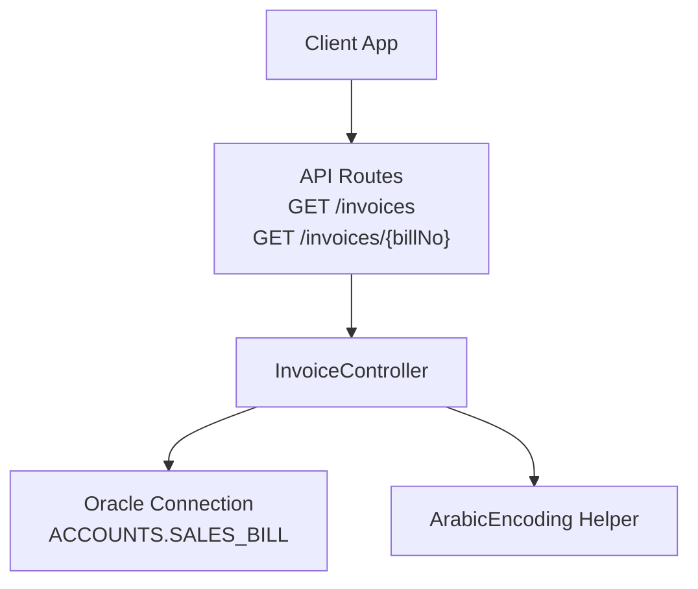
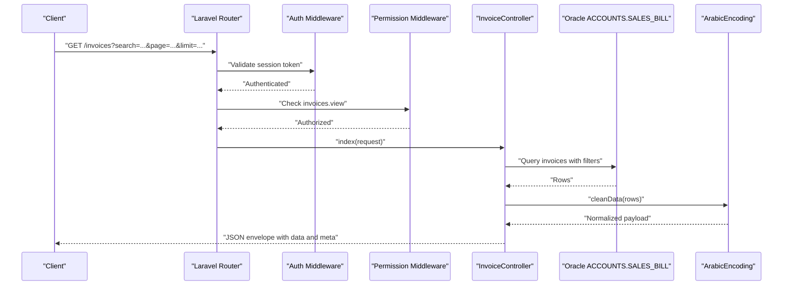
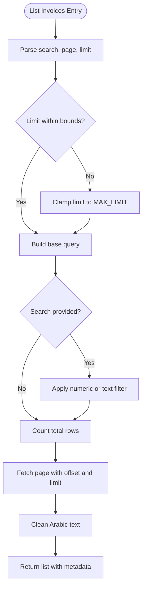
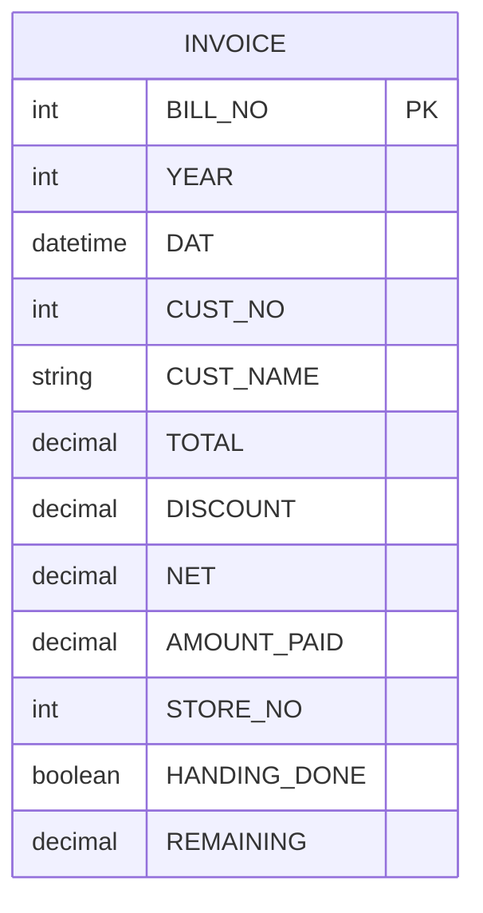
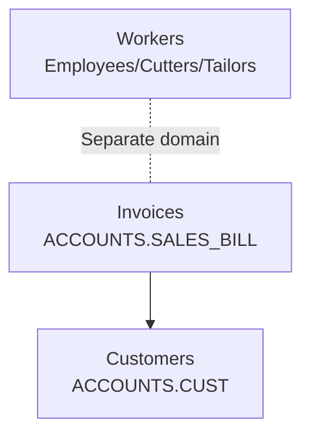
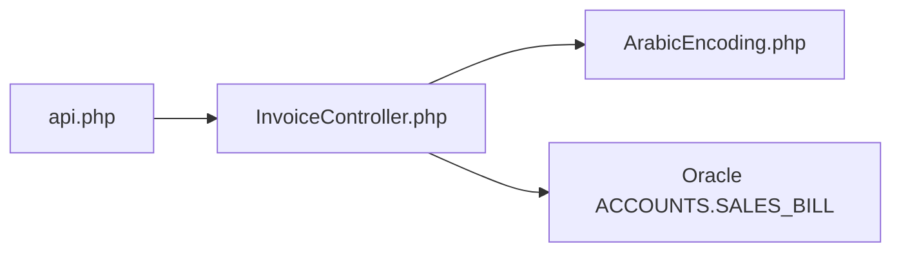

# Invoice Management API

<cite>
**Referenced Files in This Document**
- [InvoiceController.php](file://kyApp_API/app/Http/Controllers/InvoiceController.php)
- [api.php](file://kyApp_API/routes/api.php)
- [ArabicEncoding.php](file://kyApp_API/app/Support/ArabicEncoding.php)
</cite>

## Table of Contents
1. [Introduction](#introduction)
2. [Project Structure](#project-structure)
3. [Core Components](#core-components)
4. [Architecture Overview](#architecture-overview)
5. [Detailed Component Analysis](#detailed-component-analysis)
6. [Dependency Analysis](#dependency-analysis)
7. [Performance Considerations](#performance-considerations)
8. [Troubleshooting Guide](#troubleshooting-guide)
9. [Conclusion](#conclusion)

## Introduction
This document describes the read-only invoice management API surface. The endpoints expose invoices from a legacy accounting system and do not create, update, or delete invoice data. Clients can list invoices with search and pagination, and retrieve individual invoices by bill number. Access is protected by authentication and requires the `invoices.view` permission.

The invoice data model is derived directly from the `ACCOUNTS.SALES_BILL` table. Billing fields such as total, discount, net amount, amount paid, and remaining balance are exposed through a consistent response schema. Arabic text handling between Oracle and UTF-8 clients is managed by an encoding helper to ensure correct display and search behavior.

## Project Structure
The invoice feature is implemented as a small, focused controller plus route registration:

- Route registration defines two read-only GET endpoints under the `/invoices` path.
- The controller reads from the Oracle connection and returns JSON responses.
- An encoding helper normalizes Arabic text for both search queries and response payloads.

**Diagram sources**
- [api.php:168-172](file://kyApp_API/routes/api.php#L168-L172)
- [InvoiceController.php:18-45](file://kyApp_API/app/Http/Controllers/InvoiceController.php#L18-L45)
- [ArabicEncoding.php:143-192](file://kyApp_API/app/Support/ArabicEncoding.php#L143-L192)

**Section sources**
- [api.php:168-172](file://kyApp_API/routes/api.php#L168-L172)
- [InvoiceController.php:10-45](file://kyApp_API/app/Http/Controllers/InvoiceController.php#L10-L45)

## Core Components
- **InvoiceController**: Implements the invoice listing and single-invoice retrieval logic. It enforces read-only access by design and computes a derived `REMAINING` field from `NET` and `AMOUNT_PAID`.
- **API Routes**: Register the invoice endpoints under authentication and the `invoices.view` permission.
- **ArabicEncoding**: Provides safe Arabic text conversion for Oracle searches and cleans response payloads to avoid mojibake.

Key responsibilities:
- List invoices with optional search by bill number or customer name.
- Paginate results with configurable limit and page.
- Retrieve a single invoice by numeric bill number.
- Normalize Arabic text in requests and responses.
- Return consistent success/failure JSON envelopes.

**Section sources**
- [InvoiceController.php:18-139](file://kyApp_API/app/Http/Controllers/InvoiceController.php#L18-L139)
- [api.php:168-172](file://kyApp_API/routes/api.php#L168-L172)
- [ArabicEncoding.php:143-192](file://kyApp_API/app/Support/ArabicEncoding.php#L143-L192)

## Architecture Overview
The invoice API follows a simple request-to-response flow:

1. The client sends a GET request to either `/invoices` or `/invoices/{billNo}`.
2. Laravel routes enforce authentication (`auth:sanctum`) and authorization (`permission:invoices.view`).
3. The controller validates query parameters and builds a database query against `ACCOUNTS.SALES_BILL`.
4. For list operations, the controller applies search filters, counts total rows, and returns paginated results.
5. For detail operations, the controller fetches one invoice by bill number.
6. Responses are normalized through the Arabic encoding helper and returned as JSON.

**Diagram sources**
- [api.php:168-172](file://kyApp_API/routes/api.php#L168-L172)
- [InvoiceController.php:51-104](file://kyApp_API/app/Http/Controllers/InvoiceController.php#L51-L104)
- [ArabicEncoding.php:167-192](file://kyApp_API/app/Support/ArabicEncoding.php#L167-L192)

## Detailed Component Analysis

### HTTP Endpoints

#### List Invoices
- **Method**: GET
- **URL Pattern**: `/invoices`
- **Authentication**: Required (`auth:sanctum`)
- **Authorization**: Requires `invoices.view`
- **Query Parameters**:
  - `search`: Optional string; supports numeric bill numbers and customer name text matching.
  - `page`: Optional integer; defaults to 1; minimum enforced is 1.
  - `limit`: Optional integer; defaults to 100; maximum enforced is 500.
- **Response Schema**:
  - `success`: boolean
  - `message`: string
  - `data`: array of invoice objects
  - `meta`: object containing `total`, `page`, `limit`, `pages`
- **Success Status Code**: 200
- **Error Status Code**: 500 on internal errors

Example request:
- `GET /invoices?page=1&limit=50&search=1234`

Example response body structure:
- `success`: true
- `message`: "Invoices retrieved"
- `data`: [invoice object, ...]
- `meta`: { "total": 120, "page": 1, "limit": 50, "pages": 3 }

**Section sources**
- [api.php:168-172](file://kyApp_API/routes/api.php#L168-L172)
- [InvoiceController.php:51-104](file://kyApp_API/app/Http/Controllers/InvoiceController.php#L51-L104)

#### Get Single Invoice
- **Method**: GET
- **URL Pattern**: `/invoices/{billNo}`
- **Path Parameter**:
  - `billNo`: Numeric invoice identifier (validated by route constraint).
- **Authentication**: Required (`auth:sanctum`)
- **Authorization**: Requires `invoices.view`
- **Response Schema**:
  - `success`: boolean
  - `message`: string
  - `data`: invoice object
- **Success Status Code**: 200
- **Not Found Status Code**: 404 when no invoice matches the bill number
- **Error Status Code**: 500 on internal errors

Example request:
- `GET /invoices/1234`

Example response body structure:
- `success`: true
- `message`: "Invoice retrieved"
- `data`: invoice object

**Section sources**
- [api.php:168-172](file://kyApp_API/routes/api.php#L168-L172)
- [InvoiceController.php:110-138](file://kyApp_API/app/Http/Controllers/InvoiceController.php#L110-L138)

### Request and Response Schemas

#### Invoice Object Fields
The invoice object includes the following fields:
- `BILL_NO`: Invoice number
- `YEAR`: Fiscal year
- `DAT`: Invoice date
- `CUST_NO`: Customer number
- `CUST_NAME`: Customer name
- `TOTAL`: Total invoice amount
- `DISCOUNT`: Discount amount
- `NET`: Net amount after discounts
- `AMOUNT_PAID`: Amount already paid
- `STORE_NO`: Store identifier
- `HANDING_DONE`: Handling completion flag
- `REMAINING`: Derived field calculated as `NET - AMOUNT_PAID`

Note: `REMAINING` is computed by the controller and is not stored in the source table.

#### Pagination Metadata
- `total`: Total number of matching invoices
- `page`: Current page number
- `limit`: Number of items per page
- `pages`: Total number of pages

#### Error Envelope
- `success`: false
- `message`: Human-readable error message
- `error`: Optional detailed error message when debug mode is enabled

**Section sources**
- [InvoiceController.php:33-45](file://kyApp_API/app/Http/Controllers/InvoiceController.php#L33-L45)
- [InvoiceController.php:79-96](file://kyApp_API/app/Http/Controllers/InvoiceController.php#L79-L96)
- [InvoiceController.php:113-130](file://kyApp_API/app/Http/Controllers/InvoiceController.php#L113-L130)

### Search Behavior
- Numeric search values match `BILL_NO` exactly.
- Text search values match `CUST_NAME` using pattern matching in both encoded and raw forms to handle Arabic text stored in CP1256 bytes.
- Search is case-insensitive at the database level depending on collation; the implementation uses `LIKE` patterns.

**Diagram sources**
- [InvoiceController.php:51-104](file://kyApp_API/app/Http/Controllers/InvoiceController.php#L51-L104)
- [ArabicEncoding.php:143-162](file://kyApp_API/app/Support/ArabicEncoding.php#L143-L162)

**Section sources**
- [InvoiceController.php:51-104](file://kyApp_API/app/Http/Controllers/InvoiceController.php#L51-L104)
- [ArabicEncoding.php:143-162](file://kyApp_API/app/Support/ArabicEncoding.php#L143-L162)

### Data Model and Billing Information
The invoice data model maps directly to the `ACCOUNTS.SALES_BILL` table columns. The billing information includes:
- Identification: `BILL_NO`, `YEAR`, `DAT`
- Customer linkage: `CUST_NO`, `CUST_NAME`
- Financials: `TOTAL`, `DISCOUNT`, `NET`, `AMOUNT_PAID`, `REMAINING`
- Operational flags: `STORE_NO`, `HANDING_DONE`

The `REMAINING` field represents the outstanding balance and is derived at query time.

[No sources needed since this diagram shows conceptual mapping of fields rather than code-level relationships]

**Section sources**
- [InvoiceController.php:33-45](file://kyApp_API/app/Http/Controllers/InvoiceController.php#L33-L45)
- [InvoiceController.php:79-84](file://kyApp_API/app/Http/Controllers/InvoiceController.php#L79-L84)

### Integration with Customer and Worker Systems
- Invoices reference customers via `CUST_NO` and `CUST_NAME`.
- The customer management API provides separate endpoints for listing, retrieving, updating, and deleting customers, as well as generating customer statements.
- Workers (employees, cutters, tailors) have their own management endpoints and statement endpoints, but they are not directly referenced by invoice records in this controller.
- Clients can correlate invoices with customer data by using the shared `CUST_NO` identifier.

**Diagram sources**
- [InvoiceController.php:33-45](file://kyApp_API/app/Http/Controllers/InvoiceController.php#L33-L45)
- [api.php:188-273](file://kyApp_API/routes/api.php#L188-L273)

**Section sources**
- [InvoiceController.php:33-45](file://kyApp_API/app/Http/Controllers/InvoiceController.php#L33-L45)
- [api.php:188-273](file://kyApp_API/routes/api.php#L188-L273)

### Read-Only Nature and Role in Billing Workflow
- The invoice endpoints are intentionally read-only. Creation, modification, and deletion of invoices occur in the legacy accounting system, not through this API.
- These endpoints serve reporting, reconciliation, and customer-facing invoice viewing roles.
- They complement customer statements and worker statements by providing invoice-level financial details without altering source data.

**Section sources**
- [InvoiceController.php:10-17](file://kyApp_API/app/Http/Controllers/InvoiceController.php#L10-L17)

## Dependency Analysis
The invoice endpoints depend on:
- Laravel routing and middleware for authentication and permission checks.
- The Oracle database connection configured for the application.
- The Arabic encoding helper for safe text handling.

**Diagram sources**
- [api.php:168-172](file://kyApp_API/routes/api.php#L168-L172)
- [InvoiceController.php:18-45](file://kyApp_API/app/Http/Controllers/InvoiceController.php#L18-L45)
- [ArabicEncoding.php:143-192](file://kyApp_API/app/Support/ArabicEncoding.php#L143-L192)

**Section sources**
- [api.php:168-172](file://kyApp_API/routes/api.php#L168-L172)
- [InvoiceController.php:18-45](file://kyApp_API/app/Http/Controllers/InvoiceController.php#L18-L45)
- [ArabicEncoding.php:143-192](file://kyApp_API/app/Support/ArabicEncoding.php#L143-L192)

## Performance Considerations
- Pagination limits prevent large result sets; default limit is 100, maximum is 500.
- Search filters reduce dataset size before counting and fetching.
- The controller clones the query builder to compute totals efficiently.
- Arabic text normalization occurs after data retrieval to minimize overhead during query construction.

Recommendations:
- Use specific search terms to reduce full scans.
- Keep page sizes reasonable for client rendering performance.
- Cache frequently accessed invoice lists if appropriate for your use case.

[No sources needed since this section provides general guidance]

## Troubleshooting Guide
Common issues and resolutions:
- **401 Unauthorized**: Ensure the client has a valid Sanctum session token.
- **403 Forbidden**: Verify the authenticated user has the `invoices.view` permission.
- **404 Not Found**: The requested invoice bill number does not exist.
- **500 Internal Server Error**: Check server logs; detailed error messages may be included when debug mode is enabled.
- **Incorrect Arabic Text**: Confirm that the client sends UTF-8 text and that the server’s Arabic encoding helper is applied to both search inputs and response payloads.

Operational notes:
- The controller catches exceptions and returns structured error envelopes.
- Debug mode controls whether raw exception messages are exposed to clients.

**Section sources**
- [InvoiceController.php:97-103](file://kyApp_API/app/Http/Controllers/InvoiceController.php#L97-L103)
- [InvoiceController.php:131-137](file://kyApp_API/app/Http/Controllers/InvoiceController.php#L131-L137)

## Conclusion
The invoice management API provides secure, read-only access to invoice data from the legacy accounting system. Clients can list invoices with search and pagination and retrieve individual invoices by bill number. All endpoints require authentication and the `invoices.view` permission. The response schema consistently exposes billing fields and a derived remaining balance, while Arabic text is safely handled across Oracle and UTF-8 environments. These endpoints integrate with customer and worker systems through shared identifiers and support reporting and reconciliation workflows without modifying source data.

[No sources needed since this section summarizes without analyzing specific files]