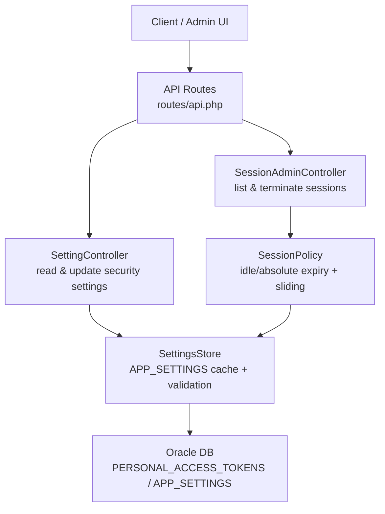
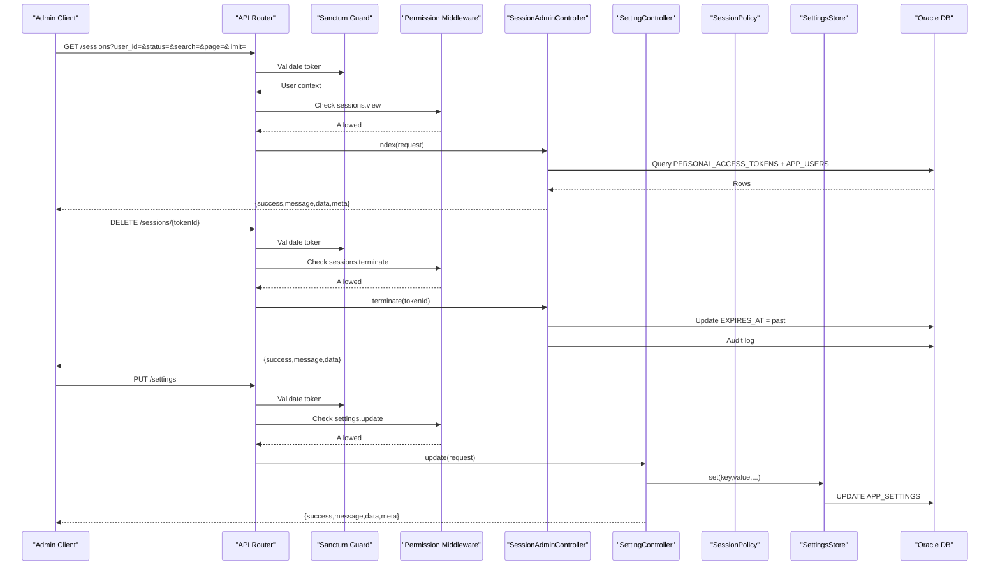
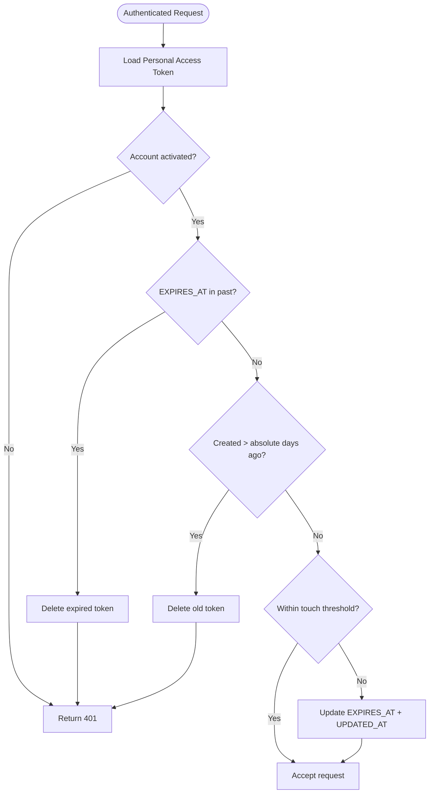
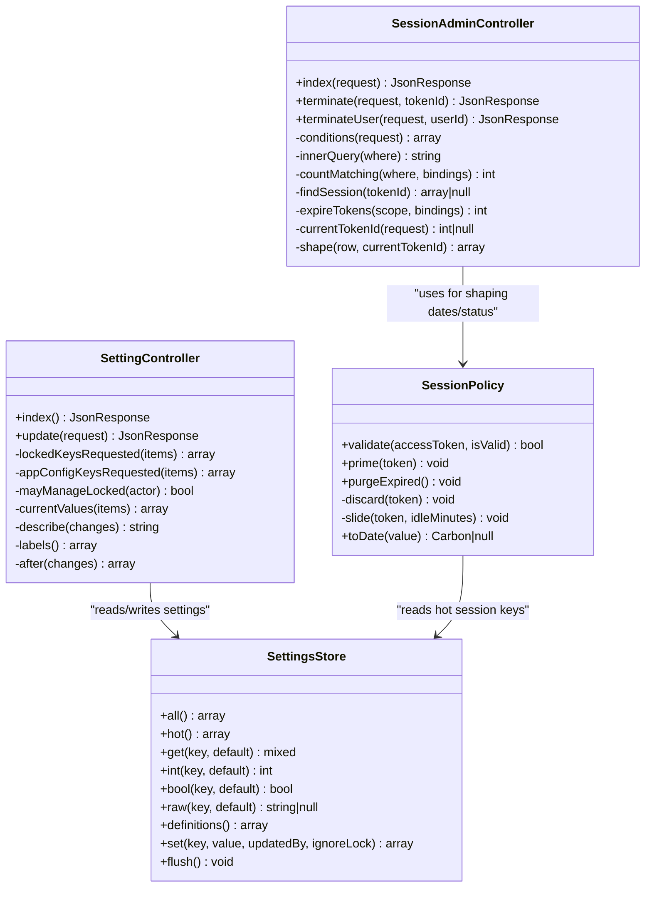

# Session Administration API

<cite>
**Referenced Files in This Document**
- [SessionAdminController.php](file://kyApp_API/app/Http/Controllers/SessionAdminController.php)
- [SettingController.php](file://kyApp_API/app/Http/Controllers/SettingController.php)
- [api.php](file://kyApp_API/routes/api.php)
- [SessionPolicy.php](file://kyApp_API/app/Support/SessionPolicy.php)
- [SettingsStore.php](file://kyApp_API/app/Support/SettingsStore.php)
- [02_ibac_seed.php](file://kyApp_API/database/oracle/02_ibac_seed.php)
</cite>

## Table of Contents
1. [Introduction](#introduction)
2. [Project Structure](#project-structure)
3. [Core Components](#core-components)
4. [Architecture Overview](#architecture-overview)
5. [Detailed Component Analysis](#detailed-component-analysis)
6. [Dependency Analysis](#dependency-analysis)
7. [Performance Considerations](#performance-considerations)
8. [Troubleshooting Guide](#troubleshooting-guide)
9. [Conclusion](#conclusion)

## Introduction
This document describes the session administration and security settings API surface. It covers:
- Active session listing, filtering, and pagination.
- Remote session termination by token or by user.
- Security policy configuration through a batched settings endpoint.
- Idle timeout handling, absolute session lifetime, sliding renewal, and concurrent session behavior.
- Required permissions, request/response schemas, and administrative workflows for monitoring and enforcing security policies.

The implementation is built on Laravel Sanctum personal access tokens stored in `ACCOUNTS.PERSONAL_ACCESS_TOKENS`. Sessions are not represented by a separate table; instead, each token row represents a live session, with its effective lifetime driven by the `EXPIRES_AT` column and the session policy.

## Project Structure
The relevant backend code lives under `kyApp_API`:
- Routes define protected endpoints behind Sanctum authentication and IBAC permissions.
- Controllers implement session listing/termination and security settings read/update.
- Support classes enforce session validation, idle expiration, sliding renewal, and secure setting persistence.
- Seed data defines default security settings such as idle minutes, absolute days, touch threshold, and single-session-per-device behavior.



**Diagram sources**
- [api.php:104-130](file://kyApp_API/routes/api.php#L104-L130)
- [SessionAdminController.php:93-233](file://kyApp_API/app/Http/Controllers/SessionAdminController.php#L93-L233)
- [SettingController.php:48-230](file://kyApp_API/app/Http/Controllers/SettingController.php#L48-L230)
- [SessionPolicy.php:70-183](file://kyApp_API/app/Support/SessionPolicy.php#L70-L183)
- [SettingsStore.php:108-336](file://kyApp_API/app/Support/SettingsStore.php#L108-L336)

**Section sources**
- [api.php:104-130](file://kyApp_API/routes/api.php#L104-L130)

## Core Components
- **Session administration controller**: Provides active session listing and termination operations. It reads from `PERSONAL_ACCESS_TOKENS`, avoids exposing sensitive token values, and logs administrative actions.
- **Security settings controller**: Reads and updates security-related settings stored in `APP_SETTINGS`. It validates types and bounds, enforces locked-key protection, and records audit changes.
- **Session policy**: Applies per-request validation for idle expiration, absolute lifetime, account activation state, and sliding renewal. It also purges expired tokens.
- **Settings store**: Caches hot security/session keys, casts values to declared types, enforces min/max constraints, and persists changes safely.

**Section sources**
- [SessionAdminController.php:15-82](file://kyApp_API/app/Http/Controllers/SessionAdminController.php#L15-L82)
- [SettingController.php:17-37](file://kyApp_API/app/Http/Controllers/SettingController.php#L17-L37)
- [SessionPolicy.php:9-41](file://kyApp_API/app/Support/SessionPolicy.php#L9-L41)
- [SettingsStore.php:9-27](file://kyApp_API/app/Support/SettingsStore.php#L9-L27)

## Architecture Overview
The session administration API follows a layered design:
1. **Routing layer**: Sanctum authentication plus IBAC permission checks gate all session and settings endpoints.
2. **Controller layer**: Validates inputs, builds queries, performs writes, and returns standardized JSON responses.
3. **Policy/store layer**: Enforces business rules (session lifecycle, setting type/bounds/locking).
4. **Data layer**: Oracle database tables `PERSONAL_ACCESS_TOKENS` and `APP_SETTINGS`.



**Diagram sources**
- [api.php:113-129](file://kyApp_API/routes/api.php#L113-L129)
- [SessionAdminController.php:93-233](file://kyApp_API/app/Http/Controllers/SessionAdminController.php#L93-L233)
- [SettingController.php:107-230](file://kyApp_API/app/Http/Controllers/SettingController.php#L107-L230)
- [SettingsStore.php:291-336](file://kyApp_API/app/Support/SettingsStore.php#L291-L336)

## Detailed Component Analysis

### Session Administration Endpoints

#### List Active Sessions
- **Method**: `GET`
- **URL**: `/sessions`
- **Authentication**: Sanctum token required.
- **Permissions**: `sessions.view`
- **Query parameters**:
  - `user_id` (integer, optional): Filter by target user.
  - `status` (string, optional): One of `active`, `expired`, `disabled`; other values treated as “all”.
  - `search` (string, optional): Search by English username, Arabic username, or device name.
  - `page` (integer, optional, default 1): Page number.
  - `limit` (integer, optional, default 50, max 200): Page size.
- **Response schema**:
  - `success` (boolean)
  - `message` (string)
  - `data` (array of session objects)
  - `meta` (object):
    - `total` (integer)
    - `page` (integer)
    - `limit` (integer)
    - `pages` (integer)
- **Session object fields**:
  - `token_id` (integer)
  - `user_id` (integer)
  - `token_name` (string)
  - `user_name_en` (string)
  - `user_name_ar` (string)
  - `user_type` (integer)
  - `user_type_label` (string)
  - `is_admin` (boolean)
  - `is_activated` (integer)
  - `branch_no` (integer|null)
  - `device_name` (string|null)
  - `platform` (string|null)
  - `created_at` (string)
  - `last_activity_at` (string)
  - `expires_at` (string)
  - `status` (string: `active`, `expired`, `disabled`)
  - `status_label` (string)
  - `minutes_left` (integer|null)
  - `is_current` (boolean)

Example request:
```http
GET /sessions?user_id=123&status=active&page=1&limit=50
Authorization: Bearer <sanctum-token>
```

Example response:
```json
{
  "success": true,
  "message": "Sessions retrieved.",
  "data": [
    {
      "token_id": 1001,
      "user_id": 123,
      "token_name": "My Device",
      "user_name_en": "Alice",
      "user_name_ar": "أليس",
      "user_type": 1,
      "user_type_label": "Employee",
      "is_admin": false,
      "is_activated": 1,
      "branch_no": 10,
      "device_name": "iPhone 14",
      "platform": "iOS",
      "created_at": "2026-09-01 10:00:00",
      "last_activity_at": "2026-09-01 11:30:00",
      "expires_at": "2026-09-01 15:30:00",
      "status": "active",
      "status_label": "Active",
      "minutes_left": 240,
      "is_current": true
    }
  ],
  "meta": {
    "total": 1,
    "page": 1,
    "limit": 50,
    "pages": 1
  }
}
```

Notes:
- Ordering is fixed by last activity then token id; client cannot supply custom sort columns.
- The current admin device’s session is flagged via `is_current`.
- Sensitive token secret and abilities are never returned.

**Section sources**
- [api.php:113-115](file://kyApp_API/routes/api.php#L113-L115)
- [SessionAdminController.php:93-141](file://kyApp_API/app/Http/Controllers/SessionAdminController.php#L93-L141)
- [SessionAdminController.php:245-283](file://kyApp_API/app/Http/Controllers/SessionAdminController.php#L245-L283)
- [SessionAdminController.php:384-417](file://kyApp_API/app/Http/Controllers/SessionAdminController.php#L384-L417)

#### Terminate Single Session
- **Method**: `DELETE`
- **URL**: `/sessions/{tokenId}`
- **Authentication**: Sanctum token required.
- **Permissions**: `sessions.terminate`
- **Path parameter**:
  - `tokenId` (integer)
- **Response schema**:
  - `success` (boolean)
  - `message` (string)
  - `data` (object):
    - `token_id` (integer)
    - `user_id` (integer)
    - `sessions_ended` (integer)

Example request:
```http
DELETE /sessions/1001
Authorization: Bearer <sanctum-token>
```

Example response:
```json
{
  "success": true,
  "message": "Session terminated.",
  "data": {
    "token_id": 1001,
    "user_id": 123,
    "sessions_ended": 1
  }
}
```

Behavior:
- The endpoint pushes the token’s `EXPIRES_AT` into the past so the next client request receives a 401 and logs out.
- An audit entry is recorded with actor, target user, module, entity type, and description.

**Section sources**
- [api.php:121-123](file://kyApp_API/routes/api.php#L121-L123)
- [SessionAdminController.php:147-182](file://kyApp_API/app/Http/Controllers/SessionAdminController.php#L147-L182)
- [SessionAdminController.php:343-355](file://kyApp_API/app/Http/Controllers/SessionAdminController.php#L343-L355)

#### Terminate All Sessions for a User
- **Method**: `DELETE`
- **URL**: `/sessions/user/{userId}`
- **Authentication**: Sanctum token required.
- **Permissions**: `sessions.terminate`
- **Path parameter**:
  - `userId` (integer)
- **Response schema**:
  - `success` (boolean)
  - `message` (string)
  - `data` (object):
    - `user_id` (integer)
    - `sessions_ended` (integer)

Example request:
```http
DELETE /sessions/user/123
Authorization: Bearer <sanctum-token>
```

Example response:
```json
{
  "success": true,
  "message": "User sessions terminated.",
  "data": {
    "user_id": 123,
    "sessions_ended": 3
  }
}
```

Behavior:
- Terminates every active token for the specified user.
- Uses the same audit action code as single-session termination; the description indicates scope.

**Section sources**
- [api.php:117-119](file://kyApp_API/routes/api.php#L117-L119)
- [SessionAdminController.php:193-233](file://kyApp_API/app/Http/Controllers/SessionAdminController.php#L193-L233)

### Security Settings Endpoints

#### Read Security Settings
- **Method**: `GET`
- **URL**: `/settings`
- **Authentication**: Sanctum token required.
- **Permissions**: `settings.view`
- **Response schema**:
  - `success` (boolean)
  - `message` (string)
  - `data` (array of setting objects)
  - `meta` (object):
    - `total` (integer)
- **Setting object fields**:
  - `setting_id` (integer)
  - `key` (string)
  - `name_ar` (string)
  - `description_ar` (string)
  - `value_type` (string)
  - `value` (mixed, cast to declared type)
  - `raw_value` (string)
  - `min_value` (integer|null)
  - `max_value` (integer|null)
  - `is_lockable` (boolean)
  - `sort_order` (integer)
  - `updated_by` (integer|null)
  - `updated_on` (string|null)

Example request:
```http
GET /settings
Authorization: Bearer <sanctum-token>
```

Example response:
```json
{
  "success": true,
  "message": "Security settings retrieved.",
  "data": [
    {
      "setting_id": 1,
      "key": "session_idle_minutes",
      "name_ar": "Idle session timeout (minutes)",
      "description_ar": "Minutes of inactivity after which a session expires.",
      "value_type": "int",
      "value": 240,
      "raw_value": "240",
      "min_value": 5,
      "max_value": 10080,
      "is_lockable": false,
      "sort_order": 10,
      "updated_by": null,
      "updated_on": null
    }
  ],
  "meta": {
    "total": 1
  }
}
```

Notes:
- App-config keys (branding/API password) are excluded from this list.
- Values are cast according to their declared type.

**Section sources**
- [api.php:125-126](file://kyApp_API/routes/api.php#L125-L126)
- [SettingController.php:48-91](file://kyApp_API/app/Http/Controllers/SettingController.php#L48-L91)
- [SettingsStore.php:279-282](file://kyApp_API/app/Support/SettingsStore.php#L279-L282)

#### Update Security Settings
- **Method**: `PUT`
- **URL**: `/settings`
- **Authentication**: Sanctum token required.
- **Permissions**: `settings.update`
- **Request body schema**:
  - `items` (array of objects), minimum length 1:
    - `key` (string, required, max 60)
    - `value` (any, nullable)
- **Response schema**:
  - `success` (boolean)
  - `message` (string)
  - `data` (array of changed setting summaries)
  - `meta` (object):
    - `changed` (integer)
- **Error responses**:
  - `422` for validation errors or invalid values.
  - `403` when attempting to modify locked settings without `settings.security_manage`.

Example request:
```http
PUT /settings
Content-Type: application/json
Authorization: Bearer <sanctum-token>

{
  "items": [
    {"key": "session_idle_minutes", "value": 300},
    {"key": "session_absolute_days", "value": 30},
    {"key": "single_active_session_per_device", "value": true}
  ]
}
```

Example response:
```json
{
  "success": true,
  "message": "Security settings saved.",
  "data": [
    {"key": "session_idle_minutes", "name_ar": "Idle session timeout (minutes)", "value": 300, "value_type": "int"},
    {"key": "session_absolute_days", "name_ar": "Absolute session lifetime (days)", "value": 30, "value_type": "int"},
    {"key": "single_active_session_per_device", "name_ar": "Single active session per device", "value": true, "value_type": "bool"}
  ],
  "meta": {
    "changed": 3
  }
}
```

Behavior:
- Batch save inside one transaction; any failure rolls back all changes.
- Locked keys require explicit sensitive-management permission.
- Changes are audited with before/after descriptions.

**Section sources**
- [api.php:128-129](file://kyApp_API/routes/api.php#L128-L129)
- [SettingController.php:107-230](file://kyApp_API/app/Http/Controllers/SettingController.php#L107-L230)
- [SettingsStore.php:291-336](file://kyApp_API/app/Support/SettingsStore.php#L291-L336)

### Session Management Architecture

#### Session Lifecycle and Expiration
- A session is a Sanctum personal access token row.
- On each authenticated request, the session policy:
  - Rejects deactivated accounts.
  - Rejects idle-expired tokens (`EXPIRES_AT` in the past).
  - Rejects tokens older than the configured absolute lifetime since creation.
  - Slides renewal if within the write-threshold window.
- Expired tokens are deleted on rejection; a background sweep cleans leftovers.



**Diagram sources**
- [SessionPolicy.php:70-183](file://kyApp_API/app/Support/SessionPolicy.php#L70-L183)

**Section sources**
- [SessionPolicy.php:9-41](file://kyApp_API/app/Support/SessionPolicy.php#L9-L41)
- [SessionPolicy.php:70-183](file://kyApp_API/app/Support/SessionPolicy.php#L70-L183)

#### Idle Timeout Handling
- Controlled by `session_idle_minutes`.
- Default value is defined in seed data.
- Sliding renewal occurs up to a configurable threshold to reduce database writes.

Key behaviors:
- New tokens are primed with the full idle window.
- Active requests extend the token only when necessary.
- If idle time exceeds the configured minutes, the token is rejected and removed.

**Section sources**
- [SessionPolicy.php:114-117](file://kyApp_API/app/Support/SessionPolicy.php#L114-L117)
- [SessionPolicy.php:166-183](file://kyApp_API/app/Support/SessionPolicy.php#L166-L183)
- [02_ibac_seed.php:103-134](file://kyApp_API/database/oracle/02_ibac_seed.php#L103-L134)

#### Absolute Session Lifetime
- Controlled by `session_absolute_days`.
- Tokens older than this many days since creation are rejected regardless of activity.

**Section sources**
- [SessionPolicy.php:97-103](file://kyApp_API/app/Support/SessionPolicy.php#L97-L103)
- [02_ibac_seed.php:114-123](file://kyApp_API/database/oracle/02_ibac_seed.php#L114-L123)

#### Concurrent Session Limits
- Controlled by `single_active_session_per_device`.
- When enabled, new login attempts can terminate older sessions for the same user/device combination.
- This is distinct from terminating existing sessions via the session administration endpoints.

**Section sources**
- [02_ibac_seed.php:135-145](file://kyApp_API/database/oracle/02_ibac_seed.php#L135-L145)

### Administrative Workflows

#### Monitoring User Sessions Across Devices
Recommended workflow:
1. Authenticate as an administrator with `sessions.view`.
2. Call `GET /sessions` with filters:
   - Use `user_id` to focus on a specific user.
   - Use `status=active` to see currently usable sessions.
   - Use `search` to find devices by name or username.
3. Inspect `minutes_left`, `device_name`, `platform`, and `is_current`.
4. For suspicious or lost devices, call `DELETE /sessions/{tokenId}`.
5. If the user has multiple unknown devices, call `DELETE /sessions/user/{userId}` to force re-authentication everywhere.

#### Enforcing Security Policies
Recommended workflow:
1. Authenticate as an administrator with `settings.view`.
2. Call `GET /settings` to inspect current policy values.
3. Call `PUT /settings` with a batch of updated keys:
   - Adjust `session_idle_minutes` to tighten or relax idle timeouts.
   - Adjust `session_absolute_days` to limit maximum token age.
   - Enable `single_active_session_per_device` to restrict concurrent sessions per device.
4. Review audit entries for sensitive changes.

**Section sources**
- [SessionAdminController.php:93-141](file://kyApp_API/app/Http/Controllers/SessionAdminController.php#L93-L141)
- [SettingController.php:48-91](file://kyApp_API/app/Http/Controllers/SettingController.php#L48-L91)
- [SettingController.php:107-230](file://kyApp_API/app/Http/Controllers/SettingController.php#L107-L230)

## Dependency Analysis



**Diagram sources**
- [SessionAdminController.php:93-472](file://kyApp_API/app/Http/Controllers/SessionAdminController.php#L93-L472)
- [SettingController.php:48-398](file://kyApp_API/app/Http/Controllers/SettingController.php#L48-L398)
- [SessionPolicy.php:50-183](file://kyApp_API/app/Support/SessionPolicy.php#L50-L183)
- [SettingsStore.php:108-336](file://kyApp_API/app/Support/SettingsStore.php#L108-L336)

**Section sources**
- [SessionAdminController.php:93-472](file://kyApp_API/app/Http/Controllers/SessionAdminController.php#L93-L472)
- [SettingController.php:48-398](file://kyApp_API/app/Http/Controllers/SettingController.php#L48-L398)
- [SessionPolicy.php:50-183](file://kyApp_API/app/Support/SessionPolicy.php#L50-L183)
- [SettingsStore.php:108-336](file://kyApp_API/app/Support/SettingsStore.php#L108-L336)

## Performance Considerations
- **Pagination**: The session list uses a two-level query to avoid unsupported offset/fetch syntax in Oracle 11g. Default page size is 50 with a hard cap of 200.
- **Write throttling**: Sliding renewal updates the token only when the current expiry is older than the new horizon minus the touch threshold, reducing database writes.
- **Settings caching**: Hot session/security keys are cached for a short TTL; writes invalidate the cache immediately.
- **Audit logging**: Both session termination and settings updates record administrative actions for accountability.

[No sources needed since this section provides general guidance]

## Troubleshooting Guide
Common issues and resolutions:
- **401 Unauthorized during session operations**: Indicates the token is expired, absolute lifetime exceeded, or the account is deactivated. The client should clear local storage and redirect to login.
- **403 Forbidden on settings update**: Attempted to modify a locked key without `settings.security_manage`.
- **422 Validation error on settings update**: Invalid type, out-of-range value, missing items array, or app-config keys submitted through the security settings endpoint.
- **Arabic text corruption**: The controllers and settings store repair mojibake where appropriate; ensure clients send UTF-8 and do not double-encode.

**Section sources**
- [SessionAdminController.php:465-472](file://kyApp_API/app/Http/Controllers/SessionAdminController.php#L465-L472)
- [SettingController.php:215-229](file://kyApp_API/app/Http/Controllers/SettingController.php#L215-L229)
- [SettingsStore.php:291-336](file://kyApp_API/app/Support/SettingsStore.php#L291-L336)

## Conclusion
The session administration API provides secure, auditable controls for monitoring and terminating user sessions, while the security settings API enables administrators to tune idle timeouts, absolute lifetimes, and concurrent session behavior. Permissions are enforced at the route level, and sensitive operations are further guarded by locked-setting checks and detailed audit trails. Administrators should use these endpoints carefully, ensuring that only authorized personnel can terminate sessions or adjust security policies.

[No sources needed since this section summarizes without analyzing specific files]