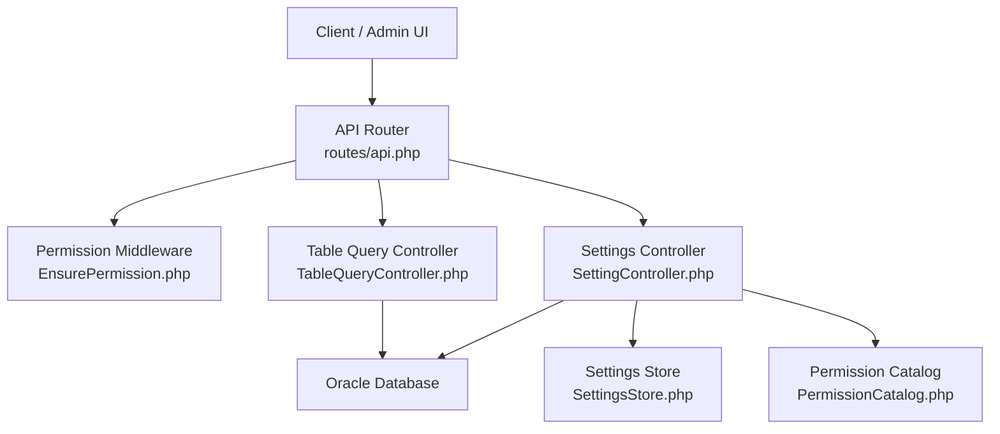
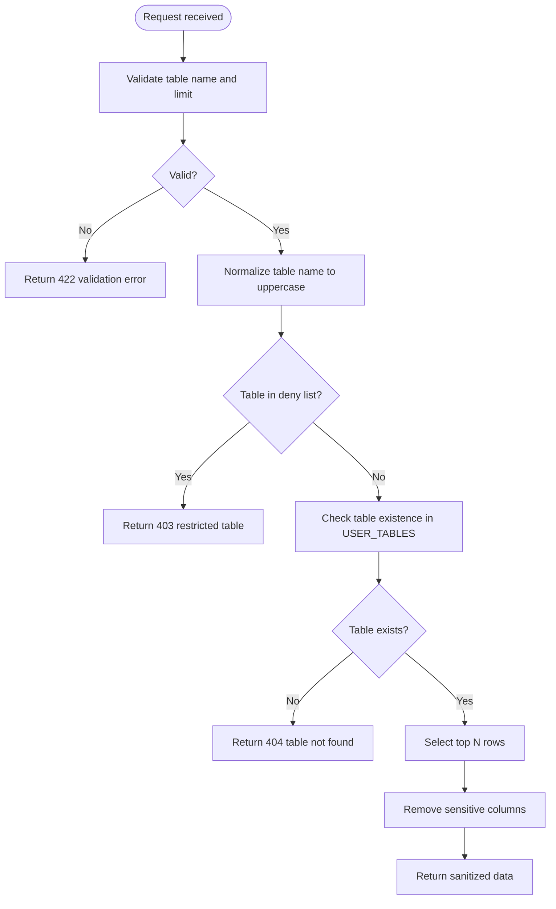
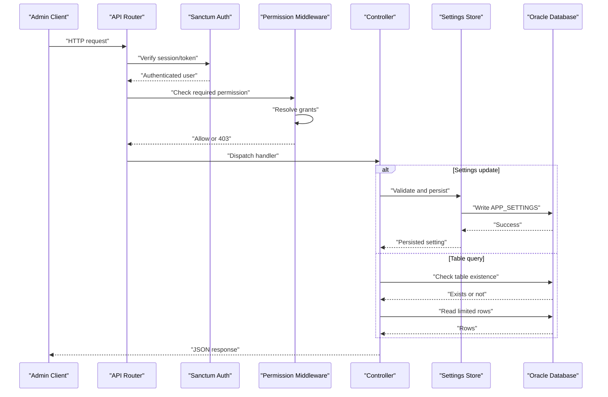
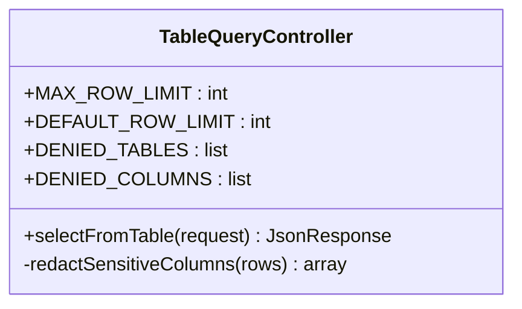
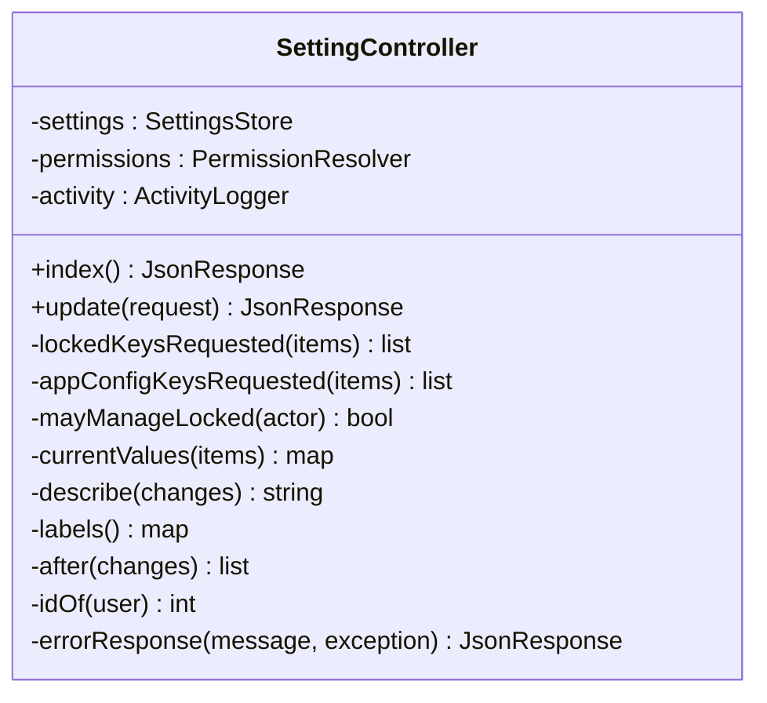
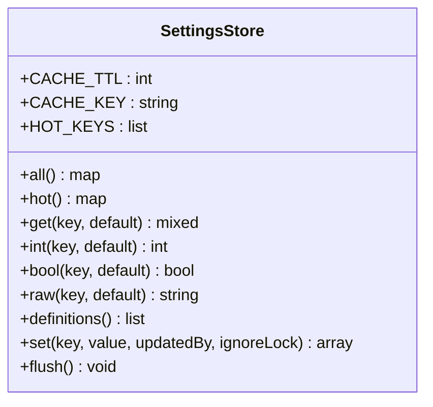
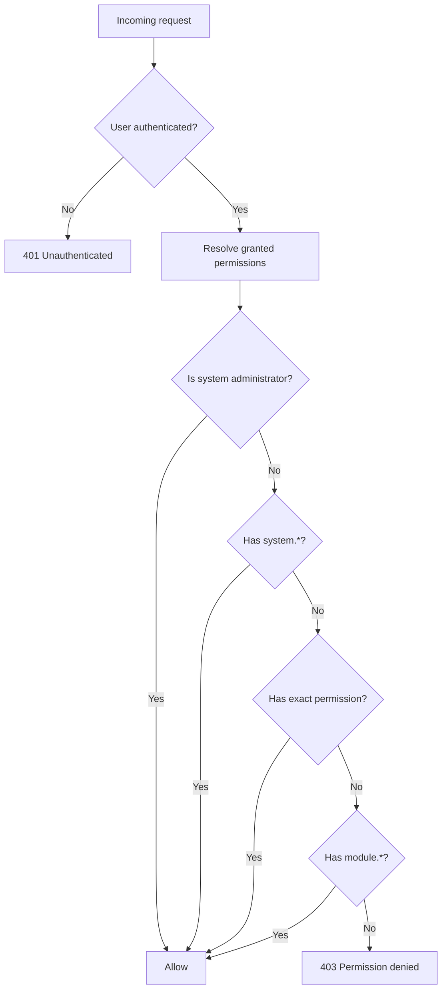
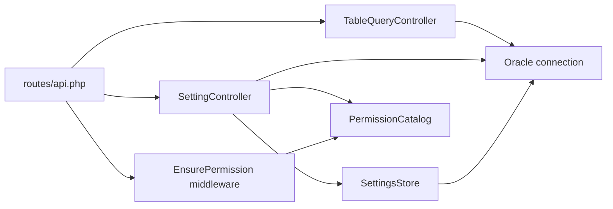

# System Administration API

<cite>
**Referenced Files in This Document**   
- [api.php](file://kyApp_API/routes/api.php)
- [TableQueryController.php](file://kyApp_API/app/Http/Controllers/TableQueryController.php)
- [SettingController.php](file://kyApp_API/app/Http/Controllers/SettingController.php)
- [EnsurePermission.php](file://kyApp_API/app/Http/Middleware/EnsurePermission.php)
- [PermissionCatalog.php](file://kyApp_API/app/Support/PermissionCatalog.php)
- [SettingsStore.php](file://kyApp_API/app/Support/SettingsStore.php)
</cite>

## Table of Contents
1. [Introduction](#introduction)
2. [Project Structure](#project-structure)
3. [Core Components](#core-components)
4. [Architecture Overview](#architecture-overview)
5. [Detailed Component Analysis](#detailed-component-analysis)
6. [Dependency Analysis](#dependency-analysis)
7. [Performance Considerations](#performance-considerations)
8. [Troubleshooting Guide](#troubleshooting-guide)
9. [Conclusion](#conclusion)

## Introduction
This document describes the system administration and diagnostic endpoints exposed by the Laravel API:

- **Table query diagnostic endpoint**: a controlled, read-only diagnostic tool that returns the top rows from an allowed database table after strict validation, deny-list checks, existence verification, and sensitive-column redaction.
- **System settings management endpoints**: read and update endpoints for security-related application settings stored in `APP_SETTINGS`, with type enforcement, bounds checking, locking, audit logging, and transactional batch updates.

These endpoints require elevated permissions:

| Endpoint | HTTP methods | URL pattern | Required permission | Risk level |
|---|---:|---|---|---|
| Table query diagnostic | `GET` or `POST` | `/selectFromTable` | `system.*` (system-wide wildcard) | Critical |
| List security settings | `GET` | `/settings` | `settings.view` | High |
| Update security settings | `PUT` | `/settings` | `settings.update` | High |

All routes are protected by Sanctum authentication (`auth:sanctum`) and then checked against explicit permission codes. The table query route additionally requires the system-wide wildcard permission because it can expose any schema table except those explicitly denied.

**Section sources**
- [api.php:175-185](file://kyApp_API/routes/api.php#L175-L185)
- [api.php:125-129](file://kyApp_API/routes/api.php#L125-L129)
- [EnsurePermission.php:11-23](file://kyApp_API/app/Http/Middleware/EnsurePermission.php#L11-L23)

## Project Structure
The relevant backend code lives under `kyApp_API`:

**Diagram sources**
- [api.php:175-185](file://kyApp_API/routes/api.php#L175-L185)
- [api.php:125-129](file://kyApp_API/routes/api.php#L125-L129)
- [TableQueryController.php:14-20](file://kyApp_API/app/Http/Controllers/TableQueryController.php#L14-L20)
- [SettingController.php:31-37](file://kyApp_API/app/Http/Controllers/SettingController.php#L31-L37)
- [SettingsStore.php:28-40](file://kyApp_API/app/Support/SettingsStore.php#L28-L40)
- [PermissionCatalog.php:22-34](file://kyApp_API/app/Support/PermissionCatalog.php#L22-L34)

**Section sources**
- [api.php:175-185](file://kyApp_API/routes/api.php#L175-L185)
- [api.php:125-129](file://kyApp_API/routes/api.php#L125-L129)
- [TableQueryController.php:14-20](file://kyApp_API/app/Http/Controllers/TableQueryController.php#L14-L20)
- [SettingController.php:31-37](file://kyApp_API/app/Http/Controllers/SettingController.php#L31-L37)
- [SettingsStore.php:28-40](file://kyApp_API/app/Support/SettingsStore.php#L28-L40)
- [PermissionCatalog.php:22-34](file://kyApp_API/app/Support/PermissionCatalog.php#L22-L34)

## Core Components

### Table Query Diagnostic Endpoint
The table query endpoint is a diagnostic tool intended for administrators who need to inspect the first rows of a business table. It is not a general-purpose SQL execution interface.

#### Security Model
- Requires Sanctum authentication.
- Requires the system-wide wildcard permission `system.*`.
- Rejects a hard-coded deny list of tables containing credentials, sessions, cache, migrations, jobs, and internal infrastructure data.
- Validates the table name using a strict regular expression allowing only letters, digits, and underscores, with a maximum length.
- Enforces a maximum row limit to protect server performance.
- Verifies that the requested table exists in the connected Oracle user schema before reading data.
- Redacts sensitive columns such as password-like, token-like, secret-like, key-like, and device-token-like fields.
- Returns sanitized error responses unless debug mode is enabled.

#### Request Schema
| Field | Type | Required | Default | Validation |
|---|---|---:|---:|---|
| `table_name` | string | Yes | None | Must match `[A-Za-z0-9_]+`, max 30 characters |
| `table` | string | No | Alias for `table_name` | Same rules |
| `tableName` | string | No | Alias for `table_name` | Same rules |
| `tbl` | string | No | Alias for `table_name` | Same rules |
| `limit` | integer | No | 50 | Minimum 1, maximum 1000 |
| `rows` | integer | No | Alias for `limit` | Same rules |
| `row_count` | integer | No | Alias for `limit` | Same rules |
| `rowCount` | integer | No | Alias for `limit` | Same rules |
| `count` | integer | No | Alias for `limit` | Same rules |

The controller accepts multiple common parameter names so client code can use whichever naming convention it prefers.

#### Response Schema
**Success response:**
| Field | Type | Description |
|---|---|---|
| `success` | boolean | Always `true` on success |
| `table` | string | Uppercase table name used |
| `count` | integer | Number of rows returned |
| `limit` | integer | Applied row limit |
| `redacted_columns` | array of strings | Distinct column names removed from every row |
| `data` | array of objects | Row data with sensitive columns removed |

**Validation failure response:**
| Field | Type | Description |
|---|---|---|
| `success` | boolean | `false` |
| `message` | string | Human-readable validation message |
| `errors` | object | Validation errors keyed by field |

**Denied table response:**
| Field | Type | Description |
|---|---|---|
| `success` | boolean | `false` |
| `message` | string | Explanation that the table is restricted |
| `errors` | object | Contains `restricted_table` |

**Not found response:**
| Field | Type | Description |
|---|---|---|
| `success` | boolean | `false` |
| `message` | string | Indicates the table does not exist in the schema |

**Server error response:**
| Field | Type | Description |
|---|---|---|
| `success` | boolean | `false` |
| `message` | string | Generic database error message |
| `error` | string or null | Detailed error only when `app.debug` is true |

#### Safe Usage Examples
- Read the first 50 rows of a business table:
  - Method: `GET`
  - URL: `/selectFromTable?table_name=INVOICES&limit=50`
- Read the first 10 rows using an alias:
  - Method: `POST`
  - Body: `{ "table": "CUSTOMERS", "rows": 10 }`
- Use the default limit:
  - Method: `GET`
  - URL: `/selectFromTable?table_name=ACCOUNTS`

#### Sensitive Data Protection
The implementation enforces two layers of protection:

1. **Deny list for entire tables**: Tables such as user accounts, personal access tokens, user permissions, cache, cache locks, migrations, jobs, failed jobs, sessions, password reset tokens, and users are blocked even for system administrators.
2. **Sensitive column redaction**: Columns whose names contain patterns like `PASSWORD`, `DEVICE_TOKEN`, `TOKEN`, `SECRET`, or `KEY` are removed from every returned row.

**Diagram sources**
- [TableQueryController.php:65-170](file://kyApp_API/app/Http/Controllers/TableQueryController.php#L65-L170)
- [TableQueryController.php:182-213](file://kyApp_API/app/Http/Controllers/TableQueryController.php#L182-L213)

**Section sources**
- [TableQueryController.php:14-59](file://kyApp_API/app/Http/Controllers/TableQueryController.php#L14-L59)
- [TableQueryController.php:65-170](file://kyApp_API/app/Http/Controllers/TableQueryController.php#L65-L170)
- [TableQueryController.php:182-213](file://kyApp_API/app/Http/Controllers/TableQueryController.php#L182-L213)
- [api.php:175-185](file://kyApp_API/routes/api.php#L175-L185)

### System Settings Management Endpoints
The settings endpoints manage security-related configuration values stored in the `APP_SETTINGS` table. These are live runtime settings, not environment variables. They are read on authenticated requests and can affect session behavior immediately.

#### Permissions
| Action | Route | Permission |
|---|---|---|
| List settings | `GET /settings` | `settings.view` |
| Update settings | `PUT /settings` | `settings.update` |
| Manage locked settings | Any update including lockable keys | `settings.security_manage` |

Locked settings cannot be changed through the normal update path without the higher-level `settings.security_manage` permission.

#### GET /settings
Returns the full list of security settings with labels, types, current values, raw values, bounds, lockability, sort order, and metadata.

**Response schema:**
| Field | Type | Description |
|---|---|---|
| `success` | boolean | Always `true` on success |
| `message` | string | Confirmation message |
| `data` | array of objects | Settings definitions and values |
| `meta.total` | integer | Number of settings returned |

Each setting object includes:
| Field | Type | Description |
|---|---|---|
| `setting_id` | integer | Database identifier |
| `key` | string | Setting key |
| `name_ar` | string | Arabic label |
| `description_ar` | string | Arabic description |
| `value_type` | string | Declared type: `string`, `int`, `bool`, or `json` |
| `value` | mixed | Cast value |
| `raw_value` | mixed | Stored value |
| `min_value` | integer or null | Minimum bound |
| `max_value` | integer or null | Maximum bound |
| `is_lockable` | boolean | Whether the setting can be locked |
| `sort_order` | integer | Display order |
| `updated_by` | integer or null | Last updater user ID |
| `updated_on` | timestamp or null | Last update time |

#### PUT /settings
Updates one or more settings in a single transaction.

**Request body:**
| Field | Type | Required | Description |
|---|---|---:|---|
| `items` | array | Yes | Array of setting entries |
| `items[].key` | string | Yes | Setting key, max 60 characters |
| `items[].value` | mixed | No | New value; omitting means no change |

**Behavior:**
- All submitted items are processed inside one database transaction.
- If any item fails validation or type/bounds checking, the entire batch rolls back.
- App configuration keys are rejected here; they have their own route.
- Locked keys require `settings.security_manage`.
- Changes are audited with before/after descriptions.
- The settings cache is flushed after successful persistence.

**Success response:**
| Field | Type | Description |
|---|---|---|
| `success` | boolean | Always `true` on success |
| `message` | string | Either “no changes” or “security settings saved” |
| `data` | array of objects | Updated settings for changed keys |
| `meta.changed` | integer | Number of keys actually changed |

**Validation failure response:**
| Field | Type | Description |
|---|---|---|
| `success` | boolean | `false` |
| `message` | string | Validation error message |
| `errors` | object | Validation details |

**Forbidden response for locked keys:**
| Field | Type | Description |
|---|---|---|
| `success` | boolean | `false` |
| `message` | string | Indicates locked settings require `settings.security_manage` |
| `errors.locked_keys` | array of strings | Keys requiring elevated permission |

**Invalid value response:**
| Field | Type | Description |
|---|---|---|
| `success` | boolean | `false` |
| `message` | string | Invalid setting value |
| `errors.setting` | array of strings | Specific validation message from the settings store |

**Section sources**
- [SettingController.php:48-91](file://kyApp_API/app/Http/Controllers/SettingController.php#L48-L91)
- [SettingController.php:107-229](file://kyApp_API/app/Http/Controllers/SettingController.php#L107-L229)
- [SettingController.php:243-289](file://kyApp_API/app/Http/Controllers/SettingController.php#L243-L289)
- [api.php:125-129](file://kyApp_API/routes/api.php#L125-L129)

## Architecture Overview
The request flow for both administrative endpoints follows the same layered model:

**Diagram sources**
- [api.php:175-185](file://kyApp_API/routes/api.php#L175-L185)
- [api.php:125-129](file://kyApp_API/routes/api.php#L125-L129)
- [EnsurePermission.php:32-51](file://kyApp_API/app/Http/Middleware/EnsurePermission.php#L32-L51)
- [SettingController.php:165-195](file://kyApp_API/app/Http/Controllers/SettingController.php#L165-L195)
- [TableQueryController.php:122-142](file://kyApp_API/app/Http/Controllers/TableQueryController.php#L122-L142)

## Detailed Component Analysis

### Table Query Controller
The controller implements a defensive diagnostic query layer. Its responsibilities include input normalization, validation, deny-list enforcement, schema existence checks, bounded reads, sensitive-column redaction, and safe error handling.

**Diagram sources**
- [TableQueryController.php:14-59](file://kyApp_API/app/Http/Controllers/TableQueryController.php#L14-L59)
- [TableQueryController.php:65-170](file://kyApp_API/app/Http/Controllers/TableQueryController.php#L65-L170)
- [TableQueryController.php:182-213](file://kyApp_API/app/Http/Controllers/TableQueryController.php#L182-L213)

Key design points:
- The maximum row limit is 1000; the default is 50.
- The deny list blocks credential, session, cache, migration, job, and user infrastructure tables.
- Column redaction uses substring matching against sensitive keywords rather than relying solely on table names.
- Errors do not leak internal stack traces unless debug mode is enabled.

**Section sources**
- [TableQueryController.php:14-59](file://kyApp_API/app/Http/Controllers/TableQueryController.php#L14-L59)
- [TableQueryController.php:65-170](file://kyApp_API/app/Http/Controllers/TableQueryController.php#L65-L170)
- [TableQueryController.php:182-213](file://kyApp_API/app/Http/Controllers/TableQueryController.php#L182-L213)

### Settings Controller
The settings controller backs the admin security settings screen. It coordinates validation, permission checks, type-safe persistence, auditing, and cache invalidation.

**Diagram sources**
- [SettingController.php:31-37](file://kyApp_API/app/Http/Controllers/SettingController.php#L31-L37)
- [SettingController.php:48-91](file://kyApp_API/app/Http/Controllers/SettingController.php#L48-L91)
- [SettingController.php:107-229](file://kyApp_API/app/Http/Controllers/SettingController.php#L107-L229)
- [SettingController.php:243-397](file://kyApp_API/app/Http/Controllers/SettingController.php#L243-L397)

Key design points:
- The index endpoint excludes application configuration keys and returns only security-related settings.
- Updates are transactional: partial failures roll back the whole batch.
- Locked settings require `settings.security_manage`.
- App configuration keys are rejected at this endpoint and must use the dedicated app configuration route.
- Audit activity is recorded with Arabic descriptions of what changed.

**Section sources**
- [SettingController.php:48-91](file://kyApp_API/app/Http/Controllers/SettingController.php#L48-L91)
- [SettingController.php:107-229](file://kyApp_API/app/Http/Controllers/SettingController.php#L107-L229)
- [SettingController.php:243-397](file://kyApp_API/app/Http/Controllers/SettingController.php#L243-L397)

### Settings Store
The settings store provides typed, bounded, cached access to `APP_SETTINGS`.

**Diagram sources**
- [SettingsStore.php:28-90](file://kyApp_API/app/Support/SettingsStore.php#L28-L90)
- [SettingsStore.php:108-153](file://kyApp_API/app/Support/SettingsStore.php#L108-L153)
- [SettingsStore.php:205-216](file://kyApp_API/app/Support/SettingsStore.php#L205-L216)
- [SettingsStore.php:279-321](file://kyApp_API/app/Support/SettingsStore.php#L279-L321)
- [SettingsStore.php:344-425](file://kyApp_API/app/Support/SettingsStore.php#L344-L425)

Key design points:
- Hot keys are cached for up to 300 seconds.
- Definitions and non-hot reads go directly to Oracle.
- Values are cast to declared types: `int`, `bool`, `json`, or string.
- Numeric values are validated against `min_value` and `max_value`.
- Boolean normalization uses an allow-list.
- JSON values are validated during encoding.
- String values are limited to 500 characters and pass through Arabic encoding helpers.
- Writes flush the cache to avoid stale session policy values.

**Section sources**
- [SettingsStore.php:28-90](file://kyApp_API/app/Support/SettingsStore.php#L28-L90)
- [SettingsStore.php:108-153](file://kyApp_API/app/Support/SettingsStore.php#L108-L153)
- [SettingsStore.php:205-216](file://kyApp_API/app/Support/SettingsStore.php#L205-L216)
- [SettingsStore.php:279-321](file://kyApp_API/app/Support/SettingsStore.php#L279-L321)
- [SettingsStore.php:344-425](file://kyApp_API/app/Support/SettingsStore.php#L344-L425)

### Permission System
Permissions are enforced by middleware and defined centrally.

**Diagram sources**
- [EnsurePermission.php:32-51](file://kyApp_API/app/Http/Middleware/EnsurePermission.php#L32-L51)
- [PermissionCatalog.php:22-34](file://kyApp_API/app/Support/PermissionCatalog.php#L22-L34)
- [PermissionCatalog.php:447-468](file://kyApp_API/app/Support/PermissionCatalog.php#L447-L468)

Key design points:
- Deny-by-default is enforced.
- System administrators bypass grant checks.
- `system.*` grants everything.
- Exact permission codes take precedence.
- Module wildcards cover all actions in a module.
- Unknown permission codes fall back to showing the raw code in denial messages.

**Section sources**
- [EnsurePermission.php:11-51](file://kyApp_API/app/Http/Middleware/EnsurePermission.php#L11-L51)
- [PermissionCatalog.php:22-34](file://kyApp_API/app/Support/PermissionCatalog.php#L22-L34)
- [PermissionCatalog.php:447-468](file://kyApp_API/app/Support/PermissionCatalog.php#L447-L468)

## Dependency Analysis
The administrative endpoints depend on several shared components:

**Diagram sources**
- [api.php:175-185](file://kyApp_API/routes/api.php#L175-L185)
- [api.php:125-129](file://kyApp_API/routes/api.php#L125-L129)
- [EnsurePermission.php:5-27](file://kyApp_API/app/Http/Middleware/EnsurePermission.php#L5-L27)
- [SettingController.php:5-13](file://kyApp_API/app/Http/Controllers/SettingController.php#L5-L13)
- [SettingsStore.php:5-7](file://kyApp_API/app/Support/SettingsStore.php#L5-L7)

Coupling observations:
- The router couples endpoints to controllers and middleware.
- The settings controller depends on `SettingsStore`, `PermissionResolver`, and `ActivityLogger`.
- The settings store depends on the Oracle database and cache.
- The permission middleware depends on `PermissionResolver` and `PermissionCatalog`.
- The table query controller depends directly on the Oracle database connection.

**Section sources**
- [api.php:175-185](file://kyApp_API/routes/api.php#L175-L185)
- [api.php:125-129](file://kyApp_API/routes/api.php#L125-L129)
- [EnsurePermission.php:5-27](file://kyApp_API/app/Http/Middleware/EnsurePermission.php#L5-L27)
- [SettingController.php:5-13](file://kyApp_API/app/Http/Controllers/SettingController.php#L5-L13)
- [SettingsStore.php:5-7](file://kyApp_API/app/Support/SettingsStore.php#L5-L7)

## Performance Considerations
- The table query endpoint limits results to a maximum of 1000 rows to prevent large result sets from overwhelming the server.
- The default limit is 50 rows, which is appropriate for diagnostics.
- The settings store caches hot keys for up to 300 seconds to reduce repeated database reads on the authenticated request path.
- Definitions and non-hot settings are read directly from Oracle because they may carry Arabic text that exceeds cache constraints.
- Batch settings updates run in a single transaction, reducing round-trips and ensuring consistency.
- Sensitive-column redaction iterates over each row and column, so very wide result sets may incur CPU cost proportional to the number of rows and columns.

[No sources needed since this section provides general guidance]

## Troubleshooting Guide

### Table Query Endpoint Issues
| Symptom | Likely cause | Resolution |
|---|---|---|
| 422 validation error | Missing or invalid table name or limit | Provide a valid table name matching `[A-Za-z0-9_]+` and a limit between 1 and 1000 |
| 403 restricted table | Request targets a denied table | Use a business table instead of credentials, sessions, cache, migrations, jobs, or user infrastructure tables |
| 404 table not found | Table does not exist in the connected Oracle schema | Verify the table name and schema connectivity |
| Empty or missing sensitive fields | Columns were redacted | Check the `redacted_columns` field in the response |
| 500 server error | Database or unexpected error | Enable debug mode temporarily to inspect the detailed error |

### Settings Endpoint Issues
| Symptom | Likely cause | Resolution |
|---|---|---|
| 422 validation error | Missing `items`, invalid key, or empty list | Submit at least one item with a valid key |
| 422 app config keys rejected | Attempting to update app configuration via the security settings route | Use the dedicated app configuration route |
| 403 locked settings | Updating a lockable setting without `settings.security_manage` | Grant the elevated permission or avoid changing locked keys |
| 422 invalid setting value | Wrong type, out-of-bounds integer, invalid JSON, or too-long string | Match the declared `value_type` and bounds |
| Stale settings visible after rollback | Cache inconsistency after failed transaction | The controller flushes the cache; verify the transaction succeeded |

### Administrative Workflows

#### Safe Database Diagnostics
1. Authenticate with a system administrator account holding `system.*`.
2. Call `/selectFromTable` with a known business table.
3. Start with the default limit of 50 rows.
4. Inspect `redacted_columns` to understand which sensitive fields were removed.
5. Avoid requesting large limits unless necessary for troubleshooting.

#### Configuration Backup Workflow
1. Call `GET /settings` to retrieve the full settings catalog and current values.
2. Export the response as a backup artifact.
3. Before updating, record the current state and expected changes.
4. Call `PUT /settings` with the complete set of items.
5. Review the `meta.changed` count and returned updated values.
6. Re-run `GET /settings` to confirm the final state.

#### Administrative Troubleshooting Workflow
1. Check whether the user is authenticated.
2. Confirm the required permission is granted:
   - `system.*` for table queries.
   - `settings.view` for listing settings.
   - `settings.update` for updating settings.
   - `settings.security_manage` for locked settings.
3. For table queries, verify the table is not in the deny list and exists in the schema.
4. For settings updates, validate the key, type, bounds, and lock status.
5. Review audit logs if available to see what changed.

**Section sources**
- [TableQueryController.php:83-120](file://kyApp_API/app/Http/Controllers/TableQueryController.php#L83-L120)
- [TableQueryController.php:153-170](file://kyApp_API/app/Http/Controllers/TableQueryController.php#L153-L170)
- [SettingController.php:111-159](file://kyApp_API/app/Http/Controllers/SettingController.php#L111-L159)
- [SettingController.php:215-229](file://kyApp_API/app/Http/Controllers/SettingController.php#L215-L229)

## Conclusion
The system administration API exposes two powerful but high-risk capabilities:

- The table query diagnostic endpoint allows administrators to inspect the first rows of allowed database tables. It is intentionally narrow: it supports only a small set of parameters, enforces a strict table-name format, applies a hard deny list, verifies schema existence, caps results, and redacts sensitive columns.
- The settings management endpoints provide controlled access to live security configuration. They enforce types, bounds, locking, permissions, transactions, and auditing.

Because these endpoints can expose sensitive data or alter system behavior, they must be protected by:

- Strict Sanctum authentication.
- Explicit permission checks.
- The system-wide wildcard permission for the table query endpoint.
- The `settings.security_manage` permission for locked settings.
- Operational controls limiting who receives `system.*`.
- Monitoring, auditing, and incident response procedures.

Treat these endpoints as administrative tools, not public APIs. Restrict access to trusted administrators, log usage, and review permissions regularly.

[No sources needed since this section summarizes without analyzing specific files]