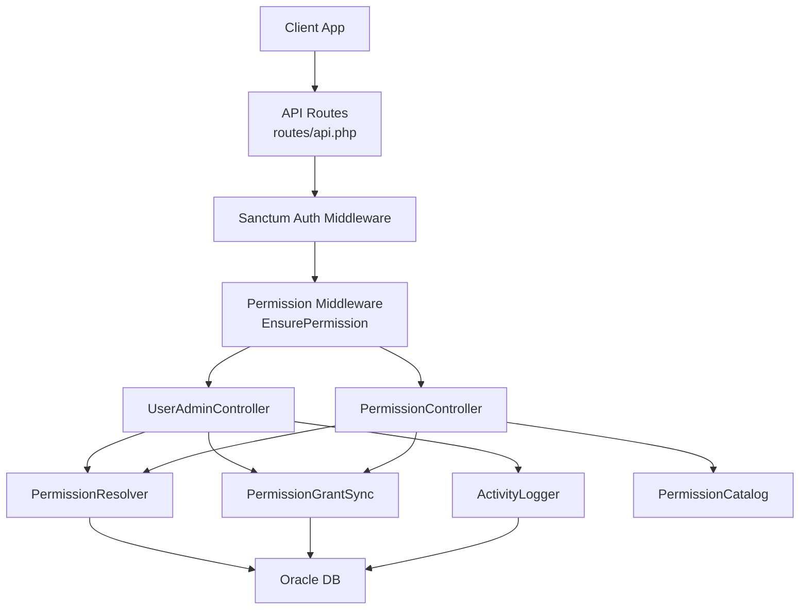
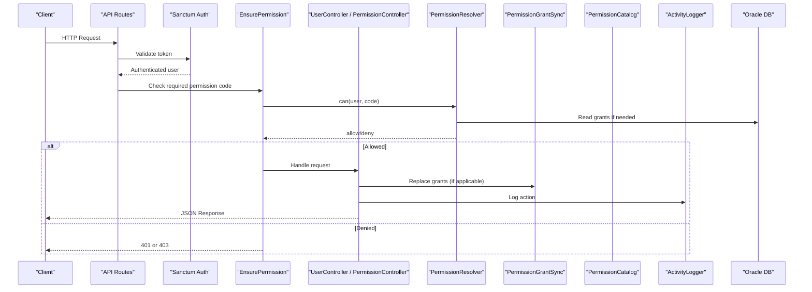
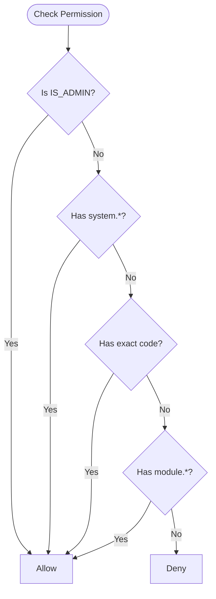
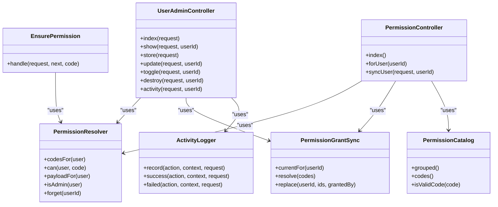
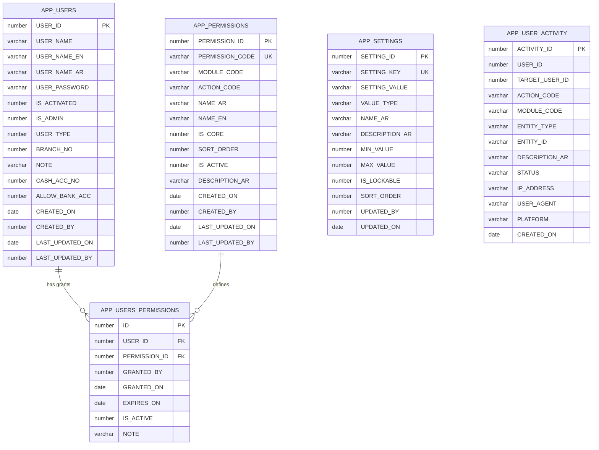

# User Management API

<cite>
**Referenced Files in This Document**   
- [api.php](file://kyApp_API/routes/api.php)
- [UserAdminController.php](file://kyApp_API/app/Http/Controllers/UserAdminController.php)
- [PermissionController.php](file://kyApp_API/app/Http/Controllers/PermissionController.php)
- [EnsurePermission.php](file://kyApp_API/app/Http/Middleware/EnsurePermission.php)
- [PermissionResolver.php](file://kyApp_API/app/Support/PermissionResolver.php)
- [PermissionCatalog.php](file://kyApp_API/app/Support/PermissionCatalog.php)
- [PermissionGrantSync.php](file://kyApp_API/app/Support/PermissionGrantSync.php)
- [ActivityLogger.php](file://kyApp_API/app/Support/ActivityLogger.php)
- [01_ibac_schema.sql](file://kyApp_API/database/oracle/01_ibac_schema.sql)
- [02_ibac_seed.php](file://kyApp_API/database/oracle/02_ibac_seed.php)
- [03_ibac_bootstrap.php](file://kyApp_API/database/oracle/03_ibac_bootstrap.php)
</cite>

## Table of Contents
1. [Introduction](#introduction)
2. [Project Structure](#project-structure)
3. [Core Components](#core-components)
4. [Architecture Overview](#architecture-overview)
5. [Detailed Component Analysis](#detailed-component-analysis)
6. [Dependency Analysis](#dependency-analysis)
7. [Performance Considerations](#performance-considerations)
8. [Troubleshooting Guide](#troubleshooting-guide)
9. [Conclusion](#conclusion)
10. [Appendices](#appendices)

## Introduction
This document provides detailed API documentation for user management and permission control endpoints implemented by the IBAC (Identity-Based Access Control) system. It covers:

- User CRUD operations: listing, viewing, creating, updating, toggling activation, and deleting users.
- Permission catalog retrieval and per-user permission assignment.
- Role-based access control is not used; instead, permissions are granted directly to users, with an `IS_ADMIN` flag acting as a system-wide bypass.
- IBAC integration points: permission catalog, grant synchronization, activity logging, and session termination on sensitive changes.
- Security considerations: deny-by-default authorization, anti-escalation guards, protection against locking out the last administrator, and safe handling of sensitive columns.

The API uses Sanctum authentication and a custom `permission:<code>` middleware that enforces explicit grants or admin status before allowing access.

## Project Structure
The user and permission functionality is centered around:

- Route definitions under `routes/api.php`.
- Controllers for user administration and permission management.
- Support classes for permission resolution, catalog generation, grant synchronization, and audit logging.
- Oracle schema and seed/bootstrap scripts defining the IBAC tables and initial data.

**Diagram sources**
- [api.php:59-102](file://kyApp_API/routes/api.php#L59-L102)
- [EnsurePermission.php:25-52](file://kyApp_API/app/Http/Middleware/EnsurePermission.php#L25-L52)
- [UserAdminController.php:18-33](file://kyApp_API/app/Http/Controllers/UserAdminController.php#L18-L33)
- [PermissionController.php:17-29](file://kyApp_API/app/Http/Controllers/PermissionController.php#L17-L29)
- [PermissionResolver.php:9-26](file://kyApp_API/app/Support/PermissionResolver.php#L9-L26)
- [PermissionGrantSync.php:7-19](file://kyApp_API/app/Support/PermissionGrantSync.php#L7-L19)
- [PermissionCatalog.php:5-21](file://kyApp_API/app/Support/PermissionCatalog.php#L5-L21)
- [ActivityLogger.php:9-17](file://kyApp_API/app/Support/ActivityLogger.php#L9-L17)

**Section sources**
- [api.php:59-102](file://kyApp_API/routes/api.php#L59-L102)
- [UserAdminController.php:18-33](file://kyApp_API/app/Http/Controllers/UserAdminController.php#L18-L33)
- [PermissionController.php:17-29](file://kyApp_API/app/Http/Controllers/PermissionController.php#L17-L29)

## Core Components
This section summarizes the core components involved in user management and permission control.

### User Administration Controller
- Provides endpoints for listing, viewing, creating, updating, toggling, and deleting users.
- Enforces strict rules: no self-deletion, no self-deactivation, never demote/delete the last administrator.
- Prevents escalation: non-admins cannot set the admin flag or grant permissions they do not hold.
- Uses explicit column lists and Arabic encoding helpers to avoid leaking sensitive data and ensure correct character handling.

**Section sources**
- [UserAdminController.php:18-33](file://kyApp_API/app/Http/Controllers/UserAdminController.php#L18-L33)
- [UserAdminController.php:108-148](file://kyApp_API/app/Http/Controllers/UserAdminController.php#L108-L148)
- [UserAdminController.php:188-312](file://kyApp_API/app/Http/Controllers/UserAdminController.php#L188-L312)
- [UserAdminController.php:318-496](file://kyApp_API/app/Http/Controllers/UserAdminController.php#L318-L496)
- [UserAdminController.php:502-560](file://kyApp_API/app/Http/Controllers/UserAdminController.php#L502-L560)
- [UserAdminController.php:566-626](file://kyApp_API/app/Http/Controllers/UserAdminController.php#L566-L626)

### Permission Controller
- Serves the permission catalog grouped by module.
- Returns current grants for a specific user.
- Replaces a user’s grants atomically with escalation and safety checks.
- Terminates sessions when grants change to prevent stale access.

**Section sources**
- [PermissionController.php:17-29](file://kyApp_API/app/Http/Controllers/PermissionController.php#L17-L29)
- [PermissionController.php:51-93](file://kyApp_API/app/Http/Controllers/PermissionController.php#L51-L93)
- [PermissionController.php:99-128](file://kyApp_API/app/Http/Controllers/PermissionController.php#L99-L128)
- [PermissionController.php:137-243](file://kyApp_API/app/Http/Controllers/PermissionController.php#L137-L243)

### Permission Resolver
- Implements IBAC evaluation order: admin bypass, system wildcard, explicit code, module wildcard, then deny.
- Caches effective codes per user with size-aware caching to avoid Oracle bound-value limits.
- Provides helper methods for checking single/multiple permissions and building client payloads.

**Section sources**
- [PermissionResolver.php:9-26](file://kyApp_API/app/Support/PermissionResolver.php#L9-L26)
- [PermissionResolver.php:66-89](file://kyApp_API/app/Support/PermissionResolver.php#L66-L89)
- [PermissionResolver.php:95-132](file://kyApp_API/app/Support/PermissionResolver.php#L95-L132)
- [PermissionResolver.php:178-200](file://kyApp_API/app/Support/PermissionResolver.php#L178-L200)
- [PermissionResolver.php:206-218](file://kyApp_API/app/Support/PermissionResolver.php#L206-L218)

### Permission Catalog
- Single source of truth for permission codes, labels, modules, and ordering.
- Generates rows for seeding the database and grouping permissions for UI consumption.
- Validates explicit permission codes and supports wildcards only in defined forms.

**Section sources**
- [PermissionCatalog.php:5-21](file://kyApp_API/app/Support/PermissionCatalog.php#L5-L21)
- [PermissionCatalog.php:271-316](file://kyApp_API/app/Support/PermissionCatalog.php#L271-L316)
- [PermissionCatalog.php:400-415](file://kyApp_API/app/Support/PermissionCatalog.php#L400-L415)
- [PermissionCatalog.php:447-456](file://kyApp_API/app/Support/PermissionCatalog.php#L447-L456)

### Permission Grant Sync
- The only code path that mutates `APP_USERS_PERMISSIONS`.
- Resolves permission codes to IDs and separates unknown/inactive codes.
- Performs atomic replacement of grants and invalidates resolver cache.

**Section sources**
- [PermissionGrantSync.php:7-19](file://kyApp_API/app/Support/PermissionGrantSync.php#L7-L19)
- [PermissionGrantSync.php:40-63](file://kyApp_API/app/Support/PermissionGrantSync.php#L40-L63)
- [PermissionGrantSync.php:77-120](file://kyApp_API/app/Support/PermissionGrantSync.php#L77-L120)
- [PermissionGrantSync.php:134-163](file://kyApp_API/app/Support/PermissionGrantSync.php#L134-L163)

### Activity Logger
- Writes audit events into `APP_USER_ACTIVITY`.
- Never fails a successful request due to logging errors.
- Stores IP, user agent, platform, and Arabic descriptions safely.

**Section sources**
- [ActivityLogger.php:9-17](file://kyApp_API/app/Support/ActivityLogger.php#L9-L17)
- [ActivityLogger.php:37-73](file://kyApp_API/app/Support/ActivityLogger.php#L37-L73)
- [ActivityLogger.php:81-95](file://kyApp_API/app/Support/ActivityLogger.php#L81-L95)

## Architecture Overview
The authorization flow combines Sanctum authentication with a permission middleware that evaluates IBAC rules.

**Diagram sources**
- [api.php:59-102](file://kyApp_API/routes/api.php#L59-L102)
- [EnsurePermission.php:25-52](file://kyApp_API/app/Http/Middleware/EnsurePermission.php#L25-L52)
- [PermissionResolver.php:95-132](file://kyApp_API/app/Support/PermissionResolver.php#L95-L132)
- [PermissionGrantSync.php:134-163](file://kyApp_API/app/Support/PermissionGrantSync.php#L134-L163)
- [ActivityLogger.php:37-73](file://kyApp_API/app/Support/ActivityLogger.php#L37-L73)

## Detailed Component Analysis

### User Management Endpoints

#### List Users
- **Method:** GET
- **URL Pattern:** `/users`
- **Required Permissions:** `users.view`
- **Query Parameters:**
  - `limit`: page size, bounded between 1 and 500; default 100.
  - `page`: page number, minimum 1.
  - `status`: `all`, `active`, `inactive`.
  - `user_type`: `1` (employee) or `2` (client).
  - `admin_only`: boolean filter for administrators.
  - `search`: text search across Latin name, Arabic name, and ID.
  - `sort`: whitelisted column such as `user_id`, `user_name_en`, `user_name_ar`, `created_on`, `is_activated`, `user_type`.
  - `direction`: `asc` or `desc`; defaults to ascending.
- **Response Schema:**
  - `success`: boolean
  - `message`: string
  - `data`: array of user objects without sensitive fields
  - `meta`: object with `total`, `page`, `limit`, `pages`
- **Notes:**
  - Uses Oracle pagination via row numbering.
  - Includes a grant count per user.

**Section sources**
- [api.php:77-78](file://kyApp_API/routes/api.php#L77-L78)
- [UserAdminController.php:108-148](file://kyApp_API/app/Http/Controllers/UserAdminController.php#L108-L148)
- [UserAdminController.php:691-752](file://kyApp_API/app/Http/Controllers/UserAdminController.php#L691-L752)

#### Get User
- **Method:** GET
- **URL Pattern:** `/users/{userId}`
- **Required Permissions:** `users.view`
- **Path Parameter:** `userId` (integer)
- **Response Schema:**
  - `success`: boolean
  - `data`: user object including `granted_codes`, `granted_ids`, and `last_activity_on`
- **Notes:**
  - Returns current grants and latest activity timestamp.

**Section sources**
- [api.php:80-82](file://kyApp_API/routes/api.php#L80-L82)
- [UserAdminController.php:154-182](file://kyApp_API/app/Http/Controllers/UserAdminController.php#L154-L182)

#### Create User
- **Method:** POST
- **URL Pattern:** `/users`
- **Required Permissions:** `users.create`
- **Request Body Fields:**
  - `user_name_en`: required string, length 2–50
  - `user_name_ar`: optional string, max 120
  - `user_password`: required string, min length from settings, max 100
  - `user_type`: optional integer, values `1` or `2`
  - `is_activated`: optional integer, values `0` or `1`
  - `is_admin`: optional integer, values `0` or `1`; requires `users.admin_flag_manage`
  - `branch_no`: optional integer, minimum 0
  - `note`: optional string, max 100
  - `cash_acc_no`: optional integer, minimum 0
  - `allow_bank_acc`: optional integer, values `0` or `1`
  - `permissions`: optional array of permission codes
- **Response Schema:**
  - `success`: boolean
  - `message`: string
  - `data`: created user object or minimal identifier
- **Security Rules:**
  - Username uniqueness is case-insensitive.
  - Admin flag may only be set by an actor holding `users.admin_flag_manage`.
  - Permissions are validated against the catalog and escalation rules.

**Section sources**
- [api.php:84-85](file://kyApp_API/routes/api.php#L84-L85)
- [UserAdminController.php:188-312](file://kyApp_API/app/Http/Controllers/UserAdminController.php#L188-L312)

#### Update User
- **Method:** PUT
- **URL Pattern:** `/users/{userId}`
- **Required Permissions:** `users.update`
- **Path Parameter:** `userId` (integer)
- **Request Body Fields:** Same as create, but most fields are optional and partial updates are supported.
- **Response Schema:**
  - `success`: boolean
  - `message`: string
  - `data`: updated user object or null if nothing changed
- **Security Rules:**
  - Self-edits cannot change account type or admin flag.
  - Changing admin flag requires `users.admin_flag_manage`.
  - Cannot remove the last administrator.
  - If `is_activated` becomes inactive, user sessions are terminated immediately.

**Section sources**
- [api.php:87-89](file://kyApp_API/routes/api.php#L87-L89)
- [UserAdminController.php:318-496](file://kyApp_API/app/Http/Controllers/UserAdminController.php#L318-L496)

#### Toggle User Activation
- **Method:** PATCH
- **URL Pattern:** `/users/{userId}/toggle`
- **Required Permissions:** `users.toggle`
- **Path Parameter:** `userId` (integer)
- **Response Schema:**
  - `success`: boolean
  - `message`: string
  - `data`: object with `user_id`, `is_activated`, and `sessions_ended`
- **Security Rules:**
  - Cannot deactivate your own account.
  - Cannot deactivate the last administrator.
  - Deactivation terminates active sessions.

**Section sources**
- [api.php:91-93](file://kyApp_API/routes/api.php#L91-L93)
- [UserAdminController.php:502-560](file://kyApp_API/app/Http/Controllers/UserAdminController.php#L502-L560)

#### Delete User
- **Method:** DELETE
- **URL Pattern:** `/users/{userId}`
- **Required Permissions:** `users.delete`
- **Path Parameter:** `userId` (integer)
- **Response Schema:**
  - `success`: boolean
  - `message`: string
  - `data`: object with `user_id`
- **Security Rules:**
  - Cannot delete your own account.
  - Cannot delete the last administrator.
  - Deletes grants, personal access tokens, and the user record.

**Section sources**
- [api.php:95-97](file://kyApp_API/routes/api.php#L95-L97)
- [UserAdminController.php:566-626](file://kyApp_API/app/Http/Controllers/UserAdminController.php#L566-L626)

#### View User Activity
- **Method:** GET
- **URL Pattern:** `/users/{userId}/activity`
- **Required Permissions:** `users.activity_view`
- **Path Parameter:** `userId` (integer)
- **Query Parameters:**
  - `limit`: page size, bounded between 1 and 500; default 50.
  - `page`: page number, minimum 1.
- **Response Schema:**
  - `success`: boolean
  - `data`: array of activity records
  - `meta`: object with `total`, `page`, `limit`, `pages`
- **Notes:**
  - Shows actions performed by the user and actions performed against the user.

**Section sources**
- [api.php:99-101](file://kyApp_API/routes/api.php#L99-L101)
- [UserAdminController.php:632-679](file://kyApp_API/app/Http/Controllers/UserAdminController.php#L632-L679)

### Permission Management Endpoints

#### Get Permission Catalog
- **Method:** GET
- **URL Pattern:** `/permissions`
- **Required Permissions:** `users.view`
- **Response Schema:**
  - `success`: boolean
  - `message`: string
  - `data`: array of modules, each containing `module_code`, `name_ar`, and `permissions`
  - `meta`: object with `total` and `modules`
- **Notes:**
  - Each permission includes `permission_id`, `permission_code`, `action_code`, names, core flag, and sort order.

**Section sources**
- [api.php:65-66](file://kyApp_API/routes/api.php#L65-L66)
- [PermissionController.php:51-93](file://kyApp_API/app/Http/Controllers/PermissionController.php#L51-L93)
- [PermissionCatalog.php:271-316](file://kyApp_API/app/Support/PermissionCatalog.php#L271-L316)

#### Get User Permissions
- **Method:** GET
- **URL Pattern:** `/users/{userId}/permissions`
- **Required Permissions:** `users.view`
- **Path Parameter:** `userId` (integer)
- **Response Schema:**
  - `success`: boolean
  - `data`: object with `user_id`, `user_name_en`, `user_name_ar`, `is_admin`, `effective_permissions`, `granted_codes`, `granted_ids`
- **Notes:**
  - For administrators, `effective_permissions` returns all catalog codes because admin bypasses grants.

**Section sources**
- [api.php:68-70](file://kyApp_API/routes/api.php#L68-L70)
- [PermissionController.php:99-128](file://kyApp_API/app/Http/Controllers/PermissionController.php#L99-L128)

#### Sync User Permissions
- **Method:** PUT
- **URL Pattern:** `/users/{userId}/permissions`
- **Required Permissions:** `users.permissions_manage`
- **Path Parameter:** `userId` (integer)
- **Request Body Fields:**
  - `permissions`: required array of permission codes; empty list means revoke all.
  - `logout_others`: optional boolean; defaults to true to terminate sessions after permission changes.
- **Response Schema:**
  - `success`: boolean
  - `message`: string
  - `data`: object with `user_id`, `granted_codes`, `granted_ids`, `sessions_ended`
- **Security Rules:**
  - Non-admins cannot edit their own permissions.
  - Unknown or inactive permission codes are rejected.
  - Non-admins can only grant permissions they themselves hold.
  - Changes invalidate cached permissions and optionally terminate sessions.

**Section sources**
- [api.php:72-74](file://kyApp_API/routes/api.php#L72-L74)
- [PermissionController.php:137-243](file://kyApp_API/app/Http/Controllers/PermissionController.php#L137-L243)
- [PermissionGrantSync.php:134-163](file://kyApp_API/app/Support/PermissionGrantSync.php#L134-L163)

### IBAC Integration Points

#### Permission Evaluation Order
The IBAC system evaluates permissions in this order:
1. System administrator (`IS_ADMIN = 1`) bypasses all checks.
2. Explicit `system.*` grant gives full access.
3. Explicit permission code match.
4. Module wildcard `module.*` matches any action in that module.
5. Deny by default.

**Diagram sources**
- [PermissionResolver.php:9-26](file://kyApp_API/app/Support/PermissionResolver.php#L9-L26)
- [PermissionResolver.php:95-132](file://kyApp_API/app/Support/PermissionResolver.php#L95-L132)

#### Permission Catalog Seeding
The catalog is generated from `PermissionCatalog::rows()` and upserted into `APP_PERMISSIONS`. It also seeds security settings and application configuration keys.

**Section sources**
- [02_ibac_seed.php:38-91](file://kyApp_API/database/oracle/02_ibac_seed.php#L38-L91)
- [02_ibac_seed.php:434-442](file://kyApp_API/database/oracle/02_ibac_seed.php#L434-L442)

#### Bootstrap and First Administrator
The bootstrap script applies table/column comments, promotes the first administrator if none exists, grants `system.*` to user ID 1, and logs the bootstrap event.

**Section sources**
- [03_ibac_bootstrap.php:131-149](file://kyApp_API/database/oracle/03_ibac_bootstrap.php#L131-L149)
- [03_ibac_bootstrap.php:155-185](file://kyApp_API/database/oracle/03_ibac_bootstrap.php#L155-L185)
- [03_ibac_bootstrap.php:191-217](file://kyApp_API/database/oracle/03_ibac_bootstrap.php#L191-L217)

### Complex Permission Hierarchies and Bulk Operations
- **Complex Hierarchies:**
  - Use module wildcards like `customers.*` to grant all actions for a module.
  - Combine explicit codes such as `customers.statement` and `customers.export` for fine-grained control.
  - Use `system.*` for full system access, typically reserved for administrators.
- **Bulk Operations:**
  - The sync endpoint replaces all grants for a user atomically.
  - An empty `permissions` array revokes all grants.
  - Clients should send the complete desired permission set rather than incremental diffs.

**Section sources**
- [PermissionCatalog.php:271-316](file://kyApp_API/app/Support/PermissionCatalog.php#L271-L316)
- [PermissionController.php:137-243](file://kyApp_API/app/Http/Controllers/PermissionController.php#L137-L243)
- [PermissionGrantSync.php:134-163](file://kyApp_API/app/Support/PermissionGrantSync.php#L134-L163)

### User Activity Tracking
- Every user creation, update, toggle, deletion, and permission sync logs an activity event.
- Activity includes actor, target, module, entity type, entity ID, Arabic description, status, IP, user agent, and platform.
- Activity logging failures are swallowed so they do not break successful requests.

**Section sources**
- [UserAdminController.php:293-300](file://kyApp_API/app/Http/Controllers/UserAdminController.php#L293-L300)
- [UserAdminController.php:477-484](file://kyApp_API/app/Http/Controllers/UserAdminController.php#L477-L484)
- [UserAdminController.php:543-550](file://kyApp_API/app/Http/Controllers/UserAdminController.php#L543-L550)
- [UserAdminController.php:609-616](file://kyApp_API/app/Http/Controllers/UserAdminController.php#L609-L616)
- [PermissionController.php:219-226](file://kyApp_API/app/Http/Controllers/PermissionController.php#L219-L226)
- [ActivityLogger.php:37-73](file://kyApp_API/app/Support/ActivityLogger.php#L37-L73)

### Account Status Management
- Activation state is stored in `IS_ACTIVATED`.
- Toggling activation flips between active and inactive states.
- Deactivating an account terminates active sessions immediately.
- Administrators must remain at least one active admin to avoid locking out the system.

**Section sources**
- [UserAdminController.php:502-560](file://kyApp_API/app/Http/Controllers/UserAdminController.php#L502-L560)
- [UserAdminController.php:469-475](file://kyApp_API/app/Http/Controllers/UserAdminController.php#L469-L475)

### Administrative Controls
- Only actors with `users.admin_flag_manage` can set or remove the admin flag.
- The last administrator cannot be demoted or deleted.
- Non-admins cannot grant permissions they do not hold.
- Non-admins cannot edit their own permissions.

**Section sources**
- [UserAdminController.php:235-241](file://kyApp_API/app/Http/Controllers/UserAdminController.php#L235-L241)
- [UserAdminController.php:336-347](file://kyApp_API/app/Http/Controllers/UserAdminController.php#L336-L347)
- [UserAdminController.php:519-525](file://kyApp_API/app/Http/Controllers/UserAdminController.php#L519-L525)
- [UserAdminController.php:582-584](file://kyApp_API/app/Http/Controllers/UserAdminController.php#L582-L584)
- [PermissionController.php:162-169](file://kyApp_API/app/Http/Controllers/PermissionController.php#L162-L169)
- [PermissionController.php:194-209](file://kyApp_API/app/Http/Controllers/PermissionController.php#L194-L209)

## Dependency Analysis
The following diagram shows how controllers depend on support classes and how routes enforce permissions.

**Diagram sources**
- [UserAdminController.php:97-102](file://kyApp_API/app/Http/Controllers/UserAdminController.php#L97-L102)
- [PermissionController.php:38-42](file://kyApp_API/app/Http/Controllers/PermissionController.php#L38-L42)
- [EnsurePermission.php:25-52](file://kyApp_API/app/Http/Middleware/EnsurePermission.php#L25-L52)
- [PermissionResolver.php:66-89](file://kyApp_API/app/Support/PermissionResolver.php#L66-L89)
- [PermissionGrantSync.php:40-63](file://kyApp_API/app/Support/PermissionGrantSync.php#L40-L63)
- [PermissionCatalog.php:400-415](file://kyApp_API/app/Support/PermissionCatalog.php#L400-L415)
- [ActivityLogger.php:37-73](file://kyApp_API/app/Support/ActivityLogger.php#L37-L73)

**Section sources**
- [UserAdminController.php:97-102](file://kyApp_API/app/Http/Controllers/UserAdminController.php#L97-L102)
- [PermissionController.php:38-42](file://kyApp_API/app/Http/Controllers/PermissionController.php#L38-L42)
- [EnsurePermission.php:25-52](file://kyApp_API/app/Http/Middleware/EnsurePermission.php#L25-L52)

## Performance Considerations
- **Pagination:** User listing and activity queries use Oracle row numbering to avoid OFFSET/FETCH limitations.
- **Sorting:** Sorting columns are whitelisted to prevent SQL injection and ensure deterministic ordering.
- **Caching:** Permission codes are cached per user with a TTL and a maximum payload size to avoid Oracle bound-value errors.
- **Database Queries:** All statements are fully parameterized; sensitive columns are explicitly selected.
- **Session Termination:** When grants change or accounts are deactivated, sessions are terminated to prevent stale access.

**Section sources**
- [UserAdminController.php:61-85](file://kyApp_API/app/Http/Controllers/UserAdminController.php#L61-L85)
- [UserAdminController.php:744-752](file://kyApp_API/app/Http/Controllers/UserAdminController.php#L744-L752)
- [PermissionResolver.php:29-43](file://kyApp_API/app/Support/PermissionResolver.php#L29-L43)
- [PermissionResolver.php:66-89](file://kyApp_API/app/Support/PermissionResolver.php#L66-L89)
- [PermissionController.php:294-304](file://kyApp_API/app/Http/Controllers/PermissionController.php#L294-L304)

## Troubleshooting Guide
Common issues and their likely causes:

- **401 Unauthenticated:**
  - Missing or invalid Sanctum token.
  - Ensure requests to protected routes include a valid token.
- **403 Permission Denied:**
  - The authenticated user lacks the required permission.
  - Check whether the user holds the exact code, module wildcard, or `system.*`.
  - Verify that the permission code exists in the catalog and is active.
- **404 User Not Found:**
  - The requested `userId` does not exist.
- **422 Validation Error:**
  - Missing or invalid request fields such as username, password, or permission codes.
  - Check field lengths, allowed values, and required arrays.
- **409 Conflict:**
  - Username already exists.
- **Cannot Change Admin Flag:**
  - Actor lacks `users.admin_flag_manage`.
  - Attempting to remove the last administrator.
- **Cannot Edit Own Permissions:**
  - Non-admins are blocked from modifying their own grants.
- **Unknown or Inactive Permission Codes:**
  - The sync endpoint rejects codes not present in `APP_PERMISSIONS` or marked inactive.

**Section sources**
- [EnsurePermission.php:32-52](file://kyApp_API/app/Http/Middleware/EnsurePermission.php#L32-L52)
- [PermissionController.php:146-192](file://kyApp_API/app/Http/Controllers/PermissionController.php#L146-L192)
- [PermissionController.php:194-209](file://kyApp_API/app/Http/Controllers/PermissionController.php#L194-L209)
- [UserAdminController.php:227-233](file://kyApp_API/app/Http/Controllers/UserAdminController.php#L227-L233)
- [UserAdminController.php:336-347](file://kyApp_API/app/Http/Controllers/UserAdminController.php#L336-L347)
- [UserAdminController.php:519-525](file://kyApp_API/app/Http/Controllers/UserAdminController.php#L519-L525)

## Conclusion
The User Management API implements a robust IBAC system focused on direct user permissions, strict escalation prevention, and comprehensive auditing. Authorization is enforced through Sanctum authentication and a permission middleware that evaluates admin status, system-wide wildcards, explicit codes, and module wildcards. Controllers protect sensitive operations with anti-lockout guards, session termination on critical changes, and careful handling of Arabic text and sensitive columns. The permission catalog serves as the single source of truth for codes, labels, and ordering, while grant synchronization ensures atomic updates and immediate effect.

## Appendices

### Database Schema Overview
The IBAC schema defines the core tables for permissions, user grants, settings, and activity tracking.

**Diagram sources**
- [01_ibac_schema.sql:21-33](file://kyApp_API/database/oracle/01_ibac_schema.sql#L21-L33)
- [01_ibac_schema.sql:38-62](file://kyApp_API/database/oracle/01_ibac_schema.sql#L38-L62)
- [01_ibac_schema.sql:81-112](file://kyApp_API/database/oracle/01_ibac_schema.sql#L81-L112)
- [01_ibac_schema.sql:118-146](file://kyApp_API/database/oracle/01_ibac_schema.sql#L118-L146)
- [01_ibac_schema.sql:152-184](file://kyApp_API/database/oracle/01_ibac_schema.sql#L152-L184)