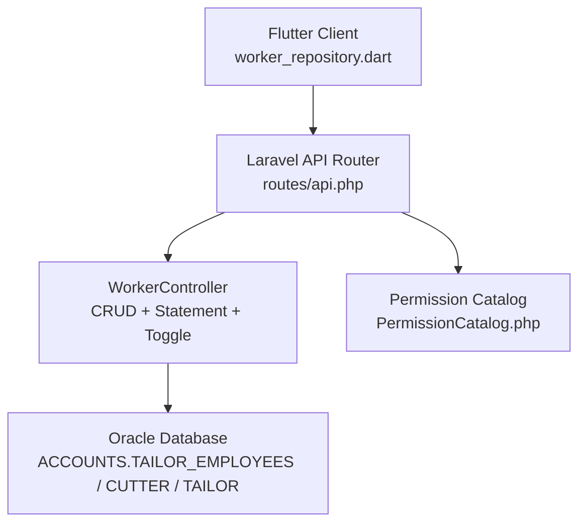
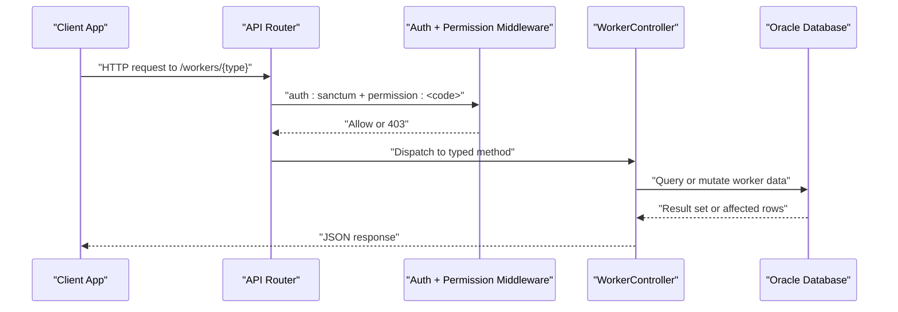
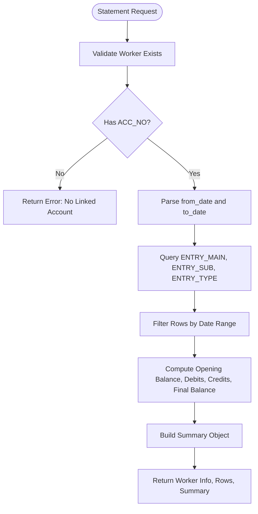
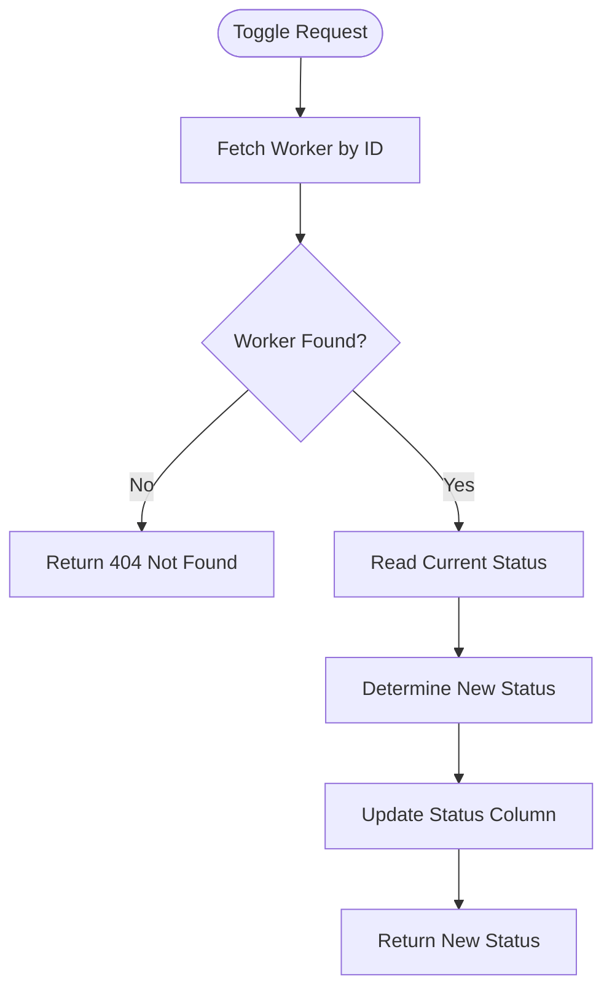
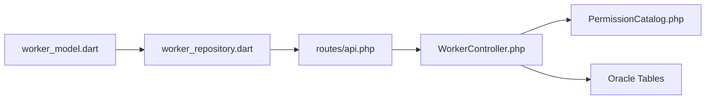

# Worker Management API

<cite>
**Referenced Files in This Document**
- [WorkerController.php](file://kyApp_API/app/Http/Controllers/WorkerController.php)
- [api.php](file://kyApp_API/routes/api.php)
- [PermissionCatalog.php](file://kyApp_API/app/Support/PermissionCatalog.php)
- [worker_repository.dart](file://lib/features/workers/data/repositories/worker_repository.dart)
- [worker_model.dart](file://lib/features/workers/data/models/worker_model.dart)
</cite>

## Table of Contents
1. [Introduction](#introduction)
2. [Project Structure](#project-structure)
3. [Core Components](#core-components)
4. [Architecture Overview](#architecture-overview)
5. [Detailed Component Analysis](#detailed-component-analysis)
6. [Dependency Analysis](#dependency-analysis)
7. [Performance Considerations](#performance-considerations)
8. [Troubleshooting Guide](#troubleshooting-guide)
9. [Conclusion](#conclusion)

## Introduction
This document provides comprehensive API documentation for the worker management endpoints that cover three independent worker categories:
- Employees
- Cutters
- Tailors

The system exposes full CRUD operations, statement generation, and worker status toggling for each category. Each worker type has its own permission module, ensuring segregation of duties: managing tailors does not imply managing cutters or employees. The backend is a Laravel application backed by an Oracle database, while the frontend client uses a Dart repository to call these endpoints.

## Project Structure
The worker management feature spans several layers:
- Routes define protected HTTP endpoints under `/api/workers`.
- `WorkerController` implements shared logic for all three worker types.
- `PermissionCatalog` defines the canonical permission codes for employees, cutters, and tailors.
- The Flutter/Dart client calls the worker endpoints through a repository layer.



**Diagram sources**
- [api.php:219-273](file://kyApp_API/routes/api.php#L219-L273)
- [WorkerController.php:16-59](file://kyApp_API/app/Http/Controllers/WorkerController.php#L16-L59)
- [PermissionCatalog.php:99-137](file://kyApp_API/app/Support/PermissionCatalog.php#L99-L137)

**Section sources**
- [api.php:219-273](file://kyApp_API/routes/api.php#L219-L273)
- [WorkerController.php:16-59](file://kyApp_API/app/Http/Controllers/WorkerController.php#L16-L59)
- [PermissionCatalog.php:99-137](file://kyApp_API/app/Support/PermissionCatalog.php#L99-L137)

## Core Components
The worker management system is built around three core components:

| Component | Responsibility | Key Behavior |
|---|---|---|
| `WorkerController` | Implements list, store, update, delete, toggle, and statement endpoints for employees, cutters, and tailors | Uses shared private methods per worker type; maps to Oracle tables via configuration constants |
| `api.php` | Registers REST routes with Sanctum authentication and per-route permissions | Enforces separate permission modules: `employees.*`, `cutters.*`, `tailors.*` |
| `PermissionCatalog` | Defines canonical permission codes and labels | Includes core actions (`view`, `create`, `update`, `delete`) and extra actions (`toggle`, `statement`) for each worker category |

### Worker Classification System
Each worker type maps to a specific Oracle table and primary key:

| Worker Type | Oracle Table | Primary Key | Name Column | Status Column | Account Column | Extra Columns |
|---|---|---|---|---|---|---|
| Employees | `ACCOUNTS.TAILOR_EMPLOYEES` | `EMP_NO` | `EMP_NAME` | `EMP_STATUS` | `ACC_NO` | `JOP_TYPE`, `EMP_CLASS`, `WAGES_TYPE`, `SALARY`, `PIECE_PRICE`, `CUR_NO` |
| Cutters | `ACCOUNTS.CUTTER` | `CUTTER_NO` | `CUTTER_NAME` | `CUTTER_STATUS` | `ACC_NO` | `CUR_NO` |
| Tailors | `ACCOUNTS.TAILOR` | `TAILOR_NO` | `TAILOR_NAME` | `TAILOR_STATUS` | `ACC_NO` | `CUR_NO` |

**Section sources**
- [WorkerController.php:22-59](file://kyApp_API/app/Http/Controllers/WorkerController.php#L22-L59)

## Architecture Overview
The worker management API follows a layered architecture:



**Diagram sources**
- [api.php:38-58](file://kyApp_API/routes/api.php#L38-L58)
- [api.php:219-273](file://kyApp_API/routes/api.php#L219-L273)
- [WorkerController.php:188-239](file://kyApp_API/app/Http/Controllers/WorkerController.php#L188-L239)

## Detailed Component Analysis

### HTTP Endpoints

#### Employees
| Operation | HTTP Method | URL Pattern | Required Permission | Request Body | Response Summary |
|---|---|---|---|---|---|
| List employees | `GET` | `/api/workers/employees` | `employees.view` | Optional query: `search`, `limit`, `page` | Paginated employee list with metadata |
| Create employee | `POST` | `/api/workers/employees` | `employees.create` | Employee fields including name, phones, email, status, notes, account number, and extra columns | Success with new ID |
| Update employee | `PUT` | `/api/workers/employees/{id}` | `employees.update` | Partial or full employee fields | Success message |
| Delete employee | `DELETE` | `/api/workers/employees/{id}` | `employees.delete` | None | Success message |
| Toggle employee status | `PATCH` | `/api/workers/employees/{id}/toggle` | `employees.toggle` | None | New status value |
| Employee statement | `GET` | `/api/workers/employees/{id}/statement` | `employees.statement` | Optional query: `from_date`, `to_date` | Worker info, transaction rows, summary totals |

#### Cutters
| Operation | HTTP Method | URL Pattern | Required Permission | Request Body | Response Summary |
|---|---|---|---|---|---|
| List cutters | `GET` | `/api/workers/cutters` | `cutters.view` | Optional query: `search`, `limit`, `page` | Paginated cutter list with metadata |
| Create cutter | `POST` | `/api/workers/cutters` | `cutters.create` | Cutter fields including name, phones, email, status, notes, account number, currency | Success with new ID |
| Update cutter | `PUT` | `/api/workers/cutters/{id}` | `cutters.update` | Partial or full cutter fields | Success message |
| Delete cutter | `DELETE` | `/api/workers/cutters/{id}` | `cutters.delete` | None | Success message |
| Toggle cutter status | `PATCH` | `/api/workers/cutters/{id}/toggle` | `cutters.toggle` | None | New status value |
| Cutter statement | `GET` | `/api/workers/cutters/{id}/statement` | `cutters.statement` | Optional query: `from_date`, `to_date` | Worker info, transaction rows, summary totals |

#### Tailors
| Operation | HTTP Method | URL Pattern | Required Permission | Request Body | Response Summary |
|---|---|---|---|---|---|
| List tailors | `GET` | `/api/workers/tailors` | `tailors.view` | Optional query: `search`, `limit`, `page` | Paginated tailor list with metadata |
| Create tailor | `POST` | `/api/workers/tailors` | `tailors.create` | Tailor fields including name, phones, email, status, notes, account number, currency | Success with new ID |
| Update tailor | `PUT` | `/api/workers/tailors/{id}` | `tailors.update` | Partial or full tailor fields | Success message |
| Delete tailor | `DELETE` | `/api/workers/tailors/{id}` | `tailors.delete` | None | Success message |
| Toggle tailor status | `PATCH` | `/api/workers/tailors/{id}/toggle` | `tailors.toggle` | None | New status value |
| Tailor statement | `GET` | `/api/workers/tailors/{id}/statement` | `tailors.statement` | Optional query: `from_date`, `to_date` | Worker info, transaction rows, summary totals |

**Section sources**
- [api.php:219-273](file://kyApp_API/routes/api.php#L219-L273)

### Request and Response Schemas

#### Common List Response Schema
```json
{
  "success": true,
  "type": "employees|cutters|tailors",
  "data": [],
  "meta": {
    "total": 0,
    "page": 1,
    "limit": 100,
    "pages": 1
  }
}
```

#### Common Create Response Schema
```json
{
  "success": true,
  "message": "Created successfully",
  "id": 0
}
```

#### Common Update/Delete/Toggle Response Schema
```json
{
  "success": true,
  "message": "Operation completed"
}
```

#### Toggle Response Schema
```json
{
  "success": true,
  "message": "Status changed",
  "new_status": "فعال|معطل"
}
```

#### Statement Response Schema
```json
{
  "success": true,
  "worker": {
    "id": 0,
    "name": "",
    "acc_no": 0,
    "type": "employees|cutters|tailors"
  },
  "data": [],
  "summary": {
    "total_rows": 0,
    "total_debit": 0.0,
    "total_credit": 0.0,
    "opening_balance": 0.0,
    "final_balance": 0.0,
    "from_date": "dd/mm/yyyy",
    "to_date": "dd/mm/yyyy",
    "currency": "يمني YR",
    "account_title": "acc_no - worker_name"
  }
}
```

**Section sources**
- [WorkerController.php:188-239](file://kyApp_API/app/Http/Controllers/WorkerController.php#L188-L239)
- [WorkerController.php:244-284](file://kyApp_API/app/Http/Controllers/WorkerController.php#L244-L284)
- [WorkerController.php:289-320](file://kyApp_API/app/Http/Controllers/WorkerController.php#L289-L320)
- [WorkerController.php:325-343](file://kyApp_API/app/Http/Controllers/WorkerController.php#L325-L343)
- [WorkerController.php:348-381](file://kyApp_API/app/Http/Controllers/WorkerController.php#L348-L381)
- [WorkerController.php:398-558](file://kyApp_API/app/Http/Controllers/WorkerController.php#L398-L558)

### Worker Registration Examples

#### Registering an Employee
- **Method**: `POST`
- **URL**: `/api/workers/employees`
- **Required Permission**: `employees.create`
- **Request Fields**:
  - `EMP_NAME`: Employee name
  - `EMP_PHONE1`: Primary phone
  - `EMP_PHONE2`: Secondary phone
  - `EMP_EMAIL`: Email address
  - `EMP_STATUS`: Employment status
  - `NOTES1`: Notes
  - `ACC_NO`: Associated account number
  - `JOP_TYPE`: Job type
  - `EMP_CLASS`: Employee class
  - `WAGES_TYPE`: Wages type
  - `SALARY`: Salary amount
  - `PIECE_PRICE`: Piece price
  - `CUR_NO`: Currency code
- **Response**: Returns success flag, message, and new employee ID.

#### Registering a Cutter
- **Method**: `POST`
- **URL**: `/api/workers/cutters`
- **Required Permission**: `cutters.create`
- **Request Fields**:
  - `CUTTER_NAME`: Cutter name
  - `CUTTER_PHONE1`: Primary phone
  - `CUTTER_PHONE2`: Secondary phone
  - `CUTTER_EMAIL`: Email address
  - `CUTTER_STATUS`: Cutter status
  - `NOTES1`: Notes
  - `ACC_NO`: Associated account number
  - `CUR_NO`: Currency code
- **Response**: Returns success flag, message, and new cutter ID.

#### Registering a Tailor
- **Method**: `POST`
- **URL**: `/api/workers/tailors`
- **Required Permission**: `tailors.create`
- **Request Fields**:
  - `TAILOR_NAME`: Tailor name
  - `TAILOR_PHONE1`: Primary phone
  - `TAILOR_PHONE2`: Secondary phone
  - `TAILOR_EMAIL`: Email address
  - `TAILOR_STATUS`: Tailor status
  - `NOTES1`: Notes
  - `ACC_NO`: Associated account number
  - `CUR_NO`: Currency code
- **Response**: Returns success flag, message, and new tailor ID.

**Section sources**
- [WorkerController.php:90-103](file://kyApp_API/app/Http/Controllers/WorkerController.php#L90-L103)
- [WorkerController.php:244-284](file://kyApp_API/app/Http/Controllers/WorkerController.php#L244-L284)

### Profile Updates

#### Updating an Employee
- **Method**: `PUT`
- **URL**: `/api/workers/employees/{id}`
- **Required Permission**: `employees.update`
- **Behavior**: Updates allowed fields for the employee record identified by `EMP_NO`.

#### Updating a Cutter
- **Method**: `PUT`
- **URL**: `/api/workers/cutters/{id}`
- **Required Permission**: `cutters.update`
- **Behavior**: Updates allowed fields for the cutter record identified by `CUTTER_NO`.

#### Updating a Tailor
- **Method**: `PUT`
- **URL**: `/api/workers/tailors/{id}`
- **Required Permission**: `tailors.update`
- **Behavior**: Updates allowed fields for the tailor record identified by `TAILOR_NO`.

**Section sources**
- [WorkerController.php:109-122](file://kyApp_API/app/Http/Controllers/WorkerController.php#L109-L122)
- [WorkerController.php:289-320](file://kyApp_API/app/Http/Controllers/WorkerController.php#L289-L320)

### Performance Tracking and Worker Data Model
Employee records include performance-related and compensation-related fields:
- `JOP_TYPE`: Job classification
- `EMP_CLASS`: Employee class
- `WAGES_TYPE`: Wage calculation type
- `SALARY`: Base salary
- `PIECE_PRICE`: Piece-rate price
- `CUR_NO`: Currency reference

These fields are exposed through the employee list and can be used by the frontend to calculate or display performance metrics and compensation details.

**Section sources**
- [WorkerController.php:22-34](file://kyApp_API/app/Http/Controllers/WorkerController.php#L22-L34)
- [worker_model.dart:74-93](file://lib/features/workers/data/models/worker_model.dart#L74-L93)

### Statement Generation

#### Statement Flow


**Diagram sources**
- [WorkerController.php:398-558](file://kyApp_API/app/Http/Controllers/WorkerController.php#L398-L558)

#### Statement Parameters
- `from_date`: Optional start date in `dd/mm/yyyy` or ISO format
- `to_date`: Optional end date in `dd/mm/yyyy` or ISO format
- If no dates are provided, the backend defaults to the last 30 days based on the latest transaction date.

#### Statement Output Fields
Each row includes:
- `entry_no`
- `sub_entry_no`
- `entry_date`
- `raw_date`
- `entry_type_name`
- `details`
- `balance_s`
- `entry_mnt`
- `debit`
- `credit`
- `acc_no`

The summary includes:
- `total_rows`
- `total_debit`
- `total_credit`
- `opening_balance`
- `final_balance`
- `from_date`
- `to_date`
- `currency`
- `account_title`

**Section sources**
- [WorkerController.php:398-558](file://kyApp_API/app/Http/Controllers/WorkerController.php#L398-L558)

### Worker Status Management

#### Toggle Logic
- Reads the current status column for the worker.
- If the status contains disabled terms, it sets the status to active.
- Otherwise, it sets the status to disabled.
- Arabic text encoding is handled before writing to the database.



**Diagram sources**
- [WorkerController.php:348-381](file://kyApp_API/app/Http/Controllers/WorkerController.php#L348-L381)

**Section sources**
- [WorkerController.php:348-381](file://kyApp_API/app/Http/Controllers/WorkerController.php#L348-L381)

### Permissions and Segregation of Duties

#### Permission Modules
Each worker category has its own permission module:
- `employees`: view, create, update, delete, toggle, statement
- `cutters`: view, create, update, delete, toggle, statement
- `tailors`: view, create, update, delete, toggle, statement

#### Route-Level Enforcement
Every worker endpoint is protected by:
- `auth:sanctum` for session authentication
- `permission:<module>.<action>` for fine-grained authorization

This ensures that:
- A user with `tailors.view` cannot manage cutters or employees.
- Statement access requires explicit `*.statement` permission.
- Status toggling requires explicit `*.toggle` permission.

**Section sources**
- [api.php:219-273](file://kyApp_API/routes/api.php#L219-L273)
- [PermissionCatalog.php:99-137](file://kyApp_API/app/Support/PermissionCatalog.php#L99-L137)

### Frontend Integration Example
The Flutter client calls the worker statement endpoint using a repository method:
- Endpoint pattern: `/workers/${type.apiPath}/${id}/statement`
- Query parameters: `from_date`, `to_date`
- Response parsing returns worker info, statement rows, and summary.

**Section sources**
- [worker_repository.dart:136-169](file://lib/features/workers/data/repositories/worker_repository.dart#L136-L169)

## Dependency Analysis



**Diagram sources**
- [api.php:219-273](file://kyApp_API/routes/api.php#L219-L273)
- [WorkerController.php:16-59](file://kyApp_API/app/Http/Controllers/WorkerController.php#L16-L59)
- [PermissionCatalog.php:99-137](file://kyApp_API/app/Support/PermissionCatalog.php#L99-L137)
- [worker_repository.dart:136-181](file://lib/features/workers/data/repositories/worker_repository.dart#L136-L181)
- [worker_model.dart:68-93](file://lib/features/workers/data/models/worker_model.dart#L68-L93)

**Section sources**
- [api.php:219-273](file://kyApp_API/routes/api.php#L219-L273)
- [WorkerController.php:16-59](file://kyApp_API/app/Http/Controllers/WorkerController.php#L16-L59)
- [PermissionCatalog.php:99-137](file://kyApp_API/app/Support/PermissionCatalog.php#L99-L137)
- [worker_repository.dart:136-181](file://lib/features/workers/data/repositories/worker_repository.dart#L136-L181)
- [worker_model.dart:68-93](file://lib/features/workers/data/models/worker_model.dart#L68-L93)

## Performance Considerations
- Pagination is enforced with a maximum limit of 500 and a default limit of 100.
- Search supports numeric primary key lookup and text-based name/phone search.
- Statement queries use direct SQL against Oracle tables and compute running balances server-side.
- Arabic text encoding is applied consistently to prevent mojibake issues.

[No sources needed since this section provides general guidance]

## Troubleshooting Guide

### Common Errors
- **404 Not Found**: Returned when a worker ID does not exist during update, delete, toggle, or statement retrieval.
- **422 Unprocessable Entity**: Returned when a worker exists but has no linked account number for statement generation.
- **403 Forbidden**: Returned when the authenticated user lacks the required permission for the requested operation.
- **500 Internal Server Error**: Returned when a database error occurs; detailed error message may be included if debug mode is enabled.

### Debugging Tips
- Verify the worker’s `ACC_NO` before requesting statements.
- Check permission assignments for the current user session.
- Use the `/api/auth/me` or `/api/auth/permissions` endpoints to inspect current authentication and granted permissions.
- Inspect the `error` field in 500 responses when `app.debug` is enabled.

**Section sources**
- [WorkerController.php:307-320](file://kyApp_API/app/Http/Controllers/WorkerController.php#L307-L320)
- [WorkerController.php:325-343](file://kyApp_API/app/Http/Controllers/WorkerController.php#L325-L343)
- [WorkerController.php:348-381](file://kyApp_API/app/Http/Controllers/WorkerController.php#L348-L381)
- [WorkerController.php:405-424](file://kyApp_API/app/Http/Controllers/WorkerController.php#L405-L424)
- [WorkerController.php:589-596](file://kyApp_API/app/Http/Controllers/WorkerController.php#L589-L596)

## Conclusion
The Worker Management API provides a secure, permission-segregated interface for managing employees, cutters, and tailors. It supports full CRUD operations, statement generation, and status toggling, with clear separation between worker categories. The permission model ensures proper segregation of duties, while the controller centralizes business logic and handles Arabic encoding, pagination, search, and financial summaries. Clients can integrate confidently using the documented endpoints and schemas.

[No sources needed since this section summarizes without analyzing specific files]