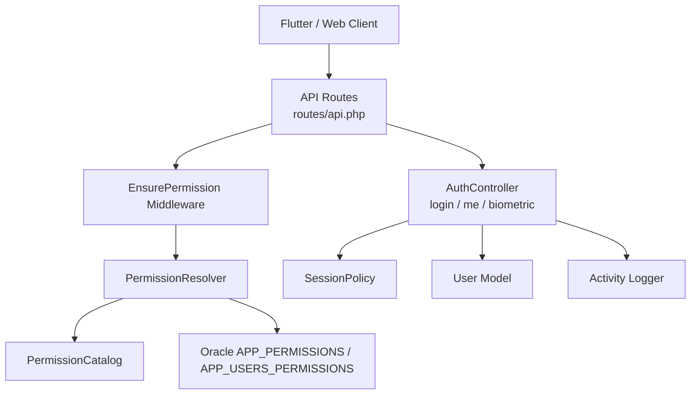
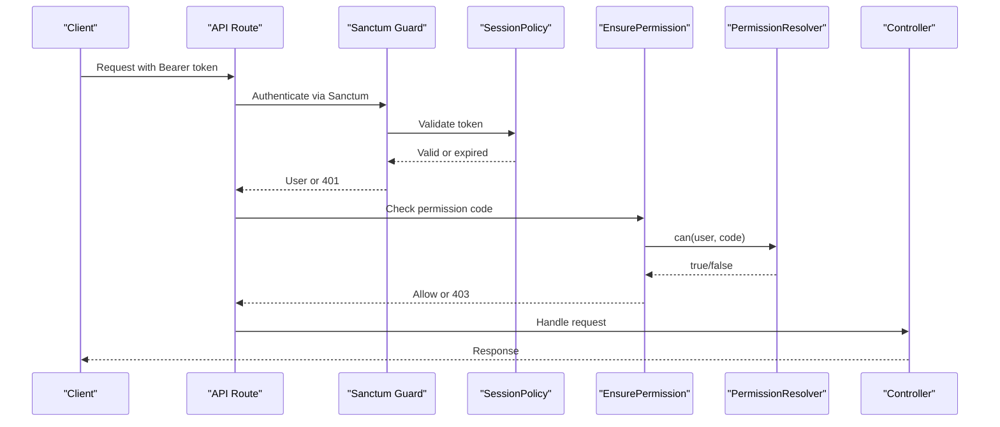
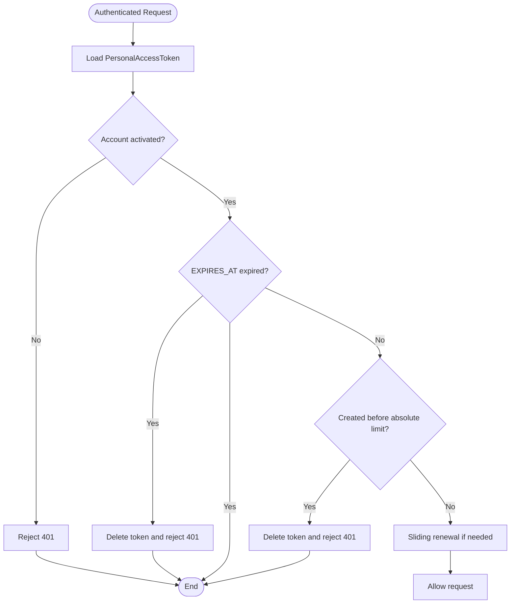
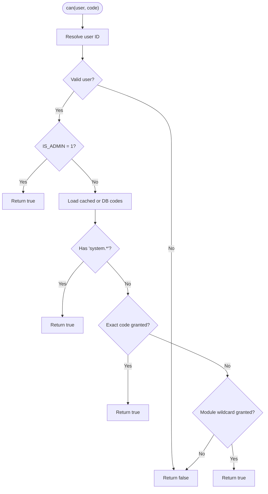
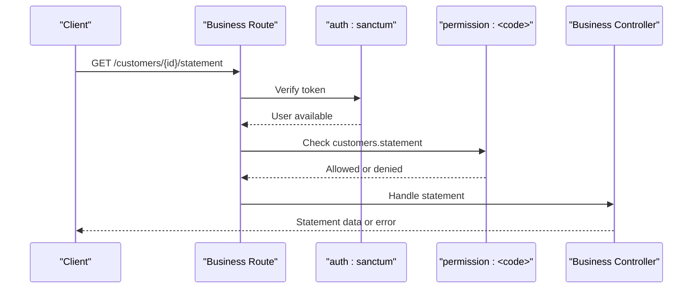
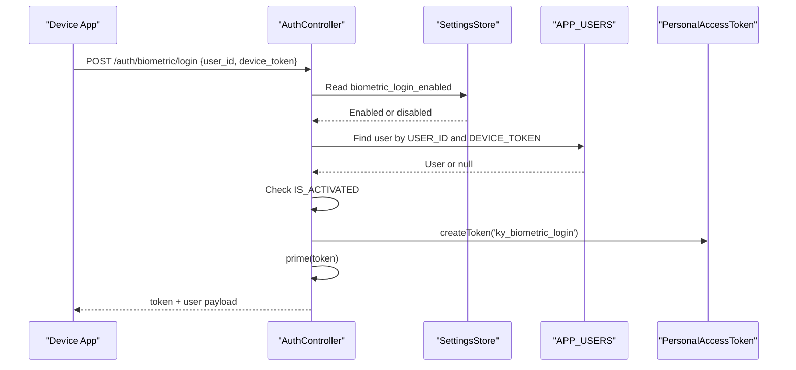
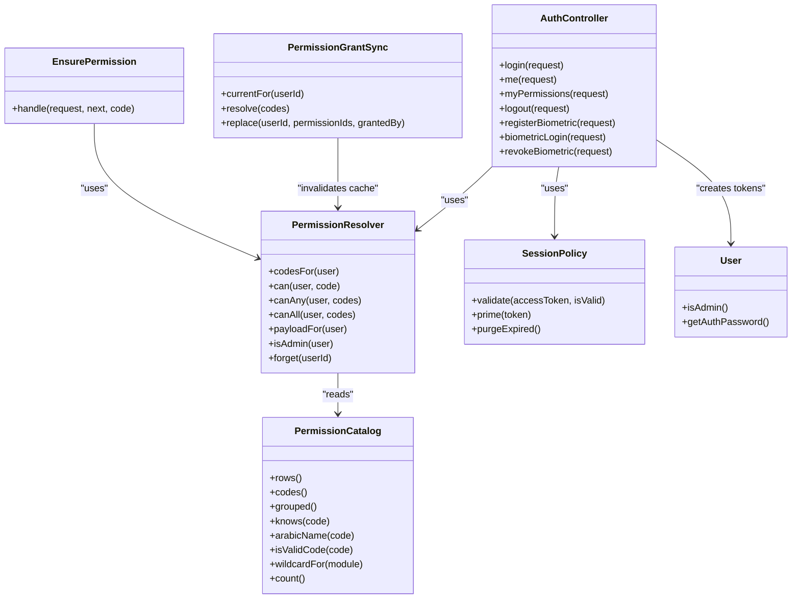

# Authentication & Authorization

<cite>
**Referenced Files in This Document**   
- [sanctum.php](file://kyApp_API/config/sanctum.php)
- [auth.php](file://kyApp_API/config/auth.php)
- [api.php](file://kyApp_API/routes/api.php)
- [AuthController.php](file://kyApp_API/app/Http/Controllers/AuthController.php)
- [EnsurePermission.php](file://kyApp_API/app/Http/Middleware/EnsurePermission.php)
- [PermissionResolver.php](file://kyApp_API/app\Support\PermissionResolver.php)
- [PermissionCatalog.php](file://kyApp_API/app\Support\PermissionCatalog.php)
- [PermissionGrantSync.php](file://kyApp_API/app\Support\PermissionGrantSync.php)
- [SessionPolicy.php](file://kyApp_API/app\Support\SessionPolicy.php)
- [User.php](file://kyApp_API/app/Models/User.php)
- [01_ibac_schema.sql](file://kyApp_API/database/oracle/01_ibac_schema.sql)
- [02_ibac_seed.php](file://kyApp_API/database/oracle/02_ibac_seed.php)
- [03_ibac_bootstrap.php](file://kyApp_API/database/oracle/03_ibac_bootstrap.php)
</cite>

## Table of Contents
1. [Introduction](#introduction)
2. [Project Structure](#project-structure)
3. [Core Components](#core-components)
4. [Architecture Overview](#architecture-overview)
5. [Detailed Component Analysis](#detailed-component-analysis)
6. [Dependency Analysis](#dependency-analysis)
7. [Performance Considerations](#performance-considerations)
8. [Troubleshooting Guide](#troubleshooting-guide)
9. [Conclusion](#conclusion)
10. [Appendices](#appendices)

## Introduction
This document explains the authentication and authorization system used by the application. It covers:

- Laravel Sanctum configuration for API authentication, token lifecycle, and session handling.
- The custom Identity-Based Access Control (IBAC) model: permission codes, grant storage, resolution rules, and catalog-driven administration.
- The `EnsurePermission` middleware and how every protected route enforces deny-by-default access control.
- Token management, sliding session renewal, idle expiry, absolute lifetime, and biometric login.
- Practical guidance for adding permissions, implementing role-like behavior through grants, securing endpoints, and integrating multi-factor flows.

The system is built around two layers:

1. **Authentication layer**: Sanctum issues personal access tokens; `SessionPolicy` validates and renews them.
2. **Authorization layer**: IBAC resolves whether a user may perform an action based on explicit grants, module wildcards, or the system administrator flag.

## Project Structure
The authentication and authorization logic lives primarily under `kyApp_API`:

| Area | Responsibility |
|---|---|
| `config/sanctum.php` | Sanctum stateful domains, guard, expiration policy, last-used tracking, token prefix, and middleware aliases. |
| `config/auth.php` | Default guard and Eloquent user provider pointing to the Oracle-backed `User` model. |
| `routes/api.php` | Public login routes, Sanctum-protected groups, and per-route `permission:<code>` gates. |
| `app/Http/Controllers/AuthController.php` | Password login, biometric login, logout, device registration, `/auth/me`, and permission payload delivery. |
| `app/Http/Middleware/EnsurePermission.php` | Deny-by-default gate that checks the current user against `PermissionResolver`. |
| `app/Support/PermissionResolver.php` | Core IBAC resolver with caching, admin bypass, wildcard support, and client payload generation. |
| `app/Support/PermissionCatalog.php` | Canonical definition of modules, actions, labels, valid code formats, and seed rows. |
| `app/Support/PermissionGrantSync.php` | Single write path for `APP_USERS_PERMISSIONS`, including validation, mapping, transactional replacement, and cache invalidation. |
| `app/Support/SessionPolicy.php` | Sliding session renewal, idle expiry, absolute lifetime, and best-effort cleanup of expired tokens. |
| `app/Models/User.php` | Oracle-backed Eloquent model with Sanctum tokens, admin flag, biometric fields, and case-tolerant attribute access. |
| `database/oracle/01_ibac_schema.sql` | IBAC schema: users, permissions, grants, settings, activity log, sequences, triggers, and indexes. |
| `database/oracle/02_ibac_seed.php` | Idempotent seed for permission catalog rows and security/session settings. |
| `database/oracle/03_ibac_bootstrap.php` | Final bootstrap: bilingual comments, first administrator promotion, and initial `system.*` grant. |

**Diagram sources**
- [api.php:17-34](file://kyApp_API/routes/api.php#L17-L34)
- [api.php:45-88](file://kyApp_API/routes/api.php#L45-L88)
- [api.php:138-142](file://kyApp_API/routes/api.php#L138-L142)
- [AuthController.php:47-164](file://kyApp_API/app/Http/Controllers/AuthController.php#L47-L164)
- [EnsurePermission.php:25-52](file://kyApp_API/app/Http/Middleware/EnsurePermission.php#L25-L52)
- [PermissionResolver.php:27-132](file://kyApp_API/app\Support\PermissionResolver.php#L27-L132)
- [PermissionCatalog.php:22-237](file://kyApp_API/app\Support\PermissionCatalog.php#L22-L237)
- [SessionPolicy.php:42-108](file://kyApp_API/app\Support\SessionPolicy.php#L42-L108)
- [User.php:10-167](file://kyApp_API/app/Models/User.php#L10-L167)

**Section sources**
- [sanctum.php:8-111](file://kyApp_API/config/sanctum.php#L8-L111)
- [auth.php:40-68](file://kyApp_API/config/auth.php#L40-L68)
- [api.php:17-327](file://kyApp_API/routes/api.php#L17-L327)

## Core Components
The system has five core components:

| Component | Purpose | Key Behavior |
|---|---|---|
| Sanctum + SessionPolicy | Authenticate requests and manage token lifetimes | Stateless API tokens with sliding renewal and idle expiry driven by settings. |
| PermissionCatalog | Define all valid permission codes and labels | Single source of truth for modules, core actions, extra actions, and wildcard forms. |
| PermissionResolver | Resolve effective permissions at runtime | Admin bypass, `system.*`, exact match, module wildcard, cache, and client payload. |
| EnsurePermission | Enforce per-route authorization | Returns 401 if unauthenticated, 403 if permission missing. |
| PermissionGrantSync | Write grants safely | Validates codes, maps to IDs, replaces grants atomically, invalidates cache. |

**Section sources**
- [PermissionCatalog.php:22-480](file://kyApp_API/app\Support\PermissionCatalog.php#L22-L480)
- [PermissionResolver.php:27-275](file://kyApp_API/app\Support\PermissionResolver.php#L27-L275)
- [EnsurePermission.php:11-52](file://kyApp_API/app/Http/Middleware/EnsurePermission.php#L11-L52)
- [PermissionGrantSync.php:7-191](file://kyApp_API/app\Support\PermissionGrantSync.php#L7-L191)
- [SessionPolicy.php:9-185](file://kyApp_API/app\Support\SessionPolicy.php#L9-L185)

## Architecture Overview
At request time, the flow is layered:

1. **Sanctum authenticates** using the `web` guard and personal access tokens.
2. **SessionPolicy validates** the token’s activation, idle expiry, absolute lifetime, and performs sliding renewal.
3. **EnsurePermission checks** the requested permission code.
4. **PermissionResolver evaluates** the grant rules and returns allow/deny.
5. **Controller handles** business logic only after both authentication and authorization pass.

**Diagram sources**
- [api.php:17-34](file://kyApp_API/routes/api.php#L17-L34)
- [api.php:45-88](file://kyApp_API/routes/api.php#L45-L88)
- [api.php:138-142](file://kyApp_API/routes/api.php#L138-L142)
- [AuthController.php:47-164](file://kyApp_API/app/Http/Controllers/AuthController.php#L47-L164)
- [SessionPolicy.php:70-108](file://kyApp_API/app\Support\SessionPolicy.php#L70-L108)
- [EnsurePermission.php:32-52](file://kyApp_API/app/Http/Middleware/EnsurePermission.php#L32-L52)
- [PermissionResolver.php:95-132](file://kyApp_API/app\Support\PermissionResolver.php#L95-L132)

## Detailed Component Analysis

### Laravel Sanctum Configuration
Sanctum is configured for SPA-style stateful sessions and bearer-token API authentication:

- **Stateful domains**: Localhost, common development hosts, and the current application URL are allowed to receive stateful cookies.
- **Guard**: Uses the `web` guard.
- **Expiration**: Explicitly `null`. Absolute age is not enforced by Sanctum’s default guard because the application uses `EXPIRES_AT` managed by `SessionPolicy`.
- **Last used at**: Enabled so active-session screens can show real last activity.
- **Token prefix**: Optional environment-based prefix for secret scanning.
- **Middleware aliases**: Sanctum’s session authentication, cookie encryption, and CSRF validation are aliased for first-party SPA usage.

Important design note: setting `expiration` to a number would make Sanctum compare it against `created_at`, which would forcibly disconnect active users. Idle expiry and sliding renewal are instead implemented through `SessionPolicy` and the `EXPIRES_AT` column.

**Section sources**
- [sanctum.php:21-26](file://kyApp_API/config/sanctum.php#L21-L26)
- [sanctum.php:40-40](file://kyApp_API/config/sanctum.php#L40-L40)
- [sanctum.php:47-63](file://kyApp_API/config/sanctum.php#L47-L63)
- [sanctum.php:69-77](file://kyApp_API/config/sanctum.php#L69-L77)
- [sanctum.php:92-109](file://kyApp_API/config/sanctum.php#L92-L109)

### Token Management and Session Handling
Token issuance and lifecycle are handled by `AuthController` and `SessionPolicy`:

- Login creates a Sanctum personal access token named after the user type.
- Biometric login also creates a token but uses a distinct name.
- Every issued token is immediately primed with a full idle window.
- Expired tokens are purged after successful sign-in.
- On each authenticated request, `SessionPolicy::validate` runs:
  - Rejects deactivated accounts.
  - Rejects expired idle sessions.
  - Rejects tokens older than the absolute lifetime.
  - Performs write-throttled sliding renewal.
- Logout deletes the current token.
- `/auth/me` returns the user profile plus IBAC state and current session expiry.

**Diagram sources**
- [AuthController.php:142-164](file://kyApp_API/app/Http/Controllers/AuthController.php#L142-L164)
- [AuthController.php:221-239](file://kyApp_API/app/Http/Controllers/AuthController.php#L221-L239)
- [AuthController.php:392-410](file://kyApp_API/app/Http/Controllers/AuthController.php#L392-L410)
- [SessionPolicy.php:70-108](file://kyApp_API/app\Support\SessionPolicy.php#L70-L108)
- [SessionPolicy.php:114-117](file://kyApp_API/app/Support\SessionPolicy.php#L114-L117)
- [SessionPolicy.php:130-141](file://kyApp_API/app/Support\SessionPolicy.php#L130-L141)
- [SessionPolicy.php:166-183](file://kyApp_API/app/Support\SessionPolicy.php#L166-L183)

**Section sources**
- [AuthController.php:47-164](file://kyApp_API/app/Http/Controllers/AuthController.php#L47-L164)
- [AuthController.php:170-215](file://kyApp_API/app/Http/Controllers/AuthController.php#L170-L215)
- [AuthController.php:221-239](file://kyApp_API/app/Http/Controllers/AuthController.php#L221-L239)
- [SessionPolicy.php:42-185](file://kyApp_API/app\Support\SessionPolicy.php#L42-L185)

### Custom IBAC System: Permission Resolution
The IBAC system is identity-based: permissions are granted directly to users, not roles. Resolution follows a strict order:

1. If the user is a system administrator (`IS_ADMIN = 1`), allow.
2. If the user has `system.*`, allow.
3. If the exact permission code is granted, allow.
4. If the module wildcard `<module>.*` is granted, allow.
5. Otherwise, deny.

Grants are considered valid only when both the grant row and the permission row are active and not expired.

**Diagram sources**
- [PermissionResolver.php:95-132](file://kyApp_API/app\Support\PermissionResolver.php#L95-L132)
- [PermissionResolver.php:206-218](file://kyApp_API/app\Support\PermissionResolver.php#L206-L218)
- [PermissionResolver.php:235-251](file://kyApp_API/app\Support\PermissionResolver.php#L235-L251)

**Section sources**
- [PermissionResolver.php:9-275](file://kyApp_API/app\Support\PermissionResolver.php#L9-L275)

### Permission Catalog
The permission catalog is the single source of truth for:

- Module definitions.
- Core actions: `view`, `create`, `update`, `delete`.
- Extra actions such as `print`, `export`, `statement`, `toggle`, `structure_manage`, `prices_view`, `prices_manage`, `permissions_manage`, `activity_view`, `admin_flag_manage`, `terminate`, `security_manage`, `api_manage`.
- Wildcard forms: `<module>.*` and `system.*`.
- Arabic and English labels.
- Seed rows for `APP_PERMISSIONS`.
- Validation of permission codes.

The catalog ensures that database seeds, server-side validation, and UI permission pickers never drift apart.

**Section sources**
- [PermissionCatalog.php:5-21](file://kyApp_API/app\Support\PermissionCatalog.php#L5-L21)
- [PermissionCatalog.php:22-237](file://kyApp_API/app\Support\PermissionCatalog.php#L22-L237)
- [PermissionCatalog.php:256-344](file://kyApp_API/app\Support\PermissionCatalog.php#L256-L344)
- [PermissionCatalog.php:377-480](file://kyApp_API/app\Support\PermissionCatalog.php#L377-L480)

### EnsurePermission Middleware
`EnsurePermission` is the enforcement point for every secured route:

- If no authenticated user exists, return 401.
- If `PermissionResolver::can` denies the request, return 403 with a user-facing Arabic label from the catalog.
- Otherwise, pass the request to the controller.
- Administrators always pass because `PermissionResolver` short-circuits on `IS_ADMIN`.

Routes use the alias `permission:<code>` inside Sanctum-protected groups.

**Section sources**
- [EnsurePermission.php:11-52](file://kyApp_API/app/Http/Middleware/EnsurePermission.php#L11-L52)
- [api.php:45-88](file://kyApp_API/routes/api.php#L45-L88)
- [api.php:138-142](file://kyApp_API/routes/api.php#L138-L142)

### Permission Codes System
Permission codes follow the pattern `<module>.<action>`:

- Lowercase module and action.
- One dot separator.
- Wildcards allowed only as `<module>.*` or `system.*`.
- Unknown modules are rejected by `isValidCode`.
- The catalog generates sortable rows with core actions before extra actions.

Examples already present include:

- `customers.view`, `customers.create`, `customers.update`, `customers.delete`
- `customers.statement`
- `employees.view`, `cutters.view`, `tailors.view`
- `accounts.structure_manage`, `accounts.statement`
- `currencies.prices_view`, `currencies.prices_manage`
- `sessions.terminate`
- `settings.security_manage`
- `system.*`

**Section sources**
- [PermissionCatalog.php:18-21](file://kyApp_API/app\Support\PermissionCatalog.php#L18-L21)
- [PermissionCatalog.php:27-40](file://kyApp_API/app\Support\PermissionCatalog.php#L27-L40)
- [PermissionCatalog.php:447-469](file://kyApp_API/app\Support\PermissionCatalog.php#L447-L469)
- [api.php:154-155](file://kyApp_API/routes/api.php#L154-L155)

### Grant Management
Grant management is centralized in `PermissionGrantSync`:

- `currentFor` reads a user’s active grants with IDs and codes.
- `resolve` validates requested codes, separates unknown and inactive codes, and maps valid codes to permission IDs.
- `replace` atomically deletes all existing grants for a user, inserts new ones, and invalidates the resolver cache.
- All queries are fully bound; no string interpolation is used.

This separation keeps `PermissionResolver` read-only and centralizes escalation guards and cache invalidation in controllers.

**Section sources**
- [PermissionGrantSync.php:7-191](file://kyApp_API/app\Support\PermissionGrantSync.php#L7-L191)
- [PermissionResolver.php:220-227](file://kyApp_API/app\Support\PermissionResolver.php#L220-L227)

### Securing API Endpoints
Every business endpoint is behind two layers:

1. `auth:sanctum` — verifies the token and loads the user.
2. `permission:<code>` — verifies the specific action.

Examples:

- Invoice listing requires `invoices.view`.
- Customer listing requires `customers.view`; customer statement requires `customers.statement`.
- Worker endpoints are split into `employees`, `cutters`, and `tailors`.
- Account structure changes require `accounts.structure_manage`; financial statements require `accounts.statement`.
- Currency directory operations require `currencies.*`; exchange rate operations require `currencies.prices_*`.
- Diagnostic table query requires `system.*`.

**Diagram sources**
- [api.php:160-179](file://kyApp_API/routes/api.php#L160-L179)
- [api.php:189-243](file://kyApp_API/routes/api.php#L189-L243)
- [api.php:255-291](file://kyApp_API/routes/api.php#L255-L291)
- [api.php:302-326](file://kyApp_API/routes/api.php#L302-L326)
- [EnsurePermission.php:32-52](file://kyApp_API/app/Http/Middleware/EnsurePermission.php#L32-L52)

**Section sources**
- [api.php:17-327](file://kyApp_API/routes/api.php#L17-L327)

### Biometric Authentication Integration
Biometric login is supported as a separate flow:

- Device registration stores `DEVICE_TOKEN`, `DEVICE_NAME`, `PLATFORM`, and enables `BIOMETRIC_ENABLED`.
- Biometric login requires `user_id` and `device_token`.
- A global kill switch `biometric_login_enabled` can disable the entire flow.
- The same user must own both the account and the device token.
- Deactivated accounts cannot log in via biometrics.
- Successful biometric login issues a token with the same session policy as password login.
- Revoke clears biometric enrollment fields.

**Diagram sources**
- [api.php:21-23](file://kyApp_API/routes/api.php#L21-L23)
- [AuthController.php:241-310](file://kyApp_API/app/Http/Controllers/AuthController.php#L241-L310)
- [AuthController.php:316-410](file://kyApp_API/app/Http/Controllers/AuthController.php#L316-L410)
- [AuthController.php:417-441](file://kyApp_API/app/Http/Controllers/AuthController.php#L417-L441)

**Section sources**
- [AuthController.php:241-441](file://kyApp_API/app/Http/Controllers/AuthController.php#L241-L441)
- [02_ibac_seed.php:177-187](file://kyApp_API/database/oracle/02_ibac_seed.php#L177-L187)

### Multi-Factor Authentication Flows
The repository implements:

- Two-factor style flows through Sanctum tokens and session policy.
- Biometric authentication as a second factor alternative to passwords.
- No explicit OTP, TOTP, or SMS verification implementation is visible in the analyzed files.

A practical multi-factor extension would add:

- A secondary challenge step after password or biometric verification.
- A temporary session state indicating “second factor pending”.
- A dedicated endpoint to verify the second factor.
- A final endpoint that promotes the pending state into a full token.

This should be implemented as a new controller method and route group rather than modifying the existing password or biometric flows directly.

[No sources needed since this section proposes conceptual extensions not present in the analyzed files]

### Adding New Permissions
To add a new permission:

1. Add the module or action to `PermissionCatalog`.
2. Run the seed script to update `APP_PERMISSIONS`.
3. Apply the new `permission:<code>` middleware to the relevant route.
4. Grant the permission to users through the administration interface or `PermissionGrantSync`.
5. Clear or refresh the resolver cache if testing with cached grants.

Example pattern:

- New module: add its core and extra actions in the catalog.
- New action: add it under an existing module’s `extra` list.
- Route protection: attach `->middleware('permission:<module>.<action>')`.

**Section sources**
- [PermissionCatalog.php:52-237](file://kyApp_API/app\Support\PermissionCatalog.php#L52-L237)
- [PermissionCatalog.php:271-344](file://kyApp_API/app\Support\PermissionCatalog.php#L271-L344)
- [PermissionCatalog.php:447-469](file://kyApp_API/app\Support\PermissionCatalog.php#L447-L469)
- [02_ibac_seed.php:281-291](file://kyApp_API/database/oracle/02_ibac_seed.php#L281-L291)
- [api.php:160-179](file://kyApp_API/routes/api.php#L160-L179)

### Implementing Role-Based Access Control
The current system is IBAC, not RBAC. There are no role tables or role-to-permission mappings. However, you can simulate roles by creating reusable grant sets:

- Create a named set of permission codes in your application layer.
- When assigning a “role”, insert the corresponding permission IDs into `APP_USERS_PERMISSIONS`.
- Use `PermissionGrantSync::replace` to assign a complete set.
- Keep the role definition in application code so it stays consistent across deployments.

This approach preserves the deny-by-default model while giving administrators a higher-level abstraction over direct grants.

**Section sources**
- [PermissionGrantSync.php:122-163](file://kyApp_API/app\Support\PermissionGrantSync.php#L122-L163)
- [PermissionResolver.php:9-26](file://kyApp_API/app\Support\PermissionResolver.php#L9-L26)

### Database Schema for IBAC
The Oracle schema defines:

| Table | Purpose |
|---|---|
| `APP_PERMISSIONS` | Canonical permission catalog with codes, labels, core/extras, and sort order. |
| `APP_USERS_PERMISSIONS` | Direct grants from users to permissions, with optional expiry and active flag. |
| `APP_SETTINGS` | Security and session settings editable from the UI. |
| `APP_USER_ACTIVITY` | Lightweight audit trail for authentication, user management, sessions, and settings. |
| `APP_USERS` | Extended with `IS_ADMIN`, wider password column, and biometric-related columns. |

Indexes and triggers provide performance and auto-generated IDs.

**Section sources**
- [01_ibac_schema.sql:21-107](file://kyApp_API/database/oracle/01_ibac_schema.sql#L21-L107)
- [01_ibac_schema.sql:114-184](file://kyApp_API/database/oracle/01_ibac_schema.sql#L114-L184)
- [01_ibac_schema.sql:186-207](file://kyApp_API/database/oracle/01_ibac_schema.sql#L186-L207)

## Dependency Analysis
The following diagram shows how the main components depend on each other:

**Diagram sources**
- [AuthController.php:36-41](file://kyApp_API/app/Http/Controllers/AuthController.php#L36-L41)
- [EnsurePermission.php:25-27](file://kyApp_API/app/Http/Middleware/EnsurePermission.php#L25-L27)
- [PermissionResolver.php:27-33](file://kyApp_API/app\Support\PermissionResolver.php#L27-L33)
- [PermissionCatalog.php:22-28](file://kyApp_API/app\Support\PermissionCatalog.php#L22-L28)
- [PermissionGrantSync.php:20-32](file://kyApp_API/app\Support\PermissionGrantSync.php#L20-L32)
- [SessionPolicy.php:42-44](file://kyApp_API/app\Support\SessionPolicy.php#L42-L44)
- [User.php:114-117](file://kyApp_API/app/Models/User.php#L114-L117)

**Section sources**
- [AuthController.php:34-494](file://kyApp_API/app/Http/Controllers/AuthController.php#L34-L494)
- [EnsurePermission.php:1-54](file://kyApp_API/app/Http/Middleware/EnsurePermission.php#L1-L54)
- [PermissionResolver.php:1-275](file://kyApp_API/app\Support\PermissionResolver.php#L1-L275)
- [PermissionCatalog.php:1-480](file://kyApp_API/app\Support\PermissionCatalog.php#L1-L480)
- [PermissionGrantSync.php:1-191](file://kyApp_API/app\Support\PermissionGrantSync.php#L1-L191)
- [SessionPolicy.php:1-185](file://kyApp_API/app\Support\SessionPolicy.php#L1-L185)
- [User.php:1-167](file://kyApp_API/app/Models/User.php#L1-L167)

## Performance Considerations
Key performance characteristics:

- **Permission cache**: `PermissionResolver` caches a user’s permission codes for a fixed TTL.
- **Cache size guard**: Oversized permission sets skip the cache to avoid Oracle bind-size limits.
- **Sliding renewal threshold**: Token updates are throttled to reduce database writes.
- **Best-effort cleanup**: Expired token deletion failures do not block authentication.
- **Deny-by-default**: Fast-path denial avoids unnecessary controller work.

Recommendations:

- Monitor `session_idle_minutes` and `session_touch_threshold_minutes` to balance security and database load.
- Avoid granting `system.*` broadly; prefer precise module permissions.
- Use `myPermissions` after grant changes to force fresh resolution.
- Keep permission catalogs small and focused to reduce cache payloads.

**Section sources**
- [PermissionResolver.php:29-43](file://kyApp_API/app\Support\PermissionResolver.php#L29-L43)
- [PermissionResolver.php:74-89](file://kyApp_API/app\Support\PermissionResolver.php#L74-L89)
- [SessionPolicy.php:157-183](file://kyApp_API/app\Support\SessionPolicy.php#L157-L183)
- [SessionPolicy.php:130-141](file://kyApp_API/app\Support\SessionPolicy.php#L130-L141)

## Troubleshooting Guide

### Common Issues

| Symptom | Likely Cause | Resolution |
|---|---|---|
| 401 Unauthenticated | Missing or invalid Sanctum token | Ensure the client sends the Bearer token and the route is under `auth:sanctum`. |
| 403 Permission denied | User lacks the required permission code | Grant the correct `<module>.<action>` code or use a module wildcard. |
| Admin still denied | `IS_ADMIN` not set or resolver cache stale | Promote the user via bootstrap or grant `system.*`, then refresh permissions. |
| Token expires too quickly | Idle expiry or absolute lifetime misconfigured | Adjust `session_idle_minutes` and `session_absolute_days`. |
| Biometric login blocked globally | `biometric_login_enabled` is disabled | Enable it in security settings. |
| Biometric login fails | Device token does not belong to the user | Re-enroll the device or verify `USER_ID` matches `DEVICE_TOKEN`. |
| Permission change not reflected | Resolver cache still holds old codes | Call `/auth/permissions` or clear the resolver cache. |

**Section sources**
- [EnsurePermission.php:32-52](file://kyApp_API/app/Http/Middleware/EnsurePermission.php#L32-L52)
- [AuthController.php:190-215](file://kyApp_API/app/Http/Controllers/AuthController.php#L190-L215)
- [SessionPolicy.php:70-108](file://kyApp_API/app\Support\SessionPolicy.php#L70-L108)
- [AuthController.php:334-347](file://kyApp_API/app/Http/Controllers/AuthController.php#L334-L347)
- [AuthController.php:352-371](file://kyApp_API/app/Http/Controllers/AuthController.php#L352-L371)

## Conclusion
The application uses a layered security model:

- Sanctum provides API authentication and token handling.
- `SessionPolicy` adds production-grade session semantics: sliding renewal, idle expiry, absolute lifetime, and cleanup.
- IBAC provides fine-grained, deny-by-default authorization through explicit user grants.
- `PermissionCatalog` is the canonical source for permission codes and labels.
- `EnsurePermission` enforces authorization at the route level.
- Biometric login integrates securely with the same token and session policy as password login.

For future evolution, keep permissions explicit, avoid broad `system.*` grants, and extend multi-factor flows through dedicated controller methods rather than mutating existing authentication paths.

[No sources needed since this section summarizes without analyzing specific files]

## Appendices

### Practical Examples

#### Example: Secure a New Endpoint
1. Define the permission code in `PermissionCatalog`.
2. Seed the database.
3. Protect the route with `auth:sanctum` and `permission:<code>`.
4. Grant the permission to the appropriate users.

#### Example: Add a New Module
1. Add the module entry with core and extra actions.
2. Generate catalog rows.
3. Seed `APP_PERMISSIONS`.
4. Gate routes with the new codes.

#### Example: Simulate a Role
1. Define a set of permission codes representing the role.
2. Map codes to permission IDs using `PermissionGrantSync::resolve`.
3. Replace the user’s grants using `PermissionGrantSync::replace`.
4. Refresh the resolver cache.

**Section sources**
- [PermissionCatalog.php:271-344](file://kyApp_API/app\Support\PermissionCatalog.php#L271-L344)
- [PermissionGrantSync.php:77-120](file://kyApp_API/app\Support\PermissionGrantSync.php#L77-L120)
- [PermissionGrantSync.php:134-163](file://kyApp_API/app\Support\PermissionGrantSync.php#L134-L163)
- [api.php:160-179](file://kyApp_API/routes/api.php#L160-L179)