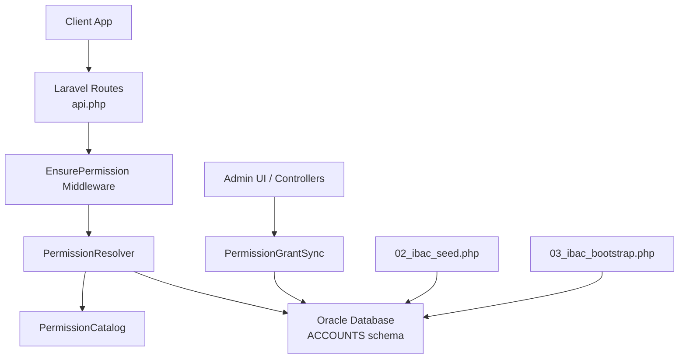
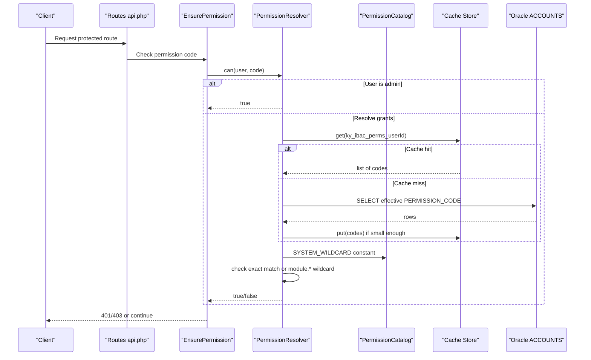
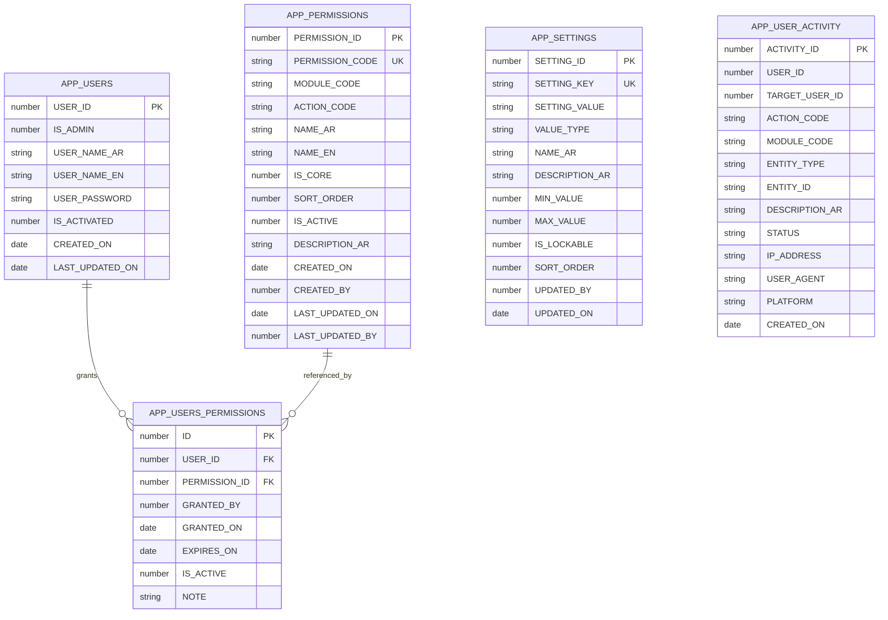
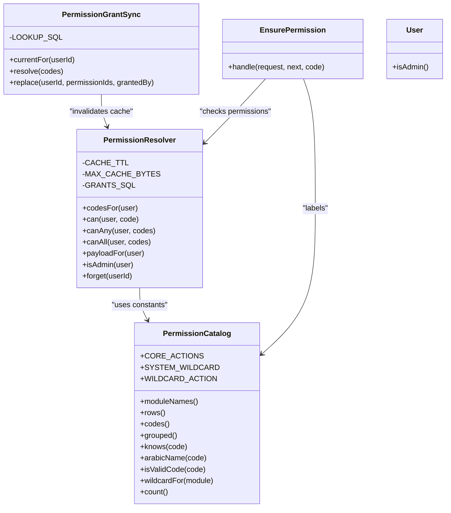

# IBAC Permission System

<cite>
**Referenced Files in This Document**
- [PermissionCatalog.php](file://kyApp_API/app/Support/PermissionCatalog.php)
- [PermissionResolver.php](file://kyApp_API/app/Support/PermissionResolver.php)
- [PermissionGrantSync.php](file://kyApp_API/app/Support/PermissionGrantSync.php)
- [EnsurePermission.php](file://kyApp_API/app/Http/Middleware/EnsurePermission.php)
- [User.php](file://kyApp_API/app/Models/User.php)
- [01_ibac_schema.sql](file://kyApp_API/database/oracle/01_ibac_schema.sql)
- [02_ibac_seed.php](file://kyApp_API/database/oracle/02_ibac_seed.php)
- [03_ibac_bootstrap.php](file://kyApp_API/database/oracle/03_ibac_bootstrap.php)
- [api.php](file://kyApp_API/routes/api.php)
</cite>

## Table of Contents
1. [Introduction](#introduction)
2. [Project Structure](#project-structure)
3. [Core Components](#core-components)
4. [Architecture Overview](#architecture-overview)
5. [Detailed Component Analysis](#detailed-component-analysis)
6. [Dependency Analysis](#dependency-analysis)
7. [Performance Considerations](#performance-considerations)
8. [Troubleshooting Guide](#troubleshooting-guide)
9. [Conclusion](#conclusion)
10. [Appendices](#appendices)

## Introduction
This document explains the custom Identity-Based Access Control (IBAC) system implemented for the application. The system grants permissions directly to users, without roles, using a canonical permission catalog, an Oracle-backed schema, and a runtime resolver with caching. It covers how permissions are defined, stored, granted, evaluated, and enforced across the application lifecycle, including practical guidance for extending the system.

## Project Structure
The IBAC implementation is centered in the Laravel backend under `app/Support`, integrated through HTTP middleware, backed by Oracle database objects, and initialized by seed/bootstrap scripts.

**Diagram sources**
- [api.php:50-145](file://kyApp_API/routes/api.php#L50-L145)
- [EnsurePermission.php:25-52](file://kyApp_API/app/Http/Middleware/EnsurePermission.php#L25-L52)
- [PermissionResolver.php:27-273](file://kyApp_API/app/Support/PermissionResolver.php#L27-L273)
- [PermissionCatalog.php:22-478](file://kyApp_API/app/Support/PermissionCatalog.php#L22-L478)
- [PermissionGrantSync.php:20-190](file://kyApp_API/app/Support/PermissionGrantSync.php#L20-L190)
- [01_ibac_schema.sql:38-100](file://kyApp_API/database/oracle/01_ibac_schema.sql#L38-L100)
- [02_ibac_seed.php:36-89](file://kyApp_API/database/oracle/02_ibac_seed.php#L36-L89)
- [03_ibac_bootstrap.php:131-185](file://kyApp_API/database/oracle/03_ibac_bootstrap.php#L131-L185)

**Section sources**
- [api.php:50-145](file://kyApp_API/routes/api.php#L50-L145)
- [EnsurePermission.php:11-52](file://kyApp_API/app/Http/Middleware/EnsurePermission.php#L11-L52)
- [PermissionResolver.php:9-273](file://kyApp_API/app/Support/PermissionResolver.php#L9-L273)
- [PermissionCatalog.php:5-478](file://kyApp_API/app/Support/PermissionCatalog.php#L5-L478)
- [PermissionGrantSync.php:7-190](file://kyApp_API/app/Support/PermissionGrantSync.php#L7-L190)
- [01_ibac_schema.sql:21-100](file://kyApp_API/database/oracle/01_ibac_schema.sql#L21-L100)
- [02_ibac_seed.php:1-310](file://kyApp_API/database/oracle/02_ibac_seed.php#L1-L310)
- [03_ibac_bootstrap.php:1-227](file://kyApp_API/database/oracle/03_ibac_bootstrap.php#L1-L227)

## Core Components
- **PermissionCatalog**: Canonical source of truth for permission codes, module definitions, labels, wildcards, and validation rules.
- **PermissionResolver**: Runtime evaluator that determines whether a user has a permission, with admin bypass, wildcard support, and per-user caching.
- **PermissionGrantSync**: Write-only path for granting permissions, resolving codes to IDs, validating unknown/inactive permissions, and atomically replacing grants while invalidating cache.
- **EnsurePermission**: Route-level middleware enforcing deny-by-default access control using the resolver.
- **User model**: Legacy Oracle user table mapping, including the `IS_ADMIN` flag used for admin bypass.
- **Oracle schema and scripts**: Define tables, sequences, triggers, indexes, seed data, and bootstrap behavior.

**Section sources**
- [PermissionCatalog.php:22-478](file://kyApp_API/app/Support/PermissionCatalog.php#L22-L478)
- [PermissionResolver.php:27-273](file://kyApp_API/app/Support/PermissionResolver.php#L27-L273)
- [PermissionGrantSync.php:20-190](file://kyApp_API/app/Support/PermissionGrantSync.php#L20-L190)
- [EnsurePermission.php:25-52](file://kyApp_API/app/Http/Middleware/EnsurePermission.php#L25-L52)
- [User.php:10-166](file://kyApp_API/app/Models/User.php#L10-L166)
- [01_ibac_schema.sql:38-100](file://kyApp_API/database/oracle/01_ibac_schema.sql#L38-L100)

## Architecture Overview
The IBAC system follows a clear separation between definition, storage, evaluation, and enforcement:

- Definition lives in `PermissionCatalog`.
- Storage lives in Oracle tables `APP_PERMISSIONS` and `APP_USERS_PERMISSIONS`.
- Evaluation happens in `PermissionResolver`, which reads active grants and applies resolution rules.
- Enforcement happens at routes via `EnsurePermission`.
- Administration writes go through `PermissionGrantSync`, which ensures consistency and cache invalidation.

**Diagram sources**
- [api.php:50-145](file://kyApp_API/routes/api.php#L50-L145)
- [EnsurePermission.php:32-52](file://kyApp_API/app/Http/Middleware/EnsurePermission.php#L32-L52)
- [PermissionResolver.php:66-132](file://kyApp_API/app/Support/PermissionResolver.php#L66-L132)
- [PermissionCatalog.php:31-40](file://kyApp_API/app/Support/PermissionCatalog.php#L31-L40)
- [01_ibac_schema.sql:49-58](file://kyApp_API/database/oracle/01_ibac_schema.sql#L49-L58)

## Detailed Component Analysis

### PermissionCatalog
`PermissionCatalog` is the single source of truth for all permission metadata. It defines:
- Module names and ordering.
- Core actions (`view`, `create`, `update`, `delete`) and extra actions per module.
- Wildcard constants (`system.*` and module-level `module.*`).
- Methods to generate rows for seeding, validate codes, build grouped UI payloads, and provide Arabic labels.

Key behaviors:
- `rows()` generates the full set of permission rows ready for insertion into `APP_PERMISSIONS`.
- `codes()` enumerates every valid permission code, including wildcards.
- `isValidCode()` enforces lowercase module/action format and rejects partial wildcards.
- `wildcardFor(module)` returns the correct wildcard code when the module exists.
- `arabicName(code)` returns a user-facing label; unknown codes fall back to raw code to avoid leaking internal naming.

Complexity:
- Generating rows and grouping is linear in the number of modules and actions.
- Validation uses regex and array lookup; overall efficient for typical catalog sizes.

Extension guidance:
- Add a new module by adding an entry to the internal `MODULES` array with core and extra actions.
- New actions automatically produce both explicit codes and module-level wildcard rows.
- Use `PermissionCatalog::codes()` and `PermissionCatalog::grouped()` to verify generated metadata.

**Section sources**
- [PermissionCatalog.php:22-478](file://kyApp_API/app/Support/PermissionCatalog.php#L22-L478)

### PermissionResolver
`PermissionResolver` evaluates permissions at runtime. Its decision order is:
1. If the user is a system administrator (`IS_ADMIN = 1`), allow immediately.
2. If the user holds `system.*`, allow any permission.
3. If the exact permission code is granted, allow.
4. If the module-level wildcard `module.*` is granted, allow any action within that module.
5. Otherwise, deny.

It provides:
- `codesFor(user)`: fetches effective permission codes with caching.
- `can(user, code)`: boolean check following the rule order above.
- `canAny(user, codes)` and `canAll(user, codes)`: convenience checks for multiple codes.
- `payloadFor(user)`: builds a client-consumable payload including user ID, admin flag, permissions, and derived modules.
- `isAdmin(user)`: reads `IS_ADMIN` directly from the user object or database.
- `forget(userId)`: invalidates cached grants after modifications.

Caching strategy:
- Per-user cache key: `ky_ibac_perms_<userId>`.
- TTL: 300 seconds.
- Payload size limit: 3000 bytes; oversized sets skip caching to avoid Oracle bind-value errors.

Database query:
- Joins `APP_USERS_PERMISSIONS` with `APP_PERMISSIONS`.
- Filters on active grants and active permissions.
- Honors expiration via `EXPIRES_ON`.

Complexity:
- `codesFor` performs one database read unless cached.
- `can` performs constant-time lookups over the resolved code list.
- Overall performance is suitable for high-frequency checks when caching is effective.

**Section sources**
- [PermissionResolver.php:9-273](file://kyApp_API/app/Support/PermissionResolver.php#L9-L273)

### PermissionGrantSync
`PermissionGrantSync` is the exclusive write path for user permissions. Responsibilities:
- `currentFor(userId)`: returns current effective grant codes and IDs.
- `resolve(codes)`: validates input codes against `APP_PERMISSIONS`, separating unknown and inactive codes from valid IDs.
- `replace(userId, permissionIds, grantedBy)`: atomically deletes existing grants, inserts new ones, and invalidates the resolver’s cache.

Design principles:
- All SQL uses bound parameters.
- Unknown vs inactive rejection enables precise error messages.
- Transactional replacement prevents partial grant states.
- Cache invalidation occurs exactly once after successful mutation.

Complexity:
- `resolve` scans the requested codes and matches them against database results; complexity is linear in the number of unique codes.
- `replace` performs delete plus N inserts; transaction guarantees atomicity.

**Section sources**
- [PermissionGrantSync.php:7-190](file://kyApp_API/app/Support/PermissionGrantSync.php#L7-L190)

### EnsurePermission Middleware
`EnsurePermission` protects routes by requiring a specific permission code:
- Returns 401 if no authenticated user is present.
- Delegates to `PermissionResolver::can`.
- Returns 403 with a user-friendly Arabic message when permission is missing.
- Passes the request when authorized.

Usage pattern:
- Routes apply `->middleware('permission:<code>')` inside `auth:sanctum` groups.
- Deny-by-default is enforced at the route layer.

**Section sources**
- [EnsurePermission.php:11-52](file://kyApp_API/app/Http/Middleware/EnsurePermission.php#L11-L52)
- [api.php:50-145](file://kyApp_API/routes/api.php#L50-L145)

### User Model
The `User` model maps to the legacy `APP_USERS` table:
- Uses Oracle connection and table name.
- Casts numeric columns appropriately.
- Provides `isAdmin()` helper aligned with `IS_ADMIN`.
- Includes case-insensitive attribute access for Oracle compatibility.

Security note:
- `IS_ADMIN` is outside the grant table, so bad grant edits cannot revoke admin status, providing an anti-lockout guarantee.

**Section sources**
- [User.php:10-166](file://kyApp_API/app/Models/User.php#L10-L166)

### Database Schema Design
The Oracle schema defines the IBAC foundation:

- `APP_PERMISSIONS`: Canonical permission catalog with code, module, action, labels, core flag, sort order, activity flag, description, and audit timestamps.
- `APP_USERS_PERMISSIONS`: Direct user-to-permission grants with activation, expiration, auditor, and notes.
- `APP_SETTINGS`: Security/session settings editable from the UI.
- `APP_USER_ACTIVITY`: Lightweight audit trail for security-relevant actions.

Indexes and constraints:
- Unique constraint on `PERMISSION_CODE`.
- Indexes on `(MODULE_CODE, SORT_ORDER)` and `(USER_ID, IS_ACTIVE)`.
- Foreign keys linking grants to users and permissions.
- Sequences and triggers auto-generate primary keys.

**Diagram sources**
- [01_ibac_schema.sql:26-100](file://kyApp_API/database/oracle/01_ibac_schema.sql#L26-L100)
- [01_ibac_schema.sql:118-184](file://kyApp_API/database/oracle/01_ibac_schema.sql#L118-L184)

**Section sources**
- [01_ibac_schema.sql:21-100](file://kyApp_API/database/oracle/01_ibac_schema.sql#L21-L100)
- [01_ibac_schema.sql:118-184](file://kyApp_API/database/oracle/01_ibac_schema.sql#L118-L184)

### Permission Seeding and Bootstrap
- `02_ibac_seed.php` seeds `APP_PERMISSIONS` using `PermissionCatalog::rows()`. It upserts permission rows and default security settings, preserving operator-edited values where appropriate.
- `03_ibac_bootstrap.php` applies bilingual comments, promotes the first administrator safely, grants `system.*` to the initial admin, and logs bootstrap activity.

Idempotency:
- Both scripts are safe to re-run.
- Admin promotion is guarded by checking existing admins.
- System wildcard grant is not duplicated.

**Section sources**
- [02_ibac_seed.php:1-310](file://kyApp_API/database/oracle/02_ibac_seed.php#L1-L310)
- [03_ibac_bootstrap.php:1-227](file://kyApp_API/database/oracle/03_ibac_bootstrap.php#L1-L227)

## Dependency Analysis
The components have clear responsibilities and minimal coupling:

- `PermissionCatalog` has no runtime dependencies beyond PHP arrays/constants.
- `PermissionResolver` depends on `PermissionCatalog` constants and Laravel cache/database facades.
- `PermissionGrantSync` depends on `PermissionResolver` only for cache invalidation.
- `EnsurePermission` depends on `PermissionResolver` and `PermissionCatalog` for user-facing labels.
- Database scripts depend on `PermissionCatalog` for consistent metadata.

**Diagram sources**
- [PermissionCatalog.php:22-478](file://kyApp_API/app/Support/PermissionCatalog.php#L22-L478)
- [PermissionResolver.php:27-273](file://kyApp_API/app/Support/PermissionResolver.php#L27-L273)
- [PermissionGrantSync.php:20-190](file://kyApp_API/app/Support/PermissionGrantSync.php#L20-L190)
- [EnsurePermission.php:25-52](file://kyApp_API/app/Http/Middleware/EnsurePermission.php#L25-L52)
- [User.php:10-166](file://kyApp_API/app/Models/User.php#L10-L166)

**Section sources**
- [PermissionCatalog.php:22-478](file://kyApp_API/app/Support/PermissionCatalog.php#L22-L478)
- [PermissionResolver.php:27-273](file://kyApp_API/app/Support/PermissionResolver.php#L27-L273)
- [PermissionGrantSync.php:20-190](file://kyApp_API/app/Support/PermissionGrantSync.php#L20-L190)
- [EnsurePermission.php:25-52](file://kyApp_API/app/Http/Middleware/EnsurePermission.php#L25-L52)
- [User.php:10-166](file://kyApp_API/app/Models/User.php#L10-L166)

## Performance Considerations
- **Caching**: `PermissionResolver` caches per-user permission codes for 300 seconds, skipping cache when serialized payload exceeds 3000 bytes to avoid Oracle bind-value limits.
- **Query efficiency**: Effective grants are fetched via a single join query filtering active grants and active permissions, with expiration handling.
- **Indexes**: `(USER_ID, IS_ACTIVE)` and `(PERMISSION_ID)` indexes optimize grant lookups.
- **Admin bypass**: `IS_ADMIN` short-circuits grant checks, reducing database load for administrators.
- **Wildcard matching**: Module-level wildcard checks are constant-time after codes are loaded.
- **Write path isolation**: `PermissionGrantSync` centralizes mutations and invalidates cache exactly once, preventing stale reads.

Recommendations:
- Keep catalogs compact; large catalogs increase cache payload size.
- Prefer module-level wildcards for broad access to reduce grant row count.
- Monitor cache hit rates and adjust TTL if needed.
- Avoid excessive dynamic permission creation at runtime; prefer catalog-driven definitions.

[No sources needed since this section provides general guidance]

## Troubleshooting Guide
Common issues and resolutions:

- **401 Unauthenticated**:
  - Cause: No authenticated user in the request.
  - Resolution: Ensure the route is behind `auth:sanctum` and the client sends a valid token.

- **403 Permission denied**:
  - Cause: User lacks the required permission code.
  - Resolution: Grant the exact code or a module-level wildcard; verify the code exists in `PermissionCatalog` and is active in `APP_PERMISSIONS`.

- **Unknown or inactive permission codes**:
  - Cause: Code not found in `APP_PERMISSIONS` or marked inactive.
  - Resolution: Add the code to `PermissionCatalog`, run the seed script, and ensure `IS_ACTIVE = 1`.

- **Cache not updating after grant changes**:
  - Cause: Cache invalidation not triggered.
  - Resolution: Use `PermissionGrantSync::replace` or call `PermissionResolver::forget(userId)` after manual grant changes.

- **Arabic text corruption**:
  - Cause: Incorrect encoding when writing to Oracle.
  - Resolution: Use `ArabicEncoding::toOracleSearchChars()` as done in seed/bootstrap scripts.

**Section sources**
- [EnsurePermission.php:32-52](file://kyApp_API/app/Http/Middleware/EnsurePermission.php#L32-L52)
- [PermissionGrantSync.php:77-119](file://kyApp_API/app/Support/PermissionGrantSync.php#L77-L119)
- [PermissionResolver.php:66-89](file://kyApp_API/app/Support/PermissionResolver.php#L66-L89)
- [02_ibac_seed.php:10-23](file://kyApp_API/database/oracle/02_ibac_seed.php#L10-L23)

## Conclusion
The IBAC system provides a robust, extensible, and performant identity-based access control mechanism. Permissions are centrally defined, securely stored, efficiently evaluated, and consistently enforced. Administrators can manage grants through a controlled write path, while clients receive concise permission payloads. The design supports simple hierarchies via module-level wildcards and global system-wide access via `system.*`, with clear extension points for future business requirements.

[No sources needed since this section summarizes without analyzing specific files]

## Appendices

### Practical Examples

#### Adding a New Permission Type
Steps:
1. Add the new action to `PermissionCatalog` under the appropriate module.
2. Run the seed script to upsert the new permission row into `APP_PERMISSIONS`.
3. Verify via `PermissionCatalog::codes()` and `PermissionCatalog::grouped()`.
4. Protect routes using `->middleware('permission:<new_code>')`.

References:
- [PermissionCatalog.php:52-237](file://kyApp_API/app/Support/PermissionCatalog.php#L52-L237)
- [02_ibac_seed.php:283-285](file://kyApp_API/database/oracle/02_ibac_seed.php#L283-L285)
- [api.php:66-145](file://kyApp_API/routes/api.php#L66-L145)

#### Creating Permission Grants
Steps:
1. Validate desired codes using `PermissionGrantSync::resolve`.
2. Replace user grants via `PermissionGrantSync::replace`, passing permission IDs and optional `grantedBy`.
3. Confirm cache invalidation and effective permissions via `PermissionResolver::codesFor`.

References:
- [PermissionGrantSync.php:77-163](file://kyApp_API/app/Support/PermissionGrantSync.php#L77-L163)
- [PermissionResolver.php:66-89](file://kyApp_API/app/Support/PermissionResolver.php#L66-L89)

#### Implementing Complex Permission Hierarchies
Approach:
- Use module-level wildcards (`module.*`) for broad access within a module.
- Combine explicit codes for fine-grained control.
- Reserve `system.*` for global access, typically granted to administrators.

References:
- [PermissionResolver.php:111-129](file://kyApp_API/app/Support/PermissionResolver.php#L111-L129)
- [PermissionCatalog.php:31-40](file://kyApp_API/app/Support/PermissionCatalog.php#L31-L40)

### Relationship Between Users, Permissions, and Business Entities
- Users are represented by `APP_USERS`; administrators have `IS_ADMIN = 1`.
- Permissions are cataloged in `APP_PERMISSIONS` with codes like `module.action`.
- Grants link users to permissions in `APP_USERS_PERMISSIONS`, with activation and expiration controls.
- Business entities are not modeled in the IBAC schema; permissions gate access to controllers/routes that operate on those entities.

References:
- [User.php:10-166](file://kyApp_API/app/Models/User.php#L10-L166)
- [01_ibac_schema.sql:38-100](file://kyApp_API/database/oracle/01_ibac_schema.sql#L38-L100)

### Extending the Permission System
Guidelines:
- Extend `PermissionCatalog` for new modules/actions.
- Use `PermissionGrantSync` for all grant mutations.
- Enforce access via middleware on routes.
- Maintain idempotent seed/bootstrap scripts for deployment safety.
- Leverage audit trails in `APP_USER_ACTIVITY` for security-sensitive operations.

References:
- [PermissionCatalog.php:22-478](file://kyApp_API/app/Support/PermissionCatalog.php#L22-L478)
- [PermissionGrantSync.php:20-190](file://kyApp_API/app/Support/PermissionGrantSync.php#L20-L190)
- [01_ibac_schema.sql:152-184](file://kyApp_API/database/oracle/01_ibac_schema.sql#L152-L184)