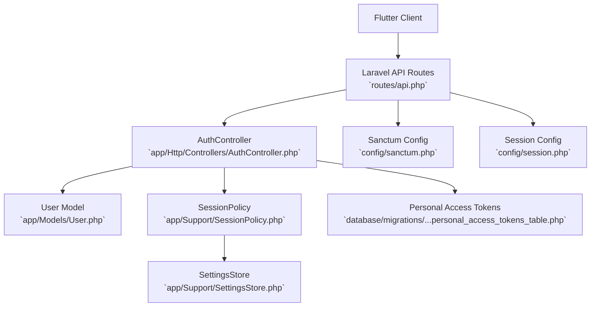
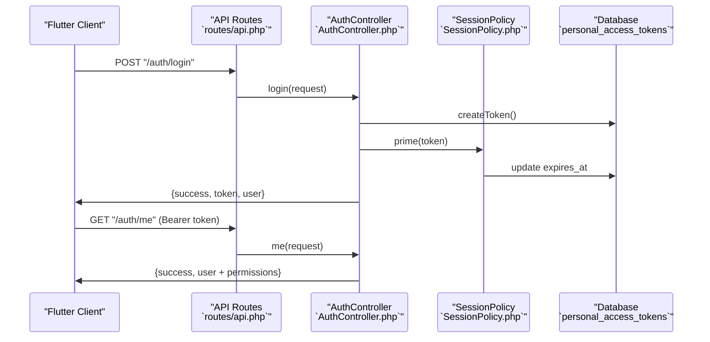
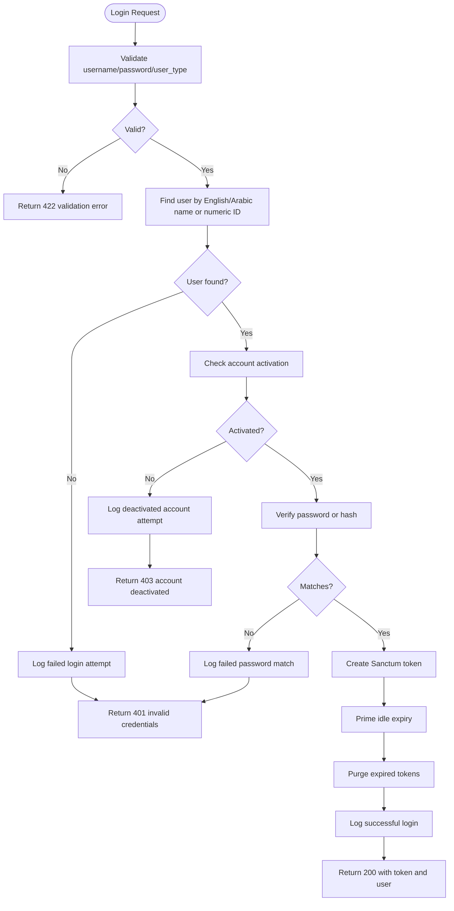
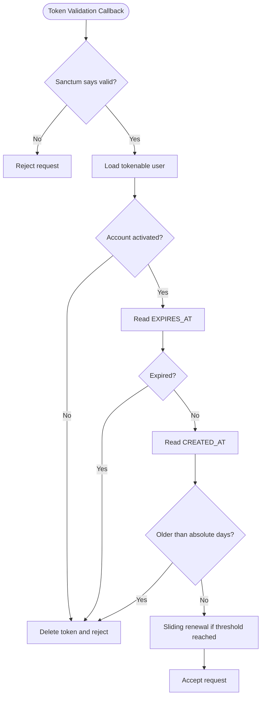
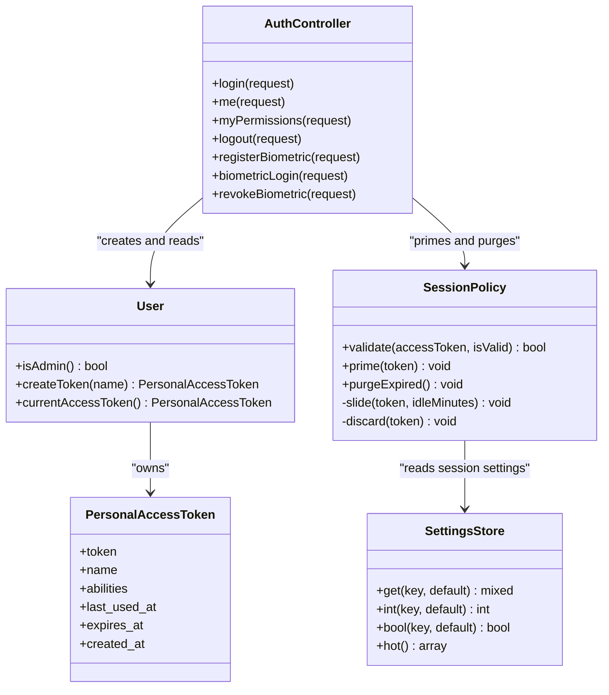

# Laravel Sanctum Authentication

<cite>
**Referenced Files in This Document**   
- [sanctum.php](file://kyApp_API/config/sanctum.php)
- [api.php](file://kyApp_API/routes/api.php)
- [AuthController.php](file://kyApp_API/app/Http/Controllers/AuthController.php)
- [SessionPolicy.php](file://kyApp_API/app/Support/SessionPolicy.php)
- [User.php](file://kyApp_API/app/Models/User.php)
- [SettingsStore.php](file://kyApp_API/app/Support/SettingsStore.php)
- [2026_09_01_212624_create_personal_access_tokens_table.php](file://kyApp_API/database/migrations/2026_09_01_212624_create_personal_access_tokens_table.php)
- [session.php](file://kyApp_API/config/session.php)
- [auth.php](file://kyApp_API/config/auth.php)
</cite>

## Table of Contents
1. [Introduction](#introduction)
2. [Project Structure](#project-structure)
3. [Core Components](#core-components)
4. [Architecture Overview](#architecture-overview)
5. [Detailed Component Analysis](#detailed-component-analysis)
6. [Dependency Analysis](#dependency-analysis)
7. [Performance Considerations](#performance-considerations)
8. [Troubleshooting Guide](#troubleshooting-guide)
9. [Conclusion](#conclusion)

## Introduction
This document explains how the Laravel API implements authentication for a Flutter frontend using Laravel Sanctum. The system supports:
- Stateless API token authentication for mobile and other non-browser clients.
- Stateful SPA session authentication for first-party web frontends.
- A custom sliding-session policy that keeps active users logged in while enforcing idle and absolute expiration.
- Biometric device registration and login flows that issue tokens under the same session rules as password login.
- Permission-aware responses so the Flutter UI can be built on real grants rather than assumptions.

The documentation covers configuration, routes, controllers, token lifecycle, session handling, security considerations, and integration guidance for multi-platform clients.

## Project Structure
The relevant backend code lives under `kyApp_API`. The most important parts for Sanctum are:
- Configuration files for Sanctum, sessions, and authentication guards.
- API routes defining public and protected endpoints.
- The authentication controller handling login, logout, profile, permissions, and biometric flows.
- A session policy that enforces idle and absolute token expiration with sliding renewal.
- The user model configured for Sanctum and Oracle compatibility.
- The personal access tokens migration.

**Diagram sources**
- [api.php:17-34](file://kyApp_API/routes/api.php#L17-L34)
- [AuthController.php:47-163](file://kyApp_API/app/Http/Controllers/AuthController.php#L47-L163)
- [SessionPolicy.php:70-108](file://kyApp_API/app/Support/SessionPolicy.php#L70-L108)
- [User.php:8-12](file://kyApp_API/app/Models/User.php#L8-L12)
- [sanctum.php:21-40](file://kyApp_API/config/sanctum.php#L21-L40)
- [session.php:21-35](file://kyApp_API/config/session.php#L21-L35)
- [2026_09_01_212624_create_personal_access_tokens_table.php:14-23](file://kyApp_API/database/migrations/2026_09_01_212624_create_personal_access_tokens_table.php#L14-L23)

**Section sources**
- [api.php:17-34](file://kyApp_API/routes/api.php#L17-L34)
- [sanctum.php:21-40](file://kyApp_API/config/sanctum.php#L21-L40)
- [session.php:21-35](file://kyApp_API/config/session.php#L21-L35)

## Core Components
- Sanctum configuration defines stateful domains, guard, expiration behavior, last-used tracking, token prefix, and middleware aliases.
- API routes expose login, logout, current-user, permissions, and biometric endpoints; many business routes are protected by `auth:sanctum`.
- `AuthController` validates credentials, issues Sanctum tokens, primes idle expiry, purges expired tokens, logs activity, and returns permission-aware payloads.
- `SessionPolicy` is invoked after Sanctum token validation to enforce idle and absolute expiration, perform write-throttled sliding renewal, and delete expired tokens.
- `User` uses Sanctum’s `HasApiTokens`, connects to Oracle, and exposes admin status and safe attribute access.
- `SettingsStore` reads session-related settings from `APP_SETTINGS` with a short-lived cache used by the session policy and biometric flow.
- The personal access tokens migration creates the table Sanctum needs to store tokens, abilities, last-used timestamps, and expiration.

**Section sources**
- [sanctum.php:21-109](file://kyApp_API/config/sanctum.php#L21-L109)
- [api.php:17-34](file://kyApp_API/routes/api.php#L17-L34)
- [AuthController.php:47-163](file://kyApp_API/app/Http/Controllers/AuthController.php#L47-L163)
- [SessionPolicy.php:70-183](file://kyApp_API/app/Support/SessionPolicy.php#L70-L183)
- [User.php:8-12](file://kyApp_API/app/Models/User.php#L8-L12)
- [SettingsStore.php:78-89](file://kyApp_API/app/Support/SettingsStore.php#L78-L89)
- [2026_09_01_212624_create_personal_access_tokens_table.php:14-23](file://kyApp_API/database/migrations/2026_09_01_212624_create_personal_access_tokens_table.php#L14-L23)

## Architecture Overview
The authentication architecture combines Sanctum’s token-based API authentication with a custom session policy. Mobile clients authenticate via `/auth/login` or `/auth/biometric/login`, receive a plain text token, and attach it as a bearer token for subsequent requests. Web SPAs can use stateful cookies when their domain is listed in Sanctum’s stateful domains.

**Diagram sources**
- [api.php:17-34](file://kyApp_API/routes/api.php#L17-L34)
- [AuthController.php:47-163](file://kyApp_API/app/Http/Controllers/AuthController.php#L47-L163)
- [SessionPolicy.php:114-117](file://kyApp_API/app/Support/SessionPolicy.php#L114-L117)
- [2026_09_01_212624_create_personal_access_tokens_table.php:14-23](file://kyApp_API/database/migrations/2026_09_01_212624_create_personal_access_tokens_table.php#L14-L23)

## Detailed Component Analysis

### Sanctum Configuration
Sanctum is configured to:
- Allow stateful cookie-based authentication only for explicitly listed domains.
- Use the `web` guard for Sanctum session checks.
- Keep token expiration null at the Sanctum level because the application manages expiration through `EXPIRES_AT` and `SessionPolicy`.
- Track last-used timestamps for active sessions.
- Optionally prefix tokens for secret scanning.
- Map middleware aliases for session authentication, cookie encryption, and CSRF validation.

Key implications:
- Mobile clients should not rely on cookies; they must send bearer tokens.
- Web SPAs must ensure their origin is included in the stateful domains list.
- CSRF protection applies to stateful SPA requests through the configured middleware.

**Section sources**
- [sanctum.php:21-40](file://kyApp_API/config/sanctum.php#L21-L40)
- [sanctum.php:47-63](file://kyApp_API/config/sanctum.php#L47-L63)
- [sanctum.php:66-77](file://kyApp_API/config/sanctum.php#L66-L77)
- [sanctum.php:94-109](file://kyApp_API/config/sanctum.php#L94-L109)

### API Routes and Protected Endpoints
Public authentication routes:
- `POST /auth/login`: password-based login.
- `POST /auth/biometric/login`: device-bound biometric login.

Protected routes require `auth:sanctum`:
- `POST /auth/logout`: revoke the current token.
- `GET /auth/me`: return authenticated user data.
- `GET /user`: return the authenticated user.
- `POST /auth/biometric/register`: register a device for biometric login.
- `DELETE /auth/biometric/revoke`: remove biometric enrollment.

Most business routes are grouped under `auth:sanctum` and further restricted by IBAC permissions.

**Section sources**
- [api.php:17-34](file://kyApp_API/routes/api.php#L17-L34)
- [api.php:45-88](file://kyApp_API/routes/api.php#L45-L88)
- [api.php:99-116](file://kyApp_API/routes/api.php#L99-L116)

### Authentication Controller
`AuthController` implements:
- Credential validation and account activation checks.
- Password verification supporting both hashed values and legacy plain-text rows.
- Token issuance using Sanctum’s `createToken`.
- Session priming and cleanup of expired tokens.
- Activity logging for successful and failed authentication events.
- Profile and permission responses that include effective grants and admin status.
- Logout that deletes the current access token.
- Biometric enrollment, login, and revocation flows.

Important behaviors:
- Login returns a token and a normalized user payload.
- `/auth/me` returns user data plus permissions.
- `/auth/logout` removes the current token and returns success even if no token exists.
- Biometric login requires an enrolled device and produces a token under the same session policy as password login.

**Diagram sources**
- [AuthController.php:47-163](file://kyApp_API/app/Http/Controllers/AuthController.php#L47-L163)

**Section sources**
- [AuthController.php:47-163](file://kyApp_API/app/Http/Controllers/AuthController.php#L47-L163)
- [AuthController.php:170-179](file://kyApp_API/app/Http/Controllers/AuthController.php#L170-L179)
- [AuthController.php:190-215](file://kyApp_API/app/Http/Controllers/AuthController.php#L190-L215)
- [AuthController.php:221-239](file://kyApp_API/app/Http/Controllers/AuthController.php#L221-L239)
- [AuthController.php:316-410](file://kyApp_API/app/Http/Controllers/AuthController.php#L316-L410)

### Session Policy and Token Expiration
`SessionPolicy` provides the actual session lifecycle logic:
- It is called after Sanctum validates a token.
- It rejects deactivated accounts immediately.
- It rejects tokens whose `expires_at` is in the past.
- It rejects tokens older than the configured absolute lifetime.
- It performs sliding renewal only when needed, throttling database writes.
- It deletes rejected tokens best-effort to prevent stale rows.
- It prunes expired tokens on login and on the active-sessions screen.

Configuration comes from `SettingsStore`, which reads hot keys such as:
- `session_idle_minutes`
- `session_absolute_days`
- `session_touch_threshold_minutes`

**Diagram sources**
- [SessionPolicy.php:70-108](file://kyApp_API/app/Support/SessionPolicy.php#L70-L108)
- [SessionPolicy.php:130-141](file://kyApp_API/app/Support/SessionPolicy.php#L130-L141)
- [SessionPolicy.php:166-183](file://kyApp_API/app/Support/SessionPolicy.php#L166-L183)
- [SettingsStore.php:78-89](file://kyApp_API/app/Support/SettingsStore.php#L78-L89)

**Section sources**
- [SessionPolicy.php:70-183](file://kyApp_API/app/Support/SessionPolicy.php#L70-L183)
- [SettingsStore.php:78-89](file://kyApp_API/app/Support/SettingsStore.php#L78-L89)

### Personal Access Tokens Schema
The migration creates the `personal_access_tokens` table with:
- Tokenable polymorphic relationship.
- Token name.
- Unique token string.
- Abilities.
- Last-used timestamp.
- Expiration timestamp with an index.
- Standard timestamps.

This schema supports Sanctum’s token storage and the application’s idle/absolute expiration strategy.

**Section sources**
- [2026_09_01_212624_create_personal_access_tokens_table.php:14-23](file://kyApp_API/database/migrations/2026_09_01_212624_create_personal_access_tokens_table.php#L14-L23)

### User Model and Sanctum Integration
The `User` model:
- Uses Sanctum’s `HasApiTokens` trait.
- Connects to the Oracle database connection.
- Maps to the `APP_USERS` table.
- Handles Oracle column case differences safely.
- Exposes `isAdmin()` based on a dedicated flag outside the grant table.
- Hides sensitive fields like passwords and device tokens.

This ensures Sanctum can create and validate tokens against the correct user provider and database.

**Section sources**
- [User.php:8-12](file://kyApp_API/app/Models/User.php#L8-L12)
- [User.php:14-26](file://kyApp_API/app/Models/User.php#L14-L26)
- [User.php:39-46](file://kyApp_API/app/Models/User.php#L39-L46)
- [User.php:108-117](file://kyApp_API/app/Models/User.php#L108-L117)
- [User.php:125-149](file://kyApp_API/app/Models/User.php#L125-L149)

### Session Configuration
The session configuration controls:
- Driver (default database).
- Lifetime and close-on-exit behavior.
- Encryption, file location, connection, and table.
- Cookie name, path, domain, secure flag, HTTP-only, SameSite, and partitioned cookies.

For Sanctum stateful SPA flows, these settings determine how cookies behave between the browser and the API. For mobile apps, session cookies are generally irrelevant because mobile clients use bearer tokens.

**Section sources**
- [session.php:21-35](file://kyApp_API/config/session.php#L21-L35)
- [session.php:130-202](file://kyApp_API/config/session.php#L130-L202)

### Authentication Guard Configuration
The default guard is `web`, which uses the session driver and the Eloquent user provider pointing to the `User` model. Sanctum’s `guard` setting also references `web`, meaning Sanctum will check the session guard before falling back to bearer tokens.

**Section sources**
- [auth.php:18-21](file://kyApp_API/config/auth.php#L18-L21)
- [auth.php:40-45](file://kyApp_API/config/auth.php#L40-L45)
- [auth.php:64-68](file://kyApp_API/config/auth.php#L64-L68)
- [sanctum.php:39-40](file://kyApp_API/config/sanctum.php#L39-L40)

## Dependency Analysis
The authentication flow depends on several layers:
- Routes declare public and protected endpoints.
- Controllers implement business logic for login, logout, profile, permissions, and biometrics.
- Sanctum middleware handles token and session authentication.
- `SessionPolicy` enforces expiration and sliding renewal.
- `SettingsStore` supplies runtime session policies from `APP_SETTINGS`.
- `User` integrates Sanctum with the Oracle-backed user table.
- The personal access tokens table stores issued tokens and their lifetimes.

**Diagram sources**
- [AuthController.php:36-41](file://kyApp_API/app/Http/Controllers/AuthController.php#L36-L41)
- [AuthController.php:47-163](file://kyApp_API/app/Http/Controllers/AuthController.php#L47-L163)
- [SessionPolicy.php:70-183](file://kyApp_API/app/Support/SessionPolicy.php#L70-L183)
- [SettingsStore.php:205-242](file://kyApp_API/app/Support/SettingsStore.php#L205-L242)
- [User.php:8-12](file://kyApp_API/app/Models/User.php#L8-L12)
- [2026_09_01_212624_create_personal_access_tokens_table.php:14-23](file://kyApp_API/database/migrations/2026_09_01_212624_create_personal_access_tokens_table.php#L14-L23)

**Section sources**
- [api.php:17-34](file://kyApp_API/routes/api.php#L17-L34)
- [AuthController.php:36-41](file://kyApp_API/app/Http/Controllers/AuthController.php#L36-L41)
- [SessionPolicy.php:70-183](file://kyApp_API/app/Support/SessionPolicy.php#L70-L183)
- [SettingsStore.php:205-242](file://kyApp_API/app/Support/SettingsStore.php#L205-L242)
- [User.php:8-12](file://kyApp_API/app/Models/User.php#L8-L12)

## Performance Considerations
- Sliding renewal is write-throttled: token updates happen only when the current expiry falls behind the new horizon minus a threshold window. This reduces database writes during frequent API calls.
- Settings are cached for hot keys with a short TTL, reducing repeated Oracle queries on every authenticated request.
- Expired token deletion is best-effort: failures do not block authentication or listing operations.
- Token prefixing can help secret-scanning tools detect accidental commits.
- Database indexing on `expires_at` improves cleanup and lookup performance.

Recommendations:
- Keep `session_touch_threshold_minutes` reasonable to balance freshness and write load.
- Monitor `session_idle_minutes` and `session_absolute_days` to avoid excessive churn or overly long-lived tokens.
- Use Redis or another fast cache backend for production if session caching becomes a bottleneck.

[No sources needed since this section provides general guidance]

## Troubleshooting Guide

### Mobile Clients Cannot Authenticate
Symptoms:
- 401 Unauthorized on protected routes.
- Flutter shows an interceptor-driven logout after receiving 401.

Likely causes:
- Missing or incorrect bearer token.
- Token expired due to idle or absolute limits.
- Account deactivated.
- Sanctum stateful domains misconfigured for web SPAs.

Actions:
- Ensure the Flutter client sends the token returned by `/auth/login` or `/auth/biometric/login` as a bearer token.
- Check `session_idle_minutes` and `session_absolute_days` in `APP_SETTINGS`.
- Verify the user is activated.
- For web SPAs, add the frontend domain to Sanctum’s stateful domains.

**Section sources**
- [SessionPolicy.php:70-108](file://kyApp_API/app/Support/SessionPolicy.php#L70-L108)
- [AuthController.php:47-163](file://kyApp_API/app/Http/Controllers/AuthController.php#L47-L163)
- [sanctum.php:21-40](file://kyApp_API/config/sanctum.php#L21-L40)

### Logout Does Not Revoke All Tokens
Behavior:
- `/auth/logout` deletes the current access token associated with the request.
- Other devices or tabs may still hold valid tokens until they expire or are revoked elsewhere.

Actions:
- If you need to invalidate all tokens for a user, implement a server-side revocation mechanism that iterates over the user’s tokens.
- Use the active-sessions management routes to terminate specific sessions where available.

**Section sources**
- [AuthController.php:221-239](file://kyApp_API/app/Http/Controllers/AuthController.php#L221-L239)
- [api.php:24-34](file://kyApp_API/routes/api.php#L24-L34)

### Biometric Login Fails
Symptoms:
- 401 or 403 from `/auth/biometric/login`.
- Device not recognized.

Likely causes:
- Biometric login disabled by settings.
- Device token not enrolled for the given user.
- Account deactivated.
- Platform kill-switch enabled.

Actions:
- Confirm `biometric_login_enabled` is true.
- Register the device with `/auth/biometric/register`.
- Ensure the user is activated.
- Check that the device token matches the stored value.

**Section sources**
- [AuthController.php:316-410](file://kyApp_API/app/Http/Controllers/AuthController.php#L316-L410)
- [SettingsStore.php:78-89](file://kyApp_API/app/Support/SettingsStore.php#L78-L89)

### Stateful SPA Cookies Not Working
Symptoms:
- SPA cannot maintain session across requests.
- CSRF errors or missing cookies.

Likely causes:
- Frontend domain not in Sanctum’s stateful domains.
- CORS or cookie configuration mismatch.
- Browser blocking third-party or cross-origin cookies.

Actions:
- Add the SPA origin to `SANCTUM_STATEFUL_DOMAINS`.
- Configure CORS appropriately for the frontend origin.
- Ensure session cookies are marked secure and have appropriate SameSite settings for your deployment.

**Section sources**
- [sanctum.php:21-40](file://kyApp_API/config/sanctum.php#L21-L40)
- [session.php:130-202](file://kyApp_API/config/session.php#L130-L202)

## Conclusion
Laravel Sanctum in this project provides a robust foundation for securing APIs consumed by Flutter and web clients. Mobile applications should use bearer tokens issued by `/auth/login` or `/auth/biometric/login`, while web SPAs can optionally use stateful cookies when their domain is allowed. The custom `SessionPolicy` replaces Sanctum’s simple expiration with a practical sliding-session model driven by runtime settings, ensuring active users remain logged in while enforcing idle and absolute expiration. Security is reinforced by token deletion on rejection, activity logging, permission-aware responses, and careful handling of Oracle-specific quirks.

[No sources needed since this section summarizes without analyzing specific files]