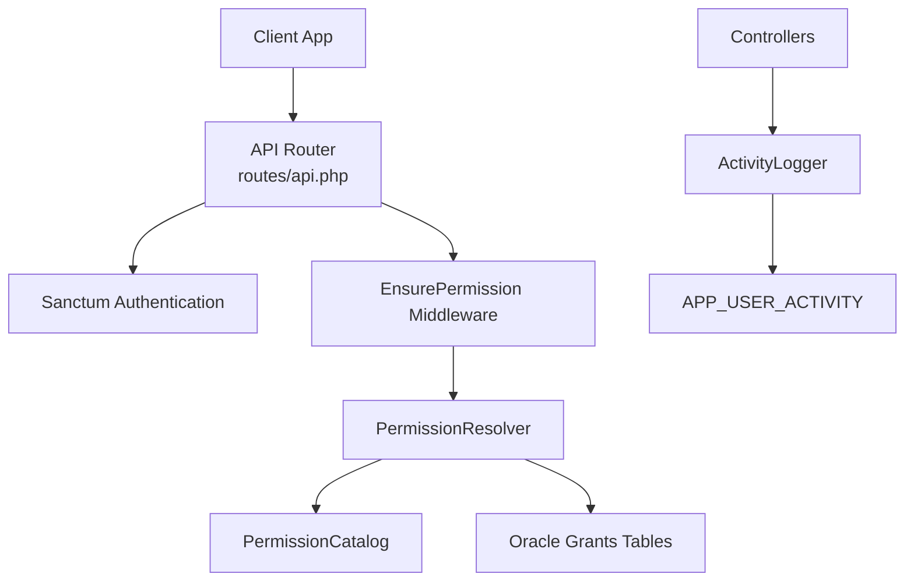
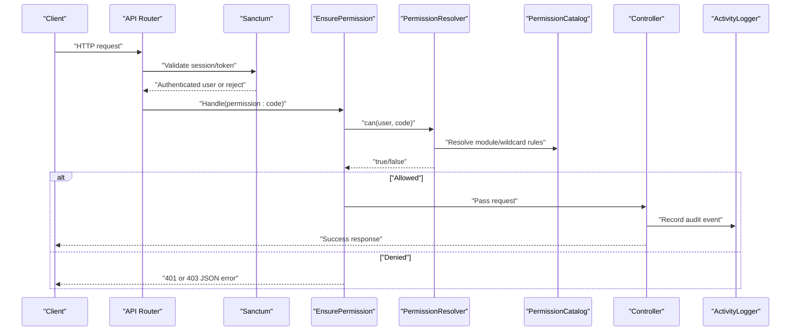
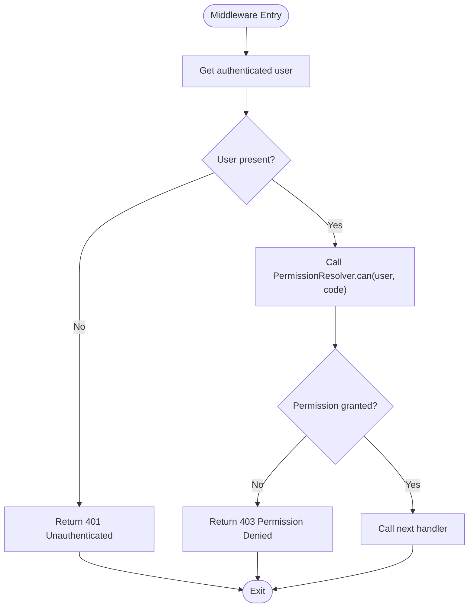
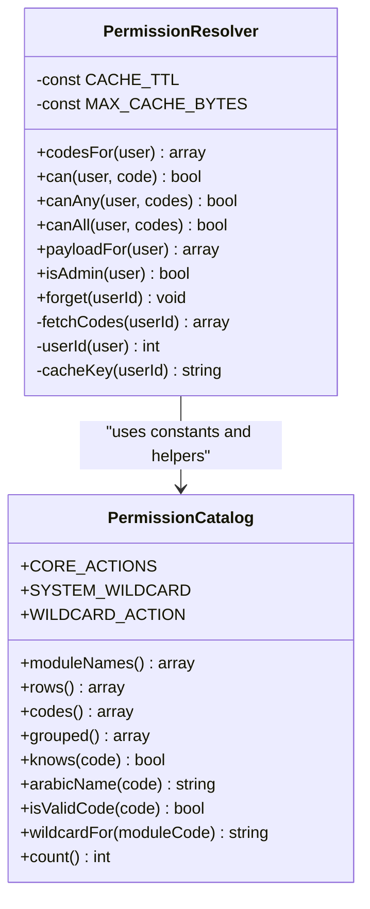
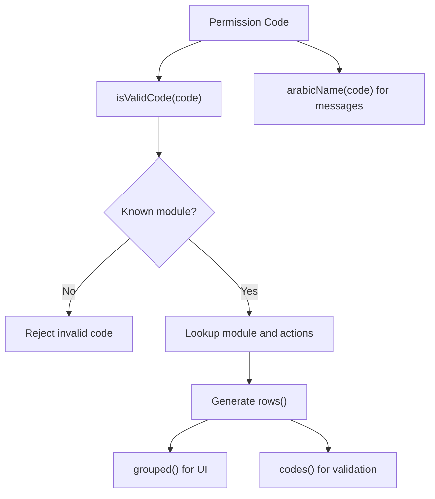
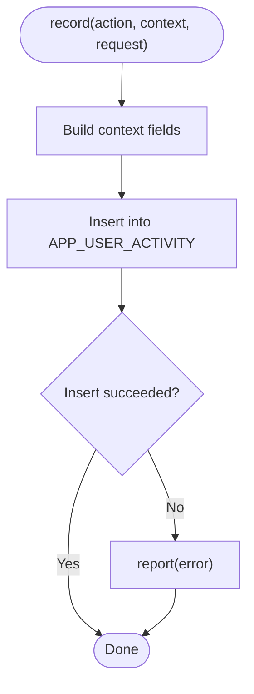
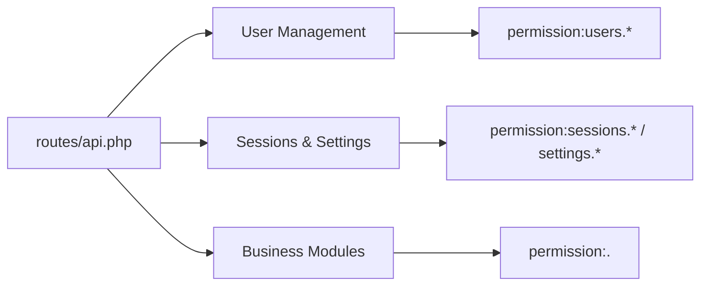
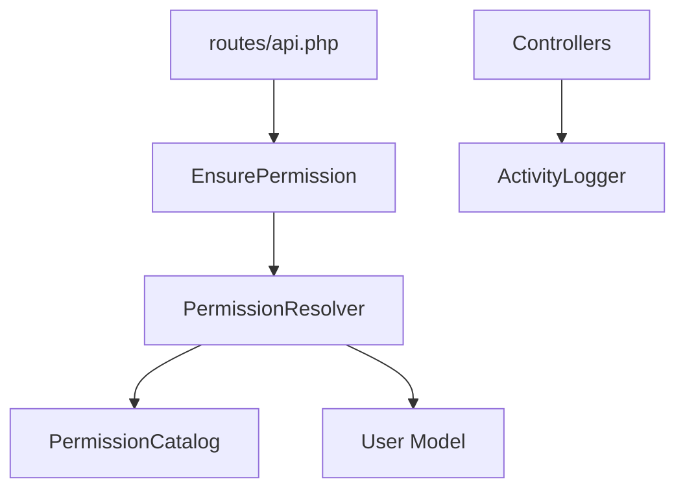

# Permission Middleware & Security

<cite>
**Referenced Files in This Document**
- [EnsurePermission.php](file://kyApp_API/app/Http/Middleware/EnsurePermission.php)
- [PermissionResolver.php](file://kyApp_API/app/Support/PermissionResolver.php)
- [PermissionCatalog.php](file://kyApp_API/app/Support/PermissionCatalog.php)
- [ActivityLogger.php](file://kyApp_API/app/Support/ActivityLogger.php)
- [api.php](file://kyApp_API/routes/api.php)
- [app.php](file://kyApp_API/bootstrap/app.php)
- [User.php](file://kyApp_API/app/Models/User.php)
</cite>

## Table of Contents
1. [Introduction](#introduction)
2. [Project Structure](#project-structure)
3. [Core Components](#core-components)
4. [Architecture Overview](#architecture-overview)
5. [Detailed Component Analysis](#detailed-component-analysis)
6. [Dependency Analysis](#dependency-analysis)
7. [Performance Considerations](#performance-considerations)
8. [Troubleshooting Guide](#troubleshooting-guide)
9. [Conclusion](#conclusion)

## Introduction
This document explains the permission middleware and security implementation used to protect API routes. The system uses a deny-by-default model: a request is rejected unless the authenticated user holds an explicit grant, a module wildcard grant, or the system-wide administrator flag.

The key pieces are:
- `EnsurePermission` middleware: validates that a route requires a specific permission code before allowing access.
- `PermissionResolver`: evaluates whether a user has a permission by checking grants, wildcards, and admin status.
- `PermissionCatalog`: the single source of truth for valid permission codes, labels, modules, and actions.
- `ActivityLogger`: writes audit events to the application activity table without failing successful requests.
- Route definitions: register Sanctum authentication and attach `permission:<code>` guards per endpoint.

## Project Structure
The security logic lives under the Laravel backend (`kyApp_API`). The most relevant locations are:
- HTTP middleware for permission checks.
- Support classes for permissions, catalog, and activity logging.
- API route definitions where permissions are attached.
- Bootstrap configuration registering the middleware alias.
- User model exposing the admin flag used by the resolver.

**Diagram sources**
- [api.php:38-102](file://kyApp_API/routes/api.php#L38-L102)
- [api.php:168-356](file://kyApp_API/routes/api.php#L168-L356)
- [app.php:15-20](file://kyApp_API/bootstrap/app.php#L15-L20)
- [EnsurePermission.php:25-52](file://kyApp_API/app/Http/Middleware/EnsurePermission.php#L25-L52)
- [PermissionResolver.php:27-132](file://kyApp_API/app/Support/PermissionResolver.php#L27-L132)
- [PermissionCatalog.php:22-479](file://kyApp_API/app/Support/PermissionCatalog.php#L22-L479)
- [ActivityLogger.php:18-73](file://kyApp_API/app/Support/ActivityLogger.php#L18-L73)

**Section sources**
- [api.php:38-102](file://kyApp_API/routes/api.php#L38-L102)
- [api.php:168-356](file://kyApp_API/routes/api.php#L168-L356)
- [app.php:15-20](file://kyApp_API/bootstrap/app.php#L15-L20)

## Core Components
- **EnsurePermission**: A route-level guard that rejects unauthenticated users with 401 and denies missing permissions with 403. It delegates the actual decision to `PermissionResolver`.
- **PermissionResolver**: Implements the IBAC evaluation order: admin bypass, system-wide wildcard, explicit grant, module wildcard, then denial. It caches effective permission codes per user.
- **PermissionCatalog**: Defines all valid permission codes, module names, core and extra actions, validation helpers, and Arabic labels for user-facing messages.
- **ActivityLogger**: Writes structured audit records for success and failure events, safely handling encoding, truncation, and database errors.
- **User Model**: Exposes the `IS_ADMIN` attribute and helper methods used by the resolver and controllers.

**Section sources**
- [EnsurePermission.php:25-52](file://kyApp_API/app/Http/Middleware/EnsurePermission.php#L25-L52)
- [PermissionResolver.php:27-132](file://kyApp_API/app/Support/PermissionResolver.php#L27-L132)
- [PermissionCatalog.php:22-479](file://kyApp_API/app/Support/PermissionCatalog.php#L22-L479)
- [ActivityLogger.php:18-73](file://kyApp_API/app/Support/ActivityLogger.php#L18-L73)
- [User.php:10-117](file://kyApp_API/app/Models/User.php#L10-L117)

## Architecture Overview
The permission flow follows a strict sequence:
1. Request enters the API router.
2. Sanctum authenticates the session if required.
3. `EnsurePermission` extracts the required permission code from the route definition.
4. `PermissionResolver` evaluates the user’s effective permissions.
5. If allowed, the controller executes; otherwise, a JSON error response is returned.
6. Controllers may record audit events using `ActivityLogger`.

**Diagram sources**
- [api.php:38-102](file://kyApp_API/routes/api.php#L38-L102)
- [api.php:168-356](file://kyApp_API/routes/api.php#L168-L356)
- [EnsurePermission.php:25-52](file://kyApp_API/app/Http/Middleware/EnsurePermission.php#L25-L52)
- [PermissionResolver.php:95-132](file://kyApp_API/app/Support/PermissionResolver.php#L95-L132)
- [PermissionCatalog.php:22-479](file://kyApp_API/app/Support/PermissionCatalog.php#L22-L479)
- [ActivityLogger.php:37-73](file://kyApp_API/app/Support/ActivityLogger.php#L37-L73)

## Detailed Component Analysis

### EnsurePermission Middleware
`EnsurePermission` enforces route-level authorization:
- Extracts the current user from the request.
- Returns 401 when no authenticated user exists.
- Delegates permission evaluation to `PermissionResolver::can`.
- Returns 403 with a user-friendly message including the Arabic label from `PermissionCatalog::arabicName` when permission is denied.
- Passes the request to the next handler when authorized.

**Diagram sources**
- [EnsurePermission.php:25-52](file://kyApp_API/app/Http/Middleware/EnsurePermission.php#L25-L52)
- [PermissionResolver.php:95-132](file://kyApp_API/app/Support/PermissionResolver.php#L95-L132)
- [PermissionCatalog.php:426-441](file://kyApp_API/app/Support/PermissionCatalog.php#L426-L441)

**Section sources**
- [EnsurePermission.php:25-52](file://kyApp_API/app/Http/Middleware/EnsurePermission.php#L25-L52)

### PermissionResolver
`PermissionResolver` implements the core authorization logic:
- Admin bypass: if the user is marked as system administrator, all permissions are granted immediately.
- System wildcard: if the user has `system.*`, all permissions are granted.
- Explicit grant: direct match against the requested permission code.
- Module wildcard: if the user has `<module>.*`, any action under that module is allowed.
- Deny-by-default: if none of the above match, access is denied.

It also provides:
- `codesFor`: fetches effective permission codes with caching.
- `payloadFor`: returns a client payload containing user ID, admin flag, permissions, and derived modules.
- `isAdmin`: reads the admin flag directly from the user model or database.
- `forget`: clears cached permissions after grant changes.

**Diagram sources**
- [PermissionResolver.php:27-275](file://kyApp_API/app/Support/PermissionResolver.php#L27-L275)
- [PermissionCatalog.php:22-479](file://kyApp_API/app/Support/PermissionCatalog.php#L22-L479)

**Section sources**
- [PermissionResolver.php:27-275](file://kyApp_API/app/Support/PermissionResolver.php#L27-L275)

### PermissionCatalog
`PermissionCatalog` is the canonical registry of permissions:
- Defines core actions (`view`, `create`, `update`, `delete`) and extra actions per module.
- Provides module display names and grouped structures for UI consumption.
- Generates rows suitable for seeding the permission table.
- Validates permission codes and supports wildcard forms.
- Supplies Arabic labels for user-facing error messages.

**Diagram sources**
- [PermissionCatalog.php:22-479](file://kyApp_API/app/Support/PermissionCatalog.php#L22-L479)

**Section sources**
- [PermissionCatalog.php:22-479](file://kyApp_API/app/Support/PermissionCatalog.php#L22-L479)

### ActivityLogger
`ActivityLogger` writes audit trail entries:
- Accepts an action code and context (user IDs, module, entity type/id, description, status, IP, user agent, platform).
- Uses bound parameters to prevent SQL injection.
- Handles Arabic text safely via encoding and length limits.
- Wrrites to `ACCOUNTS.APP_USER_ACTIVITY`.
- Never fails a successful request on logging errors; failures are reported silently.

**Diagram sources**
- [ActivityLogger.php:37-73](file://kyApp_API/app/Support/ActivityLogger.php#L37-L73)

**Section sources**
- [ActivityLogger.php:18-170](file://kyApp_API/app/Support/ActivityLogger.php#L18-L170)

### Route-Level Permissions
API routes are protected by two layers:
- `auth:sanctum`: ensures the request carries a valid session or token.
- `permission:<code>`: enforces the specific permission through `EnsurePermission`.

Examples include:
- User management endpoints guarded by `users.view`, `users.create`, `users.update`, `users.delete`, `users.toggle`, `users.permissions_manage`, and `users.activity_view`.
- Session administration endpoints guarded by `sessions.view` and `sessions.terminate`.
- Business endpoints such as invoices, customers, workers, accounts, currencies, and app configuration, each guarded by their respective module permissions.

**Diagram sources**
- [api.php:59-102](file://kyApp_API/routes/api.php#L59-L102)
- [api.php:113-146](file://kyApp_API/routes/api.php#L113-L146)
- [api.php:168-356](file://kyApp_API/routes/api.php#L168-L356)

**Section sources**
- [api.php:59-102](file://kyApp_API/routes/api.php#L59-L102)
- [api.php:113-146](file://kyApp_API/routes/api.php#L113-L146)
- [api.php:168-356](file://kyApp_API/routes/api.php#L168-L356)

### Middleware Registration
The `permission` middleware alias is registered in the bootstrap configuration:
- The alias maps to `EnsurePermission::class`.
- Routes can use `->middleware('permission:<code>')` to enforce authorization.

**Section sources**
- [app.php:15-20](file://kyApp_API/bootstrap/app.php#L15-L20)

### Error Handling Strategies
- **Unauthenticated**: When no user is authenticated, `EnsurePermission` returns a 401 JSON response indicating an invalid session.
- **Permission denied**: When the resolver determines the user lacks the required permission, `EnsurePermission` returns a 403 JSON response including the permission code and an Arabic label.
- **Audit logging failures**: `ActivityLogger` catches exceptions during audit writes and reports them without failing the original request.

**Section sources**
- [EnsurePermission.php:32-52](file://kyApp_API/app/Http/Middleware/EnsurePermission.php#L32-L52)
- [ActivityLogger.php:68-73](file://kyApp_API/app/Support/ActivityLogger.php#L68-L73)

## Dependency Analysis
The components interact as follows:
- `EnsurePermission` depends on `PermissionResolver` for authorization decisions.
- `PermissionResolver` depends on `PermissionCatalog` for constants, validation, and labels.
- Routes depend on both `auth:sanctum` and `permission:<code>` middleware.
- Controllers may depend on `ActivityLogger` for audit trails.
- The `User` model exposes attributes used by the resolver and controllers.

**Diagram sources**
- [EnsurePermission.php:25-52](file://kyApp_API/app/Http/Middleware/EnsurePermission.php#L25-L52)
- [PermissionResolver.php:27-132](file://kyApp_API/app/Support/PermissionResolver.php#L27-L132)
- [PermissionCatalog.php:22-479](file://kyApp_API/app/Support/PermissionCatalog.php#L22-L479)
- [api.php:38-102](file://kyApp_API/routes/api.php#L38-L102)
- [User.php:10-117](file://kyApp_API/app/Models/User.php#L10-L117)

**Section sources**
- [EnsurePermission.php:25-52](file://kyApp_API/app/Http/Middleware/EnsurePermission.php#L25-L52)
- [PermissionResolver.php:27-132](file://kyApp_API/app/Support/PermissionResolver.php#L27-L132)
- [PermissionCatalog.php:22-479](file://kyApp_API/app/Support/PermissionCatalog.php#L22-L479)
- [api.php:38-102](file://kyApp_API/routes/api.php#L38-L102)
- [User.php:10-117](file://kyApp_API/app/Models/User.php#L10-L117)

## Performance Considerations
- **Caching**: `PermissionResolver` caches effective permission codes per user with a TTL and a maximum serialized size to avoid Oracle binding limits.
- **Admin bypass**: Checking `IS_ADMIN` first avoids expensive grant lookups for administrators.
- **Module wildcard optimization**: After fetching codes, the resolver checks module wildcards only when needed.
- **Audit logging safety**: Logging operations are wrapped in try/catch to ensure they do not impact request performance or success.

[No sources needed since this section provides general guidance]

## Troubleshooting Guide
Common issues and how to address them:
- **401 Unauthenticated**: Indicates the request did not carry a valid Sanctum token or session. Verify authentication headers and session state.
- **403 Permission Denied**: Indicates the user lacks the required permission. Check:
  - Whether the user has an explicit grant for the exact code.
  - Whether the user has a module wildcard grant.
  - Whether the user is marked as system administrator.
  - Whether the permission code is valid according to `PermissionCatalog`.
- **Audit logs missing**: Check application logs for silent failures in `ActivityLogger`. Ensure the Oracle connection and table exist and that the logger receives valid context values.
- **Route misconfiguration**: Ensure routes are inside `auth:sanctum` groups and attach the correct `permission:<code>` middleware.

Practical steps:
- Use `/auth/me` or `/auth/permissions` to inspect the current user’s permissions and modules.
- Validate permission codes using `PermissionCatalog::isValidCode` and `PermissionCatalog::knows`.
- Clear cached permissions after grant updates using `PermissionResolver::forget`.

**Section sources**
- [EnsurePermission.php:32-52](file://kyApp_API/app/Http/Middleware/EnsurePermission.php#L32-L52)
- [PermissionResolver.php:95-132](file://kyApp_API/app/Support/PermissionResolver.php#L95-L132)
- [PermissionCatalog.php:421-479](file://kyApp_API/app/Support/PermissionCatalog.php#L421-L479)
- [ActivityLogger.php:68-73](file://kyApp_API/app/Support/ActivityLogger.php#L68-L73)

## Conclusion
The permission middleware and security implementation provide a robust, deny-by-default authorization model:
- Route-level guards enforce explicit permissions.
- The resolver evaluates admin status, system wildcard, explicit grants, and module wildcards.
- The catalog centralizes permission definitions and labels.
- Audit logging captures activity safely without compromising request success.
- Routes consistently combine Sanctum authentication with permission checks.

This design ensures clear separation of concerns, predictable authorization behavior, and maintainable permission management across the application.

[No sources needed since this section summarizes without analyzing specific files]