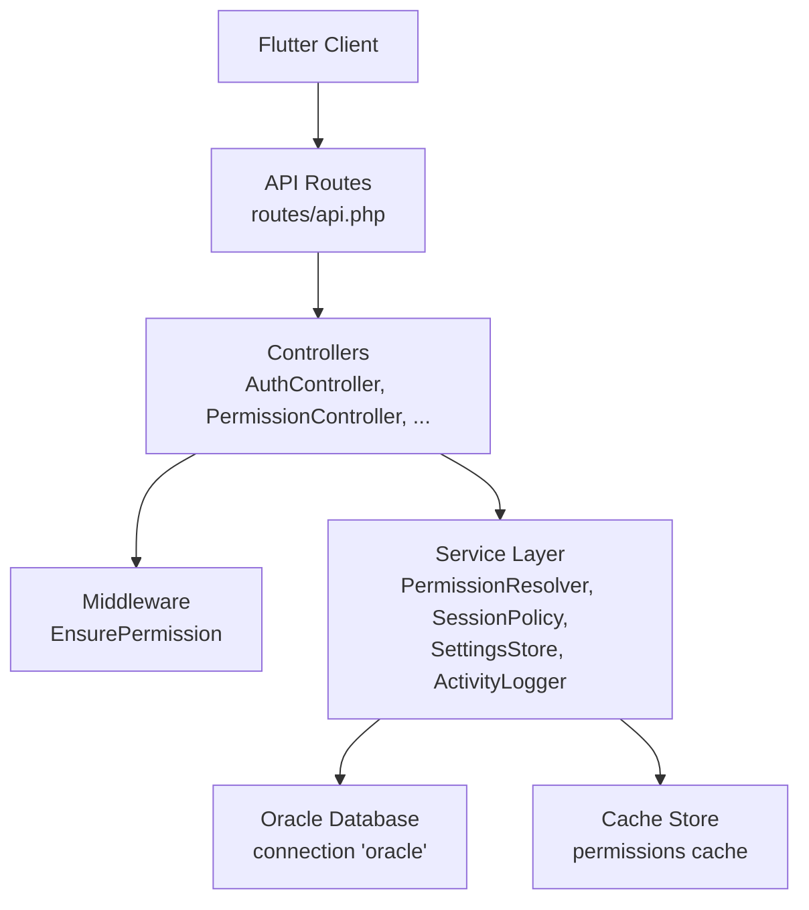
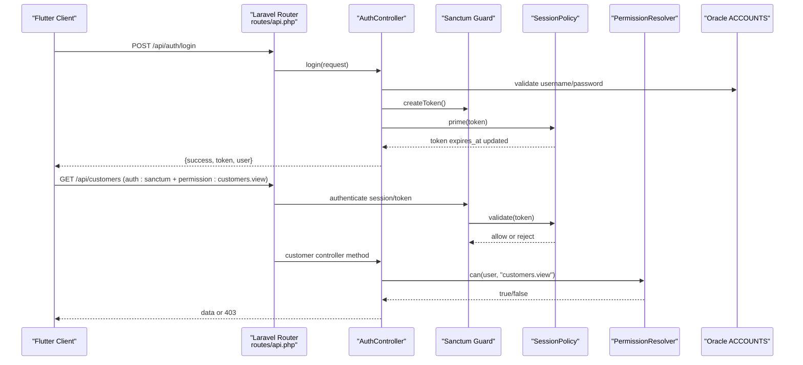
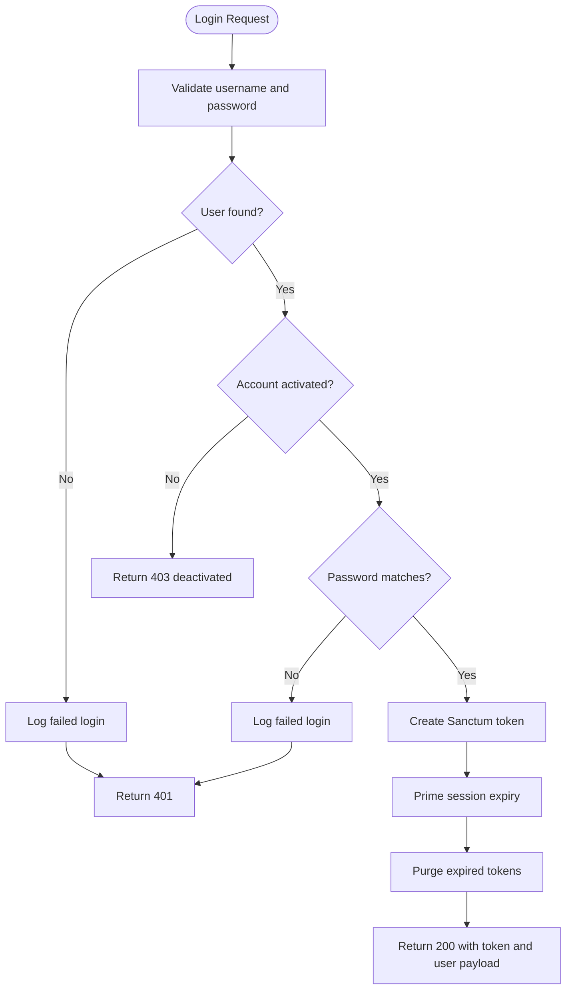
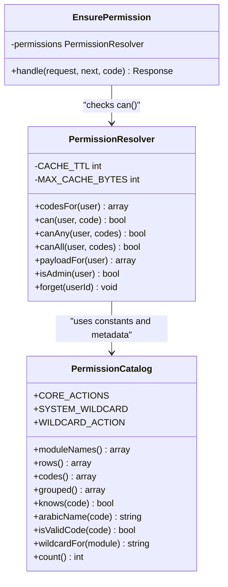
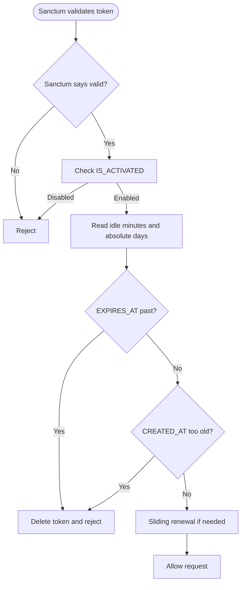
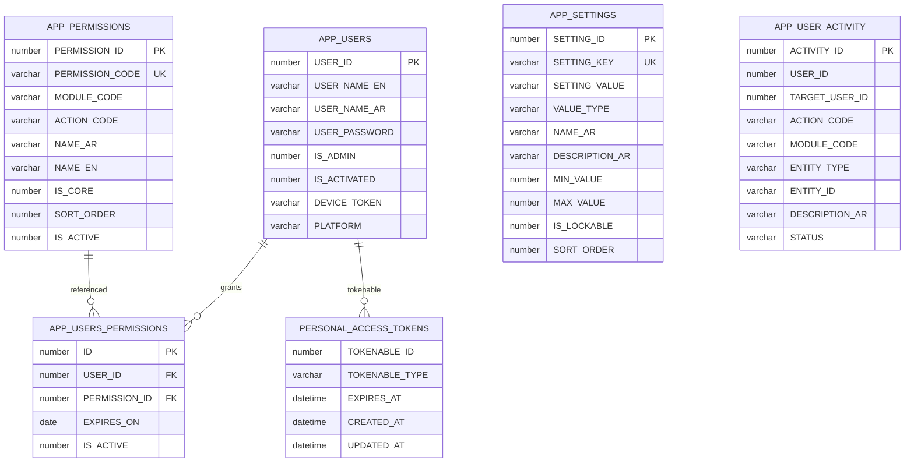
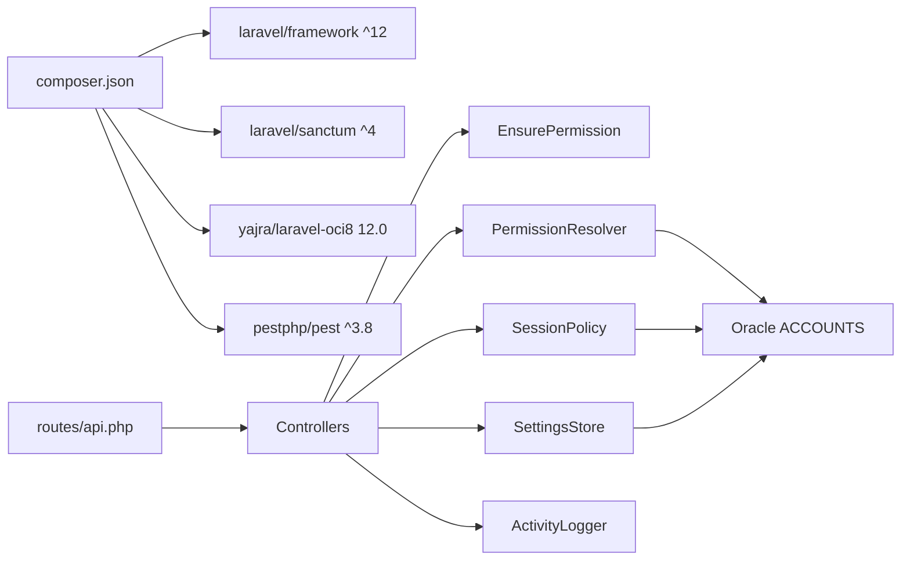

# Backend Development Guide

<cite>
**Referenced Files in This Document**
- [composer.json](file://kyApp_API/composer.json)
- [README.md](file://kyApp_API/README.md)
- [routes/api.php](file://kyApp_API/routes/api.php)
- [config/sanctum.php](file://kyApp_API/config/sanctum.php)
- [config/database.php](file://kyApp_API/config/database.php)
- [config/oracle.php](file://kyApp_API/config/oracle.php)
- [app/Http/Middleware/EnsurePermission.php](file://kyApp_API/app/Http/Middleware/EnsurePermission.php)
- [app/Support/PermissionResolver.php](file://kyApp_API/app/Support/PermissionResolver.php)
- [app/Support/SessionPolicy.php](file://kyApp_API/app/Support/SessionPolicy.php)
- [app/Support/PermissionCatalog.php](file://kyApp_API/app/Support/PermissionCatalog.php)
- [app/Support/SettingsStore.php](file://kyApp_API/app/Support/SettingsStore.php)
- [app/Support/ArabicEncoding.php](file://kyApp_API/app/Support/ArabicEncoding.php)
- [app/Support/ActivityLogger.php](file://kyApp_API/app/Support/ActivityLogger.php)
- [app/Support/PermissionGrantSync.php](file://kyApp_API/app/Support/PermissionGrantSync.php)
- [app/Models/User.php](file://kyApp_API/app/Models/User.php)
- [app/Http/Controllers/AuthController.php](file://kyApp_API/app/Http/Controllers/AuthController.php)
- [app/Http/Controllers/PermissionController.php](file://kyApp_API/app/Http/Controllers/PermissionController.php)
- [database/oracle/01_ibac_schema.sql](file://kyApp_API/database/oracle/01_ibac_schema.sql)
- [database/oracle/02_ibac_seed.php](file://kyApp_API/database/oracle/02_ibac_seed.php)
- [tests/Feature/IbacCoreTest.php](file://kyApp_API/tests/Feature/IbacCoreTest.php)
- [tests/Feature/AuthTest.php](file://kyApp_API/tests/Feature/AuthTest.php)
</cite>

## Table of Contents
1. [Introduction](#introduction)
2. [Project Structure](#project-structure)
3. [Core Components](#core-components)
4. [Architecture Overview](#architecture-overview)
5. [Detailed Component Analysis](#detailed-component-analysis)
6. [Dependency Analysis](#dependency-analysis)
7. [Performance Considerations](#performance-considerations)
8. [Troubleshooting Guide](#troubleshooting-guide)
9. [Conclusion](#conclusion)
10. [Appendices](#appendices)

## Introduction
This document explains the Laravel backend API used by the Ky Apps Flutter application. It covers the application structure, controller organization, middleware, service-layer support classes, authentication with Laravel Sanctum, the custom IBAC permission system, session management, Oracle database integration through Yajra Laravel OCI8, Arabic text handling, stored procedure and seed execution, API endpoint design, error handling, testing with Pest, and guidance for adding new controllers, business logic, and endpoints.

The project is a Laravel 12 API that:
- Authenticates users via Sanctum stateful sessions and personal access tokens.
- Enforces a deny-by-default IBAC model where permissions are granted directly to users.
- Manages sliding idle sessions and absolute token lifetimes through `SessionPolicy`.
- Connects to an Oracle schema named `ACCOUNTS` using the `oracle` connection.
- Uses a central permission catalog and settings store to keep UI, authorization, and database definitions consistent.
- Includes tests written with Pest for core security behavior.

**Section sources**
- [composer.json:11-28](file://kyApp_API/composer.json#L11-L28)
- [README.md:10-22](file://kyApp_API/README.md#L10-L22)

## Project Structure
The backend lives under `kyApp_API`. The most important directories for backend development are:

| Area | Responsibility |
|---|---|
| `app/Http/Controllers` | API endpoints grouped by domain such as authentication, permissions, customers, workers, accounts, currencies, invoices, and administration. |
| `app/Http/Middleware` | Request-level gates, including the `permission:<code>` middleware. |
| `app/Support` | Service-layer helpers: permission resolution, session policy, activity logging, Arabic encoding, settings storage, and grant synchronization. |
| `app/Models` | Eloquent models, currently centered on `User`. |
| `config` | Framework configuration, including Sanctum, database connections, and Oracle-specific options. |
| `routes/api.php` | All public and protected API routes. |
| `database/oracle` | Oracle schema definition, seeding scripts, and bootstrap utilities for the IBAC tables. |
| `tests/Feature` | Integration-style tests for authentication, permissions, sessions, and security settings. |

**Diagram sources**
- [routes/api.php:17-327](file://kyApp_API/routes/api.php#L17-L327)
- [app/Http/Controllers/AuthController.php:17-41](file://kyApp_API/app/Http/Controllers/AuthController.php#L17-L41)
- [app/Http/Middleware/EnsurePermission.php:11-24](file://kyApp_API/app/Http/Middleware/EnsurePermission.php#L11-L24)
- [app/Support/PermissionResolver.php:9-26](file://kyApp_API/app/Support/PermissionResolver.php#L9-L26)
- [app/Support/SessionPolicy.php:9-41](file://kyApp_API/app/Support/SessionPolicy.php#L9-L41)
- [config/database.php:116-127](file://kyApp_API/config/database.php#L116-L127)

**Section sources**
- [composer.json:30-40](file://kyApp_API/composer.json#L30-L40)
- [routes/api.php:17-327](file://kyApp_API/routes/api.php#L17-L327)

## Core Components
The backend’s core runtime is built around five layers:

1. **Routing layer**: `routes/api.php` defines public login, Sanctum-protected routes, IBAC administration routes, business modules, and diagnostic endpoints.
2. **Controller layer**: Domain controllers handle request validation, orchestrate services, and return JSON responses.
3. **Middleware layer**: `EnsurePermission` enforces per-route permission codes after Sanctum authentication.
4. **Service layer**: `PermissionResolver`, `SessionPolicy`, `SettingsStore`, `ActivityLogger`, `ArabicEncoding`, and `PermissionGrantSync` encapsulate authorization, session lifecycle, settings, auditing, encoding, and grant operations.
5. **Data layer**: Oracle schema `ACCOUNTS` holds users, permissions, grants, settings, activity logs, and Sanctum tokens.

Key responsibilities:
- Authentication and token issuance are handled by `AuthController`.
- Permission catalog and user grants are managed by `PermissionController` and backed by `PermissionCatalog` and `PermissionGrantSync`.
- Authorization decisions use `PermissionResolver` with a strict deny-by-default rule set.
- Session validity, sliding renewal, and expiry are enforced by `SessionPolicy`.
- Oracle connectivity uses the `oracle` connection configured in `config/database.php` and `config/oracle.php`.

**Section sources**
- [routes/api.php:17-327](file://kyApp_API/routes/api.php#L17-L327)
- [app/Http/Controllers/AuthController.php:17-41](file://kyApp_API/app/Http/Controllers/AuthController.php#L17-L41)
- [app/Http/Controllers/PermissionController.php:17-42](file://kyApp_API/app/Http/Controllers/PermissionController.php#L17-L42)
- [app/Http/Middleware/EnsurePermission.php:11-24](file://kyApp_API/app/Http/Middleware/EnsurePermission.php#L11-L24)
- [app/Support/PermissionResolver.php:9-26](file://kyApp_API/app/Support/PermissionResolver.php#L9-L26)
- [app/Support/SessionPolicy.php:9-41](file://kyApp_API/app/Support/SessionPolicy.php#L9-L41)
- [config/database.php:116-127](file://kyApp_API/config/database.php#L116-L127)

## Architecture Overview
The API follows a layered architecture:

**Diagram sources**
- [routes/api.php:17-34](file://kyApp_API/routes/api.php#L17-L34)
- [routes/api.php:158-179](file://kyApp_API/routes/api.php#L158-L179)
- [app/Http/Controllers/AuthController.php:47-163](file://kyApp_API/app/Http/Controllers/AuthController.php#L47-L163)
- [app/Support/SessionPolicy.php:70-107](file://kyApp_API/app/Support/SessionPolicy.php#L70-L107)
- [app/Support/PermissionResolver.php:95-131](file://kyApp_API/app/Support/PermissionResolver.php#L95-L131)

## Detailed Component Analysis

### Authentication System and Sanctum Integration
`AuthController` implements:
- Password-based login with support for legacy plain-text passwords and modern hashes.
- Biometric device registration, biometric login, and biometric revocation.
- Token creation, session priming, and expired-session cleanup.
- User profile response and current-permissions refresh.
- Activity logging for successful and failed authentication events.

Sanctum configuration:
- Stateful domains are controlled by environment variables.
- The guard is set to `web`.
- Expiration is intentionally `null` so `SessionPolicy` controls `EXPIRES_AT`.
- Last-used tracking is enabled for active-session reporting.

**Diagram sources**
- [app/Http/Controllers/AuthController.php:47-163](file://kyApp_API/app/Http/Controllers/AuthController.php#L47-L163)
- [app/Support/SessionPolicy.php:114-117](file://kyApp_API/app/Support/SessionPolicy.php#L114-L117)
- [app/Support/SessionPolicy.php:130-141](file://kyApp_API/app/Support/SessionPolicy.php#L130-L141)
- [config/sanctum.php:21-77](file://kyApp_API/config/sanctum.php#L21-L77)

**Section sources**
- [app/Http/Controllers/AuthController.php:17-493](file://kyApp_API/app/Http/Controllers/AuthController.php#L17-L493)
- [config/sanctum.php:1-112](file://kyApp_API/config/sanctum.php#L1-L112)
- [routes/api.php:17-34](file://kyApp_API/routes/api.php#L17-L34)

### Custom IBAC Permission System
IBAC stands for Immediate-Based Access Control. Permissions are granted directly to users rather than through roles.

Core rules evaluated in order:
1. System administrator (`IS_ADMIN = 1`) bypasses all grant checks.
2. A `system.*` wildcard grant implies every permission.
3. An explicit permission code match allows access.
4. A module wildcard such as `customers.*` allows any action under that module.
5. Otherwise, access is denied.

The permission catalog is the single source of truth for valid codes, labels, modules, and ordering. It feeds:
- Oracle seed data.
- Server-side grant validation.
- Permission picker UI payloads.

**Diagram sources**
- [app/Support/PermissionCatalog.php:22-468](file://kyApp_API/app/Support/PermissionCatalog.php#L22-L468)
- [app/Support/PermissionResolver.php:27-274](file://kyApp_API/app/Support/PermissionResolver.php#L27-L274)
- [app/Http/Middleware/EnsurePermission.php:25-53](file://kyApp_API/app/Http/Middleware/EnsurePermission.php#L25-L53)

Authorization flow:
- Routes are wrapped in `auth:sanctum`.
- Each sensitive route adds `permission:<code>`.
- If the user lacks the required code, `EnsurePermission` returns a bilingual 403 response.
- Admin users pass without grant checks.

**Section sources**
- [app/Support/PermissionResolver.php:9-274](file://kyApp_API/app/Support/PermissionResolver.php#L9-L274)
- [app/Support/PermissionCatalog.php:22-468](file://kyApp_API/app/Support/PermissionCatalog.php#L22-L468)
- [app/Http/Middleware/EnsurePermission.php:11-53](file://kyApp_API/app/Http/Middleware/EnsurePermission.php#L11-L53)
- [routes/api.php:36-88](file://kyApp_API/routes/api.php#L36-L88)

### Session Management and Sliding Expiry
`SessionPolicy` replaces hard Sanctum expiration with a dynamic policy driven by `APP_SETTINGS`:
- Disabled accounts are rejected immediately.
- Expired idle sessions are rejected and deleted.
- Tokens older than `session_absolute_days` are rejected and deleted.
- Active sessions receive a silent sliding renewal limited by `session_touch_threshold_minutes`.
- On login and on the active-sessions screen, expired tokens are purged.

Sanctum’s `expiration` is kept `null` because setting it would compare against `created_at` and forcibly disconnect active users. Instead, `EXPIRES_AT` is managed explicitly.

**Diagram sources**
- [app/Support/SessionPolicy.php:70-107](file://kyApp_API/app/Support/SessionPolicy.php#L70-L107)
- [app/Support/SessionPolicy.php:166-183](file://kyApp_API/app/Support/SessionPolicy.php#L166-L183)
- [config/sanctum.php:47-77](file://kyApp_API/config/sanctum.php#L47-L77)

**Section sources**
- [app/Support/SessionPolicy.php:9-184](file://kyApp_API/app/Support/SessionPolicy.php#L9-L184)
- [config/sanctum.php:47-77](file://kyApp_API/config/sanctum.php#L47-L77)

### Database Integration with Oracle and Arabic Text Handling
The application connects to Oracle using:
- `yajra/laravel-oci8` version `12.0`.
- The `oracle` connection defined in `config/database.php`.
- Additional Oracle driver options in `config/oracle.php`.

Important characteristics:
- Default connection may be SQLite for local tooling, but business logic uses `DB::connection('oracle')`.
- Schema prefix is `accounts`.
- Character set is `AL32UTF8` at the client level.
- Oracle schema `ACCOUNTS` contains legacy tables plus IBAC tables: `APP_USERS`, `APP_PERMISSIONS`, `APP_USERS_PERMISSIONS`, `APP_SETTINGS`, `APP_USER_ACTIVITY`, and Sanctum tokens.

Arabic text handling:
- The Oracle schema notes indicate the legacy database charset is `WE8MSWIN1252`.
- Direct insertion of raw CP1256 bytes through an AL32UTF8 client can corrupt Arabic text.
- `ArabicEncoding::toOracleSearchChars()` maps CP1256 bytes safely so values remain compatible with the legacy system.
- `ArabicEncoding::fixMojibake()` repairs mojibake when reading from Oracle.
- `AuthController` avoids double-fixing Arabic names because the Flutter client already applies repair logic.

Seed and bootstrap:
- `database/oracle/01_ibac_schema.sql` creates IBAC tables, sequences, triggers, and indexes.
- `database/oracle/02_ibac_seed.php` seeds `APP_PERMISSIONS` and `APP_SETTINGS` idempotently.
- Arabic labels and descriptions are written through `ArabicEncoding::toOracleSearchChars()`.

**Diagram sources**
- [database/oracle/01_ibac_schema.sql:21-198](file://kyApp_API/database/oracle/01_ibac_schema.sql#L21-L198)
- [config/database.php:116-127](file://kyApp_API/config/database.php#L116-L127)
- [config/oracle.php:3-28](file://kyApp_API/config/oracle.php#L3-L28)

**Section sources**
- [config/database.php:1-197](file://kyApp_API/config/database.php#L1-L197)
- [config/oracle.php:1-30](file://kyApp_API/config/oracle.php#L1-L30)
- [database/oracle/01_ibac_schema.sql:1-207](file://kyApp_API/database/oracle/01_ibac_schema.sql#L1-L207)
- [database/oracle/02_ibac_seed.php:1-310](file://kyApp_API/database/oracle/02_ibac_seed.php#L1-L310)
- [app/Support/ArabicEncoding.php](file://kyApp_API/app/Support/ArabicEncoding.php)

### API Endpoint Design and Error Handling
Routes are organized by domain and protected by two layers:
- `auth:sanctum` ensures a valid session or token.
- `permission:<code>` enforces IBAC.

Representative groups:
- Authentication: `/api/auth/login`, `/api/auth/logout`, `/api/auth/me`, biometric endpoints.
- Users and permissions: `/api/users`, `/api/permissions`, `/api/users/{userId}/permissions`.
- Sessions and security settings: `/api/sessions`, `/api/settings`.
- Business modules: invoices, customers, workers, accounts, currencies.
- Diagnostic query: `/api/selectFromTable` requires `system.*`.

Error handling patterns:
- Validation failures return `422` with a `success: false` envelope and field errors.
- Unauthenticated requests return `401`.
- Missing permissions return `403` with an Arabic permission name and the requested code.
- Not found returns `404`.
- Internal errors return `500` with optional debug details depending on `config.app.debug`.

Response envelope conventions:
- Successful responses include `success: true`, often a message, and either `data` or direct fields.
- Failed responses include `success: false`, a human-readable message, and sometimes `errors`.

**Section sources**
- [routes/api.php:17-327](file://kyApp_API/routes/api.php#L17-L327)
- [app/Http/Middleware/EnsurePermission.php:32-52](file://kyApp_API/app/Http/Middleware/EnsurePermission.php#L32-L52)
- [app/Http/Controllers/AuthController.php:47-66](file://kyApp_API/app/Http/Controllers/AuthController.php#L47-L66)
- [app/Http/Controllers/PermissionController.php:146-159](file://kyApp_API/app/Http/Controllers/PermissionController.php#L146-L159)

### Practical Examples

#### Creating a New Controller
1. Add a controller under `app/Http/Controllers`, for example `NewModuleController.php`.
2. Inject only the services you need, such as `PermissionResolver`, `SettingsStore`, and `ActivityLogger`.
3. Keep controllers thin: validate input, call services, log activity, and return JSON.
4. Follow existing response envelopes: `success`, `message`, `data`, and `errors`.

Example pattern reference:
- Constructor injection and shared helpers are shown in `AuthController` and `PermissionController`.

**Section sources**
- [app/Http/Controllers/AuthController.php:36-41](file://kyApp_API/app/Http/Controllers/AuthController.php#L36-L41)
- [app/Http/Controllers/PermissionController.php:38-42](file://kyApp_API/app/Http/Controllers/PermissionController.php#L38-L42)

#### Implementing Business Logic
Place reusable logic in `app/Support` rather than inside controllers:
- Use `PermissionResolver` for authorization checks.
- Use `SettingsStore` for typed, validated settings reads and writes.
- Use `ActivityLogger` for audit entries.
- Use `ArabicEncoding` when writing or reading Arabic text from Oracle.
- Use `PermissionGrantSync` for atomic grant replacement.

Reference implementations:
- Authorization checks: `PermissionResolver::can`, `PermissionResolver::payloadFor`.
- Settings reads: `SettingsStore` usage in `SessionPolicy` and `AuthController`.
- Grant replacement: `PermissionController::syncUser` calls `PermissionGrantSync`.

**Section sources**
- [app/Support/PermissionResolver.php:95-200](file://kyApp_API/app/Support/PermissionResolver.php#L95-L200)
- [app/Support/SessionPolicy.php:84-86](file://kyApp_API/app/Support/SessionPolicy.php#L84-L86)
- [app/Http/Controllers/PermissionController.php:137-243](file://kyApp_API/app/Http/Controllers/PermissionController.php#L137-L243)

#### Adding a New Endpoint
1. Define the route in `routes/api.php`.
2. Wrap it in `auth:sanctum` and add `permission:<module>.<action>`.
3. Implement the controller method with validation and service calls.
4. Add the permission code to `PermissionCatalog` if it is part of the canonical catalog.
5. Seed the catalog and settings if needed.
6. Write a Pest test covering success, missing permission, and invalid input.

Route example references:
- Customer routes show CRUD plus a separately-granted statement endpoint.
- Worker routes show separate modules for employees, cutters, and tailors.
- Account routes split tree reads, ledger writes, structure management, and statements.

**Section sources**
- [routes/api.php:158-179](file://kyApp_API/routes/api.php#L158-L179)
- [routes/api.php:189-243](file://kyApp_API/routes/api.php#L189-L243)
- [routes/api.php:245-291](file://kyApp_API/routes/api.php#L245-L291)
- [app/Support/PermissionCatalog.php:261-306](file://kyApp_API/app/Support/PermissionCatalog.php#L261-L306)

## Dependency Analysis
The main runtime dependencies are:

**Diagram sources**
- [composer.json:11-28](file://kyApp_API/composer.json#L11-L28)
- [routes/api.php:17-327](file://kyApp_API/routes/api.php#L17-L327)
- [app/Http/Middleware/EnsurePermission.php:5-7](file://kyApp_API/app/Http/Middleware/EnsurePermission.php#L5-L7)
- [app/Support/PermissionResolver.php:5-8](file://kyApp_API/app/Support/PermissionResolver.php#L5-L8)
- [app/Support/SessionPolicy.php:5-7](file://kyApp_API/app/Support/SessionPolicy.php#L5-L7)

Coupling and cohesion:
- Controllers depend on well-defined services, keeping request handling cohesive.
- `PermissionResolver` owns authorization logic and caches results per user.
- `SessionPolicy` owns token lifecycle and is invoked by both authentication and Sanctum callbacks.
- `PermissionCatalog` is immutable metadata consumed by seeding, authorization, and UI generation.

Potential circular dependencies:
- No obvious cycles exist; services do not import controllers, and controllers import services.

External integrations:
- Oracle via Yajra OCI8.
- Sanctum for session and token authentication.
- Laravel cache for permission sets.

**Section sources**
- [composer.json:11-28](file://kyApp_API/composer.json#L11-L28)
- [app/Support/PermissionResolver.php:29-43](file://kyApp_API/app/Support/PermissionResolver.php#L29-L43)
- [app/Support/SessionPolicy.php:157-183](file://kyApp_API/app/Support/SessionPolicy.php#L157-L183)

## Performance Considerations
- Permission caching: `PermissionResolver` caches effective permission codes per user with a TTL and a maximum serialized size to avoid Oracle cache-store limits.
- Sliding session updates: `SessionPolicy` throttles writes by comparing the current expiry against a threshold window.
- Minimal database writes: Controllers perform focused queries and rely on services for repeated logic.
- Oracle character set: Using correct encoding avoids costly mojibake repair and reprocessing.
- Route grouping: Shared middleware reduces per-route overhead.

Recommendations:
- Keep permission codes minimal and scoped.
- Avoid returning large datasets from diagnostic endpoints.
- Monitor Oracle connection pool and query performance for heavy report endpoints.
- Use background jobs for expensive exports or bulk operations if added later.

[No sources needed since this section provides general guidance]

## Troubleshooting Guide

### Authentication Fails Immediately After Login
- Verify Sanctum stateful domains include the frontend host.
- Confirm `sanctum.expiration` is `null`; otherwise, absolute age may expire active sessions.
- Check `SessionPolicy::validate` rejects disabled accounts, expired idle windows, or ancient tokens.

**Section sources**
- [config/sanctum.php:21-77](file://kyApp_API/config/sanctum.php#L21-L77)
- [app/Support/SessionPolicy.php:70-107](file://kyApp_API/app/Support/SessionPolicy.php#L70-L107)

### 403 Permission Denied
- Ensure the route has `permission:<code>`.
- Confirm the user has the exact code, a module wildcard, or `system.*`.
- Check whether the actor is an admin; admins bypass grant checks.
- Inspect `EnsurePermission` response for the Arabic permission label.

**Section sources**
- [app/Http/Middleware/EnsurePermission.php:32-52](file://kyApp_API/app/Http/Middleware/EnsurePermission.php#L32-L52)
- [app/Support/PermissionResolver.php:95-131](file://kyApp_API/app/Support/PermissionResolver.php#L95-L131)

### Arabic Text Appears Corrupted
- Do not apply `fixMojibake` twice; the Flutter client already repairs names returned by `AuthController`.
- When inserting Arabic into Oracle, use `ArabicEncoding::toOracleSearchChars()`.
- Verify the Oracle client charset and schema charset alignment.

**Section sources**
- [app/Http/Controllers/AuthController.php:29-32](file://kyApp_API/app/Http/Controllers/AuthController.php#L29-L32)
- [database/oracle/02_ibac_seed.php:10-23](file://kyApp_API/database/oracle/02_ibac_seed.php#L10-L23)
- [app/Support/ArabicEncoding.php](file://kyApp_API/app/Support/ArabicEncoding.php)

### Oracle Connection or Query Issues
- Confirm `DB_CONNECTION=oracle` or use `DB::connection('oracle')` for business queries.
- Check host, port, database/service name, username, password, and charset.
- Remember the schema prefix is `accounts`.

**Section sources**
- [config/database.php:116-127](file://kyApp_API/config/database.php#L116-L127)
- [config/oracle.php:3-28](file://kyApp_API/config/oracle.php#L3-L28)

### Testing Failures Without Oracle
Some feature tests read live Oracle data. They will skip or fail if the database is unavailable. This is expected in environments without Oracle.

**Section sources**
- [tests/Feature/IbacCoreTest.php:13-26](file://kyApp_API/tests/Feature/IbacCoreTest.php#L13-L26)

## Conclusion
The Ky Apps Laravel API is a secure, permission-driven backend that separates routing, controllers, middleware, and service-layer concerns. Sanctum handles authentication, while `SessionPolicy` manages realistic session lifetimes. IBAC provides fine-grained, deny-by-default authorization backed by a centralized catalog and Oracle storage. Arabic text and Oracle quirks are handled explicitly to maintain compatibility with the legacy system. The repository includes Pest tests for core security behavior and clear patterns for adding new controllers, endpoints, and business logic.

[No sources needed since this section summarizes without analyzing specific files]

## Appendices

### API Endpoints Summary
| Group | Method | Path | Protection | Purpose |
|---|---|---|---|---|
| Authentication | POST | `/api/auth/login` | Public | Authenticate and issue token |
| Authentication | POST | `/api/auth/biometric/login` | Public | Biometric login |
| Authentication | POST | `/api/auth/logout` | Sanctum | Revoke current token |
| Authentication | GET | `/api/auth/me` | Sanctum | Current user with IBAC state |
| Permissions | GET | `/api/permissions` | Sanctum + `users.view` | Permission catalog |
| Permissions | GET | `/api/users/{userId}/permissions` | Sanctum + `users.view` | Grants for a user |
| Permissions | PUT | `/api/users/{userId}/permissions` | Sanctum + `users.permissions_manage` | Replace user grants |
| Users | GET | `/api/users` | Sanctum + `users.view` | List users |
| Users | POST | `/api/users` | Sanctum + `users.create` | Create user |
| Users | PUT | `/api/users/{userId}` | Sanctum + `users.update` | Update user |
| Users | PATCH | `/api/users/{userId}/toggle` | Sanctum + `users.toggle` | Toggle user status |
| Users | DELETE | `/api/users/{userId}` | Sanctum + `users.delete` | Delete user |
| Sessions | GET | `/api/sessions` | Sanctum + `sessions.view` | Active sessions |
| Sessions | DELETE | `/api/sessions/user/{userId}` | Sanctum + `sessions.terminate` | Terminate user sessions |
| Sessions | DELETE | `/api/sessions/{tokenId}` | Sanctum + `sessions.terminate` | Terminate token |
| Settings | GET | `/api/settings` | Sanctum + `settings.view` | Security settings |
| Settings | PUT | `/api/settings` | Sanctum + `settings.update` | Update security settings |
| Invoices | GET | `/api/invoices` | Sanctum + `invoices.view` | List invoices |
| Invoices | GET | `/api/invoices/{billNo}` | Sanctum + `invoices.view` | Show invoice |
| Customers | GET | `/api/customers` | Sanctum + `customers.view` | List customers |
| Customers | POST | `/api/customers` | Sanctum + `customers.create` | Create customer |
| Customers | GET | `/api/customers/{custNo}/statement` | Sanctum + `customers.statement` | Customer statement |
| Customers | GET | `/api/customers/{custNo}` | Sanctum + `customers.view` | Show customer |
| Customers | PUT | `/api/customers/{custNo}` | Sanctum + `customers.update` | Update customer |
| Customers | DELETE | `/api/customers/{custNo}` | Sanctum + `customers.delete` | Delete customer |
| Workers | Multiple | `/api/workers/employees`, `/api/workers/cutters`, `/api/workers/tailors` | Sanctum + module permissions | Manage worker registries |
| Accounts | Multiple | `/api/accounts/*` | Sanctum + account permissions | Chart of accounts, sub-groups, statements |
| Currencies | Multiple | `/api/currencies*` | Sanctum + currency permissions | Currency directory and exchange rates |
| Diagnostic | GET/POST | `/api/selectFromTable` | Sanctum + `system.*` | Top-N rows from any table |

**Section sources**
- [routes/api.php:17-327](file://kyApp_API/routes/api.php#L17-L327)

### Testing Strategy with Pest
- Feature tests cover authentication validation, credential rejection, and protected route protection.
- IBAC core tests verify catalog shape, code validation, resolver denial defaults, admin bypass, settings store behavior, middleware responses, and session policy acceptance/rejection.
- Tests should avoid mutating production data; they exercise in-memory tokens and live Oracle reads where necessary.

**Section sources**
- [tests/Feature/AuthTest.php:1-32](file://kyApp_API/tests/Feature/AuthTest.php#L1-L32)
- [tests/Feature/IbacCoreTest.php:13-196](file://kyApp_API/tests/Feature/IbacCoreTest.php#L13-L196)