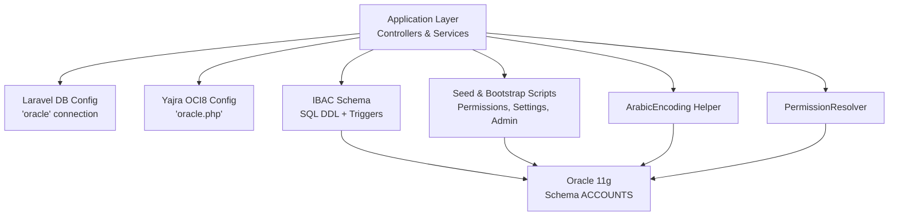
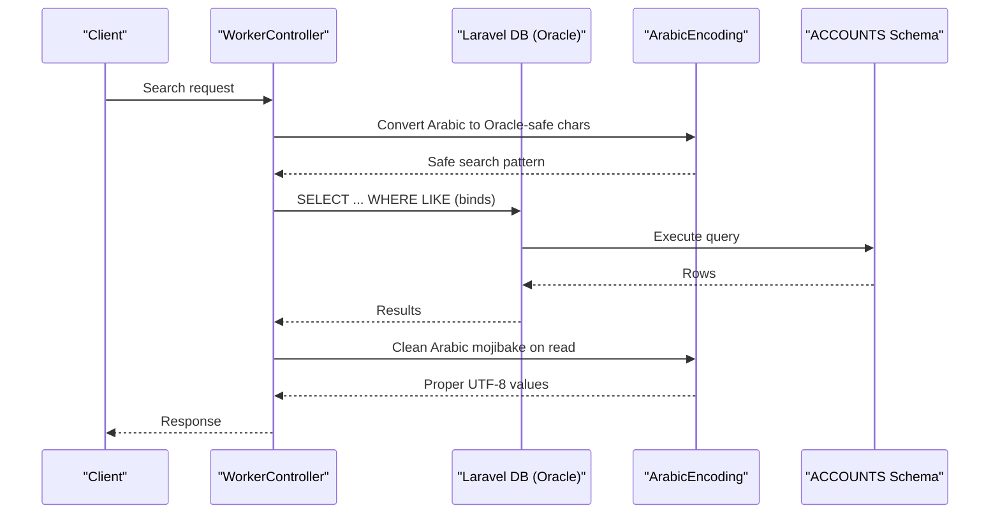
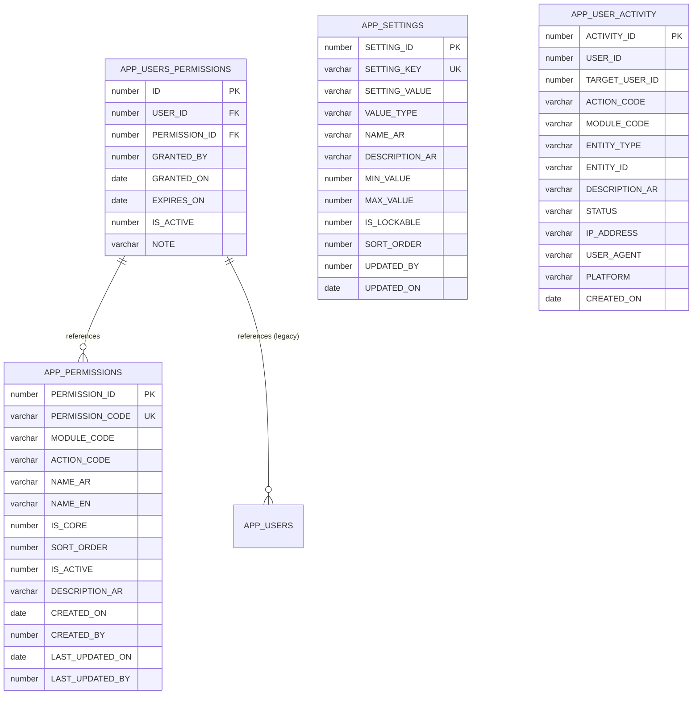
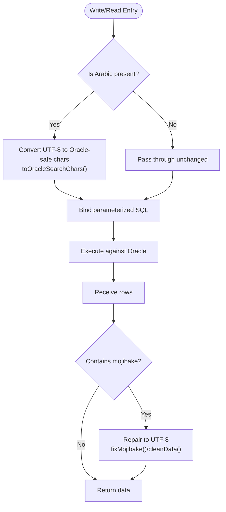
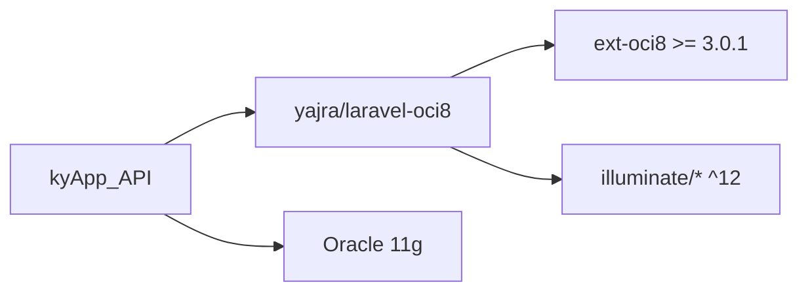

# Database Integration

<cite>
**Referenced Files in This Document**
- [database.php](file://kyApp_API/config/database.php)
- [oracle.php](file://kyApp_API/config/oracle.php)
- [01_ibac_schema.sql](file://kyApp_API/database/oracle/01_ibac_schema.sql)
- [02_ibac_seed.php](file://kyApp_API/database/oracle/02_ibac_seed.php)
- [03_ibac_bootstrap.php](file://kyApp_API/database/oracle/03_ibac_bootstrap.php)
- [04_ibac_rollback.sql](file://kyApp_API/database/oracle/04_ibac_rollback.sql)
- [ArabicEncoding.php](file://kyApp_API/app/Support/ArabicEncoding.php)
- [PermissionResolver.php](file://kyApp_API/app/Support/PermissionResolver.php)
- [WorkerController.php](file://kyApp_API/app/Http/Controllers/WorkerController.php)
- [TableQueryController.php](file://kyApp_API/app/Http/Controllers/TableQueryController.php)
- [UserAdminController.php](file://kyApp_API/app/Http/Controllers/UserAdminController.php)
- [composer.lock](file://kyApp_API/composer.lock)
</cite>

## Table of Contents
1. [Introduction](#introduction)
2. [Project Structure](#project-structure)
3. [Core Components](#core-components)
4. [Architecture Overview](#architecture-overview)
5. [Detailed Component Analysis](#detailed-component-analysis)
6. [Dependency Analysis](#dependency-analysis)
7. [Performance Considerations](#performance-considerations)
8. [Troubleshooting Guide](#troubleshooting-guide)
9. [Conclusion](#conclusion)

## Introduction
This document explains how the application integrates Oracle using the Yajra Laravel OCI8 package, focusing on the IBAC security schema, Arabic text handling, and operational practices for Oracle 11g. It covers:
- Schema design, table relationships, constraints, sequences, and triggers.
- Arabic encoding strategy between an AL32UTF8 PHP client and a WE8MSWIN1252 Oracle database.
- Seeders and bootstrap scripts for permissions, settings, and administrator setup.
- Query patterns, performance considerations, and safe rollback procedures.
- Connection configuration, session variables, and practical guidance for backups, transactions, and multi-platform usage.

## Project Structure
The Oracle integration is centered around:
- Configuration files for the default Laravel database connection and a dedicated Oracle driver configuration.
- A raw SQL schema for the IBAC security model under `database/oracle`.
- PHP seed and bootstrap scripts executed through Laravel Tinker.
- Support classes for Arabic encoding and permission resolution.
- Controllers that demonstrate search, query validation, and scalar column access against Oracle.

**Diagram sources**
- [database.php:116-127](file://kyApp_API/config/database.php#L116-L127)
- [oracle.php:1-29](file://kyApp_API/config/oracle.php#L1-L29)
- [01_ibac_schema.sql:1-207](file://kyApp_API/database/oracle/01_ibac_schema.sql#L1-L207)
- [02_ibac_seed.php:1-310](file://kyApp_API/database/oracle/02_ibac_seed.php#L1-L310)
- [03_ibac_bootstrap.php:1-227](file://kyApp_API/database/oracle/03_ibac_bootstrap.php#L1-L227)
- [ArabicEncoding.php:1-194](file://kyApp_API/app/Support/ArabicEncoding.php#L1-L194)
- [PermissionResolver.php:35-58](file://kyApp_API/app/Support/PermissionResolver.php#L35-L58)

**Section sources**
- [database.php:116-127](file://kyApp_API/config/database.php#L116-L127)
- [oracle.php:1-29](file://kyApp_API/config/oracle.php#L1-L29)
- [01_ibac_schema.sql:1-207](file://kyApp_API/database/oracle/01_ibac_schema.sql#L1-L207)

## Core Components
- Oracle connection configuration:
  - Default Laravel connection defines the Oracle driver, host, port, service name, username, password, charset, prefix, and schema prefix.
  - Yajra OCI8 configuration adds TNS, edition, server version, load balancing, max name length, dynamic options, and NLS session variables.
- IBAC schema:
  - Tables: APP_PERMISSIONS, APP_USERS_PERMISSIONS, APP_SETTINGS, APP_USER_ACTIVITY.
  - Legacy extension: APP_USERS widened password column and admin flag; sequence created without trigger to avoid breaking legacy writes.
  - Constraints: primary keys, unique codes, active flags, foreign keys with cascade where appropriate.
  - Indexes: optimized for module ordering, user grants, and activity queries.
  - Triggers: auto-generate IDs from sequences for new tables.
- Arabic encoding helper:
  - Converts UTF-8 Arabic to Oracle-compatible characters for both write and search paths.
  - Repairs mojibake when reading from Oracle back to proper UTF-8.
- Permission resolver:
  - Queries effective permissions for a user with active grants and expiration checks.
  - Includes cache payload safety limits due to Oracle bind size restrictions.

**Section sources**
- [database.php:116-127](file://kyApp_API/config/database.php#L116-L127)
- [oracle.php:1-29](file://kyApp_API/config/oracle.php#L1-L29)
- [01_ibac_schema.sql:21-207](file://kyApp_API/database/oracle/01_ibac_schema.sql#L21-L207)
- [ArabicEncoding.php:1-194](file://kyApp_API/app/Support/ArabicEncoding.php#L1-L194)
- [PermissionResolver.php:35-58](file://kyApp_API/app/Support/PermissionResolver.php#L35-L58)

## Architecture Overview
The Oracle integration follows a layered approach:
- Application controllers and services use Laravel’s DB facade with the 'oracle' connection.
- Raw SQL and Eloquent queries interact with the ACCOUNTS schema.
- Arabic text is normalized at write time and repaired at read time via the encoding helper.
- Permissions are resolved by joining grant tables and filtering active/expired entries.
- Seeders and bootstrap scripts manage catalog data, settings, and initial admin privileges.

**Diagram sources**
- [WorkerController.php:203-223](file://kyApp_API/app/Http/Controllers/WorkerController.php#L203-L223)
- [ArabicEncoding.php:122-162](file://kyApp_API/app/Support/ArabicEncoding.php#L122-L162)
- [ArabicEncoding.php:167-192](file://kyApp_API/app/Support/ArabicEncoding.php#L167-L192)

## Detailed Component Analysis

### Oracle Connection and Session Configuration
- Laravel default connection:
  - Driver: oracle
  - Host, port, database/service_name, username, password
  - Charset: AL32UTF8
  - Prefix and schema prefix configured for ACCOUNTS
- Yajra OCI8 config:
  - TNS, edition, server_version, load_balance, max_name_len
  - Dynamic options array
  - Session variables for NLS formatting and numeric characters

Operational implications:
- The client speaks AL32UTF8 while the database uses WE8MSWIN1252; therefore, Arabic must be encoded before binding and repaired after reading.
- NLS session variables standardize date/time formats and numeric separators across sessions.

**Section sources**
- [database.php:116-127](file://kyApp_API/config/database.php#L116-L127)
- [oracle.php:1-29](file://kyApp_API/config/oracle.php#L1-L29)

### IBAC Schema Design and Relationships
Key entities:
- APP_PERMISSIONS: Permission catalog with unique code, module/action codes, bilingual names, core flags, sort order, active status, timestamps, and audit fields.
- APP_USERS_PERMISSIONS: Direct user-to-permission grants with optional expiry, active flag, note, and audit fields.
- APP_SETTINGS: Security/session settings editable from UI, with typed values, ranges, lockable flags, and ordering.
- APP_USER_ACTIVITY: Lightweight audit trail for login, user management, sessions, and settings changes.

Relationships and constraints:
- Primary keys on all tables.
- Unique constraint on PERMISSION_CODE.
- Foreign keys from APP_USERS_PERMISSIONS to APP_USERS and APP_PERMISSIONS; cascade delete on user removal.
- Check constraints enforce binary flags and value types.
- Indexes optimize lookups by module/sort, user/activity, and module/activity.

Sequences and triggers:
- Auto-generated IDs for APP_PERMISSIONS, APP_USERS_PERMISSIONS, APP_SETTINGS, APP_USER_ACTIVITY via BEFORE INSERT triggers.
- Sequence SEQ_APP_USERS_ID exists but no trigger on APP_USERS to avoid breaking legacy ERP writes.

**Diagram sources**
- [01_ibac_schema.sql:38-100](file://kyApp_API/database/oracle/01_ibac_schema.sql#L38-L100)
- [01_ibac_schema.sql:118-184](file://kyApp_API/database/oracle/01_ibac_schema.sql#L118-L184)

**Section sources**
- [01_ibac_schema.sql:21-207](file://kyApp_API/database/oracle/01_ibac_schema.sql#L21-L207)

### Arabic Text Handling and Internationalization Strategy
- Write path:
  - Use ArabicEncoding::toOracleSearchChars() to convert UTF-8 Arabic into Oracle-compatible characters for both search and write operations.
  - Avoid sending raw CP1256 bytes; they are replaced by replacement characters due to AL32UTF8 client vs WE8MSWIN1252 database mismatch.
- Read path:
  - Use ArabicEncoding::fixMojibake() or cleanData() to repair mojibake back to proper UTF-8.
  - Idempotent repair ensures already-correct Arabic is not double-transformed.
- Controller usage:
  - WorkerController applies toOracleSearchChars() for LIKE searches and cleanData() on results.

**Diagram sources**
- [ArabicEncoding.php:122-162](file://kyApp_API/app/Support/ArabicEncoding.php#L122-L162)
- [ArabicEncoding.php:36-120](file://kyApp_API/app/Support/ArabicEncoding.php#L36-L120)
- [WorkerController.php:203-223](file://kyApp_API/app/Http/Controllers/WorkerController.php#L203-L223)

**Section sources**
- [ArabicEncoding.php:1-194](file://kyApp_API/app/Support/ArabicEncoding.php#L1-194)
- [WorkerController.php:203-223](file://kyApp_API/app/Http/Controllers/WorkerController.php#L203-L223)

### Stored Procedure Execution and PL/SQL Notes
- The repository does not include stored procedure definitions; it uses DDL, triggers, and direct SQL statements.
- Important PL/SQL naming rule:
  - Do not qualify sequence names with the schema inside PL/SQL because a VIEW named ACCOUNTS exists; qualified references resolve incorrectly and invalidate triggers.

Recommendations:
- For stored procedures, prefer explicit unqualified sequence references within PL/SQL blocks.
- Validate object validity after deployment; invalid triggers will surface on first use.

**Section sources**
- [01_ibac_schema.sql:64-75](file://kyApp_API/database/oracle/01_ibac_schema.sql#L64-L75)

### Query Optimization Techniques
- Indexing strategy:
  - Composite indexes for module ordering and user/activity queries.
  - Separate indexes for user grants and permission lookups.
- Query patterns:
  - Parameterized queries with bound variables only; never string interpolation.
  - Two-targeted queries can outperform complex correlated subqueries depending on selectivity and plans.
  - Cache payload safety: avoid oversized binds (>4000 bytes) due to ORA-01461; PermissionResolver caps cache payloads.

Practical examples:
- WorkerController performs LIKE searches with Arabic-safe patterns and paginates results.
- TableQueryController validates table existence in the connected schema before querying.

**Section sources**
- [01_ibac_schema.sql:59-100](file://kyApp_API/database/oracle/01_ibac_schema.sql#L59-L100)
- [PermissionResolver.php:35-58](file://kyApp_API/app/Support/PermissionResolver.php#L35-L58)
- [WorkerController.php:203-223](file://kyApp_API/app/Http/Controllers/WorkerController.php#L203-L223)
- [TableQueryController.php:122-142](file://kyApp_API/app/Http/Controllers/TableQueryController.php#L122-L142)

### Migrations, Seeders, and Bootstrap
- No Laravel migrations for business schema; the IBAC model is managed via raw SQL scripts.
- Seeders:
  - 02_ibac_seed.php idempotently inserts or updates permission catalog rows and security settings using bound parameters and Arabic-safe encoding.
- Bootstrap:
  - 03_ibac_bootstrap.php applies bilingual table/column comments, promotes the first administrator safely, grants system.* explicitly, and logs bootstrap activity.

Operational notes:
- All scripts are safe to re-run; they update existing metadata and guard against duplicate admin promotion.
- Arabic labels and descriptions are written via ArabicEncoding::toOracleSearchChars().

**Section sources**
- [02_ibac_seed.php:1-310](file://kyApp_API/database/oracle/02_ibac_seed.php#L1-L310)
- [03_ibac_bootstrap.php:1-227](file://kyApp_API/database/oracle/03_ibac_bootstrap.php#L1-L227)

### Connection Pooling and Multi-Platform Considerations
- Connection pooling:
  - Not explicitly configured in the repository; rely on PHP process lifecycle and OCI8 defaults.
  - Consider application-level connection reuse and avoiding per-request connect overhead in high-throughput environments.
- Multi-platform:
  - Activity logging includes platform field (android, ios, web, windows).
  - Ensure consistent Arabic encoding across platforms; clients should send UTF-8 and rely on server-side conversion.

**Section sources**
- [01_ibac_schema.sql:152-184](file://kyApp_API/database/oracle/01_ibac_schema.sql#L152-L184)

### Backup Strategies, Data Integrity, and Transactions
- Backup strategy:
  - Pre-change snapshot: APP_USERS_BAK_IBAC is created before altering APP_USERS.
  - Rollback script drops only IBAC objects in reverse dependency order, preserving business data.
- Data integrity:
  - Strong constraints: primary keys, unique codes, check constraints for flags and types.
  - Foreign keys with cascade for user grants; intentional lack of FK on activity USER_ID to preserve audit history even for unknown users.
- Transactions:
  - Laravel supports transactional migrations and manual DB::beginTransaction()/commit()/rollBack() usage.
  - For Oracle-specific concerns, keep statement sets small and ensure error handling does not leave partial state.

**Section sources**
- [01_ibac_schema.sql:17-19](file://kyApp_API/database/oracle/01_ibac_schema.sql#L17-L19)
- [04_ibac_rollback.sql:1-42](file://kyApp_API/database/oracle/04_ibac_rollback.sql#L1-L42)
- [01_ibac_schema.sql:186-189](file://kyApp_API/database/oracle/01_ibac_schema.sql#L186-L189)

## Dependency Analysis
External dependencies:
- Yajra Laravel OCI8 package requires ext-oci8 >= 3.0.1 and aligns with Laravel 12 components.
- The application uses Laravel DB facade and PDO via OCI8 for Oracle connectivity.

**Diagram sources**
- [composer.lock:6209-6242](file://kyApp_API/composer.lock#L6209-L6242)

**Section sources**
- [composer.lock:6209-6242](file://kyApp_API/composer.lock#L6209-L6242)

## Performance Considerations
- Indexing:
  - Use composite indexes aligned with common filter/order patterns.
  - Verify query plans rather than assuming index usage solely from ORDER BY.
- Query composition:
  - Prefer targeted queries over complex joins when selectivity favors two-step retrieval.
  - Avoid oversized binds; cap cached payloads to prevent ORA-01461.
- Arabic processing:
  - Minimize repeated conversions; apply toOracleSearchChars() once per search term and cleanData() once per result set.
- Connection behavior:
  - Reuse connections where possible; avoid unnecessary reconnects in loops.
  - Monitor session variables and NLS settings for consistent formatting.

[No sources needed since this section provides general guidance]

## Troubleshooting Guide
Common issues and resolutions:
- Arabic mojibake:
  - Symptom: Arabic appears as Latin-like symbols or replacement characters.
  - Resolution: Ensure write path uses toOracleSearchChars(); read path uses fixMojibake()/cleanData().
- Invalid bind variable names:
  - Symptom: ORA-01745 or ORA-01008 errors during updates.
  - Resolution: Use domain-scoped bind names and remove unused bindings before execution.
- Column casing instability:
  - Symptom: Inconsistent key cases in Oracle result arrays.
  - Resolution: Use helpers like columnOf() to tolerate case differences.
- Oversized cache payloads:
  - Symptom: ORA-01461 when storing large permission sets.
  - Resolution: Cap payload size and fall back to database reads when exceeding thresholds.

**Section sources**
- [ArabicEncoding.php:36-120](file://kyApp_API/app/Support/ArabicEncoding.php#L36-L120)
- [UserAdminController.php:1053-1091](file://kyApp_API/app/Http/Controllers/UserAdminController.php#L1053-L1091)
- [PermissionResolver.php:35-58](file://kyApp_API/app/Support/PermissionResolver.php#L35-L58)

## Conclusion
The Oracle integration leverages Yajra Laravel OCI8 with a carefully designed IBAC schema, robust Arabic encoding strategies, and pragmatic operational scripts. By adhering to parameterized queries, respecting Oracle naming rules, and applying consistent encoding transformations, the system maintains data integrity and readability across platforms. Performance is addressed through indexing, cautious query composition, and cache payload limits. Backups and rollbacks are structured to protect business data while allowing safe iteration of the security model.