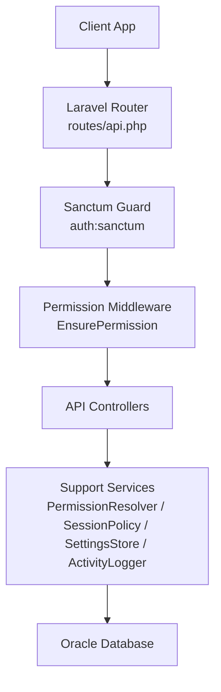
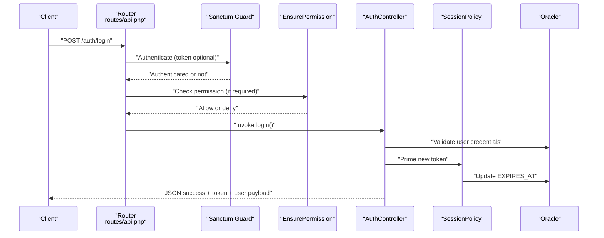
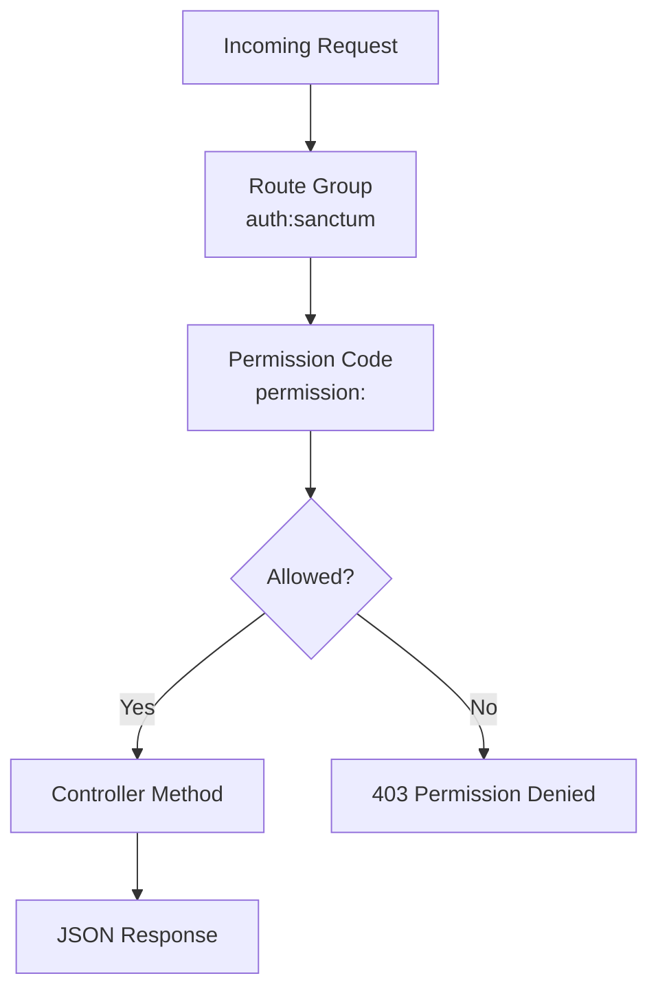
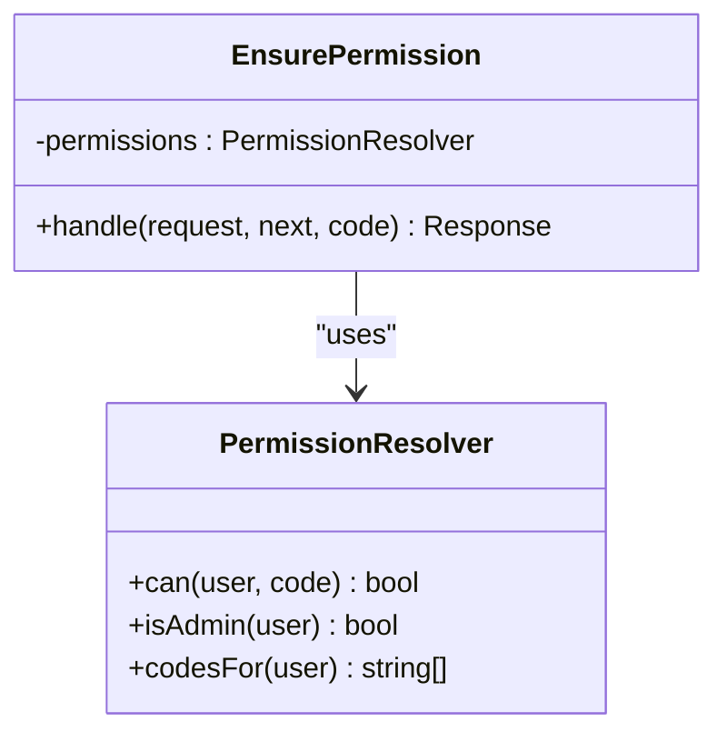
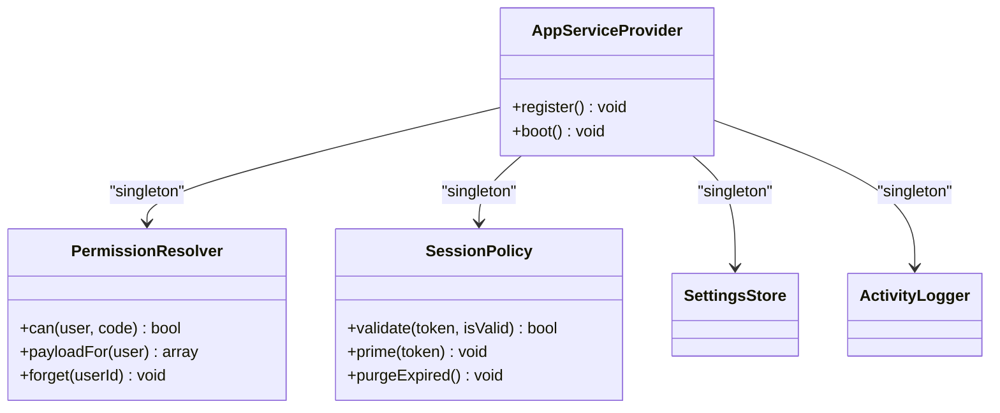
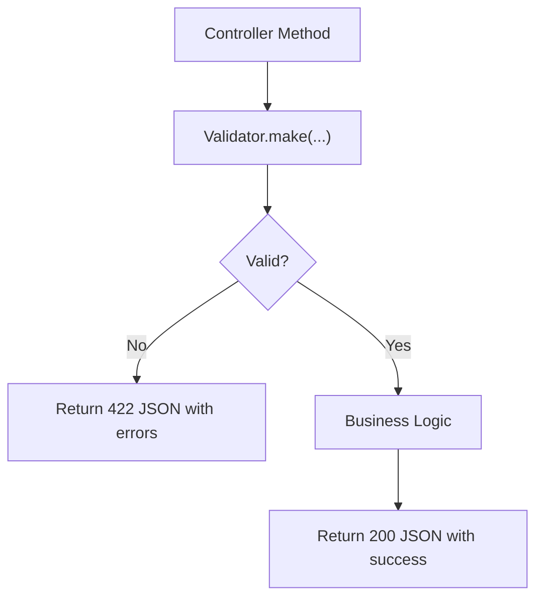
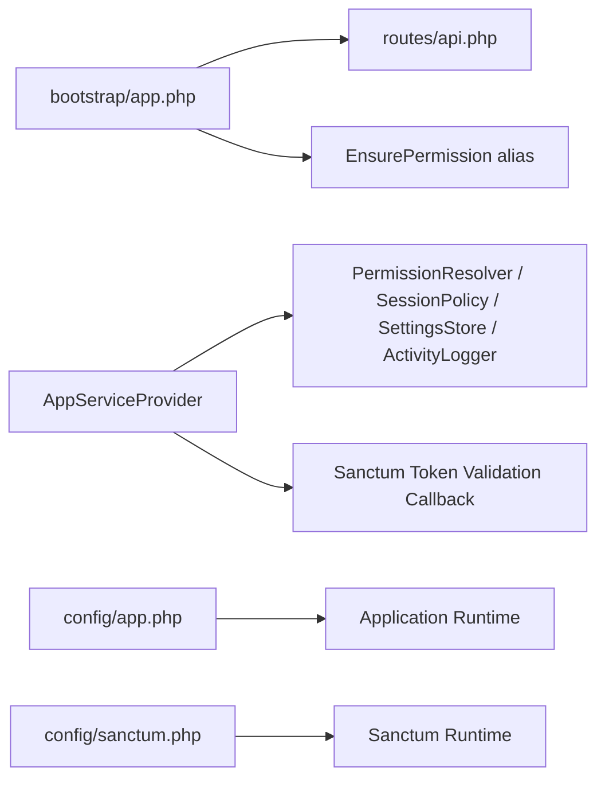
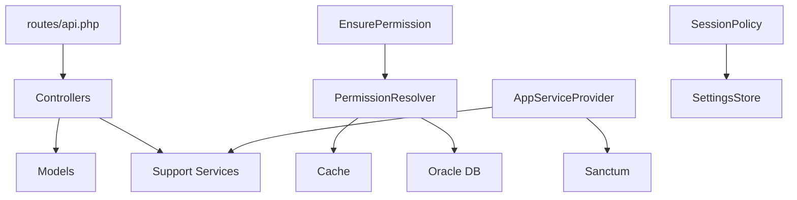

# Laravel API Architecture

<cite>
**Referenced Files in This Document**
- [api.php](file://kyApp_API/routes/api.php)
- [app.php](file://kyApp_API/bootstrap/app.php)
- [AppServiceProvider.php](file://kyApp_API/app/Providers/AppServiceProvider.php)
- [EnsurePermission.php](file://kyApp_API/app/Http/Middleware/EnsurePermission.php)
- [AuthController.php](file://kyApp_API/app/Http/Controllers/AuthController.php)
- [PermissionResolver.php](file://kyApp_API/app/Support/PermissionResolver.php)
- [SessionPolicy.php](file://kyApp_API/app/Support/SessionPolicy.php)
- [sanctum.php](file://kyApp_API/config/sanctum.php)
- [app.php](file://kyApp_API/config/app.php)
</cite>

## Table of Contents
1. [Introduction](#introduction)
2. [Project Structure](#project-structure)
3. [Core Components](#core-components)
4. [Architecture Overview](#architecture-overview)
5. [Detailed Component Analysis](#detailed-component-analysis)
6. [Dependency Analysis](#dependency-analysis)
7. [Performance Considerations](#performance-considerations)
8. [Troubleshooting Guide](#troubleshooting-guide)
9. [Conclusion](#conclusion)

## Introduction
This document explains the Laravel API architecture behind the application. It covers how routes, controllers, middleware, service-layer components, and configuration work together to provide authenticated, permission-gated business endpoints. The system uses Laravel Sanctum for token-based authentication, a custom `permission` middleware for fine-grained access control, and support services for permissions, sessions, settings, and activity logging.

The API follows RESTful conventions: resource-oriented routes under `/invoices`, `/customers`, `/workers/*`, `/accounts/*`, and `/currencies/*`; HTTP methods map to CRUD operations; responses are JSON with consistent success/error shapes; and authorization is enforced at the route level through Sanctum plus a module-action permission code.

## Project Structure
The Laravel backend lives under `kyApp_API`. The relevant parts for this documentation are:

- Routes: `routes/api.php` defines all public API endpoints.
- Bootstrap: `bootstrap/app.php` configures routing, middleware aliases, and exception handling.
- Service Provider: `app/Providers/AppServiceProvider.php` registers support services and hooks Sanctum session validation.
- Middleware: `app/Http/Middleware/EnsurePermission.php` implements the `permission:<code>` gate.
- Controllers: `app/Http/Controllers/*` implement API endpoints. Authentication logic is centralized in `AuthController.php`.
- Support layer: `app/Support/*` contains stateless services such as `PermissionResolver`, `SessionPolicy`, `SettingsStore`, `ActivityLogger`, and related helpers.
- Configuration: `config/app.php` and `config/sanctum.php` define application-level behavior.

**Diagram sources**
- [api.php:1-327](file://kyApp_API/routes/api.php#L1-L327)
- [app.php:8-24](file://kyApp_API/bootstrap/app.php#L8-L24)
- [EnsurePermission.php:25-52](file://kyApp_API/app/Http/Middleware/EnsurePermission.php#L25-L52)
- [AppServiceProvider.php:29-62](file://kyApp_API/app/Providers/AppServiceProvider.php#L29-L62)

**Section sources**
- [api.php:1-327](file://kyApp_API/routes/api.php#L1-L327)
- [app.php:8-24](file://kyApp_API/bootstrap/app.php#L8-L24)

## Core Components
The API’s core runtime consists of:

- **Routing layer**: Centralized in `routes/api.php`. Every business endpoint is grouped under `auth:sanctum` and protected by a specific `permission:<module.action>` code.
- **Authentication layer**: Sanctum bearer tokens. Login, logout, biometric login, and profile endpoints live in `AuthController.php`.
- **Authorization layer**: A custom `permission` middleware that denies requests unless the user has the required grant. Administrators bypass grants via `IS_ADMIN`.
- **Service layer**: Stateless services registered as singletons in `AppServiceProvider`:
  - `PermissionResolver`: evaluates effective permissions from Oracle.
  - `SessionPolicy`: manages sliding idle expiry and absolute lifetime for Sanctum tokens.
  - `SettingsStore`: reads application settings used by security-sensitive flows.
  - `ActivityLogger`: records successful and failed actions.
- **Configuration**: Application name, environment, locale, encryption key, maintenance mode, and Sanctum token/session behavior.

Key responsibilities:
- Controllers coordinate request validation, service calls, and JSON responses.
- Middleware enforces authentication and authorization before controller execution.
- Support services encapsulate cross-cutting concerns like permissions, session policy, and audit logging.

**Section sources**
- [api.php:1-327](file://kyApp_API/routes/api.php#L1-L327)
- [AuthController.php:34-41](file://kyApp_API/app/Http/Controllers/AuthController.php#L34-L41)
- [AppServiceProvider.php:29-36](file://kyApp_API/app/Providers/AppServiceProvider.php#L29-L36)
- [EnsurePermission.php:25-52](file://kyApp_API/app/Http/Middleware/EnsurePermission.php#L25-L52)

## Architecture Overview
The request flow is layered:

1. Laravel boots using `bootstrap/app.php`, which wires web, API, console routes, and health checks.
2. The router matches an incoming URL to a controller method defined in `routes/api.php`.
3. Sanctum authenticates the request using a bearer token.
4. The `permission` middleware checks whether the authenticated user holds the required permission code.
5. The controller validates input, delegates business logic to support services or models, and returns a JSON response.
6. Sanctum’s token validation callback delegates to `SessionPolicy` to enforce idle and absolute session limits.

**Diagram sources**
- [api.php:17-34](file://kyApp_API/routes/api.php#L17-L34)
- [AuthController.php:47-163](file://kyApp_API/app/Http/Controllers/AuthController.php#L47-L163)
- [AppServiceProvider.php:51-62](file://kyApp_API/app/Providers/AppServiceProvider.php#L51-L62)
- [SessionPolicy.php:70-107](file://kyApp_API/app/Support/SessionPolicy.php#L70-L107)

## Detailed Component Analysis

### Routing and RESTful Organization
`routes/api.php` organizes endpoints by domain:

- Authentication: login, logout, me, biometric registration/login/revoke.
- User administration and IBAC permissions: users, permissions, active sessions, settings.
- Business domains: invoices, customers, workers (employees/cutters/tailors), accounts, currencies.
- Diagnostic query endpoint restricted to system-wide wildcard permission.

Each group uses `auth:sanctum` and then applies a specific `permission:<module.action>` code. This enforces deny-by-default authorization: if no grant exists, the request is rejected.

RESTful patterns observed:
- Resource nouns in plural: `/users`, `/customers`, `/workers/employees`, `/accounts/chart`, `/currencies`.
- HTTP verbs map to operations: GET for read, POST for create, PUT/PATCH for update, DELETE for destroy.
- Path parameters are validated with `where()` constraints where numeric IDs are expected.
- Sensitive sub-resources have separate permissions, such as `/customers/{custNo}/statement` requiring `customers.statement`.

**Diagram sources**
- [api.php:45-88](file://kyApp_API/routes/api.php#L45-L88)
- [api.php:138-179](file://kyApp_API/routes/api.php#L138-L179)
- [api.php:189-243](file://kyApp_API/routes/api.php#L189-L243)
- [api.php:255-291](file://kyApp_API/routes/api.php#L255-L291)
- [api.php:302-326](file://kyApp_API/routes/api.php#L302-L326)

**Section sources**
- [api.php:17-34](file://kyApp_API/routes/api.php#L17-L34)
- [api.php:45-88](file://kyApp_API/routes/api.php#L45-L88)
- [api.php:138-179](file://kyApp_API/routes/api.php#L138-L179)
- [api.php:189-243](file://kyApp_API/routes/api.php#L189-L243)
- [api.php:255-291](file://kyApp_API/routes/api.php#L255-L291)
- [api.php:302-326](file://kyApp_API/routes/api.php#L302-L326)

### Middleware Implementation
The `permission` middleware alias is registered in `bootstrap/app.php` and maps to `EnsurePermission`. Its responsibilities:

- Require an authenticated user; otherwise return 401.
- Delegate authorization to `PermissionResolver::can()`.
- Return a structured 403 JSON response when the user lacks the required permission.
- Allow system administrators to pass without explicit grants.

**Diagram sources**
- [app.php:15-21](file://kyApp_API/bootstrap/app.php#L15-L21)
- [EnsurePermission.php:25-52](file://kyApp_API/app/Http/Middleware/EnsurePermission.php#L25-L52)
- [PermissionResolver.php:95-132](file://kyApp_API/app/Support/PermissionResolver.php#L95-L132)

**Section sources**
- [app.php:15-21](file://kyApp_API/bootstrap/app.php#L15-L21)
- [EnsurePermission.php:25-52](file://kyApp_API/app/Http/Middleware/EnsurePermission.php#L25-L52)

### Service Layer Design and Dependency Injection
The service layer separates business rules from HTTP concerns:

- `PermissionResolver` computes effective permissions from Oracle, supports wildcards (`module.*`) and system-wide wildcard (`system.*`), and caches results per user.
- `SessionPolicy` controls token lifecycle: idle expiry, absolute lifetime, sliding renewal, and cleanup of expired tokens.
- `SettingsStore` provides typed access to application settings used by security-sensitive features.
- `ActivityLogger` records audit events for authentication and other sensitive actions.

These services are registered as singletons in `AppServiceProvider`, ensuring one shared instance per request and reducing repeated database reads.

**Diagram sources**
- [AppServiceProvider.php:29-36](file://kyApp_API/app/Providers/AppServiceProvider.php#L29-L36)
- [PermissionResolver.php:95-200](file://kyApp_API/app/Support/PermissionResolver.php#L95-L200)
- [SessionPolicy.php:70-141](file://kyApp_API/app/Support/SessionPolicy.php#L70-L141)

**Section sources**
- [AppServiceProvider.php:29-36](file://kyApp_API/app/Providers/AppServiceProvider.php#L29-L36)
- [PermissionResolver.php:95-200](file://kyApp_API/app/Support/PermissionResolver.php#L95-L200)
- [SessionPolicy.php:70-141](file://kyApp_API/app/Support/SessionPolicy.php#L70-L141)

### Repository Pattern Usage
In this codebase, data access is performed directly in controllers and support classes rather than through a dedicated repository layer. For example:

- `AuthController` queries the `User` model and performs credential checks.
- `PermissionResolver` executes raw SQL against the Oracle connection to fetch permission codes.
- `SessionPolicy` updates Sanctum token rows directly.

This design favors simplicity and direct integration with legacy Oracle schemas but does not follow a strict repository pattern. If a repository layer were introduced, it would encapsulate these queries and isolate database-specific logic from controllers and support services.

**Section sources**
- [AuthController.php:75-140](file://kyApp_API/app/Http/Controllers/AuthController.php#L75-L140)
- [PermissionResolver.php:49-88](file://kyApp_API/app/Support/PermissionResolver.php#L49-L88)
- [SessionPolicy.php:130-141](file://kyApp_API/app/Support/SessionPolicy.php#L130-L141)

### Request Validation Strategies
Validation is performed inside controllers using Laravel’s validator:

- Login validates username, password, and optional user type.
- Biometric registration validates device token, device name, and platform.
- Biometric login validates user ID and device token.

Validation failures return a consistent JSON structure with `success: false`, a human-readable message, and an `errors` object. Successful validations proceed to business logic.

**Diagram sources**
- [AuthController.php:47-66](file://kyApp_API/app/Http/Controllers/AuthController.php#L47-L66)
- [AuthController.php:245-263](file://kyApp_API/app/Http/Controllers/AuthController.php#L245-L263)
- [AuthController.php:316-332](file://kyApp_API/app/Http/Controllers/AuthController.php#L316-L332)

**Section sources**
- [AuthController.php:47-66](file://kyApp_API/app/Http/Controllers/AuthController.php#L47-L66)
- [AuthController.php:245-263](file://kyApp_API/app/Http/Controllers/AuthController.php#L245-L263)
- [AuthController.php:316-332](file://kyApp_API/app/Http/Controllers/AuthController.php#L316-L332)

### Response Formatting Standards
Responses follow a consistent shape:

- Success responses include `success: true`, often a `message`, and either a `token`, `user`, or `data` field depending on the endpoint.
- Failure responses include `success: false`, a `message`, and sometimes an `errors` object for validation or authorization details.
- Authorization failures return 401 for unauthenticated requests and 403 for insufficient permissions.
- Validation failures return 422 with detailed field errors.

Examples:
- Login success returns token and user payload.
- Permission denial returns structured error with the required permission code.
- Biometric enrollment conflict returns 409 with a clear message.

**Section sources**
- [AuthController.php:158-163](file://kyApp_API/app/Http/Controllers/AuthController.php#L158-L163)
- [AuthController.php:199-214](file://kyApp_API/app/Http/Controllers/AuthController.php#L199-L214)
- [EnsurePermission.php:32-52](file://kyApp_API/app/Http/Middleware/EnsurePermission.php#L32-L52)
- [AuthController.php:282-285](file://kyApp_API/app/Http/Controllers/AuthController.php#L282-L285)

### Creating New Controllers and Endpoints
To add a new feature following current conventions:

1. Create a controller under `app/Http/Controllers/`.
2. Define RESTful routes under the appropriate group in `routes/api.php`.
3. Wrap routes in `auth:sanctum` and assign a specific `permission:<module.action>` code.
4. Use Laravel’s validator for input validation.
5. Return consistent JSON responses with `success`, `message`, and domain-specific fields.
6. Log important actions using `ActivityLogger` where applicable.
7. Avoid putting complex business logic in controllers; delegate to support services or models.

Example pattern:
- Route: `GET /new-resource` mapped to `NewResourceController@index` with `permission:new_resource.view`.
- Controller method: validate inputs, call service/model, return JSON.

**Section sources**
- [api.php:138-179](file://kyApp_API/routes/api.php#L138-L179)
- [api.php:189-243](file://kyApp_API/routes/api.php#L189-L243)
- [api.php:255-291](file://kyApp_API/routes/api.php#L255-L291)
- [api.php:302-326](file://kyApp_API/routes/api.php#L302-L326)

### Error Handling Best Practices
Recommended practices based on existing implementation:

- Distinguish between authentication failures (401) and authorization failures (403).
- Include actionable messages and machine-readable error codes.
- Use validation errors for malformed input (422).
- Avoid exposing internal stack traces in production; rely on Laravel’s exception pipeline.
- Log security-sensitive events through `ActivityLogger`.

Current examples:
- Unauthenticated requests return 401 with a bilingual message.
- Missing permissions return 403 with the required permission code.
- Validation failures return 422 with field-level errors.

**Section sources**
- [EnsurePermission.php:32-52](file://kyApp_API/app/Http/Middleware/EnsurePermission.php#L32-L52)
- [AuthController.php:60-66](file://kyApp_API/app/Http/Controllers/AuthController.php#L60-L66)
- [AuthController.php:257-263](file://kyApp_API/app/Http/Controllers/AuthController.php#L257-L263)

### RESTful API Best Practices Observed
- Resource-oriented URLs.
- HTTP verbs aligned with CRUD semantics.
- Numeric path parameters constrained with `where()`.
- Separate permissions for read-only vs write operations.
- Sensitive sub-resources gated by distinct permissions.
- Consistent JSON response structure.

**Section sources**
- [api.php:138-179](file://kyApp_API/routes/api.php#L138-L179)
- [api.php:189-243](file://kyApp_API/routes/api.php#L189-L243)
- [api.php:255-291](file://kyApp_API/routes/api.php#L255-L291)
- [api.php:302-326](file://kyApp_API/routes/api.php#L302-L326)

### Bootstrap Process, Service Providers, and Core Configuration
Bootstrap:
- `bootstrap/app.php` configures routing for web, API, console, and health check.
- Registers the `permission` middleware alias.
- Leaves exception customization open for future enhancements.

Service provider:
- `AppServiceProvider` registers support services as singletons.
- Hooks Sanctum’s token validation callback to enforce session policy.

Core configuration:
- `config/app.php` defines application name, environment, debug mode, URL, timezone, locale, encryption key, and maintenance mode.
- `config/sanctum.php` configures stateful domains, guard, expiration behavior, last-used tracking, token prefix, and middleware.

**Diagram sources**
- [app.php:8-24](file://kyApp_API/bootstrap/app.php#L8-L24)
- [AppServiceProvider.php:29-62](file://kyApp_API/app/Providers/AppServiceProvider.php#L29-L62)
- [app.php:16-124](file://kyApp_API/config/app.php#L16-L124)
- [sanctum.php:21-77](file://kyApp_API/config/sanctum.php#L21-L77)

**Section sources**
- [app.php:8-24](file://kyApp_API/bootstrap/app.php#L8-L24)
- [AppServiceProvider.php:29-62](file://kyApp_API/app/Providers/AppServiceProvider.php#L29-L62)
- [app.php:16-124](file://kyApp_API/config/app.php#L16-L124)
- [sanctum.php:21-77](file://kyApp_API/config/sanctum.php#L21-L77)

## Dependency Analysis
The main dependencies among components are:

- Routes depend on controllers and middleware.
- Controllers depend on models and support services.
- Middleware depends on `PermissionResolver`.
- `AppServiceProvider` depends on support services and Sanctum.
- `SessionPolicy` depends on `SettingsStore`.
- `PermissionResolver` depends on cache and Oracle database.

**Diagram sources**
- [api.php:1-327](file://kyApp_API/routes/api.php#L1-L327)
- [EnsurePermission.php:25-52](file://kyApp_API/app/Http/Middleware/EnsurePermission.php#L25-L52)
- [AppServiceProvider.php:29-62](file://kyApp_API/app/Providers/AppServiceProvider.php#L29-L62)
- [PermissionResolver.php:49-88](file://kyApp_API/app/Support/PermissionResolver.php#L49-L88)
- [SessionPolicy.php:44-44](file://kyApp_API/app/Support/SessionPolicy.php#L44-L44)

**Section sources**
- [api.php:1-327](file://kyApp_API/routes/api.php#L1-L327)
- [EnsurePermission.php:25-52](file://kyApp_API/app/Http/Middleware/EnsurePermission.php#L25-L52)
- [AppServiceProvider.php:29-62](file://kyApp_API/app/Providers/AppServiceProvider.php#L29-L62)
- [PermissionResolver.php:49-88](file://kyApp_API/app/Support/PermissionResolver.php#L49-L88)
- [SessionPolicy.php:44-44](file://kyApp_API/app/Support/SessionPolicy.php#L44-L44)

## Performance Considerations
- Permission caching: `PermissionResolver` caches effective permission codes per user with a TTL and a maximum serialized size to avoid Oracle bind-value overflow.
- Sliding session renewal: `SessionPolicy` throttles writes to reduce database load while keeping active sessions alive.
- Singleton services: Support services are registered as singletons to avoid repeated instantiation and redundant cache-backed reads.
- Minimal auth overhead: Sanctum’s expiration is disabled in favor of custom `EXPIRES_AT` management, preventing hard absolute age from disconnecting active users.

Recommendations:
- Keep permission payloads small; prefer module-level grants over granting every individual action when possible.
- Monitor cache hit rates and adjust TTL if permission changes are frequent.
- Use background jobs for heavy cleanup tasks if token sweep becomes a bottleneck.

**Section sources**
- [PermissionResolver.php:29-43](file://kyApp_API/app/Support/PermissionResolver.php#L29-L43)
- [PermissionResolver.php:66-88](file://kyApp_API/app/Support/PermissionResolver.php#L66-L88)
- [SessionPolicy.php:157-183](file://kyApp_API/app/Support/SessionPolicy.php#L157-L183)
- [sanctum.php:47-63](file://kyApp_API/config/sanctum.php#L47-L63)

## Troubleshooting Guide
Common issues and resolutions:

- 401 Unauthorized:
  - Cause: No authenticated user or invalid/expired session.
  - Check: Sanctum token presence, session policy, and account activation status.
  - Related code: `EnsurePermission` unauthenticated branch, `SessionPolicy::validate`.

- 403 Forbidden:
  - Cause: Missing required permission or deactivated account.
  - Check: Permission catalog, user grants, admin flag, and module-action code alignment.
  - Related code: `EnsurePermission` permission denial, `PermissionResolver::can`.

- 422 Validation Error:
  - Cause: Missing or invalid request fields.
  - Check: Validator rules in the controller method.
  - Related code: `AuthController` validation branches.

- Session unexpectedly expires:
  - Cause: Idle minutes exceeded, absolute days exceeded, or token deletion failure.
  - Check: `session_idle_minutes`, `session_absolute_days`, and token cleanup.
  - Related code: `SessionPolicy::validate`, `SessionPolicy::purgeExpired`.

- Oracle date handling anomalies:
  - Cause: Driver returns unexpected types for nullable dates.
  - Check: Use `SessionPolicy::toDate` for safe date normalization.
  - Related code: `SessionPolicy::toDate`.

**Section sources**
- [EnsurePermission.php:32-52](file://kyApp_API/app/Http/Middleware/EnsurePermission.php#L32-L52)
- [SessionPolicy.php:70-107](file://kyApp_API/app/Support/SessionPolicy.php#L70-L107)
- [SessionPolicy.php:130-141](file://kyApp_API/app/Support/SessionPolicy.php#L130-L141)
- [SessionPolicy.php:50-61](file://kyApp_API/app/Support/SessionPolicy.php#L50-L61)
- [AuthController.php:60-66](file://kyApp_API/app/Http/Controllers/AuthController.php#L60-L66)

## Conclusion
The Laravel API architecture combines Sanctum authentication, a custom permission middleware, and a set of stateless support services to deliver secure, permission-gated endpoints. Routes are organized by domain and protected by module-action codes. Controllers focus on request validation and response formatting, while business logic is delegated to models and services. Session policy ensures flexible idle expiry without disconnecting active users, and permission resolution balances security with performance through caching. Following the documented patterns will help maintain consistency, security, and scalability as new features are added.