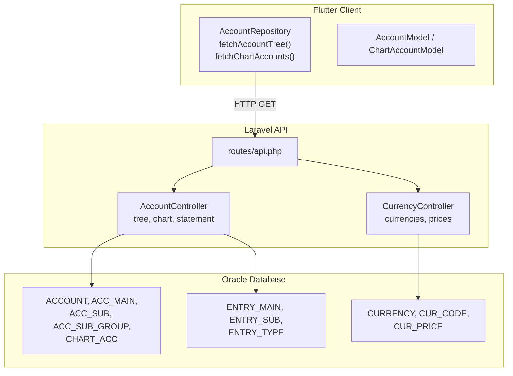
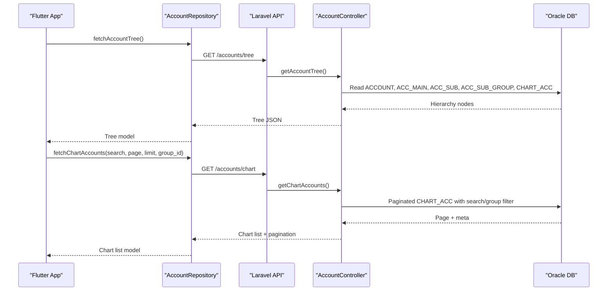
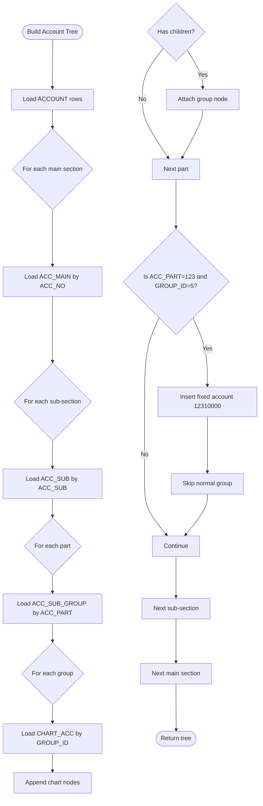
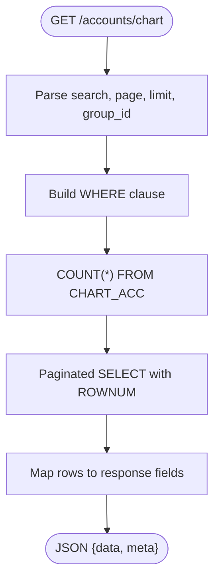
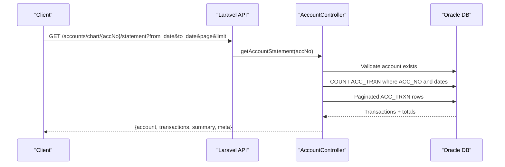
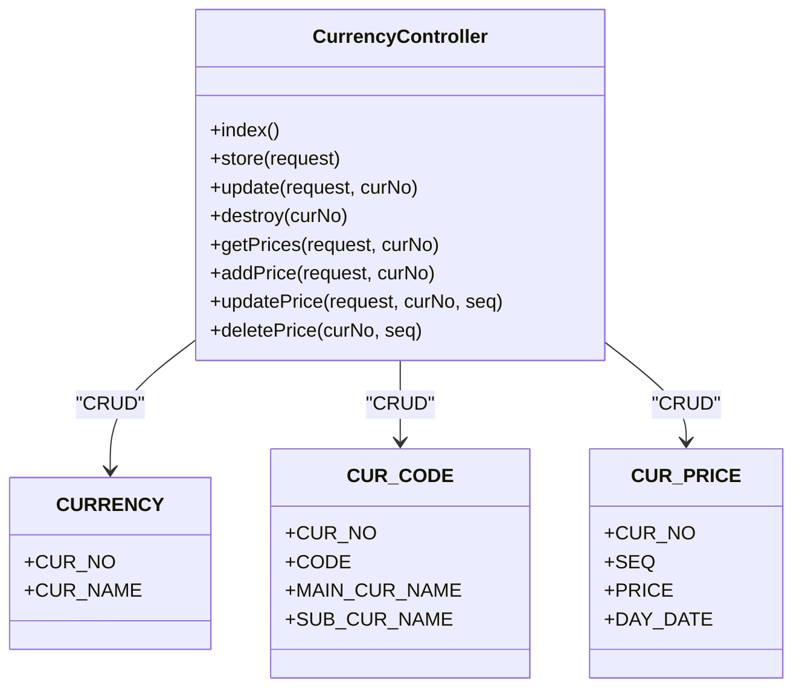
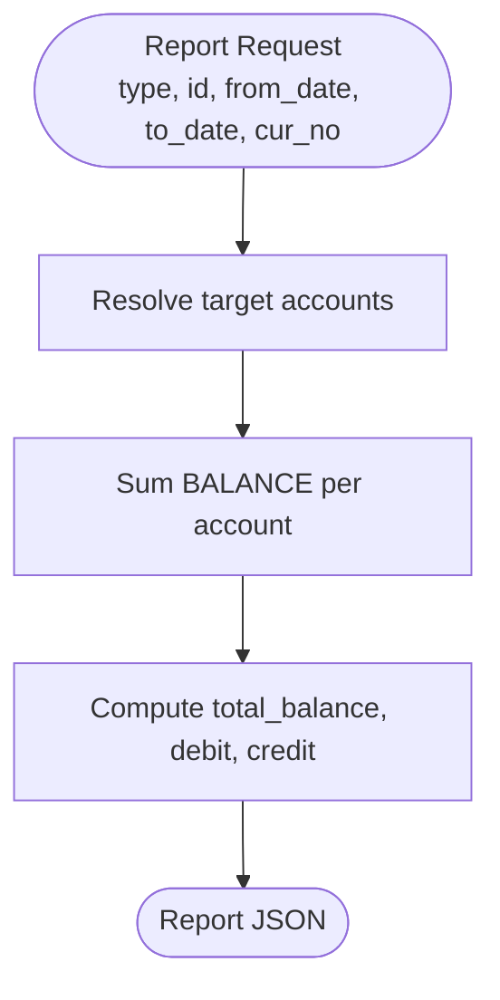
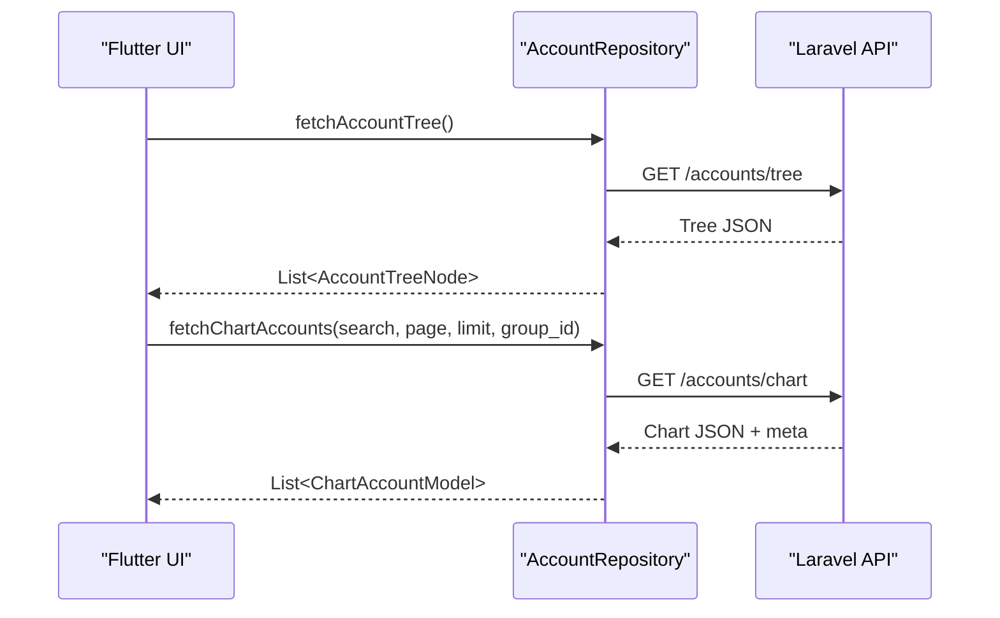
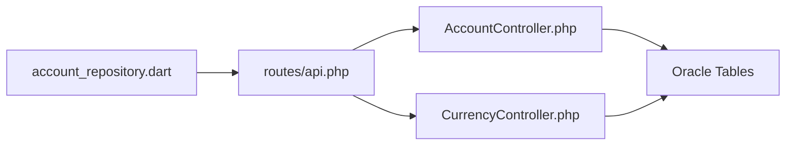

# Accounting & Financial Schema

<cite>
**Referenced Files in This Document**
- [AccountController.php](file://kyApp_API/app/Http/Controllers/AccountController.php)
- [CurrencyController.php](file://kyApp_API/app/Http/Controllers/CurrencyController.php)
- [api.php](file://kyApp_API/routes/api.php)
- [account_repository.dart](file://lib/features/accounts/data/repositories/account_repository.dart)
- [account_model.dart](file://lib/features/accounts/data/models/account_model.dart)
- [DBdevloping_history.md](file://DBdevloping_history.md)
</cite>

## Table of Contents
1. [Introduction](#introduction)
2. [Project Structure](#project-structure)
3. [Core Components](#core-components)
4. [Architecture Overview](#architecture-overview)
5. [Detailed Component Analysis](#detailed-component-analysis)
6. [Dependency Analysis](#dependency-analysis)
7. [Performance Considerations](#performance-considerations)
8. [Troubleshooting Guide](#troubleshooting-guide)
9. [Conclusion](#conclusion)

## Introduction
This document explains the accounting and financial data model, API endpoints, and processing logic for chart of accounts, account statements, multi-currency support, and financial reporting. It focuses on:
- Hierarchical account structure from main sections down to financial accounts.
- Transaction recording and balance calculations through statement queries.
- Currency exchange rate management and period handling.
- Examples of account statement generation, financial reporting queries, and multi-currency transaction processing.

The system uses an Oracle database with a Laravel backend and a Flutter client. Arabic text is stored as Windows-1256 bytes and is normalized at read/write boundaries.

## Project Structure
The accounting domain spans three layers:
- Backend controllers expose REST endpoints for accounts, currencies, and statements.
- Database tables define the hierarchical chart of accounts, transactions, currencies, and exchange rates.
- Flutter repository and models consume the APIs and present tree views and statements.

**Diagram sources**
- [AccountController.php:10-20](file://kyApp_API/app/Http/Controllers/AccountController.php#L10-L20)
- [CurrencyController.php:10-18](file://kyApp_API/app/Http/Controllers/CurrencyController.php#L10-L18)
- [api.php:295-320](file://kyApp_API/routes/api.php#L295-L320)
- [account_repository.dart:120-183](file://lib/features/accounts/data/repositories/account_repository.dart#L120-L183)
- [DBdevloping_history.md:86-99](file://DBdevloping_history.md#L86-L99)

**Section sources**
- [AccountController.php:10-20](file://kyApp_API/app/Http/Controllers/AccountController.php#L10-L20)
- [CurrencyController.php:10-18](file://kyApp_API/app/Http/Controllers/CurrencyController.php#L10-L18)
- [api.php:295-320](file://kyApp_API/routes/api.php#L295-L320)
- [account_repository.dart:120-183](file://lib/features/accounts/data/repositories/account_repository.dart#L120-L183)
- [DBdevloping_history.md:86-99](file://DBdevloping_history.md#L86-L99)

## Core Components
- Chart of Accounts hierarchy:
  - Main section: ACCOUNT (ACC_NO, ACC_NAME).
  - Sub-sections: ACC_MAIN (ACC_NO → parent, ACC_SUB, SUB_NAME).
  - Part-level: ACC_SUB (ACC_SUB → parent, ACC_PART, PART_NAME).
  - Grouping: ACC_SUB_GROUP (GROUP_ID, ACC_PART, ACC_GROUP_NAME).
  - Financial accounts: CHART_ACC (ACC_NO, ACC_NAME, BALANCE, GROUP_ID, SEQ, LIMITED_BALANCE, STOPPING_ACC).
- Transactions and statements:
  - ENTRY_MAIN (ENTRY_NO, ENTRY_DATE, DETAILS, ENTRY_TYPE_NO).
  - ENTRY_SUB (ENTRY_NO, ACC_NO, ENTRY_MNT, BALANCE_S, GIVING).
  - ENTRY_TYPE (ENTRY_TYPE_NO, ENTRY_TYPE_NAME).
- Currencies and exchange rates:
  - CURRENCY (CUR_NO, CUR_NAME).
  - CUR_CODE (CUR_NO, CODE, MAIN_CUR_NAME, SUB_CUR_NAME).
  - CUR_PRICE (CUR_NO, PRICE, DAY_DATE, SEQ).

Key responsibilities:
- AccountController provides endpoints for tree navigation, chart listing, creation/update, and statement retrieval.
- CurrencyController manages currency definitions and exchange rate history.
- Flutter repository calls these endpoints and maps responses into UI models.

**Section sources**
- [DBdevloping_history.md:86-99](file://DBdevloping_history.md#L86-L99)
- [AccountController.php:10-20](file://kyApp_API/app/Http/Controllers/AccountController.php#L10-L20)
- [CurrencyController.php:10-18](file://kyApp_API/app/Http/Controllers/CurrencyController.php#L10-L18)

## Architecture Overview
The accounting flow connects Flutter clients to Laravel controllers that query Oracle tables. Statements combine transaction headers and lines to compute balances over periods. Currency operations provide latest and historical exchange rates.

**Diagram sources**
- [account_repository.dart:120-183](file://lib/features/accounts/data/repositories/account_repository.dart#L120-L183)
- [AccountController.php:156-243](file://kyApp_API/app/Http/Controllers/AccountController.php#L156-L243)
- [AccountController.php:646-800](file://kyApp_API/app/Http/Controllers/AccountController.php#L646-L800)
- [api.php:295-303](file://kyApp_API/routes/api.php#L295-L303)

## Detailed Component Analysis

### Hierarchical Account Structure
The hierarchy is built by traversing:
- ACCOUNT → ACC_MAIN → ACC_SUB → ACC_SUB_GROUP → CHART_ACC.
- The controller constructs a nested tree, including special handling for customer-related groups and a specific customer account exception.

**Diagram sources**
- [AccountController.php:646-800](file://kyApp_API/app/Http/Controllers/AccountController.php#L646-L800)
- [DBdevloping_history.md:86-99](file://DBdevloping_history.md#L86-L99)

**Section sources**
- [AccountController.php:646-800](file://kyApp_API/app/Http/Controllers/AccountController.php#L646-L800)
- [DBdevloping_history.md:86-99](file://DBdevloping_history.md#L86-L99)

### Chart of Accounts Listing and Creation
- Listing supports:
  - Search across name and number.
  - Optional grouping by GROUP_ID.
  - Pagination compatible with Oracle 11g using ROWNUM.
- Creation computes the next account number based on the ACC_PART prefix and inserts into CHART_ACC.

**Diagram sources**
- [AccountController.php:156-243](file://kyApp_API/app/Http/Controllers/AccountController.php#L156-L243)

**Section sources**
- [AccountController.php:156-243](file://kyApp_API/app/Http/Controllers/AccountController.php#L156-L243)

### Account Statement Generation
Two statement endpoints are provided:
- Single-account statement reads precomputed transaction rows from ACC_TRXN when available; otherwise it falls back gracefully.
- Detailed statement aggregates balances across multiple accounts filtered by type (account/main/sub/group), optionally by currency and date range.

**Diagram sources**
- [AccountController.php:434-540](file://kyApp_API/app/Http/Controllers/AccountController.php#L434-L540)

**Section sources**
- [AccountController.php:434-540](file://kyApp_API/app/Http/Controllers/AccountController.php#L434-L540)

### Multi-Currency Support and Exchange Rates
Currency management includes:
- Listing currencies with codes and last two exchange rates.
- Adding, updating, deleting currencies and their codes.
- Managing exchange rate history with pagination.

**Diagram sources**
- [CurrencyController.php:25-94](file://kyApp_API/app/Http/Controllers/CurrencyController.php#L25-L94)
- [CurrencyController.php:96-216](file://kyApp_API/app/Http/Controllers/CurrencyController.php#L96-L216)
- [CurrencyController.php:218-400](file://kyApp_API/app/Http/Controllers/CurrencyController.php#L218-L400)

**Section sources**
- [CurrencyController.php:25-94](file://kyApp_API/app/Http/Controllers/CurrencyController.php#L25-L94)
- [CurrencyController.php:96-216](file://kyApp_API/app/Http/Controllers/CurrencyController.php#L96-L216)
- [CurrencyController.php:218-400](file://kyApp_API/app/Http/Controllers/CurrencyController.php#L218-L400)

### Financial Reporting Queries
Reporting can be performed by aggregating balances across the hierarchy:
- Filter by type (account/main/sub/group).
- Sum balances per account within the selected scope.
- Return totals and summaries for dashboards and reports.

**Diagram sources**
- [AccountController.php:542-640](file://kyApp_API/app/Http/Controllers/AccountController.php#L542-L640)

**Section sources**
- [AccountController.php:542-640](file://kyApp_API/app/Http/Controllers/AccountController.php#L542-L640)

### Flutter Integration for Accounts
The Flutter layer consumes the API:
- Repository methods call endpoints for tree and chart accounts.
- Models parse responses and normalize Arabic text.

**Diagram sources**
- [account_repository.dart:120-183](file://lib/features/accounts/data/repositories/account_repository.dart#L120-L183)
- [account_model.dart:1-44](file://lib/features/accounts/data/models/account_model.dart#L1-L44)

**Section sources**
- [account_repository.dart:120-183](file://lib/features/accounts/data/repositories/account_repository.dart#L120-L183)
- [account_model.dart:1-44](file://lib/features/accounts/data/models/account_model.dart#L1-L44)

## Dependency Analysis
- Controllers depend on Oracle via Laravel’s DB facade.
- Routes map HTTP endpoints to controller methods.
- Flutter repository depends on API endpoints and parses JSON into models.
- Data integrity relies on consistent naming and encoding normalization.

**Diagram sources**
- [account_repository.dart:120-183](file://lib/features/accounts/data/repositories/account_repository.dart#L120-L183)
- [api.php:295-320](file://kyApp_API/routes/api.php#L295-L320)
- [AccountController.php:10-20](file://kyApp_API/app/Http/Controllers/AccountController.php#L10-L20)
- [CurrencyController.php:10-18](file://kyApp_API/app/Http/Controllers/CurrencyController.php#L10-L18)

**Section sources**
- [account_repository.dart:120-183](file://lib/features/accounts/data/repositories/account_repository.dart#L120-L183)
- [api.php:295-320](file://kyApp_API/routes/api.php#L295-L320)
- [AccountController.php:10-20](file://kyApp_API/app/Http/Controllers/AccountController.php#L10-L20)
- [CurrencyController.php:10-18](file://kyApp_API/app/Http/Controllers/CurrencyController.php#L10-L18)

## Performance Considerations
- Use pagination with ROWNUM for large datasets in Oracle 11g.
- Limit page sizes to reduce payload and network overhead.
- Avoid unnecessary joins in tree building; load child levels lazily if needed.
- Cache frequently accessed reference data such as currency lists and exchange rates.
- Normalize Arabic text once at the boundary to avoid repeated conversions.

[No sources needed since this section provides general guidance]

## Troubleshooting Guide
Common issues and resolutions:
- Arabic mojibake: Ensure write paths use conversion to Oracle-compatible bytes and read paths fix mojibake.
- Missing transaction table: Statement endpoint gracefully handles absence of ACC_TRXN; verify table existence or populate it.
- Pagination errors: Use Oracle 11g-compatible pagination patterns with ROWNUM.
- Currency not found: Validate CUR_NO before CRUD operations; return clear 404 messages.
- Permission denied: Ensure required permissions like accounts.statement are granted.

**Section sources**
- [AccountController.php:434-540](file://kyApp_API/app/Http/Controllers/AccountController.php#L434-L540)
- [CurrencyController.php:218-400](file://kyApp_API/app/Http/Controllers/CurrencyController.php#L218-L400)
- [api.php:316-320](file://kyApp_API/routes/api.php#L316-L320)

## Conclusion
The accounting and financial schema provides a robust foundation for hierarchical account management, transactional statements, and multi-currency operations. The Laravel controllers implement safe, paginated queries against Oracle, while the Flutter client integrates seamlessly to present trees, charts, and statements. Proper encoding handling and permission controls ensure reliability and security across the stack.

[No sources needed since this section summarizes without analyzing specific files]