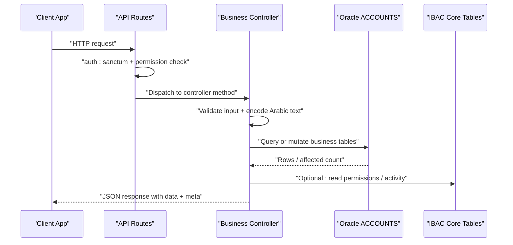
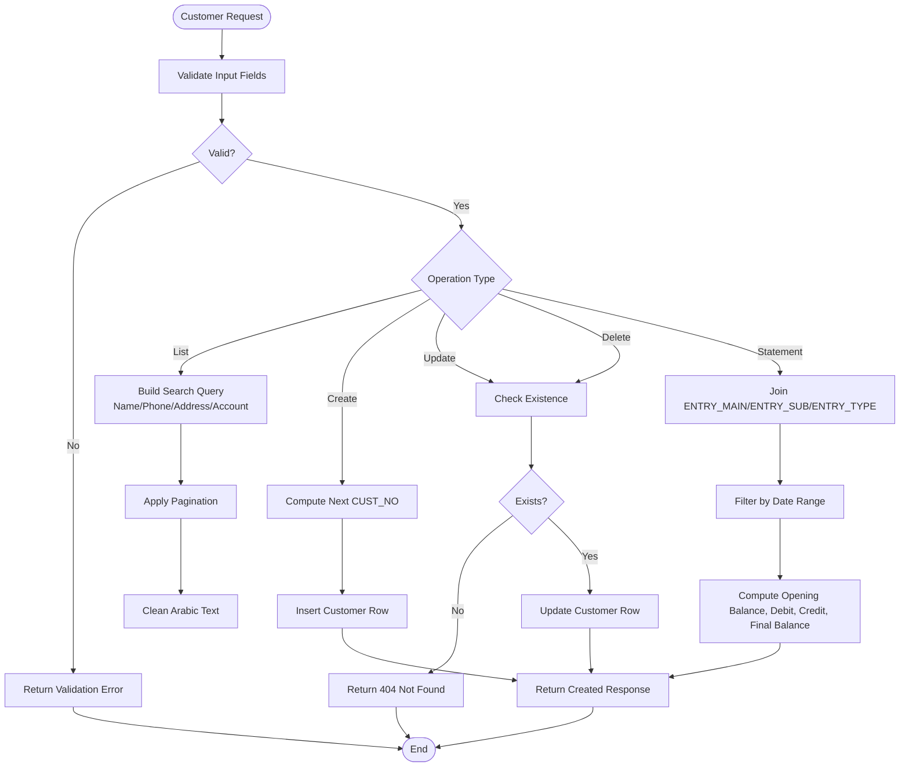
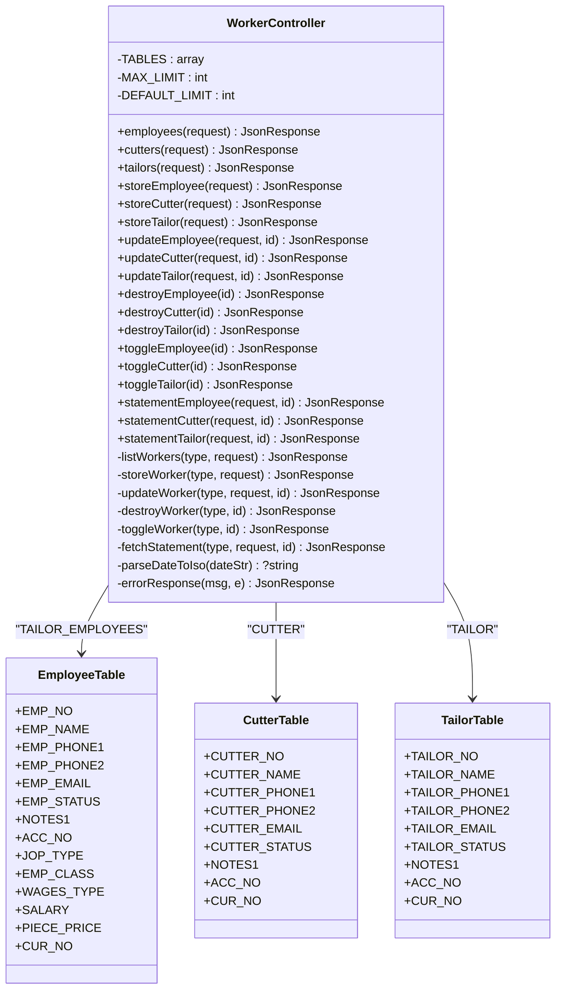
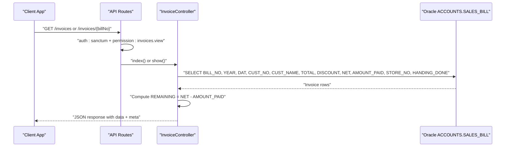
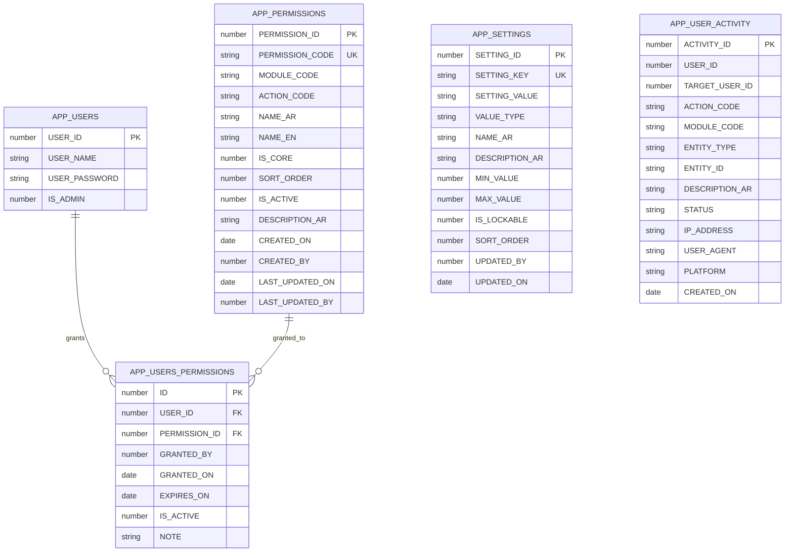
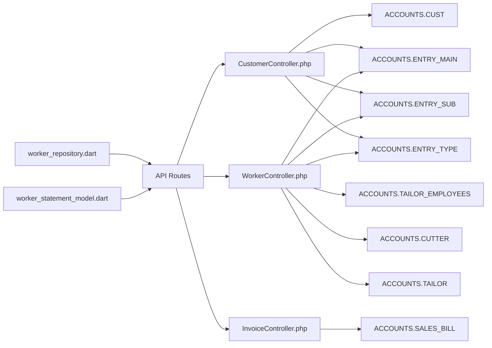

# Business Entity Tables

<cite>
**Referenced Files in This Document**   
- [01_ibac_schema.sql](file://kyApp_API/database/oracle/01_ibac_schema.sql)
- [CustomerController.php](file://kyApp_API/app/Http/Controllers/CustomerController.php)
- [WorkerController.php](file://kyApp_API/app/Http/Controllers/WorkerController.php)
- [InvoiceController.php](file://kyApp_API/app/Http/Controllers/InvoiceController.php)
- [api.php](file://kyApp_API/routes/api.php)
- [worker_statement_model.dart](file://lib/features/workers/data/models/worker_statement_model.dart)
- [worker_repository.dart](file://lib/features/workers/data/repositories/worker_repository.dart)
- [DBdevloping_history.md](file://DBdevloping_history.md)
</cite>

## Table of Contents
1. [Introduction](#introduction)
2. [Project Structure](#project-structure)
3. [Core Components](#core-components)
4. [Architecture Overview](#architecture-overview)
5. [Detailed Component Analysis](#detailed-component-analysis)
6. [Dependency Analysis](#dependency-analysis)
7. [Performance Considerations](#performance-considerations)
8. [Troubleshooting Guide](#troubleshooting-guide)
9. [Conclusion](#conclusion)

## Introduction
This document explains the business entity tables and their integration with the core system: customer management, worker management (employees, cutters, tailors), chart of accounts, financial transactions, and invoice processing. The application is a Laravel API that reads from and writes to an Oracle `ACCOUNTS` schema. Core security and audit tables are defined by the IBAC schema, while business entities such as customers, workers, invoices, and accounting entries are accessed through dedicated controllers.

The documentation covers:
- Schema design for customers, workers, chart of accounts, and financial transactions.
- Relationships between business entities and core tables.
- Data validation rules, business constraints, and referential integrity policies.
- Typical CRUD operations and reporting queries.
- Performance considerations and indexing strategies.

## Project Structure
The relevant backend structure for business entities is under `kyApp_API`:
- Controllers expose REST endpoints for customers, workers, invoices, and accounts.
- Routes define permission-gated access.
- An Oracle SQL file defines the core IBAC schema used by authentication, permissions, settings, and activity logging.
- A Flutter repository and model consume worker statement data from the API.

```mermaid
graph TB
subgraph "Laravel API"
Routes["routes/api.php"]
CustomerCtrl["CustomerController.php"]
WorkerCtrl["WorkerController.php"]
InvoiceCtrl["InvoiceController.php"]
AccountCtrl["AccountController.php"]
end
subgraph "Oracle ACCOUNTS Schema"
CUST["CUST"]
TAILOR_EMPLOYEES["TAILOR_EMPLOYEES"]
CUTTER["CUTTER"]
TAILOR["TAILOR"]
SALES_BILL["SALES_BILL"]
ENTRY_MAIN["ENTRY_MAIN"]
ENTRY_SUB["ENTRY_SUB"]
ENTRY_TYPE["ENTRY_TYPE"]
CHART_ACC["CHART_ACC"]
end
subgraph "Core IBAC"
APP_USERS["APP_USERS"]
APP_PERMISSIONS["APP_PERMISSIONS"]
APP_USERS_PERMISSIONS["APP_USERS_PERMISSIONS"]
APP_SETTINGS["APP_SETTINGS"]
APP_USER_ACTIVITY["APP_USER_ACTIVITY"]
end
Routes --> CustomerCtrl
Routes --> WorkerCtrl
Routes --> InvoiceCtrl
Routes --> AccountCtrl
CustomerCtrl --> CUST
CustomerCtrl --> ENTRY_MAIN
CustomerCtrl --> ENTRY_SUB
CustomerCtrl --> ENTRY_TYPE
WorkerCtrl --> TAILOR_EMPLOYEES
WorkerCtrl --> CUTTER
WorkerCtrl --> TAILOR
WorkerCtrl --> ENTRY_MAIN
WorkerCtrl --> ENTRY_SUB
WorkerCtrl --> ENTRY_TYPE
InvoiceCtrl --> SALES_BILL
AccountCtrl --> CHART_ACC
AccountCtrl --> ENTRY_MAIN
AccountCtrl --> ENTRY_SUB
AccountCtrl --> ENTRY_TYPE
Routes --> APP_PERMISSIONS
Routes --> APP_USERS_PERMISSIONS
CustomerCtrl -.-> APP_USERS
WorkerCtrl -.-> APP_USERS
InvoiceCtrl -.-> APP_USERS
AccountCtrl -.-> APP_USERS
```

**Diagram sources**
- [api.php:138-291](file://kyApp_API/routes/api.php#L138-L291)
- [CustomerController.php:12-464](file://kyApp_API/app/Http/Controllers/CustomerController.php#L12-L464)
- [WorkerController.php:12-598](file://kyApp_API/app/Http/Controllers/WorkerController.php#L12-L598)
- [InvoiceController.php:10-140](file://kyApp_API/app/Http/Controllers/InvoiceController.php#L10-L140)
- [01_ibac_schema.sql:21-190](file://kyApp_API/database/oracle/01_ibac_schema.sql#L21-L190)

**Section sources**
- [api.php:138-291](file://kyApp_API/routes/api.php#L138-L291)
- [CustomerController.php:12-464](file://kyApp_API/app/Http/Controllers/CustomerController.php#L12-L464)
- [WorkerController.php:12-598](file://kyApp_API/app/Http/Controllers/WorkerController.php#L12-L598)
- [InvoiceController.php:10-140](file://kyApp_API/app/Http/Controllers/InvoiceController.php#L10-L140)
- [01_ibac_schema.sql:21-190](file://kyApp_API/database/oracle/01_ibac_schema.sql#L21-L190)

## Core Components
This section summarizes the primary business components and their responsibilities:

- Customers: CRUD over `ACCOUNTS.CUST`, plus account statements derived from `ENTRY_MAIN`, `ENTRY_SUB`, and `ENTRY_TYPE`.
- Workers: Unified management for employees (`TAILOR_EMPLOYEES`), cutters (`CUTTER`), and tailors (`TAILOR`), including status toggling and account statements.
- Invoices: Read-only access to `ACCOUNTS.SALES_BILL`; creation/update/delete is intentionally not exposed here because invoices originate in the legacy accounting system.
- Chart of Accounts: Managed via `AccountController` endpoints; typically backed by `CHART_ACC` and related ledger structures.
- Financial Transactions: Represented by `ENTRY_MAIN` and `ENTRY_SUB`, linked to `ENTRY_TYPE`, and used to compute balances and statements across customers and workers.
- Core Security and Audit: Defined by the IBAC schema, including users, permissions, grants, settings, and activity logs.

Key implementation references:
- Customer CRUD and statement logic: [CustomerController.php:28-464](file://kyApp_API/app/Http/Controllers/CustomerController.php#L28-L464)
- Worker unified controller and statement logic: [WorkerController.php:18-598](file://kyApp_API/app/Http/Controllers/WorkerController.php#L18-L598)
- Invoice read-only endpoints: [InvoiceController.php:51-140](file://kyApp_API/app/Http/Controllers/InvoiceController.php#L51-L140)
- IBAC core tables and constraints: [01_ibac_schema.sql:38-190](file://kyApp_API/database/oracle/01_ibac_schema.sql#L38-L190)

**Section sources**
- [CustomerController.php:28-464](file://kyApp_API/app/Http/Controllers/CustomerController.php#L28-L464)
- [WorkerController.php:18-598](file://kyApp_API/app/Http/Controllers/WorkerController.php#L18-L598)
- [InvoiceController.php:51-140](file://kyApp_API/app/Http/Controllers/InvoiceController.php#L51-L140)
- [01_ibac_schema.sql:38-190](file://kyApp_API/database/oracle/01_ibac_schema.sql#L38-L190)

## Architecture Overview
The business layer follows a layered architecture:
- HTTP routes enforce authentication and fine-grained permissions.
- Controllers validate input, perform encoding conversions for Arabic text, and execute database operations against the Oracle `ACCOUNTS` schema.
- Reporting endpoints compute summaries and running balances using transactional entry tables.
- Core IBAC tables provide user identity, permissions, settings, and activity auditing.

**Diagram sources**
- [api.php:138-291](file://kyApp_API/routes/api.php#L138-L291)
- [CustomerController.php:118-288](file://kyApp_API/app/Http/Controllers/CustomerController.php#L118-L288)
- [WorkerController.php:244-381](file://kyApp_API/app/Http/Controllers/WorkerController.php#L244-L381)
- [InvoiceController.php:51-140](file://kyApp_API/app/Http/Controllers/InvoiceController.php#L51-L140)
- [01_ibac_schema.sql:38-190](file://kyApp_API/database/oracle/01_ibac_schema.sql#L38-L190)

## Detailed Component Analysis

### Customer Management
Customers are managed through the `ACCOUNTS.CUST` table. The controller supports:
- Listing with search across name, phone numbers, account number, and address fields.
- Retrieving a single customer by `CUST_NO`.
- Creating new customers with computed next ID and proper Arabic encoding.
- Updating existing customers after existence checks.
- Deleting customers after existence checks.
- Generating a customer account statement by joining `ENTRY_MAIN`, `ENTRY_SUB`, and `ENTRY_TYPE`, filtering by date range, and computing opening balance, debits, credits, and final balance.

Validation rules include required customer names, optional email format, numeric limits, and boolean flags for stopping customers. Arabic text is converted to Oracle-compatible byte sequences before insert/update and cleaned on output.

**Diagram sources**
- [CustomerController.php:28-464](file://kyApp_API/app/Http/Controllers/CustomerController.php#L28-L464)

Typical CRUD examples:
- List customers: GET `/customers?search=...&page=...&limit=...`
- Get customer: GET `/customers/{custNo}`
- Create customer: POST `/customers` with validated payload
- Update customer: PUT `/customers/{custNo}`
- Delete customer: DELETE `/customers/{custNo}`
- Customer statement: GET `/customers/{custNo}/statement?from_date=...&to_date=...`

Reporting query example:
- Customer statement joins `ENTRY_MAIN`, `ENTRY_SUB`, and `ENTRY_TYPE` filtered by `ACC_NO` and `GIVING = CUST_NO`, then computes debit/credit totals and running balance within the requested date range.

**Section sources**
- [CustomerController.php:28-464](file://kyApp_API/app/Http/Controllers/CustomerController.php#L28-L464)
- [api.php:158-179](file://kyApp_API/routes/api.php#L158-L179)

### Worker Management
Workers cover three distinct registries:
- Employees: `ACCOUNTS.TAILOR_EMPLOYEES`
- Cutters: `ACCOUNTS.CUTTER`
- Tailors: `ACCOUNTS.TAILOR`

Each registry has its own primary key, name column, phone columns, email, status, notes, and account number. The controller provides:
- Listing with search by numeric ID or name/phone.
- Creation with auto-incremented IDs and default active status.
- Updates after existence checks.
- Deletion after existence checks.
- Status toggling between active and inactive states.
- Statement generation based on the worker’s `ACC_NO`, joining `ENTRY_MAIN`, `ENTRY_SUB`, and `ENTRY_TYPE`, with optional date filtering and summary computation.

**Diagram sources**
- [WorkerController.php:18-598](file://kyApp_API/app/Http/Controllers/WorkerController.php#L18-L598)

Typical CRUD examples:
- List employees: GET `/workers/employees?search=...&page=...&limit=...`
- Create employee: POST `/workers/employees`
- Update employee: PUT `/workers/employees/{id}`
- Toggle employee: PATCH `/workers/employees/{id}/toggle`
- Employee statement: GET `/workers/employees/{id}/statement?from_date=...&to_date=...`
- Same patterns apply for cutters and tailors with respective route paths.

Reporting query example:
- Worker statement selects entries where `ENTRY_SUB.ACC_NO = worker.ACC_NO`, joins `ENTRY_MAIN` and `ENTRY_TYPE`, filters by date range, and computes opening balance, total debit/credit, and final balance.

**Section sources**
- [WorkerController.php:18-598](file://kyApp_API/app/Http/Controllers/WorkerController.php#L18-L598)
- [api.php:189-243](file://kyApp_API/routes/api.php#L189-L243)
- [DBdevloping_history.md:57-62](file://DBdevloping_history.md#L57-L62)

### Accounting and Chart of Accounts
Chart of accounts is managed via dedicated endpoints in `AccountController`. While the specific controller implementation is not included here, the routes indicate:
- Reading account tree and main/sub accounts.
- Managing `CHART_ACC` rows (create/update).
- Managing sub-groups (structure management).
- Generating statements and detailed statements for accounts.

These endpoints are gated by permissions:
- `accounts.view` for reading structure.
- `accounts.create` and `accounts.update` for modifying account rows.
- `accounts.structure_manage` for reshaping hierarchy groups.
- `accounts.statement` for accessing sensitive balance reports.

Integration points:
- Statements likely join `ENTRY_MAIN`, `ENTRY_SUB`, and `ENTRY_TYPE` similar to customer and worker statements.
- Currency pricing endpoints support valuation of transactions across currencies.

**Section sources**
- [api.php:245-291](file://kyApp_API/routes/api.php#L245-L291)

### Invoice Processing
Invoices are read-only in this API surface:
- List invoices with search by bill number or customer name.
- Retrieve a single invoice by bill number.
- Compute remaining amount as `NET - AMOUNT_PAID`.

The controller explicitly avoids creating, updating, or deleting invoices because they originate in the legacy accounting system.

**Diagram sources**
- [InvoiceController.php:51-140](file://kyApp_API/app/Http/Controllers/InvoiceController.php#L51-L140)
- [api.php:138-142](file://kyApp_API/routes/api.php#L138-L142)

Typical CRUD examples:
- List invoices: GET `/invoices?search=...&page=...&limit=...`
- Get invoice: GET `/invoices/{billNo}`

Note: No create/update/delete endpoints are provided for invoices in this API.

**Section sources**
- [InvoiceController.php:51-140](file://kyApp_API/app/Http/Controllers/InvoiceController.php#L51-L140)
- [api.php:138-142](file://kyApp_API/routes/api.php#L138-L142)

### Core System Integration (IBAC)
The IBAC schema defines core tables for authentication, permissions, settings, and activity logging:
- `APP_USERS`: Extended with admin flag and widened password column.
- `APP_PERMISSIONS`: Permission catalog with codes, modules, actions, and activation flags.
- `APP_USERS_PERMISSIONS`: Direct user-to-permission grants with expiration and activity tracking.
- `APP_SETTINGS`: Configurable security/session settings with typed values.
- `APP_USER_ACTIVITY`: Lightweight audit trail without foreign keys to allow anonymous failed logins and preserve history after user deletion.

Constraints and indexes:
- Primary keys and unique constraints ensure data integrity.
- Check constraints enforce boolean-like flags.
- Indexes optimize lookups by module, user, permission, and activity time ranges.

**Diagram sources**
- [01_ibac_schema.sql:21-190](file://kyApp_API/database/oracle/01_ibac_schema.sql#L21-L190)

**Section sources**
- [01_ibac_schema.sql:21-190](file://kyApp_API/database/oracle/01_ibac_schema.sql#L21-L190)

## Dependency Analysis
Business controllers depend on:
- Oracle `ACCOUNTS` schema tables for domain data.
- IBAC core tables for authentication and authorization.
- Flutter client models and repositories for consuming worker statement data.

**Diagram sources**
- [worker_repository.dart:136-181](file://lib/features/workers/data/repositories/worker_repository.dart#L136-L181)
- [worker_statement_model.dart:1-64](file://lib/features/workers/data/models/worker_statement_model.dart#L1-L64)
- [CustomerController.php:28-464](file://kyApp_API/app/Http/Controllers/CustomerController.php#L28-L464)
- [WorkerController.php:18-598](file://kyApp_API/app/Http/Controllers/WorkerController.php#L18-L598)
- [InvoiceController.php:51-140](file://kyApp_API/app/Http/Controllers/InvoiceController.php#L51-L140)

**Section sources**
- [worker_repository.dart:136-181](file://lib/features/workers/data/repositories/worker_repository.dart#L136-L181)
- [worker_statement_model.dart:1-64](file://lib/features/workers/data/models/worker_statement_model.dart#L1-L64)
- [CustomerController.php:28-464](file://kyApp_API/app/Http/Controllers/CustomerController.php#L28-L464)
- [WorkerController.php:18-598](file://kyApp_API/app/Http/Controllers/WorkerController.php#L18-L598)
- [InvoiceController.php:51-140](file://kyApp_API/app/Http/Controllers/InvoiceController.php#L51-L140)

## Performance Considerations
- Pagination: All list endpoints cap maximum page size and use offset/limit to avoid large result sets.
- Search optimization: Numeric searches bypass full-text LIKE clauses; Arabic text uses encoded search terms to match stored CP1256 bytes.
- Statement queries: Joining `ENTRY_MAIN`, `ENTRY_SUB`, and `ENTRY_TYPE` can be expensive; consider:
  - Indexing `ENTRY_SUB.ACC_NO`, `ENTRY_SUB.GIVING`, and `ENTRY_MAIN.ENTRY_DATE`.
  - Precomputing running balances if historical statements are frequently requested.
- Arabic encoding overhead: Converting and cleaning Arabic text adds CPU cost; batch operations should minimize repeated conversions.
- Read-only invoices: Since invoices are read-only, caching layers can safely cache invoice lists and details for short periods.
- Activity logging: `APP_USER_ACTIVITY` is designed to never fail requests; ensure inserts are lightweight and possibly asynchronous.

Indexing recommendations:
- `ACCOUNTS.CUST`: Index on `CUST_NO`, `ACC_NO`, and common search columns like `TEL1`, `TEL2`, `ADDR`.
- `ACCOUNTS.TAILOR_EMPLOYEES`, `CUTTER`, `TAILOR`: Index on primary keys and `ACC_NO`.
- `ACCOUNTS.SALES_BILL`: Index on `BILL_NO`, `DAT`, and `CUST_NO`.
- `ACCOUNTS.ENTRY_MAIN`, `ENTRY_SUB`: Composite indexes on `(ENTRY_DATE, ENTRY_NO)` and `(ACC_NO, ENTRY_NO)`.
- IBAC tables: Existing indexes on `MODULE_CODE`, `USER_ID`, `PERMISSION_ID`, and activity timestamps are already present.

[No sources needed since this section provides general guidance]

## Troubleshooting Guide
Common issues and resolutions:
- Arabic mojibake: Use `ArabicEncoding::toOracleSearchChars()` for writes and `ArabicEncoding::cleanData()` or `fixMojibake()` for reads.
- Validation failures: Ensure required fields like customer names and email formats are correct; check numeric constraints and boolean flags.
- Not found errors: Verify IDs exist before update/delete operations; return 404 when records are missing.
- Statement date parsing: Handle both `DD/MM/YYYY` and ISO formats; fallback to Carbon parsing when necessary.
- Permission denials: Confirm the authenticated user has the required permission code; deny-by-default applies when no grant exists.
- Legacy table modifications: Avoid altering pre-existing tables like `APP_USERS` without caution; the schema widens password length and adds admin flag carefully.

Operational tips:
- Use pagination parameters consistently to avoid timeouts.
- Log activity only when safe; do not let audit failures break requests.
- For worker statements, ensure the worker record has an associated `ACC_NO`; otherwise, return a clear error.

**Section sources**
- [CustomerController.php:118-288](file://kyApp_API/app/Http/Controllers/CustomerController.php#L118-L288)
- [WorkerController.php:244-381](file://kyApp_API/app/Http/Controllers/WorkerController.php#L244-L381)
- [InvoiceController.php:51-140](file://kyApp_API/app/Http/Controllers/InvoiceController.php#L51-L140)
- [01_ibac_schema.sql:21-190](file://kyApp_API/database/oracle/01_ibac_schema.sql#L21-L190)

## Conclusion
The business entity layer integrates customers, workers, invoices, and accounting data with a secure, permission-gated API. Customers and workers have full CRUD capabilities and robust statement reporting. Invoices are read-only due to legacy system ownership. The IBAC core ensures strong authentication, granular permissions, configurable settings, and non-blocking audit logging. Proper validation, Arabic encoding handling, and indexing strategies are essential for performance and data integrity. Future enhancements should focus on optimizing statement queries, expanding chart-of-accounts reporting, and maintaining strict referential integrity across business tables.

[No sources needed since this section summarizes without analyzing specific files]