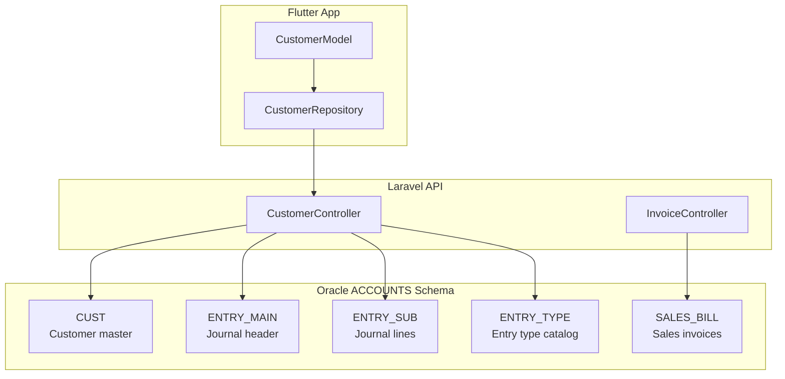
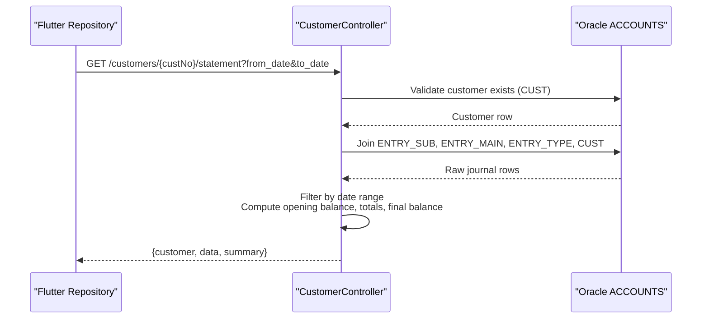
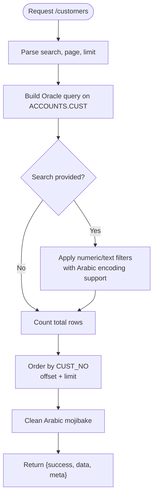
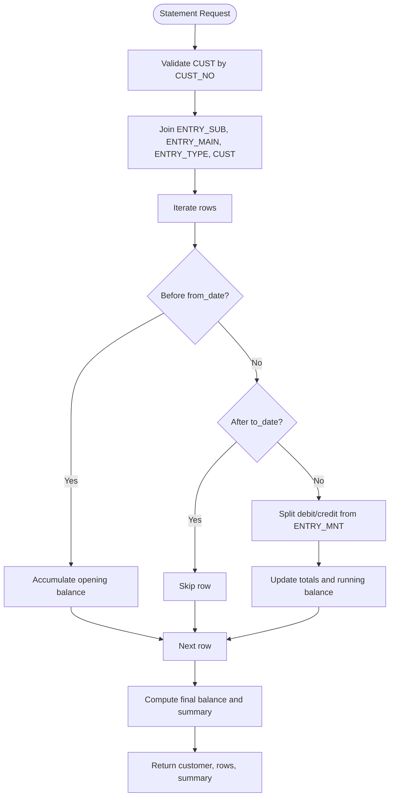
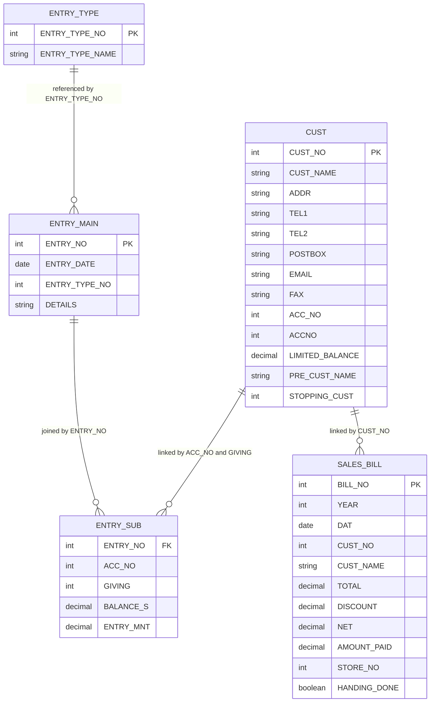
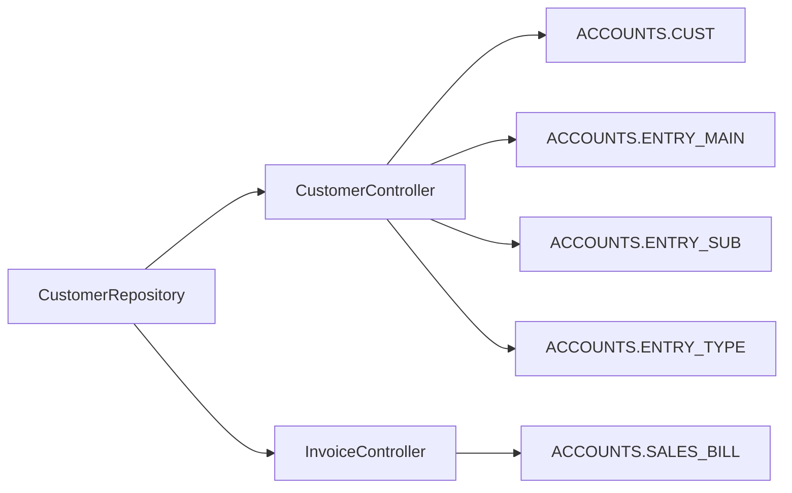

# Customer Management Schema

<cite>
**Referenced Files in This Document**   
- [CustomerController.php](file://kyApp_API/app/Http/Controllers/CustomerController.php)
- [InvoiceController.php](file://kyApp_API/app/Http/Controllers/InvoiceController.php)
- [customer_model.dart](file://lib/features/customers/data/models/customer_model.dart)
- [customer_repository.dart](file://lib/features/customers/data/repositories/customer_repository.dart)
- [01_ibac_schema.sql](file://kyApp_API/database/oracle/01_ibac_schema.sql)
- [02_ibac_seed.php](file://kyApp_API/database/oracle/02_ibac_seed.php)
- [03_ibac_bootstrap.php](file://kyApp_API/database/oracle/03_ibac_bootstrap.php)
- [db_commends.md](file://db_commends.md)
</cite>

## Table of Contents
1. [Introduction](#introduction)
2. [Project Structure](#project-structure)
3. [Core Components](#core-components)
4. [Architecture Overview](#architecture-overview)
5. [Detailed Component Analysis](#detailed-component-analysis)
6. [Dependency Analysis](#dependency-analysis)
7. [Performance Considerations](#performance-considerations)
8. [Troubleshooting Guide](#troubleshooting-guide)
9. [Conclusion](#conclusion)

## Introduction
This document explains the customer-related data model used by the application. It focuses on:
- The customer entity and its contact information storage.
- The financial statement generation flow.
- The relationship between customers, accounting entries, invoices, and system audit records.
- Practical examples of customer search queries, statement generation SQL, and mapping to other business entities.

The backend is a Laravel API that reads from an Oracle database under the `ACCOUNTS` schema. The frontend is a Flutter app that calls REST endpoints for customer listing, details, and statements.

## Project Structure
The customer domain spans three layers:
- **Database layer**: Legacy Oracle tables under `ACCOUNTS`, including `CUST`, `ENTRY_MAIN`, `ENTRY_SUB`, `ENTRY_TYPE`, and `SALES_BILL`.
- **API layer**: Laravel controllers that expose customer and invoice operations and generate statements.
- **Frontend layer**: Flutter models and repositories that call `/customers` and `/customers/{custNo}/statement`.

**Diagram sources**
- [CustomerController.php:18-42](file://kyApp_API/app/Http/Controllers/CustomerController.php#L18-L42)
- [CustomerController.php:313-332](file://kyApp_API/app/Http/Controllers/CustomerController.php#L313-L332)
- [InvoiceController.php:20-45](file://kyApp_API/app/Http/Controllers/InvoiceController.php#L20-L45)
- [customer_model.dart:3-55](file://lib/features/customers/data/models/customer_model.dart#L3-L55)
- [customer_repository.dart:121-154](file://lib/features/customers/data/repositories/customer_repository.dart#L121-L154)

**Section sources**
- [CustomerController.php:12-22](file://kyApp_API/app/Http/Controllers/CustomerController.php#L12-L22)
- [InvoiceController.php:10-24](file://kyApp_API/app/Http/Controllers/InvoiceController.php#L10-L24)
- [customer_model.dart:3-55](file://lib/features/customers/data/models/customer_model.dart#L3-L55)
- [customer_repository.dart:121-154](file://lib/features/customers/data/repositories/customer_repository.dart#L121-L154)

## Core Components
### Customer Entity
The customer entity is stored in the legacy Oracle table `ACCOUNTS.CUST`. The controller selects core identity, address, phone, postal box, email, fax, account number, balance limit, previous name, and stop flag.

Key fields exposed by the API include:
- `CUST_NO`: customer identifier.
- `CUST_NAME`: Arabic and legacy-encoded customer name.
- `ADDR`, `TEL1`, `TEL2`, `POSTBOX`, `EMAIL`, `FAX`: contact information.
- `ACC_NO`, `ACCNO`: account numbers used for financial linkage.
- `LIMITED_BALANCE`: credit or balance limit.
- `PRE_CUST_NAME`: previous customer name.
- `STOPPING_CUST`: stop flag indicating whether the customer is blocked.

The Flutter `CustomerModel` maps these columns into a typed Dart object and exposes helper properties such as `isStopped`.

**Section sources**
- [CustomerController.php:36-42](file://kyApp_API/app/Http/Controllers/CustomerController.php#L36-L42)
- [customer_model.dart:3-55](file://lib/features/customers/data/models/customer_model.dart#L3-L55)

### Statement Generation Tables
Customer statements are not generated from a dedicated “statement” table. Instead, they are computed at query time by joining:
- `ACCOUNTS.CUST`: customer master.
- `ACCOUNTS.ENTRY_SUB`: journal line with balances and amounts.
- `ACCOUNTS.ENTRY_MAIN`: journal header with entry date and details.
- `ACCOUNTS.ENTRY_TYPE`: entry type catalog with readable names.

The statement query joins these tables using:
- `ENTRY_SUB.ACC_NO = CUST.ACC_NO`
- `ENTRY_SUB.GIVING = CUST.CUST_NO`
- `ENTRY_SUB.ENTRY_NO = ENTRY_MAIN.ENTRY_NO`
- `ENTRY_MAIN.ENTRY_TYPE_NO = ENTRY_TYPE.ENTRY_TYPE_NO`

The result includes formatted entry date, raw ISO date, entry type name, details, running balance, debit/credit amount, and customer/account identifiers.

**Section sources**
- [CustomerController.php:313-332](file://kyApp_API/app/Http/Controllers/CustomerController.php#L313-L332)
- [db_commends.md:21-37](file://db_commends.md#L21-L37)

### Invoice Relationship
Invoices are read-only and originate from the legacy accounting system. They are stored in `ACCOUNTS.SALES_BILL` and linked to customers through `CUST_NO` and `CUST_NAME`. The invoice list computes a remaining balance as `NET - AMOUNT_PAID`.

**Section sources**
- [InvoiceController.php:10-45](file://kyApp_API/app/Http/Controllers/InvoiceController.php#L10-L45)

### System Audit and History Tracking
System activity is tracked in `ACCOUNTS.APP_USER_ACTIVITY`. While this is not a customer history table, it can be used to audit user actions related to customers when the action code, module, entity type, and entity ID are set appropriately. The bootstrap script also demonstrates how audit rows are inserted safely without breaking initialization.

**Section sources**
- [01_ibac_schema.sql:148-189](file://kyApp_API/database/oracle/01_ibac_schema.sql#L148-L189)
- [03_ibac_bootstrap.php:187-217](file://kyApp_API/database/oracle/03_ibac_bootstrap.php#L187-L217)

## Architecture Overview
The customer statement workflow connects the Flutter repository, Laravel controller, and Oracle tables.

**Diagram sources**
- [customer_repository.dart:121-154](file://lib/features/customers/data/repositories/customer_repository.dart#L121-L154)
- [CustomerController.php:294-420](file://kyApp_API/app/Http/Controllers/CustomerController.php#L294-L420)

## Detailed Component Analysis

### Customer Search and Listing
The customer index endpoint supports:
- Numeric search matching `CUST_NO`, `TEL1`, `TEL2`, and `ACC_NO`.
- Text search matching `CUST_NAME`, `ADDR`, and `PRE_CUST_NAME`.
- Pagination with configurable page size up to a maximum limit.
- Arabic text handling via encoding utilities.

**Diagram sources**
- [CustomerController.php:28-83](file://kyApp_API/app/Http/Controllers/CustomerController.php#L28-L83)

**Section sources**
- [CustomerController.php:28-83](file://kyApp_API/app/Http/Controllers/CustomerController.php#L28-L83)

### Customer Detail, Create, Update, Delete
- **Detail**: Fetches a single customer by `CUST_NO`.
- **Create**: Computes the next `CUST_NO` by taking the maximum existing value plus one, then inserts the new row with proper Arabic encoding.
- **Update**: Validates existence, then updates selected fields.
- **Delete**: Validates existence, then removes the row.

All mutations validate input and return structured JSON responses. Errors are centralized through a helper method.

**Section sources**
- [CustomerController.php:86-112](file://kyApp_API/app/Http/Controllers/CustomerController.php#L86-L112)
- [CustomerController.php:114-182](file://kyApp_API/app/Http/Controllers/CustomerController.php#L114-L182)
- [CustomerController.php:184-256](file://kyApp_API/app/Http/Controllers/CustomerController.php#L184-L256)
- [CustomerController.php:258-288](file://kyApp_API/app/Http/Controllers/CustomerController.php#L258-L288)

### Statement Generation Logic
The statement endpoint performs:
1. Customer validation.
2. Journal join across `ENTRY_SUB`, `ENTRY_MAIN`, `ENTRY_TYPE`, and `CUST`.
3. Date filtering in PHP after fetching rows.
4. Opening balance calculation for rows before the requested start date.
5. Debit/credit splitting based on positive/negative `ENTRY_MNT`.
6. Summary computation including total debit, total credit, opening balance, final balance, date range, currency, and account title.

**Diagram sources**
- [CustomerController.php:294-420](file://kyApp_API/app/Http/Controllers/CustomerController.php#L294-L420)

**Section sources**
- [CustomerController.php:294-420](file://kyApp_API/app/Http/Controllers/CustomerController.php#L294-L420)

### Invoice Read Model
The invoice controller provides:
- A paginated list of invoices from `ACCOUNTS.SALES_BILL`.
- Search by bill number or customer name.
- Computed remaining balance field.
- Read-only access; no create/update/delete logic.

**Section sources**
- [InvoiceController.php:51-104](file://kyApp_API/app/Http/Controllers/InvoiceController.php#L51-L104)
- [InvoiceController.php:106-138](file://kyApp_API/app/Http/Controllers/InvoiceController.php#L106-L138)

### Data Model Relationships
The following diagram shows how customer data relates to financial and invoice records.

**Diagram sources**
- [CustomerController.php:313-332](file://kyApp_API/app/Http/Controllers/CustomerController.php#L313-L332)
- [InvoiceController.php:33-45](file://kyApp_API/app/Http/Controllers/InvoiceController.php#L33-L45)

## Dependency Analysis
The customer feature depends on:
- Oracle connection configuration and legacy schema.
- Arabic encoding utilities for correct storage and retrieval.
- Flutter repository calling the `/customers/{custNo}/statement` endpoint.
- Invoice controller depending on `ACCOUNTS.SALES_BILL`.

**Diagram sources**
- [customer_repository.dart:121-154](file://lib/features/customers/data/repositories/customer_repository.dart#L121-L154)
- [CustomerController.php:18-42](file://kyApp_API/app/Http/Controllers/CustomerController.php#L18-L42)
- [InvoiceController.php:20-45](file://kyApp_API/app/Http/Controllers/InvoiceController.php#L20-L45)

**Section sources**
- [customer_repository.dart:121-154](file://lib/features/customers/data/repositories/customer_repository.dart#L121-L154)
- [CustomerController.php:18-42](file://kyApp_API/app/Http/Controllers/CustomerController.php#L18-L42)
- [InvoiceController.php:20-45](file://kyApp_API/app/Http/Controllers/InvoiceController.php#L20-L45)

## Performance Considerations
- **Pagination**: The customer list enforces a maximum limit and uses offset/limit to avoid large result sets.
- **Date Filtering**: Statement filtering occurs in PHP after fetching rows; for very large journals, consider pushing date predicates into the Oracle query to reduce network and memory usage.
- **Arabic Encoding**: All Arabic text goes through encoding utilities; ensure consistent use to avoid mojibake and unnecessary conversions.
- **Indexes**: Ensure indexes exist on frequently filtered columns such as `CUST_NO`, `ACC_NO`, `GIVING`, `ENTRY_DATE`, and `BILL_NO` in the legacy schema.

[No sources needed since this section provides general guidance]

## Troubleshooting Guide
Common issues and resolutions:
- **Mojibake in Arabic text**: Use the provided encoding utilities to write and clean Arabic values. The bootstrap and seed scripts demonstrate safe handling of CP1256 bytes.
- **Missing customer**: The detail and statement endpoints return a clear not-found response when `CUST_NO` does not exist.
- **Statement totals mismatch**: Verify that the date filter logic correctly separates opening balance rows from displayed rows.
- **Audit log failures**: Activity logging is designed to be non-fatal; bootstrap logs failures gracefully.

**Section sources**
- [02_ibac_seed.php:10-23](file://kyApp_API/database/oracle/02_ibac_seed.php#L10-L23)
- [03_ibac_bootstrap.php:187-217](file://kyApp_API/database/oracle/03_ibac_bootstrap.php#L187-L217)
- [CustomerController.php:452-462](file://kyApp_API/app/Http/Controllers/CustomerController.php#L452-L462)

## Conclusion
The customer management schema centers on the legacy `ACCOUNTS.CUST` table and integrates with accounting journals and sales invoices. Statements are computed dynamically by joining customer, journal header, journal line, and entry type tables. The API provides robust search, pagination, and statement generation, while the Flutter layer consumes these endpoints efficiently. For production performance, consider moving date filtering into the database query and ensuring appropriate indexes on key foreign keys and date columns.

[No sources needed since this section summarizes without analyzing specific files]