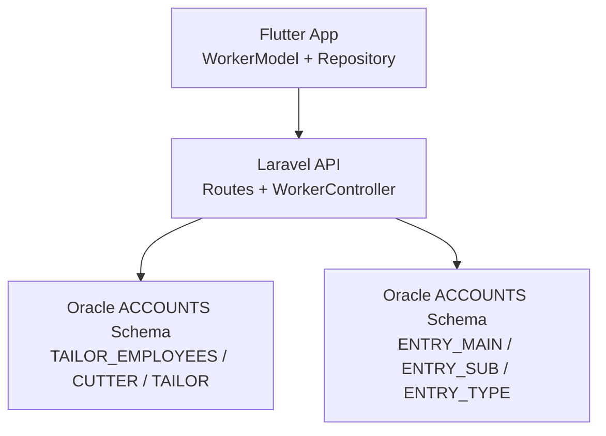
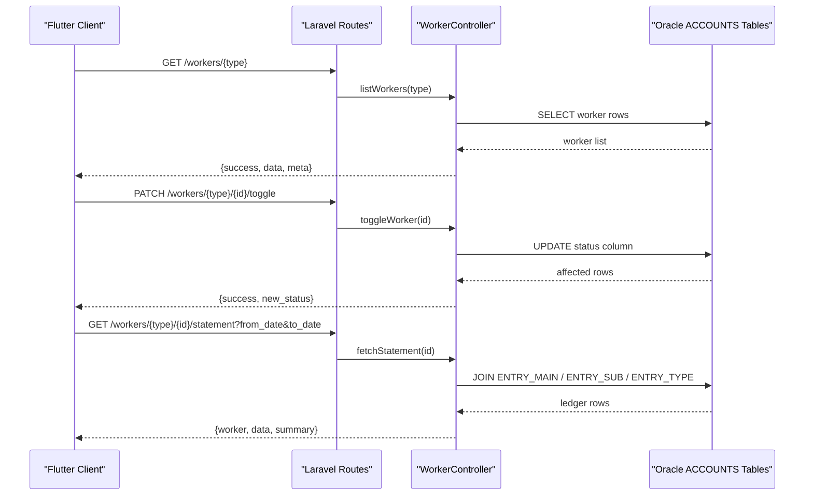
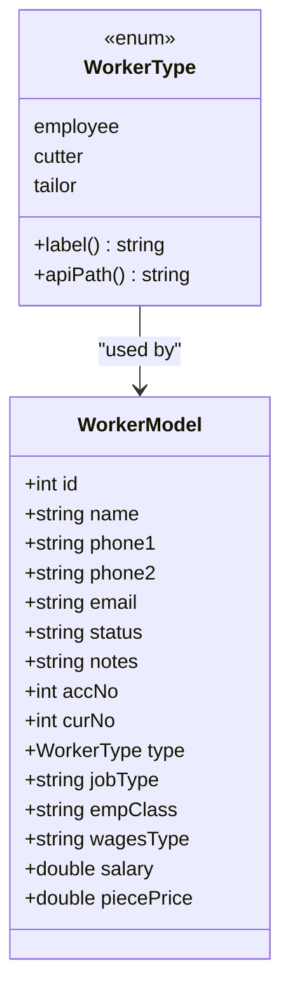
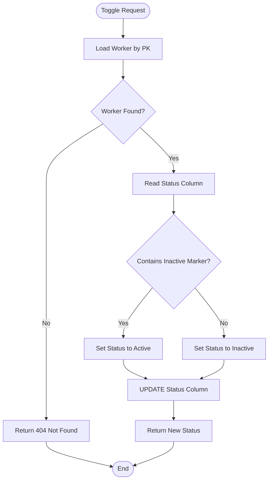
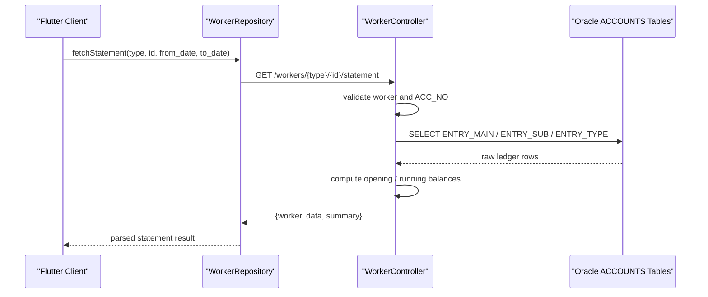
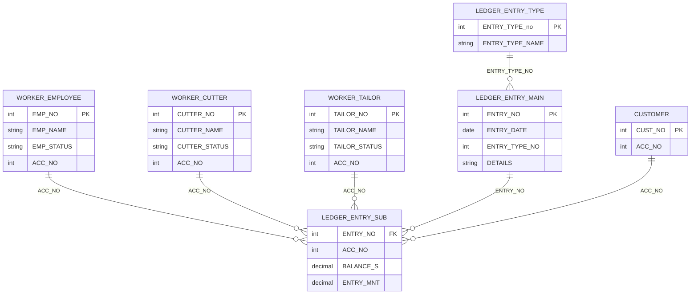
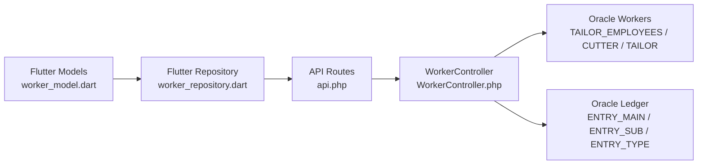

# Worker Management Schema

<cite>
**Referenced Files in This Document**
- [WorkerController.php](file://kyApp_API/app/Http/Controllers/WorkerController.php)
- [api.php](file://kyApp_API/routes/api.php)
- [worker_model.dart](file://lib/features/workers/data/models/worker_model.dart)
- [worker_repository.dart](file://lib/features/workers/data/repositories/worker_repository.dart)
- [workers_provider.dart](file://lib/features/workers/presentation/providers/workers_provider.dart)
- [AGENTS.md](file://kyApp_API/AGENTS.md)
</cite>

## Table of Contents
1. [Introduction](#introduction)
2. [Project Structure](#project-structure)
3. [Core Components](#core-components)
4. [Architecture Overview](#architecture-overview)
5. [Detailed Component Analysis](#detailed-component-analysis)
6. [Dependency Analysis](#dependency-analysis)
7. [Performance Considerations](#performance-considerations)
8. [Troubleshooting Guide](#troubleshooting-guide)
9. [Conclusion](#conclusion)

## Introduction
This document explains the worker management data model and API surface for employees, cutters, and tailors. It focuses on:
- The Oracle-backed worker entities and their shared attributes.
- The worker type hierarchy used by both the Flutter client and Laravel controller.
- How worker statements are generated from accounting tables.
- How workers relate to customers, projects, and financial records through account numbers.
- Practical examples of assignment queries, performance calculations, and status management operations.

The business schema is not defined inside this repository’s migrations; it lives in an external Oracle database under the `ACCOUNTS` schema. The Laravel application connects to that Oracle database and exposes REST endpoints for worker management.

## Project Structure
The worker management feature spans three layers:
- Flutter client layer: models, repository, and presentation state.
- Laravel API layer: routes and controller logic.
- Oracle backend: legacy business tables referenced by the controller.

**Diagram sources**
- [worker_model.dart:3-28](file://lib/features/workers/data/models/worker_model.dart#L3-L28)
- [worker_repository.dart:30-181](file://lib/features/workers/data/repositories/worker_repository.dart#L30-L181)
- [api.php:219-273](file://kyApp_API/routes/api.php#L219-L273)
- [WorkerController.php:22-58](file://kyApp_API/app/Http/Controllers/WorkerController.php#L22-L58)

**Section sources**
- [worker_model.dart:3-28](file://lib/features/workers/data/models/worker_model.dart#L3-L28)
- [worker_repository.dart:30-181](file://lib/features/workers/data/repositories/worker_repository.dart#L30-L181)
- [api.php:219-273](file://kyApp_API/routes/api.php#L219-L273)
- [WorkerController.php:22-58](file://kyApp_API/app/Http/Controllers/WorkerController.php#L22-L58)

## Core Components
The worker domain has three entity types:
- Employee: stored in `ACCOUNTS.TAILOR_EMPLOYEES`.
- Cutter: stored in `ACCOUNTS.CUTTER`.
- Tailor: stored in `ACCOUNTS.TAILOR`.

All three share common identity, contact, status, notes, and accounting fields. Employees additionally carry job classification and wage-related columns.

| Entity | Oracle Table | Primary Key | Name Column | Status Column | Account Column | Extra Columns |
|---|---|---|---|---|---|---|
| Employee | `ACCOUNTS.TAILOR_EMPLOYEES` | `EMP_NO` | `EMP_NAME` | `EMP_STATUS` | `ACC_NO` | `JOP_TYPE`, `EMP_CLASS`, `WAGES_TYPE`, `SALARY`, `PIECE_PRICE`, `CUR_NO` |
| Cutter | `ACCOUNTS.CUTTER` | `CUTTER_NO` | `CUTTER_NAME` | `CUTTER_STATUS` | `ACC_NO` | `CUR_NO` |
| Tailor | `ACCOUNTS.TAILOR` | `TAILOR_NO` | `TAILOR_NAME` | `TAILOR_STATUS` | `ACC_NO` | `CUR_NO` |

The Flutter side represents these as a single `WorkerType` enum with values `employee`, `cutter`, and `tailor`. Each type maps to a distinct API path: `employees`, `cutters`, and `tailors`.

**Section sources**
- [WorkerController.php:22-58](file://kyApp_API/app/Http/Controllers/WorkerController.php#L22-L58)
- [worker_model.dart:3-28](file://lib/features/workers/data/models/worker_model.dart#L3-L28)

## Architecture Overview
The worker management flow uses permission-gated routes, a unified controller, and Oracle queries against legacy tables.

**Diagram sources**
- [api.php:219-273](file://kyApp_API/routes/api.php#L219-L273)
- [WorkerController.php:188-381](file://kyApp_API/app/Http/Controllers/WorkerController.php#L188-L381)
- [WorkerController.php:398-558](file://kyApp_API/app/Http/Controllers/WorkerController.php#L398-L558)

## Detailed Component Analysis

### Worker Type Hierarchy
The worker type hierarchy is represented by:
- A Flutter enum with labels and API paths.
- A Laravel configuration array mapping each type to its Oracle table, primary key, name/status/account columns, and extra columns.

**Diagram sources**
- [worker_model.dart:3-28](file://lib/features/workers/data/models/worker_model.dart#L3-L28)
- [worker_model.dart:30-66](file://lib/features/workers/data/models/worker_model.dart#L30-L66)

**Section sources**
- [worker_model.dart:3-28](file://lib/features/workers/data/models/worker_model.dart#L3-L28)
- [worker_model.dart:30-66](file://lib/features/workers/data/models/worker_model.dart#L30-L66)

### Worker CRUD and Status Management
The controller provides:
- Listing with search, pagination, and Arabic text handling.
- Inserting workers with auto-generated IDs and default active status.
- Updating worker details.
- Deleting workers.
- Toggling worker status between active and inactive.

Status toggling reads the current status value, detects inactive markers, and flips to the opposite state. Arabic encoding utilities are used to normalize and store Arabic text safely.

**Diagram sources**
- [WorkerController.php:348-381](file://kyApp_API/app/Http/Controllers/WorkerController.php#L348-L381)

**Section sources**
- [WorkerController.php:188-239](file://kyApp_API/app/Http/Controllers/WorkerController.php#L188-L239)
- [WorkerController.php:244-284](file://kyApp_API/app/Http/Controllers/WorkerController.php#L244-L284)
- [WorkerController.php:289-320](file://kyApp_API/app/Http/Controllers/WorkerController.php#L289-L320)
- [WorkerController.php:325-343](file://kyApp_API/app/Http/Controllers/WorkerController.php#L325-L343)
- [WorkerController.php:348-381](file://kyApp_API/app/Http/Controllers/WorkerController.php#L348-L381)

### Worker Statement Generation
Each worker has an associated account number (`ACC_NO`). The statement endpoint:
- Loads the worker record.
- Validates the presence of an account number.
- Builds a ledger query joining `ENTRY_MAIN`, `ENTRY_SUB`, and `ENTRY_TYPE`.
- Applies optional date filters.
- Computes opening balance, running balance, total debits, total credits, and filtered row set.
- Returns worker metadata, rows, and summary.

**Diagram sources**
- [worker_repository.dart:136-181](file://lib/features/workers/data/repositories/worker_repository.dart#L136-L181)
- [WorkerController.php:398-558](file://kyApp_API/app/Http/Controllers/WorkerController.php#L398-L558)

**Section sources**
- [WorkerController.php:398-558](file://kyApp_API/app/Http/Controllers/WorkerController.php#L398-L558)

### Relationships Between Workers, Customers, Projects, and Financial Records
- Workers are linked to financial records via `ACC_NO`. Statements read entries from `ACCOUNTS.ENTRY_SUB.ACC_NO`.
- Customers also link to financial records through `ACCOUNTS.CUST.ACC_NO` and `ACCOUNTS.ENTRY_SUB.GIVING`.
- There is no explicit project-to-worker relationship in the analyzed code. If projects exist in the broader system, they would need to be modeled separately (for example, linking workers to project identifiers or work orders). As implemented here, the only direct linkage is through accounting accounts.

**Diagram sources**
- [WorkerController.php:22-58](file://kyApp_API/app/Http/Controllers/WorkerController.php#L22-L58)
- [WorkerController.php:444-462](file://kyApp_API/app/Http/Controllers/WorkerController.php#L444-L462)

**Section sources**
- [WorkerController.php:22-58](file://kyApp_API/app/Http/Controllers/WorkerController.php#L22-L58)
- [WorkerController.php:444-462](file://kyApp_API/app/Http/Controllers/WorkerController.php#L444-L462)

### Examples of Queries and Operations

#### Worker Assignment Queries
Assignment can be interpreted as selecting workers by criteria such as status, account number, or name. Use the listing endpoint with search parameters:
- List all active employees: request `/workers/employees` with appropriate filtering on the client side after receiving the response.
- Find workers by partial name or ID: include `search` parameter.
- Paginate results: use `page` and `limit`.

Example request patterns:
- `GET /workers/employees?search=Ali&page=1&limit=100`
- `GET /workers/cutters?search=123&page=1&limit=50`
- `GET /workers/tailors?page=2&limit=200`

These map to the controller’s `listWorkers` method, which builds dynamic column lists and applies search conditions.

**Section sources**
- [WorkerController.php:188-239](file://kyApp_API/app/Http/Controllers/WorkerController.php#L188-L239)
- [api.php:219-273](file://kyApp_API/routes/api.php#L219-L273)

#### Performance Calculations
Performance tracking is not implemented as dedicated worker performance tables in the analyzed code. Instead, financial activity is available through statements:
- Total debit and credit per period.
- Opening and final balances.
- Row count and date range.

If you need performance metrics like pieces produced or hours worked, those would require additional tables and reporting logic beyond what is currently exposed.

**Section sources**
- [WorkerController.php:477-554](file://kyApp_API/app/Http/Controllers/WorkerController.php#L477-L554)

#### Status Management Operations
Use the toggle endpoints:
- `PATCH /workers/employees/{id}/toggle`
- `PATCH /workers/cutters/{id}/toggle`
- `PATCH /workers/tailors/{id}/toggle`

These flip the worker’s status between active and inactive based on detected markers in the status column.

**Section sources**
- [WorkerController.php:348-381](file://kyApp_API/app/Http/Controllers/WorkerController.php#L348-L381)
- [api.php:219-273](file://kyApp_API/routes/api.php#L219-L273)

## Dependency Analysis
The worker management feature depends on:
- Flutter models and repository for API calls and parsing.
- Laravel routes for authorization and routing.
- Laravel controller for business logic and Oracle access.
- Oracle tables for worker master data and ledger entries.

**Diagram sources**
- [worker_model.dart:3-28](file://lib/features/workers/data/models/worker_model.dart#L3-L28)
- [worker_repository.dart:30-181](file://lib/features/workers/data/repositories/worker_repository.dart#L30-L181)
- [api.php:219-273](file://kyApp_API/routes/api.php#L219-L273)
- [WorkerController.php:22-58](file://kyApp_API/app/Http/Controllers/WorkerController.php#L22-L58)

**Section sources**
- [worker_model.dart:3-28](file://lib/features/workers/data/models/worker_model.dart#L3-L28)
- [worker_repository.dart:30-181](file://lib/features/workers/data/repositories/worker_repository.dart#L30-L181)
- [api.php:219-273](file://kyApp_API/routes/api.php#L219-L273)
- [WorkerController.php:22-58](file://kyApp_API/app/Http/Controllers/WorkerController.php#L22-L58)

## Performance Considerations
- Pagination limits: the controller enforces a maximum limit and defaults to a reasonable page size.
- Search optimization: numeric searches match the primary key directly; text searches use LIKE across name and phone columns.
- Statement performance: the statement query joins three ledger tables and may return large datasets. Date filtering reduces payload size.
- Arabic encoding: conversion utilities add processing overhead but ensure correct storage and retrieval.

Recommendations:
- Add server-side filters for status, account number, and currency when needed.
- Consider indexing frequently searched columns if not already indexed in Oracle.
- Cache frequent worker lookups at the application layer if accessed repeatedly.

[No sources needed since this section provides general guidance]

## Troubleshooting Guide
Common issues and resolutions:
- Missing account number for statement: the controller returns a validation error when `ACC_NO` is absent. Ensure the worker record has an account number before requesting a statement.
- Arabic text corruption: the controller uses encoding utilities to fix mojibake and convert Arabic text for Oracle. Verify client payloads use expected column names and casing.
- Permission errors: worker endpoints are protected by Sanctum authentication and granular permissions. Confirm the user has the required module permissions.
- No validation on write endpoints: the controller does not validate incoming data; clients must send correctly shaped payloads matching Oracle column names.

**Section sources**
- [WorkerController.php:416-424](file://kyApp_API/app/Http/Controllers/WorkerController.php#L416-L424)
- [WorkerController.php:589-596](file://kyApp_API/app/Http/Controllers/WorkerController.php#L589-L596)
- [AGENTS.md:475-480](file://kyApp_API/AGENTS.md#L475-L480)

## Conclusion
The worker management system models employees, cutters, and tailors as separate Oracle tables sharing common attributes. The Flutter client and Laravel API provide a unified interface for listing, creating, updating, deleting, toggling status, and generating financial statements. Worker financial activity is tied to account numbers and ledger tables rather than dedicated performance tables. For advanced performance tracking, additional schema design and reporting logic would be required.

[No sources needed since this section summarizes without analyzing specific files]