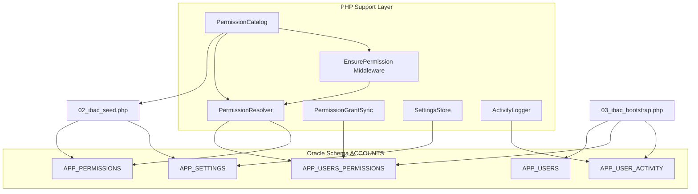
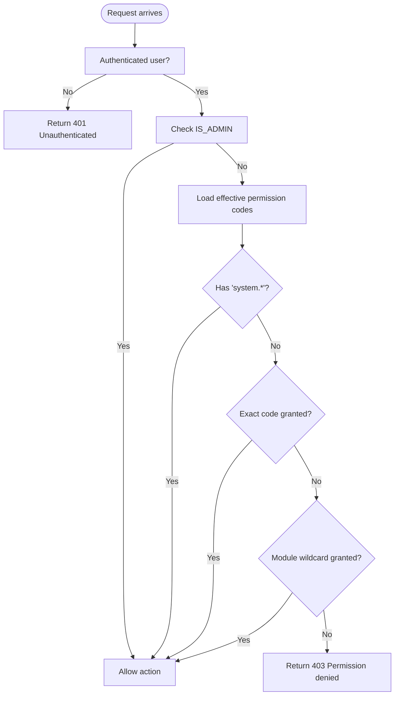
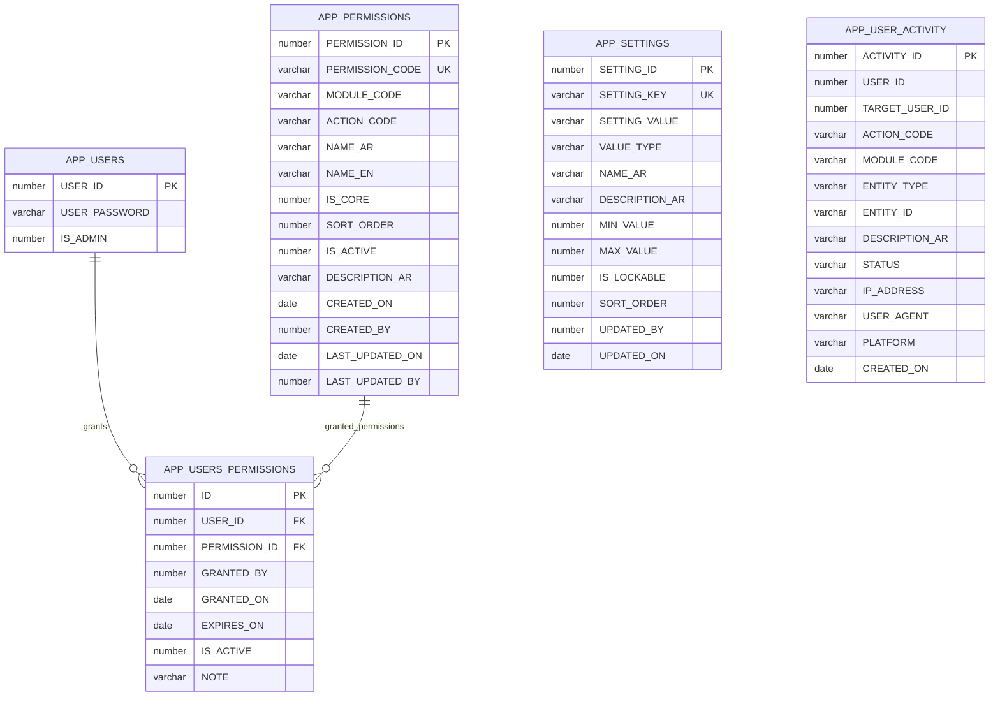
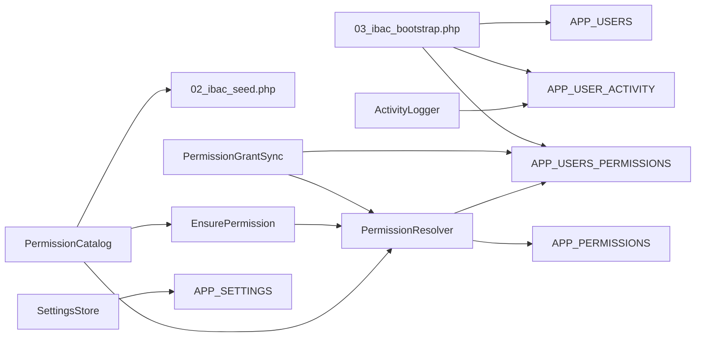
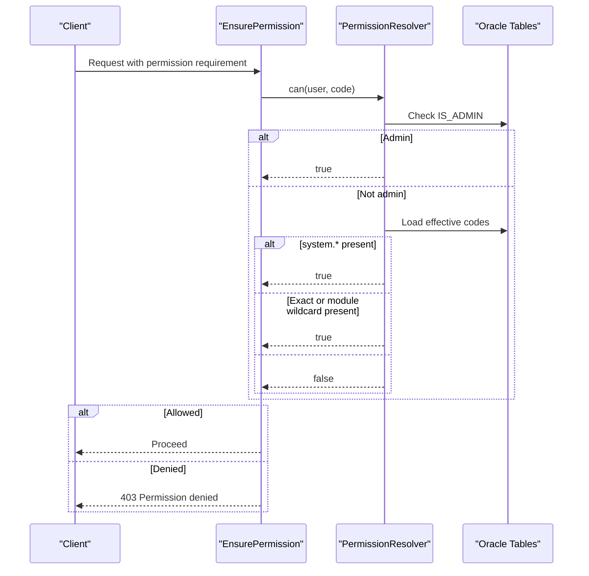

# Core System Tables

<cite>
**Referenced Files in This Document**
- [01_ibac_schema.sql](file://kyApp_API/database/oracle/01_ibac_schema.sql)
- [02_ibac_seed.php](file://kyApp_API/database/oracle/02_ibac_seed.php)
- [03_ibac_bootstrap.php](file://kyApp_API/database/oracle/03_ibac_bootstrap.php)
- [PermissionCatalog.php](file://kyApp_API/app/Support/PermissionCatalog.php)
- [PermissionResolver.php](file://kyApp_API/app/Support/PermissionResolver.php)
- [PermissionGrantSync.php](file://kyApp_API/app/Support/PermissionGrantSync.php)
- [SettingsStore.php](file://kyApp_API/app/Support/SettingsStore.php)
- [ActivityLogger.php](file://kyApp_API/app/Support/ActivityLogger.php)
- [EnsurePermission.php](file://kyApp_API/app/Http/Middleware/EnsurePermission.php)
</cite>

## Table of Contents
1. [Introduction](#introduction)
2. [Project Structure](#project-structure)
3. [Core Components](#core-components)
4. [Architecture Overview](#architecture-overview)
5. [Detailed Component Analysis](#detailed-component-analysis)
6. [Dependency Analysis](#dependency-analysis)
7. [Performance Considerations](#performance-considerations)
8. [Troubleshooting Guide](#troubleshooting-guide)
9. [Conclusion](#conclusion)
10. [Appendices](#appendices)

## Introduction
This document explains the core system tables that implement the Identity-Based Access Control (IBAC) model for the application:
- APP_USERS
- APP_PERMISSIONS
- APP_USERS_PERMISSIONS
- APP_SETTINGS
- APP_USER_ACTIVITY

It covers field definitions, data types, constraints, business rules, sequence generation, triggers, foreign key relationships, bilingual support, common queries, and guidance for extending permissions and settings. The IBAC design grants permissions directly to users rather than through roles, with an explicit administrator flag and a system-wide wildcard permission.

## Project Structure
The IBAC schema is defined in Oracle SQL and seeded by PHP scripts. Application logic reads and writes these tables through dedicated support classes and enforces access via middleware.

**Diagram sources**
- [01_ibac_schema.sql:21-192](file://kyApp_API/database/oracle/01_ibac_schema.sql#L21-L192)
- [02_ibac_seed.php:36-291](file://kyApp_API/database/oracle/02_ibac_seed.php#L36-L291)
- [03_ibac_bootstrap.php:131-217](file://kyApp_API/database/oracle/03_ibac_bootstrap.php#L131-L217)
- [PermissionCatalog.php:22-468](file://kyApp_API/app/Support/PermissionCatalog.php#L22-L468)
- [PermissionResolver.php:27-274](file://kyApp_API/app/Support/PermissionResolver.php#L27-L274)
- [PermissionGrantSync.php:20-190](file://kyApp_API/app/Support/PermissionGrantSync.php#L20-L190)
- [SettingsStore.php:28-376](file://kyApp_API/app/Support/SettingsStore.php#L28-L376)
- [ActivityLogger.php:18-170](file://kyApp_API/app/Support/ActivityLogger.php#L18-L170)
- [EnsurePermission.php:25-53](file://kyApp_API/app/Http/Middleware/EnsurePermission.php#L25-L53)

**Section sources**
- [01_ibac_schema.sql:1-207](file://kyApp_API/database/oracle/01_ibac_schema.sql#L1-L207)
- [02_ibac_seed.php:1-310](file://kyApp_API/database/oracle/02_ibac_seed.php#L1-L310)
- [03_ibac_bootstrap.php:1-227](file://kyApp_API/database/oracle/03_ibac_bootstrap.php#L1-L227)

## Core Components
The five core tables form the foundation of identity-based authorization, configuration, and audit logging:

| Table | Purpose | Key Columns | Constraints & Rules |
|---|---|---|---|
| `APP_USERS` | Existing user table extended for IBAC | `USER_ID`, `USER_PASSWORD`, `IS_ADMIN` | `IS_ADMIN` defaults to `0`; password column widened; no trigger on ID to avoid breaking legacy ERP writes |
| `APP_PERMISSIONS` | Permission catalog | `PERMISSION_ID`, `PERMISSION_CODE`, `MODULE_CODE`, `ACTION_CODE`, `NAME_AR`, `NAME_EN`, `IS_CORE`, `SORT_ORDER`, `IS_ACTIVE` | Unique `PERMISSION_CODE`; `IS_CORE` and `IS_ACTIVE` restricted to `0` or `1`; indexed by module and sort order |
| `APP_USERS_PERMISSIONS` | Direct user-to-permission grants | `ID`, `USER_ID`, `PERMISSION_ID`, `GRANTED_BY`, `GRANTED_ON`, `EXPIRES_ON`, `IS_ACTIVE`, `NOTE` | Unique per `(USER_ID, PERMISSION_ID)`; FKs to `APP_USERS` and `APP_PERMISSIONS`; active grants filtered by expiry |
| `APP_SETTINGS` | Security/session settings | `SETTING_ID`, `SETTING_KEY`, `SETTING_VALUE`, `VALUE_TYPE`, `NAME_AR`, `DESCRIPTION_AR`, `MIN_VALUE`, `MAX_VALUE`, `IS_LOCKABLE`, `SORT_ORDER` | Unique `SETTING_KEY`; `VALUE_TYPE` restricted to `int`, `bool`, `string`, `json` |
| `APP_USER_ACTIVITY` | Audit trail | `ACTIVITY_ID`, `USER_ID`, `TARGET_USER_ID`, `ACTION_CODE`, `MODULE_CODE`, `ENTITY_TYPE`, `ENTITY_ID`, `DESCRIPTION_AR`, `STATUS`, `IP_ADDRESS`, `USER_AGENT`, `PLATFORM`, `CREATED_ON` | Status restricted to `success` or `failed`; no FK on `USER_ID` so unknown users and deleted users can still be audited |

**Section sources**
- [01_ibac_schema.sql:21-192](file://kyApp_API/database/oracle/01_ibac_schema.sql#L21-L192)

## Architecture Overview
The IBAC architecture evaluates permissions in a strict order:

1. If the user has `IS_ADMIN = 1`, all actions are allowed.
2. If the user holds the `system.*` permission, all actions are allowed.
3. If the exact permission code is granted, allow.
4. If the module wildcard `module.*` is granted, allow any action under that module.
5. Otherwise deny.

**Diagram sources**
- [PermissionResolver.php:13-26](file://kyApp_API/app/Support/PermissionResolver.php#L13-L26)
- [PermissionResolver.php:95-132](file://kyApp_API/app/Support/PermissionResolver.php#L95-L132)
- [EnsurePermission.php:32-51](file://kyApp_API/app/Http/Middleware/EnsurePermission.php#L32-L51)

## Detailed Component Analysis

### APP_USERS
`APP_USERS` is a pre-existing legacy table. The schema migration widens the password column, adds an admin flag, and creates a sequence without a trigger to avoid interfering with the existing ERP write path.

| Column | Type | Nullable | Default | Notes |
|---|---|---|---|---|
| `USER_ID` | Number | No | Sequence-generated | Primary key used by grant and activity tables |
| `USER_PASSWORD` | `VARCHAR2(100)` | Yes | None | Widened from legacy size; currently plaintext but expanded for future hashing |
| `IS_ADMIN` | `NUMBER(1)` | No | `0` | Administrator bypass flag; checked before permission evaluation |

Business rules:
- Legacy systems continue writing to this table; therefore, no auto-increment trigger is added.
- Administrators bypass all permission checks.
- The bootstrap script promotes the first active user when no administrator exists.

Common operations:
- Promote first administrator during bootstrap.
- Toggle admin flag only through protected management permissions.

**Section sources**
- [01_ibac_schema.sql:21-34](file://kyApp_API/database/oracle/01_ibac_schema.sql#L21-L34)
- [03_ibac_bootstrap.php:131-149](file://kyApp_API/database/oracle/03_ibac_bootstrap.php#L131-L149)
- [PermissionResolver.php:202-218](file://kyApp_API/app/Support/PermissionResolver.php#L202-L218)

### APP_PERMISSIONS
`APP_PERMISSIONS` is the canonical permission catalog. Each row represents a specific permission such as `customers.view`, plus optional module-level wildcards like `customers.*`.

| Column | Type | Nullable | Default | Notes |
|---|---|---|---|---|
| `PERMISSION_ID` | `NUMBER(6)` | No | Sequence + trigger | Primary key |
| `PERMISSION_CODE` | `VARCHAR2(60)` | No | None | Unique code such as `module.action` or `module.*` |
| `MODULE_CODE` | `VARCHAR2(30)` | No | None | Logical module grouping |
| `ACTION_CODE` | `VARCHAR2(30)` | No | None | Action token; `*` denotes wildcard |
| `NAME_AR` | `VARCHAR2(150)` | No | None | Arabic display name |
| `NAME_EN` | `VARCHAR2(150)` | Yes | None | English description |
| `IS_CORE` | `NUMBER(1)` | No | `0` | Core CRUD-like permissions appear first |
| `SORT_ORDER` | `NUMBER(4)` | Yes | `0` | Ordering within a module |
| `IS_ACTIVE` | `NUMBER(1)` | No | `1` | Inactive permissions cannot be newly granted |
| `DESCRIPTION_AR` | `VARCHAR2(500)` | Yes | None | Arabic explanation |
| `CREATED_ON` | `DATE` | Yes | `SYSDATE` | Creation timestamp |
| `CREATED_BY` | `NUMBER(5)` | Yes | None | Auditor |
| `LAST_UPDATED_ON` | `DATE` | Yes | None | Update timestamp |
| `LAST_UPDATED_BY` | `NUMBER(5)` | Yes | None | Auditor |

Constraints:
- Primary key on `PERMISSION_ID`.
- Unique constraint on `PERMISSION_CODE`.
- Check constraints enforce binary flags.
- Index on `(MODULE_CODE, SORT_ORDER)` improves UI ordering queries.

Bilingual support:
- Arabic labels are stored using a compatibility encoding layer so they survive the AL32UTF8 client to WE8MSWIN1252 database connection.
- English names are descriptive and generated from module/action tokens.

Seeding:
- `PermissionCatalog::rows()` defines every valid permission.
- `02_ibac_seed.php` upserts rows by `PERMISSION_CODE`, updating metadata while preserving operator-edited values where appropriate.

**Section sources**
- [01_ibac_schema.sql:35-75](file://kyApp_API/database/oracle/01_ibac_schema.sql#L35-L75)
- [PermissionCatalog.php:22-468](file://kyApp_API/app/Support/PermissionCatalog.php#L22-L468)
- [02_ibac_seed.php:36-89](file://kyApp_API/database/oracle/02_ibac_seed.php#L36-L89)

### APP_USERS_PERMISSIONS
`APP_USERS_PERMISSIONS` implements direct identity-based grants. There are no role tables; permissions are assigned straight to users.

| Column | Type | Nullable | Default | Notes |
|---|---|---|---|---|
| `ID` | `NUMBER(9)` | No | Sequence + trigger | Primary key |
| `USER_ID` | `NUMBER(5)` | No | None | FK to `APP_USERS.USER_ID`; cascade delete removes grants |
| `PERMISSION_ID` | `NUMBER(6)` | No | None | FK to `APP_PERMISSIONS.PERMISSION_ID` |
| `GRANTED_BY` | `NUMBER(5)` | Yes | None | Auditor who performed the grant |
| `GRANTED_ON` | `DATE` | Yes | `SYSDATE` | Grant timestamp |
| `EXPIRES_ON` | `DATE` | Yes | None | Optional expiration; null means permanent |
| `IS_ACTIVE` | `NUMBER(1)` | No | `1` | Soft deactivation preserves history |
| `NOTE` | `VARCHAR2(200)` | Yes | None | Reason for grant |

Constraints:
- Primary key on `ID`.
- Unique constraint on `(USER_ID, PERMISSION_ID)` prevents duplicate grants.
- Foreign keys enforce referential integrity.
- Check constraint restricts `IS_ACTIVE` to `0` or `1`.
- Indexes optimize lookups by user and permission.

Business rules:
- Only active grants count.
- Expired grants are ignored after their expiry time.
- Deactivating a grant keeps audit history but removes it from effective permissions.

Sequence and trigger:
- `SEQ_APP_USERS_PERM` generates IDs.
- `TRG_APP_USERS_PERM` fills `ID` when inserting without one.

Common operations:
- Replace all grants for a user atomically.
- Resolve permission codes to IDs and validate unknown/inactive codes.

**Section sources**
- [01_ibac_schema.sql:77-112](file://kyApp_API/database/oracle/01_ibac_schema.sql#L77-L112)
- [PermissionGrantSync.php:40-163](file://kyApp_API/app/Support/PermissionGrantSync.php#L40-L163)

### APP_SETTINGS
`APP_SETTINGS` stores security and session configuration. It supports typed values and validation at write time.

| Column | Type | Nullable | Default | Notes |
|---|---|---|---|---|
| `SETTING_ID` | `NUMBER(6)` | No | Sequence + trigger | Primary key |
| `SETTING_KEY` | `VARCHAR2(60)` | No | None | Unique configuration key |
| `SETTING_VALUE` | `VARCHAR2(500)` | Yes | None | Stored text interpreted by `VALUE_TYPE` |
| `VALUE_TYPE` | `VARCHAR2(20)` | No | `'int'` | One of `int`, `bool`, `string`, `json` |
| `NAME_AR` | `VARCHAR2(150)` | No | None | Arabic label for UI |
| `DESCRIPTION_AR` | `VARCHAR2(500)` | Yes | None | Arabic description |
| `MIN_VALUE` | `NUMBER(10)` | Yes | None | Numeric lower bound |
| `MAX_VALUE` | `NUMBER(10)` | Yes | None | Numeric upper bound |
| `IS_LOCKABLE` | `NUMBER(1)` | No | `0` | Prevents UI editing when set |
| `SORT_ORDER` | `NUMBER(4)` | Yes | `0` | Display order |
| `UPDATED_BY` | `NUMBER(5)` | Yes | None | Auditor |
| `UPDATED_ON` | `DATE` | Yes | None | Update timestamp |

Constraints:
- Primary key on `SETTING_ID`.
- Unique constraint on `SETTING_KEY`.
- Check constraint restricts `VALUE_TYPE`.

Validation and typing:
- `SettingsStore` casts values to declared types.
- Boolean normalization accepts explicit true/false forms.
- Integer values are validated against min/max bounds.
- JSON values are encoded and truncated safely.
- String values use the same encoding path as other Arabic fields.

Caching:
- A short-lived cache avoids repeated reads on every authenticated request.
- Definitions requiring Arabic labels read directly from Oracle because large payloads exceed safe cache limits.

Default settings:
- Session idle timeout, absolute lifetime, touch threshold.
- Single active session policy.
- Password length minimum.
- Failed login lockout controls.
- Biometric login toggle.
- Activity log retention.
- Maintenance message.

**Section sources**
- [01_ibac_schema.sql:114-146](file://kyApp_API/database/oracle/01_ibac_schema.sql#L114-L146)
- [02_ibac_seed.php:99-279](file://kyApp_API/database/oracle/02_ibac_seed.php#L99-L279)
- [SettingsStore.php:28-376](file://kyApp_API/app/Support/SettingsStore.php#L28-L376)

### APP_USER_ACTIVITY
`APP_USER_ACTIVITY` records user actions for auditing and troubleshooting. Logging failures must never break successful requests.

| Column | Type | Nullable | Default | Notes |
|---|---|---|---|---|
| `ACTIVITY_ID` | `NUMBER(11)` | No | Sequence + trigger | Primary key |
| `USER_ID` | `NUMBER(5)` | Yes | None | Actor; nullable for anonymous failures |
| `TARGET_USER_ID` | `NUMBER(5)` | Yes | None | Target of the action |
| `ACTION_CODE` | `VARCHAR2(60)` | No | None | Semantic action identifier |
| `MODULE_CODE` | `VARCHAR2(30)` | Yes | None | Related module |
| `ENTITY_TYPE` | `VARCHAR2(40)` | Yes | None | Affected entity type |
| `ENTITY_ID` | `VARCHAR2(60)` | Yes | None | Affected entity identifier |
| `DESCRIPTION_AR` | `VARCHAR2(1000)` | Yes | None | Arabic human-readable description |
| `STATUS` | `VARCHAR2(10)` | No | `'success'` | `success` or `failed` |
| `IP_ADDRESS` | `VARCHAR2(45)` | Yes | None | IPv4 or IPv6 address |
| `USER_AGENT` | `VARCHAR2(200)` | Yes | None | Client browser/device string |
| `PLATFORM` | `VARCHAR2(20)` | Yes | None | Client platform |
| `CREATED_ON` | `DATE` | Yes | `SYSDATE` | Event timestamp |

Constraints:
- Primary key on `ACTIVITY_ID`.
- Check constraint restricts status.
- No FK on `USER_ID` so anonymous and deleted-user events remain intact.

Indexes:
- Optimized for queries by actor, target, and module over time.

Logging behavior:
- All writes are wrapped in silent error handling.
- Values are truncated to column widths.
- Arabic descriptions use the same encoding compatibility layer.

**Section sources**
- [01_ibac_schema.sql:148-192](file://kyApp_API/database/oracle/01_ibac_schema.sql#L148-L192)
- [ActivityLogger.php:18-170](file://kyApp_API/app/Support/ActivityLogger.php#L18-L170)

### Bilingual Support (Arabic/English)
Arabic text is handled carefully because the application connects as an AL32UTF8 client to a WE8MSWIN1252 database:

- Raw CP1256 bytes would be replaced by replacement characters.
- The encoding helper maps CP1256 bytes to Latin-1 code points so the stored bytes match the legacy system.
- On read, mojibake repair restores readable Arabic.
- Comments, seed data, settings labels, and activity descriptions all follow this pattern.

Key implementation points:
- Seed scripts use the encoding helper for Arabic labels and descriptions.
- Settings store repairs Arabic text when reading definitions.
- Activity logger truncates and encodes Arabic descriptions safely.
- Table and column comments are applied through the bootstrap script.

**Section sources**
- [01_ibac_schema.sql:11-15](file://kyApp_API/database/oracle/01_ibac_schema.sql#L11-L15)
- [02_ibac_seed.php:10-24](file://kyApp_API/database/oracle/02_ibac_seed.php#L10-L24)
- [03_ibac_bootstrap.php:22-30](file://kyApp_API/database/oracle/03_ibac_bootstrap.php#L22-L30)
- [SettingsStore.php:303-341](file://kyApp_API/app/Support/SettingsStore.php#L303-L341)
- [ActivityLogger.php:56-60](file://kyApp_API/app/Support/ActivityLogger.php#L56-L60)

### Sequence Generation Patterns and Triggers
Each major table uses a sequence and a `BEFORE INSERT` trigger to generate primary keys automatically:

| Table | Sequence | Trigger | Behavior |
|---|---|---|---|
| `APP_PERMISSIONS` | `SEQ_APP_PERMISSIONS` | `TRG_APP_PERMISSIONS` | Generates `PERMISSION_ID` when null |
| `APP_USERS_PERMISSIONS` | `SEQ_APP_USERS_PERM` | `TRG_APP_USERS_PERM` | Generates `ID` when null |
| `APP_SETTINGS` | `SEQ_APP_SETTINGS` | `TRG_APP_SETTINGS` | Generates `SETTING_ID` when null |
| `APP_USER_ACTIVITY` | `SEQ_APP_ACTIVITY` | `TRG_APP_ACTIVITY` | Generates `ACTIVITY_ID` when null |
| `APP_USERS` | `SEQ_APP_USERS_ID` | None | Created but not used here to avoid breaking legacy ERP writes |

Important note:
- Sequence references inside PL/SQL must be unqualified because the schema contains a view named `ACCOUNTS`; qualifying them would resolve incorrectly.

**Section sources**
- [01_ibac_schema.sql:32-33](file://kyApp_API/database/oracle/01_ibac_schema.sql#L32-L33)
- [01_ibac_schema.sql:61-75](file://kyApp_API/database/oracle/01_ibac_schema.sql#L61-L75)
- [01_ibac_schema.sql:102-112](file://kyApp_API/database/oracle/01_ibac_schema.sql#L102-L112)
- [01_ibac_schema.sql:136-146](file://kyApp_API/database/oracle/01_ibac_schema.sql#L136-L146)
- [01_ibac_schema.sql:174-184](file://kyApp_API/database/oracle/01_ibac_schema.sql#L174-L184)
- [01_ibac_schema.sql:64-67](file://kyApp_API/database/oracle/01_ibac_schema.sql#L64-L67)

### Foreign Key Relationships

**Diagram sources**
- [01_ibac_schema.sql:38-97](file://kyApp_API/database/oracle/01_ibac_schema.sql#L38-L97)

**Section sources**
- [01_ibac_schema.sql:38-97](file://kyApp_API/database/oracle/01_ibac_schema.sql#L38-L97)

### Common Queries and Data Manipulation Examples
These examples describe typical operations without embedding raw SQL content.

#### List effective permissions for a user
- Retrieve active grants joined with permission codes.
- Filter by active grant and active permission.
- Exclude expired grants.
- Order by grant insertion order.

#### Check whether a user can perform an action
- Short-circuit if `IS_ADMIN = 1`.
- Check for `system.*`.
- Check exact permission code.
- Check module wildcard.
- Return deny otherwise.

#### Replace all grants for a user
- Delete existing grants for the user.
- Insert new permission IDs.
- Wrap in a transaction.
- Invalidate the user’s permission cache.

#### Read all settings
- Fetch from database.
- Normalize keys.
- Repair Arabic text.
- Cache a slim numeric-only payload.

#### Update a setting
- Validate key existence.
- Enforce lockable flag.
- Normalize value by declared type.
- Validate numeric bounds.
- Persist and drop cache.

#### Log an activity event
- Determine success or failure status.
- Encode and truncate Arabic description.
- Capture IP, user agent, and platform.
- Ignore logging failures silently.

**Section sources**
- [PermissionResolver.php:49-88](file://kyApp_API/app/Support/PermissionResolver.php#L49-L88)
- [PermissionResolver.php:95-132](file://kyApp_API/app/Support/PermissionResolver.php#L95-L132)
- [PermissionGrantSync.php:134-163](file://kyApp_API/app/Support/PermissionGrantSync.php#L134-L163)
- [SettingsStore.php:80-101](file://kyApp_API/app/Support/SettingsStore.php#L80-L101)
- [SettingsStore.php:167-197](file://kyApp_API/app/Support/SettingsStore.php#L167-L197)
- [ActivityLogger.php:37-73](file://kyApp_API/app/Support/ActivityLogger.php#L37-L73)

### Extending the Permission System
To add a new permission:

1. Add the module and action to `PermissionCatalog`.
2. Run the seed script to upsert the permission into `APP_PERMISSIONS`.
3. Assign the permission to users through `PermissionGrantSync`.
4. Protect routes or controllers using the permission middleware.
5. Log relevant activity through `ActivityLogger`.

Guidelines:
- Use lowercase module and action codes separated by a single dot.
- Wildcards are only allowed as `module.*` or `system.*`.
- Core actions should be listed first so they appear before extra actions.
- Keep Arabic labels consistent with the permission picker UI.

**Section sources**
- [PermissionCatalog.php:22-468](file://kyApp_API/app/Support/PermissionCatalog.php#L22-L468)
- [02_ibac_seed.php:283-285](file://kyApp_API/database/oracle/02_ibac_seed.php#L283-L285)
- [PermissionGrantSync.php:134-163](file://kyApp_API/app/Support/PermissionGrantSync.php#L134-L163)
- [EnsurePermission.php:32-51](file://kyApp_API/app/Http/Middleware/EnsurePermission.php#L32-L51)

### Adding New Settings
To add a new security or session setting:

1. Define the setting entry in the seed script with key, default value, type, Arabic name, description, min/max bounds, lockable flag, and sort order.
2. Run the seed script to insert or update the setting.
3. Use `SettingsStore::get`, `int`, or `bool` to read the value.
4. Use `SettingsStore::set` to persist changes with validation.
5. Mark sensitive settings as lockable to prevent UI edits.

Notes:
- The seed script updates metadata and ranges but preserves operator-edited values.
- Locked settings throw a validation exception unless explicitly ignored.
- Definitions requiring Arabic labels read directly from Oracle.

**Section sources**
- [02_ibac_seed.php:99-279](file://kyApp_API/database/oracle/02_ibac_seed.php#L99-L279)
- [SettingsStore.php:107-197](file://kyApp_API/app/Support/SettingsStore.php#L107-L197)
- [SettingsStore.php:220-301](file://kyApp_API/app/Support/SettingsStore.php#L220-L301)

## Dependency Analysis
The following diagram shows how the support classes depend on each other and on the Oracle tables.

**Diagram sources**
- [PermissionCatalog.php:22-468](file://kyApp_API/app/Support/PermissionCatalog.php#L22-L468)
- [PermissionResolver.php:27-274](file://kyApp_API/app/Support/PermissionResolver.php#L27-L274)
- [PermissionGrantSync.php:20-190](file://kyApp_API/app/Support/PermissionGrantSync.php#L20-L190)
- [SettingsStore.php:28-376](file://kyApp_API/app/Support/SettingsStore.php#L28-L376)
- [ActivityLogger.php:18-170](file://kyApp_API/app/Support/ActivityLogger.php#L18-L170)
- [02_ibac_seed.php:36-291](file://kyApp_API/database/oracle/02_ibac_seed.php#L36-L291)
- [03_ibac_bootstrap.php:131-217](file://kyApp_API/database/oracle/03_ibac_bootstrap.php#L131-L217)

**Section sources**
- [PermissionCatalog.php:22-468](file://kyApp_API/app/Support/PermissionCatalog.php#L22-L468)
- [PermissionResolver.php:27-274](file://kyApp_API/app/Support/PermissionResolver.php#L27-L274)
- [PermissionGrantSync.php:20-190](file://kyApp_API/app/Support/PermissionGrantSync.php#L20-L190)
- [SettingsStore.php:28-376](file://kyApp_API/app/Support/SettingsStore.php#L28-L376)
- [ActivityLogger.php:18-170](file://kyApp_API/app/Support/ActivityLogger.php#L18-L170)

## Performance Considerations
- Permission resolution caches effective codes per user for a limited time.
- Settings caching stores only numeric fields to stay under Oracle cache payload limits.
- Database indexes exist on frequently queried columns such as module/sort order, user/activity timestamps, and permission identifiers.
- Logging is designed to fail silently so audit writes do not degrade request performance.
- Large permission sets may skip cache storage to avoid Oracle binding limits.

[No sources needed since this section provides general guidance]

## Troubleshooting Guide

### Permission Denied Errors
Symptoms:
- API returns 403 with a permission code.
- User sees an Arabic permission label in the error message.

Checks:
- Confirm the user is authenticated.
- Verify `IS_ADMIN` is not unexpectedly set.
- Inspect active grants in `APP_USERS_PERMISSIONS`.
- Ensure the permission row exists and is active.
- Check whether a module wildcard was intended.

Relevant components:
- `EnsurePermission` returns 401 or 403.
- `PermissionResolver` applies the deny-by-default ladder.
- `PermissionCatalog` supplies Arabic labels for unknown codes.

**Section sources**
- [EnsurePermission.php:32-51](file://kyApp_API/app/Http/Middleware/EnsurePermission.php#L32-L51)
- [PermissionResolver.php:95-132](file://kyApp_API/app/Support/PermissionResolver.php#L95-L132)
- [PermissionCatalog.php:416-430](file://kyApp_API/app/Support/PermissionCatalog.php#L416-L430)

### Invalid Setting Updates
Symptoms:
- Exception thrown when saving a setting.
- Value rejected due to type, range, or lockable flag.

Checks:
- Confirm the setting key exists.
- Check `VALUE_TYPE`.
- Validate numeric min/max bounds.
- Ensure the setting is not locked.
- Verify boolean normalization matches expected tokens.

Relevant component:
- `SettingsStore::set` validates and persists values.

**Section sources**
- [SettingsStore.php:167-197](file://kyApp_API/app/Support/SettingsStore.php#L167-L197)
- [SettingsStore.php:220-301](file://kyApp_API/app/Support/SettingsStore.php#L220-L301)

### Arabic Text Issues
Symptoms:
- Arabic characters appear as replacement symbols.
- Labels or descriptions are unreadable.

Checks:
- Confirm seed and bootstrap scripts use the encoding helper.
- Ensure read paths repair mojibake.
- Avoid sending raw CP1256 bytes through UTF-8 clients.

Relevant components:
- Seed script comments explain encoding requirements.
- Settings store repairs Arabic text.
- Activity logger encodes Arabic descriptions.

**Section sources**
- [02_ibac_seed.php:10-24](file://kyApp_API/database/oracle/02_ibac_seed.php#L10-L24)
- [SettingsStore.php:303-341](file://kyApp_API/app/Support/SettingsStore.php#L303-L341)
- [ActivityLogger.php:56-60](file://kyApp_API/app/Support/ActivityLogger.php#L56-L60)

### Audit Trail Not Appearing
Symptoms:
- Expected activity record missing.
- Logs show a warning about activity logging.

Checks:
- Confirm the logger is called with required context.
- Verify database connectivity and inserts.
- Remember logging failures are swallowed intentionally.

Relevant component:
- `ActivityLogger` wraps inserts in silent error handling.

**Section sources**
- [ActivityLogger.php:41-73](file://kyApp_API/app/Support/ActivityLogger.php#L41-L73)

## Conclusion
The IBAC system centers on five core tables that separate identity, permissions, grants, settings, and audit logs. Permissions are evaluated strictly, with administrators and the system wildcard providing full access. The design favors direct user grants, typed and validated settings, careful bilingual encoding, and resilient audit logging. Extending the system requires updating the central permission catalog and seed data, using the dedicated grant sync class, and protecting routes through the permission middleware.

[No sources needed since this section summarizes without analyzing specific files]

## Appendices

### IBAC Decision Flow for Developers

**Diagram sources**
- [EnsurePermission.php:32-51](file://kyApp_API/app/Http/Middleware/EnsurePermission.php#L32-L51)
- [PermissionResolver.php:95-132](file://kyApp_API/app/Support/PermissionResolver.php#L95-L132)