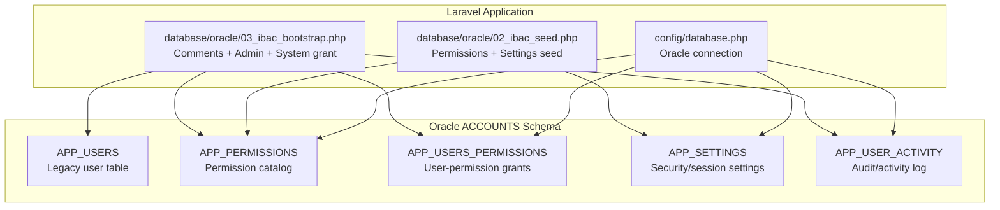
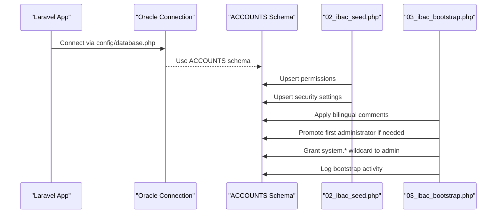
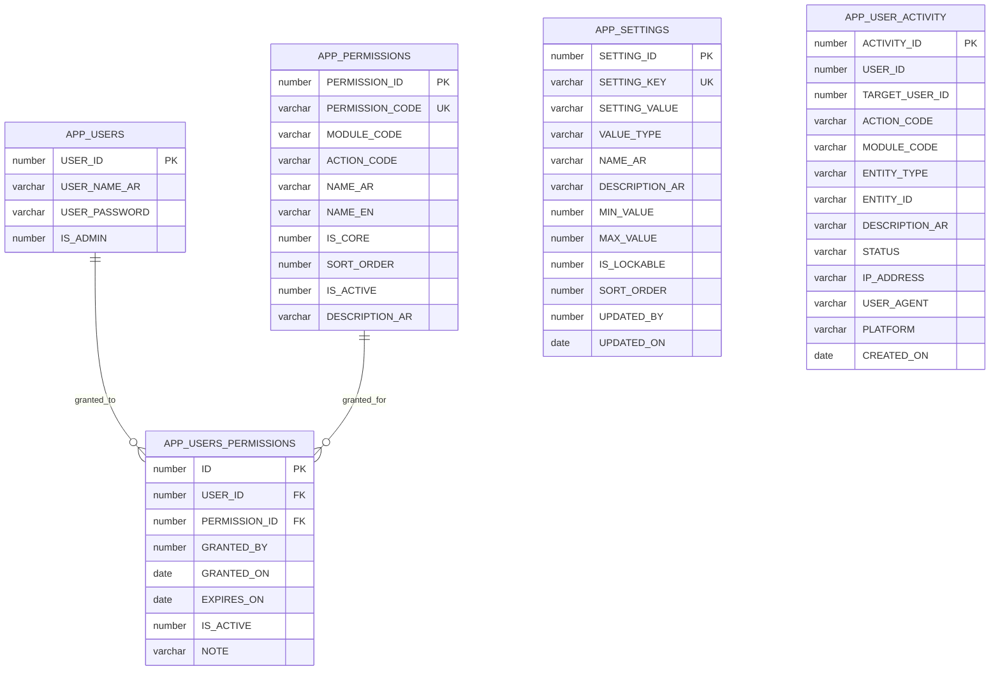
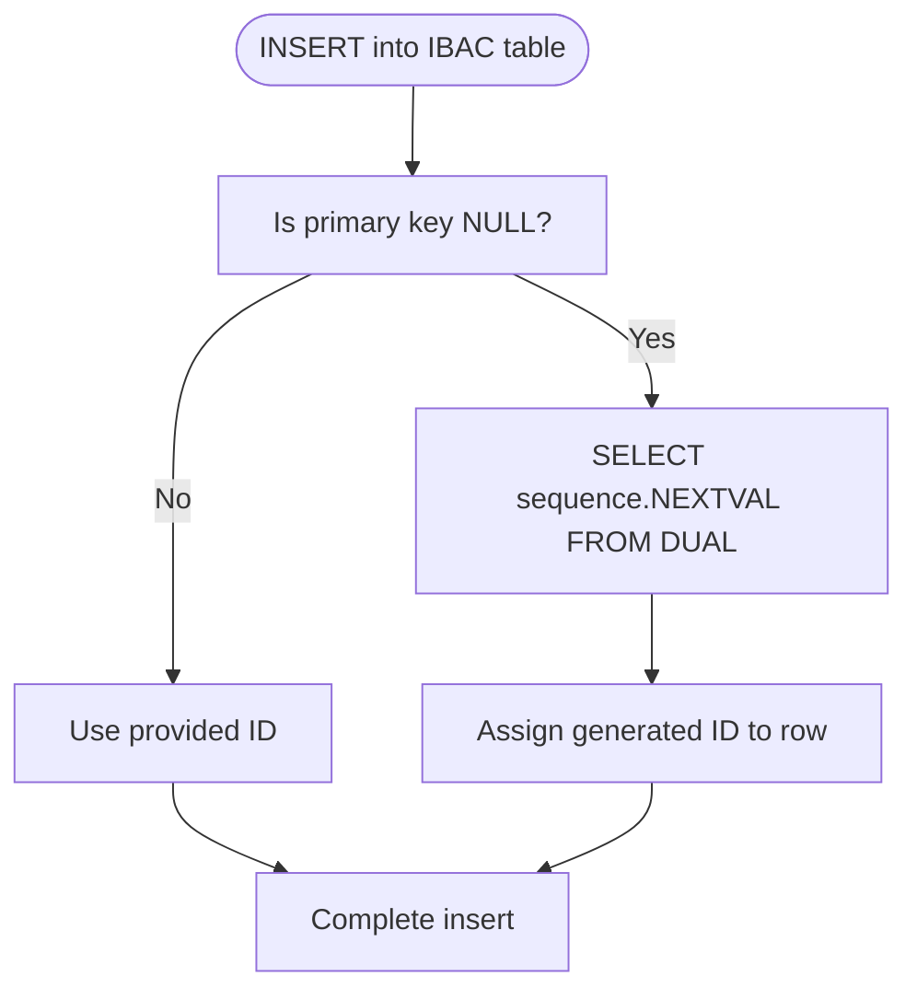
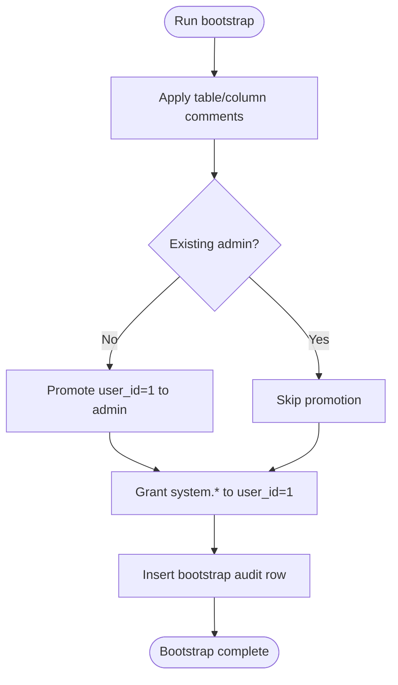
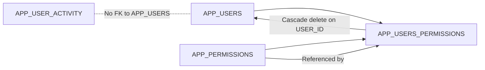

# Data Relationships & Constraints

<cite>
**Referenced Files in This Document**
- [01_ibac_schema.sql](file://kyApp_API/database/oracle/01_ibac_schema.sql)
- [02_ibac_seed.php](file://kyApp_API/database/oracle/02_ibac_seed.php)
- [03_ibac_bootstrap.php](file://kyApp_API/database/oracle/03_ibac_bootstrap.php)
- [04_ibac_rollback.sql](file://kyApp_API/database/oracle/04_ibac_rollback.sql)
- [database.php](file://kyApp_API/config/database.php)
- [DBdevloping_history.md](file://DBdevloping_history.md)
- [db_commends.md](file://db_commends.md)
</cite>

## Table of Contents
1. [Introduction](#introduction)
2. [Project Structure](#project-structure)
3. [Core Components](#core-components)
4. [Architecture Overview](#architecture-overview)
5. [Detailed Component Analysis](#detailed-component-analysis)
6. [Dependency Analysis](#dependency-analysis)
7. [Performance Considerations](#performance-considerations)
8. [Troubleshooting Guide](#troubleshooting-guide)
9. [Conclusion](#conclusion)
10. [Appendices](#appendices)

## Introduction
This document explains the data relationships, foreign key constraints, referential integrity policies, constraint validation rules, indexing strategy, and trigger-based ID generation for the IBAC (In-Business Access Control) Oracle schema used by the application. It focuses on the `ACCOUNTS` schema objects created by the Oracle SQL script and PHP bootstrap scripts, while also documenting how Laravel’s Oracle connection is configured.

The design intentionally keeps business tables untouched and adds a small permission, settings, and audit subsystem around an existing legacy user table. Referential integrity is enforced where safe, but deliberately relaxed for audit logs so that failed logins and historical records remain intact even when users are deleted.

## Project Structure
The database-related implementation lives under the Oracle-specific database directory and the Laravel configuration file:

- `kyApp_API/database/oracle/01_ibac_schema.sql`: Core schema, sequences, triggers, indexes, and constraints.
- `kyApp_API/database/oracle/02_ibac_seed.php`: Idempotent seed for permissions and security settings.
- `kyApp_API/database/oracle/03_ibac_bootstrap.php`: Bilingual metadata comments, initial admin promotion, system wildcard grant, and bootstrap audit logging.
- `kyApp_API/database/oracle/04_ibac_rollback.sql`: Safe rollback script that drops only IBAC objects and preserves business data.
- `kyApp_API/config/database.php`: Laravel Oracle connection definition with schema prefix and character set.

**Diagram sources**
- [database.php:116-127](file://kyApp_API/config/database.php#L116-L127)
- [01_ibac_schema.sql:38-184](file://kyApp_API/database/oracle/01_ibac_schema.sql#L38-L184)
- [02_ibac_seed.php:36-279](file://kyApp_API/database/oracle/02_ibac_seed.php#L36-L279)
- [03_ibac_bootstrap.php:109-217](file://kyApp_API/database/oracle/03_ibac_bootstrap.php#L109-L217)

**Section sources**
- [01_ibac_schema.sql:1-207](file://kyApp_API/database/oracle/01_ibac_schema.sql#L1-L207)
- [02_ibac_seed.php:1-310](file://kyApp_API/database/oracle/02_ibac_seed.php#L1-L310)
- [03_ibac_bootstrap.php:1-227](file://kyApp_API/database/oracle/03_ibac_bootstrap.php#L1-L227)
- [04_ibac_rollback.sql:1-42](file://kyApp_API/database/oracle/04_ibac_rollback.sql#L1-L42)
- [database.php:116-127](file://kyApp_API/config/database.php#L116-L127)

## Core Components
The IBAC data model consists of five main components:

| Component | Purpose | Primary Key | Important Constraints | Foreign Keys | Indexes | Trigger |
|---|---|---|---|---|---|---|
| `APP_USERS` | Legacy user table extended for IBAC | Existing `USER_ID` | Added `IS_ADMIN`, widened password column | None defined here | Not modified by IBAC schema | No trigger; sequence exists but is not auto-assigned |
| `APP_PERMISSIONS` | Permission catalog (`module.action`) | `PERMISSION_ID` | Unique `PERMISSION_CODE`; boolean checks | None | Composite index on `(MODULE_CODE, SORT_ORDER)` | `TRG_APP_PERMISSIONS` generates ID from `SEQ_APP_PERMISSIONS` |
| `APP_USERS_PERMISSIONS` | Direct user-to-permission grants | `ID` | Unique `(USER_ID, PERMISSION_ID)`; boolean check | `USER_ID → APP_USERS.USER_ID` with cascade delete; `PERMISSION_ID → APP_PERMISSIONS.PERMISSION_ID` | Composite index on `(USER_ID, IS_ACTIVE)`; index on `PERMISSION_ID` | `TRG_APP_USERS_PERM` generates ID from `SEQ_APP_USERS_PERM` |
| `APP_SETTINGS` | Security and session settings | `SETTING_ID` | Unique `SETTING_KEY`; `VALUE_TYPE` restricted to allowed types | None | Not explicitly indexed | `TRG_APP_SETTINGS` generates ID from `SEQ_APP_SETTINGS` |
| `APP_USER_ACTIVITY` | Audit trail for actions | `ACTIVITY_ID` | `STATUS` restricted to success/failed | None; `USER_ID` intentionally nullable | Composite indexes on `(USER_ID, CREATED_ON)`, `(TARGET_USER_ID, CREATED_ON)`, `(MODULE_CODE, CREATED_ON)` | `TRG_APP_ACTIVITY` generates ID from `SEQ_APP_ACTIVITY` |

Key design decisions:

- The legacy `APP_USERS` table is extended rather than replaced. A new sequence exists, but no trigger writes to it because the ERP or legacy system may still write directly to this table.
- Direct user-to-permission grants are modeled without roles. This simplifies authorization logic and matches the IBAC approach.
- Audit activity does not enforce a foreign key to `APP_USERS`. This allows recording failed login attempts with unknown usernames and prevents deletion of a user from erasing their audit history.
- Cascade delete is applied only to user-grant rows when a user is removed, keeping the permission catalog stable.

**Section sources**
- [01_ibac_schema.sql:21-33](file://kyApp_API/database/oracle/01_ibac_schema.sql#L21-L33)
- [01_ibac_schema.sql:38-100](file://kyApp_API/database/oracle/01_ibac_schema.sql#L38-L100)
- [01_ibac_schema.sql:118-184](file://kyApp_API/database/oracle/01_ibac_schema.sql#L118-L184)
- [01_ibac_schema.sql:186-189](file://kyApp_API/database/oracle/01_ibac_schema.sql#L186-L189)

## Architecture Overview
At runtime, the Laravel application connects to Oracle using the `oracle` connection. The schema is created and maintained by the Oracle SQL script, while seeding and bootstrap logic run through PHP scripts.

**Diagram sources**
- [database.php:116-127](file://kyApp_API/config/database.php#L116-L127)
- [02_ibac_seed.php:30-291](file://kyApp_API/database/oracle/02_ibac_seed.php#L30-L291)
- [03_ibac_bootstrap.php:20-217](file://kyApp_API/database/oracle/03_ibac_bootstrap.php#L20-L217)

## Detailed Component Analysis

### Referential Integrity Policies
The referential integrity policy balances strictness with operational safety:

- `APP_USERS_PERMISSIONS.USER_ID` references `APP_USERS.USER_ID` with `ON DELETE CASCADE`. Removing a user removes their direct grants.
- `APP_USERS_PERMISSIONS.PERMISSION_ID` references `APP_PERMISSIONS.PERMISSION_ID` without cascade delete. Deleting a permission is not allowed unless the application handles dependent grants first.
- `APP_USER_ACTIVITY` has no foreign key to `APP_USERS`. This supports:
  - Recording failed login attempts with `USER_ID = NULL`.
  - Preserving audit history after user deletion.
- `APP_PERMISSIONS`, `APP_SETTINGS`, and `APP_USERS` have no outgoing foreign keys in this schema.

**Diagram sources**
- [01_ibac_schema.sql:38-100](file://kyApp_API/database/oracle/01_ibac_schema.sql#L38-L100)
- [01_ibac_schema.sql:118-184](file://kyApp_API/database/oracle/01_ibac_schema.sql#L118-L184)

**Section sources**
- [01_ibac_schema.sql:81-100](file://kyApp_API/database/oracle/01_ibac_schema.sql#L81-L100)
- [01_ibac_schema.sql:186-189](file://kyApp_API/database/oracle/01_ibac_schema.sql#L186-L189)

### Constraint Validation Rules
Constraint validation is implemented through primary keys, unique constraints, and check constraints:

| Table | Constraint Type | Rule | Rationale |
|---|---|---|---|
| `APP_PERMISSIONS` | Primary Key | `PERMISSION_ID` | Stable internal identifier generated by sequence and trigger. |
| `APP_PERMISSIONS` | Unique | `PERMISSION_CODE` | Ensures one canonical code per permission pattern. |
| `APP_PERMISSIONS` | Check | `IS_CORE IN (0, 1)` | Enforces boolean-like flag at the database level. |
| `APP_PERMISSIONS` | Check | `IS_ACTIVE IN (0, 1)` | Prevents invalid active flags. |
| `APP_USERS_PERMISSIONS` | Primary Key | `ID` | Stable grant identifier. |
| `APP_USERS_PERMISSIONS` | Unique | `(USER_ID, PERMISSION_ID)` | Prevents duplicate grants for the same user and permission. |
| `APP_USERS_PERMISSIONS` | Check | `IS_ACTIVE IN (0, 1)` | Enforces boolean-like grant status. |
| `APP_SETTINGS` | Primary Key | `SETTING_ID` | Stable setting identifier. |
| `APP_SETTINGS` | Unique | `SETTING_KEY` | One row per configuration key. |
| `APP_SETTINGS` | Check | `VALUE_TYPE IN ('int', 'bool', 'string', 'json')` | Restricts value type to supported categories. |
| `APP_USER_ACTIVITY` | Primary Key | `ACTIVITY_ID` | Stable audit identifier. |
| `APP_USER_ACTIVITY` | Check | `STATUS IN ('success', 'failed')` | Keeps audit status consistent. |

These constraints provide strong data integrity for core IBAC entities while allowing flexibility for audit logs.

**Section sources**
- [01_ibac_schema.sql:38-57](file://kyApp_API/database/oracle/01_ibac_schema.sql#L38-L57)
- [01_ibac_schema.sql:81-97](file://kyApp_API/database/oracle/01_ibac_schema.sql#L81-L97)
- [01_ibac_schema.sql:118-134](file://kyApp_API/database/oracle/01_ibac_schema.sql#L118-L134)
- [01_ibac_schema.sql:152-168](file://kyApp_API/database/oracle/01_ibac_schema.sql#L152-L168)

### Indexing Strategy
The indexing strategy targets common query patterns:

| Index | Columns | Purpose |
|---|---|---|
| `APP_PERM_MOD_IX` | `MODULE_CODE, SORT_ORDER` | Efficient listing of permissions grouped by module and ordered. |
| `APP_UQ_USER_IX` | `USER_ID, IS_ACTIVE` | Fast lookup of active grants for a user. |
| `APP_UQ_PERM_IX` | `PERMISSION_ID` | Fast reverse lookup of which users hold a permission. |
| `APP_ACT_USER_IX` | `USER_ID, CREATED_ON` | User-scoped activity queries sorted by time. |
| `APP_ACT_TGT_IX` | `TARGET_USER_ID, CREATED_ON` | Activity targeting another user, sorted by time. |
| `APP_ACT_MOD_IX` | `MODULE_CODE, CREATED_ON` | Module-scoped activity queries sorted by time. |

Notes:

- The unique constraint on `(USER_ID, PERMISSION_ID)` implicitly creates an index, but an additional composite index on `(USER_ID, IS_ACTIVE)` is useful for filtering active grants.
- Audit indexes use composite columns to support typical reporting queries that filter by entity and sort by creation time.
- No explicit index is defined for `APP_SETTINGS.SETTING_KEY` beyond its unique constraint; lookups by key are expected to be infrequent and fast enough due to uniqueness.

**Section sources**
- [01_ibac_schema.sql:59-60](file://kyApp_API/database/oracle/01_ibac_schema.sql#L59-L60)
- [01_ibac_schema.sql:99-100](file://kyApp_API/database/oracle/01_ibac_schema.sql#L99-L100)
- [01_ibac_schema.sql:170-172](file://kyApp_API/database/oracle/01_ibac_schema.sql#L170-L172)

### Trigger Implementations for Automatic ID Generation
Each table except `APP_USERS` uses a `BEFORE INSERT` trigger to generate its primary key from a sequence when the insert does not supply an ID:

- `TRG_APP_PERMISSIONS` uses `SEQ_APP_PERMISSIONS`.
- `TRG_APP_USERS_PERM` uses `SEQ_APP_USERS_PERM`.
- `TRG_APP_SETTINGS` uses `SEQ_APP_SETTINGS`.
- `TRG_APP_ACTIVITY` uses `SEQ_APP_ACTIVITY`.

A known Oracle PL/SQL issue required unqualified sequence names inside triggers because the schema contains a view named `ACCOUNTS`. Qualifying the sequence name caused resolution as a view column and failed with a PL/SQL error. The final trigger definitions avoid the schema prefix for sequence names.

**Diagram sources**
- [01_ibac_schema.sql:68-74](file://kyApp_API/database/oracle/01_ibac_schema.sql#L68-L74)
- [01_ibac_schema.sql:105-111](file://kyApp_API/database/oracle/01_ibac_schema.sql#L105-L111)
- [01_ibac_schema.sql:139-145](file://kyApp_API/database/oracle/01_ibac_schema.sql#L139-L145)
- [01_ibac_schema.sql:177-183](file://kyApp_API/database/oracle/01_ibac_schema.sql#L177-L183)
- [db_commends.md:233-290](file://db_commends.md#L233-L290)

**Section sources**
- [01_ibac_schema.sql:61-74](file://kyApp_API/database/oracle/01_ibac_schema.sql#L61-L74)
- [01_ibac_schema.sql:102-111](file://kyApp_API/database/oracle/01_ibac_schema.sql#L102-L111)
- [01_ibac_schema.sql:136-145](file://kyApp_API/database/oracle/01_ibac_schema.sql#L136-L145)
- [01_ibac_schema.sql:174-183](file://kyApp_API/database/oracle/01_ibac_schema.sql#L174-L183)
- [db_commends.md:233-290](file://db_commends.md#L233-L290)

### Data Consistency Checks and Bootstrap Logic
The bootstrap process ensures the system starts in a usable state:

1. Apply bilingual table and column comments.
2. Promote the first administrator if none exists.
3. Grant the system wildcard permission to the administrator if missing.
4. Record a bootstrap audit event, swallowing failures so audit logging does not block initialization.

**Diagram sources**
- [03_ibac_bootstrap.php:109-119](file://kyApp_API/database/oracle/03_ibac_bootstrap.php#L109-L119)
- [03_ibac_bootstrap.php:135-149](file://kyApp_API/database/oracle/03_ibac_bootstrap.php#L135-L149)
- [03_ibac_bootstrap.php:155-185](file://kyApp_API/database/oracle/03_ibac_bootstrap.php#L155-L185)
- [03_ibac_bootstrap.php:191-217](file://kyApp_API/database/oracle/03_ibac_bootstrap.php#L191-L217)

**Section sources**
- [03_ibac_bootstrap.php:109-217](file://kyApp_API/database/oracle/03_ibac_bootstrap.php#L109-L217)

### Examples of Complex Joins, Consistency Checks, and Constraint Violations

#### Example Query Patterns
Although specific SQL is not reproduced here, the following query patterns are implied by the schema and indexes:

- Active permissions for a user: join `APP_USERS_PERMISSIONS` with `APP_PERMISSIONS`, filter by `USER_ID` and `IS_ACTIVE = 1`, order by `MODULE_CODE` and `SORT_ORDER`.
- Users holding a permission: join `APP_USERS_PERMISSIONS` with `APP_USERS`, filter by `PERMISSION_ID` and `IS_ACTIVE = 1`.
- Recent activity for a user or target user: query `APP_USER_ACTIVITY` using the composite indexes on `(USER_ID, CREATED_ON)` or `(TARGET_USER_ID, CREATED_ON)`.
- Security settings by key: query `APP_SETTINGS` by `SETTING_KEY`, relying on the unique constraint.

#### Data Consistency Checks
Recommended consistency checks include:

- Verify every `PERMISSION_ID` in `APP_USERS_PERMISSIONS` exists in `APP_PERMISSIONS`.
- Verify every `GRANTED_BY` in `APP_USERS_PERMISSIONS` corresponds to a valid user when present.
- Ensure `IS_ADMIN` users can bypass normal grant checks at the application layer.
- Validate that `VALUE_TYPE` values in `APP_SETTINGS` match the stored value format.

#### Constraint Violation Scenarios
Common violations and their meanings:

- Duplicate grant: inserting the same `(USER_ID, PERMISSION_ID)` pair violates the unique constraint on `APP_USERS_PERMISSIONS`.
- Invalid permission code: inserting a duplicate `PERMISSION_CODE` violates the unique constraint on `APP_PERMISSIONS`.
- Invalid setting type: inserting a `VALUE_TYPE` outside the allowed set violates the check constraint on `APP_SETTINGS`.
- Invalid activity status: inserting a `STATUS` other than `success` or `failed` violates the check constraint on `APP_USER_ACTIVITY`.
- Orphaned grant: inserting a `USER_ID` that does not exist in `APP_USERS` violates the foreign key constraint on `APP_USERS_PERMISSIONS`.
- Deleting a permission with active grants: deleting a referenced `PERMISSION_ID` without removing dependent grants violates the foreign key constraint.

**Section sources**
- [01_ibac_schema.sql:81-100](file://kyApp_API/database/oracle/01_ibac_schema.sql#L81-L100)
- [01_ibac_schema.sql:118-134](file://kyApp_API/database/oracle/01_ibac_schema.sql#L118-L134)
- [01_ibac_schema.sql:152-168](file://kyApp_API/database/oracle/01_ibac_schema.sql#L152-L168)

## Dependency Analysis
The IBAC schema has clear dependency directions:

- `APP_USERS_PERMISSIONS` depends on both `APP_USERS` and `APP_PERMISSIONS`.
- `APP_PERMISSIONS` and `APP_SETTINGS` are leaf reference tables.
- `APP_USER_ACTIVITY` is independent and intentionally decoupled from `APP_USERS`.
- Rollback operations drop objects in reverse dependency order: activity, settings, grants, permissions, then sequences.

**Diagram sources**
- [01_ibac_schema.sql:81-97](file://kyApp_API/database/oracle/01_ibac_schema.sql#L81-L97)
- [01_ibac_schema.sql:186-189](file://kyApp_API/database/oracle/01_ibac_schema.sql#L186-L189)
- [04_ibac_rollback.sql:13-31](file://kyApp_API/database/oracle/04_ibac_rollback.sql#L13-L31)

**Section sources**
- [01_ibac_schema.sql:81-100](file://kyApp_API/database/oracle/01_ibac_schema.sql#L81-L100)
- [01_ibac_schema.sql:186-189](file://kyApp_API/database/oracle/01_ibac_schema.sql#L186-L189)
- [04_ibac_rollback.sql:13-31](file://kyApp_API/database/oracle/04_ibac_rollback.sql#L13-L31)

## Performance Considerations
Performance guidance based on the current schema:

- Prefer queries that use the defined composite indexes:
  - Filter by `MODULE_CODE` and sort by `SORT_ORDER` for permission listings.
  - Filter by `USER_ID` and `IS_ACTIVE` for grant lookups.
  - Filter by `USER_ID`, `TARGET_USER_ID`, or `MODULE_CODE` combined with `CREATED_ON` for audit reports.
- Avoid scanning `APP_USER_ACTIVITY` without time-bounded filters; the table is append-only and can grow large.
- Keep grant queries selective by combining `USER_ID` and `IS_ACTIVE`.
- Do not add redundant single-column indexes where a composite index already serves the leading column pattern.
- Monitor sequence usage and cache behavior. The sequences are defined without cache, which reduces memory usage but increases sequence calls; this is acceptable for low-volume administrative tables but should be reviewed if write volume grows significantly.
- For complex joins between `APP_USERS_PERMISSIONS` and `APP_PERMISSIONS`, ensure the optimizer can use the indexes on `PERMISSION_ID` and the composite grant index.

[No sources needed since this section provides general guidance]

## Troubleshooting Guide

### Common Issues and Resolutions

| Issue | Cause | Resolution |
|---|---|---|
| Trigger compilation fails with PL/SQL sequence resolution error | Sequence name qualified with schema conflicts with a view named `ACCOUNTS` | Use unqualified sequence names inside triggers, as implemented in the final trigger definitions. |
| Arabic text appears corrupted | Client charset mismatch between AL32UTF8 and WE8MSWIN1252 | Write Arabic values through the encoding helper that maps CP1256 bytes safely; read-side fixes repair mojibake. |
| Failed login cannot be recorded | Audit table intentionally has no FK on `USER_ID` | This is by design; record `USER_ID = NULL` for unknown usernames. |
| Deleting a user deletes audit history unexpectedly | No FK on `USER_ID` in audit table | This is intentional; audit history persists independently. |
| Cannot delete a permission with active grants | Foreign key constraint on `PERMISSION_ID` | Remove or deactivate dependent grants before deleting the permission. |
| Duplicate grant error | Unique constraint on `(USER_ID, PERMISSION_ID)` | Deactivate or remove the existing grant before reinserting. |
| Setting update overwrites operator-edited values | Seed script updates metadata fields but preserves stored values | Use the seed script for metadata changes; do not rely on it to overwrite runtime values. |

**Section sources**
- [db_commends.md:233-290](file://db_commends.md#L233-L290)
- [DBdevloping_history.md:390-409](file://DBdevloping_history.md#L390-L409)
- [01_ibac_schema.sql:186-189](file://kyApp_API/database/oracle/01_ibac_schema.sql#L186-L189)
- [02_ibac_seed.php:229-255](file://kyApp_API/database/oracle/02_ibac_seed.php#L229-L255)

## Conclusion
The IBAC schema implements a focused authorization and auditing layer over an existing user table. It enforces referential integrity where it matters most—user grants and permission catalogs—while preserving audit independence. Triggers provide automatic ID generation, and constraints enforce boolean-like flags, unique codes, and supported setting types. The indexing strategy supports common permission and audit queries. Operational safety is prioritized: cascade delete applies to user grants, but audit logs survive user deletion, and bootstrap failures in audit logging do not block initialization.

For future evolution, consider:

- Adding application-level validation for grant expiration dates.
- Reviewing sequence caching if write volume increases.
- Adding partitioning or archival strategies for `APP_USER_ACTIVITY`.
- Extending foreign key constraints only where they improve correctness without breaking audit requirements.
- Validating query plans for high-volume permission and audit queries.

[No sources needed since this section summarizes without analyzing specific files]

## Appendices

### Oracle Connection Configuration
The Laravel Oracle connection defines host, port, service name, username, password, charset, and schema prefix. This connection is used by the seed and bootstrap scripts to interact with the `ACCOUNTS` schema.

**Section sources**
- [database.php:116-127](file://kyApp_API/config/database.php#L116-L127)

### Rollback Safety
The rollback script drops IBAC objects in reverse dependency order and leaves business data untouched. It includes optional steps to restore the legacy `APP_USERS` columns if explicitly requested.

**Section sources**
- [04_ibac_rollback.sql:1-42](file://kyApp_API/database/oracle/04_ibac_rollback.sql#L1-L42)